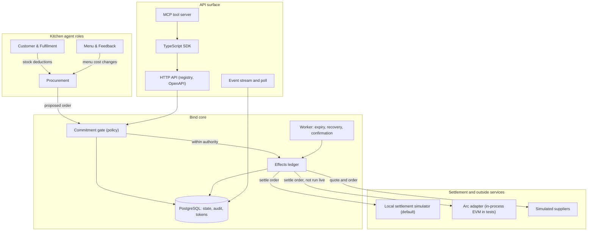

# Bind

**Bind coordinates AI agents around the way a business actually works, with clear limits and a record of every important action.**

Status: a local, API-first vertical slice (commercial kitchen). It runs on PostgreSQL. Its outside connections are simulated, and no live
supplier, messaging, accounting, model or chain connection is verified. Read the [Status](#status) section before relying on anything here.

- Hosted deployment: an earlier session reported `https://bind-gilt.vercel.app`. Task 14 could not check it (no network). Treat it as unverified.
- Branch: `claude/capabilities-overview-c6elxr`. Evidence is for commit `407533a` (see [`docs/RELEASE_EVIDENCE.md`](docs/RELEASE_EVIDENCE.md)).

---

## The problem

An AI agent with a wallet is not an operational business system. Handing a model a token balance and a tool list does not make it safe to run purchasing, promises, or payments. The model can be talked into spending. The ledger cannot catch what was never recorded. Nothing checks that a digital decision turned into a physical delivery.

Double-entry bookkeeping only verifies that debits equal credits. It is blind to an unrecorded transaction, the right amount paid to the wrong vendor, an invoice paid twice after a timeout retry, and two separate errors that cancel out. In every one of those cases the books balance and the mistake survives.

So safety cannot come from the model or from the ledger alone.

## The idea

Bind is a deployment and governance layer. A business sets its operating preferences and authority, and gets role-specific agents. The owner keeps the decisions that matter. Bind holds three things together:

1. **Context**: the business's stock, SKUs, suppliers, preferences, and roles (templates and `AGENTS.md`).
2. **Authority**: what an agent may do, spend, or approve, enforced in code outside the model. A daily limit and a vendor allowlist are also written into the settlement contract, but that contract is tested only in-process (see [Arc](#how-bind-uses-arc)).
3. **Fulfilment**: what happened in the physical world, tracked separately from payment.

## What Bind does (checked locally)

- **Governed agent roles.** Procurement, customer and fulfilment, and menu and feedback roles, each with its own grants. Their tools are checked by the server, not by the prompt.
- **One commitment gate.** Every commercial commitment is decided by one function (`src/policy/commitment-gate.ts`) and checked again when the owner approves.
- **Durable effects.** External calls (quote, order, transfer, notice) go through an effects ledger (`src/effects/ledger.ts`) that runs each call at most once per key. An unknown outcome is kept as "in doubt" and is not resent.
- **Crash-recoverable workflows.** State is in PostgreSQL. A background worker (`src/workers/runner.ts`) resumes interrupted work, expires approvals, and confirms settlements.
- **Tenancy and tokens.** Per-workspace owner and staff bearer tokens, stored as hashes. Cross-tenant access is refused on the server.
- **Signed webhooks and a pause switch.** Bind's own webhooks are HMAC-signed over the raw body with a replay window. A paused workspace sends no payment and starts no restock.
- **Credentials.** Connector secrets are encrypted at rest with one environment key and are never returned to a caller. No credential is shown as verified, because no live verifier exists.
- **Customer orders and feedback.** A customer order is promised only when reserved stock and kitchen capacity cover it. Feedback is counted; a menu change needs owner approval and an owner publish.
- **Operations.** Request ids, redacted structured logs, `/health`, `/ready`, `/metrics`, rate limits on failed authentication, graceful shutdown.
- **API first.** A route registry, a generated OpenAPI document, a replayable event stream (SSE with a poll fallback), a typed TypeScript SDK, and an MCP tool server, both local (stdio) and hosted at `POST /mcp` with a staff key (docs/decisions/0075). The MCP server has no approval, payment or credential tools.
- **Decision records.** Each template decision carries a canonical SHA-256 `decisionHash` and writes `STATE_ANCHOR.md` and `DECISION_EVIDENCE.md` (tests in `tests/unit/bindTemplateAgent.test.ts`).
- **Honest labels.** Simulated suppliers are labelled `SIMULATED_SUPPLIER_ADAPTER`. Market checks are `LIVE_WEB_BENCHMARK` only when a search key is set, and `OFFLINE_DETERMINISTIC_FALLBACK` otherwise.

The owner-facing UI in `src/ui/` is **orphaned** (ADR 0016): it is not maintained, not tested, and contains hard-coded text that the backend does not produce. The product surface is the API, the event stream, the SDK and MCP.

## The first vertical slice: a commercial kitchen

Three agent roles with three boundaries:

- **Procurement**: reads stock, computes depletion, requests quotes, proposes orders. Cannot commit funds above the workspace limit without owner authorization.
- **Customer and fulfilment**: takes orders, checks stock and kitchen capacity. Cannot promise availability or a time that the reserved stock and slots cannot support.
- **Menu and feedback**: counts feedback and proposes menu changes. Cannot publish a change without owner approval.

Workflows never collapse into an ambiguous `success`. The states are `draft → request_sent → quote_received → awaiting_approval → authorized → submitted → confirmed → reconciled`, with `failed` and `cancelled` as exits. A quote request is not an accepted offer. A submitted transfer is not a confirmed payment.

## How Bind uses Arc

Arc L1 (chain ID `5042002`) is the intended settlement rail. **The default settlement mode is the local simulator** (`SETTLEMENT_MODE`, and each workspace's `settlement_mode`, default `local`). No money moves in the default mode.

- The contract source is [`contracts/src/BindSettlement.sol`](contracts/src/BindSettlement.sol). It has a daily spend limit and a vendor allowlist.
- Its daily limit is a **fixed window** that resets at `lastDayReset + 1 day`. The NatSpec says "rolling", and the code is not. A refund after a window reset can also reduce the current window's spent amount. Both are recorded as known issues in [`docs/CONTRACT_SCOPE.md`](docs/CONTRACT_SCOPE.md) (section 7). Changing a deployed contract is a product decision, so neither is changed here.
- The Arc adapter (`src/adapters/settlement/arc-l1.ts`) reports only what the chain returns: `submitted`, `confirmed` or `failed`. It checks the chain ID before it sends. Its tests run against an **in-process EVM**, not Anvil and not Arc.
- **Live Arc checks have not been run.** The contract address, deployment and transaction hashes in earlier notes are earlier-session claims. They are listed, with their reproduction commands, in the appendix of [`docs/RELEASE_EVIDENCE.md`](docs/RELEASE_EVIDENCE.md). Nothing in this repository reads them back.
- Arc settlement, even when it confirms, is a payment. It is not proof of delivery. Delivery and the three-way match are tracked separately.

The RPC URL comes from `ARC_RPC_URL` (or `RPC_URL`). Treat the whole URL as a secret, because a provider URL often carries its access token in the path. The committed example uses the placeholder `<ARC_RPC_TOKEN>`.

## Evidence

Checked on commit `407533a` in this container, 2026-10-20 (UTC), with `.env.local` moved aside (a clean-checkout run):

| Check | Command | Result | Class |
| --- | --- | --- | --- |
| Lint | `npm run lint` | exit 0 | LOCAL_PASS |
| Typecheck | `npm run typecheck` | exit 0 | LOCAL_PASS |
| Unit | `npm run test:unit` | 48 files, 340 tests passed | LOCAL_PASS |
| Integration | `npm run test:integration` | 535 passed, 10 skipped (the Anvil suite); identical in two runs | LOCAL_PASS |
| Build | `npm run build`, `npm run sdk:build`, `npm run mcp:build` | exit 0 each | LOCAL_PASS |
| Dependency audit | `npm audit --audit-level=high` | 0 vulnerabilities (reads npm's advisory database) | LIVE_READ_PASS |
| API spec, SDK and map drift | `npm run api:spec`, `npm run sdk:generate`, `npm run map:functions`, each followed by `git diff --exit-code` | no drift | LOCAL_PASS |
| In-process contract suite | four `vitest` files, see [`docs/CONTRACT_SCOPE.md`](docs/CONTRACT_SCOPE.md) section 6 | 4 files, 32 tests passed | LOCAL_PASS |
| Browser E2E | `npm run test:e2e` | exits 1 with BLOCKED (UI orphaned) | BLOCKED |
| Forge fmt, build, tests, coverage | `forge ...` in `contracts/` | 24 of 24 passed (unit, fuzz, reentrancy, invariants). Contract line coverage 100%, branch coverage 72.73% | LOCAL_PASS |
| Anvil deployment and client suite | `tests/integration/anvil-settlement.test.ts` | 10 of 10 passed against a local Anvil (skipped unless `ANVIL_RPC_URL` is set) | LOCAL_PASS |
| Slither | `slither . --fail-medium` in `contracts/` | no medium or high findings; 9 low, informational or optimization findings | LOCAL_PASS |
| Live Arc reads and transactions | `scripts/verify-live-arc.ts` | not run (no token, no `cast`, no network) | NOT_RUN |
| CI | `.github/workflows/quality-gates.yml` | dispatched once; no job got a runner (section 6) | BLOCKED |
| Built server smoke run | `node dist/index.js`, then HTTP calls | health, readiness, OpenAPI, onboarding, two authenticated routes, clean SIGTERM | LOCAL_PASS (smoke) |

The full commands, counts, the skipped tests and the known risks are in [`docs/RELEASE_EVIDENCE.md`](docs/RELEASE_EVIDENCE.md). The claims from earlier sessions that this task did not reproduce are in its appendix.

## Quick start

```bash
npm ci                               # uses package-lock.json
cp .env.local.example .env.local     # set DATABASE_URL to a PostgreSQL 16 or 17 database
npm run db:migrate:dev               # applies the schema (idempotent)
npm run dev                          # tsx watch on src/index.ts, http://127.0.0.1:3000
```

Without `NODE_ENV=production`, the server starts with a local development database URL and a local password. Production refuses to start without `DATABASE_URL`. See [`docs/RUNBOOK.md`](docs/RUNBOOK.md) section 2 for every variable.

Run the gates (results above):

```bash
npm run lint
npm run typecheck
npm run test:unit                 # 347 tests on the final tree (340 on 407533a, before docs-honesty.test.ts)
npm run test:integration          # 535 pass, 10 skipped (Anvil)
npm run build
npm run test:e2e                  # BLOCKED: exits 1 while the UI is orphaned (ADR 0016)
cd contracts && forge test -vvv   # needs Foundry
bash scripts/verify-local.sh      # runs the gates above; exits 0 with Foundry, Anvil and Slither installed
```

## Architecture



Key source:

- `src/policy/` and `src/effects/`: the commitment gate and the effects ledger.
- `src/workflows/`: procurement, settlement, fulfilment (customer orders), feedback and menu, recovery, cancel.
- `src/workers/runner.ts`: the background worker.
- `src/accounting/`: three-way match and the journal.
- `src/adapters/settlement/`: the local simulator and the Arc adapter. `src/adapters/suppliers/` and `src/adapters/web2/`: simulated suppliers, the notification emitter, and the webhook receiver.
- `src/auth/`, `src/credentials/`, `src/security/`: tokens, tenancy, encrypted credentials, rate limits.
- `src/observability/`: logs, request ids, metrics.
- `src/api/`: the route registry, schemas, OpenAPI document and event stream. `src/server/app.ts` holds the routes.
- `sdk/`: the typed client. `mcp/`: the MCP server.
- `contracts/src/BindSettlement.sol`: the settlement contract (tests in `contracts/test/` and in `tests/integration/`).
- `api/`: the Vercel serverless entry. It runs no worker.
- `src/ui/`: orphaned (ADR 0016). Not maintained.

## Documentation

- [`docs/RELEASE_EVIDENCE.md`](docs/RELEASE_EVIDENCE.md): the commands, counts, classes, skipped tests, known risks, and the earlier-session claims that were not reproduced.
- [`docs/RUNBOOK.md`](docs/RUNBOOK.md): start, stop, migrate, variables, recovery, pause, tokens, webhook secrets, backups.
- [`docs/CONTRACT_SCOPE.md`](docs/CONTRACT_SCOPE.md): what is on-chain, what is tested where, and the known contract issues.
- [`docs/TESTING_AND_RELEASE_GATES.md`](docs/TESTING_AND_RELEASE_GATES.md): the gate definitions and the evidence classes.
- [`docs/ACCEPTANCE_TEST_MATRIX.md`](docs/ACCEPTANCE_TEST_MATRIX.md): each acceptance requirement mapped to its tests and class.
- [`docs/openapi.json`](docs/openapi.json): the generated API contract (`npm run api:spec`).
- [`docs/EVENTS.md`](docs/EVENTS.md): the workspace event stream, its cursors and its event types.
- [`sdk/README.md`](sdk/README.md) and [`mcp/README.md`](mcp/README.md): the client SDK and the MCP tool server.
- [`docs/BIND_MISSION_AND_ARCHITECTURE.md`](docs/BIND_MISSION_AND_ARCHITECTURE.md), [`docs/WEB2_INTEGRATIONS_AND_ORCHESTRATION.md`](docs/WEB2_INTEGRATIONS_AND_ORCHESTRATION.md): design documents. Most of their content is target design, marked as such.
- [`docs/decisions/README.md`](docs/decisions/README.md): the index of decision records (ADRs 0001 to 0040).

## Status

**Works, checked locally** (`LOCAL_PASS`, commit `407533a`): the gates in the table above, the built server's smoke run, and the behaviour the test files named in `docs/ACCEPTANCE_TEST_MATRIX.md` assert. These run against a local PostgreSQL and in-process components.

**Simulated** (labelled in the code and the API):

- Suppliers: all are in-memory simulators. Nothing is ordered from a real supplier.
- Owner notices: recorded with status `simulated` and never delivered. A waiting approval or order is visible only through the API and the needs-attention list (RUNBOOK section 7.1).
- Accounting: a local journal in PostgreSQL. No accounting service is connected.
- Settlement: the default is an in-memory local simulator. Its transfers are lost on restart.
- Model: no model key is set. The deterministic offline path runs. The LLM path is not run.
- Market benchmarks, the TypeSafe scorer and the Circle CLI: off unless their keys or flags are set, and none is set here.

**Not verified**:

- Any live Arc read or transaction (`NOT_RUN`). The earlier-session deployment, transaction and revert claims are unverified and listed in the appendix of `docs/RELEASE_EVIDENCE.md`.
- Forge, Anvil and Slither have run only locally, once, not in CI.
- The browser E2E (`BLOCKED`; the UI is orphaned). CI (BLOCKED: dispatched once, no runner). The hosted deployment.
- The Bind agent harness's own model path, a long-running or adversarial model session against the MCP server (a short local run is in `docs/RELEASE_EVIDENCE.md` section 4.1), and any live supplier, messaging, accounting or payment service.

**Action needed from the owner**:

1. Set `DATABASE_URL` for each environment. Do not use the local development default in production; production refuses to start without it.
2. Set the secrets, each at its minimum length: `BIND_MASTER_SECRET`, `BIND_WEBHOOK_SECRET`, `BIND_METRICS_TOKEN`, and `BIND_CREDENTIAL_KEY` (32 random bytes, base64). See [`docs/RUNBOOK.md`](docs/RUNBOOK.md) section 2.
3. Rotate the Arc RPC access token if one was ever used with this repository. Commit `0b69b2e` says a token was removed from the source, docs and example, but a search of every commit found only the placeholder, so the exposure is not confirmed here. Rotate anyway if the token was ever in use.
4. For any workspace created before owner tokens existed, issue one: `npm run token:issue -- <workspaceId> <label> owner` (RUNBOOK section 10.1).
5. Leave the restock sweep (`BIND_RESTOCK_SWEEP`) off unless you decide that the system may place orders within policy on its own (RUNBOOK section 6.2).
6. Supply the connectors and keys for anything live: supplier APIs, messaging, accounting, a model key, a search key, and the Arc signer and settlement address. Each needs its own review. Nothing live is enabled by default.
7. Decide on the on-chain daily-limit behaviour (a fixed window, and the refund case in [`docs/CONTRACT_SCOPE.md`](docs/CONTRACT_SCOPE.md) section 7) before any contract change or deployment. A deployed contract cannot be changed in place.

This project is a hackathon vertical slice. There is no mainnet deployment, no live-money transfer, and no real commercial commitment.

## Licence

MIT, see [`LICENSE`](LICENSE) and [`docs/decisions/0082-mit-licence.md`](docs/decisions/0082-mit-licence.md).
