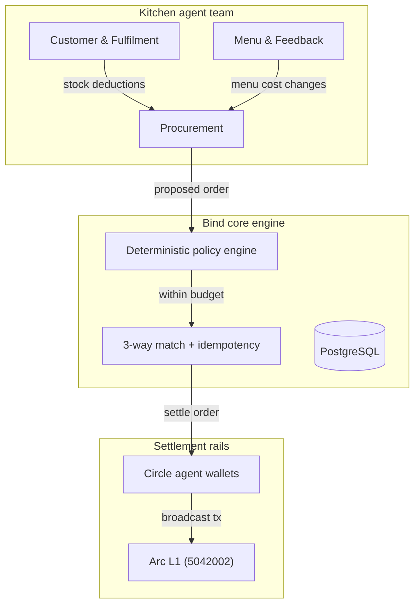

# Bind

**Bind coordinates AI agents around the way a business actually works, with clear limits and a record of every important action.**

Live: https://bind-gilt.vercel.app · Code: branch `feature/bind-kitchen-vertical-slice`

---

## The problem

An AI agent with a wallet is not an operational business system. Handing a model a token balance and a tool list does not make it safe to run purchasing, promises, or payments. The model can be talked into spending. The ledger cannot catch what was never recorded. Nothing checks that a digital decision turned into a physical delivery.

Double-entry bookkeeping only verifies that debits equal credits. It is blind to an unrecorded transaction, the right amount paid to the wrong vendor, an invoice paid twice after a timeout retry, and two separate errors that cancel out. In every one of those cases the books balance and the mistake survives.

So safety cannot come from the model or from the ledger alone.

## The solution

Bind is a deployment and governance layer. A business connects once, sets its operating preferences and authority, and receives a role-specific agent team that uses real tools and talks to real counterparties. The owner keeps the decisions that matter.

Bind holds three things together:

1. **Context** — the business's stock, SKUs, burn rates, suppliers, and preferences (`AGENTS.md`, templates, and roles).
2. **Authority** — what an agent may do, spend, or approve, enforced in code outside the model and mirrored on-chain.
3. **Fulfilment** — what actually happened in the physical world, tracked separately from payment and settlement.

## What Bind offers

- **A governed agent team.** Roles with explicit, non-overlapping permissions.
- **Deterministic policy outside the model.** Tenancy, spend limits, approval thresholds, counterparty allowlists, idempotency, and state transitions are enforced by code, never by a prompt.
- **Durable, crash-recoverable workflows.** State lives in PostgreSQL; a restarted worker resumes the workflow it was running.
- **Three-way match accounting.** No invoice settles without an approved purchase order and a verified fulfilment receipt.
- **Explicit effect classes.** Every tool call is `read`, `external_request`, or `commercial_commitment`. A quote request is not an accepted offer; a submitted transaction is not confirmed settlement.
- **Verifiable decision records.** Each evaluation produces a canonical SHA-256 `decisionHash` plus `STATE_ANCHOR.md` and `DECISION_EVIDENCE.md`.
- **Honest attribution.** Simulated supplier responses are labelled `SIMULATED_SUPPLIER_ADAPTER`; market checks are `LIVE_WEB_BENCHMARK` or `OFFLINE_DETERMINISTIC_FALLBACK`.
- **No crypto jargon for the owner.** Approvals arrive through WhatsApp one-tap buttons, email, Telegram, and POS webhooks.

## The first vertical slice: a commercial kitchen

Three agents with three boundaries:

- **Procurement** — reads stock, computes depletion, requests quotes, proposes orders. Cannot commit funds above the workspace limit without owner authorization.
- **Customer & Fulfilment** — ingests orders, checks stock and kitchen capacity. Cannot promise availability or delivery windows the schedule cannot substantiate.
- **Menu & Feedback** — reads reviews and waste, proposes recipe and cost changes. Cannot publish changes without authority.

Workflows never collapse into an ambiguous `success`. They move through explicit states:

```
draft → request_sent → quote_received → awaiting_approval
      → authorized → submitted → confirmed → reconciled
```

## How Bind uses Arc

Arc L1 is the settlement rail. Policy is enforced twice: off-chain in the deterministic engine, and on-chain in the contract. The owner's authority therefore survives even if application code is bypassed.

- Network: **Arc Testnet**, chain ID **5042002**
- Contract: [`BindSettlement.sol`](contracts/src/BindSettlement.sol) at `0x16E1Bd42F7C0FfD28D10919C87CaD22d05f2aA29`
- Explorer: https://testnet.arcscan.app/address/0x16E1Bd42F7C0FfD28D10919C87CaD22d05f2aA29

Enforced on-chain:

- **Rolling 24-hour USDC daily spend limit** (configured to 1.0 USDC), reverting with `DailyLimitExceeded` (`0xef664d6a`).
- **Vendor allowlist** (whitelisted supplier `0xa8358AED200D6CB6C856F972D853C1be833006ea`), reverting unapproved vendors with `VendorNotWhitelisted` (`0x65e822e9`).

Verified testnet transactions:

| Action | Transaction |
| --- | --- |
| Deploy `BindSettlement` | [`0xe152f9ce…5300e`](https://testnet.arcscan.app/tx/0xe152f9ced4c696548c42d629ea88917ca1b810de845407ac0b7c17698245300e) |
| `setDailyLimit(1 USDC)` | [`0x388196b8…d1ab`](https://testnet.arcscan.app/tx/0x388196b8c8fdf16cf600a1f059fa8fa0fde6a710424588eea6f54c0425b5d1ab) |
| `setEnforceVendorWhitelist(true)` | [`0x4c8f5b2c…7051`](https://testnet.arcscan.app/tx/0x4c8f5b2ca544c05a22caa639d4707cb8c81264ff38044d338d02f6bb7f2d7051) |
| `setVendorStatus(whitelisted, true)` | [`0x20f04822…ae2a`](https://testnet.arcscan.app/tx/0x20f04822e1ea1fe0a79953071207a64db3575bd90e15f0243dc1a4be3575ae2a) |
| `settleOrder(orderId, supplier, matchHash)` | [`0x626129a1…1bbb`](https://testnet.arcscan.app/tx/0x626129a1953e7fa8cea3c1d5f4904e246ec9eae5de1ecdb6fb91af581c711bbb) |

The Arc RPC endpoint is read from `ARC_RPC_URL` (or `RPC_URL`). No token is committed; the committed default is a non-secret placeholder.

Arc testnet settlement confirms a testnet payment. It does not stand in for physical delivery. Delivery and the three-way match are tracked separately, and a testnet transfer is never reported as delivered goods.

## Evidence

All 10 local gates pass with `bash scripts/verify-local.sh` → `PASS=10 FAIL_OR_BLOCKED=0`:

| Layer | Command | Result |
| --- | --- | --- |
| Lint | `npm run lint` | 0 errors, 0 warnings |
| Types | `npm run typecheck` | 0 type errors |
| Unit | `npm run test:unit` | 49 passed |
| Integration | `npm run test:integration` | 15 passed |
| Browser E2E | `npm run test:e2e` | 8 passed (Desktop + Mobile Chrome) |
| Production build | `npm run build` | clean compile to `dist/` |
| Contracts | `cd contracts && forge test -vvv` | 10 passed (unit/fuzz/invariant) |
| Contract coverage | `cd contracts && forge coverage` | 100% lines (68/68), 100% functions (11/11) |
| Dependency audit | `npm audit --audit-level=high` | 0 vulnerabilities |
| Arc testnet | `arc-canteen status` + live deploy and policy txs | `LIVE_READ_PASS` / `VERIFIED_REMOTE` |

Live deployment: https://bind-gilt.vercel.app on Neon PostgreSQL. `/health` reports `postgres: connected`; read APIs, the replenishment and approval flow, and owner/staff role separation were verified end to end.

Full commands, evidence classifications (`LOCAL_PASS`, `LIVE_READ_PASS`, `VERIFIED_REMOTE`, `NOT_RUN`, `BLOCKED`), and known risks are in [`docs/RELEASE_EVIDENCE.md`](docs/RELEASE_EVIDENCE.md).

Known gaps:

- The live LLM agent planning path inside the serverless function is `NOT_RUN`; the deterministic paths are live.
- Evidence `.md` artifacts are written to ephemeral `/tmp` on Vercel.
- Preview deployments are unverified.

## Quick start

```bash
npm install
cp .env.local.example .env.local     # point DATABASE_URL at PostgreSQL 16
npm run db:migrate:dev
npm run dev                          # http://127.0.0.1:3000
```

Run the gates:

```bash
npm run lint
npm run typecheck
npm run test:unit          # 49
npm run test:integration   # 15
npm run test:e2e           # 8 (Playwright)
npm run build
cd contracts && forge test -vvv   # 10 (unit/fuzz/invariant)
```

## Architecture



Key source:

- `src/policy/` — deterministic policy engine
- `src/workflows/` — durable workflows (procurement vertical slice)
- `src/accounting/` — three-way match
- `src/adapters/` — supplier and fulfilment adapters
- `src/agents/` — role agents and the anti-drift writer
- `src/server/`, `src/ui/` — Express API and SPA
- `contracts/src/BindSettlement.sol` — on-chain policy
- `api/` — Vercel serverless entry

## Documentation

- [`docs/BIND_MISSION_AND_ARCHITECTURE.md`](docs/BIND_MISSION_AND_ARCHITECTURE.md) — mission, laws, architecture
- [`docs/CONTRACT_SCOPE.md`](docs/CONTRACT_SCOPE.md) — what is on-chain and why
- [`docs/WEB2_INTEGRATIONS_AND_ORCHESTRATION.md`](docs/WEB2_INTEGRATIONS_AND_ORCHESTRATION.md) — WhatsApp, email, Telegram, POS
- [`docs/TESTING_AND_RELEASE_GATES.md`](docs/TESTING_AND_RELEASE_GATES.md) — the gate definitions
- [`docs/RELEASE_EVIDENCE.md`](docs/RELEASE_EVIDENCE.md) — commands, outcomes, risks
- [`docs/decisions/`](docs/decisions/) — decision records (ADRs)

## Status

Hackathon vertical slice for the Tameion Agents Hackathon (Canteen × Circle on Arc L1). Arc **testnet only**. No mainnet deployment, no live-money transfer, and no real commercial commitment.
