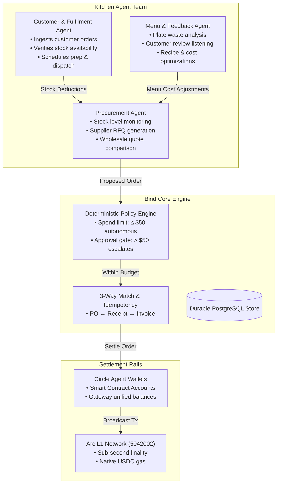

# Bind: Mission, Philosophy, and Core Architecture

## 1. Executive Summary

Bind is a deployment and connectivity layer for business agents. It enables any business—beginning with a commercial kitchen vertical—to connect once, configure operating preferences and authority boundaries, and receive a coordinated, role-specific agent team that can safely use real business tools, communicate with external services, and settle value.

The ultimate product outcome is to make a business agent-capable without requiring the owner to assemble agent infrastructure, manage cryptographic keychains, prompt-engineer safety guards, or debug ledger reconciliation errors.

---

## 2. Core Philosophy & Theoretical Foundation

Bind's architecture is rooted in the empirical findings of Canteen’s research paper, ***Agents and Ledgers in 2026***:

### The Failure of Double-Entry Checks for Autonomous Agents
Double-entry bookkeeping verifies only that debits equal credits ($\sum \text{Debits} = \sum \text{Credits}$). It is mathematically blind to:
* **Errors of Omission**: An unrecorded transaction.
* **Errors of Commission**: The right amount booked to the wrong party (e.g. paying an imposter vendor).
* **Errors of Principle**: An operational expense booked as an asset.
* **Errors of Original Entry**: An invoice paid twice after a network timeout retry.
* **Compensating Errors**: Two distinct errors that accidentally cancel out.
* **Reversals**: Transposing debits and credits.

In all six cases, double-entry checks pass completely. Therefore, safety cannot come from the ledger alone; it must come from **deterministic controls operating outside the model**.

### Bind's Foundational Laws:
1. **Model Reasoning $\ne$ Authority**: An LLM is strictly an input and proposal generator. It can parse documents, evaluate quotes, and propose purchase orders, but **code outside the model** deterministically enforces tenancy, spending limits, approval thresholds, idempotency, and state transitions. Natural language can never grant authority.
2. **No Entry Without a Document (3-Way Matching)**: No bill or invoice is ever settled without programmatic verification against an approved Purchase Order and a verified Fulfillment/Delivery Receipt.
3. **No Silent Rounding / Repair**: Discrepancies between quotes, invoices, and settlement amounts are never quietly absorbed into general expense/rounding accounts; they are refused or loudly escalated.
4. **Idempotent Effect Execution**: Every external mutation (quote request, purchase order, funds transfer) is anchored by a deterministic idempotency key to prevent double-commitments during network failures or worker crashes.

---

## 3. The First Vertical Slice: The Commercial Kitchen

The first complete implementation of Bind provisions a coordinated three-role agent team for commercial kitchens:

### Agent Roles & Boundaries:
1. **Procurement Agent**: Reads stock, calculates depletion rates, finds eligible suppliers via configured adapters, requests quotes, and proposes orders. It cannot commit funds above the configured workspace limit without owner authorization.
2. **Customer & Fulfilment Agent**: Ingests customer orders, tracks fulfillment milestones, and manages kitchen capacity. It is strictly prohibited from promising availability or delivery windows that the inventory and prep schedule cannot substantiate.
3. **Menu & Feedback Agent**: Listens to customer feedback across social and review platforms (Twitter/X, Google Reviews), tracks food waste, and proposes recipe/menu pricing adjustments. It cannot publish menu or price changes without explicit authority.

---

## 4. Effect Classes & State Machine

### Effect Classification
Every tool and API call executed by an agent is explicitly checked against three immutable effect classes:
* `read`: Inspects information without changing external state (e.g. `get_inventory_levels`, `get_balance`).
* `external_request`: Solicits information or consideration from an external party without binding commitments (e.g. `send_supplier_rfq`, `check_delivery_window`).
* `commercial_commitment`: Binds the business legally or financially (e.g. `submit_order`, `transfer_usdc`, `sign_contract`).

### Operational State Transitions:
Workflows are never collapsed into an ambiguous `success` state. They transition through explicit, auditable milestones:
$$\text{draft} \longrightarrow \text{request\_sent} \longrightarrow \text{quote\_received} \longrightarrow \text{awaiting\_approval} \longrightarrow \text{authorized} \longrightarrow \text{submitted} \longrightarrow \text{confirmed} \longrightarrow \text{reconciled}$$

---

## 5. Settlement & Custody: Arc L1 and Circle

* **Arc L1**: Provides stablecoin-native sub-second settlement ($<500\text{ms}$) with predictable, low-cost gas ($\sim\$0.01$) paid directly in native USDC.
* **Circle Agent Stack**: Provides programmatic developer-controlled smart contract wallets, spending policy limiters, and compliance screening against sanctions allowlists/blocklists.
* **Onchain Contracts**:
  * ERC-8004 for agent identity and reputation.
  * ERC-8183 for milestone-based deliverable escrow and settlement.

---

## 6. The Web2 Experience ("Zero Crypto Jargon")

Bind bridges agents into the tools business owners already use daily:
* **WhatsApp Business**: Interactive alerts with one-tap `[Approve ($480)]` / `[Reject]` buttons, dock-worker delivery photo capture, and voice note dictation.
* **Gmail / Email**: Automated invoice PDF ingestion, supplier RFQ dispatch, and cryptographic 1-click magic approval links.
* **Telegram**: Inline team coordination and 8:00 AM executive financial briefings.
* **POS & Webhooks**: Real-time stock consumption feeds from Square, Toast, or Shopify.
