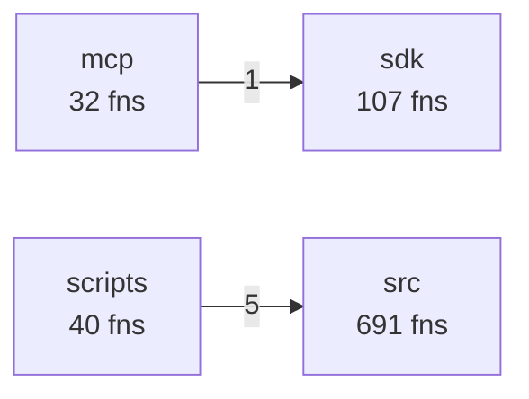
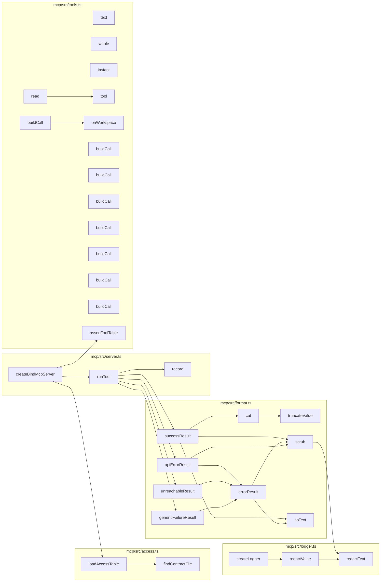
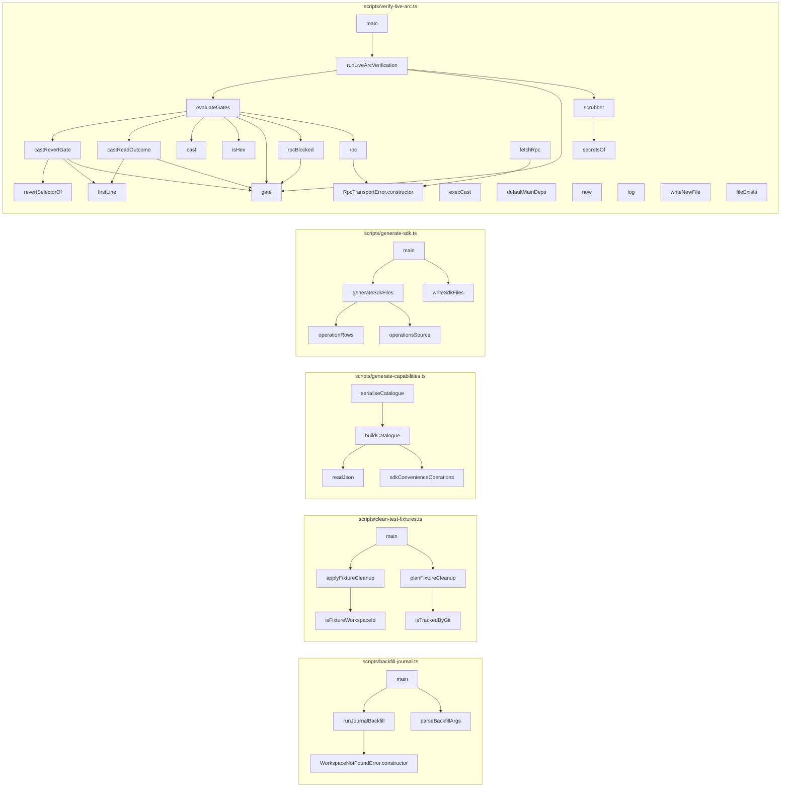

# Codebase map: functions and calls

Generated by `npx tsx scripts/map-functions.ts` from the TypeScript compiler's symbol table. Do not edit by hand.
The browser UI (`src/ui`, plain JavaScript) and the Solidity contract are not included here; see `.ua/knowledge-graph.json` for the contract.

- Functions, methods, handlers and classes: **1643** (870 in production code, 773 in tests)
- Resolved call edges: **3037**
- HTTP routes: **83**

## Layers and cross-layer calls



## HTTP surface: route to what it calls

| Route | Line | Calls directly |
| --- | --- | --- |
| `GET /x` | 161 | SQL or inline logic only |
| `GET /y` | 164 | SQL or inline logic only |
| `GET /health` | 505 | `query` |
| `GET /ready` | 516 | `checkReadiness` |
| `GET /api/templates` | 530 | `jsonSafe`, `listTemplates` |
| `GET /api/templates/:id/blueprint` | 534 | `getTemplateBlueprint` |
| `GET /api/openapi.json` | 547 | `serializeOpenApiDocument`, `buildOpenApiDocument` |
| `GET /api/workspaces` | 554 | `query` |
| `POST /api/workspaces/onboard` | 564 | `createWithOwnerToken`, `onboardBlankWorkspace`, `jsonSafe`, `publicErrorMessage` |
| `POST /api/workspaces` | 579 | `createWithOwnerToken`, `provisionWorkspace`, `jsonSafe`, `publicErrorMessage` |
| `POST /api/demo` | 600 | `sendDemoDisabled`, `createDemoWorkspace`, `demoBody`, `sendDemoError` |
| `POST /api/workspaces/:id/demo/reset` | 613 | `sendDemoDisabled`, `resetDemoWorkspace`, `demoBody`, `sendDemoError` |
| `GET /api/workspaces/:id` | 624 | `query`, `getSettlementAdapter`, `effectiveSettlementMode`, `ArcL1SettlementAdapter.getBalance`, `LocalSettlementSimulator.getBalance` |
| `PUT /api/workspaces/:id/policy` | 645 | `normalizePaymentAddress`, `query`, `syncWorkspaceDerivedTemplateFiles`, `publicErrorMessage` |
| `GET /api/workspaces/:id/inventory` | 690 | `query` |
| `POST /api/workspaces/:id/inventory` | 699 | `query`, `publicErrorMessage` |
| `POST /api/workspaces/:id/replenish` | 739 | `ProcurementWorkflowRunner.startReplenishment`, `publicErrorMessage` |
| `GET /api/workspaces/:id/approvals` | 759 | `ProcurementWorkflowRunner.expireApprovals`, `query` |
| `GET /api/workspaces/:id/approvals/:approvalId` | 769 | `ProcurementWorkflowRunner.expireApprovals`, `query` |
| `POST /api/approvals/:id/approve` | 777 | `ProcurementWorkflowRunner.approveAndSubmit`, `decidedByOf`, `sendApprovalError` |
| `POST /api/approvals/:id/reject` | 788 | `parseDecisionBody`, `ProcurementWorkflowRunner.declineApproval`, `decidedByOf`, `sendApprovalError` |
| `POST /api/approvals/:id/revoke` | 808 | `parseDecisionBody`, `ProcurementWorkflowRunner.declineApproval`, `decidedByOf`, `sendApprovalError` |
| `POST /api/orders/:id/reconcile` | 829 | `ProcurementWorkflowRunner.fulfillAndReconcile`, `publicErrorMessage` |
| `POST /api/orders/:id/confirm-settlement` | 845 | `ProcurementWorkflowRunner.confirmSettlement`, `publicErrorMessage` |
| `GET /api/workspaces/:id/customer-orders` | 862 | `listCustomerOrders`, `sendFulfilmentError` |
| `POST /api/workspaces/:id/customer-orders` | 870 | `sendFulfilmentError`, `acceptCustomerOrder` |
| `GET /api/workspaces/:id/customer-orders/:orderId` | 895 | `getCustomerOrder`, `sendFulfilmentError` |
| `POST /api/workspaces/:id/customer-orders/:orderId/accept` | 905 | `acceptHeldOrder`, `sendFulfilmentError` |
| `POST /api/workspaces/:id/customer-orders/:orderId/cancel` | 913 | `cancelCustomerOrder`, `sendFulfilmentError` |
| `POST /api/workspaces/:id/customer-orders/:orderId/fulfil` | 922 | `fulfilCustomerOrder`, `sendFulfilmentError` |
| `GET /api/workspaces/:id/kitchen-capacity` | 931 | `listKitchenCapacity`, `sendFulfilmentError` |
| `PUT /api/workspaces/:id/kitchen-capacity` | 939 | `sendFulfilmentError`, `setKitchenCapacity` |
| `POST /api/workspaces/:id/feedback` | 961 | `sendMenuError`, `ingestFeedback` |
| `GET /api/workspaces/:id/feedback` | 981 | `listFeedback`, `sendMenuError` |
| `GET /api/workspaces/:id/feedback/summary` | 989 | `sendMenuError`, `summarizeFeedback` |
| `POST /api/workspaces/:id/menu-proposals` | 1008 | `sendMenuError`, `proposeMenuChange` |
| `GET /api/workspaces/:id/menu-proposals` | 1035 | `listMenuProposals`, `sendMenuError` |
| `POST /api/workspaces/:id/menu-proposals/:proposalId/approve` | 1043 | `approveMenuProposal`, `sendMenuError` |
| `POST /api/workspaces/:id/menu-proposals/:proposalId/reject` | 1051 | `rejectMenuProposal`, `sendMenuError` |
| `POST /api/workspaces/:id/menu-proposals/:proposalId/cancel` | 1059 | `cancelMenuProposal`, `sendMenuError` |
| `POST /api/workspaces/:id/menu-proposals/:proposalId/publish` | 1067 | `publishMenuChange`, `sendMenuError` |
| `GET /api/workspaces/:id/menu` | 1075 | `listMenu`, `sendMenuError` |
| `GET /api/workspaces/:id/workflows` | 1084 | `query` |
| `GET /api/workspaces/:id/workflows/:workflowId` | 1093 | `query` |
| `POST /api/workspaces/:id/workflows/:workflowId/cancel` | 1101 | `cancelWorkflow`, `sendCancelError` |
| `GET /api/workspaces/:id/needs-attention` | 1122 | `listNeedsAttention` |
| `GET /api/workspaces/:id/orders/:orderId` | 1127 | `query` |
| `GET /api/workspaces/:id/orders` | 1142 | `query` |
| `GET /api/workspaces/:id/suppliers` | 1167 | `query` |
| `POST /api/workspaces/:id/suppliers` | 1176 | `isDemoWorkspace`, `normalizePaymentAddress`, `simulatedPaymentAddress`, `query`, `publicErrorMessage` |
| `GET /api/workspaces/:id/agents` | 1233 | `query` |
| `POST /api/workspaces/:id/agents` | 1246 | `upsertAgentRole`, `publicErrorMessage` |
| `GET /api/workspaces/:id/surfaces` | 1261 | `listSurfaceBindings` |
| `POST /api/workspaces/:id/surfaces` | 1267 | `upsertSurfaceBinding`, `decidedByOf`, `publicErrorMessage` |
| `GET /api/workspaces/:id/documents` | 1278 | `listStagedDocuments` |
| `POST /api/workspaces/:id/documents/extract` | 1284 | `extractDocumentDraft`, `publicErrorMessage` |
| `POST /api/workspaces/:id/documents/:docId/confirm` | 1295 | `confirmStagedDocument`, `decidedByOf`, `publicErrorMessage`, `redactText` |
| `GET /api/workspaces/:id/accounting/ledger` | 1320 | `getWorkspaceAccountingLedger`, `formatLedgerAsCsv` |
| `GET /api/workspaces/:id/audit` | 1336 | `query` |
| `POST /api/workspaces/:id/recover` | 1350 | `WorkflowCrashRecoveryRunner.recoverInterruptedWorkflows`, `publicErrorMessage` |
| `POST /api/auth/session` | 1361 | `upsertAccount`, `createSession`, `sendAccountError` |
| `POST /api/auth/sign-out` | 1375 | `revokeSession` |
| `GET /api/account/workspaces` | 1382 | `listAccountWorkspaces` |
| `POST /api/account/workspaces` | 1386 | `createAccountWorkspace`, `publicErrorMessage` |
| `POST /api/account/invites/accept` | 1399 | `acceptInvite`, `sendAccountError` |
| `POST /api/workspaces/:id/invites` | 1409 | `createInvite`, `sendAccountError` |
| `GET /api/workspaces/:id/invites` | 1419 | `jsonSafe`, `listInvites` |
| `DELETE /api/workspaces/:id/invites/:inviteId` | 1423 | `revokeInvite` |
| `GET /api/workspaces/:id/members` | 1429 | `jsonSafe`, `listMembers` |
| `PUT /api/workspaces/:id/members/:accountId` | 1433 | `jsonSafe`, `setMemberRole`, `sendAccountError` |
| `DELETE /api/workspaces/:id/members/:accountId` | 1443 | `removeMember`, `sendAccountError` |
| `POST /api/workspaces/:id/tokens` | 1453 | `issueToken`, `sendTokenError` |
| `GET /api/workspaces/:id/tokens` | 1467 | `listTokens`, `sendTokenError` |
| `DELETE /api/workspaces/:id/tokens/:tokenId` | 1475 | `revokeToken`, `sendTokenError` |
| `PUT /api/workspaces/:id/agents-paused` | 1487 | `setAgentsPaused`, `decidedByOf` |
| `GET /api/workspaces/:id/webhook-secret` | 1504 | `viewWebhookSecret`, `decidedByOf` |
| `POST /api/workspaces/:id/webhook-secret/rotate` | 1516 | `rotateWebhookSecret`, `decidedByOf` |
| `GET /api/workspaces/:id/connectors` | 1530 | `listConnectors`, `sendCredentialError` |
| `PUT /api/workspaces/:id/connectors/:connectorId` | 1538 | `setCredential`, `credentialActorOf`, `sendCredentialError` |
| `DELETE /api/workspaces/:id/connectors/:connectorId` | 1553 | `revokeCredential`, `credentialActorOf`, `sendCredentialError` |
| `POST /api/workspaces/:id/connectors/:connectorId/verify` | 1563 | `verifyCredential`, `credentialActorOf`, `sendCredentialError` |
| `POST /api/webhooks/incoming` | 1574 | `handleSurfaceEvent`, `handleStandardWebhook` |
| `GET *` | 1775 | SQL or inline logic only |

## mcp

| Function | File:lines | Kind | Params | Exported | Called by (prod / tests) | Calls |
| --- | --- | --- | --- | --- | --- | --- |
| `findContractFile` | mcp/src/access.ts:16-26 | function | 0 | no | 1 / 0 | 0 |
| `loadAccessTable` | mcp/src/access.ts:29-53 | function | 1 | yes | 1 / 2 | 1 |
| `truncateValue` | mcp/src/format.ts:24-44 | function | 3 | yes | 1 / 0 | 0 |
| `cut` | mcp/src/format.ts:47-51 | function | 2 | yes | 1 / 0 | 1 |
| `scrub` | mcp/src/format.ts:54-56 | function | 2 | no | 3 / 0 | 1 |
| `asText` | mcp/src/format.ts:58-60 | function | 1 | no | 2 / 0 | 0 |
| `successResult` | mcp/src/format.ts:70-86 | function | 1 | yes | 1 / 0 | 3 |
| `errorResult` | mcp/src/format.ts:88-93 | function | 2 | no | 3 / 0 | 2 |
| `apiErrorResult` | mcp/src/format.ts:96-108 | function | 2 | yes | 1 / 0 | 2 |
| `unreachableResult` | mcp/src/format.ts:111-113 | function | 1 | yes | 1 / 0 | 1 |
| `genericFailureResult` | mcp/src/format.ts:116-118 | function | 1 | yes | 1 / 0 | 1 |
| `redactText` | mcp/src/logger.ts:21-27 | function | 2 | yes | 2 / 0 | 0 |
| `redactValue` | mcp/src/logger.ts:30-40 | function | 3 | yes | 1 / 0 | 1 |
| `createLogger` | mcp/src/logger.ts:52-62 | function | 1 | yes | 0 / 2 | 1 |
| `createBindMcpServer` | mcp/src/server.ts:35-63 | function | 1 | yes | 0 / 3 | 3 |
| `runTool` | mcp/src/server.ts:65-97 | function | 6 | no | 1 / 0 | 6 |
| `record` | mcp/src/server.ts:74-76 | arrow | 2 | no | 1 / 0 | 0 |
| `text` | mcp/src/tools.ts:72-77 | function | 3 | no | 1 / 0 | 0 |
| `whole` | mcp/src/tools.ts:79-85 | function | 3 | no | 1 / 0 | 0 |
| `instant` | mcp/src/tools.ts:87-92 | function | 1 | no | 1 / 0 | 0 |
| `tool` | mcp/src/tools.ts:195-221 | function | 1 | no | 2 / 0 | 0 |
| `onWorkspace` | mcp/src/tools.ts:223-223 | arrow | 1 | no | 1 / 0 | 0 |
| `read` | mcp/src/tools.ts:225-240 | function | 1 | no | 1 / 0 | 1 |
| `buildCall` | mcp/src/tools.ts:238-238 | arrow | 2 | no | 0 / 0 | 1 |
| `buildCall` | mcp/src/tools.ts:315-319 | arrow | 2 | no | 0 / 0 | 0 |
| `buildCall` | mcp/src/tools.ts:338-344 | arrow | 2 | no | 0 / 0 | 0 |
| `buildCall` | mcp/src/tools.ts:357-361 | arrow | 2 | no | 0 / 0 | 0 |
| `buildCall` | mcp/src/tools.ts:374-383 | arrow | 2 | no | 0 / 0 | 0 |
| `buildCall` | mcp/src/tools.ts:396-399 | arrow | 2 | no | 0 / 0 | 0 |
| `buildCall` | mcp/src/tools.ts:411-414 | arrow | 2 | no | 0 / 0 | 0 |
| `buildCall` | mcp/src/tools.ts:427-434 | arrow | 2 | no | 0 / 0 | 0 |
| `assertToolTable` | mcp/src/tools.ts:443-468 | function | 2 | yes | 1 / 0 | 0 |



## scripts

| Function | File:lines | Kind | Params | Exported | Called by (prod / tests) | Calls |
| --- | --- | --- | --- | --- | --- | --- |
| `WorkspaceNotFoundError.constructor` | scripts/backfill-journal.ts:22-25 | constructor | 0 | yes | 1 / 0 | 0 |
| `parseBackfillArgs` | scripts/backfill-journal.ts:29-38 | function | 1 | yes | 1 / 1 | 0 |
| `runJournalBackfill` | scripts/backfill-journal.ts:41-56 | function | 1 | yes | 1 / 1 | 3 |
| `main` | scripts/backfill-journal.ts:58-73 | function | 0 | no | 1 / 0 | 2 |
| `isFixtureWorkspaceId` | scripts/clean-test-fixtures.ts:78-82 | function | 1 | yes | 1 / 1 | 0 |
| `isTrackedByGit` | scripts/clean-test-fixtures.ts:88-93 | function | 1 | yes | 1 / 0 | 0 |
| `planFixtureCleanup` | scripts/clean-test-fixtures.ts:102-116 | function | 0 | yes | 1 / 0 | 2 |
| `applyFixtureCleanup` | scripts/clean-test-fixtures.ts:119-128 | function | 1 | yes | 1 / 0 | 2 |
| `main` | scripts/clean-test-fixtures.ts:130-154 | function | 0 | no | 1 / 0 | 2 |
| `readJson` | scripts/generate-capabilities.ts:67-69 | function | 1 | no | 1 / 0 | 0 |
| `sdkConvenienceOperations` | scripts/generate-capabilities.ts:72-75 | function | 0 | no | 1 / 0 | 0 |
| `buildCatalogue` | scripts/generate-capabilities.ts:77-123 | function | 0 | yes | 1 / 1 | 2 |
| `serialiseCatalogue` | scripts/generate-capabilities.ts:125-127 | function | 0 | yes | 1 / 1 | 1 |
| `operationRows` | scripts/generate-sdk.ts:32-48 | function | 1 | yes | 1 / 0 | 0 |
| `operationsSource` | scripts/generate-sdk.ts:50-70 | function | 1 | no | 1 / 0 | 0 |
| `generateSdkFiles` | scripts/generate-sdk.ts:73-83 | function | 1 | yes | 1 / 1 | 2 |
| `writeSdkFiles` | scripts/generate-sdk.ts:86-91 | function | 2 | yes | 1 / 1 | 0 |
| `main` | scripts/generate-sdk.ts:93-97 | function | 0 | no | 1 / 0 | 2 |
| `RpcTransportError.constructor` | scripts/verify-live-arc.ts:82-88 | constructor | 2 | yes | 2 / 1 | 0 |
| `secretsOf` | scripts/verify-live-arc.ts:115-127 | function | 1 | yes | 2 / 0 | 0 |
| `scrubber` | scripts/verify-live-arc.ts:130-133 | function | 1 | yes | 1 / 0 | 2 |
| `revertSelectorOf` | scripts/verify-live-arc.ts:139-144 | function | 1 | yes | 1 / 1 | 0 |
| `firstLine` | scripts/verify-live-arc.ts:146-148 | function | 1 | no | 2 / 0 | 0 |
| `isHex` | scripts/verify-live-arc.ts:150-152 | function | 1 | no | 1 / 0 | 0 |
| `gate` | scripts/verify-live-arc.ts:154-156 | function | 3 | no | 5 / 0 | 0 |
| `rpcBlocked` | scripts/verify-live-arc.ts:167-180 | function | 2 | no | 1 / 0 | 1 |
| `castReadOutcome` | scripts/verify-live-arc.ts:183-200 | function | 3 | no | 1 / 0 | 2 |
| `castRevertGate` | scripts/verify-live-arc.ts:206-227 | function | 5 | no | 1 / 0 | 3 |
| `runLiveArcVerification` | scripts/verify-live-arc.ts:230-265 | function | 1 | yes | 1 / 1 | 3 |
| `evaluateGates` | scripts/verify-live-arc.ts:267-368 | function | 1 | no | 1 / 0 | 7 |
| `rpc` | scripts/verify-live-arc.ts:269-279 | arrow | 2 | no | 1 / 0 | 1 |
| `cast` | scripts/verify-live-arc.ts:280-280 | arrow | 1 | no | 1 / 0 | 0 |
| `execCast` | scripts/verify-live-arc.ts:371-398 | arrow | 1 | yes | 0 / 0 | 0 |
| `fetchRpc` | scripts/verify-live-arc.ts:401-420 | arrow | 1 | yes | 0 / 0 | 1 |
| `defaultMainDeps` | scripts/verify-live-arc.ts:429-442 | function | 0 | yes | 0 / 0 | 0 |
| `now` | scripts/verify-live-arc.ts:434-434 | arrow | 0 | no | 0 / 0 | 0 |
| `log` | scripts/verify-live-arc.ts:435-435 | arrow | 1 | no | 0 / 0 | 0 |
| `writeNewFile` | scripts/verify-live-arc.ts:436-436 | arrow | 2 | no | 0 / 0 | 0 |
| `fileExists` | scripts/verify-live-arc.ts:437-440 | arrow | 1 | no | 0 / 0 | 0 |
| `main` | scripts/verify-live-arc.ts:448-480 | function | 2 | yes | 1 / 1 | 1 |



## sdk

| Function | File:lines | Kind | Params | Exported | Called by (prod / tests) | Calls |
| --- | --- | --- | --- | --- | --- | --- |
| `parseBaseUrl` | sdk/src/client.ts:93-106 | function | 1 | no | 1 / 0 | 0 |
| `checkToken` | sdk/src/client.ts:108-113 | function | 1 | no | 1 / 0 | 0 |
| `checkInteger` | sdk/src/client.ts:115-119 | function | 4 | no | 1 / 0 | 0 |
| `abortReason` | sdk/src/client.ts:122-125 | function | 1 | no | 4 / 0 | 0 |
| `newRequestId` | sdk/src/client.ts:128-132 | function | 0 | no | 1 / 0 | 0 |
| `defaultSleep` | sdk/src/client.ts:134-144 | function | 2 | no | 0 / 0 | 0 |
| `done` | sdk/src/client.ts:137-141 | function | 0 | no | 0 / 0 | 0 |
| `abortable` | sdk/src/client.ts:147-167 | function | 2 | no | 1 / 0 | 0 |
| `onAbort` | sdk/src/client.ts:149-149 | arrow | 0 | no | 0 / 0 | 1 |
| `BindClient.constructor` | sdk/src/client.ts:191-205 | constructor | 1 | yes | 0 / 5 | 4 |
| `BindClient.toJSON` | sdk/src/client.ts:208-215 | method | 0 | yes | 0 / 0 | 1 |
| `BindClient.toString` | sdk/src/client.ts:217-219 | method | 0 | yes | 0 / 0 | 1 |
| `BindClient.[INSPECT]` | sdk/src/client.ts:221-223 | method | 0 | yes | 0 / 0 | 1 |
| `BindClient.#baseLabel` | sdk/src/client.ts:225-227 | method | 0 | yes | 3 / 0 | 0 |
| `BindClient.call` | sdk/src/client.ts:234-261 | method | 2 | yes | 47 / 3 | 6 |
| `BindClient.workspace` | sdk/src/client.ts:265-267 | method | 1 | yes | 0 / 2 | 1 |
| `BindClient.listInventory` | sdk/src/client.ts:269-271 | method | 1 | yes | 0 / 1 | 1 |
| `BindClient.upsertInventory` | sdk/src/client.ts:273-275 | method | 2 | yes | 0 / 3 | 1 |
| `BindClient.replenish` | sdk/src/client.ts:277-279 | method | 2 | yes | 0 / 2 | 1 |
| `BindClient.listApprovals` | sdk/src/client.ts:281-283 | method | 1 | yes | 0 / 1 | 1 |
| `BindClient.listOrders` | sdk/src/client.ts:285-287 | method | 1 | yes | 0 / 1 | 1 |
| `BindClient.listWorkflows` | sdk/src/client.ts:289-291 | method | 1 | yes | 0 / 1 | 1 |
| `BindClient.needsAttention` | sdk/src/client.ts:293-295 | method | 1 | yes | 0 / 1 | 1 |
| `BindClient.createCustomerOrder` | sdk/src/client.ts:297-299 | method | 2 | yes | 0 / 1 | 1 |
| `BindClient.listCustomerOrders` | sdk/src/client.ts:301-303 | method | 1 | yes | 0 / 1 | 1 |
| `BindClient.cancelCustomerOrder` | sdk/src/client.ts:305-307 | method | 2 | yes | 0 / 1 | 1 |
| `BindClient.ingestFeedback` | sdk/src/client.ts:309-311 | method | 2 | yes | 0 / 1 | 1 |
| `BindClient.feedbackSummary` | sdk/src/client.ts:313-315 | method | 2 | yes | 0 / 2 | 1 |
| `BindClient.proposeMenuChange` | sdk/src/client.ts:317-319 | method | 2 | yes | 0 / 1 | 1 |
| `BindClient.listMenu` | sdk/src/client.ts:321-323 | method | 1 | yes | 0 / 1 | 1 |
| `BindClient.listAudit` | sdk/src/client.ts:325-327 | method | 1 | yes | 0 / 2 | 1 |
| `BindClient.pollEvents` | sdk/src/client.ts:330-336 | method | 2 | yes | 0 / 3 | 1 |
| `BindClient.events` | sdk/src/client.ts:347-369 | method | 2 | yes | 0 / 2 | 2 |
| `open` | sdk/src/client.ts:351-358 | arrow | 2 | no | 0 / 0 | 1 |
| `describeError` | sdk/src/client.ts:359-359 | arrow | 1 | no | 0 / 0 | 1 |
| `sleep` | sdk/src/client.ts:360-360 | arrow | 2 | no | 0 / 0 | 0 |
| `random` | sdk/src/client.ts:361-361 | arrow | 0 | no | 0 / 0 | 0 |
| `pin` | sdk/src/client.ts:363-366 | arrow | 1 | no | 0 / 0 | 1 |
| `BindClient.#url` | sdk/src/client.ts:374-386 | method | 3 | yes | 2 / 0 | 1 |
| `BindClient.#path` | sdk/src/client.ts:388-401 | method | 2 | yes | 1 / 0 | 0 |
| `BindClient.#run` | sdk/src/client.ts:404-441 | method | 5 | yes | 1 / 0 | 4 |
| `BindClient.#exchange` | sdk/src/client.ts:447-496 | method | 6 | yes | 2 / 0 | 6 |
| `onCallerAbort` | sdk/src/client.ts:464-464 | arrow | 0 | no | 0 / 0 | 0 |
| `release` | sdk/src/client.ts:470-473 | arrow | 0 | no | 1 / 0 | 0 |
| `timedOut` | sdk/src/client.ts:495-495 | arrow | 0 | no | 0 / 0 | 0 |
| `BindClient.#backoff` | sdk/src/client.ts:498-500 | method | 1 | yes | 1 / 0 | 0 |
| `BindClient.#pause` | sdk/src/client.ts:502-506 | method | 2 | yes | 1 / 0 | 1 |
| `readBody` | sdk/src/client.ts:510-523 | function | 1 | no | 1 / 0 | 1 |
| `OwnerOperations.constructor` | sdk/src/client.ts:532-534 | constructor | 1 | yes | 1 / 0 | 0 |
| `OwnerOperations.approveApproval` | sdk/src/client.ts:536-538 | method | 1 | yes | 0 / 0 | 1 |
| `OwnerOperations.rejectApproval` | sdk/src/client.ts:540-542 | method | 2 | yes | 0 / 0 | 1 |
| `OwnerOperations.revokeApproval` | sdk/src/client.ts:544-546 | method | 2 | yes | 0 / 0 | 1 |
| `OwnerOperations.reconcileOrder` | sdk/src/client.ts:549-551 | method | 1 | yes | 0 / 0 | 1 |
| `OwnerOperations.confirmOrderSettlement` | sdk/src/client.ts:554-556 | method | 1 | yes | 0 / 0 | 1 |
| `OwnerOperations.acceptCustomerOrder` | sdk/src/client.ts:558-560 | method | 2 | yes | 0 / 0 | 1 |
| `OwnerOperations.cancelWorkflow` | sdk/src/client.ts:562-564 | method | 3 | yes | 0 / 0 | 1 |
| `OwnerOperations.recoverWorkflows` | sdk/src/client.ts:566-568 | method | 1 | yes | 0 / 0 | 1 |
| `OwnerOperations.updatePolicy` | sdk/src/client.ts:570-572 | method | 2 | yes | 0 / 2 | 1 |
| `OwnerOperations.setKitchenCapacity` | sdk/src/client.ts:574-576 | method | 2 | yes | 0 / 0 | 1 |
| `OwnerOperations.upsertSupplier` | sdk/src/client.ts:578-580 | method | 2 | yes | 0 / 0 | 1 |
| `OwnerOperations.upsertAgentRole` | sdk/src/client.ts:582-584 | method | 2 | yes | 0 / 0 | 1 |
| `OwnerOperations.upsertSurfaceBinding` | sdk/src/client.ts:586-588 | method | 2 | yes | 0 / 0 | 1 |
| `OwnerOperations.setAgentsPaused` | sdk/src/client.ts:591-593 | method | 2 | yes | 0 / 2 | 1 |
| `OwnerOperations.issueToken` | sdk/src/client.ts:595-597 | method | 2 | yes | 0 / 1 | 1 |
| `OwnerOperations.listTokens` | sdk/src/client.ts:599-601 | method | 1 | yes | 0 / 0 | 1 |
| `OwnerOperations.revokeToken` | sdk/src/client.ts:603-605 | method | 2 | yes | 0 / 0 | 1 |
| `OwnerOperations.getWebhookSecret` | sdk/src/client.ts:607-609 | method | 1 | yes | 0 / 0 | 1 |
| `OwnerOperations.rotateWebhookSecret` | sdk/src/client.ts:611-613 | method | 1 | yes | 0 / 0 | 1 |
| `OwnerOperations.listConnectors` | sdk/src/client.ts:615-617 | method | 1 | yes | 0 / 0 | 1 |
| `OwnerOperations.setConnector` | sdk/src/client.ts:619-621 | method | 3 | yes | 0 / 0 | 1 |
| `OwnerOperations.revokeConnector` | sdk/src/client.ts:623-625 | method | 2 | yes | 0 / 0 | 1 |
| `OwnerOperations.verifyConnector` | sdk/src/client.ts:627-629 | method | 2 | yes | 0 / 0 | 1 |
| `OwnerOperations.confirmDocument` | sdk/src/client.ts:631-633 | method | 3 | yes | 0 / 0 | 1 |
| `OwnerOperations.approveMenuProposal` | sdk/src/client.ts:635-637 | method | 2 | yes | 0 / 0 | 1 |
| `OwnerOperations.rejectMenuProposal` | sdk/src/client.ts:639-641 | method | 2 | yes | 0 / 0 | 1 |
| `OwnerOperations.cancelMenuProposal` | sdk/src/client.ts:643-645 | method | 2 | yes | 0 / 0 | 1 |
| `OwnerOperations.publishMenuProposal` | sdk/src/client.ts:647-649 | method | 2 | yes | 0 / 0 | 1 |
| `BindError.constructor` | sdk/src/errors.ts:9-12 | constructor | 1 | yes | 5 / 0 | 0 |
| `BindApiError.constructor` | sdk/src/errors.ts:34-43 | constructor | 1 | yes | 1 / 1 | 1 |
| `BindNetworkError.constructor` | sdk/src/errors.ts:50-54 | constructor | 1 | yes | 2 / 1 | 1 |
| `BindTimeoutError.constructor` | sdk/src/errors.ts:61-65 | constructor | 1 | yes | 2 / 1 | 1 |
| `BindStreamError.constructor` | sdk/src/errors.ts:72-76 | constructor | 1 | yes | 2 / 0 | 1 |
| `scrubText` | sdk/src/errors.ts:82-88 | function | 2 | yes | 2 / 0 | 0 |
| `scrubValue` | sdk/src/errors.ts:91-100 | function | 3 | yes | 1 / 0 | 1 |
| `parseRetryAfter` | sdk/src/errors.ts:103-110 | function | 2 | yes | 1 / 0 | 0 |
| `isRecord` | sdk/src/errors.ts:112-114 | function | 1 | no | 1 / 0 | 0 |
| `apiErrorFrom` | sdk/src/errors.ts:120-151 | function | 2 | yes | 2 / 0 | 5 |
| `Parser` | sdk/src/events.ts:38-127 | class | 0 | no | 1 / 0 | 0 |
| `Parser.lastEventId` | sdk/src/events.ts:48-50 | method | 0 | no | 0 / 0 | 0 |
| `Parser.retry` | sdk/src/events.ts:52-54 | method | 0 | no | 0 / 0 | 0 |
| `Parser.push` | sdk/src/events.ts:56-88 | method | 1 | no | 1 / 2 | 1 |
| `Parser.handleLine` | sdk/src/events.ts:90-117 | method | 2 | no | 1 / 0 | 1 |
| `Parser.dispatch` | sdk/src/events.ts:119-126 | method | 1 | no | 1 / 0 | 0 |
| `createSseParser` | sdk/src/events.ts:130-132 | function | 0 | yes | 1 / 2 | 1 |
| `settlePin` | sdk/src/events.ts:180-188 | function | 1 | no | 2 / 0 | 0 |
| `retryablePinError` | sdk/src/events.ts:191-194 | function | 1 | no | 1 / 0 | 0 |
| `parseCursor` | sdk/src/events.ts:206-210 | function | 1 | yes | 3 / 0 | 0 |
| `compareCursor` | sdk/src/events.ts:212-216 | function | 2 | no | 1 / 0 | 0 |
| `isRecord` | sdk/src/events.ts:218-220 | function | 1 | no | 1 / 0 | 0 |
| `toBindEvent` | sdk/src/events.ts:223-243 | function | 1 | no | 1 / 0 | 3 |
| `backoffMs` | sdk/src/events.ts:246-249 | function | 4 | yes | 1 / 0 | 0 |
| `positiveInteger` | sdk/src/events.ts:251-255 | function | 3 | no | 1 / 0 | 0 |
| `readEventStream` | sdk/src/events.ts:261-273 | function | 2 | yes | 1 / 0 | 4 |
| `run` | sdk/src/events.ts:275-414 | function | 3 | no | 1 / 0 | 9 |
| `onCallerAbort` | sdk/src/events.ts:284-284 | arrow | 0 | no | 0 / 0 | 0 |
| `random` | sdk/src/events.ts:292-292 | arrow | 0 | no | 0 / 0 | 0 |
| `cancelBody` | sdk/src/events.ts:356-358 | arrow | 0 | no | 0 / 0 | 0 |

```mermaid
flowchart LR
  subgraph F0["sdk/src/client.ts"]
    n37["parseBaseUrl"]
    n38["checkToken"]
    n39["checkInteger"]
    n40["abortReason"]
    n41["newRequestId"]
    n42["defaultSleep"]
    n43["done"]
    n44["abortable"]
    n45["onAbort"]
    n46["BindClient.constructor"]
    n47["BindClient.toJSON"]
    n48["BindClient.toString"]
    n49["BindClient.[INSPECT]"]
    n50["BindClient.#baseLabel"]
    n51["BindClient.call"]
    n52["BindClient.workspace"]
    n53["BindClient.listInventory"]
    n54["BindClient.upsertInventory"]
    n55["BindClient.replenish"]
    n56["BindClient.listApprovals"]
    n57["BindClient.listOrders"]
    n58["BindClient.listWorkflows"]
    n59["BindClient.needsAttention"]
    n60["BindClient.createCustomerOrder"]
    n61["BindClient.listCustomerOrders"]
    n62["BindClient.cancelCustomerOrder"]
    n63["BindClient.ingestFeedback"]
    n64["BindClient.feedbackSummary"]
    n65["BindClient.proposeMenuChange"]
    n66["BindClient.listMenu"]
    n67["BindClient.listAudit"]
    n68["BindClient.pollEvents"]
    n69["BindClient.events"]
    n70["open"]
    n71["describeError"]
    n72["sleep"]
    n73["random"]
    n74["pin"]
    n75["BindClient.#url"]
    n76["BindClient.#path"]
    n77["BindClient.#run"]
    n78["BindClient.#exchange"]
    n79["onCallerAbort"]
    n80["release"]
    n81["timedOut"]
    n82["BindClient.#backoff"]
    n83["BindClient.#pause"]
    n84["readBody"]
    n85["OwnerOperations.constructor"]
    n86["OwnerOperations.approveApproval"]
    n87["OwnerOperations.rejectApproval"]
    n88["OwnerOperations.revokeApproval"]
    n89["OwnerOperations.reconcileOrder"]
    n90["OwnerOperations.confirmOrderSettlement"]
    n91["OwnerOperations.acceptCustomerOrder"]
    n92["OwnerOperations.cancelWorkflow"]
    n93["OwnerOperations.recoverWorkflows"]
    n94["OwnerOperations.updatePolicy"]
    n95["OwnerOperations.setKitchenCapacity"]
    n96["OwnerOperations.upsertSupplier"]
    n97["OwnerOperations.upsertAgentRole"]
    n98["OwnerOperations.upsertSurfaceBinding"]
    n99["OwnerOperations.setAgentsPaused"]
    n100["OwnerOperations.issueToken"]
    n101["OwnerOperations.listTokens"]
    n102["OwnerOperations.revokeToken"]
    n103["OwnerOperations.getWebhookSecret"]
    n104["OwnerOperations.rotateWebhookSecret"]
    n105["OwnerOperations.listConnectors"]
    n106["OwnerOperations.setConnector"]
    n107["OwnerOperations.revokeConnector"]
    n108["OwnerOperations.verifyConnector"]
    n109["OwnerOperations.confirmDocument"]
    n110["OwnerOperations.approveMenuProposal"]
    n111["OwnerOperations.rejectMenuProposal"]
    n112["OwnerOperations.cancelMenuProposal"]
    n113["OwnerOperations.publishMenuProposal"]
  end
  subgraph F1["sdk/src/errors.ts"]
    n114["BindError.constructor"]
    n115["BindApiError.constructor"]
    n116["BindNetworkError.constructor"]
    n117["BindTimeoutError.constructor"]
    n118["BindStreamError.constructor"]
    n119["scrubText"]
    n120["scrubValue"]
    n121["parseRetryAfter"]
    n122["isRecord"]
    n123["apiErrorFrom"]
  end
  subgraph F2["sdk/src/events.ts"]
    n124["Parser"]
    n125["Parser.lastEventId"]
    n126["Parser.retry"]
    n127["Parser.push"]
    n128["Parser.handleLine"]
    n129["Parser.dispatch"]
    n130["createSseParser"]
    n131["settlePin"]
    n132["retryablePinError"]
    n133["parseCursor"]
    n134["compareCursor"]
    n135["isRecord"]
    n136["toBindEvent"]
    n137["backoffMs"]
    n138["positiveInteger"]
    n139["readEventStream"]
    n140["run"]
    n141["onCallerAbort"]
    n142["random"]
    n143["cancelBody"]
  end
  n45 --> n40
  n46 --> n37
  n46 --> n38
  n46 --> n39
  n46 --> n85
  n47 --> n50
  n48 --> n50
  n49 --> n50
  n51 --> n75
  n51 --> n77
  n51 --> n84
  n51 --> n117
  n51 --> n40
  n51 --> n116
  n52 --> n51
  n53 --> n51
  n54 --> n51
  n55 --> n51
  n56 --> n51
  n57 --> n51
  n58 --> n51
  n59 --> n51
  n60 --> n51
  n61 --> n51
  n62 --> n51
  n63 --> n51
  n64 --> n51
  n65 --> n51
  n66 --> n51
  n67 --> n51
  n68 --> n51
  n69 --> n75
  n69 --> n139
  n70 --> n78
  n71 --> n123
  n74 --> n51
  n75 --> n76
  n77 --> n78
  n77 --> n83
  n77 --> n82
  n77 --> n123
  n78 --> n40
  n78 --> n41
  n78 --> n44
  n78 --> n80
  n78 --> n117
  n78 --> n116
  n83 --> n40
  n84 --> n114
  n86 --> n51
  n87 --> n51
  n88 --> n51
  n89 --> n51
  n90 --> n51
  n91 --> n51
  n92 --> n51
  n93 --> n51
  n94 --> n51
  n95 --> n51
  n96 --> n51
  n97 --> n51
  n98 --> n51
  n99 --> n51
  n100 --> n51
  n101 --> n51
  n102 --> n51
  n103 --> n51
  n104 --> n51
  n105 --> n51
  n106 --> n51
  n107 --> n51
  n108 --> n51
  n109 --> n51
  n110 --> n51
  n111 --> n51
  n112 --> n51
  n113 --> n51
  n115 --> n114
  n116 --> n114
  n117 --> n114
  n118 --> n114
  n120 --> n119
  n123 --> n120
  n123 --> n122
  n123 --> n115
  n123 --> n119
  n123 --> n121
  n127 --> n128
  n128 --> n129
  n130 --> n124
  n136 --> n118
  n136 --> n135
  n136 --> n133
  n139 --> n138
  n139 --> n133
  n139 --> n131
  n139 --> n140
  n140 --> n133
  n140 --> n132
  n140 --> n137
  n140 --> n131
  n140 --> n118
  n140 --> n130
  n140 --> n127
  n140 --> n136
  n140 --> n134
```



## src

| Function | File:lines | Kind | Params | Exported | Called by (prod / tests) | Calls |
| --- | --- | --- | --- | --- | --- | --- |
| `JournalConflictError.constructor` | src/accounting/journal.ts:8-11 | constructor | 1 | yes | 1 / 0 | 0 |
| `recordIdempotentJournalEntry` | src/accounting/journal.ts:20-59 | function | 1 | yes | 2 / 1 | 2 |
| `evaluateThreeWayMatch` | src/accounting/three-way-match.ts:19-100 | function | 3 | yes | 1 / 1 | 0 |
| `b64urlToBuffer` | src/accounts/privy.ts:26-29 | function | 1 | no | 1 / 0 | 0 |
| `parseJson` | src/accounts/privy.ts:31-38 | function | 1 | no | 1 / 0 | 0 |
| `createPrivyVerifier` | src/accounts/privy.ts:41-83 | function | 1 | yes | 1 / 3 | 2 |
| `AccountError.constructor` | src/accounts/service.ts:26-30 | constructor | 2 | yes | 5 / 0 | 0 |
| `hasControl` | src/accounts/service.ts:39-45 | function | 1 | no | 2 / 0 | 0 |
| `sha256` | src/accounts/service.ts:47-47 | arrow | 1 | no | 2 / 0 | 0 |
| `audit` | src/accounts/service.ts:53-59 | function | 5 | no | 6 / 0 | 2 |
| `cleanName` | src/accounts/service.ts:61-67 | function | 1 | no | 1 / 0 | 2 |
| `upsertAccount` | src/accounts/service.ts:76-86 | function | 2 | yes | 2 / 0 | 3 |
| `listAccountWorkspaces` | src/accounts/service.ts:94-101 | function | 1 | yes | 1 / 0 | 1 |
| `createAccountWorkspace` | src/accounts/service.ts:107-127 | function | 4 | yes | 1 / 0 | 5 |
| `createInvite` | src/accounts/service.ts:140-163 | function | 4 | yes | 1 / 0 | 6 |
| `listInvites` | src/accounts/service.ts:165-171 | function | 1 | yes | 1 / 0 | 1 |
| `revokeInvite` | src/accounts/service.ts:173-183 | function | 3 | yes | 1 / 0 | 2 |
| `acceptInvite` | src/accounts/service.ts:190-216 | function | 2 | yes | 1 / 0 | 4 |
| `listMembers` | src/accounts/service.ts:225-232 | function | 1 | yes | 1 / 0 | 1 |
| `activeOwnerCredentials` | src/accounts/service.ts:235-239 | function | 2 | no | 2 / 0 | 0 |
| `setMemberRole` | src/accounts/service.ts:242-260 | function | 4 | yes | 1 / 0 | 4 |
| `removeMember` | src/accounts/service.ts:263-277 | function | 3 | yes | 1 / 0 | 4 |
| `isSessionToken` | src/accounts/sessions.ts:15-17 | function | 1 | yes | 2 / 0 | 0 |
| `hash` | src/accounts/sessions.ts:19-21 | function | 1 | no | 2 / 0 | 0 |
| `createSession` | src/accounts/sessions.ts:32-47 | function | 3 | yes | 1 / 0 | 3 |
| `resolveSession` | src/accounts/sessions.ts:50-65 | function | 1 | yes | 1 / 0 | 3 |
| `revokeSession` | src/accounts/sessions.ts:67-70 | function | 1 | yes | 1 / 0 | 1 |
| `defaultExec` | src/adapters/circleAgentStack.ts:70-73 | arrow | 3 | no | 0 / 0 | 0 |
| `requiresOwnerApprovalGate` | src/adapters/circleAgentStack.ts:75-78 | function | 1 | yes | 0 / 1 | 0 |
| `isFlagEnabled` | src/adapters/circleAgentStack.ts:83-86 | function | 1 | yes | 1 / 1 | 0 |
| `redactUrls` | src/adapters/circleAgentStack.ts:88-90 | function | 1 | no | 2 / 0 | 0 |
| `errorMessage` | src/adapters/circleAgentStack.ts:92-94 | function | 1 | no | 3 / 0 | 0 |
| `textOf` | src/adapters/circleAgentStack.ts:96-100 | function | 1 | no | 1 / 0 | 0 |
| `errorText` | src/adapters/circleAgentStack.ts:103-112 | function | 1 | no | 1 / 0 | 2 |
| `wasKilledOrTimedOut` | src/adapters/circleAgentStack.ts:115-119 | function | 1 | no | 1 / 0 | 0 |
| `classifyLiveFailure` | src/adapters/circleAgentStack.ts:121-124 | function | 1 | no | 1 / 0 | 2 |
| `parseWhitelisted` | src/adapters/circleAgentStack.ts:126-134 | function | 1 | no | 1 / 0 | 0 |
| `parseTxHash` | src/adapters/circleAgentStack.ts:137-146 | function | 1 | no | 1 / 0 | 0 |
| `CircleAgentStackAdapter.constructor` | src/adapters/circleAgentStack.ts:153-157 | constructor | 2 | yes | 1 / 2 | 0 |
| `CircleAgentStackAdapter.isLive` | src/adapters/circleAgentStack.ts:160-162 | method | 0 | yes | 2 / 0 | 1 |
| `CircleAgentStackAdapter.queryVendorWhitelistStatus` | src/adapters/circleAgentStack.ts:167-209 | method | 1 | yes | 1 / 2 | 4 |
| `CircleAgentStackAdapter.executeBindSettlement` | src/adapters/circleAgentStack.ts:215-276 | method | 1 | yes | 1 / 2 | 5 |
| `HybridMarketBenchmarkAdapter` | src/adapters/marketBenchmark.ts:19-113 | class | 0 | yes | 2 / 1 | 0 |
| `HybridMarketBenchmarkAdapter.fetchBenchmark` | src/adapters/marketBenchmark.ts:20-112 | method | 2 | yes | 2 / 1 | 0 |
| `revertDataOf` | src/adapters/settlement/arc-l1.ts:135-143 | function | 1 | no | 1 / 0 | 0 |
| `decodeRevert` | src/adapters/settlement/arc-l1.ts:145-152 | function | 1 | no | 1 / 0 | 0 |
| `deployBlockFromConfig` | src/adapters/settlement/arc-l1.ts:154-156 | function | 0 | no | 1 / 0 | 0 |
| `ArcL1SettlementAdapter.constructor` | src/adapters/settlement/arc-l1.ts:180-196 | constructor | 1 | yes | 1 / 6 | 1 |
| `ArcL1SettlementAdapter.getBalance` | src/adapters/settlement/arc-l1.ts:198-212 | method | 1 | yes | 1 / 2 | 0 |
| `ArcL1SettlementAdapter.transferUSDC` | src/adapters/settlement/arc-l1.ts:218-258 | method | 1 | yes | 1 / 4 | 6 |
| `ArcL1SettlementAdapter.confirm` | src/adapters/settlement/arc-l1.ts:265-288 | method | 1 | yes | 1 / 2 | 6 |
| `ArcL1SettlementAdapter.findTransfer` | src/adapters/settlement/arc-l1.ts:299-307 | method | 1 | yes | 0 / 2 | 4 |
| `ArcL1SettlementAdapter.depositEscrow` | src/adapters/settlement/arc-l1.ts:309-311 | method | 2 | yes | 0 / 2 | 1 |
| `ArcL1SettlementAdapter.releaseEscrow` | src/adapters/settlement/arc-l1.ts:313-315 | method | 2 | yes | 0 / 2 | 1 |
| `ArcL1SettlementAdapter.#result` | src/adapters/settlement/arc-l1.ts:317-328 | method | 3 | yes | 4 / 0 | 0 |
| `ArcL1SettlementAdapter.#secrets` | src/adapters/settlement/arc-l1.ts:331-333 | method | 0 | yes | 4 / 0 | 0 |
| `ArcL1SettlementAdapter.#classifyFailure` | src/adapters/settlement/arc-l1.ts:339-355 | method | 4 | yes | 1 / 0 | 7 |
| `ArcL1SettlementAdapter.#contractAddress` | src/adapters/settlement/arc-l1.ts:357-363 | method | 0 | yes | 2 / 0 | 1 |
| `ArcL1SettlementAdapter.#requireSettings` | src/adapters/settlement/arc-l1.ts:366-385 | method | 0 | yes | 1 / 0 | 1 |
| `ArcL1SettlementAdapter.#assertChain` | src/adapters/settlement/arc-l1.ts:388-398 | method | 0 | yes | 1 / 0 | 3 |
| `ArcL1SettlementAdapter.#settlementEvent` | src/adapters/settlement/arc-l1.ts:400-404 | method | 0 | yes | 1 / 0 | 0 |
| `ArcL1SettlementAdapter.#findSettlement` | src/adapters/settlement/arc-l1.ts:410-428 | method | 2 | yes | 2 / 0 | 3 |
| `ArcL1SettlementAdapter.#pollReceipt` | src/adapters/settlement/arc-l1.ts:430-443 | method | 1 | yes | 1 / 0 | 0 |
| `SettlementNotConfiguredError.constructor` | src/adapters/settlement/errors.ts:12-16 | constructor | 1 | yes | 2 / 0 | 0 |
| `SettlementChainMismatchError.constructor` | src/adapters/settlement/errors.ts:24-29 | constructor | 2 | yes | 1 / 0 | 0 |
| `SettlementPayerMismatchError.constructor` | src/adapters/settlement/errors.ts:34-37 | constructor | 0 | yes | 1 / 0 | 0 |
| `SettlementRejectedError.constructor` | src/adapters/settlement/errors.ts:45-50 | constructor | 2 | yes | 4 / 1 | 0 |
| `SettlementNotSupportedError.constructor` | src/adapters/settlement/errors.ts:55-58 | constructor | 1 | yes | 2 / 0 | 0 |
| `SettlementTransportError.constructor` | src/adapters/settlement/errors.ts:68-72 | constructor | 2 | yes | 2 / 1 | 0 |
| `redactSecrets` | src/adapters/settlement/errors.ts:79-81 | function | 2 | yes | 1 / 1 | 2 |
| `transportErrorFrom` | src/adapters/settlement/errors.ts:84-93 | function | 3 | yes | 4 / 0 | 2 |
| `getSettlementAdapter` | src/adapters/settlement/index.ts:14-27 | function | 1 | yes | 3 / 0 | 1 |
| `LocalSettlementSimulator.constructor` | src/adapters/settlement/local-sim.ts:24-27 | constructor | 0 | yes | 1 / 1 | 0 |
| `LocalSettlementSimulator.getBalance` | src/adapters/settlement/local-sim.ts:29-31 | method | 1 | yes | 3 / 1 | 0 |
| `LocalSettlementSimulator.transferUSDC` | src/adapters/settlement/local-sim.ts:33-56 | method | 1 | yes | 1 / 1 | 2 |
| `LocalSettlementSimulator.findTransfer` | src/adapters/settlement/local-sim.ts:59-61 | method | 1 | yes | 0 / 1 | 0 |
| `LocalSettlementSimulator.confirm` | src/adapters/settlement/local-sim.ts:63-66 | method | 1 | yes | 1 / 1 | 1 |
| `LocalSettlementSimulator.depositEscrow` | src/adapters/settlement/local-sim.ts:68-83 | method | 2 | yes | 0 / 0 | 2 |
| `LocalSettlementSimulator.releaseEscrow` | src/adapters/settlement/local-sim.ts:85-100 | method | 2 | yes | 0 / 0 | 1 |
| `LocalSettlementSimulator.submitted` | src/adapters/settlement/local-sim.ts:102-110 | method | 0 | yes | 3 / 0 | 0 |
| `SurfaceAuthorizationError.constructor` | src/adapters/socialSurface.ts:75-78 | constructor | 1 | yes | 2 / 0 | 0 |
| `assertSurfaceRoleAuthorized` | src/adapters/socialSurface.ts:84-107 | function | 2 | yes | 1 / 1 | 1 |
| `verifyAndAuthorizeSurfaceEvent` | src/adapters/socialSurface.ts:114-136 | function | 1 | yes | 1 / 0 | 3 |
| `upsertSurfaceBinding` | src/adapters/socialSurface.ts:144-192 | function | 3 | yes | 1 / 4 | 3 |
| `listSurfaceBindings` | src/adapters/socialSurface.ts:194-200 | function | 1 | yes | 1 / 0 | 1 |
| `getSupplierAdapter` | src/adapters/suppliers/index.ts:24-34 | function | 1 | yes | 0 / 2 | 1 |
| `md5Hex` | src/adapters/suppliers/payment-address.ts:4-6 | function | 1 | no | 1 / 0 | 0 |
| `simulatedPaymentAddress` | src/adapters/suppliers/payment-address.ts:14-16 | function | 1 | yes | 4 / 3 | 1 |
| `normalizePaymentAddress` | src/adapters/suppliers/payment-address.ts:22-26 | function | 1 | yes | 2 / 1 | 0 |
| `SimulatedSupplierAdapter.constructor` | src/adapters/suppliers/simulated.ts:20-25 | constructor | 4 | yes | 2 / 7 | 0 |
| `SimulatedSupplierAdapter.acceptedKey` | src/adapters/suppliers/simulated.ts:27-29 | method | 2 | yes | 2 / 0 | 0 |
| `SimulatedSupplierAdapter.requestQuote` | src/adapters/suppliers/simulated.ts:31-62 | method | 1 | yes | 1 / 5 | 0 |
| `SimulatedSupplierAdapter.submitOrder` | src/adapters/suppliers/simulated.ts:65-80 | method | 1 | yes | 1 / 6 | 1 |
| `SimulatedSupplierAdapter.lookupOrder` | src/adapters/suppliers/simulated.ts:83-87 | method | 1 | yes | 0 / 3 | 1 |
| `SimulatedSupplierAdapter.generateDeliveryReceipt` | src/adapters/suppliers/simulated.ts:89-99 | method | 3 | yes | 1 / 5 | 0 |
| `SimulatedSupplierAdapter.generateBill` | src/adapters/suppliers/simulated.ts:101-114 | method | 5 | yes | 1 / 6 | 0 |
| `SupplierResponseInvalidError.constructor` | src/adapters/suppliers/validate.ts:47-51 | constructor | 1 | yes | 2 / 1 | 0 |
| `isBoundedAmount` | src/adapters/suppliers/validate.ts:54-56 | function | 1 | no | 1 / 0 | 0 |
| `isValidDate` | src/adapters/suppliers/validate.ts:58-60 | function | 1 | no | 1 / 0 | 0 |
| `validateQuoteResponse` | src/adapters/suppliers/validate.ts:67-105 | function | 3 | yes | 1 / 2 | 2 |
| `validateOrderResponse` | src/adapters/suppliers/validate.ts:111-124 | function | 2 | yes | 1 / 1 | 0 |
| `NotificationEmitter` | src/adapters/web2/notifications.ts:4-32 | class | 0 | yes | 1 / 0 | 0 |
| `NotificationEmitter.send` | src/adapters/web2/notifications.ts:7-20 | method | 1 | yes | 1 / 0 | 1 |
| `NotificationEmitter.getSentNotifications` | src/adapters/web2/notifications.ts:22-27 | method | 1 | yes | 0 / 2 | 0 |
| `NotificationEmitter.clear` | src/adapters/web2/notifications.ts:29-31 | method | 0 | yes | 0 / 4 | 0 |
| `WebhookReceiver.constructor` | src/adapters/web2/webhook-receiver.ts:27-29 | constructor | 1 | yes | 2 / 0 | 0 |
| `WebhookReceiver.secret` | src/adapters/web2/webhook-receiver.ts:31-35 | method | 0 | yes | 2 / 0 | 1 |
| `WebhookReceiver.computeSignature` | src/adapters/web2/webhook-receiver.ts:38-40 | method | 2 | yes | 0 / 1 | 2 |
| `WebhookReceiver.verifySignature` | src/adapters/web2/webhook-receiver.ts:43-50 | method | 3 | yes | 0 / 1 | 2 |
| `WebhookReceiver.processEvent` | src/adapters/web2/webhook-receiver.ts:56-77 | method | 1 | yes | 1 / 1 | 2 |
| `InvariantDriftError.constructor` | src/agents/antiDriftWriter.ts:33-36 | constructor | 1 | yes | 1 / 0 | 0 |
| `assertNoSpecDrift` | src/agents/antiDriftWriter.ts:42-78 | function | 1 | yes | 1 / 1 | 1 |
| `writeWorkflowAntiDriftFiles` | src/agents/antiDriftWriter.ts:91-241 | function | 2 | yes | 2 / 1 | 2 |
| `createBindCircleAgent` | src/agents/bindCircleDeepAgent.ts:15-108 | function | 1 | yes | 0 / 0 | 5 |
| `listAvailableTemplates` | src/agents/bindTemplateAgent.ts:26-44 | function | 0 | yes | 0 / 1 | 0 |
| `resolveTemplateDir` | src/agents/bindTemplateAgent.ts:49-60 | function | 1 | yes | 2 / 1 | 0 |
| `whitelistLabel` | src/agents/bindTemplateAgent.ts:106-110 | function | 1 | no | 1 / 0 | 0 |
| `generateVerifiableDecisionRecord` | src/agents/bindTemplateAgent.ts:114-273 | function | 1 | yes | 1 / 2 | 5 |
| `classifyRequestEvidence` | src/agents/evidence-classification.ts:12-23 | function | 1 | yes | 1 / 1 | 0 |
| `createReplenishmentTools` | src/agents/replenishmentTools.ts:27-687 | function | 1 | yes | 1 / 8 | 17 |
| `eventNameOf` | src/api/event-catalogue.ts:72-74 | function | 1 | yes | 1 / 0 | 0 |
| `positiveInteger` | src/api/event-routes.ts:69-73 | function | 3 | no | 1 / 0 | 0 |
| `resolveEventsOptions` | src/api/event-routes.ts:76-87 | function | 1 | yes | 1 / 0 | 1 |
| `eventFrame` | src/api/event-routes.ts:90-93 | function | 1 | yes | 1 / 0 | 0 |
| `requestedCursor` | src/api/event-routes.ts:96-103 | function | 1 | no | 1 / 0 | 2 |
| `sendInvalidCursor` | src/api/event-routes.ts:105-107 | function | 1 | no | 2 / 0 | 0 |
| `tokenStillActive` | src/api/event-routes.ts:110-113 | function | 1 | no | 1 / 0 | 1 |
| `eventStreamHandler` | src/api/event-routes.ts:116-252 | function | 1 | yes | 1 / 0 | 6 |
| `close` | src/api/event-routes.ts:129-129 | arrow | 1 | no | 0 / 0 | 1 |
| `end` | src/api/event-routes.ts:150-162 | function | 1 | no | 4 / 0 | 0 |
| `waitFor` | src/api/event-routes.ts:187-200 | arrow | 1 | no | 1 / 0 | 0 |
| `done` | src/api/event-routes.ts:195-199 | function | 0 | no | 0 / 0 | 0 |
| `send` | src/api/event-routes.ts:203-208 | arrow | 1 | no | 1 / 0 | 2 |
| `run` | src/api/event-routes.ts:210-248 | arrow | 0 | no | 1 / 0 | 7 |
| `eventPollHandler` | src/api/event-routes.ts:255-285 | function | 0 | yes | 1 / 0 | 5 |
| `publishCount` | src/api/event-streams.ts:30-32 | function | 0 | no | 2 / 0 | 1 |
| `claimStream` | src/api/event-streams.ts:38-66 | function | 2 | yes | 1 / 0 | 2 |
| `release` | src/api/event-streams.ts:59-64 | arrow | 0 | no | 0 / 0 | 1 |
| `countOpenStreams` | src/api/event-streams.ts:69-71 | function | 0 | yes | 0 / 2 | 0 |
| `countOpenStreamsFor` | src/api/event-streams.ts:74-82 | function | 1 | yes | 0 / 1 | 0 |
| `closeAllEventStreams` | src/api/event-streams.ts:88-98 | function | 1 | yes | 1 / 4 | 0 |
| `writeWithBackpressure` | src/api/event-streams.ts:114-134 | function | 3 | yes | 1 / 1 | 1 |
| `finish` | src/api/event-streams.ts:122-127 | arrow | 1 | no | 3 / 0 | 0 |
| `onDrain` | src/api/event-streams.ts:128-128 | arrow | 0 | no | 0 / 0 | 1 |
| `onClose` | src/api/event-streams.ts:129-129 | arrow | 0 | no | 0 / 0 | 1 |
| `parseCursor` | src/api/events.ts:52-60 | function | 1 | yes | 3 / 1 | 0 |
| `formatCursor` | src/api/events.ts:63-65 | function | 2 | yes | 5 / 1 | 0 |
| `allowedValue` | src/api/events.ts:105-113 | function | 1 | no | 1 / 0 | 0 |
| `eventData` | src/api/events.ts:119-128 | function | 2 | yes | 1 / 1 | 2 |
| `isVisibleToRole` | src/api/events.ts:131-134 | function | 2 | yes | 2 / 1 | 0 |
| `objectIdOf` | src/api/events.ts:137-143 | function | 3 | no | 1 / 0 | 0 |
| `mapAuditRow` | src/api/events.ts:149-168 | function | 1 | yes | 0 / 1 | 5 |
| `assertLimit` | src/api/events.ts:194-198 | function | 1 | no | 2 / 0 | 0 |
| `cursorOf` | src/api/events.ts:200-202 | function | 1 | no | 3 / 0 | 1 |
| `pageOf` | src/api/events.ts:204-217 | function | 4 | no | 1 / 0 | 2 |
| `readEvents` | src/api/events.ts:223-240 | function | 4 | yes | 2 / 0 | 5 |
| `readLatestEvents` | src/api/events.ts:246-263 | function | 3 | yes | 1 / 0 | 4 |
| `latestCursor` | src/api/events.ts:269-278 | function | 1 | yes | 1 / 0 | 2 |
| `toOpenApiPath` | src/api/openapi.ts:40-42 | function | 1 | yes | 1 / 0 | 0 |
| `jsonSchema` | src/api/openapi.ts:50-60 | function | 1 | no | 3 / 0 | 0 |
| `schemaOrRef` | src/api/openapi.ts:62-65 | function | 1 | no | 2 / 0 | 1 |
| `queryParameters` | src/api/openapi.ts:67-75 | function | 1 | no | 1 / 0 | 1 |
| `responsesOf` | src/api/openapi.ts:77-97 | function | 2 | no | 1 / 0 | 1 |
| `operationOf` | src/api/openapi.ts:99-134 | function | 1 | no | 1 / 0 | 3 |
| `sortKeysDeep` | src/api/openapi.ts:137-147 | function | 1 | yes | 1 / 0 | 0 |
| `buildOpenApiDocument` | src/api/openapi.ts:153-187 | function | 2 | yes | 1 / 2 | 4 |
| `serializeOpenApiDocument` | src/api/openapi.ts:190-192 | function | 1 | yes | 1 / 2 | 0 |
| `err` | src/api/registry.ts:140-140 | arrow | 1 | no | 2 / 0 | 0 |
| `ok` | src/api/registry.ts:141-141 | arrow | 2 | no | 1 / 0 | 0 |
| `list` | src/api/registry.ts:142-142 | arrow | 1 | no | 1 / 0 | 0 |
| `withGenericErrors` | src/api/registry.ts:151-177 | function | 1 | no | 1 / 0 | 1 |
| `bearerToken` | src/auth/middleware.ts:25-30 | function | 1 | no | 2 / 0 | 0 |
| `authenticate` | src/auth/middleware.ts:36-55 | function | 3 | yes | 0 / 0 | 2 |
| `scopeToWorkspace` | src/auth/middleware.ts:61-71 | function | 3 | yes | 0 / 0 | 0 |
| `requireRole` | src/auth/middleware.ts:74-86 | function | 1 | yes | 1 / 0 | 0 |
| `authenticateAccount` | src/auth/middleware.ts:103-126 | function | 3 | yes | 0 / 0 | 2 |
| `TokenError.constructor` | src/auth/tokens.ts:57-61 | constructor | 2 | yes | 3 / 0 | 0 |
| `generateToken` | src/auth/tokens.ts:64-66 | function | 0 | yes | 1 / 1 | 0 |
| `hashToken` | src/auth/tokens.ts:68-70 | function | 1 | yes | 3 / 1 | 0 |
| `isWellFormedToken` | src/auth/tokens.ts:72-74 | function | 1 | yes | 2 / 0 | 0 |
| `validateIssue` | src/auth/tokens.ts:76-85 | function | 2 | no | 2 / 0 | 1 |
| `writeTokenAudit` | src/auth/tokens.ts:87-99 | function | 5 | no | 2 / 0 | 2 |
| `issueToken` | src/auth/tokens.ts:105-127 | function | 4 | yes | 3 / 35 | 6 |
| `resolveToken` | src/auth/tokens.ts:134-153 | function | 1 | yes | 1 / 1 | 5 |
| `revokeToken` | src/auth/tokens.ts:160-203 | function | 3 | yes | 1 / 3 | 3 |
| `listTokens` | src/auth/tokens.ts:206-219 | function | 1 | yes | 1 / 0 | 1 |
| `ensureSecretOwnerToken` | src/auth/tokens.ts:226-239 | function | 3 | yes | 1 / 0 | 6 |
| `optionalSecret` | src/config/env.ts:9-14 | function | 1 | no | 1 / 0 | 0 |
| `credentialKeyBytes` | src/config/env.ts:20-24 | function | 1 | yes | 2 / 0 | 0 |
| `optionalCredentialKey` | src/config/env.ts:27-35 | function | 1 | no | 1 / 0 | 1 |
| `databaseUrlRule` | src/config/env.ts:116-120 | function | 1 | yes | 1 / 1 | 0 |
| `CredentialStoreDisabledError.constructor` | src/credentials/crypto.ts:16-19 | constructor | 0 | yes | 1 / 0 | 0 |
| `CredentialDecryptError.constructor` | src/credentials/crypto.ts:24-27 | constructor | 1 | yes | 1 / 0 | 0 |
| `keyIdOf` | src/credentials/crypto.ts:65-67 | function | 1 | yes | 1 / 0 | 0 |
| `credentialKeyFromBase64` | src/credentials/crypto.ts:70-74 | function | 1 | yes | 1 / 1 | 2 |
| `keyringFromConfig` | src/credentials/crypto.ts:80-88 | function | 0 | yes | 6 / 0 | 2 |
| `aadOf` | src/credentials/crypto.ts:90-92 | function | 1 | no | 2 / 0 | 0 |
| `fingerprintOf` | src/credentials/crypto.ts:94-97 | function | 2 | no | 1 / 0 | 0 |
| `encryptSecret` | src/credentials/crypto.ts:100-113 | function | 3 | yes | 2 / 1 | 2 |
| `decryptSecret` | src/credentials/crypto.ts:116-130 | function | 3 | yes | 3 / 1 | 2 |
| `CredentialInputError.constructor` | src/credentials/store.ts:73-76 | constructor | 1 | yes | 3 / 0 | 0 |
| `CredentialNotFoundError.constructor` | src/credentials/store.ts:81-84 | constructor | 0 | yes | 1 / 0 | 0 |
| `checkConnectorId` | src/credentials/store.ts:87-94 | function | 1 | no | 3 / 0 | 1 |
| `checkKind` | src/credentials/store.ts:96-101 | function | 1 | no | 1 / 0 | 1 |
| `checkSecret` | src/credentials/store.ts:103-108 | function | 1 | no | 1 / 0 | 1 |
| `summaryOf` | src/credentials/store.ts:110-119 | function | 1 | no | 2 / 0 | 0 |
| `writeCredentialAudit` | src/credentials/store.ts:124-137 | function | 6 | no | 4 / 0 | 2 |
| `setCredential` | src/credentials/store.ts:143-176 | function | 1 | yes | 1 / 2 | 9 |
| `listConnectors` | src/credentials/store.ts:179-186 | function | 1 | yes | 1 / 1 | 2 |
| `revokeCredential` | src/credentials/store.ts:192-216 | function | 3 | yes | 1 / 1 | 5 |
| `getCredentialForAdapter` | src/credentials/store.ts:223-243 | function | 2 | yes | 0 / 1 | 3 |
| `verifyCredential` | src/credentials/store.ts:250-337 | function | 3 | yes | 1 / 1 | 10 |
| `rotateCredentialKeys` | src/credentials/store.ts:349-404 | function | 1 | yes | 0 / 1 | 6 |
| `registerVerifier` | src/credentials/verifiers.ts:22-26 | function | 2 | yes | 0 / 2 | 0 |
| `findVerifier` | src/credentials/verifiers.ts:29-31 | function | 2 | yes | 1 / 0 | 0 |
| `clearVerifiers` | src/credentials/verifiers.ts:34-36 | function | 0 | yes | 0 / 2 | 0 |
| `sleep` | src/db/advisory-lock.ts:21-21 | arrow | 1 | no | 1 / 0 | 0 |
| `acquireAdvisoryLock` | src/db/advisory-lock.ts:24-52 | function | 2 | yes | 8 / 3 | 1 |
| `release` | src/db/advisory-lock.ts:40-44 | arrow | 0 | no | 0 / 0 | 0 |
| `query` | src/db/client.ts:13-18 | function | 2 | yes | 127 / 194 | 0 |
| `getClient` | src/db/client.ts:20-22 | function | 0 | yes | 0 / 1 | 0 |
| `withTransaction` | src/db/client.ts:24-39 | function | 1 | yes | 33 / 0 | 0 |
| `closePool` | src/db/client.ts:41-43 | function | 0 | yes | 2 / 59 | 0 |
| `runMigrations` | src/db/migrate.ts:24-49 | function | 1 | yes | 2 / 59 | 1 |
| `isDirectRun` | src/db/migrate.ts:55-57 | function | 2 | yes | 1 / 1 | 0 |
| `demoEnabled` | src/demo/policy.ts:33-37 | function | 1 | yes | 1 / 1 | 0 |
| `isDemoWorkspaceId` | src/demo/policy.ts:39-41 | function | 1 | yes | 1 / 1 | 0 |
| `effectiveSettlementMode` | src/demo/policy.ts:44-47 | function | 1 | yes | 5 / 1 | 0 |
| `DemoSafetyError.constructor` | src/demo/policy.ts:53-56 | constructor | 1 | yes | 1 / 0 | 0 |
| `assertDemoAdapterSimulated` | src/demo/policy.ts:60-62 | function | 1 | yes | 3 / 1 | 1 |
| `childOfRoot` | src/demo/purge.ts:25-31 | function | 2 | yes | 1 / 1 | 0 |
| `removeDemoArtifacts` | src/demo/purge.ts:34-43 | function | 1 | yes | 2 / 0 | 5 |
| `deleteDemoRows` | src/demo/purge.ts:49-57 | function | 2 | yes | 2 / 0 | 1 |
| `purgeExpiredDemos` | src/demo/purge.ts:67-84 | function | 1 | yes | 1 / 0 | 3 |
| `DemoError.constructor` | src/demo/service.ts:37-41 | constructor | 2 | yes | 3 / 0 | 0 |
| `withCreateLock` | src/demo/service.ts:59-67 | function | 1 | no | 2 / 0 | 2 |
| `countActiveDemos` | src/demo/service.ts:69-72 | function | 0 | no | 2 / 0 | 1 |
| `assertCapacity` | src/demo/service.ts:75-79 | function | 2 | no | 2 / 0 | 1 |
| `provisionDemo` | src/demo/service.ts:85-110 | function | 1 | no | 2 / 0 | 5 |
| `seedDemo` | src/demo/service.ts:116-124 | function | 2 | yes | 2 / 0 | 2 |
| `createDemoWorkspace` | src/demo/service.ts:127-134 | function | 1 | yes | 1 / 0 | 5 |
| `resetDemoWorkspace` | src/demo/service.ts:141-155 | function | 2 | yes | 1 / 0 | 9 |
| `isDemoWorkspace` | src/demo/status.ts:4-7 | function | 1 | yes | 4 / 0 | 1 |
| `evaluateWithJevSystemOne` | src/domain/jevScorer.ts:50-241 | function | 1 | yes | 1 / 1 | 0 |
| `setEffectFault` | src/effects/faults.ts:24-29 | function | 1 | yes | 0 / 8 | 0 |
| `takeEffectFault` | src/effects/faults.ts:32-37 | function | 2 | yes | 1 / 0 | 0 |
| `EffectConflictError.constructor` | src/effects/ledger.ts:70-73 | constructor | 1 | yes | 1 / 0 | 0 |
| `EffectInDoubtError.constructor` | src/effects/ledger.ts:82-91 | constructor | 3 | yes | 2 / 0 | 0 |
| `newEffectId` | src/effects/ledger.ts:103-105 | function | 0 | no | 1 / 0 | 0 |
| `validateSpec` | src/effects/ledger.ts:107-126 | function | 1 | no | 1 / 0 | 1 |
| `boundedErrorMessage` | src/effects/ledger.ts:132-135 | function | 1 | yes | 4 / 0 | 2 |
| `assertSameRequest` | src/effects/ledger.ts:137-141 | function | 3 | no | 2 / 0 | 1 |
| `loadByKey` | src/effects/ledger.ts:143-159 | function | 1 | no | 2 / 0 | 1 |
| `markCompleted` | src/effects/ledger.ts:161-168 | function | 3 | no | 2 / 0 | 2 |
| `markFailed` | src/effects/ledger.ts:170-179 | function | 2 | no | 1 / 0 | 2 |
| `executeCall` | src/effects/ledger.ts:182-199 | function | 4 | no | 1 / 0 | 3 |
| `runLocked` | src/effects/ledger.ts:201-256 | function | 4 | no | 1 / 0 | 8 |
| `reportBusy` | src/effects/ledger.ts:259-267 | function | 2 | no | 1 / 0 | 4 |
| `runEffect` | src/effects/ledger.ts:273-289 | function | 3 | yes | 4 / 2 | 5 |
| `listUnresolvedEffects` | src/effects/ledger.ts:292-316 | function | 1 | yes | 0 / 3 | 1 |
| `isPlainObject` | src/effects/serialize.ts:20-23 | function | 1 | no | 1 / 0 | 0 |
| `toTagged` | src/effects/serialize.ts:26-62 | function | 2 | no | 2 / 0 | 1 |
| `fromTagged` | src/effects/serialize.ts:64-88 | function | 1 | no | 2 / 0 | 1 |
| `mapValues` | src/effects/serialize.ts:90-94 | function | 1 | no | 1 / 0 | 1 |
| `encodeResult` | src/effects/serialize.ts:100-103 | function | 1 | yes | 1 / 1 | 1 |
| `decodeResult` | src/effects/serialize.ts:106-108 | function | 1 | yes | 2 / 2 | 1 |
| `requestHash` | src/effects/serialize.ts:114-118 | function | 1 | yes | 2 / 2 | 2 |
| `stopAndExit` | src/index.ts:20-31 | function | 2 | no | 1 / 0 | 0 |
| `main` | src/index.ts:33-86 | function | 0 | no | 1 / 0 | 6 |
| `stop` | src/index.ts:66-66 | arrow | 0 | no | 0 / 0 | 0 |
| `beforeClose` | src/index.ts:71-73 | arrow | 0 | no | 0 / 0 | 1 |
| `sendOwnerNotification` | src/notifications/dispatch.ts:33-76 | function | 1 | yes | 2 / 1 | 3 |
| `sendApprovalNotification` | src/notifications/dispatch.ts:82-90 | function | 1 | yes | 1 / 1 | 1 |
| `approvalLink` | src/notifications/links.ts:7-9 | function | 1 | yes | 1 / 0 | 0 |
| `customerOrderLink` | src/notifications/links.ts:15-17 | function | 1 | yes | 1 / 0 | 0 |
| `resolveOwnerRecipient` | src/notifications/recipients.ts:19-33 | function | 1 | yes | 2 / 1 | 1 |
| `setLogSink` | src/observability/logger.ts:27-32 | function | 1 | yes | 0 / 5 | 0 |
| `thresholdLevel` | src/observability/logger.ts:34-36 | function | 0 | no | 1 / 0 | 0 |
| `replacer` | src/observability/logger.ts:39-46 | function | 2 | no | 0 / 0 | 0 |
| `encode` | src/observability/logger.ts:48-61 | function | 3 | no | 1 / 0 | 2 |
| `fallbackLine` | src/observability/logger.ts:64-71 | function | 2 | no | 1 / 0 | 1 |
| `write` | src/observability/logger.ts:73-91 | function | 3 | no | 1 / 0 | 3 |
| `readSnapshot` | src/observability/metrics-route.ts:38-58 | function | 0 | no | 1 / 0 | 1 |
| `applySnapshot` | src/observability/metrics-route.ts:61-72 | function | 1 | no | 1 / 0 | 2 |
| `bearerMatches` | src/observability/metrics-route.ts:75-83 | function | 2 | yes | 1 / 0 | 0 |
| `createMetricsHandler` | src/observability/metrics-route.ts:92-123 | function | 1 | yes | 1 / 0 | 6 |
| `escapeLabelValue` | src/observability/metrics.ts:18-20 | function | 1 | yes | 1 / 1 | 0 |
| `escapeHelp` | src/observability/metrics.ts:23-25 | function | 1 | yes | 1 / 1 | 0 |
| `formatValue` | src/observability/metrics.ts:28-34 | function | 1 | yes | 3 / 1 | 0 |
| `renderLabels` | src/observability/metrics.ts:36-40 | function | 3 | no | 3 / 0 | 1 |
| `valuesFor` | src/observability/metrics.ts:42-47 | function | 2 | no | 6 / 0 | 0 |
| `keyOf` | src/observability/metrics.ts:49-51 | function | 1 | no | 6 / 0 | 0 |
| `BaseFamily.constructor` | src/observability/metrics.ts:61-70 | constructor | 3 | no | 1 / 0 | 0 |
| `BaseFamily.header` | src/observability/metrics.ts:72-74 | method | 1 | no | 3 / 0 | 1 |
| `Counter` | src/observability/metrics.ts:78-102 | class | 0 | yes | 1 / 0 | 0 |
| `Counter.inc` | src/observability/metrics.ts:82-89 | method | 2 | yes | 6 / 1 | 2 |
| `Counter.get` | src/observability/metrics.ts:91-93 | method | 1 | yes | 0 / 0 | 2 |
| `Counter.render` | src/observability/metrics.ts:95-101 | method | 0 | yes | 1 / 0 | 3 |
| `Gauge` | src/observability/metrics.ts:105-131 | class | 0 | yes | 1 / 0 | 0 |
| `Gauge.set` | src/observability/metrics.ts:109-113 | method | 2 | yes | 6 / 1 | 2 |
| `Gauge.replaceAll` | src/observability/metrics.ts:115-118 | method | 1 | yes | 1 / 1 | 1 |
| `Gauge.get` | src/observability/metrics.ts:120-122 | method | 1 | yes | 0 / 0 | 2 |
| `Gauge.render` | src/observability/metrics.ts:124-130 | method | 0 | yes | 1 / 0 | 3 |
| `Histogram.constructor` | src/observability/metrics.ts:146-151 | constructor | 4 | yes | 1 / 0 | 1 |
| `Histogram.observe` | src/observability/metrics.ts:153-167 | method | 2 | yes | 2 / 1 | 2 |
| `Histogram.countOf` | src/observability/metrics.ts:170-172 | method | 1 | yes | 0 / 0 | 2 |
| `Histogram.render` | src/observability/metrics.ts:174-187 | method | 0 | yes | 1 / 0 | 3 |
| `Registry` | src/observability/metrics.ts:190-217 | class | 0 | yes | 1 / 1 | 0 |
| `Registry.add` | src/observability/metrics.ts:193-197 | method | 1 | yes | 3 / 0 | 0 |
| `Registry.counter` | src/observability/metrics.ts:199-201 | method | 3 | yes | 1 / 1 | 2 |
| `Registry.gauge` | src/observability/metrics.ts:203-205 | method | 3 | yes | 1 / 1 | 2 |
| `Registry.histogram` | src/observability/metrics.ts:207-209 | method | 4 | yes | 1 / 1 | 2 |
| `Registry.render` | src/observability/metrics.ts:212-216 | method | 0 | yes | 1 / 1 | 3 |
| `recordWorkerTick` | src/observability/metrics.ts:294-299 | function | 3 | yes | 1 / 1 | 3 |
| `workerLagSeconds` | src/observability/metrics.ts:302-305 | function | 1 | yes | 1 / 1 | 0 |
| `DeadlineExceeded` | src/observability/readiness.ts:14-14 | class | 0 | no | 1 / 0 | 0 |
| `withDeadline` | src/observability/readiness.ts:17-23 | function | 2 | no | 1 / 0 | 1 |
| `checkReadiness` | src/observability/readiness.ts:25-46 | function | 0 | yes | 1 / 0 | 2 |
| `methodLabel` | src/observability/request-context.ts:32-35 | function | 1 | yes | 1 / 0 | 0 |
| `routePattern` | src/observability/request-context.ts:38-42 | function | 1 | yes | 1 / 0 | 0 |
| `statusClass` | src/observability/request-context.ts:45-47 | function | 1 | yes | 1 / 0 | 0 |
| `requestContext` | src/observability/request-context.ts:49-74 | function | 3 | yes | 0 / 0 | 5 |
| `currentRequestId` | src/observability/request-context.ts:83-85 | function | 0 | yes | 17 / 0 | 0 |
| `bindRequestId` | src/observability/request-context.ts:88-90 | function | 3 | yes | 0 / 0 | 0 |
| `orderNumberFor` | src/orders/reservation.ts:33-35 | function | 1 | yes | 1 / 2 | 0 |
| `spendLockKey` | src/orders/reservation.ts:37-39 | function | 1 | yes | 1 / 0 | 0 |
| `loadStoredQuote` | src/orders/reservation.ts:41-61 | function | 2 | yes | 1 / 0 | 1 |
| `hasApprovedEscalation` | src/orders/reservation.ts:64-70 | function | 2 | yes | 2 / 0 | 1 |
| `reserveOrder` | src/orders/reservation.ts:94-145 | function | 1 | yes | 1 / 0 | 5 |
| `spendStatusesSql` | src/orders/statuses.ts:20-22 | function | 0 | yes | 2 / 1 | 0 |
| `decideCommitment` | src/policy/commitment-gate.ts:78-171 | function | 2 | yes | 1 / 1 | 2 |
| `loadCommitmentFacts` | src/policy/commitment-gate.ts:174-240 | function | 1 | yes | 1 / 0 | 2 |
| `authorizeCommitment` | src/policy/commitment-gate.ts:242-244 | function | 1 | yes | 5 / 1 | 2 |
| `usd` | src/policy/commitment-gate.ts:260-262 | function | 1 | no | 1 / 0 | 0 |
| `describeCommitmentDecision` | src/policy/commitment-gate.ts:265-278 | function | 1 | yes | 4 / 0 | 1 |
| `classifyOperation` | src/policy/effect-classifier.ts:45-54 | function | 1 | yes | 2 / 2 | 0 |
| `isEffectPermitted` | src/policy/effect-classifier.ts:59-64 | function | 2 | yes | 1 / 0 | 0 |
| `PolicyEngine` | src/policy/engine.ts:14-60 | class | 0 | yes | 3 / 1 | 0 |
| `PolicyEngine.evaluate` | src/policy/engine.ts:15-59 | method | 1 | yes | 3 / 1 | 2 |
| `ipHashOf` | src/security/rate-limit-middleware.ts:31-33 | function | 1 | yes | 1 / 0 | 0 |
| `clientIp` | src/security/rate-limit-middleware.ts:35-37 | function | 1 | no | 2 / 0 | 0 |
| `refuse` | src/security/rate-limit-middleware.ts:39-44 | function | 4 | no | 2 / 0 | 3 |
| `rateLimitGate` | src/security/rate-limit-middleware.ts:52-91 | function | 1 | yes | 1 / 0 | 2 |
| `tokenRateLimit` | src/security/rate-limit-middleware.ts:98-110 | function | 3 | yes | 0 / 0 | 1 |
| `createRateLimiter` | src/security/rate-limit.ts:53-131 | function | 1 | yes | 1 / 1 | 4 |
| `live` | src/security/rate-limit.ts:67-75 | function | 2 | no | 1 / 0 | 0 |
| `sweep` | src/security/rate-limit.ts:77-82 | function | 1 | no | 1 / 0 | 0 |
| `enforceBound` | src/security/rate-limit.ts:84-90 | function | 0 | no | 1 / 0 | 0 |
| `retryAfter` | src/security/rate-limit.ts:92-94 | function | 2 | no | 1 / 0 | 0 |
| `rateLimitsEnabled` | src/security/rate-limit.ts:147-151 | function | 1 | yes | 1 / 1 | 0 |
| `buildRateLimitScopes` | src/security/rate-limit.ts:196-203 | function | 1 | yes | 1 / 0 | 1 |
| `parseDecisionBody` | src/server/app.ts:150-157 | function | 2 | no | 2 / 0 | 0 |
| `sendApprovalError` | src/server/app.ts:160-170 | function | 2 | no | 4 / 0 | 1 |
| `sendCancelError` | src/server/app.ts:173-184 | function | 2 | no | 1 / 0 | 0 |
| `sendFulfilmentError` | src/server/app.ts:187-196 | function | 2 | no | 8 / 0 | 0 |
| `sendMenuError` | src/server/app.ts:202-218 | function | 2 | no | 10 / 0 | 0 |
| `parseCorsOrigins` | src/server/app.ts:223-228 | function | 1 | yes | 1 / 0 | 0 |
| `jsonSafe` | src/server/app.ts:234-236 | function | 1 | no | 6 / 0 | 0 |
| `decidedByOf` | src/server/app.ts:239-241 | function | 1 | no | 8 / 0 | 0 |
| `sendAccountError` | src/server/app.ts:244-255 | function | 2 | no | 5 / 0 | 0 |
| `sendTokenError` | src/server/app.ts:257-263 | function | 2 | no | 3 / 0 | 0 |
| `credentialActorOf` | src/server/app.ts:266-268 | function | 1 | no | 3 / 0 | 0 |
| `sendCredentialError` | src/server/app.ts:271-282 | function | 2 | no | 4 / 0 | 1 |
| `createWithOwnerToken` | src/server/app.ts:294-314 | function | 2 | no | 2 / 0 | 3 |
| `demoBody` | src/server/app.ts:357-359 | function | 1 | no | 2 / 0 | 0 |
| `sendDemoDisabled` | src/server/app.ts:361-363 | function | 1 | no | 2 / 0 | 0 |
| `sendDemoError` | src/server/app.ts:366-372 | function | 2 | no | 2 / 0 | 0 |
| `requestSignatureValid` | src/server/app.ts:384-392 | function | 2 | no | 2 / 0 | 1 |
| `createApp` | src/server/app.ts:394-1784 | function | 1 | yes | 1 / 35 | 14 |
| `verify` | src/server/app.ts:471-473 | arrow | 3 | no | 0 / 0 | 0 |
| `setHeaders` | src/server/app.ts:488-488 | arrow | 1 | no | 0 / 0 | 0 |
| `setHeaders` | src/server/app.ts:498-500 | arrow | 2 | no | 0 / 0 | 0 |
| `handleSurfaceEvent` | src/server/app.ts:1588-1737 | function | 3 | no | 1 / 0 | 12 |
| `handleStandardWebhook` | src/server/app.ts:1739-1766 | function | 2 | no | 1 / 0 | 3 |
| `isText` | src/server/app.ts:1751-1752 | arrow | 1 | no | 1 / 0 | 0 |
| `provisionDemoWorkspace` | src/server/demo.ts:11-16 | function | 0 | yes | 1 / 0 | 2 |
| `genericCode` | src/server/error-contract.ts:71-80 | function | 1 | no | 1 / 0 | 0 |
| `shapeFromStatus` | src/server/error-contract.ts:83-93 | function | 1 | no | 1 / 0 | 0 |
| `recoveryFor` | src/server/error-contract.ts:95-115 | function | 2 | no | 1 / 0 | 0 |
| `retryAfterFrom` | src/server/error-contract.ts:120-124 | function | 1 | no | 1 / 0 | 0 |
| `enrichErrorBody` | src/server/error-contract.ts:127-151 | function | 3 | yes | 1 / 1 | 4 |
| `errorContract` | src/server/error-contract.ts:154-159 | function | 3 | yes | 0 / 0 | 1 |
| `isInfrastructureError` | src/server/errors.ts:22-27 | function | 1 | yes | 1 / 1 | 0 |
| `publicErrorMessage` | src/server/errors.ts:33-38 | function | 1 | yes | 17 / 1 | 2 |
| `containsNul` | src/server/errors.ts:41-63 | function | 1 | yes | 1 / 1 | 0 |
| `rejectNulInput` | src/server/errors.ts:69-82 | function | 3 | yes | 0 / 0 | 1 |
| `requestErrorHandler` | src/server/errors.ts:88-115 | function | 4 | yes | 0 / 0 | 0 |
| `wrapAsyncHandler` | src/server/errors.ts:127-144 | function | 1 | yes | 1 / 0 | 0 |
| `wrapped` | src/server/errors.ts:129-141 | arrow | 4 | no | 0 / 0 | 0 |
| `wrapAsyncHandlers` | src/server/errors.ts:151-161 | function | 1 | yes | 1 / 1 | 1 |
| `withoutSecrets` | src/server/idempotency.ts:45-53 | function | 2 | no | 1 / 0 | 0 |
| `canonical` | src/server/idempotency.ts:61-71 | function | 1 | no | 1 / 0 | 0 |
| `fingerprintOf` | src/server/idempotency.ts:73-75 | function | 3 | yes | 1 / 0 | 1 |
| `isStorable` | src/server/idempotency.ts:78-81 | function | 1 | no | 1 / 0 | 0 |
| `idempotency` | src/server/idempotency.ts:83-175 | function | 3 | yes | 0 / 0 | 5 |
| `claim` | src/server/idempotency.ts:177-185 | function | 5 | no | 1 / 0 | 1 |
| `str` | src/server/response-meta.ts:40-40 | arrow | 1 | no | 5 / 0 | 0 |
| `eventsPath` | src/server/response-meta.ts:41-41 | arrow | 1 | no | 1 / 0 | 0 |
| `ownerOnly` | src/server/response-meta.ts:43-45 | function | 2 | no | 1 / 0 | 0 |
| `workflowStatus` | src/server/response-meta.ts:48-61 | function | 1 | no | 1 / 0 | 0 |
| `procurementLinks` | src/server/response-meta.ts:64-74 | function | 1 | no | 1 / 0 | 1 |
| `procurement` | src/server/response-meta.ts:76-95 | function | 1 | no | 1 / 0 | 5 |
| `customerOrder` | src/server/response-meta.ts:97-117 | function | 1 | no | 0 / 0 | 1 |
| `approvalDecision` | src/server/response-meta.ts:119-123 | function | 1 | no | 0 / 0 | 1 |
| `approve` | src/server/response-meta.ts:125-133 | function | 1 | no | 0 / 0 | 1 |
| `recorded` | src/server/response-meta.ts:135-140 | function | 1 | no | 1 / 0 | 1 |
| `buildMeta` | src/server/response-meta.ts:157-172 | function | 4 | yes | 1 / 1 | 0 |
| `responseMeta` | src/server/response-meta.ts:175-191 | function | 3 | yes | 0 / 0 | 1 |
| `createShutdown` | src/server/shutdown.ts:42-104 | function | 1 | yes | 1 / 2 | 1 |
| `run` | src/server/shutdown.ts:47-98 | function | 1 | no | 1 / 0 | 0 |
| `parseDollarToCents` | src/studio/documentsAndAccounting.ts:34-41 | function | 1 | no | 1 / 0 | 1 |
| `boundedCents` | src/studio/documentsAndAccounting.ts:44-46 | function | 1 | no | 2 / 0 | 0 |
| `extractDocumentDraft` | src/studio/documentsAndAccounting.ts:52-232 | function | 3 | yes | 1 / 1 | 5 |
| `confirmStagedDocument` | src/studio/documentsAndAccounting.ts:239-487 | function | 4 | yes | 1 / 2 | 4 |
| `settlementFor` | src/studio/documentsAndAccounting.ts:432-432 | arrow | 1 | no | 0 / 0 | 1 |
| `loadStoredEvidence` | src/studio/documentsAndAccounting.ts:436-460 | arrow | 1 | no | 0 / 0 | 1 |
| `listStagedDocuments` | src/studio/documentsAndAccounting.ts:489-495 | function | 1 | yes | 1 / 0 | 1 |
| `backfillReconciledJournalEntries` | src/studio/documentsAndAccounting.ts:517-563 | function | 2 | yes | 1 / 0 | 2 |
| `getWorkspaceAccountingLedger` | src/studio/documentsAndAccounting.ts:566-572 | function | 1 | yes | 1 / 0 | 1 |
| `formatLedgerAsCsv` | src/studio/documentsAndAccounting.ts:574-609 | function | 1 | yes | 1 / 0 | 0 |
| `ForbiddenCapabilityError.constructor` | src/studio/onboarding.ts:32-35 | constructor | 1 | yes | 1 / 0 | 0 |
| `assertSafeAgentTools` | src/studio/onboarding.ts:116-130 | function | 1 | yes | 1 / 0 | 1 |
| `getTemplateBlueprint` | src/studio/onboarding.ts:135-175 | function | 1 | yes | 1 / 0 | 1 |
| `onboardBlankWorkspace` | src/studio/onboarding.ts:181-328 | function | 2 | yes | 1 / 0 | 5 |
| `upsertAgentRole` | src/studio/onboarding.ts:333-406 | function | 3 | yes | 1 / 0 | 5 |
| `syncWorkspaceDerivedTemplateFiles` | src/studio/onboarding.ts:412-496 | function | 1 | yes | 3 / 0 | 2 |
| `writeControlAudit` | src/studio/workspaceControls.ts:18-31 | function | 6 | no | 3 / 0 | 2 |
| `setAgentsPaused` | src/studio/workspaceControls.ts:37-56 | function | 4 | yes | 2 / 4 | 2 |
| `viewWebhookSecret` | src/studio/workspaceControls.ts:64-76 | function | 3 | yes | 1 / 0 | 3 |
| `rotateWebhookSecret` | src/studio/workspaceControls.ts:82-98 | function | 3 | yes | 1 / 0 | 3 |
| `getTemplate` | src/templates/registry.ts:12-19 | function | 1 | yes | 2 / 1 | 1 |
| `own` | src/templates/registry.ts:14-15 | arrow | 1 | no | 1 / 0 | 0 |
| `listTemplates` | src/templates/registry.ts:21-23 | function | 0 | yes | 1 / 1 | 0 |
| `provisionWorkspace` | src/templates/registry.ts:46-191 | function | 4 | yes | 4 / 51 | 3 |
| `derivedArtifactsRoot` | src/utils/artifacts.ts:12-20 | function | 0 | yes | 2 / 0 | 0 |
| `workflowsArtifactsDir` | src/utils/artifacts.ts:22-24 | function | 0 | yes | 2 / 0 | 1 |
| `templatesArtifactsDir` | src/utils/artifacts.ts:26-28 | function | 0 | yes | 2 / 0 | 1 |
| `canonicalStringify` | src/utils/idempotency.ts:7-16 | function | 1 | yes | 2 / 0 | 0 |
| `generateIdempotencyKey` | src/utils/idempotency.ts:21-32 | function | 3 | yes | 1 / 3 | 1 |
| `newId` | src/utils/ids.ts:9-14 | function | 1 | yes | 31 / 5 | 0 |
| `safeString` | src/utils/redact.ts:66-73 | function | 1 | no | 2 / 0 | 0 |
| `configuredSecrets` | src/utils/redact.ts:76-93 | function | 0 | no | 1 / 0 | 0 |
| `scrubUrl` | src/utils/redact.ts:96-111 | function | 1 | no | 1 / 0 | 0 |
| `redactText` | src/utils/redact.ts:118-134 | function | 2 | yes | 14 / 1 | 3 |
| `redactUrls` | src/utils/redact.ts:140-142 | function | 1 | yes | 3 / 0 | 1 |
| `keyNamesSecret` | src/utils/redact.ts:149-159 | function | 1 | yes | 1 / 0 | 0 |
| `redactDeep` | src/utils/redact.ts:165-171 | function | 2 | yes | 3 / 1 | 1 |
| `walk` | src/utils/redact.ts:173-205 | function | 4 | no | 1 / 0 | 2 |
| `WebhookNotConfiguredError.constructor` | src/webhooks/signing.ts:13-16 | constructor | 0 | yes | 2 / 0 | 0 |
| `workspaceWebhookSecret` | src/webhooks/signing.ts:30-36 | function | 3 | yes | 3 / 8 | 1 |
| `signPayload` | src/webhooks/signing.ts:39-45 | function | 3 | yes | 2 / 11 | 0 |
| `verifySignature` | src/webhooks/signing.ts:62-82 | function | 1 | yes | 2 / 1 | 1 |
| `emptyReport` | src/workers/runner.ts:112-123 | function | 0 | no | 1 / 0 | 0 |
| `boundedMessage` | src/workers/runner.ts:126-129 | function | 1 | no | 5 / 0 | 1 |
| `resolved` | src/workers/runner.ts:131-144 | function | 1 | no | 1 / 0 | 0 |
| `runStep` | src/workers/runner.ts:151-171 | function | 3 | no | 1 / 0 | 2 |
| `expiryStep` | src/workers/runner.ts:173-175 | function | 2 | no | 1 / 0 | 2 |
| `recoveryStep` | src/workers/runner.ts:177-186 | function | 2 | no | 1 / 0 | 2 |
| `settlementPollStep` | src/workers/runner.ts:193-222 | function | 2 | no | 1 / 0 | 4 |
| `stuckSettlingStep` | src/workers/runner.ts:229-246 | function | 2 | no | 1 / 0 | 3 |
| `recoverStuckOrder` | src/workers/runner.ts:253-290 | function | 2 | no | 1 / 0 | 3 |
| `idempotencySweepStep` | src/workers/runner.ts:296-307 | function | 2 | no | 1 / 0 | 1 |
| `restockSweepStep` | src/workers/runner.ts:316-367 | function | 2 | no | 1 / 0 | 6 |
| `demoExpiryStep` | src/workers/runner.ts:373-380 | function | 2 | no | 1 / 0 | 2 |
| `runTick` | src/workers/runner.ts:386-406 | function | 1 | yes | 1 / 6 | 11 |
| `startWorker` | src/workers/runner.ts:412-465 | function | 1 | yes | 1 / 1 | 2 |
| `runOnce` | src/workers/runner.ts:420-427 | arrow | 0 | no | 2 / 0 | 1 |
| `schedule` | src/workers/runner.ts:429-442 | arrow | 0 | no | 1 / 0 | 1 |
| `WorkflowCancelError.constructor` | src/workflows/cancel.ts:39-45 | constructor | 3 | yes | 2 / 0 | 0 |
| `currentState` | src/workflows/cancel.ts:71-74 | function | 2 | no | 2 / 0 | 1 |
| `stateChanged` | src/workflows/cancel.ts:77-82 | function | 2 | no | 1 / 0 | 2 |
| `cancelWorkflow` | src/workflows/cancel.ts:88-149 | function | 4 | yes | 1 / 0 | 9 |
| `recordCancelled` | src/workflows/cancel.ts:152-169 | function | 5 | no | 1 / 0 | 1 |
| `safeJsonStringify` | src/workflows/engine.ts:10-14 | function | 1 | no | 4 / 0 | 0 |
| `errorMessage` | src/workflows/engine.ts:22-22 | arrow | 0 | no | 0 / 0 | 0 |
| `errorMessage` | src/workflows/engine.ts:25-25 | arrow | 1 | no | 0 / 0 | 0 |
| `errorMessage` | src/workflows/engine.ts:29-29 | arrow | 1 | no | 0 / 0 | 0 |
| `ApprovalDecisionError.constructor` | src/workflows/engine.ts:40-45 | constructor | 3 | yes | 3 / 0 | 0 |
| `WorkflowEngine` | src/workflows/engine.ts:48-302 | class | 0 | yes | 7 / 16 | 0 |
| `WorkflowEngine.mapRow` | src/workflows/engine.ts:49-62 | method | 1 | yes | 3 / 0 | 0 |
| `WorkflowEngine.createWorkflow` | src/workflows/engine.ts:68-85 | method | 5 | yes | 1 / 18 | 3 |
| `WorkflowEngine.getWorkflow` | src/workflows/engine.ts:90-96 | method | 1 | yes | 5 / 8 | 2 |
| `WorkflowEngine.transition` | src/workflows/engine.ts:101-127 | method | 2 | yes | 8 / 13 | 4 |
| `WorkflowEngine.recordAudit` | src/workflows/engine.ts:132-169 | method | 10 | yes | 15 / 1 | 5 |
| `WorkflowEngine.createApproval` | src/workflows/engine.ts:174-191 | method | 8 | yes | 1 / 10 | 1 |
| `WorkflowEngine.resolveApproval` | src/workflows/engine.ts:201-239 | method | 5 | yes | 2 / 1 | 3 |
| `WorkflowEngine.expireApprovals` | src/workflows/engine.ts:249-278 | method | 1 | yes | 3 / 1 | 1 |
| `WorkflowEngine.explainUnresolvedApproval` | src/workflows/engine.ts:284-301 | method | 1 | yes | 1 / 0 | 3 |
| `termsOf` | src/workflows/feedback-summary.ts:48-56 | function | 1 | no | 1 / 0 | 0 |
| `compareText` | src/workflows/feedback-summary.ts:58-60 | function | 2 | no | 1 / 0 | 0 |
| `firstCharacters` | src/workflows/feedback-summary.ts:63-65 | function | 2 | no | 1 / 0 | 0 |
| `summarizeTexts` | src/workflows/feedback-summary.ts:67-87 | function | 1 | yes | 1 / 2 | 3 |
| `FeedbackError.constructor` | src/workflows/feedback.ts:19-23 | constructor | 2 | yes | 1 / 0 | 0 |
| `invalid` | src/workflows/feedback.ts:40-42 | function | 1 | no | 2 / 0 | 1 |
| `writeAudit` | src/workflows/feedback.ts:45-57 | function | 5 | no | 1 / 0 | 2 |
| `ingestFeedback` | src/workflows/feedback.ts:63-105 | function | 1 | yes | 1 / 3 | 4 |
| `summarizeFeedback` | src/workflows/feedback.ts:122-136 | function | 2 | yes | 1 / 1 | 3 |
| `listFeedback` | src/workflows/feedback.ts:139-153 | function | 1 | yes | 1 / 1 | 1 |
| `hasOwn` | src/workflows/fulfilment-promise.ts:54-54 | arrow | 2 | no | 1 / 0 | 0 |
| `invalidLineReasons` | src/workflows/fulfilment-promise.ts:57-71 | function | 1 | no | 1 / 0 | 0 |
| `decidePromise` | src/workflows/fulfilment-promise.ts:73-121 | function | 2 | yes | 1 / 1 | 2 |
| `FulfilmentError.constructor` | src/workflows/fulfilment.ts:67-71 | constructor | 2 | yes | 8 / 0 | 0 |
| `invalid` | src/workflows/fulfilment.ts:158-160 | function | 1 | no | 6 / 0 | 1 |
| `checkExternalRef` | src/workflows/fulfilment.ts:162-167 | function | 1 | no | 1 / 0 | 1 |
| `checkLines` | src/workflows/fulfilment.ts:169-180 | function | 1 | no | 1 / 0 | 1 |
| `checkDate` | src/workflows/fulfilment.ts:182-186 | function | 2 | no | 2 / 0 | 1 |
| `normaliseNote` | src/workflows/fulfilment.ts:189-194 | function | 1 | yes | 1 / 0 | 0 |
| `compareSku` | src/workflows/fulfilment.ts:196-198 | function | 2 | no | 1 / 0 | 0 |
| `identityHash` | src/workflows/fulfilment.ts:201-208 | function | 2 | no | 1 / 0 | 2 |
| `toView` | src/workflows/fulfilment.ts:210-226 | function | 2 | no | 3 / 0 | 0 |
| `loadLines` | src/workflows/fulfilment.ts:228-241 | function | 2 | no | 4 / 0 | 0 |
| `lockOrder` | src/workflows/fulfilment.ts:244-251 | function | 3 | no | 3 / 0 | 1 |
| `writeAudit` | src/workflows/fulfilment.ts:253-281 | function | 2 | no | 4 / 0 | 2 |
| `decideLocked` | src/workflows/fulfilment.ts:287-359 | function | 6 | no | 2 / 0 | 3 |
| `recordDecision` | src/workflows/fulfilment.ts:362-425 | function | 2 | no | 2 / 0 | 2 |
| `resultOf` | src/workflows/fulfilment.ts:427-435 | function | 2 | no | 1 / 0 | 0 |
| `acceptCustomerOrder` | src/workflows/fulfilment.ts:442-507 | function | 3 | yes | 1 / 3 | 13 |
| `acceptHeldOrder` | src/workflows/fulfilment.ts:513-547 | function | 4 | yes | 1 / 2 | 8 |
| `noticeMessage` | src/workflows/fulfilment.ts:579-585 | function | 3 | no | 1 / 0 | 0 |
| `recordSystemAudit` | src/workflows/fulfilment.ts:593-606 | function | 6 | no | 2 / 0 | 1 |
| `notifyOwnerOfDecision` | src/workflows/fulfilment.ts:612-656 | function | 4 | no | 1 / 0 | 6 |
| `availableLevel` | src/workflows/fulfilment.ts:659-670 | function | 2 | no | 1 / 0 | 1 |
| `restockIfLow` | src/workflows/fulfilment.ts:677-721 | function | 3 | no | 1 / 0 | 6 |
| `triggerRestockAfterAcceptance` | src/workflows/fulfilment.ts:724-730 | function | 3 | no | 1 / 0 | 1 |
| `afterNewDecision` | src/workflows/fulfilment.ts:733-742 | function | 3 | no | 2 / 0 | 2 |
| `cancelCustomerOrder` | src/workflows/fulfilment.ts:748-782 | function | 3 | yes | 1 / 1 | 5 |
| `fulfilCustomerOrder` | src/workflows/fulfilment.ts:788-843 | function | 3 | yes | 1 / 1 | 5 |
| `setKitchenCapacity` | src/workflows/fulfilment.ts:849-898 | function | 3 | yes | 1 / 3 | 7 |
| `listKitchenCapacity` | src/workflows/fulfilment.ts:900-919 | function | 2 | yes | 2 / 0 | 0 |
| `viewAfter` | src/workflows/fulfilment.ts:921-926 | function | 3 | no | 2 / 0 | 3 |
| `getCustomerOrder` | src/workflows/fulfilment.ts:929-934 | function | 2 | yes | 1 / 1 | 3 |
| `listCustomerOrders` | src/workflows/fulfilment.ts:937-945 | function | 1 | yes | 1 / 0 | 3 |
| `MenuError.constructor` | src/workflows/menu.ts:43-47 | constructor | 2 | yes | 8 / 0 | 0 |
| `invalid` | src/workflows/menu.ts:94-96 | function | 1 | no | 9 / 0 | 1 |
| `characterCount` | src/workflows/menu.ts:98-100 | function | 1 | no | 2 / 0 | 0 |
| `checkName` | src/workflows/menu.ts:102-110 | function | 1 | no | 1 / 0 | 2 |
| `checkOptionalText` | src/workflows/menu.ts:113-120 | function | 3 | no | 2 / 0 | 2 |
| `checkPrice` | src/workflows/menu.ts:122-127 | function | 1 | no | 1 / 0 | 1 |
| `checkItemId` | src/workflows/menu.ts:129-134 | function | 1 | no | 1 / 0 | 1 |
| `checkChange` | src/workflows/menu.ts:136-156 | function | 1 | no | 1 / 0 | 5 |
| `checkSourceFeedbackIds` | src/workflows/menu.ts:158-170 | function | 1 | no | 1 / 0 | 1 |
| `requireWorkspace` | src/workflows/menu.ts:172-175 | function | 1 | no | 4 / 0 | 1 |
| `requireLabel` | src/workflows/menu.ts:177-180 | function | 1 | no | 4 / 0 | 1 |
| `identityOf` | src/workflows/menu.ts:183-185 | function | 1 | no | 2 / 0 | 0 |
| `requireGrant` | src/workflows/menu.ts:188-207 | function | 4 | no | 2 / 0 | 3 |
| `requireNotPaused` | src/workflows/menu.ts:213-216 | function | 2 | no | 2 / 0 | 1 |
| `writeAudit` | src/workflows/menu.ts:218-236 | function | 2 | no | 4 / 0 | 2 |
| `lockProposal` | src/workflows/menu.ts:239-246 | function | 3 | no | 3 / 0 | 1 |
| `requireItem` | src/workflows/menu.ts:248-255 | function | 4 | no | 2 / 0 | 1 |
| `toProposalView` | src/workflows/menu.ts:257-270 | function | 1 | no | 4 / 0 | 0 |
| `withRefusalAudit` | src/workflows/menu.ts:292-314 | function | 2 | no | 2 / 0 | 3 |
| `proposeMenuChange` | src/workflows/menu.ts:321-372 | function | 2 | yes | 1 / 3 | 14 |
| `approveMenuProposal` | src/workflows/menu.ts:375-377 | function | 3 | yes | 1 / 2 | 2 |
| `rejectMenuProposal` | src/workflows/menu.ts:380-382 | function | 3 | yes | 1 / 1 | 2 |
| `decideProposal` | src/workflows/menu.ts:384-411 | function | 5 | no | 2 / 0 | 6 |
| `cancelMenuProposal` | src/workflows/menu.ts:414-436 | function | 3 | yes | 1 / 1 | 7 |
| `publishMenuChange` | src/workflows/menu.ts:443-527 | function | 3 | yes | 1 / 2 | 12 |
| `listMenuProposals` | src/workflows/menu.ts:530-536 | function | 1 | yes | 1 / 1 | 1 |
| `listMenu` | src/workflows/menu.ts:539-553 | function | 1 | yes | 1 / 2 | 1 |
| `codesOnly` | src/workflows/needs-attention.ts:45-47 | function | 1 | no | 6 / 0 | 0 |
| `iso` | src/workflows/needs-attention.ts:49-51 | function | 1 | no | 7 / 0 | 0 |
| `assembleAttention` | src/workflows/needs-attention.ts:57-65 | function | 2 | yes | 1 / 0 | 0 |
| `effectsInDoubt` | src/workflows/needs-attention.ts:68-82 | function | 1 | no | 1 / 0 | 3 |
| `paymentHolds` | src/workflows/needs-attention.ts:85-103 | function | 1 | no | 1 / 0 | 3 |
| `settlementsUnconfirmed` | src/workflows/needs-attention.ts:110-133 | function | 1 | no | 1 / 0 | 3 |
| `orderSubmissionsInDoubt` | src/workflows/needs-attention.ts:136-152 | function | 1 | no | 1 / 0 | 2 |
| `customerOrdersHeld` | src/workflows/needs-attention.ts:155-173 | function | 1 | no | 1 / 0 | 3 |
| `menuProposalsAwaiting` | src/workflows/needs-attention.ts:176-190 | function | 1 | no | 1 / 0 | 3 |
| `approvalsPending` | src/workflows/needs-attention.ts:193-207 | function | 1 | no | 1 / 0 | 3 |
| `listNeedsAttention` | src/workflows/needs-attention.ts:210-221 | function | 1 | yes | 1 / 0 | 8 |
| `AgentsPausedError.constructor` | src/workflows/procurement.ts:48-53 | constructor | 0 | yes | 1 / 0 | 0 |
| `commitmentClaims` | src/workflows/procurement.ts:71-81 | function | 3 | no | 1 / 0 | 0 |
| `ProcurementWorkflowRunner.constructor` | src/workflows/procurement.ts:91-96 | constructor | 1 | yes | 6 / 21 | 2 |
| `ProcurementWorkflowRunner.startReplenishment` | src/workflows/procurement.ts:101-387 | method | 4 | yes | 5 / 20 | 14 |
| `ProcurementWorkflowRunner.approveAndSubmit` | src/workflows/procurement.ts:392-467 | method | 3 | yes | 2 / 4 | 9 |
| `ProcurementWorkflowRunner.expireApprovals` | src/workflows/procurement.ts:472-474 | method | 1 | yes | 2 / 0 | 1 |
| `ProcurementWorkflowRunner.declineApproval` | src/workflows/procurement.ts:480-510 | method | 5 | yes | 4 / 1 | 5 |
| `ProcurementWorkflowRunner.requestQuote` | src/workflows/procurement.ts:517-575 | method | 1 | yes | 1 / 1 | 7 |
| `ProcurementWorkflowRunner.resumeOrderSubmission` | src/workflows/procurement.ts:585-775 | method | 1 | yes | 3 / 1 | 17 |
| `externalRef` | src/workflows/procurement.ts:691-691 | arrow | 1 | no | 0 / 0 | 0 |
| `ProcurementWorkflowRunner.loadOwnOrder` | src/workflows/procurement.ts:778-785 | method | 2 | yes | 1 / 0 | 1 |
| `ProcurementWorkflowRunner.failReservation` | src/workflows/procurement.ts:788-813 | method | 3 | yes | 1 / 0 | 3 |
| `ProcurementWorkflowRunner.fulfillAndReconcile` | src/workflows/procurement.ts:820-826 | method | 2 | yes | 1 / 10 | 3 |
| `ProcurementWorkflowRunner.confirmSettlement` | src/workflows/procurement.ts:832-835 | method | 2 | yes | 2 / 2 | 2 |
| `ProcurementWorkflowRunner.assertOrderInWorkspace` | src/workflows/procurement.ts:838-843 | method | 2 | yes | 2 / 0 | 2 |
| `ProcurementWorkflowRunner.storedOrGeneratedEvidence` | src/workflows/procurement.ts:845-930 | method | 1 | yes | 1 / 0 | 5 |
| `WorkflowCrashRecoveryRunner.constructor` | src/workflows/recovery.ts:34-36 | constructor | 1 | yes | 2 / 3 | 1 |
| `WorkflowCrashRecoveryRunner.recoverInterruptedWorkflows` | src/workflows/recovery.ts:48-96 | method | 1 | yes | 2 / 3 | 5 |
| `WorkflowCrashRecoveryRunner.touch` | src/workflows/recovery.ts:99-105 | method | 1 | yes | 1 / 0 | 1 |
| `WorkflowCrashRecoveryRunner.recoverSubmitted` | src/workflows/recovery.ts:107-141 | method | 2 | yes | 1 / 0 | 3 |
| `WorkflowCrashRecoveryRunner.recoverAuthorized` | src/workflows/recovery.ts:143-187 | method | 2 | yes | 1 / 0 | 6 |
| `WorkflowCrashRecoveryRunner.resume` | src/workflows/recovery.ts:189-197 | method | 3 | yes | 2 / 0 | 1 |
| `SettlementOrderError.constructor` | src/workflows/settlement.ts:62-70 | constructor | 2 | yes | 3 / 0 | 0 |
| `outcomeOf` | src/workflows/settlement.ts:101-105 | function | 1 | no | 2 / 0 | 0 |
| `OrderSettlementService.constructor` | src/workflows/settlement.ts:117-119 | constructor | 1 | yes | 2 / 2 | 0 |
| `OrderSettlementService.settle` | src/workflows/settlement.ts:130-201 | method | 2 | yes | 2 / 1 | 6 |
| `OrderSettlementService.confirmSettlement` | src/workflows/settlement.ts:209-245 | method | 1 | yes | 1 / 0 | 8 |
| `OrderSettlementService.releaseClaim` | src/workflows/settlement.ts:248-253 | method | 2 | yes | 4 / 0 | 1 |
| `OrderSettlementService.inProgressResult` | src/workflows/settlement.ts:256-263 | method | 1 | yes | 2 / 0 | 1 |
| `OrderSettlementService.storedReconcileResult` | src/workflows/settlement.ts:265-273 | method | 1 | yes | 2 / 0 | 1 |
| `OrderSettlementService.awaitingResult` | src/workflows/settlement.ts:279-287 | method | 2 | yes | 3 / 0 | 1 |
| `OrderSettlementService.orderOrThrow` | src/workflows/settlement.ts:289-295 | method | 1 | yes | 1 / 0 | 2 |
| `OrderSettlementService.holdClaim` | src/workflows/settlement.ts:301-316 | method | 3 | yes | 2 / 0 | 2 |
| `OrderSettlementService.confirmOnce` | src/workflows/settlement.ts:319-327 | method | 2 | yes | 2 / 0 | 14 |
| `OrderSettlementService.confirmClaimedOrder` | src/workflows/settlement.ts:334-392 | method | 1 | yes | 1 / 0 | 8 |
| `OrderSettlementService.matchStatusOf` | src/workflows/settlement.ts:394-397 | method | 1 | yes | 1 / 0 | 1 |
| `OrderSettlementService.finaliseConfirmedPayment` | src/workflows/settlement.ts:405-480 | method | 2 | yes | 2 / 0 | 7 |
| `OrderSettlementService.reattachLostTransfer` | src/workflows/settlement.ts:488-529 | method | 4 | yes | 1 / 0 | 4 |
| `OrderSettlementService.settleClaimedOrder` | src/workflows/settlement.ts:531-796 | method | 4 | yes | 1 / 0 | 24 |
| `externalRef` | src/workflows/settlement.ts:703-703 | arrow | 1 | no | 0 / 0 | 0 |

```mermaid
flowchart LR
  subgraph F0["src/accounting/journal.ts"]
    n179["JournalConflictError.constructor"]
    n180["recordIdempotentJournalEntry"]
  end
  subgraph F1["src/accounting/three-way-match.ts"]
    n181["evaluateThreeWayMatch"]
  end
  subgraph F2["src/accounts/privy.ts"]
    n182["b64urlToBuffer"]
    n183["parseJson"]
    n184["createPrivyVerifier"]
  end
  subgraph F3["src/accounts/service.ts"]
    n185["AccountError.constructor"]
    n186["hasControl"]
    n187["sha256"]
    n188["audit"]
    n189["cleanName"]
    n190["upsertAccount"]
    n191["listAccountWorkspaces"]
    n192["createAccountWorkspace"]
    n193["createInvite"]
    n194["listInvites"]
    n195["revokeInvite"]
    n196["acceptInvite"]
    n197["listMembers"]
    n198["activeOwnerCredentials"]
    n199["setMemberRole"]
    n200["removeMember"]
  end
  subgraph F4["src/accounts/sessions.ts"]
    n201["isSessionToken"]
    n202["hash"]
    n203["createSession"]
    n204["resolveSession"]
    n205["revokeSession"]
  end
  subgraph F5["src/adapters/circleAgentStack.ts"]
    n206["defaultExec"]
    n207["requiresOwnerApprovalGate"]
    n208["isFlagEnabled"]
    n209["redactUrls"]
    n210["errorMessage"]
    n211["textOf"]
    n212["errorText"]
    n213["wasKilledOrTimedOut"]
    n214["classifyLiveFailure"]
    n215["parseWhitelisted"]
    n216["parseTxHash"]
    n217["CircleAgentStackAdapter.constructor"]
    n218["CircleAgentStackAdapter.isLive"]
    n219["CircleAgentStackAdapter.queryVendorWhitelistStatus"]
    n220["CircleAgentStackAdapter.executeBindSettlement"]
  end
  subgraph F6["src/adapters/marketBenchmark.ts"]
    n221["HybridMarketBenchmarkAdapter"]
    n222["HybridMarketBenchmarkAdapter.fetchBenchmark"]
  end
  subgraph F7["src/adapters/settlement/arc-l1.ts"]
    n223["revertDataOf"]
    n224["decodeRevert"]
    n225["deployBlockFromConfig"]
    n226["ArcL1SettlementAdapter.constructor"]
    n227["ArcL1SettlementAdapter.getBalance"]
    n228["ArcL1SettlementAdapter.transferUSDC"]
    n229["ArcL1SettlementAdapter.confirm"]
    n230["ArcL1SettlementAdapter.findTransfer"]
    n231["ArcL1SettlementAdapter.depositEscrow"]
    n232["ArcL1SettlementAdapter.releaseEscrow"]
    n233["ArcL1SettlementAdapter.#result"]
    n234["ArcL1SettlementAdapter.#secrets"]
    n235["ArcL1SettlementAdapter.#classifyFailure"]
    n236["ArcL1SettlementAdapter.#contractAddress"]
    n237["ArcL1SettlementAdapter.#requireSettings"]
    n238["ArcL1SettlementAdapter.#assertChain"]
    n239["ArcL1SettlementAdapter.#settlementEvent"]
    n240["ArcL1SettlementAdapter.#findSettlement"]
    n241["ArcL1SettlementAdapter.#pollReceipt"]
  end
  subgraph F8["src/adapters/settlement/errors.ts"]
    n242["SettlementNotConfiguredError.constructor"]
    n243["SettlementChainMismatchError.constructor"]
    n244["SettlementPayerMismatchError.constructor"]
    n245["SettlementRejectedError.constructor"]
    n246["SettlementNotSupportedError.constructor"]
    n247["SettlementTransportError.constructor"]
    n248["redactSecrets"]
    n249["transportErrorFrom"]
  end
  subgraph F9["src/adapters/settlement/index.ts"]
    n250["getSettlementAdapter"]
  end
  subgraph F10["src/adapters/settlement/local-sim.ts"]
    n251["LocalSettlementSimulator.constructor"]
    n252["LocalSettlementSimulator.getBalance"]
    n253["LocalSettlementSimulator.transferUSDC"]
    n254["LocalSettlementSimulator.findTransfer"]
    n255["LocalSettlementSimulator.confirm"]
    n256["LocalSettlementSimulator.depositEscrow"]
    n257["LocalSettlementSimulator.releaseEscrow"]
    n258["LocalSettlementSimulator.submitted"]
  end
  subgraph F11["src/adapters/socialSurface.ts"]
    n259["SurfaceAuthorizationError.constructor"]
    n260["assertSurfaceRoleAuthorized"]
    n261["verifyAndAuthorizeSurfaceEvent"]
    n262["upsertSurfaceBinding"]
    n263["listSurfaceBindings"]
  end
  subgraph F12["src/adapters/suppliers/index.ts"]
    n264["getSupplierAdapter"]
  end
  subgraph F13["src/adapters/suppliers/payment-address.ts"]
    n265["md5Hex"]
    n266["simulatedPaymentAddress"]
    n267["normalizePaymentAddress"]
  end
  subgraph F14["src/adapters/suppliers/simulated.ts"]
    n268["SimulatedSupplierAdapter.constructor"]
    n269["SimulatedSupplierAdapter.acceptedKey"]
    n270["SimulatedSupplierAdapter.requestQuote"]
    n271["SimulatedSupplierAdapter.submitOrder"]
    n272["SimulatedSupplierAdapter.lookupOrder"]
    n273["SimulatedSupplierAdapter.generateDeliveryReceipt"]
    n274["SimulatedSupplierAdapter.generateBill"]
  end
  subgraph F15["src/adapters/suppliers/validate.ts"]
    n275["SupplierResponseInvalidError.constructor"]
    n276["isBoundedAmount"]
    n277["isValidDate"]
    n278["validateQuoteResponse"]
    n279["validateOrderResponse"]
  end
  subgraph F16["src/adapters/web2/notifications.ts"]
    n280["NotificationEmitter"]
    n281["NotificationEmitter.send"]
    n282["NotificationEmitter.getSentNotifications"]
    n283["NotificationEmitter.clear"]
  end
  subgraph F17["src/adapters/web2/webhook-receiver.ts"]
    n284["WebhookReceiver.constructor"]
    n285["WebhookReceiver.secret"]
    n286["WebhookReceiver.computeSignature"]
    n287["WebhookReceiver.verifySignature"]
    n288["WebhookReceiver.processEvent"]
  end
  subgraph F18["src/agents/antiDriftWriter.ts"]
    n289["InvariantDriftError.constructor"]
    n290["assertNoSpecDrift"]
    n291["writeWorkflowAntiDriftFiles"]
  end
  subgraph F19["src/agents/bindCircleDeepAgent.ts"]
    n292["createBindCircleAgent"]
  end
  subgraph F20["src/agents/bindTemplateAgent.ts"]
    n293["listAvailableTemplates"]
    n294["resolveTemplateDir"]
    n295["whitelistLabel"]
    n296["generateVerifiableDecisionRecord"]
  end
  subgraph F21["src/agents/evidence-classification.ts"]
    n297["classifyRequestEvidence"]
  end
  subgraph F22["src/agents/replenishmentTools.ts"]
    n298["createReplenishmentTools"]
  end
  subgraph F23["src/api/event-catalogue.ts"]
    n299["eventNameOf"]
  end
  subgraph F24["src/api/event-routes.ts"]
    n300["positiveInteger"]
    n301["resolveEventsOptions"]
    n302["eventFrame"]
    n303["requestedCursor"]
    n304["sendInvalidCursor"]
    n305["tokenStillActive"]
    n306["eventStreamHandler"]
    n307["close"]
    n308["end"]
    n309["waitFor"]
    n310["done"]
    n311["send"]
    n312["run"]
    n313["eventPollHandler"]
  end
  subgraph F25["src/api/event-streams.ts"]
    n314["publishCount"]
    n315["claimStream"]
    n316["release"]
    n317["countOpenStreams"]
    n318["countOpenStreamsFor"]
    n319["closeAllEventStreams"]
    n320["writeWithBackpressure"]
    n321["finish"]
    n322["onDrain"]
    n323["onClose"]
  end
  subgraph F26["src/api/events.ts"]
    n324["parseCursor"]
    n325["formatCursor"]
    n326["allowedValue"]
    n327["eventData"]
    n328["isVisibleToRole"]
    n329["objectIdOf"]
    n330["mapAuditRow"]
    n331["assertLimit"]
    n332["cursorOf"]
    n333["pageOf"]
    n334["readEvents"]
    n335["readLatestEvents"]
    n336["latestCursor"]
  end
  subgraph F27["src/api/openapi.ts"]
    n337["toOpenApiPath"]
    n338["jsonSchema"]
    n339["schemaOrRef"]
    n340["queryParameters"]
    n341["responsesOf"]
    n342["operationOf"]
    n343["sortKeysDeep"]
    n344["buildOpenApiDocument"]
    n345["serializeOpenApiDocument"]
  end
  subgraph F28["src/api/registry.ts"]
    n346["err"]
    n347["ok"]
    n348["list"]
    n349["withGenericErrors"]
  end
  subgraph F29["src/auth/middleware.ts"]
    n350["bearerToken"]
    n351["authenticate"]
    n352["scopeToWorkspace"]
    n353["requireRole"]
    n354["authenticateAccount"]
  end
  subgraph F30["src/auth/tokens.ts"]
    n355["TokenError.constructor"]
    n356["generateToken"]
    n357["hashToken"]
    n358["isWellFormedToken"]
    n359["validateIssue"]
    n360["writeTokenAudit"]
    n361["issueToken"]
    n362["resolveToken"]
    n363["revokeToken"]
    n364["listTokens"]
    n365["ensureSecretOwnerToken"]
  end
  subgraph F31["src/config/env.ts"]
    n366["optionalSecret"]
    n367["credentialKeyBytes"]
    n368["optionalCredentialKey"]
    n369["databaseUrlRule"]
  end
  subgraph F32["src/credentials/crypto.ts"]
    n370["CredentialStoreDisabledError.constructor"]
    n371["CredentialDecryptError.constructor"]
    n372["keyIdOf"]
    n373["credentialKeyFromBase64"]
    n374["keyringFromConfig"]
    n375["aadOf"]
    n376["fingerprintOf"]
    n377["encryptSecret"]
    n378["decryptSecret"]
  end
  subgraph F33["src/credentials/store.ts"]
    n379["CredentialInputError.constructor"]
    n380["CredentialNotFoundError.constructor"]
    n381["checkConnectorId"]
    n382["checkKind"]
    n383["checkSecret"]
    n384["summaryOf"]
    n385["writeCredentialAudit"]
    n386["setCredential"]
    n387["listConnectors"]
    n388["revokeCredential"]
    n389["getCredentialForAdapter"]
    n390["verifyCredential"]
    n391["rotateCredentialKeys"]
  end
  subgraph F34["src/credentials/verifiers.ts"]
    n392["registerVerifier"]
    n393["findVerifier"]
    n394["clearVerifiers"]
  end
  subgraph F35["src/db/advisory-lock.ts"]
    n395["sleep"]
    n396["acquireAdvisoryLock"]
    n397["release"]
  end
  subgraph F36["src/db/client.ts"]
    n398["query"]
    n399["getClient"]
    n400["withTransaction"]
    n401["closePool"]
  end
  subgraph F37["src/db/migrate.ts"]
    n402["runMigrations"]
    n403["isDirectRun"]
  end
  subgraph F38["src/demo/policy.ts"]
    n404["demoEnabled"]
    n405["isDemoWorkspaceId"]
    n406["effectiveSettlementMode"]
    n407["DemoSafetyError.constructor"]
    n408["assertDemoAdapterSimulated"]
  end
  subgraph F39["src/demo/purge.ts"]
    n409["childOfRoot"]
    n410["removeDemoArtifacts"]
    n411["deleteDemoRows"]
    n412["purgeExpiredDemos"]
  end
  subgraph F40["src/demo/service.ts"]
    n413["DemoError.constructor"]
    n414["withCreateLock"]
    n415["countActiveDemos"]
    n416["assertCapacity"]
    n417["provisionDemo"]
    n418["seedDemo"]
    n419["createDemoWorkspace"]
    n420["resetDemoWorkspace"]
  end
  subgraph F41["src/demo/status.ts"]
    n421["isDemoWorkspace"]
  end
  subgraph F42["src/domain/jevScorer.ts"]
    n422["evaluateWithJevSystemOne"]
  end
  subgraph F43["src/effects/faults.ts"]
    n423["setEffectFault"]
    n424["takeEffectFault"]
  end
  subgraph F44["src/effects/ledger.ts"]
    n425["EffectConflictError.constructor"]
    n426["EffectInDoubtError.constructor"]
    n427["newEffectId"]
    n428["validateSpec"]
    n429["boundedErrorMessage"]
    n430["assertSameRequest"]
    n431["loadByKey"]
    n432["markCompleted"]
    n433["markFailed"]
    n434["executeCall"]
    n435["runLocked"]
    n436["reportBusy"]
    n437["runEffect"]
    n438["listUnresolvedEffects"]
  end
  subgraph F45["src/effects/serialize.ts"]
    n439["isPlainObject"]
    n440["toTagged"]
    n441["fromTagged"]
    n442["mapValues"]
    n443["encodeResult"]
    n444["decodeResult"]
    n445["requestHash"]
  end
  subgraph F46["src/index.ts"]
    n446["stopAndExit"]
    n447["main"]
    n448["stop"]
    n449["beforeClose"]
  end
  subgraph F47["src/notifications/dispatch.ts"]
    n450["sendOwnerNotification"]
    n451["sendApprovalNotification"]
  end
  subgraph F48["src/notifications/links.ts"]
    n452["approvalLink"]
    n453["customerOrderLink"]
  end
  subgraph F49["src/notifications/recipients.ts"]
    n454["resolveOwnerRecipient"]
  end
  subgraph F50["src/observability/logger.ts"]
    n455["setLogSink"]
    n456["thresholdLevel"]
    n457["replacer"]
    n458["encode"]
    n459["fallbackLine"]
    n460["write"]
  end
  subgraph F51["src/observability/metrics-route.ts"]
    n461["readSnapshot"]
    n462["applySnapshot"]
    n463["bearerMatches"]
    n464["createMetricsHandler"]
  end
  subgraph F52["src/observability/metrics.ts"]
    n465["escapeLabelValue"]
    n466["escapeHelp"]
    n467["formatValue"]
    n468["renderLabels"]
    n469["valuesFor"]
    n470["keyOf"]
    n471["BaseFamily.constructor"]
    n472["BaseFamily.header"]
    n473["Counter"]
    n474["Counter.inc"]
    n475["Counter.get"]
    n476["Counter.render"]
    n477["Gauge"]
    n478["Gauge.set"]
    n479["Gauge.replaceAll"]
    n480["Gauge.get"]
    n481["Gauge.render"]
    n482["Histogram.constructor"]
    n483["Histogram.observe"]
    n484["Histogram.countOf"]
    n485["Histogram.render"]
    n486["Registry"]
    n487["Registry.add"]
    n488["Registry.counter"]
    n489["Registry.gauge"]
    n490["Registry.histogram"]
    n491["Registry.render"]
    n492["recordWorkerTick"]
    n493["workerLagSeconds"]
  end
  subgraph F53["src/observability/readiness.ts"]
    n494["DeadlineExceeded"]
    n495["withDeadline"]
    n496["checkReadiness"]
  end
  subgraph F54["src/observability/request-context.ts"]
    n497["methodLabel"]
    n498["routePattern"]
    n499["statusClass"]
    n500["requestContext"]
    n501["currentRequestId"]
    n502["bindRequestId"]
  end
  subgraph F55["src/orders/reservation.ts"]
    n503["orderNumberFor"]
    n504["spendLockKey"]
    n505["loadStoredQuote"]
    n506["hasApprovedEscalation"]
    n507["reserveOrder"]
  end
  subgraph F56["src/orders/statuses.ts"]
    n508["spendStatusesSql"]
  end
  subgraph F57["src/policy/commitment-gate.ts"]
    n509["decideCommitment"]
    n510["loadCommitmentFacts"]
    n511["authorizeCommitment"]
    n512["usd"]
    n513["describeCommitmentDecision"]
  end
  subgraph F58["src/policy/effect-classifier.ts"]
    n514["classifyOperation"]
    n515["isEffectPermitted"]
  end
  subgraph F59["src/policy/engine.ts"]
    n516["PolicyEngine"]
    n517["PolicyEngine.evaluate"]
  end
  subgraph F60["src/security/rate-limit-middleware.ts"]
    n518["ipHashOf"]
    n519["clientIp"]
    n520["refuse"]
    n521["rateLimitGate"]
    n522["tokenRateLimit"]
  end
  subgraph F61["src/security/rate-limit.ts"]
    n523["createRateLimiter"]
    n524["live"]
    n525["sweep"]
    n526["enforceBound"]
    n527["retryAfter"]
    n528["rateLimitsEnabled"]
    n529["buildRateLimitScopes"]
  end
  subgraph F62["src/server/app.ts"]
    n530["parseDecisionBody"]
    n531["sendApprovalError"]
    n532["sendCancelError"]
    n533["sendFulfilmentError"]
    n534["sendMenuError"]
    n535["parseCorsOrigins"]
    n536["jsonSafe"]
    n537["decidedByOf"]
    n538["sendAccountError"]
    n539["sendTokenError"]
    n540["credentialActorOf"]
    n541["sendCredentialError"]
    n542["createWithOwnerToken"]
    n543["demoBody"]
    n544["sendDemoDisabled"]
    n545["sendDemoError"]
    n546["requestSignatureValid"]
    n547["createApp"]
    n548["verify"]
    n549["setHeaders"]
    n550["setHeaders"]
    n631["handleSurfaceEvent"]
    n632["handleStandardWebhook"]
    n633["isText"]
  end
  subgraph F63["src/server/demo.ts"]
    n635["provisionDemoWorkspace"]
  end
  subgraph F64["src/server/error-contract.ts"]
    n636["genericCode"]
    n637["shapeFromStatus"]
    n638["recoveryFor"]
    n639["retryAfterFrom"]
    n640["enrichErrorBody"]
    n641["errorContract"]
  end
  subgraph F65["src/server/errors.ts"]
    n642["isInfrastructureError"]
    n643["publicErrorMessage"]
    n644["containsNul"]
    n645["rejectNulInput"]
    n646["requestErrorHandler"]
    n647["wrapAsyncHandler"]
    n648["wrapped"]
    n649["wrapAsyncHandlers"]
  end
  subgraph F66["src/server/idempotency.ts"]
    n650["withoutSecrets"]
    n651["canonical"]
    n652["fingerprintOf"]
    n653["isStorable"]
    n654["idempotency"]
    n655["claim"]
  end
  subgraph F67["src/server/response-meta.ts"]
    n656["str"]
    n657["eventsPath"]
    n658["ownerOnly"]
    n659["workflowStatus"]
    n660["procurementLinks"]
    n661["procurement"]
    n662["customerOrder"]
    n663["approvalDecision"]
    n664["approve"]
    n665["recorded"]
    n666["buildMeta"]
    n667["responseMeta"]
  end
  subgraph F68["src/server/shutdown.ts"]
    n668["createShutdown"]
    n669["run"]
  end
  subgraph F69["src/studio/documentsAndAccounting.ts"]
    n670["parseDollarToCents"]
    n671["boundedCents"]
    n672["extractDocumentDraft"]
    n673["confirmStagedDocument"]
    n674["settlementFor"]
    n675["loadStoredEvidence"]
    n676["listStagedDocuments"]
    n677["backfillReconciledJournalEntries"]
    n678["getWorkspaceAccountingLedger"]
    n679["formatLedgerAsCsv"]
  end
  subgraph F70["src/studio/onboarding.ts"]
    n680["ForbiddenCapabilityError.constructor"]
    n681["assertSafeAgentTools"]
    n682["getTemplateBlueprint"]
    n683["onboardBlankWorkspace"]
    n684["upsertAgentRole"]
    n685["syncWorkspaceDerivedTemplateFiles"]
  end
  subgraph F71["src/studio/workspaceControls.ts"]
    n686["writeControlAudit"]
    n687["setAgentsPaused"]
    n688["viewWebhookSecret"]
    n689["rotateWebhookSecret"]
  end
  subgraph F72["src/templates/registry.ts"]
    n690["getTemplate"]
    n691["own"]
    n692["listTemplates"]
    n693["provisionWorkspace"]
  end
  subgraph F73["src/utils/artifacts.ts"]
    n694["derivedArtifactsRoot"]
    n695["workflowsArtifactsDir"]
    n696["templatesArtifactsDir"]
  end
  subgraph F74["src/utils/idempotency.ts"]
    n697["canonicalStringify"]
    n698["generateIdempotencyKey"]
  end
  subgraph F75["src/utils/ids.ts"]
    n699["newId"]
  end
  subgraph F76["src/utils/redact.ts"]
    n700["safeString"]
    n701["configuredSecrets"]
    n702["scrubUrl"]
    n703["redactText"]
    n704["redactUrls"]
    n705["keyNamesSecret"]
    n706["redactDeep"]
    n707["walk"]
  end
  subgraph F77["src/webhooks/signing.ts"]
    n708["WebhookNotConfiguredError.constructor"]
    n709["workspaceWebhookSecret"]
    n710["signPayload"]
    n711["verifySignature"]
  end
  subgraph F78["src/workers/runner.ts"]
    n712["emptyReport"]
    n713["boundedMessage"]
    n714["resolved"]
    n715["runStep"]
    n716["expiryStep"]
    n717["recoveryStep"]
    n718["settlementPollStep"]
    n719["stuckSettlingStep"]
    n720["recoverStuckOrder"]
    n721["idempotencySweepStep"]
    n722["restockSweepStep"]
    n723["demoExpiryStep"]
    n724["runTick"]
    n725["startWorker"]
    n726["runOnce"]
    n727["schedule"]
  end
  subgraph F79["src/workflows/cancel.ts"]
    n728["WorkflowCancelError.constructor"]
    n729["currentState"]
    n730["stateChanged"]
    n731["cancelWorkflow"]
    n732["recordCancelled"]
  end
  subgraph F80["src/workflows/engine.ts"]
    n733["safeJsonStringify"]
    n734["errorMessage"]
    n735["errorMessage"]
    n736["errorMessage"]
    n737["ApprovalDecisionError.constructor"]
    n738["WorkflowEngine"]
    n739["WorkflowEngine.mapRow"]
    n740["WorkflowEngine.createWorkflow"]
    n741["WorkflowEngine.getWorkflow"]
    n742["WorkflowEngine.transition"]
    n743["WorkflowEngine.recordAudit"]
    n744["WorkflowEngine.createApproval"]
    n745["WorkflowEngine.resolveApproval"]
    n746["WorkflowEngine.expireApprovals"]
    n747["WorkflowEngine.explainUnresolvedApproval"]
  end
  subgraph F81["src/workflows/feedback-summary.ts"]
    n748["termsOf"]
    n749["compareText"]
    n750["firstCharacters"]
    n751["summarizeTexts"]
  end
  subgraph F82["src/workflows/feedback.ts"]
    n752["FeedbackError.constructor"]
    n753["invalid"]
    n754["writeAudit"]
    n755["ingestFeedback"]
    n756["summarizeFeedback"]
    n757["listFeedback"]
  end
  subgraph F83["src/workflows/fulfilment-promise.ts"]
    n758["hasOwn"]
    n759["invalidLineReasons"]
    n760["decidePromise"]
  end
  subgraph F84["src/workflows/fulfilment.ts"]
    n761["FulfilmentError.constructor"]
    n762["invalid"]
    n763["checkExternalRef"]
    n764["checkLines"]
    n765["checkDate"]
    n766["normaliseNote"]
    n767["compareSku"]
    n768["identityHash"]
    n769["toView"]
    n770["loadLines"]
    n771["lockOrder"]
    n772["writeAudit"]
    n773["decideLocked"]
    n774["recordDecision"]
    n775["resultOf"]
    n776["acceptCustomerOrder"]
    n777["acceptHeldOrder"]
    n778["noticeMessage"]
    n779["recordSystemAudit"]
    n780["notifyOwnerOfDecision"]
    n781["availableLevel"]
    n782["restockIfLow"]
    n783["triggerRestockAfterAcceptance"]
    n784["afterNewDecision"]
    n785["cancelCustomerOrder"]
    n786["fulfilCustomerOrder"]
    n787["setKitchenCapacity"]
    n788["listKitchenCapacity"]
    n789["viewAfter"]
    n790["getCustomerOrder"]
    n791["listCustomerOrders"]
  end
  subgraph F85["src/workflows/menu.ts"]
    n792["MenuError.constructor"]
    n793["invalid"]
    n794["characterCount"]
    n795["checkName"]
    n796["checkOptionalText"]
    n797["checkPrice"]
    n798["checkItemId"]
    n799["checkChange"]
    n800["checkSourceFeedbackIds"]
    n801["requireWorkspace"]
    n802["requireLabel"]
    n803["identityOf"]
    n804["requireGrant"]
    n805["requireNotPaused"]
    n806["writeAudit"]
    n807["lockProposal"]
    n808["requireItem"]
    n809["toProposalView"]
    n810["withRefusalAudit"]
    n811["proposeMenuChange"]
    n812["approveMenuProposal"]
    n813["rejectMenuProposal"]
    n814["decideProposal"]
    n815["cancelMenuProposal"]
    n816["publishMenuChange"]
    n817["listMenuProposals"]
    n818["listMenu"]
  end
  subgraph F86["src/workflows/needs-attention.ts"]
    n819["codesOnly"]
    n820["iso"]
    n821["assembleAttention"]
    n822["effectsInDoubt"]
    n823["paymentHolds"]
    n824["settlementsUnconfirmed"]
    n825["orderSubmissionsInDoubt"]
    n826["customerOrdersHeld"]
    n827["menuProposalsAwaiting"]
    n828["approvalsPending"]
    n829["listNeedsAttention"]
  end
  subgraph F87["src/workflows/procurement.ts"]
    n830["AgentsPausedError.constructor"]
    n831["commitmentClaims"]
    n832["ProcurementWorkflowRunner.constructor"]
    n833["ProcurementWorkflowRunner.startReplenishment"]
    n834["ProcurementWorkflowRunner.approveAndSubmit"]
    n835["ProcurementWorkflowRunner.expireApprovals"]
    n836["ProcurementWorkflowRunner.declineApproval"]
    n837["ProcurementWorkflowRunner.requestQuote"]
    n838["ProcurementWorkflowRunner.resumeOrderSubmission"]
    n839["externalRef"]
    n840["ProcurementWorkflowRunner.loadOwnOrder"]
    n841["ProcurementWorkflowRunner.failReservation"]
    n842["ProcurementWorkflowRunner.fulfillAndReconcile"]
    n843["ProcurementWorkflowRunner.confirmSettlement"]
    n844["ProcurementWorkflowRunner.assertOrderInWorkspace"]
    n845["ProcurementWorkflowRunner.storedOrGeneratedEvidence"]
  end
  subgraph F88["src/workflows/recovery.ts"]
    n846["WorkflowCrashRecoveryRunner.constructor"]
    n847["WorkflowCrashRecoveryRunner.recoverInterruptedWorkflows"]
    n848["WorkflowCrashRecoveryRunner.touch"]
    n849["WorkflowCrashRecoveryRunner.recoverSubmitted"]
    n850["WorkflowCrashRecoveryRunner.recoverAuthorized"]
    n851["WorkflowCrashRecoveryRunner.resume"]
  end
  subgraph F89["src/workflows/settlement.ts"]
    n852["SettlementOrderError.constructor"]
    n853["outcomeOf"]
    n854["OrderSettlementService.constructor"]
    n855["OrderSettlementService.settle"]
    n856["OrderSettlementService.confirmSettlement"]
    n857["OrderSettlementService.releaseClaim"]
    n858["OrderSettlementService.inProgressResult"]
    n859["OrderSettlementService.storedReconcileResult"]
    n860["OrderSettlementService.awaitingResult"]
    n861["OrderSettlementService.orderOrThrow"]
    n862["OrderSettlementService.holdClaim"]
    n863["OrderSettlementService.confirmOnce"]
    n864["OrderSettlementService.confirmClaimedOrder"]
    n865["OrderSettlementService.matchStatusOf"]
    n866["OrderSettlementService.finaliseConfirmedPayment"]
    n867["OrderSettlementService.reattachLostTransfer"]
    n868["OrderSettlementService.settleClaimedOrder"]
    n869["externalRef"]
  end
  n180 --> n398
  n180 --> n179
  n184 --> n182
  n184 --> n183
  n188 --> n699
  n188 --> n501
  n189 --> n186
  n189 --> n185
  n190 --> n189
  n190 --> n398
  n190 --> n699
  n191 --> n398
  n192 --> n396
  n192 --> n398
  n192 --> n693
  n192 --> n400
  n192 --> n188
  n193 --> n186
  n193 --> n185
  n193 --> n699
  n193 --> n400
  n193 --> n187
  n193 --> n188
  n194 --> n398
  n195 --> n400
  n195 --> n188
  n196 --> n185
  n196 --> n400
  n196 --> n187
  n196 --> n188
  n197 --> n398
  n199 --> n185
  n199 --> n400
  n199 --> n198
  n199 --> n188
  n200 --> n400
  n200 --> n198
  n200 --> n185
  n200 --> n188
  n203 --> n398
  n203 --> n699
  n203 --> n202
  n204 --> n201
  n204 --> n398
  n204 --> n202
  n205 --> n398
  n212 --> n210
  n212 --> n211
  n214 --> n213
  n214 --> n212
  n218 --> n208
  n219 --> n218
  n219 --> n215
  n219 --> n209
  n219 --> n210
  n220 --> n218
  n220 --> n209
  n220 --> n210
  n220 --> n214
  n220 --> n216
  n226 --> n225
  n228 --> n237
  n228 --> n238
  n228 --> n244
  n228 --> n245
  n228 --> n235
  n228 --> n233
  n229 --> n245
  n229 --> n236
  n229 --> n241
  n229 --> n233
  n229 --> n249
  n229 --> n234
  n230 --> n236
  n230 --> n240
  n230 --> n247
  n230 --> n233
  n231 --> n246
  n232 --> n246
  n235 --> n223
  n235 --> n249
  n235 --> n234
  n235 --> n224
  n235 --> n245
  n235 --> n240
  n235 --> n233
  n236 --> n242
  n237 --> n242
  n238 --> n249
  n238 --> n234
  n238 --> n243
  n240 --> n239
  n240 --> n249
  n240 --> n234
  n248 --> n703
  n248 --> n704
  n249 --> n247
  n249 --> n248
  n250 --> n226
  n253 --> n252
  n253 --> n258
  n255 --> n245
  n256 --> n252
  n256 --> n258
  n257 --> n258
  n260 --> n259
  n261 --> n398
  n261 --> n259
  n261 --> n260
  n262 --> n398
  n262 --> n699
  n262 --> n501
  n263 --> n398
  n264 --> n268
  n266 --> n265
  n271 --> n269
  n272 --> n269
  n278 --> n276
  n278 --> n277
  n281 --> n699
  n285 --> n708
  n286 --> n710
  n286 --> n285
  n287 --> n711
  n287 --> n285
  n288 --> n398
  n288 --> n699
  n290 --> n289
  n291 --> n290
  n291 --> n695
  n292 --> n217
  n292 --> n221
  n292 --> n219
  n292 --> n222
  n292 --> n220
  n296 --> n294
  n296 --> n221
  n296 --> n222
  n296 --> n295
  n296 --> n291
  n298 --> n738
  n298 --> n398
  n298 --> n508
  n298 --> n406
  n298 --> n422
  n298 --> n699
  n298 --> n501
  n298 --> n511
  n298 --> n513
  n298 --> n743
  n298 --> n744
  n298 --> n454
  n298 --> n451
  n298 --> n452
  n298 --> n429
  n298 --> n296
  n298 --> n297
  n301 --> n300
  n303 --> n324
  n303 --> n325
  n305 --> n398
  n306 --> n303
  n306 --> n304
  n306 --> n315
  n306 --> n308
  n306 --> n336
  n306 --> n312
  n307 --> n308
  n311 --> n320
  n311 --> n308
  n312 --> n308
  n312 --> n305
  n312 --> n334
  n312 --> n311
  n312 --> n302
  n312 --> n474
  n312 --> n309
  n313 --> n335
  n313 --> n324
  n313 --> n304
  n313 --> n334
  n313 --> n325
  n314 --> n478
  n315 --> n474
  n315 --> n314
  n316 --> n314
  n320 --> n321
  n322 --> n321
  n323 --> n321
  n327 --> n326
  n327 --> n706
  n330 --> n327
  n330 --> n325
  n330 --> n299
  n330 --> n703
  n330 --> n329
  n332 --> n325
  n333 --> n332
  n333 --> n328
  n334 --> n324
  n334 --> n331
  n334 --> n398
  n334 --> n333
  n334 --> n325
  n335 --> n331
  n335 --> n398
  n335 --> n332
  n335 --> n328
  n336 --> n398
  n336 --> n332
  n339 --> n338
  n340 --> n338
  n341 --> n339
  n342 --> n340
  n342 --> n341
  n342 --> n339
  n344 --> n337
  n344 --> n342
  n344 --> n343
  n344 --> n338
  n349 --> n346
  n351 --> n350
  n351 --> n362
  n354 --> n350
  n354 --> n190
  n359 --> n355
  n360 --> n699
  n360 --> n501
  n361 --> n359
  n361 --> n356
  n361 --> n699
  n361 --> n400
  n361 --> n357
  n361 --> n360
  n362 --> n201
  n362 --> n204
  n362 --> n358
  n362 --> n398
  n362 --> n357
  n363 --> n400
  n363 --> n355
  n363 --> n360
  n364 --> n398
  n365 --> n358
  n365 --> n355
  n365 --> n359
  n365 --> n398
  n365 --> n699
  n365 --> n357
  n368 --> n367
  n373 --> n367
  n373 --> n372
  n374 --> n370
  n374 --> n373
  n377 --> n375
  n377 --> n376
  n378 --> n371
  n378 --> n375
  n381 --> n379
  n382 --> n379
  n383 --> n379
  n385 --> n699
  n385 --> n501
  n386 --> n374
  n386 --> n381
  n386 --> n382
  n386 --> n383
  n386 --> n377
  n386 --> n400
  n386 --> n699
  n386 --> n385
  n386 --> n384
  n387 --> n374
  n387 --> n398
  n388 --> n374
  n388 --> n381
  n388 --> n400
  n388 --> n385
  n388 --> n384
  n389 --> n374
  n389 --> n398
  n389 --> n378
  n390 --> n374
  n390 --> n381
  n390 --> n398
  n390 --> n380
  n390 --> n393
  n390 --> n378
  n390 --> n703
  n390 --> n704
  n390 --> n400
  n390 --> n385
  n391 --> n374
  n391 --> n398
  n391 --> n400
  n391 --> n378
  n391 --> n377
  n391 --> n385
  n396 --> n395
  n402 --> n396
  n408 --> n407
  n410 --> n405
  n410 --> n409
  n410 --> n696
  n410 --> n398
  n410 --> n695
  n411 --> n400
  n412 --> n398
  n412 --> n410
  n412 --> n411
  n414 --> n396
  n414 --> n413
  n415 --> n398
  n416 --> n413
  n417 --> n693
  n417 --> n361
  n417 --> n398
  n417 --> n743
  n417 --> n738
  n418 --> n833
  n418 --> n703
  n419 --> n414
  n419 --> n416
  n419 --> n415
  n419 --> n417
  n419 --> n418
  n420 --> n414
  n420 --> n398
  n420 --> n413
  n420 --> n416
  n420 --> n415
  n420 --> n410
  n420 --> n411
  n420 --> n417
  n420 --> n418
  n421 --> n398
  n428 --> n514
  n429 --> n703
  n429 --> n704
  n430 --> n425
  n431 --> n398
  n432 --> n443
  n432 --> n398
  n433 --> n398
  n433 --> n429
  n434 --> n424
  n434 --> n433
  n434 --> n432
  n435 --> n427
  n435 --> n398
  n435 --> n434
  n435 --> n431
  n435 --> n430
  n435 --> n444
  n435 --> n432
  n435 --> n426
  n436 --> n431
  n436 --> n430
  n436 --> n444
  n436 --> n426
  n437 --> n428
  n437 --> n445
  n437 --> n396
  n437 --> n436
  n437 --> n435
  n438 --> n398
  n440 --> n439
  n441 --> n442
  n442 --> n441
  n443 --> n440
  n444 --> n441
  n445 --> n440
  n445 --> n697
  n447 --> n402
  n447 --> n635
  n447 --> n547
  n447 --> n725
  n447 --> n668
  n447 --> n446
  n449 --> n319
  n450 --> n437
  n450 --> n281
  n450 --> n743
  n451 --> n450
  n454 --> n398
  n458 --> n703
  n458 --> n706
  n459 --> n703
  n460 --> n456
  n460 --> n458
  n460 --> n459
  n461 --> n398
  n462 --> n479
  n462 --> n478
  n464 --> n463
  n464 --> n461
  n464 --> n462
  n464 --> n478
  n464 --> n493
  n464 --> n491
  n468 --> n465
  n472 --> n466
  n474 --> n469
  n474 --> n470
  n475 --> n470
  n475 --> n469
  n476 --> n472
  n476 --> n468
  n476 --> n467
  n478 --> n469
  n478 --> n470
  n479 --> n478
  n480 --> n470
  n480 --> n469
  n481 --> n472
  n481 --> n468
  n481 --> n467
  n482 --> n471
  n483 --> n469
  n483 --> n470
  n484 --> n470
  n484 --> n469
  n485 --> n472
  n485 --> n468
  n485 --> n467
  n488 --> n487
  n488 --> n473
  n489 --> n487
  n489 --> n477
  n490 --> n487
  n490 --> n482
  n491 --> n476
  n491 --> n481
  n491 --> n485
  n492 --> n483
  n492 --> n474
  n492 --> n478
  n495 --> n494
  n496 --> n495
  n496 --> n398
  n500 --> n497
  n500 --> n498
  n500 --> n474
  n500 --> n499
  n500 --> n483
  n505 --> n398
  n506 --> n398
  n507 --> n396
  n507 --> n504
  n507 --> n398
  n507 --> n511
  n507 --> n506
  n509 --> n517
  n509 --> n516
  n510 --> n398
  n510 --> n508
  n511 --> n509
  n511 --> n510
  n513 --> n512
  n517 --> n514
  n517 --> n515
  n520 --> n474
  n520 --> n518
  n520 --> n519
  n521 --> n519
  n521 --> n520
  n522 --> n520
  n523 --> n525
  n523 --> n524
  n523 --> n526
  n523 --> n527
  n529 --> n523
  n531 --> n643
  n541 --> n643
  n542 --> n396
  n542 --> n398
  n542 --> n361
  n546 --> n711
  n547 --> n649
  n547 --> n528
  n547 --> n529
  n547 --> n521
  n547 --> n301
  n547 --> n404
  n547 --> n832
  n547 --> n846
  n547 --> n535
  n547 --> n184
  n547 --> n284
  n547 --> n464
  n547 --> n306
  n547 --> n313
  n631 --> n398
  n631 --> n709
  n631 --> n546
  n631 --> n699
  n631 --> n261
  n631 --> n703
  n631 --> n833
  n631 --> n643
  n631 --> n834
  n631 --> n531
  n631 --> n836
  n631 --> n687
  n632 --> n546
  n632 --> n633
  n632 --> n288
  n635 --> n693
  n635 --> n365
  n640 --> n636
  n640 --> n637
  n640 --> n639
  n640 --> n638
  n641 --> n640
  n643 --> n642
  n643 --> n703
  n645 --> n644
  n649 --> n647
  n652 --> n651
  n654 --> n652
  n654 --> n655
  n654 --> n398
  n654 --> n653
  n654 --> n650
  n655 --> n398
  n660 --> n656
  n661 --> n656
  n661 --> n659
  n661 --> n660
  n661 --> n657
  n661 --> n658
  n662 --> n656
  n663 --> n656
  n664 --> n661
  n665 --> n656
  n667 --> n666
  n668 --> n669
  n670 --> n671
  n672 --> n398
  n672 --> n670
  n672 --> n671
  n672 --> n699
  n672 --> n501
  n673 --> n398
  n673 --> n501
  n673 --> n854
  n673 --> n855
  n674 --> n250
  n675 --> n398
  n676 --> n398
  n677 --> n398
  n677 --> n180
  n678 --> n398
  n681 --> n680
  n682 --> n690
  n683 --> n266
  n683 --> n400
  n683 --> n699
  n683 --> n501
  n683 --> n685
  n684 --> n681
  n684 --> n398
  n684 --> n699
  n684 --> n501
  n684 --> n685
  n685 --> n398
  n685 --> n696
  n686 --> n699
  n686 --> n501
  n687 --> n400
  n687 --> n686
  n688 --> n400
  n688 --> n686
  n688 --> n709
  n689 --> n400
  n689 --> n686
  n689 --> n709
  n690 --> n691
  n693 --> n690
  n693 --> n266
  n693 --> n400
  n695 --> n694
  n696 --> n694
  n698 --> n697
  n703 --> n700
  n703 --> n701
  n703 --> n702
  n704 --> n700
  n706 --> n707
  n707 --> n703
  n707 --> n705
  n709 --> n708
  n711 --> n710
  n713 --> n703
  n715 --> n396
  n715 --> n713
  n716 --> n746
  n716 --> n738
  n717 --> n847
  n717 --> n846
  n718 --> n398
  n718 --> n832
  n718 --> n843
  n718 --> n713
  n719 --> n398
  n719 --> n720
  n719 --> n713
  n720 --> n400
  n720 --> n699
  n720 --> n501
  n721 --> n398
  n722 --> n398
  n722 --> n832
  n722 --> n738
  n722 --> n833
  n722 --> n743
  n722 --> n713
  n723 --> n412
  n723 --> n713
  n724 --> n714
  n724 --> n712
  n724 --> n715
  n724 --> n716
  n724 --> n717
  n724 --> n718
  n724 --> n719
  n724 --> n722
  n724 --> n721
  n724 --> n723
  n724 --> n492
  n725 --> n727
  n725 --> n726
  n726 --> n724
  n727 --> n726
  n729 --> n398
  n730 --> n729
  n730 --> n728
  n731 --> n729
  n731 --> n728
  n731 --> n738
  n731 --> n398
  n731 --> n836
  n731 --> n832
  n731 --> n730
  n731 --> n732
  n731 --> n742
  n732 --> n743
  n740 --> n398
  n740 --> n733
  n740 --> n739
  n741 --> n398
  n741 --> n739
  n742 --> n733
  n742 --> n398
  n742 --> n741
  n742 --> n739
  n743 --> n699
  n743 --> n706
  n743 --> n733
  n743 --> n501
  n743 --> n398
  n744 --> n398
  n745 --> n733
  n745 --> n398
  n745 --> n747
  n746 --> n398
  n747 --> n398
  n747 --> n737
  n747 --> n746
  n751 --> n748
  n751 --> n749
  n751 --> n750
  n753 --> n752
  n754 --> n699
  n754 --> n501
  n755 --> n753
  n755 --> n400
  n755 --> n699
  n755 --> n754
  n756 --> n753
  n756 --> n398
  n756 --> n751
  n757 --> n398
  n760 --> n759
  n760 --> n758
  n762 --> n761
  n763 --> n762
  n764 --> n762
  n765 --> n762
  n768 --> n445
  n768 --> n767
  n771 --> n761
  n772 --> n699
  n772 --> n501
  n773 --> n517
  n773 --> n516
  n773 --> n760
  n774 --> n699
  n774 --> n772
  n776 --> n762
  n776 --> n763
  n776 --> n764
  n776 --> n765
  n776 --> n766
  n776 --> n768
  n776 --> n400
  n776 --> n699
  n776 --> n761
  n776 --> n775
  n776 --> n773
  n776 --> n774
  n776 --> n784
  n777 --> n762
  n777 --> n400
  n777 --> n771
  n777 --> n761
  n777 --> n770
  n777 --> n773
  n777 --> n774
  n777 --> n784
  n779 --> n743
  n780 --> n454
  n780 --> n779
  n780 --> n450
  n780 --> n778
  n780 --> n453
  n780 --> n429
  n781 --> n398
  n782 --> n396
  n782 --> n779
  n782 --> n429
  n782 --> n781
  n782 --> n833
  n782 --> n832
  n783 --> n782
  n784 --> n780
  n784 --> n783
  n785 --> n400
  n785 --> n771
  n785 --> n761
  n785 --> n789
  n785 --> n772
  n786 --> n400
  n786 --> n771
  n786 --> n789
  n786 --> n761
  n786 --> n772
  n787 --> n762
  n787 --> n765
  n787 --> n400
  n787 --> n699
  n787 --> n761
  n787 --> n772
  n787 --> n788
  n789 --> n761
  n789 --> n770
  n789 --> n769
  n790 --> n398
  n790 --> n770
  n790 --> n769
  n791 --> n398
  n791 --> n770
  n791 --> n769
  n793 --> n792
  n795 --> n793
  n795 --> n794
  n796 --> n793
  n796 --> n794
  n797 --> n793
  n798 --> n793
  n799 --> n793
  n799 --> n796
  n799 --> n795
  n799 --> n797
  n799 --> n798
  n800 --> n793
  n801 --> n793
  n802 --> n793
  n804 --> n792
  n804 --> n517
  n804 --> n516
  n805 --> n792
  n806 --> n699
  n806 --> n501
  n807 --> n792
  n808 --> n792
  n810 --> n398
  n810 --> n699
  n810 --> n501
  n811 --> n801
  n811 --> n799
  n811 --> n796
  n811 --> n800
  n811 --> n803
  n811 --> n699
  n811 --> n810
  n811 --> n400
  n811 --> n804
  n811 --> n805
  n811 --> n808
  n811 --> n793
  n811 --> n806
  n811 --> n809
  n812 --> n814
  n812 --> n802
  n813 --> n814
  n813 --> n802
  n814 --> n801
  n814 --> n400
  n814 --> n807
  n814 --> n792
  n814 --> n806
  n814 --> n809
  n815 --> n801
  n815 --> n802
  n815 --> n400
  n815 --> n807
  n815 --> n809
  n815 --> n792
  n815 --> n806
  n816 --> n801
  n816 --> n803
  n816 --> n802
  n816 --> n810
  n816 --> n400
  n816 --> n804
  n816 --> n805
  n816 --> n807
  n816 --> n809
  n816 --> n792
  n816 --> n808
  n816 --> n806
  n817 --> n398
  n818 --> n398
  n822 --> n398
  n822 --> n820
  n822 --> n819
  n823 --> n398
  n823 --> n820
  n823 --> n819
  n824 --> n398
  n824 --> n820
  n824 --> n819
  n825 --> n398
  n825 --> n820
  n826 --> n398
  n826 --> n819
  n826 --> n820
  n827 --> n398
  n827 --> n820
  n827 --> n819
  n828 --> n398
  n828 --> n820
  n828 --> n819
  n829 --> n822
  n829 --> n823
  n829 --> n824
  n829 --> n825
  n829 --> n826
  n829 --> n827
  n829 --> n828
  n829 --> n821
  n832 --> n250
  n832 --> n854
  n833 --> n398
  n833 --> n830
  n833 --> n699
  n833 --> n698
  n833 --> n740
  n833 --> n743
  n833 --> n742
  n833 --> n266
  n833 --> n837
  n833 --> n298
  n833 --> n294
  n833 --> n406
  n833 --> n741
  n833 --> n838
  n834 --> n398
  n834 --> n737
  n834 --> n741
  n834 --> n511
  n834 --> n400
  n834 --> n745
  n834 --> n743
  n834 --> n513
  n834 --> n838
  n835 --> n746
  n836 --> n398
  n836 --> n737
  n836 --> n400
  n836 --> n745
  n836 --> n743
  n837 --> n408
  n837 --> n421
  n837 --> n437
  n837 --> n270
  n837 --> n278
  n837 --> n275
  n837 --> n398
  n838 --> n741
  n838 --> n742
  n838 --> n840
  n838 --> n505
  n838 --> n511
  n838 --> n831
  n838 --> n841
  n838 --> n507
  n838 --> n503
  n838 --> n408
  n838 --> n421
  n838 --> n437
  n838 --> n271
  n838 --> n279
  n838 --> n275
  n838 --> n398
  n838 --> n743
  n840 --> n398
  n841 --> n513
  n841 --> n742
  n841 --> n743
  n842 --> n844
  n842 --> n855
  n842 --> n845
  n843 --> n844
  n843 --> n856
  n844 --> n398
  n844 --> n852
  n845 --> n408
  n845 --> n421
  n845 --> n398
  n845 --> n273
  n845 --> n274
  n846 --> n832
  n847 --> n398
  n847 --> n849
  n847 --> n850
  n847 --> n742
  n847 --> n848
  n848 --> n398
  n849 --> n398
  n849 --> n742
  n849 --> n851
  n850 --> n511
  n850 --> n506
  n850 --> n513
  n850 --> n742
  n850 --> n743
  n850 --> n851
  n851 --> n838
  n855 --> n398
  n855 --> n859
  n855 --> n858
  n855 --> n860
  n855 --> n868
  n855 --> n857
  n856 --> n398
  n856 --> n864
  n856 --> n857
  n856 --> n861
  n856 --> n859
  n856 --> n858
  n856 --> n860
  n856 --> n852
  n857 --> n398
  n858 --> n398
  n859 --> n398
  n860 --> n398
  n861 --> n398
  n861 --> n852
  n862 --> n398
  n862 --> n743
  n863 --> n853
  n863 --> n229
  n863 --> n255
  n864 --> n398
  n864 --> n406
  n864 --> n863
  n864 --> n862
  n864 --> n865
  n864 --> n857
  n864 --> n860
  n864 --> n866
  n865 --> n398
  n866 --> n400
  n866 --> n398
  n866 --> n741
  n866 --> n291
  n866 --> n742
  n866 --> n743
  n866 --> n180
  n867 --> n398
  n867 --> n400
  n867 --> n699
  n867 --> n501
  n868 --> n857
  n868 --> n181
  n868 --> n743
  n868 --> n398
  n868 --> n862
  n868 --> n406
  n868 --> n437
  n868 --> n228
  n868 --> n253
  n868 --> n867
  n868 --> n853
  n868 --> n863
  n868 --> n866
```

## Exported but never called from production code

These are exported symbols with no caller in `src/` or `scripts/`. Some are entry points (`main`) or called only from tests, which is the signal that matters.

| Function | File:line | Called from tests |
| --- | --- | --- |
| `createLogger` | mcp/src/logger.ts:52 | yes |
| `createBindMcpServer` | mcp/src/server.ts:35 | yes |
| `execCast` | scripts/verify-live-arc.ts:371 | no |
| `fetchRpc` | scripts/verify-live-arc.ts:401 | no |
| `defaultMainDeps` | scripts/verify-live-arc.ts:429 | no |
| `BindClient.constructor` | sdk/src/client.ts:191 | yes |
| `BindClient.toJSON` | sdk/src/client.ts:208 | no |
| `BindClient.toString` | sdk/src/client.ts:217 | no |
| `BindClient.[INSPECT]` | sdk/src/client.ts:221 | no |
| `BindClient.workspace` | sdk/src/client.ts:265 | yes |
| `BindClient.listInventory` | sdk/src/client.ts:269 | yes |
| `BindClient.upsertInventory` | sdk/src/client.ts:273 | yes |
| `BindClient.replenish` | sdk/src/client.ts:277 | yes |
| `BindClient.listApprovals` | sdk/src/client.ts:281 | yes |
| `BindClient.listOrders` | sdk/src/client.ts:285 | yes |
| `BindClient.listWorkflows` | sdk/src/client.ts:289 | yes |
| `BindClient.needsAttention` | sdk/src/client.ts:293 | yes |
| `BindClient.createCustomerOrder` | sdk/src/client.ts:297 | yes |
| `BindClient.listCustomerOrders` | sdk/src/client.ts:301 | yes |
| `BindClient.cancelCustomerOrder` | sdk/src/client.ts:305 | yes |
| `BindClient.ingestFeedback` | sdk/src/client.ts:309 | yes |
| `BindClient.feedbackSummary` | sdk/src/client.ts:313 | yes |
| `BindClient.proposeMenuChange` | sdk/src/client.ts:317 | yes |
| `BindClient.listMenu` | sdk/src/client.ts:321 | yes |
| `BindClient.listAudit` | sdk/src/client.ts:325 | yes |
| `BindClient.pollEvents` | sdk/src/client.ts:330 | yes |
| `BindClient.events` | sdk/src/client.ts:347 | yes |
| `OwnerOperations.approveApproval` | sdk/src/client.ts:536 | no |
| `OwnerOperations.rejectApproval` | sdk/src/client.ts:540 | no |
| `OwnerOperations.revokeApproval` | sdk/src/client.ts:544 | no |
| `OwnerOperations.reconcileOrder` | sdk/src/client.ts:549 | no |
| `OwnerOperations.confirmOrderSettlement` | sdk/src/client.ts:554 | no |
| `OwnerOperations.acceptCustomerOrder` | sdk/src/client.ts:558 | no |
| `OwnerOperations.cancelWorkflow` | sdk/src/client.ts:562 | no |
| `OwnerOperations.recoverWorkflows` | sdk/src/client.ts:566 | no |
| `OwnerOperations.updatePolicy` | sdk/src/client.ts:570 | yes |
| `OwnerOperations.setKitchenCapacity` | sdk/src/client.ts:574 | no |
| `OwnerOperations.upsertSupplier` | sdk/src/client.ts:578 | no |
| `OwnerOperations.upsertAgentRole` | sdk/src/client.ts:582 | no |
| `OwnerOperations.upsertSurfaceBinding` | sdk/src/client.ts:586 | no |
| `OwnerOperations.setAgentsPaused` | sdk/src/client.ts:591 | yes |
| `OwnerOperations.issueToken` | sdk/src/client.ts:595 | yes |
| `OwnerOperations.listTokens` | sdk/src/client.ts:599 | no |
| `OwnerOperations.revokeToken` | sdk/src/client.ts:603 | no |
| `OwnerOperations.getWebhookSecret` | sdk/src/client.ts:607 | no |
| `OwnerOperations.rotateWebhookSecret` | sdk/src/client.ts:611 | no |
| `OwnerOperations.listConnectors` | sdk/src/client.ts:615 | no |
| `OwnerOperations.setConnector` | sdk/src/client.ts:619 | no |
| `OwnerOperations.revokeConnector` | sdk/src/client.ts:623 | no |
| `OwnerOperations.verifyConnector` | sdk/src/client.ts:627 | no |
| `OwnerOperations.confirmDocument` | sdk/src/client.ts:631 | no |
| `OwnerOperations.approveMenuProposal` | sdk/src/client.ts:635 | no |
| `OwnerOperations.rejectMenuProposal` | sdk/src/client.ts:639 | no |
| `OwnerOperations.cancelMenuProposal` | sdk/src/client.ts:643 | no |
| `OwnerOperations.publishMenuProposal` | sdk/src/client.ts:647 | no |
| `requiresOwnerApprovalGate` | src/adapters/circleAgentStack.ts:75 | yes |
| `ArcL1SettlementAdapter.findTransfer` | src/adapters/settlement/arc-l1.ts:299 | yes |
| `ArcL1SettlementAdapter.depositEscrow` | src/adapters/settlement/arc-l1.ts:309 | yes |
| `ArcL1SettlementAdapter.releaseEscrow` | src/adapters/settlement/arc-l1.ts:313 | yes |
| `LocalSettlementSimulator.findTransfer` | src/adapters/settlement/local-sim.ts:59 | yes |
| `LocalSettlementSimulator.depositEscrow` | src/adapters/settlement/local-sim.ts:68 | no |
| `LocalSettlementSimulator.releaseEscrow` | src/adapters/settlement/local-sim.ts:85 | no |
| `getSupplierAdapter` | src/adapters/suppliers/index.ts:24 | yes |
| `SimulatedSupplierAdapter.lookupOrder` | src/adapters/suppliers/simulated.ts:83 | yes |
| `NotificationEmitter.getSentNotifications` | src/adapters/web2/notifications.ts:22 | yes |
| `NotificationEmitter.clear` | src/adapters/web2/notifications.ts:29 | yes |
| `WebhookReceiver.computeSignature` | src/adapters/web2/webhook-receiver.ts:38 | yes |
| `WebhookReceiver.verifySignature` | src/adapters/web2/webhook-receiver.ts:43 | yes |
| `createBindCircleAgent` | src/agents/bindCircleDeepAgent.ts:15 | no |
| `listAvailableTemplates` | src/agents/bindTemplateAgent.ts:26 | yes |
| `countOpenStreams` | src/api/event-streams.ts:69 | yes |
| `countOpenStreamsFor` | src/api/event-streams.ts:74 | yes |
| `mapAuditRow` | src/api/events.ts:149 | yes |
| `authenticate` | src/auth/middleware.ts:36 | no |
| `scopeToWorkspace` | src/auth/middleware.ts:61 | no |
| `authenticateAccount` | src/auth/middleware.ts:103 | no |
| `getCredentialForAdapter` | src/credentials/store.ts:223 | yes |
| `rotateCredentialKeys` | src/credentials/store.ts:349 | yes |
| `registerVerifier` | src/credentials/verifiers.ts:22 | yes |
| `clearVerifiers` | src/credentials/verifiers.ts:34 | yes |
| `getClient` | src/db/client.ts:20 | yes |
| `setEffectFault` | src/effects/faults.ts:24 | yes |
| `listUnresolvedEffects` | src/effects/ledger.ts:292 | yes |
| `setLogSink` | src/observability/logger.ts:27 | yes |
| `Counter.get` | src/observability/metrics.ts:91 | no |
| `Gauge.get` | src/observability/metrics.ts:120 | no |
| `Histogram.countOf` | src/observability/metrics.ts:170 | no |
| `requestContext` | src/observability/request-context.ts:49 | no |
| `bindRequestId` | src/observability/request-context.ts:88 | no |
| `tokenRateLimit` | src/security/rate-limit-middleware.ts:98 | no |
| `errorContract` | src/server/error-contract.ts:154 | no |
| `rejectNulInput` | src/server/errors.ts:69 | no |
| `requestErrorHandler` | src/server/errors.ts:88 | no |
| `idempotency` | src/server/idempotency.ts:83 | no |
| `responseMeta` | src/server/response-meta.ts:175 | no |

## Production functions with no direct test caller

425 of 610. Indirect coverage through other functions is not counted here.

- `src/accounting/journal.ts`: `JournalConflictError.constructor`
- `src/accounts/privy.ts`: `b64urlToBuffer`, `parseJson`
- `src/accounts/service.ts`: `AccountError.constructor`, `hasControl`, `sha256`, `audit`, `cleanName`, `upsertAccount`, `listAccountWorkspaces`, `createAccountWorkspace`, `createInvite`, `listInvites`, `revokeInvite`, `acceptInvite`, `listMembers`, `activeOwnerCredentials`, `setMemberRole`, `removeMember`
- `src/accounts/sessions.ts`: `isSessionToken`, `hash`, `createSession`, `resolveSession`, `revokeSession`
- `src/adapters/circleAgentStack.ts`: `defaultExec`, `redactUrls`, `errorMessage`, `textOf`, `errorText`, `wasKilledOrTimedOut`, `classifyLiveFailure`, `parseWhitelisted`, `parseTxHash`, `CircleAgentStackAdapter.isLive`
- `src/adapters/settlement/arc-l1.ts`: `revertDataOf`, `decodeRevert`, `deployBlockFromConfig`, `ArcL1SettlementAdapter.#result`, `ArcL1SettlementAdapter.#secrets`, `ArcL1SettlementAdapter.#classifyFailure`, `ArcL1SettlementAdapter.#contractAddress`, `ArcL1SettlementAdapter.#requireSettings`, `ArcL1SettlementAdapter.#assertChain`, `ArcL1SettlementAdapter.#settlementEvent`, `ArcL1SettlementAdapter.#findSettlement`, `ArcL1SettlementAdapter.#pollReceipt`
- `src/adapters/settlement/errors.ts`: `SettlementNotConfiguredError.constructor`, `SettlementChainMismatchError.constructor`, `SettlementPayerMismatchError.constructor`, `SettlementNotSupportedError.constructor`, `transportErrorFrom`
- `src/adapters/settlement/index.ts`: `getSettlementAdapter`
- `src/adapters/settlement/local-sim.ts`: `LocalSettlementSimulator.depositEscrow`, `LocalSettlementSimulator.releaseEscrow`, `LocalSettlementSimulator.submitted`
- `src/adapters/socialSurface.ts`: `SurfaceAuthorizationError.constructor`, `verifyAndAuthorizeSurfaceEvent`, `listSurfaceBindings`
- `src/adapters/suppliers/payment-address.ts`: `md5Hex`
- `src/adapters/suppliers/simulated.ts`: `SimulatedSupplierAdapter.acceptedKey`
- `src/adapters/suppliers/validate.ts`: `isBoundedAmount`, `isValidDate`
- `src/adapters/web2/notifications.ts`: `NotificationEmitter`, `NotificationEmitter.send`
- `src/adapters/web2/webhook-receiver.ts`: `WebhookReceiver.constructor`, `WebhookReceiver.secret`
- `src/agents/antiDriftWriter.ts`: `InvariantDriftError.constructor`
- `src/agents/bindCircleDeepAgent.ts`: `createBindCircleAgent`
- `src/agents/bindTemplateAgent.ts`: `whitelistLabel`
- `src/api/event-catalogue.ts`: `eventNameOf`
- `src/api/event-routes.ts`: `positiveInteger`, `resolveEventsOptions`, `eventFrame`, `requestedCursor`, `sendInvalidCursor`, `tokenStillActive`, `eventStreamHandler`, `close`, `end`, `waitFor`, `done`, `send`, `run`, `eventPollHandler`
- `src/api/event-streams.ts`: `publishCount`, `claimStream`, `release`, `finish`, `onDrain`, `onClose`
- `src/api/events.ts`: `allowedValue`, `objectIdOf`, `assertLimit`, `cursorOf`, `pageOf`, `readEvents`, `readLatestEvents`, `latestCursor`
- `src/api/openapi.ts`: `toOpenApiPath`, `jsonSchema`, `schemaOrRef`, `queryParameters`, `responsesOf`, `operationOf`, `sortKeysDeep`
- `src/api/registry.ts`: `err`, `ok`, `list`, `withGenericErrors`
- `src/auth/middleware.ts`: `bearerToken`, `authenticate`, `scopeToWorkspace`, `requireRole`, `authenticateAccount`
- `src/auth/tokens.ts`: `TokenError.constructor`, `isWellFormedToken`, `validateIssue`, `writeTokenAudit`, `listTokens`, `ensureSecretOwnerToken`
- `src/config/env.ts`: `optionalSecret`, `credentialKeyBytes`, `optionalCredentialKey`
- `src/credentials/crypto.ts`: `CredentialStoreDisabledError.constructor`, `CredentialDecryptError.constructor`, `keyIdOf`, `keyringFromConfig`, `aadOf`, `fingerprintOf`
- `src/credentials/store.ts`: `CredentialInputError.constructor`, `CredentialNotFoundError.constructor`, `checkConnectorId`, `checkKind`, `checkSecret`, `summaryOf`, `writeCredentialAudit`
- `src/credentials/verifiers.ts`: `findVerifier`
- `src/db/advisory-lock.ts`: `sleep`, `release`
- `src/db/client.ts`: `withTransaction`
- `src/demo/policy.ts`: `DemoSafetyError.constructor`
- `src/demo/purge.ts`: `removeDemoArtifacts`, `deleteDemoRows`, `purgeExpiredDemos`
- `src/demo/service.ts`: `DemoError.constructor`, `withCreateLock`, `countActiveDemos`, `assertCapacity`, `provisionDemo`, `seedDemo`, `createDemoWorkspace`, `resetDemoWorkspace`
- `src/demo/status.ts`: `isDemoWorkspace`
- `src/effects/faults.ts`: `takeEffectFault`
- `src/effects/ledger.ts`: `EffectConflictError.constructor`, `EffectInDoubtError.constructor`, `newEffectId`, `validateSpec`, `boundedErrorMessage`, `assertSameRequest`, `loadByKey`, `markCompleted`, `markFailed`, `executeCall`, `runLocked`, `reportBusy`
- `src/effects/serialize.ts`: `isPlainObject`, `toTagged`, `fromTagged`, `mapValues`
- `src/index.ts`: `stopAndExit`, `main`, `stop`, `beforeClose`
- `src/notifications/links.ts`: `approvalLink`, `customerOrderLink`
- `src/observability/logger.ts`: `thresholdLevel`, `replacer`, `encode`, `fallbackLine`, `write`
- `src/observability/metrics-route.ts`: `readSnapshot`, `applySnapshot`, `bearerMatches`, `createMetricsHandler`
- `src/observability/metrics.ts`: `renderLabels`, `valuesFor`, `keyOf`, `BaseFamily.constructor`, `BaseFamily.header`, `Counter`, `Counter.get`, `Counter.render`, `Gauge`, `Gauge.get`, `Gauge.render`, `Histogram.constructor`, `Histogram.countOf`, `Histogram.render`, `Registry.add`
- `src/observability/readiness.ts`: `DeadlineExceeded`, `withDeadline`, `checkReadiness`
- `src/observability/request-context.ts`: `methodLabel`, `routePattern`, `statusClass`, `requestContext`, `currentRequestId`, `bindRequestId`
- `src/orders/reservation.ts`: `spendLockKey`, `loadStoredQuote`, `hasApprovedEscalation`, `reserveOrder`
- `src/policy/commitment-gate.ts`: `loadCommitmentFacts`, `usd`, `describeCommitmentDecision`
- `src/policy/effect-classifier.ts`: `isEffectPermitted`
- `src/security/rate-limit-middleware.ts`: `ipHashOf`, `clientIp`, `refuse`, `rateLimitGate`, `tokenRateLimit`
- `src/security/rate-limit.ts`: `live`, `sweep`, `enforceBound`, `retryAfter`, `buildRateLimitScopes`
- `src/server/app.ts`: `parseDecisionBody`, `sendApprovalError`, `sendCancelError`, `sendFulfilmentError`, `sendMenuError`, `parseCorsOrigins`, `jsonSafe`, `decidedByOf`, `sendAccountError`, `sendTokenError`, `credentialActorOf`, `sendCredentialError`, `createWithOwnerToken`, `demoBody`, `sendDemoDisabled`, `sendDemoError`, `requestSignatureValid`, `verify`, `setHeaders`, `setHeaders`, `handleSurfaceEvent`, `handleStandardWebhook`, `isText`
- `src/server/demo.ts`: `provisionDemoWorkspace`
- `src/server/error-contract.ts`: `genericCode`, `shapeFromStatus`, `recoveryFor`, `retryAfterFrom`, `errorContract`
- `src/server/errors.ts`: `rejectNulInput`, `requestErrorHandler`, `wrapAsyncHandler`, `wrapped`
- `src/server/idempotency.ts`: `withoutSecrets`, `canonical`, `fingerprintOf`, `isStorable`, `idempotency`, `claim`
- `src/server/response-meta.ts`: `str`, `eventsPath`, `ownerOnly`, `workflowStatus`, `procurementLinks`, `procurement`, `customerOrder`, `approvalDecision`, `approve`, `recorded`, `responseMeta`
- `src/server/shutdown.ts`: `run`
- `src/studio/documentsAndAccounting.ts`: `parseDollarToCents`, `boundedCents`, `settlementFor`, `loadStoredEvidence`, `listStagedDocuments`, `backfillReconciledJournalEntries`, `getWorkspaceAccountingLedger`, `formatLedgerAsCsv`
- `src/studio/onboarding.ts`: `ForbiddenCapabilityError.constructor`, `assertSafeAgentTools`, `getTemplateBlueprint`, `onboardBlankWorkspace`, `upsertAgentRole`, `syncWorkspaceDerivedTemplateFiles`
- `src/studio/workspaceControls.ts`: `writeControlAudit`, `viewWebhookSecret`, `rotateWebhookSecret`
- `src/templates/registry.ts`: `own`
- `src/utils/artifacts.ts`: `derivedArtifactsRoot`, `workflowsArtifactsDir`, `templatesArtifactsDir`
- `src/utils/idempotency.ts`: `canonicalStringify`
- `src/utils/redact.ts`: `safeString`, `configuredSecrets`, `scrubUrl`, `redactUrls`, `keyNamesSecret`, `walk`
- `src/webhooks/signing.ts`: `WebhookNotConfiguredError.constructor`
- `src/workers/runner.ts`: `emptyReport`, `boundedMessage`, `resolved`, `runStep`, `expiryStep`, `recoveryStep`, `settlementPollStep`, `stuckSettlingStep`, `recoverStuckOrder`, `idempotencySweepStep`, `restockSweepStep`, `demoExpiryStep`, `runOnce`, `schedule`
- `src/workflows/cancel.ts`: `WorkflowCancelError.constructor`, `currentState`, `stateChanged`, `cancelWorkflow`, `recordCancelled`
- `src/workflows/engine.ts`: `safeJsonStringify`, `errorMessage`, `errorMessage`, `errorMessage`, `ApprovalDecisionError.constructor`, `WorkflowEngine.mapRow`, `WorkflowEngine.explainUnresolvedApproval`
- `src/workflows/feedback-summary.ts`: `termsOf`, `compareText`, `firstCharacters`
- `src/workflows/feedback.ts`: `FeedbackError.constructor`, `invalid`, `writeAudit`
- `src/workflows/fulfilment-promise.ts`: `hasOwn`, `invalidLineReasons`
- `src/workflows/fulfilment.ts`: `FulfilmentError.constructor`, `invalid`, `checkExternalRef`, `checkLines`, `checkDate`, `normaliseNote`, `compareSku`, `identityHash`, `toView`, `loadLines`, `lockOrder`, `writeAudit`, `decideLocked`, `recordDecision`, `resultOf`, `noticeMessage`, `recordSystemAudit`, `notifyOwnerOfDecision`, `availableLevel`, `restockIfLow`, `triggerRestockAfterAcceptance`, `afterNewDecision`, `listKitchenCapacity`, `viewAfter`, `listCustomerOrders`
- `src/workflows/menu.ts`: `MenuError.constructor`, `invalid`, `characterCount`, `checkName`, `checkOptionalText`, `checkPrice`, `checkItemId`, `checkChange`, `checkSourceFeedbackIds`, `requireWorkspace`, `requireLabel`, `identityOf`, `requireGrant`, `requireNotPaused`, `writeAudit`, `lockProposal`, `requireItem`, `toProposalView`, `withRefusalAudit`, `decideProposal`
- `src/workflows/needs-attention.ts`: `codesOnly`, `iso`, `assembleAttention`, `effectsInDoubt`, `paymentHolds`, `settlementsUnconfirmed`, `orderSubmissionsInDoubt`, `customerOrdersHeld`, `menuProposalsAwaiting`, `approvalsPending`, `listNeedsAttention`
- `src/workflows/procurement.ts`: `AgentsPausedError.constructor`, `commitmentClaims`, `ProcurementWorkflowRunner.expireApprovals`, `externalRef`, `ProcurementWorkflowRunner.loadOwnOrder`, `ProcurementWorkflowRunner.failReservation`, `ProcurementWorkflowRunner.assertOrderInWorkspace`, `ProcurementWorkflowRunner.storedOrGeneratedEvidence`
- `src/workflows/recovery.ts`: `WorkflowCrashRecoveryRunner.touch`, `WorkflowCrashRecoveryRunner.recoverSubmitted`, `WorkflowCrashRecoveryRunner.recoverAuthorized`, `WorkflowCrashRecoveryRunner.resume`
- `src/workflows/settlement.ts`: `SettlementOrderError.constructor`, `outcomeOf`, `OrderSettlementService.confirmSettlement`, `OrderSettlementService.releaseClaim`, `OrderSettlementService.inProgressResult`, `OrderSettlementService.storedReconcileResult`, `OrderSettlementService.awaitingResult`, `OrderSettlementService.orderOrThrow`, `OrderSettlementService.holdClaim`, `OrderSettlementService.confirmOnce`, `OrderSettlementService.confirmClaimedOrder`, `OrderSettlementService.matchStatusOf`, `OrderSettlementService.finaliseConfirmedPayment`, `OrderSettlementService.reattachLostTransfer`, `OrderSettlementService.settleClaimedOrder`, `externalRef`
