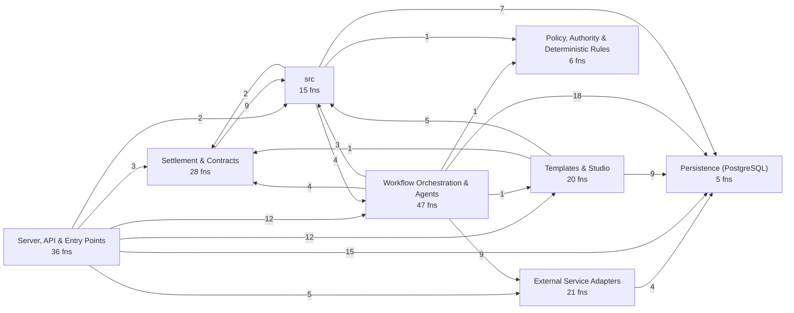
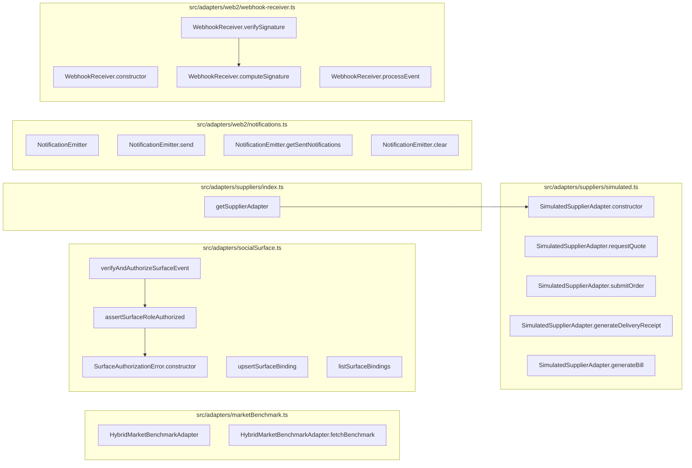
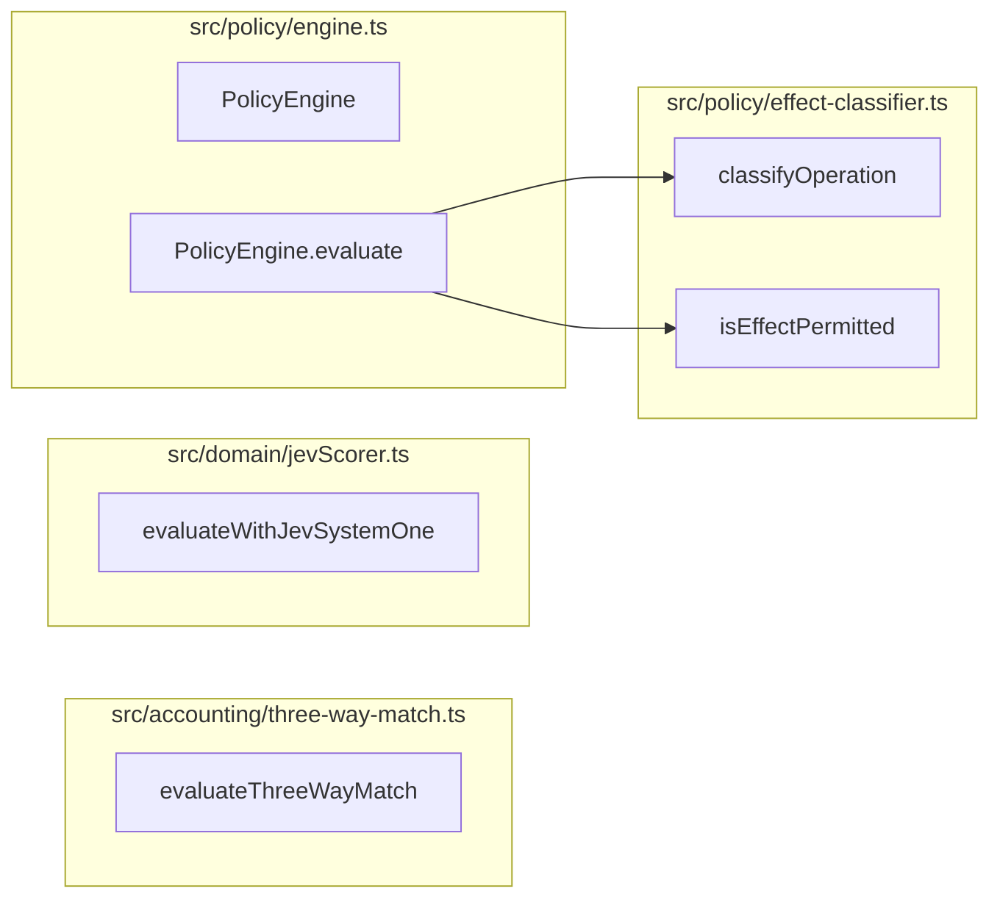
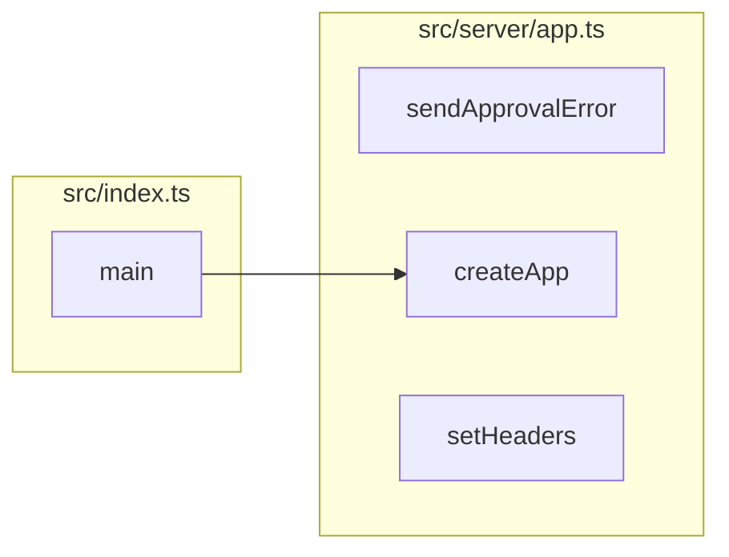
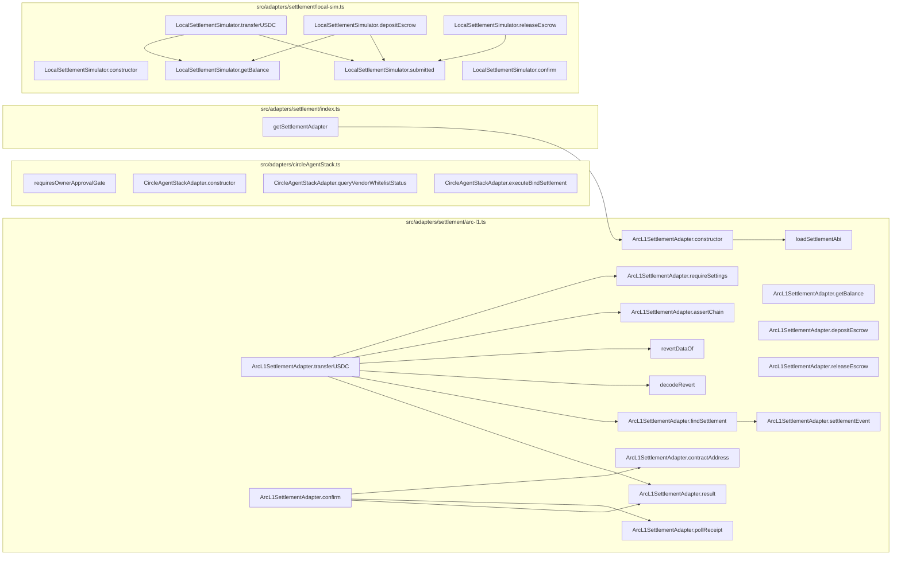
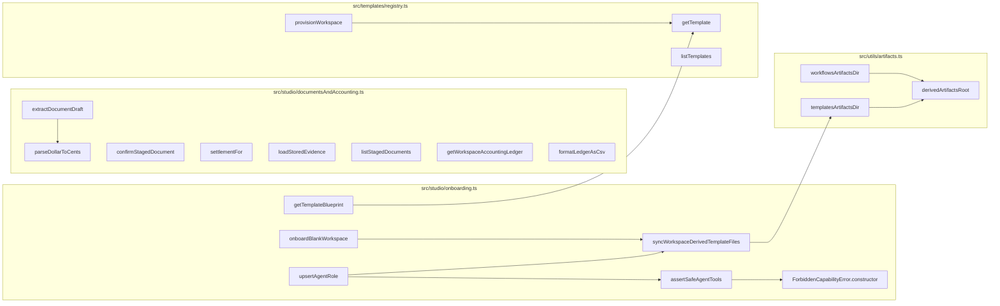
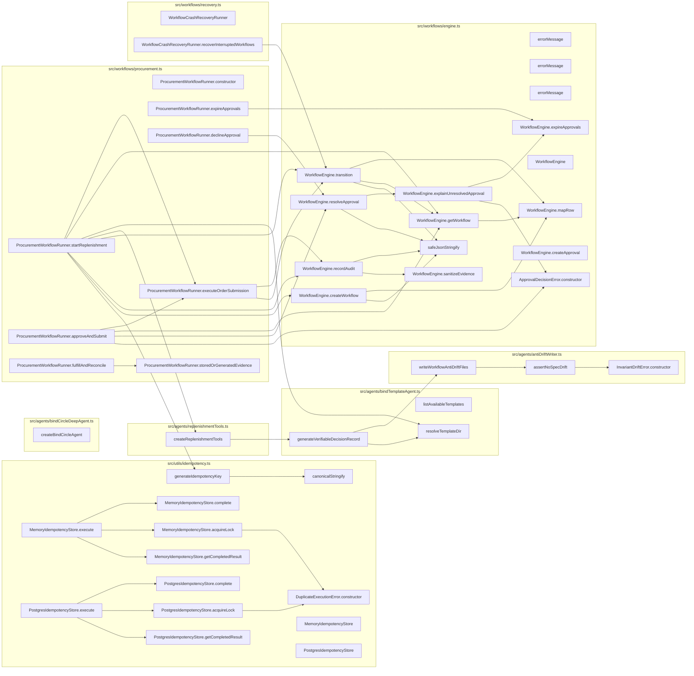
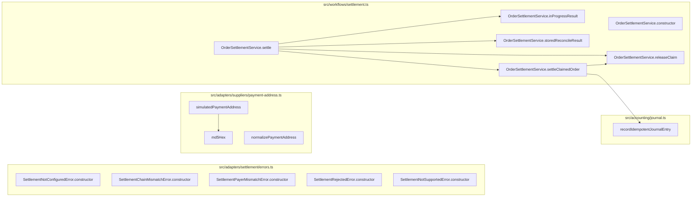

# Codebase map: functions and calls

Generated by `npx tsx scripts/map-functions.ts` from the TypeScript compiler's symbol table. Do not edit by hand.
The browser UI (`src/ui`, plain JavaScript) and the Solidity contract are not included here; see `.ua/knowledge-graph.json` for the contract.

- Functions, methods, handlers and classes: **255** (178 in production code, 77 in tests)
- Resolved call edges: **426**
- HTTP routes: **32**

## Layers and cross-layer calls

## HTTP surface: route to what it calls

| Route | Line | Calls directly |
| --- | --- | --- |
| `GET /health` | 81 | `query` |
| `GET /api/templates` | 91 | `listTemplates` |
| `GET /api/templates/:id/blueprint` | 95 | `getTemplateBlueprint` |
| `GET /api/workspaces` | 104 | `query` |
| `POST /api/workspaces/onboard` | 110 | `onboardBlankWorkspace` |
| `POST /api/workspaces` | 119 | `provisionWorkspace` |
| `GET /api/workspaces/:id` | 132 | `query`, `getSettlementAdapter`, `ArcL1SettlementAdapter.getBalance`, `LocalSettlementSimulator.getBalance` |
| `PUT /api/workspaces/:id/policy` | 152 | `query`, `syncWorkspaceDerivedTemplateFiles` |
| `GET /api/workspaces/:id/inventory` | 190 | `query` |
| `POST /api/workspaces/:id/inventory` | 199 | `query` |
| `POST /api/workspaces/:id/replenish` | 239 | `ProcurementWorkflowRunner.startReplenishment` |
| `GET /api/workspaces/:id/approvals` | 254 | `ProcurementWorkflowRunner.expireApprovals`, `query` |
| `POST /api/approvals/:id/approve` | 264 | `ProcurementWorkflowRunner.approveAndSubmit`, `sendApprovalError` |
| `POST /api/approvals/:id/reject` | 275 | `ProcurementWorkflowRunner.declineApproval`, `sendApprovalError` |
| `POST /api/approvals/:id/revoke` | 291 | `ProcurementWorkflowRunner.declineApproval`, `sendApprovalError` |
| `POST /api/orders/:id/reconcile` | 308 | `ProcurementWorkflowRunner.fulfillAndReconcile` |
| `GET /api/workspaces/:id/workflows` | 319 | `query` |
| `GET /api/workspaces/:id/orders` | 329 | `query` |
| `GET /api/workspaces/:id/suppliers` | 354 | `query` |
| `POST /api/workspaces/:id/suppliers` | 363 | `normalizePaymentAddress`, `simulatedPaymentAddress`, `query` |
| `GET /api/workspaces/:id/agents` | 409 | `query` |
| `POST /api/workspaces/:id/agents` | 422 | `upsertAgentRole` |
| `GET /api/workspaces/:id/surfaces` | 436 | `listSurfaceBindings` |
| `POST /api/workspaces/:id/surfaces` | 442 | `upsertSurfaceBinding` |
| `GET /api/workspaces/:id/documents` | 453 | `listStagedDocuments` |
| `POST /api/workspaces/:id/documents/extract` | 459 | `extractDocumentDraft` |
| `POST /api/workspaces/:id/documents/:docId/confirm` | 469 | `confirmStagedDocument` |
| `GET /api/workspaces/:id/accounting/ledger` | 479 | `getWorkspaceAccountingLedger`, `formatLedgerAsCsv` |
| `GET /api/workspaces/:id/audit` | 499 | `query` |
| `POST /api/workspaces/:id/recover` | 509 | `WorkflowCrashRecoveryRunner.recoverInterruptedWorkflows` |
| `POST /api/webhooks/incoming` | 519 | `verifyAndAuthorizeSurfaceEvent`, `query`, `ProcurementWorkflowRunner.startReplenishment`, `ProcurementWorkflowRunner.approveAndSubmit`, `sendApprovalError`, `ProcurementWorkflowRunner.declineApproval`, `WebhookReceiver.verifySignature`, `WebhookReceiver.processEvent` |
| `GET *` | 648 | SQL or inline logic only |

## External Service Adapters

| Function | File:lines | Kind | Params | Exported | Called by (prod / tests) | Calls |
| --- | --- | --- | --- | --- | --- | --- |
| `HybridMarketBenchmarkAdapter` | src/adapters/marketBenchmark.ts:19-113 | class | 0 | yes | 2 / 1 | 0 |
| `HybridMarketBenchmarkAdapter.fetchBenchmark` | src/adapters/marketBenchmark.ts:20-112 | method | 2 | yes | 2 / 1 | 0 |
| `SurfaceAuthorizationError.constructor` | src/adapters/socialSurface.ts:69-72 | constructor | 1 | yes | 1 / 0 | 0 |
| `assertSurfaceRoleAuthorized` | src/adapters/socialSurface.ts:78-101 | function | 2 | yes | 1 / 1 | 1 |
| `verifyAndAuthorizeSurfaceEvent` | src/adapters/socialSurface.ts:107-124 | function | 1 | yes | 1 / 0 | 2 |
| `upsertSurfaceBinding` | src/adapters/socialSurface.ts:126-171 | function | 2 | yes | 1 / 0 | 1 |
| `listSurfaceBindings` | src/adapters/socialSurface.ts:173-179 | function | 1 | yes | 1 / 0 | 1 |
| `getSupplierAdapter` | src/adapters/suppliers/index.ts:24-34 | function | 1 | yes | 0 / 1 | 1 |
| `SimulatedSupplierAdapter.constructor` | src/adapters/suppliers/simulated.ts:11-16 | constructor | 4 | yes | 2 / 0 | 0 |
| `SimulatedSupplierAdapter.requestQuote` | src/adapters/suppliers/simulated.ts:18-49 | method | 1 | yes | 1 / 0 | 0 |
| `SimulatedSupplierAdapter.submitOrder` | src/adapters/suppliers/simulated.ts:51-60 | method | 1 | yes | 1 / 0 | 0 |
| `SimulatedSupplierAdapter.generateDeliveryReceipt` | src/adapters/suppliers/simulated.ts:62-71 | method | 3 | yes | 1 / 0 | 0 |
| `SimulatedSupplierAdapter.generateBill` | src/adapters/suppliers/simulated.ts:73-86 | method | 5 | yes | 1 / 1 | 0 |
| `NotificationEmitter` | src/adapters/web2/notifications.ts:3-31 | class | 0 | yes | 1 / 0 | 0 |
| `NotificationEmitter.send` | src/adapters/web2/notifications.ts:6-19 | method | 1 | yes | 1 / 0 | 0 |
| `NotificationEmitter.getSentNotifications` | src/adapters/web2/notifications.ts:21-26 | method | 1 | yes | 0 / 1 | 0 |
| `NotificationEmitter.clear` | src/adapters/web2/notifications.ts:28-30 | method | 0 | yes | 0 / 1 | 0 |
| `WebhookReceiver.constructor` | src/adapters/web2/webhook-receiver.ts:6-6 | constructor | 1 | yes | 1 / 0 | 0 |
| `WebhookReceiver.computeSignature` | src/adapters/web2/webhook-receiver.ts:11-16 | method | 2 | yes | 1 / 1 | 0 |
| `WebhookReceiver.verifySignature` | src/adapters/web2/webhook-receiver.ts:21-33 | method | 3 | yes | 1 / 1 | 1 |
| `WebhookReceiver.processEvent` | src/adapters/web2/webhook-receiver.ts:39-60 | method | 1 | yes | 1 / 1 | 1 |

## Persistence (PostgreSQL)

| Function | File:lines | Kind | Params | Exported | Called by (prod / tests) | Calls |
| --- | --- | --- | --- | --- | --- | --- |
| `query` | src/db/client.ts:13-18 | function | 2 | yes | 49 / 26 | 0 |
| `getClient` | src/db/client.ts:20-22 | function | 0 | yes | 0 / 0 | 0 |
| `withTransaction` | src/db/client.ts:24-39 | function | 1 | yes | 3 / 0 | 0 |
| `closePool` | src/db/client.ts:41-43 | function | 0 | yes | 0 / 11 | 0 |
| `runMigrations` | src/db/migrate.ts:9-22 | function | 0 | yes | 2 / 12 | 0 |

## Policy, Authority & Deterministic Rules

| Function | File:lines | Kind | Params | Exported | Called by (prod / tests) | Calls |
| --- | --- | --- | --- | --- | --- | --- |
| `evaluateThreeWayMatch` | src/accounting/three-way-match.ts:18-99 | function | 3 | yes | 1 / 1 | 0 |
| `evaluateWithJevSystemOne` | src/domain/jevScorer.ts:50-241 | function | 1 | yes | 1 / 1 | 0 |
| `classifyOperation` | src/policy/effect-classifier.ts:39-47 | function | 1 | yes | 1 / 1 | 0 |
| `isEffectPermitted` | src/policy/effect-classifier.ts:52-57 | function | 2 | yes | 1 / 0 | 0 |
| `PolicyEngine` | src/policy/engine.ts:10-121 | class | 0 | yes | 0 / 1 | 0 |
| `PolicyEngine.evaluate` | src/policy/engine.ts:15-120 | method | 1 | yes | 0 / 1 | 2 |

## Server, API & Entry Points

| Function | File:lines | Kind | Params | Exported | Called by (prod / tests) | Calls |
| --- | --- | --- | --- | --- | --- | --- |
| `main` | src/index.ts:6-27 | function | 0 | no | 1 / 0 | 3 |
| `sendApprovalError` | src/server/app.ts:47-53 | function | 2 | no | 4 / 0 | 0 |
| `createApp` | src/server/app.ts:55-656 | function | 0 | yes | 1 / 3 | 2 |
| `setHeaders` | src/server/app.ts:72-76 | arrow | 1 | no | 0 / 0 | 0 |

## Settlement & Contracts

| Function | File:lines | Kind | Params | Exported | Called by (prod / tests) | Calls |
| --- | --- | --- | --- | --- | --- | --- |
| `requiresOwnerApprovalGate` | src/adapters/circleAgentStack.ts:44-47 | function | 1 | yes | 0 / 1 | 0 |
| `CircleAgentStackAdapter.constructor` | src/adapters/circleAgentStack.ts:50-53 | constructor | 1 | yes | 1 / 1 | 0 |
| `CircleAgentStackAdapter.queryVendorWhitelistStatus` | src/adapters/circleAgentStack.ts:58-100 | method | 1 | yes | 1 / 1 | 0 |
| `CircleAgentStackAdapter.executeBindSettlement` | src/adapters/circleAgentStack.ts:105-173 | method | 1 | yes | 1 / 1 | 0 |
| `loadSettlementAbi` | src/adapters/settlement/arc-l1.ts:138-153 | function | 0 | no | 1 / 0 | 0 |
| `revertDataOf` | src/adapters/settlement/arc-l1.ts:156-164 | function | 1 | no | 1 / 0 | 0 |
| `decodeRevert` | src/adapters/settlement/arc-l1.ts:166-173 | function | 2 | no | 1 / 0 | 0 |
| `ArcL1SettlementAdapter.constructor` | src/adapters/settlement/arc-l1.ts:193-209 | constructor | 1 | yes | 1 / 2 | 1 |
| `ArcL1SettlementAdapter.getBalance` | src/adapters/settlement/arc-l1.ts:211-225 | method | 1 | yes | 1 / 1 | 0 |
| `ArcL1SettlementAdapter.transferUSDC` | src/adapters/settlement/arc-l1.ts:231-274 | method | 1 | yes | 1 / 1 | 8 |
| `ArcL1SettlementAdapter.confirm` | src/adapters/settlement/arc-l1.ts:281-299 | method | 1 | yes | 0 / 1 | 4 |
| `ArcL1SettlementAdapter.depositEscrow` | src/adapters/settlement/arc-l1.ts:301-303 | method | 2 | yes | 0 / 1 | 1 |
| `ArcL1SettlementAdapter.releaseEscrow` | src/adapters/settlement/arc-l1.ts:305-307 | method | 2 | yes | 0 / 1 | 1 |
| `ArcL1SettlementAdapter.result` | src/adapters/settlement/arc-l1.ts:309-320 | method | 3 | yes | 2 / 0 | 0 |
| `ArcL1SettlementAdapter.contractAddress` | src/adapters/settlement/arc-l1.ts:322-328 | method | 0 | yes | 1 / 0 | 1 |
| `ArcL1SettlementAdapter.requireSettings` | src/adapters/settlement/arc-l1.ts:331-350 | method | 0 | yes | 1 / 0 | 1 |
| `ArcL1SettlementAdapter.assertChain` | src/adapters/settlement/arc-l1.ts:353-358 | method | 0 | yes | 1 / 0 | 1 |
| `ArcL1SettlementAdapter.settlementEvent` | src/adapters/settlement/arc-l1.ts:360-364 | method | 0 | yes | 1 / 0 | 0 |
| `ArcL1SettlementAdapter.findSettlement` | src/adapters/settlement/arc-l1.ts:367-375 | method | 2 | yes | 1 / 0 | 1 |
| `ArcL1SettlementAdapter.pollReceipt` | src/adapters/settlement/arc-l1.ts:377-390 | method | 1 | yes | 1 / 0 | 0 |
| `getSettlementAdapter` | src/adapters/settlement/index.ts:14-27 | function | 1 | yes | 3 / 0 | 1 |
| `LocalSettlementSimulator.constructor` | src/adapters/settlement/local-sim.ts:17-20 | constructor | 0 | yes | 1 / 1 | 0 |
| `LocalSettlementSimulator.getBalance` | src/adapters/settlement/local-sim.ts:22-24 | method | 1 | yes | 3 / 1 | 0 |
| `LocalSettlementSimulator.transferUSDC` | src/adapters/settlement/local-sim.ts:26-40 | method | 1 | yes | 1 / 1 | 2 |
| `LocalSettlementSimulator.confirm` | src/adapters/settlement/local-sim.ts:42-45 | method | 1 | yes | 0 / 1 | 1 |
| `LocalSettlementSimulator.depositEscrow` | src/adapters/settlement/local-sim.ts:47-62 | method | 2 | yes | 0 / 0 | 2 |
| `LocalSettlementSimulator.releaseEscrow` | src/adapters/settlement/local-sim.ts:64-79 | method | 2 | yes | 0 / 0 | 1 |
| `LocalSettlementSimulator.submitted` | src/adapters/settlement/local-sim.ts:81-89 | method | 0 | yes | 3 / 0 | 0 |

## Templates & Studio

| Function | File:lines | Kind | Params | Exported | Called by (prod / tests) | Calls |
| --- | --- | --- | --- | --- | --- | --- |
| `parseDollarToCents` | src/studio/documentsAndAccounting.ts:29-36 | function | 1 | no | 1 / 0 | 0 |
| `extractDocumentDraft` | src/studio/documentsAndAccounting.ts:42-208 | function | 2 | yes | 1 / 1 | 2 |
| `confirmStagedDocument` | src/studio/documentsAndAccounting.ts:215-462 | function | 4 | yes | 1 / 2 | 3 |
| `settlementFor` | src/studio/documentsAndAccounting.ts:407-407 | arrow | 1 | no | 0 / 0 | 1 |
| `loadStoredEvidence` | src/studio/documentsAndAccounting.ts:411-435 | arrow | 1 | no | 0 / 0 | 1 |
| `listStagedDocuments` | src/studio/documentsAndAccounting.ts:464-470 | function | 1 | yes | 1 / 0 | 1 |
| `getWorkspaceAccountingLedger` | src/studio/documentsAndAccounting.ts:472-495 | function | 1 | yes | 1 / 0 | 2 |
| `formatLedgerAsCsv` | src/studio/documentsAndAccounting.ts:497-532 | function | 1 | yes | 1 / 0 | 0 |
| `ForbiddenCapabilityError.constructor` | src/studio/onboarding.ts:29-32 | constructor | 1 | yes | 1 / 0 | 0 |
| `assertSafeAgentTools` | src/studio/onboarding.ts:113-127 | function | 1 | yes | 1 / 0 | 1 |
| `getTemplateBlueprint` | src/studio/onboarding.ts:132-172 | function | 1 | yes | 1 / 0 | 1 |
| `onboardBlankWorkspace` | src/studio/onboarding.ts:178-322 | function | 1 | yes | 1 / 0 | 3 |
| `upsertAgentRole` | src/studio/onboarding.ts:327-397 | function | 2 | yes | 1 / 0 | 3 |
| `syncWorkspaceDerivedTemplateFiles` | src/studio/onboarding.ts:403-487 | function | 1 | yes | 3 / 0 | 2 |
| `getTemplate` | src/templates/registry.ts:12-16 | function | 1 | yes | 2 / 1 | 0 |
| `listTemplates` | src/templates/registry.ts:18-20 | function | 0 | yes | 1 / 1 | 0 |
| `provisionWorkspace` | src/templates/registry.ts:33-160 | function | 4 | yes | 2 / 9 | 3 |
| `derivedArtifactsRoot` | src/utils/artifacts.ts:12-20 | function | 0 | yes | 2 / 0 | 0 |
| `workflowsArtifactsDir` | src/utils/artifacts.ts:22-24 | function | 0 | yes | 1 / 0 | 1 |
| `templatesArtifactsDir` | src/utils/artifacts.ts:26-28 | function | 0 | yes | 1 / 0 | 1 |

## Workflow Orchestration & Agents

| Function | File:lines | Kind | Params | Exported | Called by (prod / tests) | Calls |
| --- | --- | --- | --- | --- | --- | --- |
| `InvariantDriftError.constructor` | src/agents/antiDriftWriter.ts:33-36 | constructor | 1 | yes | 1 / 0 | 0 |
| `assertNoSpecDrift` | src/agents/antiDriftWriter.ts:42-78 | function | 1 | yes | 1 / 1 | 1 |
| `writeWorkflowAntiDriftFiles` | src/agents/antiDriftWriter.ts:91-236 | function | 2 | yes | 2 / 1 | 2 |
| `createBindCircleAgent` | src/agents/bindCircleDeepAgent.ts:15-108 | function | 1 | yes | 0 / 0 | 5 |
| `listAvailableTemplates` | src/agents/bindTemplateAgent.ts:25-43 | function | 0 | yes | 0 / 1 | 0 |
| `resolveTemplateDir` | src/agents/bindTemplateAgent.ts:48-59 | function | 1 | yes | 2 / 1 | 0 |
| `generateVerifiableDecisionRecord` | src/agents/bindTemplateAgent.ts:101-262 | function | 1 | yes | 1 / 1 | 4 |
| `createReplenishmentTools` | src/agents/replenishmentTools.ts:16-648 | function | 1 | yes | 1 / 3 | 4 |
| `DuplicateExecutionError.constructor` | src/utils/idempotency.ts:5-8 | constructor | 1 | yes | 2 / 0 | 0 |
| `canonicalStringify` | src/utils/idempotency.ts:14-23 | function | 1 | no | 1 / 0 | 0 |
| `generateIdempotencyKey` | src/utils/idempotency.ts:28-39 | function | 3 | yes | 1 / 1 | 1 |
| `MemoryIdempotencyStore` | src/utils/idempotency.ts:48-93 | class | 0 | yes | 0 / 1 | 0 |
| `MemoryIdempotencyStore.acquireLock` | src/utils/idempotency.ts:51-58 | method | 3 | yes | 1 / 1 | 1 |
| `MemoryIdempotencyStore.complete` | src/utils/idempotency.ts:60-66 | method | 2 | yes | 1 / 0 | 0 |
| `MemoryIdempotencyStore.getCompletedResult` | src/utils/idempotency.ts:68-74 | method | 1 | yes | 1 / 0 | 0 |
| `MemoryIdempotencyStore.execute` | src/utils/idempotency.ts:76-92 | method | 4 | yes | 0 / 1 | 3 |
| `PostgresIdempotencyStore` | src/utils/idempotency.ts:95-154 | class | 0 | yes | 0 / 0 | 0 |
| `PostgresIdempotencyStore.acquireLock` | src/utils/idempotency.ts:96-116 | method | 3 | yes | 1 / 0 | 2 |
| `PostgresIdempotencyStore.complete` | src/utils/idempotency.ts:118-125 | method | 2 | yes | 1 / 0 | 1 |
| `PostgresIdempotencyStore.getCompletedResult` | src/utils/idempotency.ts:127-136 | method | 1 | yes | 1 / 0 | 1 |
| `PostgresIdempotencyStore.execute` | src/utils/idempotency.ts:138-153 | method | 4 | yes | 0 / 0 | 4 |
| `safeJsonStringify` | src/workflows/engine.ts:6-10 | function | 1 | no | 4 / 0 | 0 |
| `errorMessage` | src/workflows/engine.ts:18-18 | arrow | 0 | no | 0 / 0 | 0 |
| `errorMessage` | src/workflows/engine.ts:21-21 | arrow | 1 | no | 0 / 0 | 0 |
| `errorMessage` | src/workflows/engine.ts:25-25 | arrow | 1 | no | 0 / 0 | 0 |
| `ApprovalDecisionError.constructor` | src/workflows/engine.ts:35-39 | constructor | 2 | yes | 2 / 0 | 0 |
| `WorkflowEngine` | src/workflows/engine.ts:42-289 | class | 0 | yes | 0 / 2 | 0 |
| `WorkflowEngine.mapRow` | src/workflows/engine.ts:43-56 | method | 1 | yes | 3 / 0 | 0 |
| `WorkflowEngine.createWorkflow` | src/workflows/engine.ts:61-76 | method | 5 | yes | 1 / 2 | 3 |
| `WorkflowEngine.getWorkflow` | src/workflows/engine.ts:81-87 | method | 1 | yes | 4 / 2 | 2 |
| `WorkflowEngine.transition` | src/workflows/engine.ts:92-118 | method | 2 | yes | 4 / 2 | 4 |
| `WorkflowEngine.recordAudit` | src/workflows/engine.ts:123-154 | method | 9 | yes | 3 / 0 | 3 |
| `WorkflowEngine.createApproval` | src/workflows/engine.ts:159-176 | method | 8 | yes | 0 / 1 | 1 |
| `WorkflowEngine.resolveApproval` | src/workflows/engine.ts:186-223 | method | 4 | yes | 2 / 0 | 3 |
| `WorkflowEngine.expireApprovals` | src/workflows/engine.ts:229-250 | method | 1 | yes | 2 / 1 | 1 |
| `WorkflowEngine.explainUnresolvedApproval` | src/workflows/engine.ts:256-273 | method | 1 | yes | 1 / 0 | 3 |
| `WorkflowEngine.sanitizeEvidence` | src/workflows/engine.ts:275-288 | method | 1 | yes | 1 / 0 | 0 |
| `ProcurementWorkflowRunner.constructor` | src/workflows/procurement.ts:32-37 | constructor | 1 | yes | 1 / 6 | 2 |
| `ProcurementWorkflowRunner.startReplenishment` | src/workflows/procurement.ts:42-286 | method | 3 | yes | 2 / 5 | 11 |
| `ProcurementWorkflowRunner.approveAndSubmit` | src/workflows/procurement.ts:291-308 | method | 2 | yes | 2 / 2 | 5 |
| `ProcurementWorkflowRunner.expireApprovals` | src/workflows/procurement.ts:313-315 | method | 1 | yes | 1 / 0 | 1 |
| `ProcurementWorkflowRunner.declineApproval` | src/workflows/procurement.ts:321-329 | method | 4 | yes | 3 / 0 | 1 |
| `ProcurementWorkflowRunner.executeOrderSubmission` | src/workflows/procurement.ts:334-401 | method | 4 | yes | 2 / 0 | 4 |
| `ProcurementWorkflowRunner.fulfillAndReconcile` | src/workflows/procurement.ts:408-413 | method | 1 | yes | 1 / 4 | 2 |
| `ProcurementWorkflowRunner.storedOrGeneratedEvidence` | src/workflows/procurement.ts:415-499 | method | 1 | yes | 1 / 0 | 3 |
| `WorkflowCrashRecoveryRunner` | src/workflows/recovery.ts:12-87 | class | 0 | yes | 1 / 1 | 0 |
| `WorkflowCrashRecoveryRunner.recoverInterruptedWorkflows` | src/workflows/recovery.ts:19-86 | method | 0 | yes | 1 / 1 | 2 |

## src

| Function | File:lines | Kind | Params | Exported | Called by (prod / tests) | Calls |
| --- | --- | --- | --- | --- | --- | --- |
| `recordIdempotentJournalEntry` | src/accounting/journal.ts:3-36 | function | 1 | yes | 2 / 0 | 1 |
| `SettlementNotConfiguredError.constructor` | src/adapters/settlement/errors.ts:10-14 | constructor | 1 | yes | 2 / 0 | 0 |
| `SettlementChainMismatchError.constructor` | src/adapters/settlement/errors.ts:22-27 | constructor | 2 | yes | 1 / 0 | 0 |
| `SettlementPayerMismatchError.constructor` | src/adapters/settlement/errors.ts:32-35 | constructor | 0 | yes | 1 / 0 | 0 |
| `SettlementRejectedError.constructor` | src/adapters/settlement/errors.ts:43-48 | constructor | 2 | yes | 3 / 0 | 0 |
| `SettlementNotSupportedError.constructor` | src/adapters/settlement/errors.ts:53-56 | constructor | 1 | yes | 2 / 0 | 0 |
| `md5Hex` | src/adapters/suppliers/payment-address.ts:4-6 | function | 1 | no | 1 / 0 | 0 |
| `simulatedPaymentAddress` | src/adapters/suppliers/payment-address.ts:14-16 | function | 1 | yes | 4 / 3 | 1 |
| `normalizePaymentAddress` | src/adapters/suppliers/payment-address.ts:22-26 | function | 1 | yes | 1 / 1 | 0 |
| `OrderSettlementService.constructor` | src/workflows/settlement.ts:64-66 | constructor | 1 | yes | 2 / 2 | 0 |
| `OrderSettlementService.settle` | src/workflows/settlement.ts:76-142 | method | 2 | yes | 2 / 1 | 5 |
| `OrderSettlementService.releaseClaim` | src/workflows/settlement.ts:145-150 | method | 2 | yes | 2 / 0 | 1 |
| `OrderSettlementService.inProgressResult` | src/workflows/settlement.ts:153-160 | method | 1 | yes | 1 / 0 | 1 |
| `OrderSettlementService.storedReconcileResult` | src/workflows/settlement.ts:162-170 | method | 1 | yes | 1 / 0 | 1 |
| `OrderSettlementService.settleClaimedOrder` | src/workflows/settlement.ts:172-397 | method | 4 | yes | 1 / 0 | 14 |

## Exported but never called from production code

These are exported symbols with no caller in `src/` or `scripts/`. Some are entry points (`main`) or called only from tests, which is the signal that matters.

| Function | File:line | Called from tests |
| --- | --- | --- |
| `requiresOwnerApprovalGate` | src/adapters/circleAgentStack.ts:44 | yes |
| `ArcL1SettlementAdapter.confirm` | src/adapters/settlement/arc-l1.ts:281 | yes |
| `ArcL1SettlementAdapter.depositEscrow` | src/adapters/settlement/arc-l1.ts:301 | yes |
| `ArcL1SettlementAdapter.releaseEscrow` | src/adapters/settlement/arc-l1.ts:305 | yes |
| `LocalSettlementSimulator.confirm` | src/adapters/settlement/local-sim.ts:42 | yes |
| `LocalSettlementSimulator.depositEscrow` | src/adapters/settlement/local-sim.ts:47 | no |
| `LocalSettlementSimulator.releaseEscrow` | src/adapters/settlement/local-sim.ts:64 | no |
| `getSupplierAdapter` | src/adapters/suppliers/index.ts:24 | yes |
| `NotificationEmitter.getSentNotifications` | src/adapters/web2/notifications.ts:21 | yes |
| `NotificationEmitter.clear` | src/adapters/web2/notifications.ts:28 | yes |
| `createBindCircleAgent` | src/agents/bindCircleDeepAgent.ts:15 | no |
| `listAvailableTemplates` | src/agents/bindTemplateAgent.ts:25 | yes |
| `getClient` | src/db/client.ts:20 | no |
| `closePool` | src/db/client.ts:41 | yes |
| `PolicyEngine` | src/policy/engine.ts:10 | yes |
| `PolicyEngine.evaluate` | src/policy/engine.ts:15 | yes |
| `MemoryIdempotencyStore` | src/utils/idempotency.ts:48 | yes |
| `MemoryIdempotencyStore.execute` | src/utils/idempotency.ts:76 | yes |
| `PostgresIdempotencyStore` | src/utils/idempotency.ts:95 | no |
| `PostgresIdempotencyStore.execute` | src/utils/idempotency.ts:138 | no |
| `WorkflowEngine` | src/workflows/engine.ts:42 | yes |
| `WorkflowEngine.createApproval` | src/workflows/engine.ts:159 | yes |

## Production functions with no direct test caller

82 of 146. Indirect coverage through other functions is not counted here.

- `src/accounting/journal.ts`: `recordIdempotentJournalEntry`
- `src/adapters/settlement/arc-l1.ts`: `loadSettlementAbi`, `revertDataOf`, `decodeRevert`, `ArcL1SettlementAdapter.result`, `ArcL1SettlementAdapter.contractAddress`, `ArcL1SettlementAdapter.requireSettings`, `ArcL1SettlementAdapter.assertChain`, `ArcL1SettlementAdapter.settlementEvent`, `ArcL1SettlementAdapter.findSettlement`, `ArcL1SettlementAdapter.pollReceipt`
- `src/adapters/settlement/errors.ts`: `SettlementNotConfiguredError.constructor`, `SettlementChainMismatchError.constructor`, `SettlementPayerMismatchError.constructor`, `SettlementRejectedError.constructor`, `SettlementNotSupportedError.constructor`
- `src/adapters/settlement/index.ts`: `getSettlementAdapter`
- `src/adapters/settlement/local-sim.ts`: `LocalSettlementSimulator.depositEscrow`, `LocalSettlementSimulator.releaseEscrow`, `LocalSettlementSimulator.submitted`
- `src/adapters/socialSurface.ts`: `SurfaceAuthorizationError.constructor`, `verifyAndAuthorizeSurfaceEvent`, `upsertSurfaceBinding`, `listSurfaceBindings`
- `src/adapters/suppliers/payment-address.ts`: `md5Hex`
- `src/adapters/suppliers/simulated.ts`: `SimulatedSupplierAdapter.constructor`, `SimulatedSupplierAdapter.requestQuote`, `SimulatedSupplierAdapter.submitOrder`, `SimulatedSupplierAdapter.generateDeliveryReceipt`
- `src/adapters/web2/notifications.ts`: `NotificationEmitter`, `NotificationEmitter.send`
- `src/adapters/web2/webhook-receiver.ts`: `WebhookReceiver.constructor`
- `src/agents/antiDriftWriter.ts`: `InvariantDriftError.constructor`
- `src/agents/bindCircleDeepAgent.ts`: `createBindCircleAgent`
- `src/db/client.ts`: `getClient`, `withTransaction`
- `src/index.ts`: `main`
- `src/policy/effect-classifier.ts`: `isEffectPermitted`
- `src/server/app.ts`: `sendApprovalError`, `setHeaders`
- `src/studio/documentsAndAccounting.ts`: `parseDollarToCents`, `settlementFor`, `loadStoredEvidence`, `listStagedDocuments`, `getWorkspaceAccountingLedger`, `formatLedgerAsCsv`
- `src/studio/onboarding.ts`: `ForbiddenCapabilityError.constructor`, `assertSafeAgentTools`, `getTemplateBlueprint`, `onboardBlankWorkspace`, `upsertAgentRole`, `syncWorkspaceDerivedTemplateFiles`
- `src/utils/artifacts.ts`: `derivedArtifactsRoot`, `workflowsArtifactsDir`, `templatesArtifactsDir`
- `src/utils/idempotency.ts`: `DuplicateExecutionError.constructor`, `canonicalStringify`, `MemoryIdempotencyStore.complete`, `MemoryIdempotencyStore.getCompletedResult`, `PostgresIdempotencyStore`, `PostgresIdempotencyStore.acquireLock`, `PostgresIdempotencyStore.complete`, `PostgresIdempotencyStore.getCompletedResult`, `PostgresIdempotencyStore.execute`
- `src/workflows/engine.ts`: `safeJsonStringify`, `errorMessage`, `errorMessage`, `errorMessage`, `ApprovalDecisionError.constructor`, `WorkflowEngine.mapRow`, `WorkflowEngine.recordAudit`, `WorkflowEngine.resolveApproval`, `WorkflowEngine.explainUnresolvedApproval`, `WorkflowEngine.sanitizeEvidence`
- `src/workflows/procurement.ts`: `ProcurementWorkflowRunner.expireApprovals`, `ProcurementWorkflowRunner.declineApproval`, `ProcurementWorkflowRunner.executeOrderSubmission`, `ProcurementWorkflowRunner.storedOrGeneratedEvidence`
- `src/workflows/settlement.ts`: `OrderSettlementService.releaseClaim`, `OrderSettlementService.inProgressResult`, `OrderSettlementService.storedReconcileResult`, `OrderSettlementService.settleClaimedOrder`
