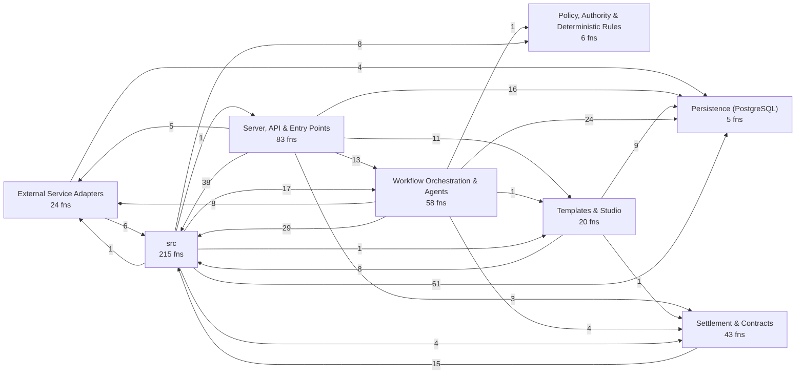
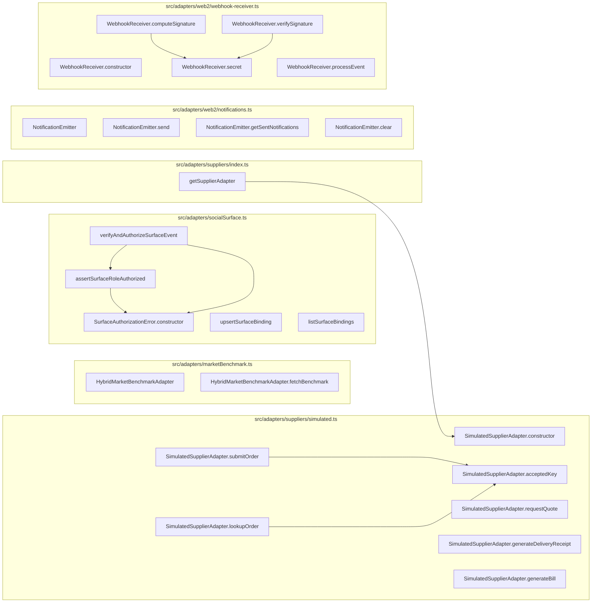
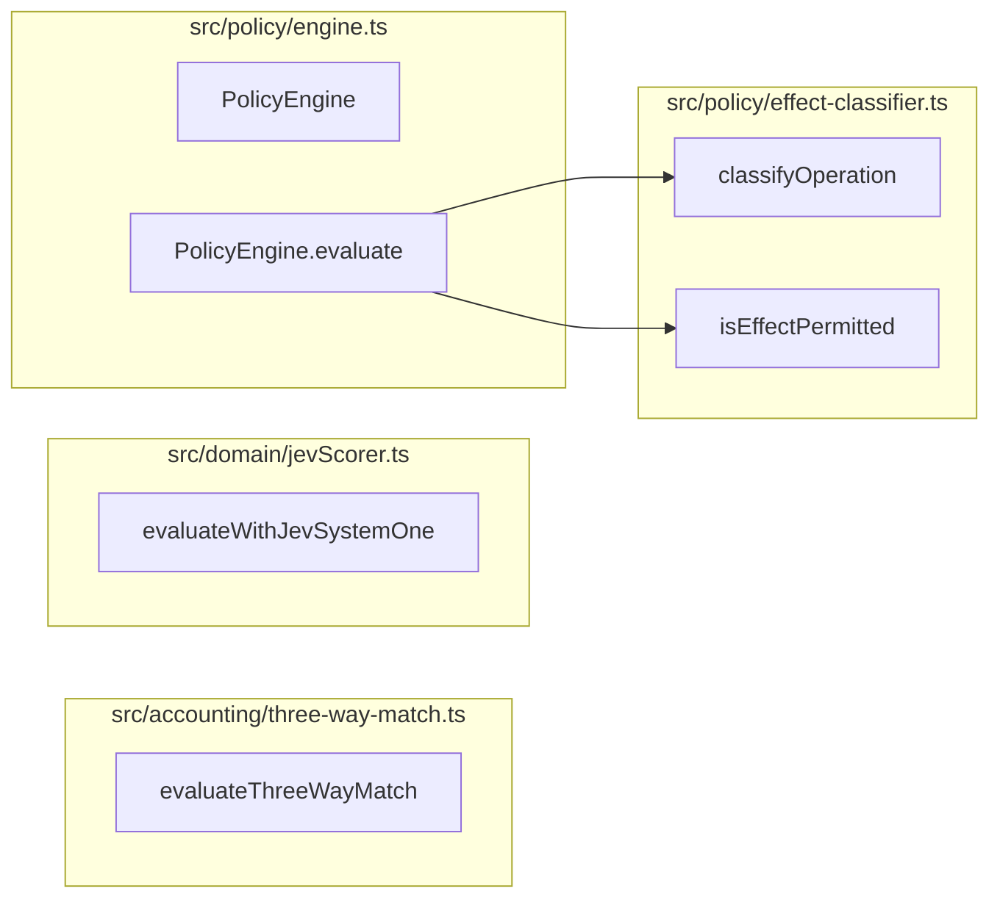
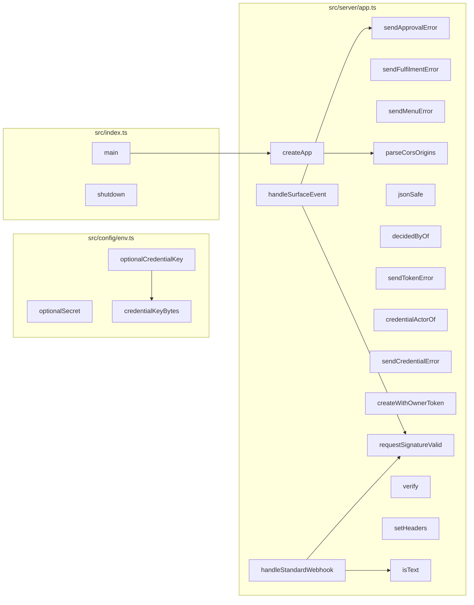
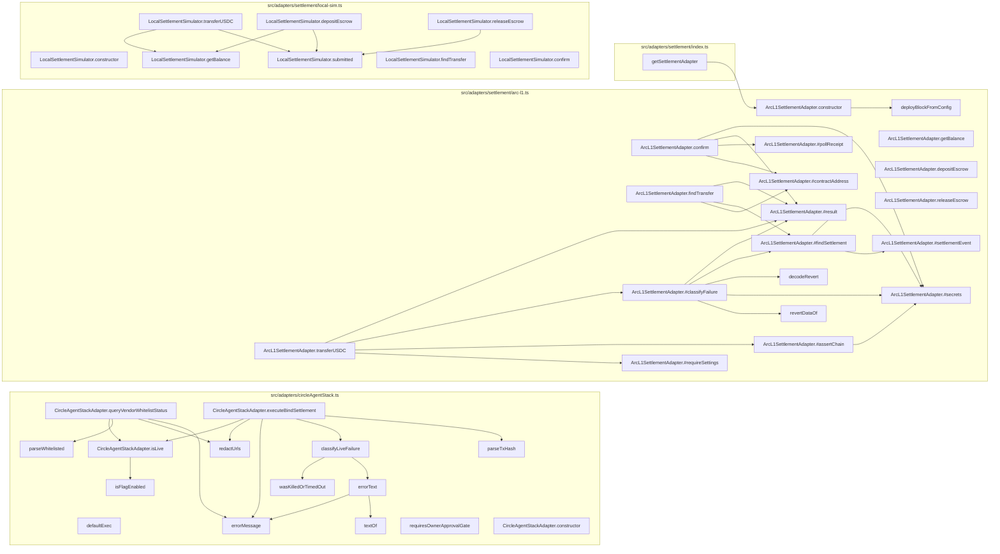
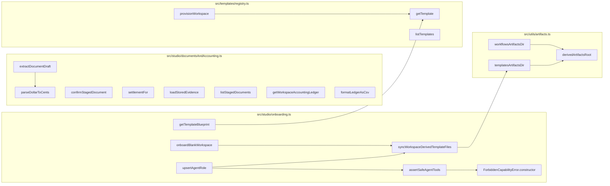
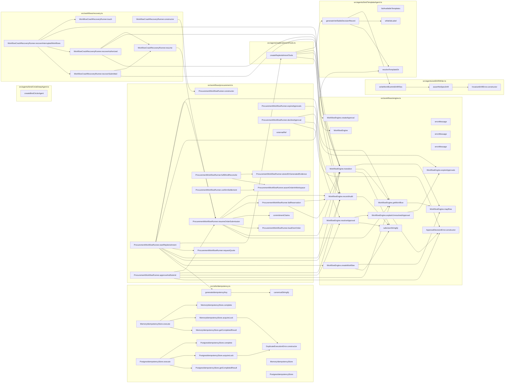

# Codebase map: functions and calls

Generated by `npx tsx scripts/map-functions.ts` from the TypeScript compiler's symbol table. Do not edit by hand.
The browser UI (`src/ui`, plain JavaScript) and the Solidity contract are not included here; see `.ua/knowledge-graph.json` for the contract.

- Functions, methods, handlers and classes: **833** (454 in production code, 379 in tests)
- Resolved call edges: **1628**
- HTTP routes: **61**

## Layers and cross-layer calls

## HTTP surface: route to what it calls

| Route | Line | Calls directly |
| --- | --- | --- |
| `GET /health` | 347 | `query` |
| `GET /api/templates` | 357 | `jsonSafe`, `listTemplates` |
| `GET /api/templates/:id/blueprint` | 361 | `getTemplateBlueprint` |
| `GET /api/workspaces` | 370 | `query` |
| `POST /api/workspaces/onboard` | 380 | `createWithOwnerToken`, `onboardBlankWorkspace`, `jsonSafe` |
| `POST /api/workspaces` | 395 | `createWithOwnerToken`, `provisionWorkspace`, `jsonSafe` |
| `GET /api/workspaces/:id` | 413 | `query`, `getSettlementAdapter`, `ArcL1SettlementAdapter.getBalance`, `LocalSettlementSimulator.getBalance` |
| `PUT /api/workspaces/:id/policy` | 433 | `query`, `syncWorkspaceDerivedTemplateFiles` |
| `GET /api/workspaces/:id/inventory` | 471 | `query` |
| `POST /api/workspaces/:id/inventory` | 480 | `query` |
| `POST /api/workspaces/:id/replenish` | 520 | `ProcurementWorkflowRunner.startReplenishment` |
| `GET /api/workspaces/:id/approvals` | 535 | `ProcurementWorkflowRunner.expireApprovals`, `query` |
| `POST /api/approvals/:id/approve` | 545 | `ProcurementWorkflowRunner.approveAndSubmit`, `decidedByOf`, `sendApprovalError` |
| `POST /api/approvals/:id/reject` | 556 | `ProcurementWorkflowRunner.declineApproval`, `decidedByOf`, `sendApprovalError` |
| `POST /api/approvals/:id/revoke` | 574 | `ProcurementWorkflowRunner.declineApproval`, `decidedByOf`, `sendApprovalError` |
| `POST /api/orders/:id/reconcile` | 593 | `ProcurementWorkflowRunner.fulfillAndReconcile` |
| `POST /api/orders/:id/confirm-settlement` | 609 | `ProcurementWorkflowRunner.confirmSettlement` |
| `GET /api/workspaces/:id/customer-orders` | 626 | `listCustomerOrders`, `sendFulfilmentError` |
| `POST /api/workspaces/:id/customer-orders` | 634 | `sendFulfilmentError`, `acceptCustomerOrder` |
| `GET /api/workspaces/:id/customer-orders/:orderId` | 659 | `getCustomerOrder`, `sendFulfilmentError` |
| `POST /api/workspaces/:id/customer-orders/:orderId/accept` | 669 | `acceptHeldOrder`, `sendFulfilmentError` |
| `POST /api/workspaces/:id/customer-orders/:orderId/cancel` | 677 | `cancelCustomerOrder`, `sendFulfilmentError` |
| `POST /api/workspaces/:id/customer-orders/:orderId/fulfil` | 686 | `fulfilCustomerOrder`, `sendFulfilmentError` |
| `GET /api/workspaces/:id/kitchen-capacity` | 695 | `listKitchenCapacity`, `sendFulfilmentError` |
| `PUT /api/workspaces/:id/kitchen-capacity` | 703 | `sendFulfilmentError`, `setKitchenCapacity` |
| `POST /api/workspaces/:id/feedback` | 725 | `sendMenuError`, `ingestFeedback` |
| `GET /api/workspaces/:id/feedback` | 745 | `listFeedback`, `sendMenuError` |
| `GET /api/workspaces/:id/feedback/summary` | 753 | `sendMenuError`, `summarizeFeedback` |
| `POST /api/workspaces/:id/menu-proposals` | 772 | `sendMenuError`, `proposeMenuChange` |
| `GET /api/workspaces/:id/menu-proposals` | 799 | `listMenuProposals`, `sendMenuError` |
| `POST /api/workspaces/:id/menu-proposals/:proposalId/approve` | 807 | `approveMenuProposal`, `sendMenuError` |
| `POST /api/workspaces/:id/menu-proposals/:proposalId/reject` | 815 | `rejectMenuProposal`, `sendMenuError` |
| `POST /api/workspaces/:id/menu-proposals/:proposalId/cancel` | 823 | `cancelMenuProposal`, `sendMenuError` |
| `POST /api/workspaces/:id/menu-proposals/:proposalId/publish` | 831 | `publishMenuChange`, `sendMenuError` |
| `GET /api/workspaces/:id/menu` | 839 | `listMenu`, `sendMenuError` |
| `GET /api/workspaces/:id/workflows` | 848 | `query` |
| `GET /api/workspaces/:id/orders` | 858 | `query` |
| `GET /api/workspaces/:id/suppliers` | 883 | `query` |
| `POST /api/workspaces/:id/suppliers` | 892 | `normalizePaymentAddress`, `simulatedPaymentAddress`, `query` |
| `GET /api/workspaces/:id/agents` | 938 | `query` |
| `POST /api/workspaces/:id/agents` | 951 | `upsertAgentRole` |
| `GET /api/workspaces/:id/surfaces` | 966 | `listSurfaceBindings` |
| `POST /api/workspaces/:id/surfaces` | 972 | `upsertSurfaceBinding`, `decidedByOf` |
| `GET /api/workspaces/:id/documents` | 983 | `listStagedDocuments` |
| `POST /api/workspaces/:id/documents/extract` | 989 | `extractDocumentDraft` |
| `POST /api/workspaces/:id/documents/:docId/confirm` | 1000 | `confirmStagedDocument`, `decidedByOf` |
| `GET /api/workspaces/:id/accounting/ledger` | 1015 | `getWorkspaceAccountingLedger`, `formatLedgerAsCsv` |
| `GET /api/workspaces/:id/audit` | 1035 | `query` |
| `POST /api/workspaces/:id/recover` | 1045 | `WorkflowCrashRecoveryRunner.recoverInterruptedWorkflows` |
| `POST /api/workspaces/:id/tokens` | 1055 | `issueToken`, `sendTokenError` |
| `GET /api/workspaces/:id/tokens` | 1069 | `listTokens`, `sendTokenError` |
| `DELETE /api/workspaces/:id/tokens/:tokenId` | 1077 | `revokeToken`, `sendTokenError` |
| `PUT /api/workspaces/:id/agents-paused` | 1089 | `setAgentsPaused`, `decidedByOf` |
| `GET /api/workspaces/:id/webhook-secret` | 1105 | `viewWebhookSecret`, `decidedByOf` |
| `POST /api/workspaces/:id/webhook-secret/rotate` | 1117 | `rotateWebhookSecret`, `decidedByOf` |
| `GET /api/workspaces/:id/connectors` | 1131 | `listConnectors`, `sendCredentialError` |
| `PUT /api/workspaces/:id/connectors/:connectorId` | 1139 | `setCredential`, `credentialActorOf`, `sendCredentialError` |
| `DELETE /api/workspaces/:id/connectors/:connectorId` | 1154 | `revokeCredential`, `credentialActorOf`, `sendCredentialError` |
| `POST /api/workspaces/:id/connectors/:connectorId/verify` | 1164 | `verifyCredential`, `credentialActorOf`, `sendCredentialError` |
| `POST /api/webhooks/incoming` | 1175 | `handleSurfaceEvent`, `handleStandardWebhook` |
| `GET *` | 1359 | SQL or inline logic only |

## External Service Adapters

| Function | File:lines | Kind | Params | Exported | Called by (prod / tests) | Calls |
| --- | --- | --- | --- | --- | --- | --- |
| `HybridMarketBenchmarkAdapter` | src/adapters/marketBenchmark.ts:19-113 | class | 0 | yes | 2 / 1 | 0 |
| `HybridMarketBenchmarkAdapter.fetchBenchmark` | src/adapters/marketBenchmark.ts:20-112 | method | 2 | yes | 2 / 1 | 0 |
| `SurfaceAuthorizationError.constructor` | src/adapters/socialSurface.ts:70-73 | constructor | 1 | yes | 2 / 0 | 0 |
| `assertSurfaceRoleAuthorized` | src/adapters/socialSurface.ts:79-102 | function | 2 | yes | 1 / 1 | 1 |
| `verifyAndAuthorizeSurfaceEvent` | src/adapters/socialSurface.ts:109-131 | function | 1 | yes | 1 / 0 | 3 |
| `upsertSurfaceBinding` | src/adapters/socialSurface.ts:139-186 | function | 3 | yes | 1 / 4 | 2 |
| `listSurfaceBindings` | src/adapters/socialSurface.ts:188-194 | function | 1 | yes | 1 / 0 | 1 |
| `getSupplierAdapter` | src/adapters/suppliers/index.ts:24-34 | function | 1 | yes | 0 / 2 | 1 |
| `SimulatedSupplierAdapter.constructor` | src/adapters/suppliers/simulated.ts:20-25 | constructor | 4 | yes | 2 / 3 | 0 |
| `SimulatedSupplierAdapter.acceptedKey` | src/adapters/suppliers/simulated.ts:27-29 | method | 2 | yes | 2 / 0 | 0 |
| `SimulatedSupplierAdapter.requestQuote` | src/adapters/suppliers/simulated.ts:31-62 | method | 1 | yes | 1 / 2 | 0 |
| `SimulatedSupplierAdapter.submitOrder` | src/adapters/suppliers/simulated.ts:65-80 | method | 1 | yes | 1 / 3 | 1 |
| `SimulatedSupplierAdapter.lookupOrder` | src/adapters/suppliers/simulated.ts:83-87 | method | 1 | yes | 0 / 3 | 1 |
| `SimulatedSupplierAdapter.generateDeliveryReceipt` | src/adapters/suppliers/simulated.ts:89-99 | method | 3 | yes | 1 / 2 | 0 |
| `SimulatedSupplierAdapter.generateBill` | src/adapters/suppliers/simulated.ts:101-114 | method | 5 | yes | 1 / 3 | 0 |
| `NotificationEmitter` | src/adapters/web2/notifications.ts:4-32 | class | 0 | yes | 1 / 0 | 0 |
| `NotificationEmitter.send` | src/adapters/web2/notifications.ts:7-20 | method | 1 | yes | 1 / 0 | 1 |
| `NotificationEmitter.getSentNotifications` | src/adapters/web2/notifications.ts:22-27 | method | 1 | yes | 0 / 2 | 0 |
| `NotificationEmitter.clear` | src/adapters/web2/notifications.ts:29-31 | method | 0 | yes | 0 / 4 | 0 |
| `WebhookReceiver.constructor` | src/adapters/web2/webhook-receiver.ts:27-29 | constructor | 1 | yes | 2 / 0 | 0 |
| `WebhookReceiver.secret` | src/adapters/web2/webhook-receiver.ts:31-35 | method | 0 | yes | 2 / 0 | 1 |
| `WebhookReceiver.computeSignature` | src/adapters/web2/webhook-receiver.ts:38-40 | method | 2 | yes | 0 / 1 | 2 |
| `WebhookReceiver.verifySignature` | src/adapters/web2/webhook-receiver.ts:43-50 | method | 3 | yes | 0 / 1 | 2 |
| `WebhookReceiver.processEvent` | src/adapters/web2/webhook-receiver.ts:56-77 | method | 1 | yes | 1 / 1 | 2 |

## Persistence (PostgreSQL)

| Function | File:lines | Kind | Params | Exported | Called by (prod / tests) | Calls |
| --- | --- | --- | --- | --- | --- | --- |
| `query` | src/db/client.ts:13-18 | function | 2 | yes | 90 / 123 | 0 |
| `getClient` | src/db/client.ts:20-22 | function | 0 | yes | 0 / 0 | 0 |
| `withTransaction` | src/db/client.ts:24-39 | function | 1 | yes | 23 / 0 | 0 |
| `closePool` | src/db/client.ts:41-43 | function | 0 | yes | 0 / 30 | 0 |
| `runMigrations` | src/db/migrate.ts:9-22 | function | 0 | yes | 2 / 31 | 0 |

## Policy, Authority & Deterministic Rules

| Function | File:lines | Kind | Params | Exported | Called by (prod / tests) | Calls |
| --- | --- | --- | --- | --- | --- | --- |
| `evaluateThreeWayMatch` | src/accounting/three-way-match.ts:18-99 | function | 3 | yes | 1 / 1 | 0 |
| `evaluateWithJevSystemOne` | src/domain/jevScorer.ts:50-241 | function | 1 | yes | 1 / 1 | 0 |
| `classifyOperation` | src/policy/effect-classifier.ts:45-54 | function | 1 | yes | 2 / 2 | 0 |
| `isEffectPermitted` | src/policy/effect-classifier.ts:59-64 | function | 2 | yes | 1 / 0 | 0 |
| `PolicyEngine` | src/policy/engine.ts:14-60 | class | 0 | yes | 3 / 1 | 0 |
| `PolicyEngine.evaluate` | src/policy/engine.ts:15-59 | method | 1 | yes | 3 / 1 | 2 |

## Server, API & Entry Points

| Function | File:lines | Kind | Params | Exported | Called by (prod / tests) | Calls |
| --- | --- | --- | --- | --- | --- | --- |
| `optionalSecret` | src/config/env.ts:9-14 | function | 1 | no | 1 / 0 | 0 |
| `credentialKeyBytes` | src/config/env.ts:20-24 | function | 1 | yes | 2 / 0 | 0 |
| `optionalCredentialKey` | src/config/env.ts:27-35 | function | 1 | no | 1 / 0 | 1 |
| `main` | src/index.ts:7-52 | function | 0 | no | 1 / 0 | 4 |
| `shutdown` | src/index.ts:38-49 | arrow | 1 | no | 0 / 0 | 0 |
| `sendApprovalError` | src/server/app.ts:99-109 | function | 2 | no | 4 / 0 | 0 |
| `sendFulfilmentError` | src/server/app.ts:112-121 | function | 2 | no | 8 / 0 | 0 |
| `sendMenuError` | src/server/app.ts:148-164 | function | 2 | no | 10 / 0 | 0 |
| `parseCorsOrigins` | src/server/app.ts:197-202 | function | 1 | yes | 1 / 0 | 0 |
| `jsonSafe` | src/server/app.ts:208-210 | function | 1 | no | 3 / 0 | 0 |
| `decidedByOf` | src/server/app.ts:213-215 | function | 1 | no | 8 / 0 | 0 |
| `sendTokenError` | src/server/app.ts:218-224 | function | 2 | no | 3 / 0 | 0 |
| `credentialActorOf` | src/server/app.ts:227-229 | function | 1 | no | 3 / 0 | 0 |
| `sendCredentialError` | src/server/app.ts:232-243 | function | 2 | no | 4 / 0 | 0 |
| `createWithOwnerToken` | src/server/app.ts:255-275 | function | 2 | no | 2 / 0 | 3 |
| `requestSignatureValid` | src/server/app.ts:297-305 | function | 2 | no | 2 / 0 | 1 |
| `createApp` | src/server/app.ts:307-1367 | function | 1 | yes | 1 / 13 | 4 |
| `verify` | src/server/app.ts:326-328 | arrow | 3 | no | 0 / 0 | 0 |
| `setHeaders` | src/server/app.ts:338-342 | arrow | 1 | no | 0 / 0 | 0 |
| `handleSurfaceEvent` | src/server/app.ts:1189-1327 | function | 3 | no | 1 / 0 | 10 |
| `handleStandardWebhook` | src/server/app.ts:1329-1356 | function | 2 | no | 1 / 0 | 3 |
| `isText` | src/server/app.ts:1341-1342 | arrow | 1 | no | 1 / 0 | 0 |

## Settlement & Contracts

| Function | File:lines | Kind | Params | Exported | Called by (prod / tests) | Calls |
| --- | --- | --- | --- | --- | --- | --- |
| `defaultExec` | src/adapters/circleAgentStack.ts:70-73 | arrow | 3 | no | 0 / 0 | 0 |
| `requiresOwnerApprovalGate` | src/adapters/circleAgentStack.ts:75-78 | function | 1 | yes | 0 / 1 | 0 |
| `isFlagEnabled` | src/adapters/circleAgentStack.ts:83-86 | function | 1 | yes | 1 / 1 | 0 |
| `redactUrls` | src/adapters/circleAgentStack.ts:88-90 | function | 1 | no | 2 / 0 | 0 |
| `errorMessage` | src/adapters/circleAgentStack.ts:92-94 | function | 1 | no | 3 / 0 | 0 |
| `textOf` | src/adapters/circleAgentStack.ts:96-100 | function | 1 | no | 1 / 0 | 0 |
| `errorText` | src/adapters/circleAgentStack.ts:103-112 | function | 1 | no | 1 / 0 | 2 |
| `wasKilledOrTimedOut` | src/adapters/circleAgentStack.ts:115-119 | function | 1 | no | 1 / 0 | 0 |
| `classifyLiveFailure` | src/adapters/circleAgentStack.ts:121-124 | function | 1 | no | 1 / 0 | 2 |
| `parseWhitelisted` | src/adapters/circleAgentStack.ts:126-134 | function | 1 | no | 1 / 0 | 0 |
| `parseTxHash` | src/adapters/circleAgentStack.ts:137-146 | function | 1 | no | 1 / 0 | 0 |
| `CircleAgentStackAdapter.constructor` | src/adapters/circleAgentStack.ts:153-157 | constructor | 2 | yes | 1 / 2 | 0 |
| `CircleAgentStackAdapter.isLive` | src/adapters/circleAgentStack.ts:160-162 | method | 0 | yes | 2 / 0 | 1 |
| `CircleAgentStackAdapter.queryVendorWhitelistStatus` | src/adapters/circleAgentStack.ts:167-209 | method | 1 | yes | 1 / 2 | 4 |
| `CircleAgentStackAdapter.executeBindSettlement` | src/adapters/circleAgentStack.ts:215-276 | method | 1 | yes | 1 / 2 | 5 |
| `revertDataOf` | src/adapters/settlement/arc-l1.ts:135-143 | function | 1 | no | 1 / 0 | 0 |
| `decodeRevert` | src/adapters/settlement/arc-l1.ts:145-152 | function | 1 | no | 1 / 0 | 0 |
| `deployBlockFromConfig` | src/adapters/settlement/arc-l1.ts:154-156 | function | 0 | no | 1 / 0 | 0 |
| `ArcL1SettlementAdapter.constructor` | src/adapters/settlement/arc-l1.ts:180-196 | constructor | 1 | yes | 1 / 5 | 1 |
| `ArcL1SettlementAdapter.getBalance` | src/adapters/settlement/arc-l1.ts:198-212 | method | 1 | yes | 1 / 2 | 0 |
| `ArcL1SettlementAdapter.transferUSDC` | src/adapters/settlement/arc-l1.ts:218-258 | method | 1 | yes | 1 / 3 | 6 |
| `ArcL1SettlementAdapter.confirm` | src/adapters/settlement/arc-l1.ts:265-288 | method | 1 | yes | 1 / 1 | 6 |
| `ArcL1SettlementAdapter.findTransfer` | src/adapters/settlement/arc-l1.ts:299-307 | method | 1 | yes | 0 / 1 | 4 |
| `ArcL1SettlementAdapter.depositEscrow` | src/adapters/settlement/arc-l1.ts:309-311 | method | 2 | yes | 0 / 2 | 1 |
| `ArcL1SettlementAdapter.releaseEscrow` | src/adapters/settlement/arc-l1.ts:313-315 | method | 2 | yes | 0 / 2 | 1 |
| `ArcL1SettlementAdapter.#result` | src/adapters/settlement/arc-l1.ts:317-328 | method | 3 | yes | 4 / 0 | 0 |
| `ArcL1SettlementAdapter.#secrets` | src/adapters/settlement/arc-l1.ts:331-333 | method | 0 | yes | 4 / 0 | 0 |
| `ArcL1SettlementAdapter.#classifyFailure` | src/adapters/settlement/arc-l1.ts:339-355 | method | 4 | yes | 1 / 0 | 7 |
| `ArcL1SettlementAdapter.#contractAddress` | src/adapters/settlement/arc-l1.ts:357-363 | method | 0 | yes | 2 / 0 | 1 |
| `ArcL1SettlementAdapter.#requireSettings` | src/adapters/settlement/arc-l1.ts:366-385 | method | 0 | yes | 1 / 0 | 1 |
| `ArcL1SettlementAdapter.#assertChain` | src/adapters/settlement/arc-l1.ts:388-398 | method | 0 | yes | 1 / 0 | 3 |
| `ArcL1SettlementAdapter.#settlementEvent` | src/adapters/settlement/arc-l1.ts:400-404 | method | 0 | yes | 1 / 0 | 0 |
| `ArcL1SettlementAdapter.#findSettlement` | src/adapters/settlement/arc-l1.ts:410-428 | method | 2 | yes | 2 / 0 | 3 |
| `ArcL1SettlementAdapter.#pollReceipt` | src/adapters/settlement/arc-l1.ts:430-443 | method | 1 | yes | 1 / 0 | 0 |
| `getSettlementAdapter` | src/adapters/settlement/index.ts:14-27 | function | 1 | yes | 3 / 0 | 1 |
| `LocalSettlementSimulator.constructor` | src/adapters/settlement/local-sim.ts:24-27 | constructor | 0 | yes | 1 / 1 | 0 |
| `LocalSettlementSimulator.getBalance` | src/adapters/settlement/local-sim.ts:29-31 | method | 1 | yes | 3 / 1 | 0 |
| `LocalSettlementSimulator.transferUSDC` | src/adapters/settlement/local-sim.ts:33-56 | method | 1 | yes | 1 / 1 | 2 |
| `LocalSettlementSimulator.findTransfer` | src/adapters/settlement/local-sim.ts:59-61 | method | 1 | yes | 0 / 1 | 0 |
| `LocalSettlementSimulator.confirm` | src/adapters/settlement/local-sim.ts:63-66 | method | 1 | yes | 1 / 1 | 1 |
| `LocalSettlementSimulator.depositEscrow` | src/adapters/settlement/local-sim.ts:68-83 | method | 2 | yes | 0 / 0 | 2 |
| `LocalSettlementSimulator.releaseEscrow` | src/adapters/settlement/local-sim.ts:85-100 | method | 2 | yes | 0 / 0 | 1 |
| `LocalSettlementSimulator.submitted` | src/adapters/settlement/local-sim.ts:102-110 | method | 0 | yes | 3 / 0 | 0 |

## Templates & Studio

| Function | File:lines | Kind | Params | Exported | Called by (prod / tests) | Calls |
| --- | --- | --- | --- | --- | --- | --- |
| `parseDollarToCents` | src/studio/documentsAndAccounting.ts:32-39 | function | 1 | no | 1 / 0 | 0 |
| `extractDocumentDraft` | src/studio/documentsAndAccounting.ts:45-214 | function | 3 | yes | 1 / 1 | 3 |
| `confirmStagedDocument` | src/studio/documentsAndAccounting.ts:221-468 | function | 4 | yes | 1 / 2 | 3 |
| `settlementFor` | src/studio/documentsAndAccounting.ts:413-413 | arrow | 1 | no | 0 / 0 | 1 |
| `loadStoredEvidence` | src/studio/documentsAndAccounting.ts:417-441 | arrow | 1 | no | 0 / 0 | 1 |
| `listStagedDocuments` | src/studio/documentsAndAccounting.ts:470-476 | function | 1 | yes | 1 / 0 | 1 |
| `getWorkspaceAccountingLedger` | src/studio/documentsAndAccounting.ts:478-501 | function | 1 | yes | 1 / 0 | 2 |
| `formatLedgerAsCsv` | src/studio/documentsAndAccounting.ts:503-538 | function | 1 | yes | 1 / 0 | 0 |
| `ForbiddenCapabilityError.constructor` | src/studio/onboarding.ts:31-34 | constructor | 1 | yes | 1 / 0 | 0 |
| `assertSafeAgentTools` | src/studio/onboarding.ts:115-129 | function | 1 | yes | 1 / 0 | 1 |
| `getTemplateBlueprint` | src/studio/onboarding.ts:134-174 | function | 1 | yes | 1 / 0 | 1 |
| `onboardBlankWorkspace` | src/studio/onboarding.ts:180-326 | function | 2 | yes | 1 / 0 | 4 |
| `upsertAgentRole` | src/studio/onboarding.ts:331-403 | function | 3 | yes | 1 / 0 | 4 |
| `syncWorkspaceDerivedTemplateFiles` | src/studio/onboarding.ts:409-493 | function | 1 | yes | 3 / 0 | 2 |
| `getTemplate` | src/templates/registry.ts:12-16 | function | 1 | yes | 2 / 1 | 0 |
| `listTemplates` | src/templates/registry.ts:18-20 | function | 0 | yes | 1 / 1 | 0 |
| `provisionWorkspace` | src/templates/registry.ts:38-179 | function | 4 | yes | 2 / 27 | 3 |
| `derivedArtifactsRoot` | src/utils/artifacts.ts:12-20 | function | 0 | yes | 2 / 0 | 0 |
| `workflowsArtifactsDir` | src/utils/artifacts.ts:22-24 | function | 0 | yes | 1 / 0 | 1 |
| `templatesArtifactsDir` | src/utils/artifacts.ts:26-28 | function | 0 | yes | 1 / 0 | 1 |

## Workflow Orchestration & Agents

| Function | File:lines | Kind | Params | Exported | Called by (prod / tests) | Calls |
| --- | --- | --- | --- | --- | --- | --- |
| `InvariantDriftError.constructor` | src/agents/antiDriftWriter.ts:33-36 | constructor | 1 | yes | 1 / 0 | 0 |
| `assertNoSpecDrift` | src/agents/antiDriftWriter.ts:42-78 | function | 1 | yes | 1 / 1 | 1 |
| `writeWorkflowAntiDriftFiles` | src/agents/antiDriftWriter.ts:91-241 | function | 2 | yes | 2 / 1 | 2 |
| `createBindCircleAgent` | src/agents/bindCircleDeepAgent.ts:15-108 | function | 1 | yes | 0 / 0 | 5 |
| `listAvailableTemplates` | src/agents/bindTemplateAgent.ts:25-43 | function | 0 | yes | 0 / 1 | 0 |
| `resolveTemplateDir` | src/agents/bindTemplateAgent.ts:48-59 | function | 1 | yes | 2 / 1 | 0 |
| `whitelistLabel` | src/agents/bindTemplateAgent.ts:105-109 | function | 1 | no | 1 / 0 | 0 |
| `generateVerifiableDecisionRecord` | src/agents/bindTemplateAgent.ts:113-274 | function | 1 | yes | 1 / 2 | 5 |
| `createReplenishmentTools` | src/agents/replenishmentTools.ts:25-675 | function | 1 | yes | 1 / 7 | 15 |
| `DuplicateExecutionError.constructor` | src/utils/idempotency.ts:5-8 | constructor | 1 | yes | 2 / 0 | 0 |
| `canonicalStringify` | src/utils/idempotency.ts:15-24 | function | 1 | yes | 2 / 0 | 0 |
| `generateIdempotencyKey` | src/utils/idempotency.ts:29-40 | function | 3 | yes | 1 / 2 | 1 |
| `MemoryIdempotencyStore` | src/utils/idempotency.ts:50-95 | class | 0 | yes | 0 / 1 | 0 |
| `MemoryIdempotencyStore.acquireLock` | src/utils/idempotency.ts:53-60 | method | 3 | yes | 1 / 1 | 1 |
| `MemoryIdempotencyStore.complete` | src/utils/idempotency.ts:62-68 | method | 2 | yes | 1 / 0 | 0 |
| `MemoryIdempotencyStore.getCompletedResult` | src/utils/idempotency.ts:70-76 | method | 1 | yes | 1 / 0 | 0 |
| `MemoryIdempotencyStore.execute` | src/utils/idempotency.ts:78-94 | method | 4 | yes | 0 / 1 | 3 |
| `PostgresIdempotencyStore` | src/utils/idempotency.ts:98-157 | class | 0 | yes | 0 / 0 | 0 |
| `PostgresIdempotencyStore.acquireLock` | src/utils/idempotency.ts:99-119 | method | 3 | yes | 1 / 0 | 2 |
| `PostgresIdempotencyStore.complete` | src/utils/idempotency.ts:121-128 | method | 2 | yes | 1 / 0 | 1 |
| `PostgresIdempotencyStore.getCompletedResult` | src/utils/idempotency.ts:130-139 | method | 1 | yes | 1 / 0 | 1 |
| `PostgresIdempotencyStore.execute` | src/utils/idempotency.ts:141-156 | method | 4 | yes | 0 / 0 | 4 |
| `safeJsonStringify` | src/workflows/engine.ts:8-12 | function | 1 | no | 4 / 0 | 0 |
| `errorMessage` | src/workflows/engine.ts:20-20 | arrow | 0 | no | 0 / 0 | 0 |
| `errorMessage` | src/workflows/engine.ts:23-23 | arrow | 1 | no | 0 / 0 | 0 |
| `errorMessage` | src/workflows/engine.ts:27-27 | arrow | 1 | no | 0 / 0 | 0 |
| `ApprovalDecisionError.constructor` | src/workflows/engine.ts:38-43 | constructor | 3 | yes | 3 / 0 | 0 |
| `WorkflowEngine` | src/workflows/engine.ts:46-290 | class | 0 | yes | 4 / 10 | 0 |
| `WorkflowEngine.mapRow` | src/workflows/engine.ts:47-60 | method | 1 | yes | 3 / 0 | 0 |
| `WorkflowEngine.createWorkflow` | src/workflows/engine.ts:65-80 | method | 5 | yes | 1 / 13 | 3 |
| `WorkflowEngine.getWorkflow` | src/workflows/engine.ts:85-91 | method | 1 | yes | 5 / 8 | 2 |
| `WorkflowEngine.transition` | src/workflows/engine.ts:96-122 | method | 2 | yes | 7 / 9 | 4 |
| `WorkflowEngine.recordAudit` | src/workflows/engine.ts:127-158 | method | 9 | yes | 12 / 0 | 4 |
| `WorkflowEngine.createApproval` | src/workflows/engine.ts:163-180 | method | 8 | yes | 1 / 6 | 1 |
| `WorkflowEngine.resolveApproval` | src/workflows/engine.ts:190-227 | method | 4 | yes | 2 / 0 | 3 |
| `WorkflowEngine.expireApprovals` | src/workflows/engine.ts:237-266 | method | 1 | yes | 3 / 1 | 1 |
| `WorkflowEngine.explainUnresolvedApproval` | src/workflows/engine.ts:272-289 | method | 1 | yes | 1 / 0 | 3 |
| `commitmentClaims` | src/workflows/procurement.ts:48-58 | function | 3 | no | 1 / 0 | 0 |
| `ProcurementWorkflowRunner.constructor` | src/workflows/procurement.ts:68-73 | constructor | 1 | yes | 4 / 14 | 2 |
| `ProcurementWorkflowRunner.startReplenishment` | src/workflows/procurement.ts:78-312 | method | 4 | yes | 3 / 12 | 12 |
| `ProcurementWorkflowRunner.approveAndSubmit` | src/workflows/procurement.ts:317-380 | method | 3 | yes | 2 / 3 | 8 |
| `ProcurementWorkflowRunner.expireApprovals` | src/workflows/procurement.ts:385-387 | method | 1 | yes | 1 / 0 | 1 |
| `ProcurementWorkflowRunner.declineApproval` | src/workflows/procurement.ts:393-417 | method | 5 | yes | 3 / 0 | 4 |
| `ProcurementWorkflowRunner.requestQuote` | src/workflows/procurement.ts:424-473 | method | 1 | yes | 1 / 1 | 3 |
| `ProcurementWorkflowRunner.resumeOrderSubmission` | src/workflows/procurement.ts:483-649 | method | 1 | yes | 3 / 1 | 13 |
| `externalRef` | src/workflows/procurement.ts:582-582 | arrow | 1 | no | 0 / 0 | 0 |
| `ProcurementWorkflowRunner.loadOwnOrder` | src/workflows/procurement.ts:652-659 | method | 2 | yes | 1 / 0 | 1 |
| `ProcurementWorkflowRunner.failReservation` | src/workflows/procurement.ts:662-687 | method | 3 | yes | 1 / 0 | 3 |
| `ProcurementWorkflowRunner.fulfillAndReconcile` | src/workflows/procurement.ts:694-700 | method | 2 | yes | 1 / 8 | 3 |
| `ProcurementWorkflowRunner.confirmSettlement` | src/workflows/procurement.ts:706-709 | method | 2 | yes | 2 / 2 | 2 |
| `ProcurementWorkflowRunner.assertOrderInWorkspace` | src/workflows/procurement.ts:712-717 | method | 2 | yes | 2 / 0 | 2 |
| `ProcurementWorkflowRunner.storedOrGeneratedEvidence` | src/workflows/procurement.ts:719-803 | method | 1 | yes | 1 / 0 | 3 |
| `WorkflowCrashRecoveryRunner.constructor` | src/workflows/recovery.ts:34-36 | constructor | 1 | yes | 2 / 3 | 1 |
| `WorkflowCrashRecoveryRunner.recoverInterruptedWorkflows` | src/workflows/recovery.ts:48-96 | method | 1 | yes | 2 / 3 | 5 |
| `WorkflowCrashRecoveryRunner.touch` | src/workflows/recovery.ts:99-105 | method | 1 | yes | 1 / 0 | 1 |
| `WorkflowCrashRecoveryRunner.recoverSubmitted` | src/workflows/recovery.ts:107-141 | method | 2 | yes | 1 / 0 | 3 |
| `WorkflowCrashRecoveryRunner.recoverAuthorized` | src/workflows/recovery.ts:143-187 | method | 2 | yes | 1 / 0 | 6 |
| `WorkflowCrashRecoveryRunner.resume` | src/workflows/recovery.ts:189-197 | method | 3 | yes | 2 / 0 | 1 |

## src

| Function | File:lines | Kind | Params | Exported | Called by (prod / tests) | Calls |
| --- | --- | --- | --- | --- | --- | --- |
| `JournalConflictError.constructor` | src/accounting/journal.ts:8-11 | constructor | 1 | yes | 1 / 0 | 0 |
| `recordIdempotentJournalEntry` | src/accounting/journal.ts:20-59 | function | 1 | yes | 2 / 1 | 2 |
| `SettlementNotConfiguredError.constructor` | src/adapters/settlement/errors.ts:12-16 | constructor | 1 | yes | 2 / 0 | 0 |
| `SettlementChainMismatchError.constructor` | src/adapters/settlement/errors.ts:24-29 | constructor | 2 | yes | 1 / 0 | 0 |
| `SettlementPayerMismatchError.constructor` | src/adapters/settlement/errors.ts:34-37 | constructor | 0 | yes | 1 / 0 | 0 |
| `SettlementRejectedError.constructor` | src/adapters/settlement/errors.ts:45-50 | constructor | 2 | yes | 4 / 1 | 0 |
| `SettlementNotSupportedError.constructor` | src/adapters/settlement/errors.ts:55-58 | constructor | 1 | yes | 2 / 0 | 0 |
| `SettlementTransportError.constructor` | src/adapters/settlement/errors.ts:68-72 | constructor | 2 | yes | 2 / 1 | 0 |
| `redactSecrets` | src/adapters/settlement/errors.ts:79-81 | function | 2 | yes | 1 / 1 | 2 |
| `transportErrorFrom` | src/adapters/settlement/errors.ts:84-93 | function | 3 | yes | 4 / 0 | 2 |
| `md5Hex` | src/adapters/suppliers/payment-address.ts:4-6 | function | 1 | no | 1 / 0 | 0 |
| `simulatedPaymentAddress` | src/adapters/suppliers/payment-address.ts:14-16 | function | 1 | yes | 4 / 3 | 1 |
| `normalizePaymentAddress` | src/adapters/suppliers/payment-address.ts:22-26 | function | 1 | yes | 1 / 1 | 0 |
| `classifyRequestEvidence` | src/agents/evidence-classification.ts:12-23 | function | 1 | yes | 1 / 1 | 0 |
| `bearerToken` | src/auth/middleware.ts:18-23 | function | 1 | no | 1 / 0 | 0 |
| `authenticate` | src/auth/middleware.ts:29-48 | function | 3 | yes | 0 / 0 | 2 |
| `scopeToWorkspace` | src/auth/middleware.ts:54-64 | function | 3 | yes | 0 / 0 | 0 |
| `requireRole` | src/auth/middleware.ts:67-79 | function | 1 | yes | 1 / 0 | 0 |
| `TokenError.constructor` | src/auth/tokens.ts:55-59 | constructor | 2 | yes | 3 / 0 | 0 |
| `generateToken` | src/auth/tokens.ts:62-64 | function | 0 | yes | 1 / 1 | 0 |
| `hashToken` | src/auth/tokens.ts:66-68 | function | 1 | yes | 3 / 1 | 0 |
| `isWellFormedToken` | src/auth/tokens.ts:70-72 | function | 1 | yes | 2 / 0 | 0 |
| `validateIssue` | src/auth/tokens.ts:74-83 | function | 2 | no | 2 / 0 | 1 |
| `writeTokenAudit` | src/auth/tokens.ts:85-97 | function | 5 | no | 2 / 0 | 1 |
| `issueToken` | src/auth/tokens.ts:103-125 | function | 4 | yes | 2 / 12 | 6 |
| `resolveToken` | src/auth/tokens.ts:131-146 | function | 1 | yes | 1 / 1 | 3 |
| `revokeToken` | src/auth/tokens.ts:153-191 | function | 3 | yes | 1 / 0 | 3 |
| `listTokens` | src/auth/tokens.ts:194-207 | function | 1 | yes | 1 / 0 | 1 |
| `ensureSecretOwnerToken` | src/auth/tokens.ts:214-227 | function | 3 | yes | 1 / 0 | 6 |
| `CredentialStoreDisabledError.constructor` | src/credentials/crypto.ts:16-19 | constructor | 0 | yes | 1 / 0 | 0 |
| `CredentialDecryptError.constructor` | src/credentials/crypto.ts:24-27 | constructor | 1 | yes | 1 / 0 | 0 |
| `keyIdOf` | src/credentials/crypto.ts:65-67 | function | 1 | yes | 1 / 0 | 0 |
| `credentialKeyFromBase64` | src/credentials/crypto.ts:70-74 | function | 1 | yes | 1 / 1 | 2 |
| `keyringFromConfig` | src/credentials/crypto.ts:80-88 | function | 0 | yes | 6 / 0 | 2 |
| `aadOf` | src/credentials/crypto.ts:90-92 | function | 1 | no | 2 / 0 | 0 |
| `fingerprintOf` | src/credentials/crypto.ts:94-97 | function | 2 | no | 1 / 0 | 0 |
| `encryptSecret` | src/credentials/crypto.ts:100-113 | function | 3 | yes | 2 / 1 | 2 |
| `decryptSecret` | src/credentials/crypto.ts:116-130 | function | 3 | yes | 3 / 1 | 2 |
| `CredentialInputError.constructor` | src/credentials/store.ts:72-75 | constructor | 1 | yes | 3 / 0 | 0 |
| `CredentialNotFoundError.constructor` | src/credentials/store.ts:80-83 | constructor | 0 | yes | 1 / 0 | 0 |
| `checkConnectorId` | src/credentials/store.ts:86-93 | function | 1 | no | 3 / 0 | 1 |
| `checkKind` | src/credentials/store.ts:95-100 | function | 1 | no | 1 / 0 | 1 |
| `checkSecret` | src/credentials/store.ts:102-107 | function | 1 | no | 1 / 0 | 1 |
| `summaryOf` | src/credentials/store.ts:109-118 | function | 1 | no | 2 / 0 | 0 |
| `writeCredentialAudit` | src/credentials/store.ts:123-136 | function | 6 | no | 4 / 0 | 1 |
| `setCredential` | src/credentials/store.ts:142-175 | function | 1 | yes | 1 / 1 | 9 |
| `listConnectors` | src/credentials/store.ts:178-185 | function | 1 | yes | 1 / 1 | 2 |
| `revokeCredential` | src/credentials/store.ts:191-215 | function | 3 | yes | 1 / 1 | 5 |
| `getCredentialForAdapter` | src/credentials/store.ts:222-242 | function | 2 | yes | 0 / 1 | 3 |
| `verifyCredential` | src/credentials/store.ts:249-336 | function | 3 | yes | 1 / 1 | 10 |
| `rotateCredentialKeys` | src/credentials/store.ts:343-389 | function | 0 | yes | 0 / 1 | 6 |
| `registerVerifier` | src/credentials/verifiers.ts:22-26 | function | 2 | yes | 0 / 1 | 0 |
| `findVerifier` | src/credentials/verifiers.ts:29-31 | function | 2 | yes | 1 / 0 | 0 |
| `clearVerifiers` | src/credentials/verifiers.ts:34-36 | function | 0 | yes | 0 / 1 | 0 |
| `sleep` | src/db/advisory-lock.ts:21-21 | arrow | 1 | no | 1 / 0 | 0 |
| `acquireAdvisoryLock` | src/db/advisory-lock.ts:24-52 | function | 2 | yes | 5 / 1 | 1 |
| `release` | src/db/advisory-lock.ts:40-44 | arrow | 0 | no | 0 / 0 | 0 |
| `setEffectFault` | src/effects/faults.ts:24-29 | function | 1 | yes | 0 / 7 | 0 |
| `takeEffectFault` | src/effects/faults.ts:32-37 | function | 2 | yes | 1 / 0 | 0 |
| `EffectConflictError.constructor` | src/effects/ledger.ts:70-73 | constructor | 1 | yes | 1 / 0 | 0 |
| `EffectInDoubtError.constructor` | src/effects/ledger.ts:82-91 | constructor | 3 | yes | 2 / 0 | 0 |
| `newEffectId` | src/effects/ledger.ts:103-105 | function | 0 | no | 1 / 0 | 0 |
| `validateSpec` | src/effects/ledger.ts:107-126 | function | 1 | no | 1 / 0 | 1 |
| `boundedErrorMessage` | src/effects/ledger.ts:132-135 | function | 1 | yes | 4 / 0 | 2 |
| `assertSameRequest` | src/effects/ledger.ts:137-141 | function | 3 | no | 2 / 0 | 1 |
| `loadByKey` | src/effects/ledger.ts:143-159 | function | 1 | no | 2 / 0 | 1 |
| `markCompleted` | src/effects/ledger.ts:161-168 | function | 3 | no | 2 / 0 | 2 |
| `markFailed` | src/effects/ledger.ts:170-179 | function | 2 | no | 1 / 0 | 2 |
| `executeCall` | src/effects/ledger.ts:182-199 | function | 4 | no | 1 / 0 | 3 |
| `runLocked` | src/effects/ledger.ts:201-256 | function | 4 | no | 1 / 0 | 8 |
| `reportBusy` | src/effects/ledger.ts:259-267 | function | 2 | no | 1 / 0 | 4 |
| `runEffect` | src/effects/ledger.ts:273-289 | function | 3 | yes | 4 / 2 | 5 |
| `listUnresolvedEffects` | src/effects/ledger.ts:292-316 | function | 1 | yes | 0 / 3 | 1 |
| `isPlainObject` | src/effects/serialize.ts:20-23 | function | 1 | no | 1 / 0 | 0 |
| `toTagged` | src/effects/serialize.ts:26-62 | function | 2 | no | 2 / 0 | 1 |
| `fromTagged` | src/effects/serialize.ts:64-88 | function | 1 | no | 2 / 0 | 1 |
| `mapValues` | src/effects/serialize.ts:90-94 | function | 1 | no | 1 / 0 | 1 |
| `encodeResult` | src/effects/serialize.ts:100-103 | function | 1 | yes | 1 / 1 | 1 |
| `decodeResult` | src/effects/serialize.ts:106-108 | function | 1 | yes | 2 / 2 | 1 |
| `requestHash` | src/effects/serialize.ts:114-118 | function | 1 | yes | 2 / 2 | 2 |
| `sendOwnerNotification` | src/notifications/dispatch.ts:33-76 | function | 1 | yes | 2 / 1 | 3 |
| `sendApprovalNotification` | src/notifications/dispatch.ts:82-90 | function | 1 | yes | 1 / 1 | 1 |
| `approvalLink` | src/notifications/links.ts:7-9 | function | 1 | yes | 1 / 0 | 0 |
| `customerOrderLink` | src/notifications/links.ts:15-17 | function | 1 | yes | 1 / 0 | 0 |
| `resolveOwnerRecipient` | src/notifications/recipients.ts:19-33 | function | 1 | yes | 2 / 1 | 1 |
| `orderNumberFor` | src/orders/reservation.ts:33-35 | function | 1 | yes | 1 / 2 | 0 |
| `spendLockKey` | src/orders/reservation.ts:37-39 | function | 1 | yes | 1 / 0 | 0 |
| `loadStoredQuote` | src/orders/reservation.ts:41-61 | function | 2 | yes | 1 / 0 | 1 |
| `hasApprovedEscalation` | src/orders/reservation.ts:64-70 | function | 2 | yes | 2 / 0 | 1 |
| `reserveOrder` | src/orders/reservation.ts:94-145 | function | 1 | yes | 1 / 0 | 5 |
| `spendStatusesSql` | src/orders/statuses.ts:20-22 | function | 0 | yes | 2 / 1 | 0 |
| `decideCommitment` | src/policy/commitment-gate.ts:78-171 | function | 2 | yes | 1 / 1 | 2 |
| `loadCommitmentFacts` | src/policy/commitment-gate.ts:174-240 | function | 1 | yes | 1 / 0 | 2 |
| `authorizeCommitment` | src/policy/commitment-gate.ts:242-244 | function | 1 | yes | 5 / 1 | 2 |
| `usd` | src/policy/commitment-gate.ts:260-262 | function | 1 | no | 1 / 0 | 0 |
| `describeCommitmentDecision` | src/policy/commitment-gate.ts:265-278 | function | 1 | yes | 4 / 0 | 1 |
| `provisionDemoWorkspace` | src/server/demo.ts:11-16 | function | 0 | yes | 1 / 0 | 2 |
| `writeControlAudit` | src/studio/workspaceControls.ts:17-30 | function | 6 | no | 3 / 0 | 1 |
| `setAgentsPaused` | src/studio/workspaceControls.ts:36-55 | function | 4 | yes | 2 / 4 | 2 |
| `viewWebhookSecret` | src/studio/workspaceControls.ts:63-75 | function | 3 | yes | 1 / 0 | 3 |
| `rotateWebhookSecret` | src/studio/workspaceControls.ts:81-97 | function | 3 | yes | 1 / 0 | 3 |
| `newId` | src/utils/ids.ts:9-14 | function | 1 | yes | 26 / 1 | 0 |
| `safeString` | src/utils/redact.ts:65-72 | function | 1 | no | 2 / 0 | 0 |
| `configuredSecrets` | src/utils/redact.ts:75-92 | function | 0 | no | 1 / 0 | 0 |
| `scrubUrl` | src/utils/redact.ts:95-110 | function | 1 | no | 1 / 0 | 0 |
| `redactText` | src/utils/redact.ts:117-133 | function | 2 | yes | 5 / 1 | 3 |
| `redactUrls` | src/utils/redact.ts:139-141 | function | 1 | yes | 3 / 0 | 1 |
| `keyNamesSecret` | src/utils/redact.ts:148-158 | function | 1 | yes | 1 / 0 | 0 |
| `redactDeep` | src/utils/redact.ts:164-170 | function | 2 | yes | 1 / 1 | 1 |
| `walk` | src/utils/redact.ts:172-204 | function | 4 | no | 1 / 0 | 2 |
| `WebhookNotConfiguredError.constructor` | src/webhooks/signing.ts:13-16 | constructor | 0 | yes | 2 / 0 | 0 |
| `workspaceWebhookSecret` | src/webhooks/signing.ts:30-36 | function | 3 | yes | 3 / 4 | 1 |
| `signPayload` | src/webhooks/signing.ts:39-45 | function | 3 | yes | 2 / 6 | 0 |
| `verifySignature` | src/webhooks/signing.ts:62-82 | function | 1 | yes | 2 / 1 | 1 |
| `emptyReport` | src/workers/runner.ts:80-88 | function | 0 | no | 1 / 0 | 0 |
| `boundedMessage` | src/workers/runner.ts:91-94 | function | 1 | no | 3 / 0 | 1 |
| `resolved` | src/workers/runner.ts:96-106 | function | 1 | no | 1 / 0 | 0 |
| `runStep` | src/workers/runner.ts:113-133 | function | 3 | no | 1 / 0 | 2 |
| `expiryStep` | src/workers/runner.ts:135-137 | function | 2 | no | 1 / 0 | 2 |
| `recoveryStep` | src/workers/runner.ts:139-148 | function | 2 | no | 1 / 0 | 2 |
| `settlementPollStep` | src/workers/runner.ts:155-184 | function | 2 | no | 1 / 0 | 4 |
| `stuckSettlingStep` | src/workers/runner.ts:191-208 | function | 2 | no | 1 / 0 | 3 |
| `recoverStuckOrder` | src/workers/runner.ts:215-251 | function | 2 | no | 1 / 0 | 2 |
| `runTick` | src/workers/runner.ts:254-262 | function | 1 | yes | 1 / 1 | 7 |
| `startWorker` | src/workers/runner.ts:268-321 | function | 1 | yes | 1 / 1 | 2 |
| `runOnce` | src/workers/runner.ts:276-283 | arrow | 0 | no | 2 / 0 | 1 |
| `schedule` | src/workers/runner.ts:285-298 | arrow | 0 | no | 1 / 0 | 1 |
| `termsOf` | src/workflows/feedback-summary.ts:48-56 | function | 1 | no | 1 / 0 | 0 |
| `compareText` | src/workflows/feedback-summary.ts:58-60 | function | 2 | no | 1 / 0 | 0 |
| `firstCharacters` | src/workflows/feedback-summary.ts:63-65 | function | 2 | no | 1 / 0 | 0 |
| `summarizeTexts` | src/workflows/feedback-summary.ts:67-87 | function | 1 | yes | 1 / 2 | 3 |
| `FeedbackError.constructor` | src/workflows/feedback.ts:18-22 | constructor | 2 | yes | 1 / 0 | 0 |
| `invalid` | src/workflows/feedback.ts:39-41 | function | 1 | no | 2 / 0 | 1 |
| `writeAudit` | src/workflows/feedback.ts:44-56 | function | 5 | no | 1 / 0 | 1 |
| `ingestFeedback` | src/workflows/feedback.ts:62-104 | function | 1 | yes | 1 / 2 | 4 |
| `summarizeFeedback` | src/workflows/feedback.ts:121-135 | function | 2 | yes | 1 / 1 | 3 |
| `listFeedback` | src/workflows/feedback.ts:138-152 | function | 1 | yes | 1 / 1 | 1 |
| `hasOwn` | src/workflows/fulfilment-promise.ts:54-54 | arrow | 2 | no | 1 / 0 | 0 |
| `invalidLineReasons` | src/workflows/fulfilment-promise.ts:57-71 | function | 1 | no | 1 / 0 | 0 |
| `decidePromise` | src/workflows/fulfilment-promise.ts:73-121 | function | 2 | yes | 1 / 1 | 2 |
| `FulfilmentError.constructor` | src/workflows/fulfilment.ts:65-69 | constructor | 2 | yes | 8 / 0 | 0 |
| `invalid` | src/workflows/fulfilment.ts:158-160 | function | 1 | no | 6 / 0 | 1 |
| `checkExternalRef` | src/workflows/fulfilment.ts:162-167 | function | 1 | no | 1 / 0 | 1 |
| `checkLines` | src/workflows/fulfilment.ts:169-180 | function | 1 | no | 1 / 0 | 1 |
| `checkDate` | src/workflows/fulfilment.ts:182-186 | function | 2 | no | 2 / 0 | 1 |
| `normaliseNote` | src/workflows/fulfilment.ts:189-194 | function | 1 | yes | 1 / 0 | 0 |
| `compareSku` | src/workflows/fulfilment.ts:196-198 | function | 2 | no | 1 / 0 | 0 |
| `identityHash` | src/workflows/fulfilment.ts:201-208 | function | 2 | no | 1 / 0 | 2 |
| `toView` | src/workflows/fulfilment.ts:210-226 | function | 2 | no | 3 / 0 | 0 |
| `loadLines` | src/workflows/fulfilment.ts:228-241 | function | 2 | no | 4 / 0 | 0 |
| `lockOrder` | src/workflows/fulfilment.ts:244-251 | function | 3 | no | 3 / 0 | 1 |
| `writeAudit` | src/workflows/fulfilment.ts:253-280 | function | 2 | no | 4 / 0 | 1 |
| `decideLocked` | src/workflows/fulfilment.ts:286-358 | function | 6 | no | 2 / 0 | 3 |
| `recordDecision` | src/workflows/fulfilment.ts:361-424 | function | 2 | no | 2 / 0 | 2 |
| `resultOf` | src/workflows/fulfilment.ts:426-434 | function | 2 | no | 1 / 0 | 0 |
| `acceptCustomerOrder` | src/workflows/fulfilment.ts:441-506 | function | 3 | yes | 1 / 2 | 13 |
| `acceptHeldOrder` | src/workflows/fulfilment.ts:512-546 | function | 4 | yes | 1 / 2 | 8 |
| `noticeMessage` | src/workflows/fulfilment.ts:578-584 | function | 3 | no | 1 / 0 | 0 |
| `recordSystemAudit` | src/workflows/fulfilment.ts:589-600 | function | 6 | no | 2 / 0 | 1 |
| `notifyOwnerOfDecision` | src/workflows/fulfilment.ts:606-650 | function | 4 | no | 1 / 0 | 6 |
| `availableLevel` | src/workflows/fulfilment.ts:653-664 | function | 2 | no | 1 / 0 | 1 |
| `restockIfLow` | src/workflows/fulfilment.ts:671-716 | function | 3 | no | 1 / 0 | 6 |
| `triggerRestockAfterAcceptance` | src/workflows/fulfilment.ts:719-725 | function | 3 | no | 1 / 0 | 1 |
| `afterNewDecision` | src/workflows/fulfilment.ts:728-737 | function | 3 | no | 2 / 0 | 2 |
| `cancelCustomerOrder` | src/workflows/fulfilment.ts:743-777 | function | 3 | yes | 1 / 1 | 5 |
| `fulfilCustomerOrder` | src/workflows/fulfilment.ts:783-838 | function | 3 | yes | 1 / 1 | 5 |
| `setKitchenCapacity` | src/workflows/fulfilment.ts:844-893 | function | 3 | yes | 1 / 3 | 7 |
| `listKitchenCapacity` | src/workflows/fulfilment.ts:895-914 | function | 2 | yes | 2 / 0 | 0 |
| `viewAfter` | src/workflows/fulfilment.ts:916-921 | function | 3 | no | 2 / 0 | 3 |
| `getCustomerOrder` | src/workflows/fulfilment.ts:924-929 | function | 2 | yes | 1 / 1 | 3 |
| `listCustomerOrders` | src/workflows/fulfilment.ts:932-940 | function | 1 | yes | 1 / 0 | 3 |
| `MenuError.constructor` | src/workflows/menu.ts:42-46 | constructor | 2 | yes | 8 / 0 | 0 |
| `invalid` | src/workflows/menu.ts:93-95 | function | 1 | no | 9 / 0 | 1 |
| `characterCount` | src/workflows/menu.ts:97-99 | function | 1 | no | 2 / 0 | 0 |
| `checkName` | src/workflows/menu.ts:101-109 | function | 1 | no | 1 / 0 | 2 |
| `checkOptionalText` | src/workflows/menu.ts:112-119 | function | 3 | no | 2 / 0 | 2 |
| `checkPrice` | src/workflows/menu.ts:121-126 | function | 1 | no | 1 / 0 | 1 |
| `checkItemId` | src/workflows/menu.ts:128-133 | function | 1 | no | 1 / 0 | 1 |
| `checkChange` | src/workflows/menu.ts:135-155 | function | 1 | no | 1 / 0 | 5 |
| `checkSourceFeedbackIds` | src/workflows/menu.ts:157-169 | function | 1 | no | 1 / 0 | 1 |
| `requireWorkspace` | src/workflows/menu.ts:171-174 | function | 1 | no | 4 / 0 | 1 |
| `requireLabel` | src/workflows/menu.ts:176-179 | function | 1 | no | 4 / 0 | 1 |
| `identityOf` | src/workflows/menu.ts:182-184 | function | 1 | no | 2 / 0 | 0 |
| `requireGrant` | src/workflows/menu.ts:187-206 | function | 4 | no | 2 / 0 | 3 |
| `requireNotPaused` | src/workflows/menu.ts:212-215 | function | 2 | no | 2 / 0 | 1 |
| `writeAudit` | src/workflows/menu.ts:217-235 | function | 2 | no | 4 / 0 | 1 |
| `lockProposal` | src/workflows/menu.ts:238-245 | function | 3 | no | 3 / 0 | 1 |
| `requireItem` | src/workflows/menu.ts:247-254 | function | 4 | no | 2 / 0 | 1 |
| `toProposalView` | src/workflows/menu.ts:256-269 | function | 1 | no | 4 / 0 | 0 |
| `withRefusalAudit` | src/workflows/menu.ts:291-313 | function | 2 | no | 2 / 0 | 2 |
| `proposeMenuChange` | src/workflows/menu.ts:320-371 | function | 2 | yes | 1 / 2 | 14 |
| `approveMenuProposal` | src/workflows/menu.ts:374-376 | function | 3 | yes | 1 / 2 | 2 |
| `rejectMenuProposal` | src/workflows/menu.ts:379-381 | function | 3 | yes | 1 / 1 | 2 |
| `decideProposal` | src/workflows/menu.ts:383-410 | function | 5 | no | 2 / 0 | 6 |
| `cancelMenuProposal` | src/workflows/menu.ts:413-435 | function | 3 | yes | 1 / 1 | 7 |
| `publishMenuChange` | src/workflows/menu.ts:442-526 | function | 3 | yes | 1 / 2 | 12 |
| `listMenuProposals` | src/workflows/menu.ts:529-535 | function | 1 | yes | 1 / 1 | 1 |
| `listMenu` | src/workflows/menu.ts:538-552 | function | 1 | yes | 1 / 2 | 1 |
| `SettlementOrderError.constructor` | src/workflows/settlement.ts:58-66 | constructor | 2 | yes | 3 / 0 | 0 |
| `outcomeOf` | src/workflows/settlement.ts:97-101 | function | 1 | no | 2 / 0 | 0 |
| `OrderSettlementService.constructor` | src/workflows/settlement.ts:113-115 | constructor | 1 | yes | 2 / 2 | 0 |
| `OrderSettlementService.settle` | src/workflows/settlement.ts:126-197 | method | 2 | yes | 2 / 1 | 6 |
| `OrderSettlementService.confirmSettlement` | src/workflows/settlement.ts:205-241 | method | 1 | yes | 1 / 0 | 8 |
| `OrderSettlementService.releaseClaim` | src/workflows/settlement.ts:244-249 | method | 2 | yes | 4 / 0 | 1 |
| `OrderSettlementService.inProgressResult` | src/workflows/settlement.ts:252-259 | method | 1 | yes | 2 / 0 | 1 |
| `OrderSettlementService.storedReconcileResult` | src/workflows/settlement.ts:261-269 | method | 1 | yes | 2 / 0 | 1 |
| `OrderSettlementService.awaitingResult` | src/workflows/settlement.ts:275-283 | method | 2 | yes | 3 / 0 | 1 |
| `OrderSettlementService.orderOrThrow` | src/workflows/settlement.ts:285-291 | method | 1 | yes | 1 / 0 | 2 |
| `OrderSettlementService.holdClaim` | src/workflows/settlement.ts:297-312 | method | 3 | yes | 2 / 0 | 2 |
| `OrderSettlementService.confirmOnce` | src/workflows/settlement.ts:315-323 | method | 2 | yes | 2 / 0 | 11 |
| `OrderSettlementService.confirmClaimedOrder` | src/workflows/settlement.ts:330-387 | method | 1 | yes | 1 / 0 | 7 |
| `OrderSettlementService.matchStatusOf` | src/workflows/settlement.ts:389-392 | method | 1 | yes | 1 / 0 | 1 |
| `OrderSettlementService.finaliseConfirmedPayment` | src/workflows/settlement.ts:400-475 | method | 2 | yes | 2 / 0 | 7 |
| `OrderSettlementService.settleClaimedOrder` | src/workflows/settlement.ts:477-734 | method | 4 | yes | 1 / 0 | 19 |
| `externalRef` | src/workflows/settlement.ts:649-649 | arrow | 1 | no | 0 / 0 | 0 |

```mermaid
flowchart LR
  subgraph F0["src/accounting/journal.ts"]
    n0["JournalConflictError.constructor"]
    n1["recordIdempotentJournalEntry"]
  end
  subgraph F1["src/adapters/settlement/errors.ts"]
    n39["SettlementNotConfiguredError.constructor"]
    n40["SettlementChainMismatchError.constructor"]
    n41["SettlementPayerMismatchError.constructor"]
    n42["SettlementRejectedError.constructor"]
    n43["SettlementNotSupportedError.constructor"]
    n44["SettlementTransportError.constructor"]
    n45["redactSecrets"]
    n46["transportErrorFrom"]
  end
  subgraph F2["src/adapters/suppliers/payment-address.ts"]
    n62["md5Hex"]
    n63["simulatedPaymentAddress"]
    n64["normalizePaymentAddress"]
  end
  subgraph F3["src/agents/evidence-classification.ts"]
    n89["classifyRequestEvidence"]
  end
  subgraph F4["src/auth/middleware.ts"]
    n91["bearerToken"]
    n92["authenticate"]
    n93["scopeToWorkspace"]
    n94["requireRole"]
  end
  subgraph F5["src/auth/tokens.ts"]
    n95["TokenError.constructor"]
    n96["generateToken"]
    n97["hashToken"]
    n98["isWellFormedToken"]
    n99["validateIssue"]
    n100["writeTokenAudit"]
    n101["issueToken"]
    n102["resolveToken"]
    n103["revokeToken"]
    n104["listTokens"]
    n105["ensureSecretOwnerToken"]
  end
  subgraph F6["src/credentials/crypto.ts"]
    n109["CredentialStoreDisabledError.constructor"]
    n110["CredentialDecryptError.constructor"]
    n111["keyIdOf"]
    n112["credentialKeyFromBase64"]
    n113["keyringFromConfig"]
    n114["aadOf"]
    n115["fingerprintOf"]
    n116["encryptSecret"]
    n117["decryptSecret"]
  end
  subgraph F7["src/credentials/store.ts"]
    n118["CredentialInputError.constructor"]
    n119["CredentialNotFoundError.constructor"]
    n120["checkConnectorId"]
    n121["checkKind"]
    n122["checkSecret"]
    n123["summaryOf"]
    n124["writeCredentialAudit"]
    n125["setCredential"]
    n126["listConnectors"]
    n127["revokeCredential"]
    n128["getCredentialForAdapter"]
    n129["verifyCredential"]
    n130["rotateCredentialKeys"]
  end
  subgraph F8["src/credentials/verifiers.ts"]
    n131["registerVerifier"]
    n132["findVerifier"]
    n133["clearVerifiers"]
  end
  subgraph F9["src/db/advisory-lock.ts"]
    n134["sleep"]
    n135["acquireAdvisoryLock"]
    n136["release"]
  end
  subgraph F10["src/effects/faults.ts"]
    n143["setEffectFault"]
    n144["takeEffectFault"]
  end
  subgraph F11["src/effects/ledger.ts"]
    n145["EffectConflictError.constructor"]
    n146["EffectInDoubtError.constructor"]
    n147["newEffectId"]
    n148["validateSpec"]
    n149["boundedErrorMessage"]
    n150["assertSameRequest"]
    n151["loadByKey"]
    n152["markCompleted"]
    n153["markFailed"]
    n154["executeCall"]
    n155["runLocked"]
    n156["reportBusy"]
    n157["runEffect"]
    n158["listUnresolvedEffects"]
  end
  subgraph F12["src/effects/serialize.ts"]
    n159["isPlainObject"]
    n160["toTagged"]
    n161["fromTagged"]
    n162["mapValues"]
    n163["encodeResult"]
    n164["decodeResult"]
    n165["requestHash"]
  end
  subgraph F13["src/notifications/dispatch.ts"]
    n168["sendOwnerNotification"]
    n169["sendApprovalNotification"]
  end
  subgraph F14["src/notifications/links.ts"]
    n170["approvalLink"]
    n171["customerOrderLink"]
  end
  subgraph F15["src/notifications/recipients.ts"]
    n172["resolveOwnerRecipient"]
  end
  subgraph F16["src/orders/reservation.ts"]
    n173["orderNumberFor"]
    n174["spendLockKey"]
    n175["loadStoredQuote"]
    n176["hasApprovedEscalation"]
    n177["reserveOrder"]
  end
  subgraph F17["src/orders/statuses.ts"]
    n178["spendStatusesSql"]
  end
  subgraph F18["src/policy/commitment-gate.ts"]
    n179["decideCommitment"]
    n180["loadCommitmentFacts"]
    n181["authorizeCommitment"]
    n182["usd"]
    n183["describeCommitmentDecision"]
  end
  subgraph F19["src/server/demo.ts"]
    n266["provisionDemoWorkspace"]
  end
  subgraph F20["src/studio/workspaceControls.ts"]
    n281["writeControlAudit"]
    n282["setAgentsPaused"]
    n283["viewWebhookSecret"]
    n284["rotateWebhookSecret"]
  end
  subgraph F21["src/utils/ids.ts"]
    n304["newId"]
  end
  subgraph F22["src/utils/redact.ts"]
    n305["safeString"]
    n306["configuredSecrets"]
    n307["scrubUrl"]
    n308["redactText"]
    n309["redactUrls"]
    n310["keyNamesSecret"]
    n311["redactDeep"]
    n312["walk"]
  end
  subgraph F23["src/webhooks/signing.ts"]
    n313["WebhookNotConfiguredError.constructor"]
    n314["workspaceWebhookSecret"]
    n315["signPayload"]
    n316["verifySignature"]
  end
  subgraph F24["src/workers/runner.ts"]
    n317["emptyReport"]
    n318["boundedMessage"]
    n319["resolved"]
    n320["runStep"]
    n321["expiryStep"]
    n322["recoveryStep"]
    n323["settlementPollStep"]
    n324["stuckSettlingStep"]
    n325["recoverStuckOrder"]
    n326["runTick"]
    n327["startWorker"]
    n328["runOnce"]
    n329["schedule"]
  end
  subgraph F25["src/workflows/feedback-summary.ts"]
    n345["termsOf"]
    n346["compareText"]
    n347["firstCharacters"]
    n348["summarizeTexts"]
  end
  subgraph F26["src/workflows/feedback.ts"]
    n349["FeedbackError.constructor"]
    n350["invalid"]
    n351["writeAudit"]
    n352["ingestFeedback"]
    n353["summarizeFeedback"]
    n354["listFeedback"]
  end
  subgraph F27["src/workflows/fulfilment-promise.ts"]
    n355["hasOwn"]
    n356["invalidLineReasons"]
    n357["decidePromise"]
  end
  subgraph F28["src/workflows/fulfilment.ts"]
    n358["FulfilmentError.constructor"]
    n359["invalid"]
    n360["checkExternalRef"]
    n361["checkLines"]
    n362["checkDate"]
    n363["normaliseNote"]
    n364["compareSku"]
    n365["identityHash"]
    n366["toView"]
    n367["loadLines"]
    n368["lockOrder"]
    n369["writeAudit"]
    n370["decideLocked"]
    n371["recordDecision"]
    n372["resultOf"]
    n373["acceptCustomerOrder"]
    n374["acceptHeldOrder"]
    n375["noticeMessage"]
    n376["recordSystemAudit"]
    n377["notifyOwnerOfDecision"]
    n378["availableLevel"]
    n379["restockIfLow"]
    n380["triggerRestockAfterAcceptance"]
    n381["afterNewDecision"]
    n382["cancelCustomerOrder"]
    n383["fulfilCustomerOrder"]
    n384["setKitchenCapacity"]
    n385["listKitchenCapacity"]
    n386["viewAfter"]
    n387["getCustomerOrder"]
    n388["listCustomerOrders"]
  end
  subgraph F29["src/workflows/menu.ts"]
    n389["MenuError.constructor"]
    n390["invalid"]
    n391["characterCount"]
    n392["checkName"]
    n393["checkOptionalText"]
    n394["checkPrice"]
    n395["checkItemId"]
    n396["checkChange"]
    n397["checkSourceFeedbackIds"]
    n398["requireWorkspace"]
    n399["requireLabel"]
    n400["identityOf"]
    n401["requireGrant"]
    n402["requireNotPaused"]
    n403["writeAudit"]
    n404["lockProposal"]
    n405["requireItem"]
    n406["toProposalView"]
    n407["withRefusalAudit"]
    n408["proposeMenuChange"]
    n409["approveMenuProposal"]
    n410["rejectMenuProposal"]
    n411["decideProposal"]
    n412["cancelMenuProposal"]
    n413["publishMenuChange"]
    n414["listMenuProposals"]
    n415["listMenu"]
  end
  subgraph F30["src/workflows/settlement.ts"]
    n437["SettlementOrderError.constructor"]
    n438["outcomeOf"]
    n439["OrderSettlementService.constructor"]
    n440["OrderSettlementService.settle"]
    n441["OrderSettlementService.confirmSettlement"]
    n442["OrderSettlementService.releaseClaim"]
    n443["OrderSettlementService.inProgressResult"]
    n444["OrderSettlementService.storedReconcileResult"]
    n445["OrderSettlementService.awaitingResult"]
    n446["OrderSettlementService.orderOrThrow"]
    n447["OrderSettlementService.holdClaim"]
    n448["OrderSettlementService.confirmOnce"]
    n449["OrderSettlementService.confirmClaimedOrder"]
    n450["OrderSettlementService.matchStatusOf"]
    n451["OrderSettlementService.finaliseConfirmedPayment"]
    n452["OrderSettlementService.settleClaimedOrder"]
    n453["externalRef"]
  end
  n1 --> n0
  n45 --> n308
  n45 --> n309
  n46 --> n44
  n46 --> n45
  n63 --> n62
  n92 --> n91
  n92 --> n102
  n99 --> n95
  n100 --> n304
  n101 --> n99
  n101 --> n96
  n101 --> n304
  n101 --> n97
  n101 --> n100
  n102 --> n98
  n102 --> n97
  n103 --> n95
  n103 --> n100
  n105 --> n98
  n105 --> n95
  n105 --> n99
  n105 --> n304
  n105 --> n97
  n112 --> n111
  n113 --> n109
  n113 --> n112
  n116 --> n114
  n116 --> n115
  n117 --> n110
  n117 --> n114
  n120 --> n118
  n121 --> n118
  n122 --> n118
  n124 --> n304
  n125 --> n113
  n125 --> n120
  n125 --> n121
  n125 --> n122
  n125 --> n116
  n125 --> n304
  n125 --> n124
  n125 --> n123
  n126 --> n113
  n127 --> n113
  n127 --> n120
  n127 --> n124
  n127 --> n123
  n128 --> n113
  n128 --> n117
  n129 --> n113
  n129 --> n120
  n129 --> n119
  n129 --> n132
  n129 --> n117
  n129 --> n308
  n129 --> n309
  n129 --> n124
  n130 --> n113
  n130 --> n117
  n130 --> n116
  n130 --> n124
  n135 --> n134
  n149 --> n308
  n149 --> n309
  n150 --> n145
  n152 --> n163
  n153 --> n149
  n154 --> n144
  n154 --> n153
  n154 --> n152
  n155 --> n147
  n155 --> n154
  n155 --> n151
  n155 --> n150
  n155 --> n164
  n155 --> n152
  n155 --> n146
  n156 --> n151
  n156 --> n150
  n156 --> n164
  n156 --> n146
  n157 --> n148
  n157 --> n165
  n157 --> n135
  n157 --> n156
  n157 --> n155
  n160 --> n159
  n161 --> n162
  n162 --> n161
  n163 --> n160
  n164 --> n161
  n165 --> n160
  n168 --> n157
  n169 --> n168
  n177 --> n135
  n177 --> n174
  n177 --> n181
  n177 --> n176
  n180 --> n178
  n181 --> n179
  n181 --> n180
  n183 --> n182
  n266 --> n105
  n281 --> n304
  n282 --> n281
  n283 --> n281
  n283 --> n314
  n284 --> n281
  n284 --> n314
  n308 --> n305
  n308 --> n306
  n308 --> n307
  n309 --> n305
  n311 --> n312
  n312 --> n308
  n312 --> n310
  n314 --> n313
  n316 --> n315
  n318 --> n308
  n320 --> n135
  n320 --> n318
  n323 --> n318
  n324 --> n325
  n324 --> n318
  n325 --> n304
  n326 --> n319
  n326 --> n317
  n326 --> n320
  n326 --> n321
  n326 --> n322
  n326 --> n323
  n326 --> n324
  n327 --> n329
  n327 --> n328
  n328 --> n326
  n329 --> n328
  n348 --> n345
  n348 --> n346
  n348 --> n347
  n350 --> n349
  n351 --> n304
  n352 --> n350
  n352 --> n304
  n352 --> n351
  n353 --> n350
  n353 --> n348
  n357 --> n356
  n357 --> n355
  n359 --> n358
  n360 --> n359
  n361 --> n359
  n362 --> n359
  n365 --> n165
  n365 --> n364
  n368 --> n358
  n369 --> n304
  n370 --> n357
  n371 --> n304
  n371 --> n369
  n373 --> n359
  n373 --> n360
  n373 --> n361
  n373 --> n362
  n373 --> n363
  n373 --> n365
  n373 --> n304
  n373 --> n358
  n373 --> n372
  n373 --> n370
  n373 --> n371
  n373 --> n381
  n374 --> n359
  n374 --> n368
  n374 --> n358
  n374 --> n367
  n374 --> n370
  n374 --> n371
  n374 --> n381
  n377 --> n172
  n377 --> n376
  n377 --> n168
  n377 --> n375
  n377 --> n171
  n377 --> n149
  n379 --> n135
  n379 --> n376
  n379 --> n149
  n379 --> n378
  n380 --> n379
  n381 --> n377
  n381 --> n380
  n382 --> n368
  n382 --> n358
  n382 --> n386
  n382 --> n369
  n383 --> n368
  n383 --> n386
  n383 --> n358
  n383 --> n369
  n384 --> n359
  n384 --> n362
  n384 --> n304
  n384 --> n358
  n384 --> n369
  n384 --> n385
  n386 --> n358
  n386 --> n367
  n386 --> n366
  n387 --> n367
  n387 --> n366
  n388 --> n367
  n388 --> n366
  n390 --> n389
  n392 --> n390
  n392 --> n391
  n393 --> n390
  n393 --> n391
  n394 --> n390
  n395 --> n390
  n396 --> n390
  n396 --> n393
  n396 --> n392
  n396 --> n394
  n396 --> n395
  n397 --> n390
  n398 --> n390
  n399 --> n390
  n401 --> n389
  n402 --> n389
  n403 --> n304
  n404 --> n389
  n405 --> n389
  n407 --> n304
  n408 --> n398
  n408 --> n396
  n408 --> n393
  n408 --> n397
  n408 --> n400
  n408 --> n304
  n408 --> n407
  n408 --> n401
  n408 --> n402
  n408 --> n405
  n408 --> n390
  n408 --> n403
  n408 --> n406
  n409 --> n411
  n409 --> n399
  n410 --> n411
  n410 --> n399
  n411 --> n398
  n411 --> n404
  n411 --> n389
  n411 --> n403
  n411 --> n406
  n412 --> n398
  n412 --> n399
  n412 --> n404
  n412 --> n406
  n412 --> n389
  n412 --> n403
  n413 --> n398
  n413 --> n400
  n413 --> n399
  n413 --> n407
  n413 --> n401
  n413 --> n402
  n413 --> n404
  n413 --> n406
  n413 --> n389
  n413 --> n405
  n413 --> n403
  n440 --> n444
  n440 --> n443
  n440 --> n445
  n440 --> n452
  n440 --> n442
  n441 --> n449
  n441 --> n442
  n441 --> n446
  n441 --> n444
  n441 --> n443
  n441 --> n445
  n441 --> n437
  n446 --> n437
  n448 --> n438
  n449 --> n448
  n449 --> n447
  n449 --> n450
  n449 --> n442
  n449 --> n445
  n449 --> n451
  n451 --> n1
  n452 --> n442
  n452 --> n447
  n452 --> n157
  n452 --> n438
  n452 --> n448
  n452 --> n451
```

## Exported but never called from production code

These are exported symbols with no caller in `src/` or `scripts/`. Some are entry points (`main`) or called only from tests, which is the signal that matters.

| Function | File:line | Called from tests |
| --- | --- | --- |
| `requiresOwnerApprovalGate` | src/adapters/circleAgentStack.ts:75 | yes |
| `ArcL1SettlementAdapter.findTransfer` | src/adapters/settlement/arc-l1.ts:299 | yes |
| `ArcL1SettlementAdapter.depositEscrow` | src/adapters/settlement/arc-l1.ts:309 | yes |
| `ArcL1SettlementAdapter.releaseEscrow` | src/adapters/settlement/arc-l1.ts:313 | yes |
| `LocalSettlementSimulator.findTransfer` | src/adapters/settlement/local-sim.ts:59 | yes |
| `LocalSettlementSimulator.depositEscrow` | src/adapters/settlement/local-sim.ts:68 | no |
| `LocalSettlementSimulator.releaseEscrow` | src/adapters/settlement/local-sim.ts:85 | no |
| `getSupplierAdapter` | src/adapters/suppliers/index.ts:24 | yes |
| `SimulatedSupplierAdapter.lookupOrder` | src/adapters/suppliers/simulated.ts:83 | yes |
| `NotificationEmitter.getSentNotifications` | src/adapters/web2/notifications.ts:22 | yes |
| `NotificationEmitter.clear` | src/adapters/web2/notifications.ts:29 | yes |
| `WebhookReceiver.computeSignature` | src/adapters/web2/webhook-receiver.ts:38 | yes |
| `WebhookReceiver.verifySignature` | src/adapters/web2/webhook-receiver.ts:43 | yes |
| `createBindCircleAgent` | src/agents/bindCircleDeepAgent.ts:15 | no |
| `listAvailableTemplates` | src/agents/bindTemplateAgent.ts:25 | yes |
| `authenticate` | src/auth/middleware.ts:29 | no |
| `scopeToWorkspace` | src/auth/middleware.ts:54 | no |
| `getCredentialForAdapter` | src/credentials/store.ts:222 | yes |
| `rotateCredentialKeys` | src/credentials/store.ts:343 | yes |
| `registerVerifier` | src/credentials/verifiers.ts:22 | yes |
| `clearVerifiers` | src/credentials/verifiers.ts:34 | yes |
| `getClient` | src/db/client.ts:20 | no |
| `closePool` | src/db/client.ts:41 | yes |
| `setEffectFault` | src/effects/faults.ts:24 | yes |
| `listUnresolvedEffects` | src/effects/ledger.ts:292 | yes |
| `MemoryIdempotencyStore` | src/utils/idempotency.ts:50 | yes |
| `MemoryIdempotencyStore.execute` | src/utils/idempotency.ts:78 | yes |
| `PostgresIdempotencyStore` | src/utils/idempotency.ts:98 | no |
| `PostgresIdempotencyStore.execute` | src/utils/idempotency.ts:141 | no |

## Production functions with no direct test caller

256 of 393. Indirect coverage through other functions is not counted here.

- `src/accounting/journal.ts`: `JournalConflictError.constructor`
- `src/adapters/circleAgentStack.ts`: `defaultExec`, `redactUrls`, `errorMessage`, `textOf`, `errorText`, `wasKilledOrTimedOut`, `classifyLiveFailure`, `parseWhitelisted`, `parseTxHash`, `CircleAgentStackAdapter.isLive`
- `src/adapters/settlement/arc-l1.ts`: `revertDataOf`, `decodeRevert`, `deployBlockFromConfig`, `ArcL1SettlementAdapter.#result`, `ArcL1SettlementAdapter.#secrets`, `ArcL1SettlementAdapter.#classifyFailure`, `ArcL1SettlementAdapter.#contractAddress`, `ArcL1SettlementAdapter.#requireSettings`, `ArcL1SettlementAdapter.#assertChain`, `ArcL1SettlementAdapter.#settlementEvent`, `ArcL1SettlementAdapter.#findSettlement`, `ArcL1SettlementAdapter.#pollReceipt`
- `src/adapters/settlement/errors.ts`: `SettlementNotConfiguredError.constructor`, `SettlementChainMismatchError.constructor`, `SettlementPayerMismatchError.constructor`, `SettlementNotSupportedError.constructor`, `transportErrorFrom`
- `src/adapters/settlement/index.ts`: `getSettlementAdapter`
- `src/adapters/settlement/local-sim.ts`: `LocalSettlementSimulator.depositEscrow`, `LocalSettlementSimulator.releaseEscrow`, `LocalSettlementSimulator.submitted`
- `src/adapters/socialSurface.ts`: `SurfaceAuthorizationError.constructor`, `verifyAndAuthorizeSurfaceEvent`, `listSurfaceBindings`
- `src/adapters/suppliers/payment-address.ts`: `md5Hex`
- `src/adapters/suppliers/simulated.ts`: `SimulatedSupplierAdapter.acceptedKey`
- `src/adapters/web2/notifications.ts`: `NotificationEmitter`, `NotificationEmitter.send`
- `src/adapters/web2/webhook-receiver.ts`: `WebhookReceiver.constructor`, `WebhookReceiver.secret`
- `src/agents/antiDriftWriter.ts`: `InvariantDriftError.constructor`
- `src/agents/bindCircleDeepAgent.ts`: `createBindCircleAgent`
- `src/agents/bindTemplateAgent.ts`: `whitelistLabel`
- `src/auth/middleware.ts`: `bearerToken`, `authenticate`, `scopeToWorkspace`, `requireRole`
- `src/auth/tokens.ts`: `TokenError.constructor`, `isWellFormedToken`, `validateIssue`, `writeTokenAudit`, `revokeToken`, `listTokens`, `ensureSecretOwnerToken`
- `src/config/env.ts`: `optionalSecret`, `credentialKeyBytes`, `optionalCredentialKey`
- `src/credentials/crypto.ts`: `CredentialStoreDisabledError.constructor`, `CredentialDecryptError.constructor`, `keyIdOf`, `keyringFromConfig`, `aadOf`, `fingerprintOf`
- `src/credentials/store.ts`: `CredentialInputError.constructor`, `CredentialNotFoundError.constructor`, `checkConnectorId`, `checkKind`, `checkSecret`, `summaryOf`, `writeCredentialAudit`
- `src/credentials/verifiers.ts`: `findVerifier`
- `src/db/advisory-lock.ts`: `sleep`, `release`
- `src/db/client.ts`: `getClient`, `withTransaction`
- `src/effects/faults.ts`: `takeEffectFault`
- `src/effects/ledger.ts`: `EffectConflictError.constructor`, `EffectInDoubtError.constructor`, `newEffectId`, `validateSpec`, `boundedErrorMessage`, `assertSameRequest`, `loadByKey`, `markCompleted`, `markFailed`, `executeCall`, `runLocked`, `reportBusy`
- `src/effects/serialize.ts`: `isPlainObject`, `toTagged`, `fromTagged`, `mapValues`
- `src/index.ts`: `main`, `shutdown`
- `src/notifications/links.ts`: `approvalLink`, `customerOrderLink`
- `src/orders/reservation.ts`: `spendLockKey`, `loadStoredQuote`, `hasApprovedEscalation`, `reserveOrder`
- `src/policy/commitment-gate.ts`: `loadCommitmentFacts`, `usd`, `describeCommitmentDecision`
- `src/policy/effect-classifier.ts`: `isEffectPermitted`
- `src/server/app.ts`: `sendApprovalError`, `sendFulfilmentError`, `sendMenuError`, `parseCorsOrigins`, `jsonSafe`, `decidedByOf`, `sendTokenError`, `credentialActorOf`, `sendCredentialError`, `createWithOwnerToken`, `requestSignatureValid`, `verify`, `setHeaders`, `handleSurfaceEvent`, `handleStandardWebhook`, `isText`
- `src/server/demo.ts`: `provisionDemoWorkspace`
- `src/studio/documentsAndAccounting.ts`: `parseDollarToCents`, `settlementFor`, `loadStoredEvidence`, `listStagedDocuments`, `getWorkspaceAccountingLedger`, `formatLedgerAsCsv`
- `src/studio/onboarding.ts`: `ForbiddenCapabilityError.constructor`, `assertSafeAgentTools`, `getTemplateBlueprint`, `onboardBlankWorkspace`, `upsertAgentRole`, `syncWorkspaceDerivedTemplateFiles`
- `src/studio/workspaceControls.ts`: `writeControlAudit`, `viewWebhookSecret`, `rotateWebhookSecret`
- `src/utils/artifacts.ts`: `derivedArtifactsRoot`, `workflowsArtifactsDir`, `templatesArtifactsDir`
- `src/utils/idempotency.ts`: `DuplicateExecutionError.constructor`, `canonicalStringify`, `MemoryIdempotencyStore.complete`, `MemoryIdempotencyStore.getCompletedResult`, `PostgresIdempotencyStore`, `PostgresIdempotencyStore.acquireLock`, `PostgresIdempotencyStore.complete`, `PostgresIdempotencyStore.getCompletedResult`, `PostgresIdempotencyStore.execute`
- `src/utils/redact.ts`: `safeString`, `configuredSecrets`, `scrubUrl`, `redactUrls`, `keyNamesSecret`, `walk`
- `src/webhooks/signing.ts`: `WebhookNotConfiguredError.constructor`
- `src/workers/runner.ts`: `emptyReport`, `boundedMessage`, `resolved`, `runStep`, `expiryStep`, `recoveryStep`, `settlementPollStep`, `stuckSettlingStep`, `recoverStuckOrder`, `runOnce`, `schedule`
- `src/workflows/engine.ts`: `safeJsonStringify`, `errorMessage`, `errorMessage`, `errorMessage`, `ApprovalDecisionError.constructor`, `WorkflowEngine.mapRow`, `WorkflowEngine.recordAudit`, `WorkflowEngine.resolveApproval`, `WorkflowEngine.explainUnresolvedApproval`
- `src/workflows/feedback-summary.ts`: `termsOf`, `compareText`, `firstCharacters`
- `src/workflows/feedback.ts`: `FeedbackError.constructor`, `invalid`, `writeAudit`
- `src/workflows/fulfilment-promise.ts`: `hasOwn`, `invalidLineReasons`
- `src/workflows/fulfilment.ts`: `FulfilmentError.constructor`, `invalid`, `checkExternalRef`, `checkLines`, `checkDate`, `normaliseNote`, `compareSku`, `identityHash`, `toView`, `loadLines`, `lockOrder`, `writeAudit`, `decideLocked`, `recordDecision`, `resultOf`, `noticeMessage`, `recordSystemAudit`, `notifyOwnerOfDecision`, `availableLevel`, `restockIfLow`, `triggerRestockAfterAcceptance`, `afterNewDecision`, `listKitchenCapacity`, `viewAfter`, `listCustomerOrders`
- `src/workflows/menu.ts`: `MenuError.constructor`, `invalid`, `characterCount`, `checkName`, `checkOptionalText`, `checkPrice`, `checkItemId`, `checkChange`, `checkSourceFeedbackIds`, `requireWorkspace`, `requireLabel`, `identityOf`, `requireGrant`, `requireNotPaused`, `writeAudit`, `lockProposal`, `requireItem`, `toProposalView`, `withRefusalAudit`, `decideProposal`
- `src/workflows/procurement.ts`: `commitmentClaims`, `ProcurementWorkflowRunner.expireApprovals`, `ProcurementWorkflowRunner.declineApproval`, `externalRef`, `ProcurementWorkflowRunner.loadOwnOrder`, `ProcurementWorkflowRunner.failReservation`, `ProcurementWorkflowRunner.assertOrderInWorkspace`, `ProcurementWorkflowRunner.storedOrGeneratedEvidence`
- `src/workflows/recovery.ts`: `WorkflowCrashRecoveryRunner.touch`, `WorkflowCrashRecoveryRunner.recoverSubmitted`, `WorkflowCrashRecoveryRunner.recoverAuthorized`, `WorkflowCrashRecoveryRunner.resume`
- `src/workflows/settlement.ts`: `SettlementOrderError.constructor`, `outcomeOf`, `OrderSettlementService.confirmSettlement`, `OrderSettlementService.releaseClaim`, `OrderSettlementService.inProgressResult`, `OrderSettlementService.storedReconcileResult`, `OrderSettlementService.awaitingResult`, `OrderSettlementService.orderOrThrow`, `OrderSettlementService.holdClaim`, `OrderSettlementService.confirmOnce`, `OrderSettlementService.confirmClaimedOrder`, `OrderSettlementService.matchStatusOf`, `OrderSettlementService.finaliseConfirmedPayment`, `OrderSettlementService.settleClaimedOrder`, `externalRef`
