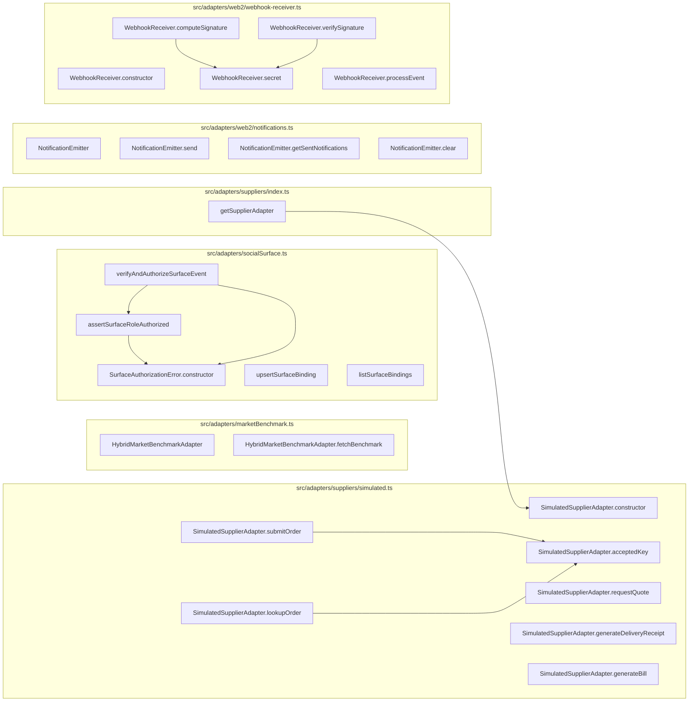
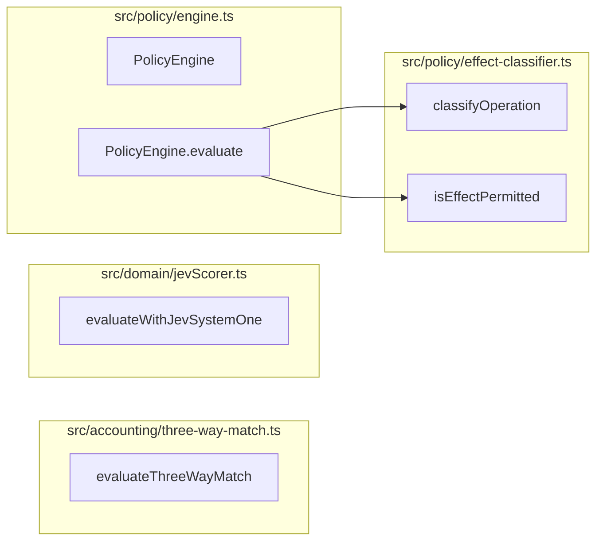
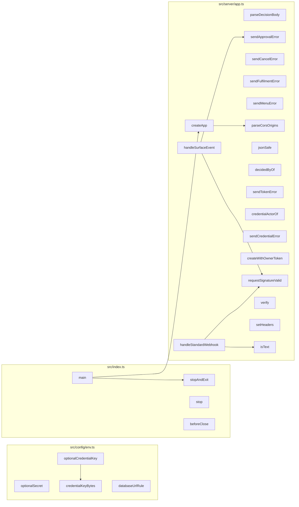
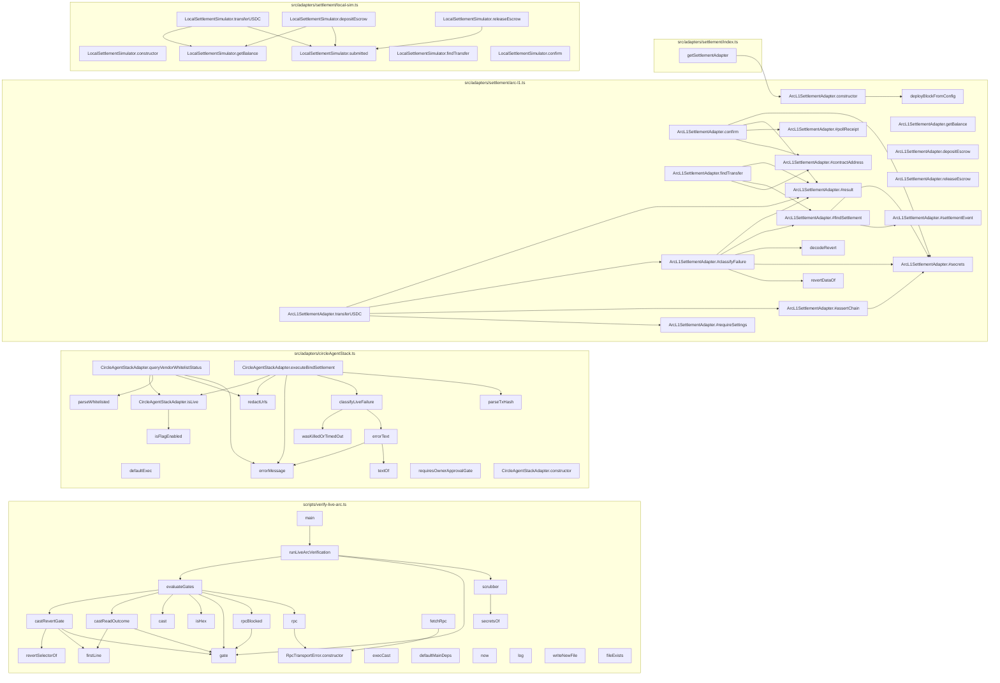
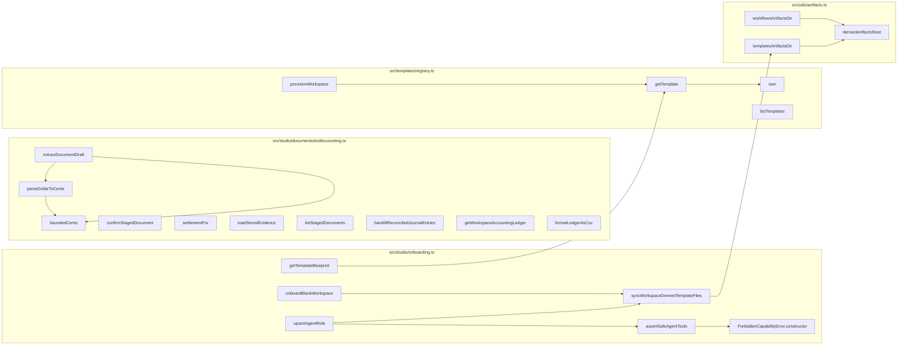
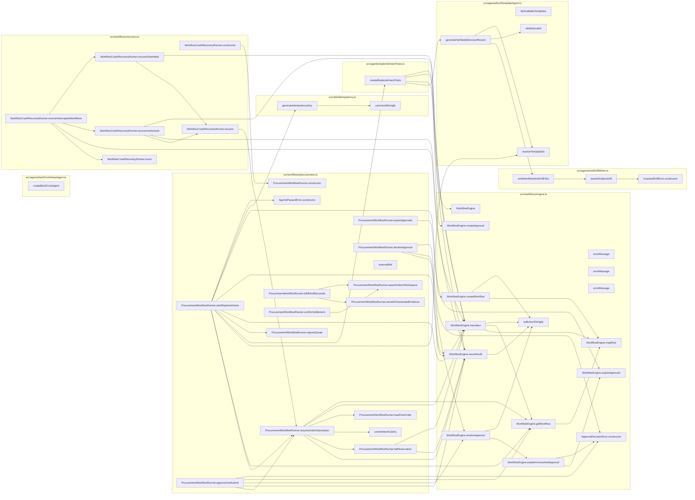
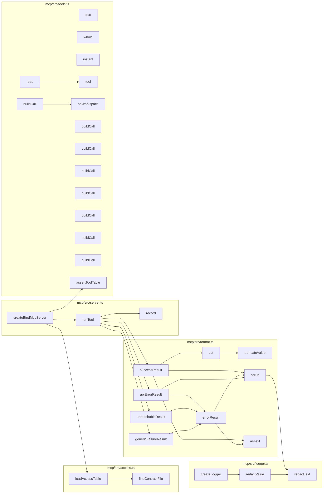
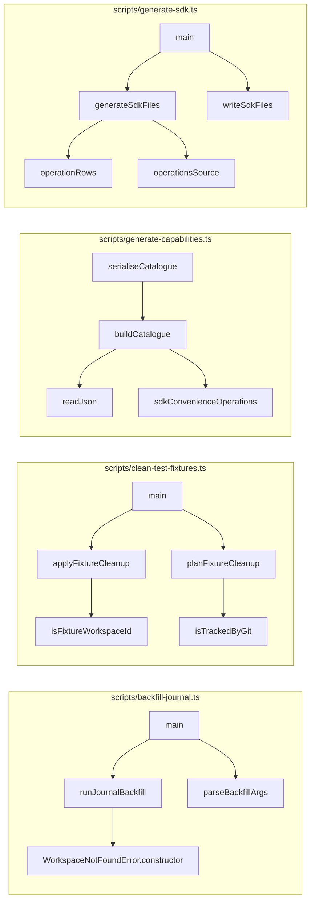

# Codebase map: functions and calls

Generated by `npx tsx scripts/map-functions.ts` from the TypeScript compiler's symbol table. Do not edit by hand.
The browser UI (`src/ui`, plain JavaScript) and the Solidity contract are not included here; see `.ua/knowledge-graph.json` for the contract.

- Functions, methods, handlers and classes: **1530** (787 in production code, 743 in tests)
- Resolved call edges: **2793**
- HTTP routes: **67**

## Layers and cross-layer calls


## HTTP surface: route to what it calls

| Route | Line | Calls directly |
| --- | --- | --- |
| `GET /x` | 161 | SQL or inline logic only |
| `GET /y` | 164 | SQL or inline logic only |
| `GET /health` | 399 | `query` |
| `GET /ready` | 410 | `checkReadiness` |
| `GET /api/templates` | 424 | `jsonSafe`, `listTemplates` |
| `GET /api/templates/:id/blueprint` | 428 | `getTemplateBlueprint` |
| `GET /api/openapi.json` | 441 | `serializeOpenApiDocument`, `buildOpenApiDocument` |
| `GET /api/workspaces` | 448 | `query` |
| `POST /api/workspaces/onboard` | 458 | `createWithOwnerToken`, `onboardBlankWorkspace`, `jsonSafe`, `publicErrorMessage` |
| `POST /api/workspaces` | 473 | `createWithOwnerToken`, `provisionWorkspace`, `jsonSafe`, `publicErrorMessage` |
| `GET /api/workspaces/:id` | 492 | `query`, `getSettlementAdapter`, `ArcL1SettlementAdapter.getBalance`, `LocalSettlementSimulator.getBalance` |
| `PUT /api/workspaces/:id/policy` | 512 | `normalizePaymentAddress`, `query`, `syncWorkspaceDerivedTemplateFiles`, `publicErrorMessage` |
| `GET /api/workspaces/:id/inventory` | 557 | `query` |
| `POST /api/workspaces/:id/inventory` | 566 | `query`, `publicErrorMessage` |
| `POST /api/workspaces/:id/replenish` | 606 | `ProcurementWorkflowRunner.startReplenishment`, `publicErrorMessage` |
| `GET /api/workspaces/:id/approvals` | 626 | `ProcurementWorkflowRunner.expireApprovals`, `query` |
| `POST /api/approvals/:id/approve` | 636 | `ProcurementWorkflowRunner.approveAndSubmit`, `decidedByOf`, `sendApprovalError` |
| `POST /api/approvals/:id/reject` | 647 | `parseDecisionBody`, `ProcurementWorkflowRunner.declineApproval`, `decidedByOf`, `sendApprovalError` |
| `POST /api/approvals/:id/revoke` | 667 | `parseDecisionBody`, `ProcurementWorkflowRunner.declineApproval`, `decidedByOf`, `sendApprovalError` |
| `POST /api/orders/:id/reconcile` | 688 | `ProcurementWorkflowRunner.fulfillAndReconcile`, `publicErrorMessage` |
| `POST /api/orders/:id/confirm-settlement` | 704 | `ProcurementWorkflowRunner.confirmSettlement`, `publicErrorMessage` |
| `GET /api/workspaces/:id/customer-orders` | 721 | `listCustomerOrders`, `sendFulfilmentError` |
| `POST /api/workspaces/:id/customer-orders` | 729 | `sendFulfilmentError`, `acceptCustomerOrder` |
| `GET /api/workspaces/:id/customer-orders/:orderId` | 754 | `getCustomerOrder`, `sendFulfilmentError` |
| `POST /api/workspaces/:id/customer-orders/:orderId/accept` | 764 | `acceptHeldOrder`, `sendFulfilmentError` |
| `POST /api/workspaces/:id/customer-orders/:orderId/cancel` | 772 | `cancelCustomerOrder`, `sendFulfilmentError` |
| `POST /api/workspaces/:id/customer-orders/:orderId/fulfil` | 781 | `fulfilCustomerOrder`, `sendFulfilmentError` |
| `GET /api/workspaces/:id/kitchen-capacity` | 790 | `listKitchenCapacity`, `sendFulfilmentError` |
| `PUT /api/workspaces/:id/kitchen-capacity` | 798 | `sendFulfilmentError`, `setKitchenCapacity` |
| `POST /api/workspaces/:id/feedback` | 820 | `sendMenuError`, `ingestFeedback` |
| `GET /api/workspaces/:id/feedback` | 840 | `listFeedback`, `sendMenuError` |
| `GET /api/workspaces/:id/feedback/summary` | 848 | `sendMenuError`, `summarizeFeedback` |
| `POST /api/workspaces/:id/menu-proposals` | 867 | `sendMenuError`, `proposeMenuChange` |
| `GET /api/workspaces/:id/menu-proposals` | 894 | `listMenuProposals`, `sendMenuError` |
| `POST /api/workspaces/:id/menu-proposals/:proposalId/approve` | 902 | `approveMenuProposal`, `sendMenuError` |
| `POST /api/workspaces/:id/menu-proposals/:proposalId/reject` | 910 | `rejectMenuProposal`, `sendMenuError` |
| `POST /api/workspaces/:id/menu-proposals/:proposalId/cancel` | 918 | `cancelMenuProposal`, `sendMenuError` |
| `POST /api/workspaces/:id/menu-proposals/:proposalId/publish` | 926 | `publishMenuChange`, `sendMenuError` |
| `GET /api/workspaces/:id/menu` | 934 | `listMenu`, `sendMenuError` |
| `GET /api/workspaces/:id/workflows` | 943 | `query` |
| `POST /api/workspaces/:id/workflows/:workflowId/cancel` | 953 | `cancelWorkflow`, `sendCancelError` |
| `GET /api/workspaces/:id/needs-attention` | 974 | `listNeedsAttention` |
| `GET /api/workspaces/:id/orders` | 979 | `query` |
| `GET /api/workspaces/:id/suppliers` | 1004 | `query` |
| `POST /api/workspaces/:id/suppliers` | 1013 | `normalizePaymentAddress`, `simulatedPaymentAddress`, `query`, `publicErrorMessage` |
| `GET /api/workspaces/:id/agents` | 1065 | `query` |
| `POST /api/workspaces/:id/agents` | 1078 | `upsertAgentRole`, `publicErrorMessage` |
| `GET /api/workspaces/:id/surfaces` | 1093 | `listSurfaceBindings` |
| `POST /api/workspaces/:id/surfaces` | 1099 | `upsertSurfaceBinding`, `decidedByOf`, `publicErrorMessage` |
| `GET /api/workspaces/:id/documents` | 1110 | `listStagedDocuments` |
| `POST /api/workspaces/:id/documents/extract` | 1116 | `extractDocumentDraft`, `publicErrorMessage` |
| `POST /api/workspaces/:id/documents/:docId/confirm` | 1127 | `confirmStagedDocument`, `decidedByOf`, `publicErrorMessage`, `redactText` |
| `GET /api/workspaces/:id/accounting/ledger` | 1152 | `getWorkspaceAccountingLedger`, `formatLedgerAsCsv` |
| `GET /api/workspaces/:id/audit` | 1168 | `query` |
| `POST /api/workspaces/:id/recover` | 1182 | `WorkflowCrashRecoveryRunner.recoverInterruptedWorkflows`, `publicErrorMessage` |
| `POST /api/workspaces/:id/tokens` | 1192 | `issueToken`, `sendTokenError` |
| `GET /api/workspaces/:id/tokens` | 1206 | `listTokens`, `sendTokenError` |
| `DELETE /api/workspaces/:id/tokens/:tokenId` | 1214 | `revokeToken`, `sendTokenError` |
| `PUT /api/workspaces/:id/agents-paused` | 1226 | `setAgentsPaused`, `decidedByOf` |
| `GET /api/workspaces/:id/webhook-secret` | 1243 | `viewWebhookSecret`, `decidedByOf` |
| `POST /api/workspaces/:id/webhook-secret/rotate` | 1255 | `rotateWebhookSecret`, `decidedByOf` |
| `GET /api/workspaces/:id/connectors` | 1269 | `listConnectors`, `sendCredentialError` |
| `PUT /api/workspaces/:id/connectors/:connectorId` | 1277 | `setCredential`, `credentialActorOf`, `sendCredentialError` |
| `DELETE /api/workspaces/:id/connectors/:connectorId` | 1292 | `revokeCredential`, `credentialActorOf`, `sendCredentialError` |
| `POST /api/workspaces/:id/connectors/:connectorId/verify` | 1302 | `verifyCredential`, `credentialActorOf`, `sendCredentialError` |
| `POST /api/webhooks/incoming` | 1313 | `handleSurfaceEvent`, `handleStandardWebhook` |
| `GET *` | 1513 | SQL or inline logic only |

## External Service Adapters

| Function | File:lines | Kind | Params | Exported | Called by (prod / tests) | Calls |
| --- | --- | --- | --- | --- | --- | --- |
| `HybridMarketBenchmarkAdapter` | src/adapters/marketBenchmark.ts:19-113 | class | 0 | yes | 2 / 1 | 0 |
| `HybridMarketBenchmarkAdapter.fetchBenchmark` | src/adapters/marketBenchmark.ts:20-112 | method | 2 | yes | 2 / 1 | 0 |
| `SurfaceAuthorizationError.constructor` | src/adapters/socialSurface.ts:74-77 | constructor | 1 | yes | 2 / 0 | 0 |
| `assertSurfaceRoleAuthorized` | src/adapters/socialSurface.ts:83-106 | function | 2 | yes | 1 / 1 | 1 |
| `verifyAndAuthorizeSurfaceEvent` | src/adapters/socialSurface.ts:113-135 | function | 1 | yes | 1 / 0 | 3 |
| `upsertSurfaceBinding` | src/adapters/socialSurface.ts:143-190 | function | 3 | yes | 1 / 4 | 2 |
| `listSurfaceBindings` | src/adapters/socialSurface.ts:192-198 | function | 1 | yes | 1 / 0 | 1 |
| `getSupplierAdapter` | src/adapters/suppliers/index.ts:24-34 | function | 1 | yes | 0 / 2 | 1 |
| `SimulatedSupplierAdapter.constructor` | src/adapters/suppliers/simulated.ts:20-25 | constructor | 4 | yes | 2 / 6 | 0 |
| `SimulatedSupplierAdapter.acceptedKey` | src/adapters/suppliers/simulated.ts:27-29 | method | 2 | yes | 2 / 0 | 0 |
| `SimulatedSupplierAdapter.requestQuote` | src/adapters/suppliers/simulated.ts:31-62 | method | 1 | yes | 1 / 5 | 0 |
| `SimulatedSupplierAdapter.submitOrder` | src/adapters/suppliers/simulated.ts:65-80 | method | 1 | yes | 1 / 6 | 1 |
| `SimulatedSupplierAdapter.lookupOrder` | src/adapters/suppliers/simulated.ts:83-87 | method | 1 | yes | 0 / 3 | 1 |
| `SimulatedSupplierAdapter.generateDeliveryReceipt` | src/adapters/suppliers/simulated.ts:89-99 | method | 3 | yes | 1 / 5 | 0 |
| `SimulatedSupplierAdapter.generateBill` | src/adapters/suppliers/simulated.ts:101-114 | method | 5 | yes | 1 / 6 | 0 |
| `NotificationEmitter` | src/adapters/web2/notifications.ts:4-32 | class | 0 | yes | 1 / 0 | 0 |
| `NotificationEmitter.send` | src/adapters/web2/notifications.ts:7-20 | method | 1 | yes | 1 / 0 | 1 |
| `NotificationEmitter.getSentNotifications` | src/adapters/web2/notifications.ts:22-27 | method | 1 | yes | 0 / 2 | 0 |
| `NotificationEmitter.clear` | src/adapters/web2/notifications.ts:29-31 | method | 0 | yes | 0 / 4 | 0 |
| `WebhookReceiver.constructor` | src/adapters/web2/webhook-receiver.ts:27-29 | constructor | 1 | yes | 2 / 0 | 0 |
| `WebhookReceiver.secret` | src/adapters/web2/webhook-receiver.ts:31-35 | method | 0 | yes | 2 / 0 | 1 |
| `WebhookReceiver.computeSignature` | src/adapters/web2/webhook-receiver.ts:38-40 | method | 2 | yes | 0 / 1 | 2 |
| `WebhookReceiver.verifySignature` | src/adapters/web2/webhook-receiver.ts:43-50 | method | 3 | yes | 0 / 1 | 2 |
| `WebhookReceiver.processEvent` | src/adapters/web2/webhook-receiver.ts:56-77 | method | 1 | yes | 1 / 1 | 2 |



## Persistence (PostgreSQL)

| Function | File:lines | Kind | Params | Exported | Called by (prod / tests) | Calls |
| --- | --- | --- | --- | --- | --- | --- |
| `query` | src/db/client.ts:13-18 | function | 2 | yes | 109 / 187 | 0 |
| `getClient` | src/db/client.ts:20-22 | function | 0 | yes | 0 / 1 | 0 |
| `withTransaction` | src/db/client.ts:24-39 | function | 1 | yes | 26 / 0 | 0 |
| `closePool` | src/db/client.ts:41-43 | function | 0 | yes | 2 / 54 | 0 |
| `runMigrations` | src/db/migrate.ts:24-49 | function | 1 | yes | 2 / 54 | 1 |
| `isDirectRun` | src/db/migrate.ts:55-57 | function | 2 | yes | 1 / 1 | 0 |

## Policy, Authority & Deterministic Rules

| Function | File:lines | Kind | Params | Exported | Called by (prod / tests) | Calls |
| --- | --- | --- | --- | --- | --- | --- |
| `evaluateThreeWayMatch` | src/accounting/three-way-match.ts:19-100 | function | 3 | yes | 1 / 1 | 0 |
| `evaluateWithJevSystemOne` | src/domain/jevScorer.ts:50-241 | function | 1 | yes | 1 / 1 | 0 |
| `classifyOperation` | src/policy/effect-classifier.ts:45-54 | function | 1 | yes | 2 / 2 | 0 |
| `isEffectPermitted` | src/policy/effect-classifier.ts:59-64 | function | 2 | yes | 1 / 0 | 0 |
| `PolicyEngine` | src/policy/engine.ts:14-60 | class | 0 | yes | 3 / 1 | 0 |
| `PolicyEngine.evaluate` | src/policy/engine.ts:15-59 | method | 1 | yes | 3 / 1 | 2 |



## Server, API & Entry Points

| Function | File:lines | Kind | Params | Exported | Called by (prod / tests) | Calls |
| --- | --- | --- | --- | --- | --- | --- |
| `optionalSecret` | src/config/env.ts:9-14 | function | 1 | no | 1 / 0 | 0 |
| `credentialKeyBytes` | src/config/env.ts:20-24 | function | 1 | yes | 2 / 0 | 0 |
| `optionalCredentialKey` | src/config/env.ts:27-35 | function | 1 | no | 1 / 0 | 1 |
| `databaseUrlRule` | src/config/env.ts:100-104 | function | 1 | yes | 1 / 1 | 0 |
| `stopAndExit` | src/index.ts:20-31 | function | 2 | no | 1 / 0 | 0 |
| `main` | src/index.ts:33-86 | function | 0 | no | 1 / 0 | 6 |
| `stop` | src/index.ts:66-66 | arrow | 0 | no | 0 / 0 | 0 |
| `beforeClose` | src/index.ts:71-73 | arrow | 0 | no | 0 / 0 | 1 |
| `parseDecisionBody` | src/server/app.ts:128-135 | function | 2 | no | 2 / 0 | 0 |
| `sendApprovalError` | src/server/app.ts:138-148 | function | 2 | no | 4 / 0 | 1 |
| `sendCancelError` | src/server/app.ts:151-162 | function | 2 | no | 1 / 0 | 0 |
| `sendFulfilmentError` | src/server/app.ts:165-174 | function | 2 | no | 8 / 0 | 0 |
| `sendMenuError` | src/server/app.ts:180-196 | function | 2 | no | 10 / 0 | 0 |
| `parseCorsOrigins` | src/server/app.ts:201-206 | function | 1 | yes | 1 / 0 | 0 |
| `jsonSafe` | src/server/app.ts:212-214 | function | 1 | no | 3 / 0 | 0 |
| `decidedByOf` | src/server/app.ts:217-219 | function | 1 | no | 8 / 0 | 0 |
| `sendTokenError` | src/server/app.ts:222-228 | function | 2 | no | 3 / 0 | 0 |
| `credentialActorOf` | src/server/app.ts:231-233 | function | 1 | no | 3 / 0 | 0 |
| `sendCredentialError` | src/server/app.ts:236-247 | function | 2 | no | 4 / 0 | 1 |
| `createWithOwnerToken` | src/server/app.ts:259-279 | function | 2 | no | 2 / 0 | 3 |
| `requestSignatureValid` | src/server/app.ts:321-329 | function | 2 | no | 2 / 0 | 1 |
| `createApp` | src/server/app.ts:331-1524 | function | 1 | yes | 1 / 31 | 12 |
| `verify` | src/server/app.ts:376-378 | arrow | 3 | no | 0 / 0 | 0 |
| `setHeaders` | src/server/app.ts:390-394 | arrow | 1 | no | 0 / 0 | 0 |
| `handleSurfaceEvent` | src/server/app.ts:1327-1476 | function | 3 | no | 1 / 0 | 12 |
| `handleStandardWebhook` | src/server/app.ts:1478-1505 | function | 2 | no | 1 / 0 | 3 |
| `isText` | src/server/app.ts:1490-1491 | arrow | 1 | no | 1 / 0 | 0 |



## Settlement & Contracts

| Function | File:lines | Kind | Params | Exported | Called by (prod / tests) | Calls |
| --- | --- | --- | --- | --- | --- | --- |
| `RpcTransportError.constructor` | scripts/verify-live-arc.ts:82-88 | constructor | 2 | yes | 2 / 1 | 0 |
| `secretsOf` | scripts/verify-live-arc.ts:115-127 | function | 1 | yes | 2 / 0 | 0 |
| `scrubber` | scripts/verify-live-arc.ts:130-133 | function | 1 | yes | 1 / 0 | 2 |
| `revertSelectorOf` | scripts/verify-live-arc.ts:139-144 | function | 1 | yes | 1 / 1 | 0 |
| `firstLine` | scripts/verify-live-arc.ts:146-148 | function | 1 | no | 2 / 0 | 0 |
| `isHex` | scripts/verify-live-arc.ts:150-152 | function | 1 | no | 1 / 0 | 0 |
| `gate` | scripts/verify-live-arc.ts:154-156 | function | 3 | no | 5 / 0 | 0 |
| `rpcBlocked` | scripts/verify-live-arc.ts:167-180 | function | 2 | no | 1 / 0 | 1 |
| `castReadOutcome` | scripts/verify-live-arc.ts:183-200 | function | 3 | no | 1 / 0 | 2 |
| `castRevertGate` | scripts/verify-live-arc.ts:206-227 | function | 5 | no | 1 / 0 | 3 |
| `runLiveArcVerification` | scripts/verify-live-arc.ts:230-265 | function | 1 | yes | 1 / 1 | 3 |
| `evaluateGates` | scripts/verify-live-arc.ts:267-368 | function | 1 | no | 1 / 0 | 7 |
| `rpc` | scripts/verify-live-arc.ts:269-279 | arrow | 2 | no | 1 / 0 | 1 |
| `cast` | scripts/verify-live-arc.ts:280-280 | arrow | 1 | no | 1 / 0 | 0 |
| `execCast` | scripts/verify-live-arc.ts:371-398 | arrow | 1 | yes | 0 / 0 | 0 |
| `fetchRpc` | scripts/verify-live-arc.ts:401-420 | arrow | 1 | yes | 0 / 0 | 1 |
| `defaultMainDeps` | scripts/verify-live-arc.ts:429-442 | function | 0 | yes | 0 / 0 | 0 |
| `now` | scripts/verify-live-arc.ts:434-434 | arrow | 0 | no | 0 / 0 | 0 |
| `log` | scripts/verify-live-arc.ts:435-435 | arrow | 1 | no | 0 / 0 | 0 |
| `writeNewFile` | scripts/verify-live-arc.ts:436-436 | arrow | 2 | no | 0 / 0 | 0 |
| `fileExists` | scripts/verify-live-arc.ts:437-440 | arrow | 1 | no | 0 / 0 | 0 |
| `main` | scripts/verify-live-arc.ts:448-480 | function | 2 | yes | 1 / 1 | 1 |
| `defaultExec` | src/adapters/circleAgentStack.ts:70-73 | arrow | 3 | no | 0 / 0 | 0 |
| `requiresOwnerApprovalGate` | src/adapters/circleAgentStack.ts:75-78 | function | 1 | yes | 0 / 1 | 0 |
| `isFlagEnabled` | src/adapters/circleAgentStack.ts:83-86 | function | 1 | yes | 1 / 1 | 0 |
| `redactUrls` | src/adapters/circleAgentStack.ts:88-90 | function | 1 | no | 2 / 0 | 0 |
| `errorMessage` | src/adapters/circleAgentStack.ts:92-94 | function | 1 | no | 3 / 0 | 0 |
| `textOf` | src/adapters/circleAgentStack.ts:96-100 | function | 1 | no | 1 / 0 | 0 |
| `errorText` | src/adapters/circleAgentStack.ts:103-112 | function | 1 | no | 1 / 0 | 2 |
| `wasKilledOrTimedOut` | src/adapters/circleAgentStack.ts:115-119 | function | 1 | no | 1 / 0 | 0 |
| `classifyLiveFailure` | src/adapters/circleAgentStack.ts:121-124 | function | 1 | no | 1 / 0 | 2 |
| `parseWhitelisted` | src/adapters/circleAgentStack.ts:126-134 | function | 1 | no | 1 / 0 | 0 |
| `parseTxHash` | src/adapters/circleAgentStack.ts:137-146 | function | 1 | no | 1 / 0 | 0 |
| `CircleAgentStackAdapter.constructor` | src/adapters/circleAgentStack.ts:153-157 | constructor | 2 | yes | 1 / 2 | 0 |
| `CircleAgentStackAdapter.isLive` | src/adapters/circleAgentStack.ts:160-162 | method | 0 | yes | 2 / 0 | 1 |
| `CircleAgentStackAdapter.queryVendorWhitelistStatus` | src/adapters/circleAgentStack.ts:167-209 | method | 1 | yes | 1 / 2 | 4 |
| `CircleAgentStackAdapter.executeBindSettlement` | src/adapters/circleAgentStack.ts:215-276 | method | 1 | yes | 1 / 2 | 5 |
| `revertDataOf` | src/adapters/settlement/arc-l1.ts:135-143 | function | 1 | no | 1 / 0 | 0 |
| `decodeRevert` | src/adapters/settlement/arc-l1.ts:145-152 | function | 1 | no | 1 / 0 | 0 |
| `deployBlockFromConfig` | src/adapters/settlement/arc-l1.ts:154-156 | function | 0 | no | 1 / 0 | 0 |
| `ArcL1SettlementAdapter.constructor` | src/adapters/settlement/arc-l1.ts:180-196 | constructor | 1 | yes | 1 / 6 | 1 |
| `ArcL1SettlementAdapter.getBalance` | src/adapters/settlement/arc-l1.ts:198-212 | method | 1 | yes | 1 / 2 | 0 |
| `ArcL1SettlementAdapter.transferUSDC` | src/adapters/settlement/arc-l1.ts:218-258 | method | 1 | yes | 1 / 4 | 6 |
| `ArcL1SettlementAdapter.confirm` | src/adapters/settlement/arc-l1.ts:265-288 | method | 1 | yes | 1 / 2 | 6 |
| `ArcL1SettlementAdapter.findTransfer` | src/adapters/settlement/arc-l1.ts:299-307 | method | 1 | yes | 0 / 2 | 4 |
| `ArcL1SettlementAdapter.depositEscrow` | src/adapters/settlement/arc-l1.ts:309-311 | method | 2 | yes | 0 / 2 | 1 |
| `ArcL1SettlementAdapter.releaseEscrow` | src/adapters/settlement/arc-l1.ts:313-315 | method | 2 | yes | 0 / 2 | 1 |
| `ArcL1SettlementAdapter.#result` | src/adapters/settlement/arc-l1.ts:317-328 | method | 3 | yes | 4 / 0 | 0 |
| `ArcL1SettlementAdapter.#secrets` | src/adapters/settlement/arc-l1.ts:331-333 | method | 0 | yes | 4 / 0 | 0 |
| `ArcL1SettlementAdapter.#classifyFailure` | src/adapters/settlement/arc-l1.ts:339-355 | method | 4 | yes | 1 / 0 | 7 |
| `ArcL1SettlementAdapter.#contractAddress` | src/adapters/settlement/arc-l1.ts:357-363 | method | 0 | yes | 2 / 0 | 1 |
| `ArcL1SettlementAdapter.#requireSettings` | src/adapters/settlement/arc-l1.ts:366-385 | method | 0 | yes | 1 / 0 | 1 |
| `ArcL1SettlementAdapter.#assertChain` | src/adapters/settlement/arc-l1.ts:388-398 | method | 0 | yes | 1 / 0 | 3 |
| `ArcL1SettlementAdapter.#settlementEvent` | src/adapters/settlement/arc-l1.ts:400-404 | method | 0 | yes | 1 / 0 | 0 |
| `ArcL1SettlementAdapter.#findSettlement` | src/adapters/settlement/arc-l1.ts:410-428 | method | 2 | yes | 2 / 0 | 3 |
| `ArcL1SettlementAdapter.#pollReceipt` | src/adapters/settlement/arc-l1.ts:430-443 | method | 1 | yes | 1 / 0 | 0 |
| `getSettlementAdapter` | src/adapters/settlement/index.ts:14-27 | function | 1 | yes | 3 / 0 | 1 |
| `LocalSettlementSimulator.constructor` | src/adapters/settlement/local-sim.ts:24-27 | constructor | 0 | yes | 1 / 1 | 0 |
| `LocalSettlementSimulator.getBalance` | src/adapters/settlement/local-sim.ts:29-31 | method | 1 | yes | 3 / 1 | 0 |
| `LocalSettlementSimulator.transferUSDC` | src/adapters/settlement/local-sim.ts:33-56 | method | 1 | yes | 1 / 1 | 2 |
| `LocalSettlementSimulator.findTransfer` | src/adapters/settlement/local-sim.ts:59-61 | method | 1 | yes | 0 / 1 | 0 |
| `LocalSettlementSimulator.confirm` | src/adapters/settlement/local-sim.ts:63-66 | method | 1 | yes | 1 / 1 | 1 |
| `LocalSettlementSimulator.depositEscrow` | src/adapters/settlement/local-sim.ts:68-83 | method | 2 | yes | 0 / 0 | 2 |
| `LocalSettlementSimulator.releaseEscrow` | src/adapters/settlement/local-sim.ts:85-100 | method | 2 | yes | 0 / 0 | 1 |
| `LocalSettlementSimulator.submitted` | src/adapters/settlement/local-sim.ts:102-110 | method | 0 | yes | 3 / 0 | 0 |



## Templates & Studio

| Function | File:lines | Kind | Params | Exported | Called by (prod / tests) | Calls |
| --- | --- | --- | --- | --- | --- | --- |
| `parseDollarToCents` | src/studio/documentsAndAccounting.ts:33-40 | function | 1 | no | 1 / 0 | 1 |
| `boundedCents` | src/studio/documentsAndAccounting.ts:43-45 | function | 1 | no | 2 / 0 | 0 |
| `extractDocumentDraft` | src/studio/documentsAndAccounting.ts:51-230 | function | 3 | yes | 1 / 1 | 4 |
| `confirmStagedDocument` | src/studio/documentsAndAccounting.ts:237-484 | function | 4 | yes | 1 / 2 | 3 |
| `settlementFor` | src/studio/documentsAndAccounting.ts:429-429 | arrow | 1 | no | 0 / 0 | 1 |
| `loadStoredEvidence` | src/studio/documentsAndAccounting.ts:433-457 | arrow | 1 | no | 0 / 0 | 1 |
| `listStagedDocuments` | src/studio/documentsAndAccounting.ts:486-492 | function | 1 | yes | 1 / 0 | 1 |
| `backfillReconciledJournalEntries` | src/studio/documentsAndAccounting.ts:514-560 | function | 2 | yes | 1 / 0 | 2 |
| `getWorkspaceAccountingLedger` | src/studio/documentsAndAccounting.ts:563-569 | function | 1 | yes | 1 / 0 | 1 |
| `formatLedgerAsCsv` | src/studio/documentsAndAccounting.ts:571-606 | function | 1 | yes | 1 / 0 | 0 |
| `ForbiddenCapabilityError.constructor` | src/studio/onboarding.ts:31-34 | constructor | 1 | yes | 1 / 0 | 0 |
| `assertSafeAgentTools` | src/studio/onboarding.ts:115-129 | function | 1 | yes | 1 / 0 | 1 |
| `getTemplateBlueprint` | src/studio/onboarding.ts:134-174 | function | 1 | yes | 1 / 0 | 1 |
| `onboardBlankWorkspace` | src/studio/onboarding.ts:180-326 | function | 2 | yes | 1 / 0 | 4 |
| `upsertAgentRole` | src/studio/onboarding.ts:331-403 | function | 3 | yes | 1 / 0 | 4 |
| `syncWorkspaceDerivedTemplateFiles` | src/studio/onboarding.ts:409-493 | function | 1 | yes | 3 / 0 | 2 |
| `getTemplate` | src/templates/registry.ts:12-19 | function | 1 | yes | 2 / 1 | 1 |
| `own` | src/templates/registry.ts:14-15 | arrow | 1 | no | 1 / 0 | 0 |
| `listTemplates` | src/templates/registry.ts:21-23 | function | 0 | yes | 1 / 1 | 0 |
| `provisionWorkspace` | src/templates/registry.ts:41-182 | function | 4 | yes | 2 / 47 | 3 |
| `derivedArtifactsRoot` | src/utils/artifacts.ts:12-20 | function | 0 | yes | 2 / 0 | 0 |
| `workflowsArtifactsDir` | src/utils/artifacts.ts:22-24 | function | 0 | yes | 1 / 0 | 1 |
| `templatesArtifactsDir` | src/utils/artifacts.ts:26-28 | function | 0 | yes | 1 / 0 | 1 |



## Workflow Orchestration & Agents

| Function | File:lines | Kind | Params | Exported | Called by (prod / tests) | Calls |
| --- | --- | --- | --- | --- | --- | --- |
| `InvariantDriftError.constructor` | src/agents/antiDriftWriter.ts:33-36 | constructor | 1 | yes | 1 / 0 | 0 |
| `assertNoSpecDrift` | src/agents/antiDriftWriter.ts:42-78 | function | 1 | yes | 1 / 1 | 1 |
| `writeWorkflowAntiDriftFiles` | src/agents/antiDriftWriter.ts:91-241 | function | 2 | yes | 2 / 1 | 2 |
| `createBindCircleAgent` | src/agents/bindCircleDeepAgent.ts:15-108 | function | 1 | yes | 0 / 0 | 5 |
| `listAvailableTemplates` | src/agents/bindTemplateAgent.ts:26-44 | function | 0 | yes | 0 / 1 | 0 |
| `resolveTemplateDir` | src/agents/bindTemplateAgent.ts:49-60 | function | 1 | yes | 2 / 1 | 0 |
| `whitelistLabel` | src/agents/bindTemplateAgent.ts:106-110 | function | 1 | no | 1 / 0 | 0 |
| `generateVerifiableDecisionRecord` | src/agents/bindTemplateAgent.ts:114-273 | function | 1 | yes | 1 / 2 | 5 |
| `createReplenishmentTools` | src/agents/replenishmentTools.ts:25-684 | function | 1 | yes | 1 / 8 | 15 |
| `canonicalStringify` | src/utils/idempotency.ts:7-16 | function | 1 | yes | 2 / 0 | 0 |
| `generateIdempotencyKey` | src/utils/idempotency.ts:21-32 | function | 3 | yes | 1 / 3 | 1 |
| `safeJsonStringify` | src/workflows/engine.ts:9-13 | function | 1 | no | 4 / 0 | 0 |
| `errorMessage` | src/workflows/engine.ts:21-21 | arrow | 0 | no | 0 / 0 | 0 |
| `errorMessage` | src/workflows/engine.ts:24-24 | arrow | 1 | no | 0 / 0 | 0 |
| `errorMessage` | src/workflows/engine.ts:28-28 | arrow | 1 | no | 0 / 0 | 0 |
| `ApprovalDecisionError.constructor` | src/workflows/engine.ts:39-44 | constructor | 3 | yes | 3 / 0 | 0 |
| `WorkflowEngine` | src/workflows/engine.ts:47-300 | class | 0 | yes | 6 / 15 | 0 |
| `WorkflowEngine.mapRow` | src/workflows/engine.ts:48-61 | method | 1 | yes | 3 / 0 | 0 |
| `WorkflowEngine.createWorkflow` | src/workflows/engine.ts:67-84 | method | 5 | yes | 1 / 18 | 3 |
| `WorkflowEngine.getWorkflow` | src/workflows/engine.ts:89-95 | method | 1 | yes | 5 / 8 | 2 |
| `WorkflowEngine.transition` | src/workflows/engine.ts:100-126 | method | 2 | yes | 8 / 13 | 4 |
| `WorkflowEngine.recordAudit` | src/workflows/engine.ts:131-167 | method | 10 | yes | 14 / 0 | 4 |
| `WorkflowEngine.createApproval` | src/workflows/engine.ts:172-189 | method | 8 | yes | 1 / 10 | 1 |
| `WorkflowEngine.resolveApproval` | src/workflows/engine.ts:199-237 | method | 5 | yes | 2 / 1 | 3 |
| `WorkflowEngine.expireApprovals` | src/workflows/engine.ts:247-276 | method | 1 | yes | 3 / 1 | 1 |
| `WorkflowEngine.explainUnresolvedApproval` | src/workflows/engine.ts:282-299 | method | 1 | yes | 1 / 0 | 3 |
| `AgentsPausedError.constructor` | src/workflows/procurement.ts:46-51 | constructor | 0 | yes | 1 / 0 | 0 |
| `commitmentClaims` | src/workflows/procurement.ts:69-79 | function | 3 | no | 1 / 0 | 0 |
| `ProcurementWorkflowRunner.constructor` | src/workflows/procurement.ts:89-94 | constructor | 1 | yes | 6 / 20 | 2 |
| `ProcurementWorkflowRunner.startReplenishment` | src/workflows/procurement.ts:99-376 | method | 4 | yes | 4 / 19 | 13 |
| `ProcurementWorkflowRunner.approveAndSubmit` | src/workflows/procurement.ts:381-456 | method | 3 | yes | 2 / 4 | 9 |
| `ProcurementWorkflowRunner.expireApprovals` | src/workflows/procurement.ts:461-463 | method | 1 | yes | 1 / 0 | 1 |
| `ProcurementWorkflowRunner.declineApproval` | src/workflows/procurement.ts:469-499 | method | 5 | yes | 4 / 1 | 5 |
| `ProcurementWorkflowRunner.requestQuote` | src/workflows/procurement.ts:506-562 | method | 1 | yes | 1 / 1 | 5 |
| `ProcurementWorkflowRunner.resumeOrderSubmission` | src/workflows/procurement.ts:572-761 | method | 1 | yes | 3 / 1 | 15 |
| `externalRef` | src/workflows/procurement.ts:677-677 | arrow | 1 | no | 0 / 0 | 0 |
| `ProcurementWorkflowRunner.loadOwnOrder` | src/workflows/procurement.ts:764-771 | method | 2 | yes | 1 / 0 | 1 |
| `ProcurementWorkflowRunner.failReservation` | src/workflows/procurement.ts:774-799 | method | 3 | yes | 1 / 0 | 3 |
| `ProcurementWorkflowRunner.fulfillAndReconcile` | src/workflows/procurement.ts:806-812 | method | 2 | yes | 1 / 10 | 3 |
| `ProcurementWorkflowRunner.confirmSettlement` | src/workflows/procurement.ts:818-821 | method | 2 | yes | 2 / 2 | 2 |
| `ProcurementWorkflowRunner.assertOrderInWorkspace` | src/workflows/procurement.ts:824-829 | method | 2 | yes | 2 / 0 | 2 |
| `ProcurementWorkflowRunner.storedOrGeneratedEvidence` | src/workflows/procurement.ts:831-915 | method | 1 | yes | 1 / 0 | 3 |
| `WorkflowCrashRecoveryRunner.constructor` | src/workflows/recovery.ts:34-36 | constructor | 1 | yes | 2 / 3 | 1 |
| `WorkflowCrashRecoveryRunner.recoverInterruptedWorkflows` | src/workflows/recovery.ts:48-96 | method | 1 | yes | 2 / 3 | 5 |
| `WorkflowCrashRecoveryRunner.touch` | src/workflows/recovery.ts:99-105 | method | 1 | yes | 1 / 0 | 1 |
| `WorkflowCrashRecoveryRunner.recoverSubmitted` | src/workflows/recovery.ts:107-141 | method | 2 | yes | 1 / 0 | 3 |
| `WorkflowCrashRecoveryRunner.recoverAuthorized` | src/workflows/recovery.ts:143-187 | method | 2 | yes | 1 / 0 | 6 |
| `WorkflowCrashRecoveryRunner.resume` | src/workflows/recovery.ts:189-197 | method | 3 | yes | 2 / 0 | 1 |



## mcp

| Function | File:lines | Kind | Params | Exported | Called by (prod / tests) | Calls |
| --- | --- | --- | --- | --- | --- | --- |
| `findContractFile` | mcp/src/access.ts:16-26 | function | 0 | no | 1 / 0 | 0 |
| `loadAccessTable` | mcp/src/access.ts:29-53 | function | 1 | yes | 1 / 2 | 1 |
| `truncateValue` | mcp/src/format.ts:24-44 | function | 3 | yes | 1 / 0 | 0 |
| `cut` | mcp/src/format.ts:47-51 | function | 2 | yes | 1 / 0 | 1 |
| `scrub` | mcp/src/format.ts:54-56 | function | 2 | no | 3 / 0 | 1 |
| `asText` | mcp/src/format.ts:58-60 | function | 1 | no | 2 / 0 | 0 |
| `successResult` | mcp/src/format.ts:70-86 | function | 1 | yes | 1 / 0 | 3 |
| `errorResult` | mcp/src/format.ts:88-93 | function | 2 | no | 3 / 0 | 2 |
| `apiErrorResult` | mcp/src/format.ts:96-108 | function | 2 | yes | 1 / 0 | 2 |
| `unreachableResult` | mcp/src/format.ts:111-113 | function | 1 | yes | 1 / 0 | 1 |
| `genericFailureResult` | mcp/src/format.ts:116-118 | function | 1 | yes | 1 / 0 | 1 |
| `redactText` | mcp/src/logger.ts:21-27 | function | 2 | yes | 2 / 0 | 0 |
| `redactValue` | mcp/src/logger.ts:30-40 | function | 3 | yes | 1 / 0 | 1 |
| `createLogger` | mcp/src/logger.ts:52-62 | function | 1 | yes | 0 / 2 | 1 |
| `createBindMcpServer` | mcp/src/server.ts:34-62 | function | 1 | yes | 0 / 3 | 3 |
| `runTool` | mcp/src/server.ts:64-94 | function | 6 | no | 1 / 0 | 6 |
| `record` | mcp/src/server.ts:73-75 | arrow | 2 | no | 1 / 0 | 0 |
| `text` | mcp/src/tools.ts:68-73 | function | 3 | no | 1 / 0 | 0 |
| `whole` | mcp/src/tools.ts:75-81 | function | 3 | no | 1 / 0 | 0 |
| `instant` | mcp/src/tools.ts:83-88 | function | 1 | no | 1 / 0 | 0 |
| `tool` | mcp/src/tools.ts:181-205 | function | 1 | no | 2 / 0 | 0 |
| `onWorkspace` | mcp/src/tools.ts:207-207 | arrow | 1 | no | 1 / 0 | 0 |
| `read` | mcp/src/tools.ts:209-224 | function | 1 | no | 1 / 0 | 1 |
| `buildCall` | mcp/src/tools.ts:222-222 | arrow | 2 | no | 0 / 0 | 1 |
| `buildCall` | mcp/src/tools.ts:299-303 | arrow | 2 | no | 0 / 0 | 0 |
| `buildCall` | mcp/src/tools.ts:322-328 | arrow | 2 | no | 0 / 0 | 0 |
| `buildCall` | mcp/src/tools.ts:340-340 | arrow | 2 | no | 0 / 0 | 0 |
| `buildCall` | mcp/src/tools.ts:352-360 | arrow | 2 | no | 0 / 0 | 0 |
| `buildCall` | mcp/src/tools.ts:372-372 | arrow | 2 | no | 0 / 0 | 0 |
| `buildCall` | mcp/src/tools.ts:384-387 | arrow | 2 | no | 0 / 0 | 0 |
| `buildCall` | mcp/src/tools.ts:400-407 | arrow | 2 | no | 0 / 0 | 0 |
| `assertToolTable` | mcp/src/tools.ts:416-441 | function | 2 | yes | 1 / 0 | 0 |



## scripts

| Function | File:lines | Kind | Params | Exported | Called by (prod / tests) | Calls |
| --- | --- | --- | --- | --- | --- | --- |
| `WorkspaceNotFoundError.constructor` | scripts/backfill-journal.ts:22-25 | constructor | 0 | yes | 1 / 0 | 0 |
| `parseBackfillArgs` | scripts/backfill-journal.ts:29-38 | function | 1 | yes | 1 / 1 | 0 |
| `runJournalBackfill` | scripts/backfill-journal.ts:41-56 | function | 1 | yes | 1 / 1 | 3 |
| `main` | scripts/backfill-journal.ts:58-73 | function | 0 | no | 1 / 0 | 2 |
| `isFixtureWorkspaceId` | scripts/clean-test-fixtures.ts:78-82 | function | 1 | yes | 1 / 1 | 0 |
| `isTrackedByGit` | scripts/clean-test-fixtures.ts:88-93 | function | 1 | yes | 1 / 0 | 0 |
| `planFixtureCleanup` | scripts/clean-test-fixtures.ts:102-116 | function | 0 | yes | 1 / 0 | 2 |
| `applyFixtureCleanup` | scripts/clean-test-fixtures.ts:119-128 | function | 1 | yes | 1 / 0 | 2 |
| `main` | scripts/clean-test-fixtures.ts:130-154 | function | 0 | no | 1 / 0 | 2 |
| `readJson` | scripts/generate-capabilities.ts:67-69 | function | 1 | no | 1 / 0 | 0 |
| `sdkConvenienceOperations` | scripts/generate-capabilities.ts:72-75 | function | 0 | no | 1 / 0 | 0 |
| `buildCatalogue` | scripts/generate-capabilities.ts:77-123 | function | 0 | yes | 1 / 1 | 2 |
| `serialiseCatalogue` | scripts/generate-capabilities.ts:125-127 | function | 0 | yes | 1 / 1 | 1 |
| `operationRows` | scripts/generate-sdk.ts:32-48 | function | 1 | yes | 1 / 0 | 0 |
| `operationsSource` | scripts/generate-sdk.ts:50-70 | function | 1 | no | 1 / 0 | 0 |
| `generateSdkFiles` | scripts/generate-sdk.ts:73-83 | function | 1 | yes | 1 / 1 | 2 |
| `writeSdkFiles` | scripts/generate-sdk.ts:86-91 | function | 2 | yes | 1 / 1 | 0 |
| `main` | scripts/generate-sdk.ts:93-97 | function | 0 | no | 1 / 0 | 2 |



## sdk

| Function | File:lines | Kind | Params | Exported | Called by (prod / tests) | Calls |
| --- | --- | --- | --- | --- | --- | --- |
| `parseBaseUrl` | sdk/src/client.ts:93-106 | function | 1 | no | 1 / 0 | 0 |
| `checkToken` | sdk/src/client.ts:108-113 | function | 1 | no | 1 / 0 | 0 |
| `checkInteger` | sdk/src/client.ts:115-119 | function | 4 | no | 1 / 0 | 0 |
| `abortReason` | sdk/src/client.ts:122-125 | function | 1 | no | 4 / 0 | 0 |
| `newRequestId` | sdk/src/client.ts:128-132 | function | 0 | no | 1 / 0 | 0 |
| `defaultSleep` | sdk/src/client.ts:134-144 | function | 2 | no | 0 / 0 | 0 |
| `done` | sdk/src/client.ts:137-141 | function | 0 | no | 0 / 0 | 0 |
| `abortable` | sdk/src/client.ts:147-167 | function | 2 | no | 1 / 0 | 0 |
| `onAbort` | sdk/src/client.ts:149-149 | arrow | 0 | no | 0 / 0 | 1 |
| `BindClient.constructor` | sdk/src/client.ts:191-205 | constructor | 1 | yes | 0 / 5 | 4 |
| `BindClient.toJSON` | sdk/src/client.ts:208-215 | method | 0 | yes | 0 / 0 | 1 |
| `BindClient.toString` | sdk/src/client.ts:217-219 | method | 0 | yes | 0 / 0 | 1 |
| `BindClient.[INSPECT]` | sdk/src/client.ts:221-223 | method | 0 | yes | 0 / 0 | 1 |
| `BindClient.#baseLabel` | sdk/src/client.ts:225-227 | method | 0 | yes | 3 / 0 | 0 |
| `BindClient.call` | sdk/src/client.ts:234-261 | method | 2 | yes | 47 / 3 | 6 |
| `BindClient.workspace` | sdk/src/client.ts:265-267 | method | 1 | yes | 0 / 2 | 1 |
| `BindClient.listInventory` | sdk/src/client.ts:269-271 | method | 1 | yes | 0 / 1 | 1 |
| `BindClient.upsertInventory` | sdk/src/client.ts:273-275 | method | 2 | yes | 0 / 3 | 1 |
| `BindClient.replenish` | sdk/src/client.ts:277-279 | method | 2 | yes | 0 / 2 | 1 |
| `BindClient.listApprovals` | sdk/src/client.ts:281-283 | method | 1 | yes | 0 / 1 | 1 |
| `BindClient.listOrders` | sdk/src/client.ts:285-287 | method | 1 | yes | 0 / 1 | 1 |
| `BindClient.listWorkflows` | sdk/src/client.ts:289-291 | method | 1 | yes | 0 / 1 | 1 |
| `BindClient.needsAttention` | sdk/src/client.ts:293-295 | method | 1 | yes | 0 / 1 | 1 |
| `BindClient.createCustomerOrder` | sdk/src/client.ts:297-299 | method | 2 | yes | 0 / 1 | 1 |
| `BindClient.listCustomerOrders` | sdk/src/client.ts:301-303 | method | 1 | yes | 0 / 1 | 1 |
| `BindClient.cancelCustomerOrder` | sdk/src/client.ts:305-307 | method | 2 | yes | 0 / 1 | 1 |
| `BindClient.ingestFeedback` | sdk/src/client.ts:309-311 | method | 2 | yes | 0 / 1 | 1 |
| `BindClient.feedbackSummary` | sdk/src/client.ts:313-315 | method | 2 | yes | 0 / 2 | 1 |
| `BindClient.proposeMenuChange` | sdk/src/client.ts:317-319 | method | 2 | yes | 0 / 1 | 1 |
| `BindClient.listMenu` | sdk/src/client.ts:321-323 | method | 1 | yes | 0 / 1 | 1 |
| `BindClient.listAudit` | sdk/src/client.ts:325-327 | method | 1 | yes | 0 / 2 | 1 |
| `BindClient.pollEvents` | sdk/src/client.ts:330-336 | method | 2 | yes | 0 / 3 | 1 |
| `BindClient.events` | sdk/src/client.ts:347-369 | method | 2 | yes | 0 / 2 | 2 |
| `open` | sdk/src/client.ts:351-358 | arrow | 2 | no | 0 / 0 | 1 |
| `describeError` | sdk/src/client.ts:359-359 | arrow | 1 | no | 0 / 0 | 1 |
| `sleep` | sdk/src/client.ts:360-360 | arrow | 2 | no | 0 / 0 | 0 |
| `random` | sdk/src/client.ts:361-361 | arrow | 0 | no | 0 / 0 | 0 |
| `pin` | sdk/src/client.ts:363-366 | arrow | 1 | no | 0 / 0 | 1 |
| `BindClient.#url` | sdk/src/client.ts:374-386 | method | 3 | yes | 2 / 0 | 1 |
| `BindClient.#path` | sdk/src/client.ts:388-401 | method | 2 | yes | 1 / 0 | 0 |
| `BindClient.#run` | sdk/src/client.ts:404-441 | method | 5 | yes | 1 / 0 | 4 |
| `BindClient.#exchange` | sdk/src/client.ts:447-496 | method | 6 | yes | 2 / 0 | 6 |
| `onCallerAbort` | sdk/src/client.ts:464-464 | arrow | 0 | no | 0 / 0 | 0 |
| `release` | sdk/src/client.ts:470-473 | arrow | 0 | no | 1 / 0 | 0 |
| `timedOut` | sdk/src/client.ts:495-495 | arrow | 0 | no | 0 / 0 | 0 |
| `BindClient.#backoff` | sdk/src/client.ts:498-500 | method | 1 | yes | 1 / 0 | 0 |
| `BindClient.#pause` | sdk/src/client.ts:502-506 | method | 2 | yes | 1 / 0 | 1 |
| `readBody` | sdk/src/client.ts:510-523 | function | 1 | no | 1 / 0 | 1 |
| `OwnerOperations.constructor` | sdk/src/client.ts:532-534 | constructor | 1 | yes | 1 / 0 | 0 |
| `OwnerOperations.approveApproval` | sdk/src/client.ts:536-538 | method | 1 | yes | 0 / 0 | 1 |
| `OwnerOperations.rejectApproval` | sdk/src/client.ts:540-542 | method | 2 | yes | 0 / 0 | 1 |
| `OwnerOperations.revokeApproval` | sdk/src/client.ts:544-546 | method | 2 | yes | 0 / 0 | 1 |
| `OwnerOperations.reconcileOrder` | sdk/src/client.ts:549-551 | method | 1 | yes | 0 / 0 | 1 |
| `OwnerOperations.confirmOrderSettlement` | sdk/src/client.ts:554-556 | method | 1 | yes | 0 / 0 | 1 |
| `OwnerOperations.acceptCustomerOrder` | sdk/src/client.ts:558-560 | method | 2 | yes | 0 / 0 | 1 |
| `OwnerOperations.cancelWorkflow` | sdk/src/client.ts:562-564 | method | 3 | yes | 0 / 0 | 1 |
| `OwnerOperations.recoverWorkflows` | sdk/src/client.ts:566-568 | method | 1 | yes | 0 / 0 | 1 |
| `OwnerOperations.updatePolicy` | sdk/src/client.ts:570-572 | method | 2 | yes | 0 / 2 | 1 |
| `OwnerOperations.setKitchenCapacity` | sdk/src/client.ts:574-576 | method | 2 | yes | 0 / 0 | 1 |
| `OwnerOperations.upsertSupplier` | sdk/src/client.ts:578-580 | method | 2 | yes | 0 / 0 | 1 |
| `OwnerOperations.upsertAgentRole` | sdk/src/client.ts:582-584 | method | 2 | yes | 0 / 0 | 1 |
| `OwnerOperations.upsertSurfaceBinding` | sdk/src/client.ts:586-588 | method | 2 | yes | 0 / 0 | 1 |
| `OwnerOperations.setAgentsPaused` | sdk/src/client.ts:591-593 | method | 2 | yes | 0 / 2 | 1 |
| `OwnerOperations.issueToken` | sdk/src/client.ts:595-597 | method | 2 | yes | 0 / 1 | 1 |
| `OwnerOperations.listTokens` | sdk/src/client.ts:599-601 | method | 1 | yes | 0 / 0 | 1 |
| `OwnerOperations.revokeToken` | sdk/src/client.ts:603-605 | method | 2 | yes | 0 / 0 | 1 |
| `OwnerOperations.getWebhookSecret` | sdk/src/client.ts:607-609 | method | 1 | yes | 0 / 0 | 1 |
| `OwnerOperations.rotateWebhookSecret` | sdk/src/client.ts:611-613 | method | 1 | yes | 0 / 0 | 1 |
| `OwnerOperations.listConnectors` | sdk/src/client.ts:615-617 | method | 1 | yes | 0 / 0 | 1 |
| `OwnerOperations.setConnector` | sdk/src/client.ts:619-621 | method | 3 | yes | 0 / 0 | 1 |
| `OwnerOperations.revokeConnector` | sdk/src/client.ts:623-625 | method | 2 | yes | 0 / 0 | 1 |
| `OwnerOperations.verifyConnector` | sdk/src/client.ts:627-629 | method | 2 | yes | 0 / 0 | 1 |
| `OwnerOperations.confirmDocument` | sdk/src/client.ts:631-633 | method | 3 | yes | 0 / 0 | 1 |
| `OwnerOperations.approveMenuProposal` | sdk/src/client.ts:635-637 | method | 2 | yes | 0 / 0 | 1 |
| `OwnerOperations.rejectMenuProposal` | sdk/src/client.ts:639-641 | method | 2 | yes | 0 / 0 | 1 |
| `OwnerOperations.cancelMenuProposal` | sdk/src/client.ts:643-645 | method | 2 | yes | 0 / 0 | 1 |
| `OwnerOperations.publishMenuProposal` | sdk/src/client.ts:647-649 | method | 2 | yes | 0 / 0 | 1 |
| `BindError.constructor` | sdk/src/errors.ts:9-12 | constructor | 1 | yes | 5 / 0 | 0 |
| `BindApiError.constructor` | sdk/src/errors.ts:34-43 | constructor | 1 | yes | 1 / 1 | 1 |
| `BindNetworkError.constructor` | sdk/src/errors.ts:50-54 | constructor | 1 | yes | 2 / 1 | 1 |
| `BindTimeoutError.constructor` | sdk/src/errors.ts:61-65 | constructor | 1 | yes | 2 / 1 | 1 |
| `BindStreamError.constructor` | sdk/src/errors.ts:72-76 | constructor | 1 | yes | 2 / 0 | 1 |
| `scrubText` | sdk/src/errors.ts:82-88 | function | 2 | yes | 2 / 0 | 0 |
| `scrubValue` | sdk/src/errors.ts:91-100 | function | 3 | yes | 1 / 0 | 1 |
| `parseRetryAfter` | sdk/src/errors.ts:103-110 | function | 2 | yes | 1 / 0 | 0 |
| `isRecord` | sdk/src/errors.ts:112-114 | function | 1 | no | 1 / 0 | 0 |
| `apiErrorFrom` | sdk/src/errors.ts:120-151 | function | 2 | yes | 2 / 0 | 5 |
| `Parser` | sdk/src/events.ts:38-127 | class | 0 | no | 1 / 0 | 0 |
| `Parser.lastEventId` | sdk/src/events.ts:48-50 | method | 0 | no | 0 / 0 | 0 |
| `Parser.retry` | sdk/src/events.ts:52-54 | method | 0 | no | 0 / 0 | 0 |
| `Parser.push` | sdk/src/events.ts:56-88 | method | 1 | no | 1 / 2 | 1 |
| `Parser.handleLine` | sdk/src/events.ts:90-117 | method | 2 | no | 1 / 0 | 1 |
| `Parser.dispatch` | sdk/src/events.ts:119-126 | method | 1 | no | 1 / 0 | 0 |
| `createSseParser` | sdk/src/events.ts:130-132 | function | 0 | yes | 1 / 2 | 1 |
| `settlePin` | sdk/src/events.ts:180-188 | function | 1 | no | 2 / 0 | 0 |
| `retryablePinError` | sdk/src/events.ts:191-194 | function | 1 | no | 1 / 0 | 0 |
| `parseCursor` | sdk/src/events.ts:206-210 | function | 1 | yes | 3 / 0 | 0 |
| `compareCursor` | sdk/src/events.ts:212-216 | function | 2 | no | 1 / 0 | 0 |
| `isRecord` | sdk/src/events.ts:218-220 | function | 1 | no | 1 / 0 | 0 |
| `toBindEvent` | sdk/src/events.ts:223-243 | function | 1 | no | 1 / 0 | 3 |
| `backoffMs` | sdk/src/events.ts:246-249 | function | 4 | yes | 1 / 0 | 0 |
| `positiveInteger` | sdk/src/events.ts:251-255 | function | 3 | no | 1 / 0 | 0 |
| `readEventStream` | sdk/src/events.ts:261-273 | function | 2 | yes | 1 / 0 | 4 |
| `run` | sdk/src/events.ts:275-414 | function | 3 | no | 1 / 0 | 9 |
| `onCallerAbort` | sdk/src/events.ts:284-284 | arrow | 0 | no | 0 / 0 | 0 |
| `random` | sdk/src/events.ts:292-292 | arrow | 0 | no | 0 / 0 | 0 |
| `cancelBody` | sdk/src/events.ts:356-358 | arrow | 0 | no | 0 / 0 | 0 |

```mermaid
flowchart LR
  subgraph F0["sdk/src/client.ts"]
    n37["parseBaseUrl"]
    n38["checkToken"]
    n39["checkInteger"]
    n40["abortReason"]
    n41["newRequestId"]
    n42["defaultSleep"]
    n43["done"]
    n44["abortable"]
    n45["onAbort"]
    n46["BindClient.constructor"]
    n47["BindClient.toJSON"]
    n48["BindClient.toString"]
    n49["BindClient.[INSPECT]"]
    n50["BindClient.#baseLabel"]
    n51["BindClient.call"]
    n52["BindClient.workspace"]
    n53["BindClient.listInventory"]
    n54["BindClient.upsertInventory"]
    n55["BindClient.replenish"]
    n56["BindClient.listApprovals"]
    n57["BindClient.listOrders"]
    n58["BindClient.listWorkflows"]
    n59["BindClient.needsAttention"]
    n60["BindClient.createCustomerOrder"]
    n61["BindClient.listCustomerOrders"]
    n62["BindClient.cancelCustomerOrder"]
    n63["BindClient.ingestFeedback"]
    n64["BindClient.feedbackSummary"]
    n65["BindClient.proposeMenuChange"]
    n66["BindClient.listMenu"]
    n67["BindClient.listAudit"]
    n68["BindClient.pollEvents"]
    n69["BindClient.events"]
    n70["open"]
    n71["describeError"]
    n72["sleep"]
    n73["random"]
    n74["pin"]
    n75["BindClient.#url"]
    n76["BindClient.#path"]
    n77["BindClient.#run"]
    n78["BindClient.#exchange"]
    n79["onCallerAbort"]
    n80["release"]
    n81["timedOut"]
    n82["BindClient.#backoff"]
    n83["BindClient.#pause"]
    n84["readBody"]
    n85["OwnerOperations.constructor"]
    n86["OwnerOperations.approveApproval"]
    n87["OwnerOperations.rejectApproval"]
    n88["OwnerOperations.revokeApproval"]
    n89["OwnerOperations.reconcileOrder"]
    n90["OwnerOperations.confirmOrderSettlement"]
    n91["OwnerOperations.acceptCustomerOrder"]
    n92["OwnerOperations.cancelWorkflow"]
    n93["OwnerOperations.recoverWorkflows"]
    n94["OwnerOperations.updatePolicy"]
    n95["OwnerOperations.setKitchenCapacity"]
    n96["OwnerOperations.upsertSupplier"]
    n97["OwnerOperations.upsertAgentRole"]
    n98["OwnerOperations.upsertSurfaceBinding"]
    n99["OwnerOperations.setAgentsPaused"]
    n100["OwnerOperations.issueToken"]
    n101["OwnerOperations.listTokens"]
    n102["OwnerOperations.revokeToken"]
    n103["OwnerOperations.getWebhookSecret"]
    n104["OwnerOperations.rotateWebhookSecret"]
    n105["OwnerOperations.listConnectors"]
    n106["OwnerOperations.setConnector"]
    n107["OwnerOperations.revokeConnector"]
    n108["OwnerOperations.verifyConnector"]
    n109["OwnerOperations.confirmDocument"]
    n110["OwnerOperations.approveMenuProposal"]
    n111["OwnerOperations.rejectMenuProposal"]
    n112["OwnerOperations.cancelMenuProposal"]
    n113["OwnerOperations.publishMenuProposal"]
  end
  subgraph F1["sdk/src/errors.ts"]
    n114["BindError.constructor"]
    n115["BindApiError.constructor"]
    n116["BindNetworkError.constructor"]
    n117["BindTimeoutError.constructor"]
    n118["BindStreamError.constructor"]
    n119["scrubText"]
    n120["scrubValue"]
    n121["parseRetryAfter"]
    n122["isRecord"]
    n123["apiErrorFrom"]
  end
  subgraph F2["sdk/src/events.ts"]
    n124["Parser"]
    n125["Parser.lastEventId"]
    n126["Parser.retry"]
    n127["Parser.push"]
    n128["Parser.handleLine"]
    n129["Parser.dispatch"]
    n130["createSseParser"]
    n131["settlePin"]
    n132["retryablePinError"]
    n133["parseCursor"]
    n134["compareCursor"]
    n135["isRecord"]
    n136["toBindEvent"]
    n137["backoffMs"]
    n138["positiveInteger"]
    n139["readEventStream"]
    n140["run"]
    n141["onCallerAbort"]
    n142["random"]
    n143["cancelBody"]
  end
  n45 --> n40
  n46 --> n37
  n46 --> n38
  n46 --> n39
  n46 --> n85
  n47 --> n50
  n48 --> n50
  n49 --> n50
  n51 --> n75
  n51 --> n77
  n51 --> n84
  n51 --> n117
  n51 --> n40
  n51 --> n116
  n52 --> n51
  n53 --> n51
  n54 --> n51
  n55 --> n51
  n56 --> n51
  n57 --> n51
  n58 --> n51
  n59 --> n51
  n60 --> n51
  n61 --> n51
  n62 --> n51
  n63 --> n51
  n64 --> n51
  n65 --> n51
  n66 --> n51
  n67 --> n51
  n68 --> n51
  n69 --> n75
  n69 --> n139
  n70 --> n78
  n71 --> n123
  n74 --> n51
  n75 --> n76
  n77 --> n78
  n77 --> n83
  n77 --> n82
  n77 --> n123
  n78 --> n40
  n78 --> n41
  n78 --> n44
  n78 --> n80
  n78 --> n117
  n78 --> n116
  n83 --> n40
  n84 --> n114
  n86 --> n51
  n87 --> n51
  n88 --> n51
  n89 --> n51
  n90 --> n51
  n91 --> n51
  n92 --> n51
  n93 --> n51
  n94 --> n51
  n95 --> n51
  n96 --> n51
  n97 --> n51
  n98 --> n51
  n99 --> n51
  n100 --> n51
  n101 --> n51
  n102 --> n51
  n103 --> n51
  n104 --> n51
  n105 --> n51
  n106 --> n51
  n107 --> n51
  n108 --> n51
  n109 --> n51
  n110 --> n51
  n111 --> n51
  n112 --> n51
  n113 --> n51
  n115 --> n114
  n116 --> n114
  n117 --> n114
  n118 --> n114
  n120 --> n119
  n123 --> n120
  n123 --> n122
  n123 --> n115
  n123 --> n119
  n123 --> n121
  n127 --> n128
  n128 --> n129
  n130 --> n124
  n136 --> n118
  n136 --> n135
  n136 --> n133
  n139 --> n138
  n139 --> n133
  n139 --> n131
  n139 --> n140
  n140 --> n133
  n140 --> n132
  n140 --> n137
  n140 --> n131
  n140 --> n118
  n140 --> n130
  n140 --> n127
  n140 --> n136
  n140 --> n134
```



## src

| Function | File:lines | Kind | Params | Exported | Called by (prod / tests) | Calls |
| --- | --- | --- | --- | --- | --- | --- |
| `JournalConflictError.constructor` | src/accounting/journal.ts:8-11 | constructor | 1 | yes | 1 / 0 | 0 |
| `recordIdempotentJournalEntry` | src/accounting/journal.ts:20-59 | function | 1 | yes | 2 / 1 | 2 |
| `SettlementNotConfiguredError.constructor` | src/adapters/settlement/errors.ts:12-16 | constructor | 1 | yes | 2 / 0 | 0 |
| `SettlementChainMismatchError.constructor` | src/adapters/settlement/errors.ts:24-29 | constructor | 2 | yes | 1 / 0 | 0 |
| `SettlementPayerMismatchError.constructor` | src/adapters/settlement/errors.ts:34-37 | constructor | 0 | yes | 1 / 0 | 0 |
| `SettlementRejectedError.constructor` | src/adapters/settlement/errors.ts:45-50 | constructor | 2 | yes | 4 / 1 | 0 |
| `SettlementNotSupportedError.constructor` | src/adapters/settlement/errors.ts:55-58 | constructor | 1 | yes | 2 / 0 | 0 |
| `SettlementTransportError.constructor` | src/adapters/settlement/errors.ts:68-72 | constructor | 2 | yes | 2 / 1 | 0 |
| `redactSecrets` | src/adapters/settlement/errors.ts:79-81 | function | 2 | yes | 1 / 1 | 2 |
| `transportErrorFrom` | src/adapters/settlement/errors.ts:84-93 | function | 3 | yes | 4 / 0 | 2 |
| `md5Hex` | src/adapters/suppliers/payment-address.ts:4-6 | function | 1 | no | 1 / 0 | 0 |
| `simulatedPaymentAddress` | src/adapters/suppliers/payment-address.ts:14-16 | function | 1 | yes | 4 / 3 | 1 |
| `normalizePaymentAddress` | src/adapters/suppliers/payment-address.ts:22-26 | function | 1 | yes | 2 / 1 | 0 |
| `SupplierResponseInvalidError.constructor` | src/adapters/suppliers/validate.ts:47-51 | constructor | 1 | yes | 2 / 1 | 0 |
| `isBoundedAmount` | src/adapters/suppliers/validate.ts:54-56 | function | 1 | no | 1 / 0 | 0 |
| `isValidDate` | src/adapters/suppliers/validate.ts:58-60 | function | 1 | no | 1 / 0 | 0 |
| `validateQuoteResponse` | src/adapters/suppliers/validate.ts:67-105 | function | 3 | yes | 1 / 2 | 2 |
| `validateOrderResponse` | src/adapters/suppliers/validate.ts:111-124 | function | 2 | yes | 1 / 1 | 0 |
| `classifyRequestEvidence` | src/agents/evidence-classification.ts:12-23 | function | 1 | yes | 1 / 1 | 0 |
| `positiveInteger` | src/api/event-routes.ts:69-73 | function | 3 | no | 1 / 0 | 0 |
| `resolveEventsOptions` | src/api/event-routes.ts:76-87 | function | 1 | yes | 1 / 0 | 1 |
| `eventFrame` | src/api/event-routes.ts:90-93 | function | 1 | yes | 1 / 0 | 0 |
| `requestedCursor` | src/api/event-routes.ts:96-103 | function | 1 | no | 1 / 0 | 2 |
| `sendInvalidCursor` | src/api/event-routes.ts:105-107 | function | 1 | no | 2 / 0 | 0 |
| `tokenStillActive` | src/api/event-routes.ts:110-113 | function | 1 | no | 1 / 0 | 1 |
| `eventStreamHandler` | src/api/event-routes.ts:116-252 | function | 1 | yes | 1 / 0 | 6 |
| `close` | src/api/event-routes.ts:129-129 | arrow | 1 | no | 0 / 0 | 1 |
| `end` | src/api/event-routes.ts:150-162 | function | 1 | no | 4 / 0 | 0 |
| `waitFor` | src/api/event-routes.ts:187-200 | arrow | 1 | no | 1 / 0 | 0 |
| `done` | src/api/event-routes.ts:195-199 | function | 0 | no | 0 / 0 | 0 |
| `send` | src/api/event-routes.ts:203-208 | arrow | 1 | no | 1 / 0 | 2 |
| `run` | src/api/event-routes.ts:210-248 | arrow | 0 | no | 1 / 0 | 7 |
| `eventPollHandler` | src/api/event-routes.ts:255-285 | function | 0 | yes | 1 / 0 | 5 |
| `publishCount` | src/api/event-streams.ts:30-32 | function | 0 | no | 2 / 0 | 1 |
| `claimStream` | src/api/event-streams.ts:38-66 | function | 2 | yes | 1 / 0 | 2 |
| `release` | src/api/event-streams.ts:59-64 | arrow | 0 | no | 0 / 0 | 1 |
| `countOpenStreams` | src/api/event-streams.ts:69-71 | function | 0 | yes | 0 / 2 | 0 |
| `countOpenStreamsFor` | src/api/event-streams.ts:74-82 | function | 1 | yes | 0 / 1 | 0 |
| `closeAllEventStreams` | src/api/event-streams.ts:88-98 | function | 1 | yes | 1 / 4 | 0 |
| `writeWithBackpressure` | src/api/event-streams.ts:114-134 | function | 3 | yes | 1 / 1 | 1 |
| `finish` | src/api/event-streams.ts:122-127 | arrow | 1 | no | 3 / 0 | 0 |
| `onDrain` | src/api/event-streams.ts:128-128 | arrow | 0 | no | 0 / 0 | 1 |
| `onClose` | src/api/event-streams.ts:129-129 | arrow | 0 | no | 0 / 0 | 1 |
| `parseCursor` | src/api/events.ts:51-59 | function | 1 | yes | 3 / 1 | 0 |
| `formatCursor` | src/api/events.ts:62-64 | function | 2 | yes | 5 / 1 | 0 |
| `allowedValue` | src/api/events.ts:94-102 | function | 1 | no | 1 / 0 | 0 |
| `eventData` | src/api/events.ts:108-117 | function | 2 | yes | 1 / 1 | 2 |
| `isVisibleToRole` | src/api/events.ts:120-123 | function | 2 | yes | 2 / 1 | 0 |
| `mapAuditRow` | src/api/events.ts:126-138 | function | 1 | yes | 0 / 1 | 3 |
| `assertLimit` | src/api/events.ts:164-168 | function | 1 | no | 2 / 0 | 0 |
| `cursorOf` | src/api/events.ts:170-172 | function | 1 | no | 3 / 0 | 1 |
| `pageOf` | src/api/events.ts:174-187 | function | 4 | no | 1 / 0 | 2 |
| `readEvents` | src/api/events.ts:193-210 | function | 4 | yes | 2 / 0 | 5 |
| `readLatestEvents` | src/api/events.ts:216-233 | function | 3 | yes | 1 / 0 | 4 |
| `latestCursor` | src/api/events.ts:239-248 | function | 1 | yes | 1 / 0 | 2 |
| `toOpenApiPath` | src/api/openapi.ts:38-40 | function | 1 | yes | 1 / 0 | 0 |
| `jsonSchema` | src/api/openapi.ts:48-58 | function | 1 | no | 3 / 0 | 0 |
| `schemaOrRef` | src/api/openapi.ts:60-63 | function | 1 | no | 2 / 0 | 1 |
| `queryParameters` | src/api/openapi.ts:65-73 | function | 1 | no | 1 / 0 | 1 |
| `responsesOf` | src/api/openapi.ts:75-91 | function | 1 | no | 1 / 0 | 1 |
| `operationOf` | src/api/openapi.ts:93-128 | function | 1 | no | 1 / 0 | 3 |
| `sortKeysDeep` | src/api/openapi.ts:131-141 | function | 1 | yes | 1 / 0 | 0 |
| `buildOpenApiDocument` | src/api/openapi.ts:147-181 | function | 2 | yes | 1 / 2 | 4 |
| `serializeOpenApiDocument` | src/api/openapi.ts:184-186 | function | 1 | yes | 1 / 2 | 0 |
| `err` | src/api/registry.ts:125-125 | arrow | 1 | no | 2 / 0 | 0 |
| `ok` | src/api/registry.ts:126-126 | arrow | 2 | no | 1 / 0 | 0 |
| `list` | src/api/registry.ts:127-127 | arrow | 1 | no | 1 / 0 | 0 |
| `withGenericErrors` | src/api/registry.ts:136-159 | function | 1 | no | 1 / 0 | 1 |
| `bearerToken` | src/auth/middleware.ts:20-25 | function | 1 | no | 1 / 0 | 0 |
| `authenticate` | src/auth/middleware.ts:31-50 | function | 3 | yes | 0 / 0 | 2 |
| `scopeToWorkspace` | src/auth/middleware.ts:56-66 | function | 3 | yes | 0 / 0 | 0 |
| `requireRole` | src/auth/middleware.ts:69-81 | function | 1 | yes | 1 / 0 | 0 |
| `TokenError.constructor` | src/auth/tokens.ts:55-59 | constructor | 2 | yes | 3 / 0 | 0 |
| `generateToken` | src/auth/tokens.ts:62-64 | function | 0 | yes | 1 / 1 | 0 |
| `hashToken` | src/auth/tokens.ts:66-68 | function | 1 | yes | 3 / 1 | 0 |
| `isWellFormedToken` | src/auth/tokens.ts:70-72 | function | 1 | yes | 2 / 0 | 0 |
| `validateIssue` | src/auth/tokens.ts:74-83 | function | 2 | no | 2 / 0 | 1 |
| `writeTokenAudit` | src/auth/tokens.ts:85-97 | function | 5 | no | 2 / 0 | 1 |
| `issueToken` | src/auth/tokens.ts:103-125 | function | 4 | yes | 2 / 31 | 6 |
| `resolveToken` | src/auth/tokens.ts:131-146 | function | 1 | yes | 1 / 1 | 3 |
| `revokeToken` | src/auth/tokens.ts:153-191 | function | 3 | yes | 1 / 3 | 3 |
| `listTokens` | src/auth/tokens.ts:194-207 | function | 1 | yes | 1 / 0 | 1 |
| `ensureSecretOwnerToken` | src/auth/tokens.ts:214-227 | function | 3 | yes | 1 / 0 | 6 |
| `CredentialStoreDisabledError.constructor` | src/credentials/crypto.ts:16-19 | constructor | 0 | yes | 1 / 0 | 0 |
| `CredentialDecryptError.constructor` | src/credentials/crypto.ts:24-27 | constructor | 1 | yes | 1 / 0 | 0 |
| `keyIdOf` | src/credentials/crypto.ts:65-67 | function | 1 | yes | 1 / 0 | 0 |
| `credentialKeyFromBase64` | src/credentials/crypto.ts:70-74 | function | 1 | yes | 1 / 1 | 2 |
| `keyringFromConfig` | src/credentials/crypto.ts:80-88 | function | 0 | yes | 6 / 0 | 2 |
| `aadOf` | src/credentials/crypto.ts:90-92 | function | 1 | no | 2 / 0 | 0 |
| `fingerprintOf` | src/credentials/crypto.ts:94-97 | function | 2 | no | 1 / 0 | 0 |
| `encryptSecret` | src/credentials/crypto.ts:100-113 | function | 3 | yes | 2 / 1 | 2 |
| `decryptSecret` | src/credentials/crypto.ts:116-130 | function | 3 | yes | 3 / 1 | 2 |
| `CredentialInputError.constructor` | src/credentials/store.ts:72-75 | constructor | 1 | yes | 3 / 0 | 0 |
| `CredentialNotFoundError.constructor` | src/credentials/store.ts:80-83 | constructor | 0 | yes | 1 / 0 | 0 |
| `checkConnectorId` | src/credentials/store.ts:86-93 | function | 1 | no | 3 / 0 | 1 |
| `checkKind` | src/credentials/store.ts:95-100 | function | 1 | no | 1 / 0 | 1 |
| `checkSecret` | src/credentials/store.ts:102-107 | function | 1 | no | 1 / 0 | 1 |
| `summaryOf` | src/credentials/store.ts:109-118 | function | 1 | no | 2 / 0 | 0 |
| `writeCredentialAudit` | src/credentials/store.ts:123-136 | function | 6 | no | 4 / 0 | 1 |
| `setCredential` | src/credentials/store.ts:142-175 | function | 1 | yes | 1 / 2 | 9 |
| `listConnectors` | src/credentials/store.ts:178-185 | function | 1 | yes | 1 / 1 | 2 |
| `revokeCredential` | src/credentials/store.ts:191-215 | function | 3 | yes | 1 / 1 | 5 |
| `getCredentialForAdapter` | src/credentials/store.ts:222-242 | function | 2 | yes | 0 / 1 | 3 |
| `verifyCredential` | src/credentials/store.ts:249-336 | function | 3 | yes | 1 / 1 | 10 |
| `rotateCredentialKeys` | src/credentials/store.ts:348-403 | function | 1 | yes | 0 / 1 | 6 |
| `registerVerifier` | src/credentials/verifiers.ts:22-26 | function | 2 | yes | 0 / 2 | 0 |
| `findVerifier` | src/credentials/verifiers.ts:29-31 | function | 2 | yes | 1 / 0 | 0 |
| `clearVerifiers` | src/credentials/verifiers.ts:34-36 | function | 0 | yes | 0 / 2 | 0 |
| `sleep` | src/db/advisory-lock.ts:21-21 | arrow | 1 | no | 1 / 0 | 0 |
| `acquireAdvisoryLock` | src/db/advisory-lock.ts:24-52 | function | 2 | yes | 6 / 3 | 1 |
| `release` | src/db/advisory-lock.ts:40-44 | arrow | 0 | no | 0 / 0 | 0 |
| `setEffectFault` | src/effects/faults.ts:24-29 | function | 1 | yes | 0 / 8 | 0 |
| `takeEffectFault` | src/effects/faults.ts:32-37 | function | 2 | yes | 1 / 0 | 0 |
| `EffectConflictError.constructor` | src/effects/ledger.ts:70-73 | constructor | 1 | yes | 1 / 0 | 0 |
| `EffectInDoubtError.constructor` | src/effects/ledger.ts:82-91 | constructor | 3 | yes | 2 / 0 | 0 |
| `newEffectId` | src/effects/ledger.ts:103-105 | function | 0 | no | 1 / 0 | 0 |
| `validateSpec` | src/effects/ledger.ts:107-126 | function | 1 | no | 1 / 0 | 1 |
| `boundedErrorMessage` | src/effects/ledger.ts:132-135 | function | 1 | yes | 4 / 0 | 2 |
| `assertSameRequest` | src/effects/ledger.ts:137-141 | function | 3 | no | 2 / 0 | 1 |
| `loadByKey` | src/effects/ledger.ts:143-159 | function | 1 | no | 2 / 0 | 1 |
| `markCompleted` | src/effects/ledger.ts:161-168 | function | 3 | no | 2 / 0 | 2 |
| `markFailed` | src/effects/ledger.ts:170-179 | function | 2 | no | 1 / 0 | 2 |
| `executeCall` | src/effects/ledger.ts:182-199 | function | 4 | no | 1 / 0 | 3 |
| `runLocked` | src/effects/ledger.ts:201-256 | function | 4 | no | 1 / 0 | 8 |
| `reportBusy` | src/effects/ledger.ts:259-267 | function | 2 | no | 1 / 0 | 4 |
| `runEffect` | src/effects/ledger.ts:273-289 | function | 3 | yes | 4 / 2 | 5 |
| `listUnresolvedEffects` | src/effects/ledger.ts:292-316 | function | 1 | yes | 0 / 3 | 1 |
| `isPlainObject` | src/effects/serialize.ts:20-23 | function | 1 | no | 1 / 0 | 0 |
| `toTagged` | src/effects/serialize.ts:26-62 | function | 2 | no | 2 / 0 | 1 |
| `fromTagged` | src/effects/serialize.ts:64-88 | function | 1 | no | 2 / 0 | 1 |
| `mapValues` | src/effects/serialize.ts:90-94 | function | 1 | no | 1 / 0 | 1 |
| `encodeResult` | src/effects/serialize.ts:100-103 | function | 1 | yes | 1 / 1 | 1 |
| `decodeResult` | src/effects/serialize.ts:106-108 | function | 1 | yes | 2 / 2 | 1 |
| `requestHash` | src/effects/serialize.ts:114-118 | function | 1 | yes | 2 / 2 | 2 |
| `sendOwnerNotification` | src/notifications/dispatch.ts:33-76 | function | 1 | yes | 2 / 1 | 3 |
| `sendApprovalNotification` | src/notifications/dispatch.ts:82-90 | function | 1 | yes | 1 / 1 | 1 |
| `approvalLink` | src/notifications/links.ts:7-9 | function | 1 | yes | 1 / 0 | 0 |
| `customerOrderLink` | src/notifications/links.ts:15-17 | function | 1 | yes | 1 / 0 | 0 |
| `resolveOwnerRecipient` | src/notifications/recipients.ts:19-33 | function | 1 | yes | 2 / 1 | 1 |
| `setLogSink` | src/observability/logger.ts:27-32 | function | 1 | yes | 0 / 4 | 0 |
| `thresholdLevel` | src/observability/logger.ts:34-36 | function | 0 | no | 1 / 0 | 0 |
| `replacer` | src/observability/logger.ts:39-46 | function | 2 | no | 0 / 0 | 0 |
| `encode` | src/observability/logger.ts:48-61 | function | 3 | no | 1 / 0 | 2 |
| `fallbackLine` | src/observability/logger.ts:64-71 | function | 2 | no | 1 / 0 | 1 |
| `write` | src/observability/logger.ts:73-91 | function | 3 | no | 1 / 0 | 3 |
| `readSnapshot` | src/observability/metrics-route.ts:38-58 | function | 0 | no | 1 / 0 | 1 |
| `applySnapshot` | src/observability/metrics-route.ts:61-72 | function | 1 | no | 1 / 0 | 2 |
| `bearerMatches` | src/observability/metrics-route.ts:75-83 | function | 2 | yes | 1 / 0 | 0 |
| `createMetricsHandler` | src/observability/metrics-route.ts:92-123 | function | 1 | yes | 1 / 0 | 6 |
| `escapeLabelValue` | src/observability/metrics.ts:18-20 | function | 1 | yes | 1 / 1 | 0 |
| `escapeHelp` | src/observability/metrics.ts:23-25 | function | 1 | yes | 1 / 1 | 0 |
| `formatValue` | src/observability/metrics.ts:28-34 | function | 1 | yes | 3 / 1 | 0 |
| `renderLabels` | src/observability/metrics.ts:36-40 | function | 3 | no | 3 / 0 | 1 |
| `valuesFor` | src/observability/metrics.ts:42-47 | function | 2 | no | 6 / 0 | 0 |
| `keyOf` | src/observability/metrics.ts:49-51 | function | 1 | no | 6 / 0 | 0 |
| `BaseFamily.constructor` | src/observability/metrics.ts:61-70 | constructor | 3 | no | 1 / 0 | 0 |
| `BaseFamily.header` | src/observability/metrics.ts:72-74 | method | 1 | no | 3 / 0 | 1 |
| `Counter` | src/observability/metrics.ts:78-102 | class | 0 | yes | 1 / 0 | 0 |
| `Counter.inc` | src/observability/metrics.ts:82-89 | method | 2 | yes | 6 / 1 | 2 |
| `Counter.get` | src/observability/metrics.ts:91-93 | method | 1 | yes | 0 / 0 | 2 |
| `Counter.render` | src/observability/metrics.ts:95-101 | method | 0 | yes | 1 / 0 | 3 |
| `Gauge` | src/observability/metrics.ts:105-131 | class | 0 | yes | 1 / 0 | 0 |
| `Gauge.set` | src/observability/metrics.ts:109-113 | method | 2 | yes | 6 / 1 | 2 |
| `Gauge.replaceAll` | src/observability/metrics.ts:115-118 | method | 1 | yes | 1 / 1 | 1 |
| `Gauge.get` | src/observability/metrics.ts:120-122 | method | 1 | yes | 0 / 0 | 2 |
| `Gauge.render` | src/observability/metrics.ts:124-130 | method | 0 | yes | 1 / 0 | 3 |
| `Histogram.constructor` | src/observability/metrics.ts:146-151 | constructor | 4 | yes | 1 / 0 | 1 |
| `Histogram.observe` | src/observability/metrics.ts:153-167 | method | 2 | yes | 2 / 1 | 2 |
| `Histogram.countOf` | src/observability/metrics.ts:170-172 | method | 1 | yes | 0 / 0 | 2 |
| `Histogram.render` | src/observability/metrics.ts:174-187 | method | 0 | yes | 1 / 0 | 3 |
| `Registry` | src/observability/metrics.ts:190-217 | class | 0 | yes | 1 / 1 | 0 |
| `Registry.add` | src/observability/metrics.ts:193-197 | method | 1 | yes | 3 / 0 | 0 |
| `Registry.counter` | src/observability/metrics.ts:199-201 | method | 3 | yes | 1 / 1 | 2 |
| `Registry.gauge` | src/observability/metrics.ts:203-205 | method | 3 | yes | 1 / 1 | 2 |
| `Registry.histogram` | src/observability/metrics.ts:207-209 | method | 4 | yes | 1 / 1 | 2 |
| `Registry.render` | src/observability/metrics.ts:212-216 | method | 0 | yes | 1 / 1 | 3 |
| `recordWorkerTick` | src/observability/metrics.ts:294-299 | function | 3 | yes | 1 / 1 | 3 |
| `workerLagSeconds` | src/observability/metrics.ts:302-305 | function | 1 | yes | 1 / 1 | 0 |
| `DeadlineExceeded` | src/observability/readiness.ts:14-14 | class | 0 | no | 1 / 0 | 0 |
| `withDeadline` | src/observability/readiness.ts:17-23 | function | 2 | no | 1 / 0 | 1 |
| `checkReadiness` | src/observability/readiness.ts:25-46 | function | 0 | yes | 1 / 0 | 2 |
| `methodLabel` | src/observability/request-context.ts:31-34 | function | 1 | yes | 1 / 0 | 0 |
| `routePattern` | src/observability/request-context.ts:37-41 | function | 1 | yes | 1 / 0 | 0 |
| `statusClass` | src/observability/request-context.ts:44-46 | function | 1 | yes | 1 / 0 | 0 |
| `requestContext` | src/observability/request-context.ts:48-73 | function | 3 | yes | 0 / 0 | 5 |
| `orderNumberFor` | src/orders/reservation.ts:33-35 | function | 1 | yes | 1 / 2 | 0 |
| `spendLockKey` | src/orders/reservation.ts:37-39 | function | 1 | yes | 1 / 0 | 0 |
| `loadStoredQuote` | src/orders/reservation.ts:41-61 | function | 2 | yes | 1 / 0 | 1 |
| `hasApprovedEscalation` | src/orders/reservation.ts:64-70 | function | 2 | yes | 2 / 0 | 1 |
| `reserveOrder` | src/orders/reservation.ts:94-145 | function | 1 | yes | 1 / 0 | 5 |
| `spendStatusesSql` | src/orders/statuses.ts:20-22 | function | 0 | yes | 2 / 1 | 0 |
| `decideCommitment` | src/policy/commitment-gate.ts:78-171 | function | 2 | yes | 1 / 1 | 2 |
| `loadCommitmentFacts` | src/policy/commitment-gate.ts:174-240 | function | 1 | yes | 1 / 0 | 2 |
| `authorizeCommitment` | src/policy/commitment-gate.ts:242-244 | function | 1 | yes | 5 / 1 | 2 |
| `usd` | src/policy/commitment-gate.ts:260-262 | function | 1 | no | 1 / 0 | 0 |
| `describeCommitmentDecision` | src/policy/commitment-gate.ts:265-278 | function | 1 | yes | 4 / 0 | 1 |
| `ipHashOf` | src/security/rate-limit-middleware.ts:29-31 | function | 1 | yes | 1 / 0 | 0 |
| `clientIp` | src/security/rate-limit-middleware.ts:33-35 | function | 1 | no | 2 / 0 | 0 |
| `refuse` | src/security/rate-limit-middleware.ts:37-42 | function | 4 | no | 2 / 0 | 3 |
| `rateLimitGate` | src/security/rate-limit-middleware.ts:50-83 | function | 1 | yes | 1 / 0 | 2 |
| `tokenRateLimit` | src/security/rate-limit-middleware.ts:90-102 | function | 3 | yes | 0 / 0 | 1 |
| `createRateLimiter` | src/security/rate-limit.ts:53-131 | function | 1 | yes | 1 / 1 | 4 |
| `live` | src/security/rate-limit.ts:67-75 | function | 2 | no | 1 / 0 | 0 |
| `sweep` | src/security/rate-limit.ts:77-82 | function | 1 | no | 1 / 0 | 0 |
| `enforceBound` | src/security/rate-limit.ts:84-90 | function | 0 | no | 1 / 0 | 0 |
| `retryAfter` | src/security/rate-limit.ts:92-94 | function | 2 | no | 1 / 0 | 0 |
| `rateLimitsEnabled` | src/security/rate-limit.ts:147-151 | function | 1 | yes | 1 / 1 | 0 |
| `buildRateLimitScopes` | src/security/rate-limit.ts:193-200 | function | 1 | yes | 1 / 0 | 1 |
| `provisionDemoWorkspace` | src/server/demo.ts:11-16 | function | 0 | yes | 1 / 0 | 2 |
| `genericCode` | src/server/error-contract.ts:63-72 | function | 1 | no | 1 / 0 | 0 |
| `shapeFromStatus` | src/server/error-contract.ts:75-85 | function | 1 | no | 1 / 0 | 0 |
| `recoveryFor` | src/server/error-contract.ts:87-107 | function | 2 | no | 1 / 0 | 0 |
| `retryAfterFrom` | src/server/error-contract.ts:112-116 | function | 1 | no | 1 / 0 | 0 |
| `enrichErrorBody` | src/server/error-contract.ts:119-143 | function | 3 | yes | 1 / 1 | 4 |
| `errorContract` | src/server/error-contract.ts:146-151 | function | 3 | yes | 0 / 0 | 1 |
| `isInfrastructureError` | src/server/errors.ts:22-27 | function | 1 | yes | 1 / 1 | 0 |
| `publicErrorMessage` | src/server/errors.ts:33-38 | function | 1 | yes | 16 / 1 | 2 |
| `containsNul` | src/server/errors.ts:41-63 | function | 1 | yes | 1 / 1 | 0 |
| `rejectNulInput` | src/server/errors.ts:69-82 | function | 3 | yes | 0 / 0 | 1 |
| `requestErrorHandler` | src/server/errors.ts:88-115 | function | 4 | yes | 0 / 0 | 0 |
| `wrapAsyncHandler` | src/server/errors.ts:127-144 | function | 1 | yes | 1 / 0 | 0 |
| `wrapped` | src/server/errors.ts:129-141 | arrow | 4 | no | 0 / 0 | 0 |
| `wrapAsyncHandlers` | src/server/errors.ts:151-161 | function | 1 | yes | 1 / 1 | 1 |
| `canonical` | src/server/idempotency.ts:42-52 | function | 1 | no | 1 / 0 | 0 |
| `fingerprintOf` | src/server/idempotency.ts:54-56 | function | 3 | yes | 1 / 0 | 1 |
| `isStorable` | src/server/idempotency.ts:59-62 | function | 1 | no | 1 / 0 | 0 |
| `idempotency` | src/server/idempotency.ts:64-156 | function | 3 | yes | 0 / 0 | 4 |
| `claim` | src/server/idempotency.ts:158-166 | function | 5 | no | 1 / 0 | 1 |
| `createShutdown` | src/server/shutdown.ts:42-104 | function | 1 | yes | 1 / 2 | 1 |
| `run` | src/server/shutdown.ts:47-98 | function | 1 | no | 1 / 0 | 0 |
| `writeControlAudit` | src/studio/workspaceControls.ts:17-30 | function | 6 | no | 3 / 0 | 1 |
| `setAgentsPaused` | src/studio/workspaceControls.ts:36-55 | function | 4 | yes | 2 / 4 | 2 |
| `viewWebhookSecret` | src/studio/workspaceControls.ts:63-75 | function | 3 | yes | 1 / 0 | 3 |
| `rotateWebhookSecret` | src/studio/workspaceControls.ts:81-97 | function | 3 | yes | 1 / 0 | 3 |
| `newId` | src/utils/ids.ts:9-14 | function | 1 | yes | 27 / 5 | 0 |
| `safeString` | src/utils/redact.ts:66-73 | function | 1 | no | 2 / 0 | 0 |
| `configuredSecrets` | src/utils/redact.ts:76-93 | function | 0 | no | 1 / 0 | 0 |
| `scrubUrl` | src/utils/redact.ts:96-111 | function | 1 | no | 1 / 0 | 0 |
| `redactText` | src/utils/redact.ts:118-134 | function | 2 | yes | 13 / 1 | 3 |
| `redactUrls` | src/utils/redact.ts:140-142 | function | 1 | yes | 3 / 0 | 1 |
| `keyNamesSecret` | src/utils/redact.ts:149-159 | function | 1 | yes | 1 / 0 | 0 |
| `redactDeep` | src/utils/redact.ts:165-171 | function | 2 | yes | 3 / 1 | 1 |
| `walk` | src/utils/redact.ts:173-205 | function | 4 | no | 1 / 0 | 2 |
| `WebhookNotConfiguredError.constructor` | src/webhooks/signing.ts:13-16 | constructor | 0 | yes | 2 / 0 | 0 |
| `workspaceWebhookSecret` | src/webhooks/signing.ts:30-36 | function | 3 | yes | 3 / 8 | 1 |
| `signPayload` | src/webhooks/signing.ts:39-45 | function | 3 | yes | 2 / 11 | 0 |
| `verifySignature` | src/webhooks/signing.ts:62-82 | function | 1 | yes | 2 / 1 | 1 |
| `emptyReport` | src/workers/runner.ts:95-104 | function | 0 | no | 1 / 0 | 0 |
| `boundedMessage` | src/workers/runner.ts:107-110 | function | 1 | no | 4 / 0 | 1 |
| `resolved` | src/workers/runner.ts:112-125 | function | 1 | no | 1 / 0 | 0 |
| `runStep` | src/workers/runner.ts:132-152 | function | 3 | no | 1 / 0 | 2 |
| `expiryStep` | src/workers/runner.ts:154-156 | function | 2 | no | 1 / 0 | 2 |
| `recoveryStep` | src/workers/runner.ts:158-167 | function | 2 | no | 1 / 0 | 2 |
| `settlementPollStep` | src/workers/runner.ts:174-203 | function | 2 | no | 1 / 0 | 4 |
| `stuckSettlingStep` | src/workers/runner.ts:210-227 | function | 2 | no | 1 / 0 | 3 |
| `recoverStuckOrder` | src/workers/runner.ts:234-270 | function | 2 | no | 1 / 0 | 2 |
| `restockSweepStep` | src/workers/runner.ts:279-330 | function | 2 | no | 1 / 0 | 6 |
| `runTick` | src/workers/runner.ts:336-354 | function | 1 | yes | 1 / 4 | 9 |
| `startWorker` | src/workers/runner.ts:360-413 | function | 1 | yes | 1 / 1 | 2 |
| `runOnce` | src/workers/runner.ts:368-375 | arrow | 0 | no | 2 / 0 | 1 |
| `schedule` | src/workers/runner.ts:377-390 | arrow | 0 | no | 1 / 0 | 1 |
| `WorkflowCancelError.constructor` | src/workflows/cancel.ts:39-45 | constructor | 3 | yes | 2 / 0 | 0 |
| `currentState` | src/workflows/cancel.ts:71-74 | function | 2 | no | 2 / 0 | 1 |
| `stateChanged` | src/workflows/cancel.ts:77-82 | function | 2 | no | 1 / 0 | 2 |
| `cancelWorkflow` | src/workflows/cancel.ts:88-149 | function | 4 | yes | 1 / 0 | 9 |
| `recordCancelled` | src/workflows/cancel.ts:152-169 | function | 5 | no | 1 / 0 | 1 |
| `termsOf` | src/workflows/feedback-summary.ts:48-56 | function | 1 | no | 1 / 0 | 0 |
| `compareText` | src/workflows/feedback-summary.ts:58-60 | function | 2 | no | 1 / 0 | 0 |
| `firstCharacters` | src/workflows/feedback-summary.ts:63-65 | function | 2 | no | 1 / 0 | 0 |
| `summarizeTexts` | src/workflows/feedback-summary.ts:67-87 | function | 1 | yes | 1 / 2 | 3 |
| `FeedbackError.constructor` | src/workflows/feedback.ts:18-22 | constructor | 2 | yes | 1 / 0 | 0 |
| `invalid` | src/workflows/feedback.ts:39-41 | function | 1 | no | 2 / 0 | 1 |
| `writeAudit` | src/workflows/feedback.ts:44-56 | function | 5 | no | 1 / 0 | 1 |
| `ingestFeedback` | src/workflows/feedback.ts:62-104 | function | 1 | yes | 1 / 3 | 4 |
| `summarizeFeedback` | src/workflows/feedback.ts:121-135 | function | 2 | yes | 1 / 1 | 3 |
| `listFeedback` | src/workflows/feedback.ts:138-152 | function | 1 | yes | 1 / 1 | 1 |
| `hasOwn` | src/workflows/fulfilment-promise.ts:54-54 | arrow | 2 | no | 1 / 0 | 0 |
| `invalidLineReasons` | src/workflows/fulfilment-promise.ts:57-71 | function | 1 | no | 1 / 0 | 0 |
| `decidePromise` | src/workflows/fulfilment-promise.ts:73-121 | function | 2 | yes | 1 / 1 | 2 |
| `FulfilmentError.constructor` | src/workflows/fulfilment.ts:66-70 | constructor | 2 | yes | 8 / 0 | 0 |
| `invalid` | src/workflows/fulfilment.ts:157-159 | function | 1 | no | 6 / 0 | 1 |
| `checkExternalRef` | src/workflows/fulfilment.ts:161-166 | function | 1 | no | 1 / 0 | 1 |
| `checkLines` | src/workflows/fulfilment.ts:168-179 | function | 1 | no | 1 / 0 | 1 |
| `checkDate` | src/workflows/fulfilment.ts:181-185 | function | 2 | no | 2 / 0 | 1 |
| `normaliseNote` | src/workflows/fulfilment.ts:188-193 | function | 1 | yes | 1 / 0 | 0 |
| `compareSku` | src/workflows/fulfilment.ts:195-197 | function | 2 | no | 1 / 0 | 0 |
| `identityHash` | src/workflows/fulfilment.ts:200-207 | function | 2 | no | 1 / 0 | 2 |
| `toView` | src/workflows/fulfilment.ts:209-225 | function | 2 | no | 3 / 0 | 0 |
| `loadLines` | src/workflows/fulfilment.ts:227-240 | function | 2 | no | 4 / 0 | 0 |
| `lockOrder` | src/workflows/fulfilment.ts:243-250 | function | 3 | no | 3 / 0 | 1 |
| `writeAudit` | src/workflows/fulfilment.ts:252-279 | function | 2 | no | 4 / 0 | 1 |
| `decideLocked` | src/workflows/fulfilment.ts:285-357 | function | 6 | no | 2 / 0 | 3 |
| `recordDecision` | src/workflows/fulfilment.ts:360-423 | function | 2 | no | 2 / 0 | 2 |
| `resultOf` | src/workflows/fulfilment.ts:425-433 | function | 2 | no | 1 / 0 | 0 |
| `acceptCustomerOrder` | src/workflows/fulfilment.ts:440-505 | function | 3 | yes | 1 / 3 | 13 |
| `acceptHeldOrder` | src/workflows/fulfilment.ts:511-545 | function | 4 | yes | 1 / 2 | 8 |
| `noticeMessage` | src/workflows/fulfilment.ts:577-583 | function | 3 | no | 1 / 0 | 0 |
| `recordSystemAudit` | src/workflows/fulfilment.ts:591-604 | function | 6 | no | 2 / 0 | 1 |
| `notifyOwnerOfDecision` | src/workflows/fulfilment.ts:610-654 | function | 4 | no | 1 / 0 | 6 |
| `availableLevel` | src/workflows/fulfilment.ts:657-668 | function | 2 | no | 1 / 0 | 1 |
| `restockIfLow` | src/workflows/fulfilment.ts:675-719 | function | 3 | no | 1 / 0 | 6 |
| `triggerRestockAfterAcceptance` | src/workflows/fulfilment.ts:722-728 | function | 3 | no | 1 / 0 | 1 |
| `afterNewDecision` | src/workflows/fulfilment.ts:731-740 | function | 3 | no | 2 / 0 | 2 |
| `cancelCustomerOrder` | src/workflows/fulfilment.ts:746-780 | function | 3 | yes | 1 / 1 | 5 |
| `fulfilCustomerOrder` | src/workflows/fulfilment.ts:786-841 | function | 3 | yes | 1 / 1 | 5 |
| `setKitchenCapacity` | src/workflows/fulfilment.ts:847-896 | function | 3 | yes | 1 / 3 | 7 |
| `listKitchenCapacity` | src/workflows/fulfilment.ts:898-917 | function | 2 | yes | 2 / 0 | 0 |
| `viewAfter` | src/workflows/fulfilment.ts:919-924 | function | 3 | no | 2 / 0 | 3 |
| `getCustomerOrder` | src/workflows/fulfilment.ts:927-932 | function | 2 | yes | 1 / 1 | 3 |
| `listCustomerOrders` | src/workflows/fulfilment.ts:935-943 | function | 1 | yes | 1 / 0 | 3 |
| `MenuError.constructor` | src/workflows/menu.ts:42-46 | constructor | 2 | yes | 8 / 0 | 0 |
| `invalid` | src/workflows/menu.ts:93-95 | function | 1 | no | 9 / 0 | 1 |
| `characterCount` | src/workflows/menu.ts:97-99 | function | 1 | no | 2 / 0 | 0 |
| `checkName` | src/workflows/menu.ts:101-109 | function | 1 | no | 1 / 0 | 2 |
| `checkOptionalText` | src/workflows/menu.ts:112-119 | function | 3 | no | 2 / 0 | 2 |
| `checkPrice` | src/workflows/menu.ts:121-126 | function | 1 | no | 1 / 0 | 1 |
| `checkItemId` | src/workflows/menu.ts:128-133 | function | 1 | no | 1 / 0 | 1 |
| `checkChange` | src/workflows/menu.ts:135-155 | function | 1 | no | 1 / 0 | 5 |
| `checkSourceFeedbackIds` | src/workflows/menu.ts:157-169 | function | 1 | no | 1 / 0 | 1 |
| `requireWorkspace` | src/workflows/menu.ts:171-174 | function | 1 | no | 4 / 0 | 1 |
| `requireLabel` | src/workflows/menu.ts:176-179 | function | 1 | no | 4 / 0 | 1 |
| `identityOf` | src/workflows/menu.ts:182-184 | function | 1 | no | 2 / 0 | 0 |
| `requireGrant` | src/workflows/menu.ts:187-206 | function | 4 | no | 2 / 0 | 3 |
| `requireNotPaused` | src/workflows/menu.ts:212-215 | function | 2 | no | 2 / 0 | 1 |
| `writeAudit` | src/workflows/menu.ts:217-235 | function | 2 | no | 4 / 0 | 1 |
| `lockProposal` | src/workflows/menu.ts:238-245 | function | 3 | no | 3 / 0 | 1 |
| `requireItem` | src/workflows/menu.ts:247-254 | function | 4 | no | 2 / 0 | 1 |
| `toProposalView` | src/workflows/menu.ts:256-269 | function | 1 | no | 4 / 0 | 0 |
| `withRefusalAudit` | src/workflows/menu.ts:291-313 | function | 2 | no | 2 / 0 | 2 |
| `proposeMenuChange` | src/workflows/menu.ts:320-371 | function | 2 | yes | 1 / 3 | 14 |
| `approveMenuProposal` | src/workflows/menu.ts:374-376 | function | 3 | yes | 1 / 2 | 2 |
| `rejectMenuProposal` | src/workflows/menu.ts:379-381 | function | 3 | yes | 1 / 1 | 2 |
| `decideProposal` | src/workflows/menu.ts:383-410 | function | 5 | no | 2 / 0 | 6 |
| `cancelMenuProposal` | src/workflows/menu.ts:413-435 | function | 3 | yes | 1 / 1 | 7 |
| `publishMenuChange` | src/workflows/menu.ts:442-526 | function | 3 | yes | 1 / 2 | 12 |
| `listMenuProposals` | src/workflows/menu.ts:529-535 | function | 1 | yes | 1 / 1 | 1 |
| `listMenu` | src/workflows/menu.ts:538-552 | function | 1 | yes | 1 / 2 | 1 |
| `codesOnly` | src/workflows/needs-attention.ts:45-47 | function | 1 | no | 6 / 0 | 0 |
| `iso` | src/workflows/needs-attention.ts:49-51 | function | 1 | no | 7 / 0 | 0 |
| `assembleAttention` | src/workflows/needs-attention.ts:57-65 | function | 2 | yes | 1 / 0 | 0 |
| `effectsInDoubt` | src/workflows/needs-attention.ts:68-82 | function | 1 | no | 1 / 0 | 3 |
| `paymentHolds` | src/workflows/needs-attention.ts:85-103 | function | 1 | no | 1 / 0 | 3 |
| `settlementsUnconfirmed` | src/workflows/needs-attention.ts:110-133 | function | 1 | no | 1 / 0 | 3 |
| `orderSubmissionsInDoubt` | src/workflows/needs-attention.ts:136-152 | function | 1 | no | 1 / 0 | 2 |
| `customerOrdersHeld` | src/workflows/needs-attention.ts:155-173 | function | 1 | no | 1 / 0 | 3 |
| `menuProposalsAwaiting` | src/workflows/needs-attention.ts:176-190 | function | 1 | no | 1 / 0 | 3 |
| `approvalsPending` | src/workflows/needs-attention.ts:193-207 | function | 1 | no | 1 / 0 | 3 |
| `listNeedsAttention` | src/workflows/needs-attention.ts:210-221 | function | 1 | yes | 1 / 0 | 8 |
| `SettlementOrderError.constructor` | src/workflows/settlement.ts:60-68 | constructor | 2 | yes | 3 / 0 | 0 |
| `outcomeOf` | src/workflows/settlement.ts:99-103 | function | 1 | no | 2 / 0 | 0 |
| `OrderSettlementService.constructor` | src/workflows/settlement.ts:115-117 | constructor | 1 | yes | 2 / 2 | 0 |
| `OrderSettlementService.settle` | src/workflows/settlement.ts:128-199 | method | 2 | yes | 2 / 1 | 6 |
| `OrderSettlementService.confirmSettlement` | src/workflows/settlement.ts:207-243 | method | 1 | yes | 1 / 0 | 8 |
| `OrderSettlementService.releaseClaim` | src/workflows/settlement.ts:246-251 | method | 2 | yes | 4 / 0 | 1 |
| `OrderSettlementService.inProgressResult` | src/workflows/settlement.ts:254-261 | method | 1 | yes | 2 / 0 | 1 |
| `OrderSettlementService.storedReconcileResult` | src/workflows/settlement.ts:263-271 | method | 1 | yes | 2 / 0 | 1 |
| `OrderSettlementService.awaitingResult` | src/workflows/settlement.ts:277-285 | method | 2 | yes | 3 / 0 | 1 |
| `OrderSettlementService.orderOrThrow` | src/workflows/settlement.ts:287-293 | method | 1 | yes | 1 / 0 | 2 |
| `OrderSettlementService.holdClaim` | src/workflows/settlement.ts:299-314 | method | 3 | yes | 2 / 0 | 2 |
| `OrderSettlementService.confirmOnce` | src/workflows/settlement.ts:317-325 | method | 2 | yes | 2 / 0 | 14 |
| `OrderSettlementService.confirmClaimedOrder` | src/workflows/settlement.ts:332-389 | method | 1 | yes | 1 / 0 | 7 |
| `OrderSettlementService.matchStatusOf` | src/workflows/settlement.ts:391-394 | method | 1 | yes | 1 / 0 | 1 |
| `OrderSettlementService.finaliseConfirmedPayment` | src/workflows/settlement.ts:402-477 | method | 2 | yes | 2 / 0 | 7 |
| `OrderSettlementService.reattachLostTransfer` | src/workflows/settlement.ts:485-525 | method | 4 | yes | 1 / 0 | 3 |
| `OrderSettlementService.settleClaimedOrder` | src/workflows/settlement.ts:527-792 | method | 4 | yes | 1 / 0 | 23 |
| `externalRef` | src/workflows/settlement.ts:699-699 | arrow | 1 | no | 0 / 0 | 0 |

```mermaid
flowchart LR
  subgraph F0["src/accounting/journal.ts"]
    n179["JournalConflictError.constructor"]
    n180["recordIdempotentJournalEntry"]
  end
  subgraph F1["src/adapters/settlement/errors.ts"]
    n218["SettlementNotConfiguredError.constructor"]
    n219["SettlementChainMismatchError.constructor"]
    n220["SettlementPayerMismatchError.constructor"]
    n221["SettlementRejectedError.constructor"]
    n222["SettlementNotSupportedError.constructor"]
    n223["SettlementTransportError.constructor"]
    n224["redactSecrets"]
    n225["transportErrorFrom"]
  end
  subgraph F2["src/adapters/suppliers/payment-address.ts"]
    n241["md5Hex"]
    n242["simulatedPaymentAddress"]
    n243["normalizePaymentAddress"]
  end
  subgraph F3["src/adapters/suppliers/validate.ts"]
    n251["SupplierResponseInvalidError.constructor"]
    n252["isBoundedAmount"]
    n253["isValidDate"]
    n254["validateQuoteResponse"]
    n255["validateOrderResponse"]
  end
  subgraph F4["src/agents/evidence-classification.ts"]
    n273["classifyRequestEvidence"]
  end
  subgraph F5["src/api/event-routes.ts"]
    n275["positiveInteger"]
    n276["resolveEventsOptions"]
    n277["eventFrame"]
    n278["requestedCursor"]
    n279["sendInvalidCursor"]
    n280["tokenStillActive"]
    n281["eventStreamHandler"]
    n282["close"]
    n283["end"]
    n284["waitFor"]
    n285["done"]
    n286["send"]
    n287["run"]
    n288["eventPollHandler"]
  end
  subgraph F6["src/api/event-streams.ts"]
    n289["publishCount"]
    n290["claimStream"]
    n291["release"]
    n292["countOpenStreams"]
    n293["countOpenStreamsFor"]
    n294["closeAllEventStreams"]
    n295["writeWithBackpressure"]
    n296["finish"]
    n297["onDrain"]
    n298["onClose"]
  end
  subgraph F7["src/api/events.ts"]
    n299["parseCursor"]
    n300["formatCursor"]
    n301["allowedValue"]
    n302["eventData"]
    n303["isVisibleToRole"]
    n304["mapAuditRow"]
    n305["assertLimit"]
    n306["cursorOf"]
    n307["pageOf"]
    n308["readEvents"]
    n309["readLatestEvents"]
    n310["latestCursor"]
  end
  subgraph F8["src/api/openapi.ts"]
    n311["toOpenApiPath"]
    n312["jsonSchema"]
    n313["schemaOrRef"]
    n314["queryParameters"]
    n315["responsesOf"]
    n316["operationOf"]
    n317["sortKeysDeep"]
    n318["buildOpenApiDocument"]
    n319["serializeOpenApiDocument"]
  end
  subgraph F9["src/api/registry.ts"]
    n320["err"]
    n321["ok"]
    n322["list"]
    n323["withGenericErrors"]
  end
  subgraph F10["src/auth/middleware.ts"]
    n324["bearerToken"]
    n325["authenticate"]
    n326["scopeToWorkspace"]
    n327["requireRole"]
  end
  subgraph F11["src/auth/tokens.ts"]
    n328["TokenError.constructor"]
    n329["generateToken"]
    n330["hashToken"]
    n331["isWellFormedToken"]
    n332["validateIssue"]
    n333["writeTokenAudit"]
    n334["issueToken"]
    n335["resolveToken"]
    n336["revokeToken"]
    n337["listTokens"]
    n338["ensureSecretOwnerToken"]
  end
  subgraph F12["src/credentials/crypto.ts"]
    n343["CredentialStoreDisabledError.constructor"]
    n344["CredentialDecryptError.constructor"]
    n345["keyIdOf"]
    n346["credentialKeyFromBase64"]
    n347["keyringFromConfig"]
    n348["aadOf"]
    n349["fingerprintOf"]
    n350["encryptSecret"]
    n351["decryptSecret"]
  end
  subgraph F13["src/credentials/store.ts"]
    n352["CredentialInputError.constructor"]
    n353["CredentialNotFoundError.constructor"]
    n354["checkConnectorId"]
    n355["checkKind"]
    n356["checkSecret"]
    n357["summaryOf"]
    n358["writeCredentialAudit"]
    n359["setCredential"]
    n360["listConnectors"]
    n361["revokeCredential"]
    n362["getCredentialForAdapter"]
    n363["verifyCredential"]
    n364["rotateCredentialKeys"]
  end
  subgraph F14["src/credentials/verifiers.ts"]
    n365["registerVerifier"]
    n366["findVerifier"]
    n367["clearVerifiers"]
  end
  subgraph F15["src/db/advisory-lock.ts"]
    n368["sleep"]
    n369["acquireAdvisoryLock"]
    n370["release"]
  end
  subgraph F16["src/effects/faults.ts"]
    n378["setEffectFault"]
    n379["takeEffectFault"]
  end
  subgraph F17["src/effects/ledger.ts"]
    n380["EffectConflictError.constructor"]
    n381["EffectInDoubtError.constructor"]
    n382["newEffectId"]
    n383["validateSpec"]
    n384["boundedErrorMessage"]
    n385["assertSameRequest"]
    n386["loadByKey"]
    n387["markCompleted"]
    n388["markFailed"]
    n389["executeCall"]
    n390["runLocked"]
    n391["reportBusy"]
    n392["runEffect"]
    n393["listUnresolvedEffects"]
  end
  subgraph F18["src/effects/serialize.ts"]
    n394["isPlainObject"]
    n395["toTagged"]
    n396["fromTagged"]
    n397["mapValues"]
    n398["encodeResult"]
    n399["decodeResult"]
    n400["requestHash"]
  end
  subgraph F19["src/notifications/dispatch.ts"]
    n405["sendOwnerNotification"]
    n406["sendApprovalNotification"]
  end
  subgraph F20["src/notifications/links.ts"]
    n407["approvalLink"]
    n408["customerOrderLink"]
  end
  subgraph F21["src/notifications/recipients.ts"]
    n409["resolveOwnerRecipient"]
  end
  subgraph F22["src/observability/logger.ts"]
    n410["setLogSink"]
    n411["thresholdLevel"]
    n412["replacer"]
    n413["encode"]
    n414["fallbackLine"]
    n415["write"]
  end
  subgraph F23["src/observability/metrics-route.ts"]
    n416["readSnapshot"]
    n417["applySnapshot"]
    n418["bearerMatches"]
    n419["createMetricsHandler"]
  end
  subgraph F24["src/observability/metrics.ts"]
    n420["escapeLabelValue"]
    n421["escapeHelp"]
    n422["formatValue"]
    n423["renderLabels"]
    n424["valuesFor"]
    n425["keyOf"]
    n426["BaseFamily.constructor"]
    n427["BaseFamily.header"]
    n428["Counter"]
    n429["Counter.inc"]
    n430["Counter.get"]
    n431["Counter.render"]
    n432["Gauge"]
    n433["Gauge.set"]
    n434["Gauge.replaceAll"]
    n435["Gauge.get"]
    n436["Gauge.render"]
    n437["Histogram.constructor"]
    n438["Histogram.observe"]
    n439["Histogram.countOf"]
    n440["Histogram.render"]
    n441["Registry"]
    n442["Registry.add"]
    n443["Registry.counter"]
    n444["Registry.gauge"]
    n445["Registry.histogram"]
    n446["Registry.render"]
    n447["recordWorkerTick"]
    n448["workerLagSeconds"]
  end
  subgraph F25["src/observability/readiness.ts"]
    n449["DeadlineExceeded"]
    n450["withDeadline"]
    n451["checkReadiness"]
  end
  subgraph F26["src/observability/request-context.ts"]
    n452["methodLabel"]
    n453["routePattern"]
    n454["statusClass"]
    n455["requestContext"]
  end
  subgraph F27["src/orders/reservation.ts"]
    n456["orderNumberFor"]
    n457["spendLockKey"]
    n458["loadStoredQuote"]
    n459["hasApprovedEscalation"]
    n460["reserveOrder"]
  end
  subgraph F28["src/orders/statuses.ts"]
    n461["spendStatusesSql"]
  end
  subgraph F29["src/policy/commitment-gate.ts"]
    n462["decideCommitment"]
    n463["loadCommitmentFacts"]
    n464["authorizeCommitment"]
    n465["usd"]
    n466["describeCommitmentDecision"]
  end
  subgraph F30["src/security/rate-limit-middleware.ts"]
    n471["ipHashOf"]
    n472["clientIp"]
    n473["refuse"]
    n474["rateLimitGate"]
    n475["tokenRateLimit"]
  end
  subgraph F31["src/security/rate-limit.ts"]
    n476["createRateLimiter"]
    n477["live"]
    n478["sweep"]
    n479["enforceBound"]
    n480["retryAfter"]
    n481["rateLimitsEnabled"]
    n482["buildRateLimitScopes"]
  end
  subgraph F32["src/server/demo.ts"]
    n567["provisionDemoWorkspace"]
  end
  subgraph F33["src/server/error-contract.ts"]
    n568["genericCode"]
    n569["shapeFromStatus"]
    n570["recoveryFor"]
    n571["retryAfterFrom"]
    n572["enrichErrorBody"]
    n573["errorContract"]
  end
  subgraph F34["src/server/errors.ts"]
    n574["isInfrastructureError"]
    n575["publicErrorMessage"]
    n576["containsNul"]
    n577["rejectNulInput"]
    n578["requestErrorHandler"]
    n579["wrapAsyncHandler"]
    n580["wrapped"]
    n581["wrapAsyncHandlers"]
  end
  subgraph F35["src/server/idempotency.ts"]
    n582["canonical"]
    n583["fingerprintOf"]
    n584["isStorable"]
    n585["idempotency"]
    n586["claim"]
  end
  subgraph F36["src/server/shutdown.ts"]
    n587["createShutdown"]
    n588["run"]
  end
  subgraph F37["src/studio/workspaceControls.ts"]
    n605["writeControlAudit"]
    n606["setAgentsPaused"]
    n607["viewWebhookSecret"]
    n608["rotateWebhookSecret"]
  end
  subgraph F38["src/utils/ids.ts"]
    n618["newId"]
  end
  subgraph F39["src/utils/redact.ts"]
    n619["safeString"]
    n620["configuredSecrets"]
    n621["scrubUrl"]
    n622["redactText"]
    n623["redactUrls"]
    n624["keyNamesSecret"]
    n625["redactDeep"]
    n626["walk"]
  end
  subgraph F40["src/webhooks/signing.ts"]
    n627["WebhookNotConfiguredError.constructor"]
    n628["workspaceWebhookSecret"]
    n629["signPayload"]
    n630["verifySignature"]
  end
  subgraph F41["src/workers/runner.ts"]
    n631["emptyReport"]
    n632["boundedMessage"]
    n633["resolved"]
    n634["runStep"]
    n635["expiryStep"]
    n636["recoveryStep"]
    n637["settlementPollStep"]
    n638["stuckSettlingStep"]
    n639["recoverStuckOrder"]
    n640["restockSweepStep"]
    n641["runTick"]
    n642["startWorker"]
    n643["runOnce"]
    n644["schedule"]
  end
  subgraph F42["src/workflows/cancel.ts"]
    n645["WorkflowCancelError.constructor"]
    n646["currentState"]
    n647["stateChanged"]
    n648["cancelWorkflow"]
    n649["recordCancelled"]
  end
  subgraph F43["src/workflows/feedback-summary.ts"]
    n665["termsOf"]
    n666["compareText"]
    n667["firstCharacters"]
    n668["summarizeTexts"]
  end
  subgraph F44["src/workflows/feedback.ts"]
    n669["FeedbackError.constructor"]
    n670["invalid"]
    n671["writeAudit"]
    n672["ingestFeedback"]
    n673["summarizeFeedback"]
    n674["listFeedback"]
  end
  subgraph F45["src/workflows/fulfilment-promise.ts"]
    n675["hasOwn"]
    n676["invalidLineReasons"]
    n677["decidePromise"]
  end
  subgraph F46["src/workflows/fulfilment.ts"]
    n678["FulfilmentError.constructor"]
    n679["invalid"]
    n680["checkExternalRef"]
    n681["checkLines"]
    n682["checkDate"]
    n683["normaliseNote"]
    n684["compareSku"]
    n685["identityHash"]
    n686["toView"]
    n687["loadLines"]
    n688["lockOrder"]
    n689["writeAudit"]
    n690["decideLocked"]
    n691["recordDecision"]
    n692["resultOf"]
    n693["acceptCustomerOrder"]
    n694["acceptHeldOrder"]
    n695["noticeMessage"]
    n696["recordSystemAudit"]
    n697["notifyOwnerOfDecision"]
    n698["availableLevel"]
    n699["restockIfLow"]
    n700["triggerRestockAfterAcceptance"]
    n701["afterNewDecision"]
    n702["cancelCustomerOrder"]
    n703["fulfilCustomerOrder"]
    n704["setKitchenCapacity"]
    n705["listKitchenCapacity"]
    n706["viewAfter"]
    n707["getCustomerOrder"]
    n708["listCustomerOrders"]
  end
  subgraph F47["src/workflows/menu.ts"]
    n709["MenuError.constructor"]
    n710["invalid"]
    n711["characterCount"]
    n712["checkName"]
    n713["checkOptionalText"]
    n714["checkPrice"]
    n715["checkItemId"]
    n716["checkChange"]
    n717["checkSourceFeedbackIds"]
    n718["requireWorkspace"]
    n719["requireLabel"]
    n720["identityOf"]
    n721["requireGrant"]
    n722["requireNotPaused"]
    n723["writeAudit"]
    n724["lockProposal"]
    n725["requireItem"]
    n726["toProposalView"]
    n727["withRefusalAudit"]
    n728["proposeMenuChange"]
    n729["approveMenuProposal"]
    n730["rejectMenuProposal"]
    n731["decideProposal"]
    n732["cancelMenuProposal"]
    n733["publishMenuChange"]
    n734["listMenuProposals"]
    n735["listMenu"]
  end
  subgraph F48["src/workflows/needs-attention.ts"]
    n736["codesOnly"]
    n737["iso"]
    n738["assembleAttention"]
    n739["effectsInDoubt"]
    n740["paymentHolds"]
    n741["settlementsUnconfirmed"]
    n742["orderSubmissionsInDoubt"]
    n743["customerOrdersHeld"]
    n744["menuProposalsAwaiting"]
    n745["approvalsPending"]
    n746["listNeedsAttention"]
  end
  subgraph F49["src/workflows/settlement.ts"]
    n769["SettlementOrderError.constructor"]
    n770["outcomeOf"]
    n771["OrderSettlementService.constructor"]
    n772["OrderSettlementService.settle"]
    n773["OrderSettlementService.confirmSettlement"]
    n774["OrderSettlementService.releaseClaim"]
    n775["OrderSettlementService.inProgressResult"]
    n776["OrderSettlementService.storedReconcileResult"]
    n777["OrderSettlementService.awaitingResult"]
    n778["OrderSettlementService.orderOrThrow"]
    n779["OrderSettlementService.holdClaim"]
    n780["OrderSettlementService.confirmOnce"]
    n781["OrderSettlementService.confirmClaimedOrder"]
    n782["OrderSettlementService.matchStatusOf"]
    n783["OrderSettlementService.finaliseConfirmedPayment"]
    n784["OrderSettlementService.reattachLostTransfer"]
    n785["OrderSettlementService.settleClaimedOrder"]
    n786["externalRef"]
  end
  n180 --> n179
  n224 --> n622
  n224 --> n623
  n225 --> n223
  n225 --> n224
  n242 --> n241
  n254 --> n252
  n254 --> n253
  n276 --> n275
  n278 --> n299
  n278 --> n300
  n281 --> n278
  n281 --> n279
  n281 --> n290
  n281 --> n283
  n281 --> n310
  n281 --> n287
  n282 --> n283
  n286 --> n295
  n286 --> n283
  n287 --> n283
  n287 --> n280
  n287 --> n308
  n287 --> n286
  n287 --> n277
  n287 --> n429
  n287 --> n284
  n288 --> n309
  n288 --> n299
  n288 --> n279
  n288 --> n308
  n288 --> n300
  n289 --> n433
  n290 --> n429
  n290 --> n289
  n291 --> n289
  n295 --> n296
  n297 --> n296
  n298 --> n296
  n302 --> n301
  n302 --> n625
  n304 --> n300
  n304 --> n622
  n304 --> n302
  n306 --> n300
  n307 --> n306
  n307 --> n303
  n308 --> n299
  n308 --> n305
  n308 --> n307
  n308 --> n300
  n309 --> n305
  n309 --> n306
  n309 --> n303
  n310 --> n306
  n313 --> n312
  n314 --> n312
  n315 --> n313
  n316 --> n314
  n316 --> n315
  n316 --> n313
  n318 --> n311
  n318 --> n316
  n318 --> n317
  n318 --> n312
  n323 --> n320
  n325 --> n324
  n325 --> n335
  n332 --> n328
  n333 --> n618
  n334 --> n332
  n334 --> n329
  n334 --> n618
  n334 --> n330
  n334 --> n333
  n335 --> n331
  n335 --> n330
  n336 --> n328
  n336 --> n333
  n338 --> n331
  n338 --> n328
  n338 --> n332
  n338 --> n618
  n338 --> n330
  n346 --> n345
  n347 --> n343
  n347 --> n346
  n350 --> n348
  n350 --> n349
  n351 --> n344
  n351 --> n348
  n354 --> n352
  n355 --> n352
  n356 --> n352
  n358 --> n618
  n359 --> n347
  n359 --> n354
  n359 --> n355
  n359 --> n356
  n359 --> n350
  n359 --> n618
  n359 --> n358
  n359 --> n357
  n360 --> n347
  n361 --> n347
  n361 --> n354
  n361 --> n358
  n361 --> n357
  n362 --> n347
  n362 --> n351
  n363 --> n347
  n363 --> n354
  n363 --> n353
  n363 --> n366
  n363 --> n351
  n363 --> n622
  n363 --> n623
  n363 --> n358
  n364 --> n347
  n364 --> n351
  n364 --> n350
  n364 --> n358
  n369 --> n368
  n384 --> n622
  n384 --> n623
  n385 --> n380
  n387 --> n398
  n388 --> n384
  n389 --> n379
  n389 --> n388
  n389 --> n387
  n390 --> n382
  n390 --> n389
  n390 --> n386
  n390 --> n385
  n390 --> n399
  n390 --> n387
  n390 --> n381
  n391 --> n386
  n391 --> n385
  n391 --> n399
  n391 --> n381
  n392 --> n383
  n392 --> n400
  n392 --> n369
  n392 --> n391
  n392 --> n390
  n395 --> n394
  n396 --> n397
  n397 --> n396
  n398 --> n395
  n399 --> n396
  n400 --> n395
  n405 --> n392
  n406 --> n405
  n413 --> n622
  n413 --> n625
  n414 --> n622
  n415 --> n411
  n415 --> n413
  n415 --> n414
  n417 --> n434
  n417 --> n433
  n419 --> n418
  n419 --> n416
  n419 --> n417
  n419 --> n433
  n419 --> n448
  n419 --> n446
  n423 --> n420
  n427 --> n421
  n429 --> n424
  n429 --> n425
  n430 --> n425
  n430 --> n424
  n431 --> n427
  n431 --> n423
  n431 --> n422
  n433 --> n424
  n433 --> n425
  n434 --> n433
  n435 --> n425
  n435 --> n424
  n436 --> n427
  n436 --> n423
  n436 --> n422
  n437 --> n426
  n438 --> n424
  n438 --> n425
  n439 --> n425
  n439 --> n424
  n440 --> n427
  n440 --> n423
  n440 --> n422
  n443 --> n442
  n443 --> n428
  n444 --> n442
  n444 --> n432
  n445 --> n442
  n445 --> n437
  n446 --> n431
  n446 --> n436
  n446 --> n440
  n447 --> n438
  n447 --> n429
  n447 --> n433
  n450 --> n449
  n451 --> n450
  n455 --> n452
  n455 --> n453
  n455 --> n429
  n455 --> n454
  n455 --> n438
  n460 --> n369
  n460 --> n457
  n460 --> n464
  n460 --> n459
  n463 --> n461
  n464 --> n462
  n464 --> n463
  n466 --> n465
  n473 --> n429
  n473 --> n471
  n473 --> n472
  n474 --> n472
  n474 --> n473
  n475 --> n473
  n476 --> n478
  n476 --> n477
  n476 --> n479
  n476 --> n480
  n482 --> n476
  n567 --> n338
  n572 --> n568
  n572 --> n569
  n572 --> n571
  n572 --> n570
  n573 --> n572
  n575 --> n574
  n575 --> n622
  n577 --> n576
  n581 --> n579
  n583 --> n582
  n585 --> n583
  n585 --> n586
  n585 --> n584
  n587 --> n588
  n605 --> n618
  n606 --> n605
  n607 --> n605
  n607 --> n628
  n608 --> n605
  n608 --> n628
  n622 --> n619
  n622 --> n620
  n622 --> n621
  n623 --> n619
  n625 --> n626
  n626 --> n622
  n626 --> n624
  n628 --> n627
  n630 --> n629
  n632 --> n622
  n634 --> n369
  n634 --> n632
  n637 --> n632
  n638 --> n639
  n638 --> n632
  n639 --> n618
  n640 --> n632
  n641 --> n633
  n641 --> n631
  n641 --> n634
  n641 --> n635
  n641 --> n636
  n641 --> n637
  n641 --> n638
  n641 --> n640
  n641 --> n447
  n642 --> n644
  n642 --> n643
  n643 --> n641
  n644 --> n643
  n647 --> n646
  n647 --> n645
  n648 --> n646
  n648 --> n645
  n648 --> n647
  n648 --> n649
  n668 --> n665
  n668 --> n666
  n668 --> n667
  n670 --> n669
  n671 --> n618
  n672 --> n670
  n672 --> n618
  n672 --> n671
  n673 --> n670
  n673 --> n668
  n677 --> n676
  n677 --> n675
  n679 --> n678
  n680 --> n679
  n681 --> n679
  n682 --> n679
  n685 --> n400
  n685 --> n684
  n688 --> n678
  n689 --> n618
  n690 --> n677
  n691 --> n618
  n691 --> n689
  n693 --> n679
  n693 --> n680
  n693 --> n681
  n693 --> n682
  n693 --> n683
  n693 --> n685
  n693 --> n618
  n693 --> n678
  n693 --> n692
  n693 --> n690
  n693 --> n691
  n693 --> n701
  n694 --> n679
  n694 --> n688
  n694 --> n678
  n694 --> n687
  n694 --> n690
  n694 --> n691
  n694 --> n701
  n697 --> n409
  n697 --> n696
  n697 --> n405
  n697 --> n695
  n697 --> n408
  n697 --> n384
  n699 --> n369
  n699 --> n696
  n699 --> n384
  n699 --> n698
  n700 --> n699
  n701 --> n697
  n701 --> n700
  n702 --> n688
  n702 --> n678
  n702 --> n706
  n702 --> n689
  n703 --> n688
  n703 --> n706
  n703 --> n678
  n703 --> n689
  n704 --> n679
  n704 --> n682
  n704 --> n618
  n704 --> n678
  n704 --> n689
  n704 --> n705
  n706 --> n678
  n706 --> n687
  n706 --> n686
  n707 --> n687
  n707 --> n686
  n708 --> n687
  n708 --> n686
  n710 --> n709
  n712 --> n710
  n712 --> n711
  n713 --> n710
  n713 --> n711
  n714 --> n710
  n715 --> n710
  n716 --> n710
  n716 --> n713
  n716 --> n712
  n716 --> n714
  n716 --> n715
  n717 --> n710
  n718 --> n710
  n719 --> n710
  n721 --> n709
  n722 --> n709
  n723 --> n618
  n724 --> n709
  n725 --> n709
  n727 --> n618
  n728 --> n718
  n728 --> n716
  n728 --> n713
  n728 --> n717
  n728 --> n720
  n728 --> n618
  n728 --> n727
  n728 --> n721
  n728 --> n722
  n728 --> n725
  n728 --> n710
  n728 --> n723
  n728 --> n726
  n729 --> n731
  n729 --> n719
  n730 --> n731
  n730 --> n719
  n731 --> n718
  n731 --> n724
  n731 --> n709
  n731 --> n723
  n731 --> n726
  n732 --> n718
  n732 --> n719
  n732 --> n724
  n732 --> n726
  n732 --> n709
  n732 --> n723
  n733 --> n718
  n733 --> n720
  n733 --> n719
  n733 --> n727
  n733 --> n721
  n733 --> n722
  n733 --> n724
  n733 --> n726
  n733 --> n709
  n733 --> n725
  n733 --> n723
  n739 --> n737
  n739 --> n736
  n740 --> n737
  n740 --> n736
  n741 --> n737
  n741 --> n736
  n742 --> n737
  n743 --> n736
  n743 --> n737
  n744 --> n737
  n744 --> n736
  n745 --> n737
  n745 --> n736
  n746 --> n739
  n746 --> n740
  n746 --> n741
  n746 --> n742
  n746 --> n743
  n746 --> n744
  n746 --> n745
  n746 --> n738
  n772 --> n776
  n772 --> n775
  n772 --> n777
  n772 --> n785
  n772 --> n774
  n773 --> n781
  n773 --> n774
  n773 --> n778
  n773 --> n776
  n773 --> n775
  n773 --> n777
  n773 --> n769
  n778 --> n769
  n780 --> n770
  n781 --> n780
  n781 --> n779
  n781 --> n782
  n781 --> n774
  n781 --> n777
  n781 --> n783
  n783 --> n180
  n784 --> n618
  n785 --> n774
  n785 --> n779
  n785 --> n392
  n785 --> n784
  n785 --> n770
  n785 --> n780
  n785 --> n783
```

## Exported but never called from production code

These are exported symbols with no caller in `src/` or `scripts/`. Some are entry points (`main`) or called only from tests, which is the signal that matters.

| Function | File:line | Called from tests |
| --- | --- | --- |
| `createLogger` | mcp/src/logger.ts:52 | yes |
| `createBindMcpServer` | mcp/src/server.ts:34 | yes |
| `execCast` | scripts/verify-live-arc.ts:371 | no |
| `fetchRpc` | scripts/verify-live-arc.ts:401 | no |
| `defaultMainDeps` | scripts/verify-live-arc.ts:429 | no |
| `BindClient.constructor` | sdk/src/client.ts:191 | yes |
| `BindClient.toJSON` | sdk/src/client.ts:208 | no |
| `BindClient.toString` | sdk/src/client.ts:217 | no |
| `BindClient.[INSPECT]` | sdk/src/client.ts:221 | no |
| `BindClient.workspace` | sdk/src/client.ts:265 | yes |
| `BindClient.listInventory` | sdk/src/client.ts:269 | yes |
| `BindClient.upsertInventory` | sdk/src/client.ts:273 | yes |
| `BindClient.replenish` | sdk/src/client.ts:277 | yes |
| `BindClient.listApprovals` | sdk/src/client.ts:281 | yes |
| `BindClient.listOrders` | sdk/src/client.ts:285 | yes |
| `BindClient.listWorkflows` | sdk/src/client.ts:289 | yes |
| `BindClient.needsAttention` | sdk/src/client.ts:293 | yes |
| `BindClient.createCustomerOrder` | sdk/src/client.ts:297 | yes |
| `BindClient.listCustomerOrders` | sdk/src/client.ts:301 | yes |
| `BindClient.cancelCustomerOrder` | sdk/src/client.ts:305 | yes |
| `BindClient.ingestFeedback` | sdk/src/client.ts:309 | yes |
| `BindClient.feedbackSummary` | sdk/src/client.ts:313 | yes |
| `BindClient.proposeMenuChange` | sdk/src/client.ts:317 | yes |
| `BindClient.listMenu` | sdk/src/client.ts:321 | yes |
| `BindClient.listAudit` | sdk/src/client.ts:325 | yes |
| `BindClient.pollEvents` | sdk/src/client.ts:330 | yes |
| `BindClient.events` | sdk/src/client.ts:347 | yes |
| `OwnerOperations.approveApproval` | sdk/src/client.ts:536 | no |
| `OwnerOperations.rejectApproval` | sdk/src/client.ts:540 | no |
| `OwnerOperations.revokeApproval` | sdk/src/client.ts:544 | no |
| `OwnerOperations.reconcileOrder` | sdk/src/client.ts:549 | no |
| `OwnerOperations.confirmOrderSettlement` | sdk/src/client.ts:554 | no |
| `OwnerOperations.acceptCustomerOrder` | sdk/src/client.ts:558 | no |
| `OwnerOperations.cancelWorkflow` | sdk/src/client.ts:562 | no |
| `OwnerOperations.recoverWorkflows` | sdk/src/client.ts:566 | no |
| `OwnerOperations.updatePolicy` | sdk/src/client.ts:570 | yes |
| `OwnerOperations.setKitchenCapacity` | sdk/src/client.ts:574 | no |
| `OwnerOperations.upsertSupplier` | sdk/src/client.ts:578 | no |
| `OwnerOperations.upsertAgentRole` | sdk/src/client.ts:582 | no |
| `OwnerOperations.upsertSurfaceBinding` | sdk/src/client.ts:586 | no |
| `OwnerOperations.setAgentsPaused` | sdk/src/client.ts:591 | yes |
| `OwnerOperations.issueToken` | sdk/src/client.ts:595 | yes |
| `OwnerOperations.listTokens` | sdk/src/client.ts:599 | no |
| `OwnerOperations.revokeToken` | sdk/src/client.ts:603 | no |
| `OwnerOperations.getWebhookSecret` | sdk/src/client.ts:607 | no |
| `OwnerOperations.rotateWebhookSecret` | sdk/src/client.ts:611 | no |
| `OwnerOperations.listConnectors` | sdk/src/client.ts:615 | no |
| `OwnerOperations.setConnector` | sdk/src/client.ts:619 | no |
| `OwnerOperations.revokeConnector` | sdk/src/client.ts:623 | no |
| `OwnerOperations.verifyConnector` | sdk/src/client.ts:627 | no |
| `OwnerOperations.confirmDocument` | sdk/src/client.ts:631 | no |
| `OwnerOperations.approveMenuProposal` | sdk/src/client.ts:635 | no |
| `OwnerOperations.rejectMenuProposal` | sdk/src/client.ts:639 | no |
| `OwnerOperations.cancelMenuProposal` | sdk/src/client.ts:643 | no |
| `OwnerOperations.publishMenuProposal` | sdk/src/client.ts:647 | no |
| `requiresOwnerApprovalGate` | src/adapters/circleAgentStack.ts:75 | yes |
| `ArcL1SettlementAdapter.findTransfer` | src/adapters/settlement/arc-l1.ts:299 | yes |
| `ArcL1SettlementAdapter.depositEscrow` | src/adapters/settlement/arc-l1.ts:309 | yes |
| `ArcL1SettlementAdapter.releaseEscrow` | src/adapters/settlement/arc-l1.ts:313 | yes |
| `LocalSettlementSimulator.findTransfer` | src/adapters/settlement/local-sim.ts:59 | yes |
| `LocalSettlementSimulator.depositEscrow` | src/adapters/settlement/local-sim.ts:68 | no |
| `LocalSettlementSimulator.releaseEscrow` | src/adapters/settlement/local-sim.ts:85 | no |
| `getSupplierAdapter` | src/adapters/suppliers/index.ts:24 | yes |
| `SimulatedSupplierAdapter.lookupOrder` | src/adapters/suppliers/simulated.ts:83 | yes |
| `NotificationEmitter.getSentNotifications` | src/adapters/web2/notifications.ts:22 | yes |
| `NotificationEmitter.clear` | src/adapters/web2/notifications.ts:29 | yes |
| `WebhookReceiver.computeSignature` | src/adapters/web2/webhook-receiver.ts:38 | yes |
| `WebhookReceiver.verifySignature` | src/adapters/web2/webhook-receiver.ts:43 | yes |
| `createBindCircleAgent` | src/agents/bindCircleDeepAgent.ts:15 | no |
| `listAvailableTemplates` | src/agents/bindTemplateAgent.ts:26 | yes |
| `countOpenStreams` | src/api/event-streams.ts:69 | yes |
| `countOpenStreamsFor` | src/api/event-streams.ts:74 | yes |
| `mapAuditRow` | src/api/events.ts:126 | yes |
| `authenticate` | src/auth/middleware.ts:31 | no |
| `scopeToWorkspace` | src/auth/middleware.ts:56 | no |
| `getCredentialForAdapter` | src/credentials/store.ts:222 | yes |
| `rotateCredentialKeys` | src/credentials/store.ts:348 | yes |
| `registerVerifier` | src/credentials/verifiers.ts:22 | yes |
| `clearVerifiers` | src/credentials/verifiers.ts:34 | yes |
| `getClient` | src/db/client.ts:20 | yes |
| `setEffectFault` | src/effects/faults.ts:24 | yes |
| `listUnresolvedEffects` | src/effects/ledger.ts:292 | yes |
| `setLogSink` | src/observability/logger.ts:27 | yes |
| `Counter.get` | src/observability/metrics.ts:91 | no |
| `Gauge.get` | src/observability/metrics.ts:120 | no |
| `Histogram.countOf` | src/observability/metrics.ts:170 | no |
| `requestContext` | src/observability/request-context.ts:48 | no |
| `tokenRateLimit` | src/security/rate-limit-middleware.ts:90 | no |
| `errorContract` | src/server/error-contract.ts:146 | no |
| `rejectNulInput` | src/server/errors.ts:69 | no |
| `requestErrorHandler` | src/server/errors.ts:88 | no |
| `idempotency` | src/server/idempotency.ts:64 | no |

## Production functions with no direct test caller

366 of 543. Indirect coverage through other functions is not counted here.

- `src/accounting/journal.ts`: `JournalConflictError.constructor`
- `src/adapters/circleAgentStack.ts`: `defaultExec`, `redactUrls`, `errorMessage`, `textOf`, `errorText`, `wasKilledOrTimedOut`, `classifyLiveFailure`, `parseWhitelisted`, `parseTxHash`, `CircleAgentStackAdapter.isLive`
- `src/adapters/settlement/arc-l1.ts`: `revertDataOf`, `decodeRevert`, `deployBlockFromConfig`, `ArcL1SettlementAdapter.#result`, `ArcL1SettlementAdapter.#secrets`, `ArcL1SettlementAdapter.#classifyFailure`, `ArcL1SettlementAdapter.#contractAddress`, `ArcL1SettlementAdapter.#requireSettings`, `ArcL1SettlementAdapter.#assertChain`, `ArcL1SettlementAdapter.#settlementEvent`, `ArcL1SettlementAdapter.#findSettlement`, `ArcL1SettlementAdapter.#pollReceipt`
- `src/adapters/settlement/errors.ts`: `SettlementNotConfiguredError.constructor`, `SettlementChainMismatchError.constructor`, `SettlementPayerMismatchError.constructor`, `SettlementNotSupportedError.constructor`, `transportErrorFrom`
- `src/adapters/settlement/index.ts`: `getSettlementAdapter`
- `src/adapters/settlement/local-sim.ts`: `LocalSettlementSimulator.depositEscrow`, `LocalSettlementSimulator.releaseEscrow`, `LocalSettlementSimulator.submitted`
- `src/adapters/socialSurface.ts`: `SurfaceAuthorizationError.constructor`, `verifyAndAuthorizeSurfaceEvent`, `listSurfaceBindings`
- `src/adapters/suppliers/payment-address.ts`: `md5Hex`
- `src/adapters/suppliers/simulated.ts`: `SimulatedSupplierAdapter.acceptedKey`
- `src/adapters/suppliers/validate.ts`: `isBoundedAmount`, `isValidDate`
- `src/adapters/web2/notifications.ts`: `NotificationEmitter`, `NotificationEmitter.send`
- `src/adapters/web2/webhook-receiver.ts`: `WebhookReceiver.constructor`, `WebhookReceiver.secret`
- `src/agents/antiDriftWriter.ts`: `InvariantDriftError.constructor`
- `src/agents/bindCircleDeepAgent.ts`: `createBindCircleAgent`
- `src/agents/bindTemplateAgent.ts`: `whitelistLabel`
- `src/api/event-routes.ts`: `positiveInteger`, `resolveEventsOptions`, `eventFrame`, `requestedCursor`, `sendInvalidCursor`, `tokenStillActive`, `eventStreamHandler`, `close`, `end`, `waitFor`, `done`, `send`, `run`, `eventPollHandler`
- `src/api/event-streams.ts`: `publishCount`, `claimStream`, `release`, `finish`, `onDrain`, `onClose`
- `src/api/events.ts`: `allowedValue`, `assertLimit`, `cursorOf`, `pageOf`, `readEvents`, `readLatestEvents`, `latestCursor`
- `src/api/openapi.ts`: `toOpenApiPath`, `jsonSchema`, `schemaOrRef`, `queryParameters`, `responsesOf`, `operationOf`, `sortKeysDeep`
- `src/api/registry.ts`: `err`, `ok`, `list`, `withGenericErrors`
- `src/auth/middleware.ts`: `bearerToken`, `authenticate`, `scopeToWorkspace`, `requireRole`
- `src/auth/tokens.ts`: `TokenError.constructor`, `isWellFormedToken`, `validateIssue`, `writeTokenAudit`, `listTokens`, `ensureSecretOwnerToken`
- `src/config/env.ts`: `optionalSecret`, `credentialKeyBytes`, `optionalCredentialKey`
- `src/credentials/crypto.ts`: `CredentialStoreDisabledError.constructor`, `CredentialDecryptError.constructor`, `keyIdOf`, `keyringFromConfig`, `aadOf`, `fingerprintOf`
- `src/credentials/store.ts`: `CredentialInputError.constructor`, `CredentialNotFoundError.constructor`, `checkConnectorId`, `checkKind`, `checkSecret`, `summaryOf`, `writeCredentialAudit`
- `src/credentials/verifiers.ts`: `findVerifier`
- `src/db/advisory-lock.ts`: `sleep`, `release`
- `src/db/client.ts`: `withTransaction`
- `src/effects/faults.ts`: `takeEffectFault`
- `src/effects/ledger.ts`: `EffectConflictError.constructor`, `EffectInDoubtError.constructor`, `newEffectId`, `validateSpec`, `boundedErrorMessage`, `assertSameRequest`, `loadByKey`, `markCompleted`, `markFailed`, `executeCall`, `runLocked`, `reportBusy`
- `src/effects/serialize.ts`: `isPlainObject`, `toTagged`, `fromTagged`, `mapValues`
- `src/index.ts`: `stopAndExit`, `main`, `stop`, `beforeClose`
- `src/notifications/links.ts`: `approvalLink`, `customerOrderLink`
- `src/observability/logger.ts`: `thresholdLevel`, `replacer`, `encode`, `fallbackLine`, `write`
- `src/observability/metrics-route.ts`: `readSnapshot`, `applySnapshot`, `bearerMatches`, `createMetricsHandler`
- `src/observability/metrics.ts`: `renderLabels`, `valuesFor`, `keyOf`, `BaseFamily.constructor`, `BaseFamily.header`, `Counter`, `Counter.get`, `Counter.render`, `Gauge`, `Gauge.get`, `Gauge.render`, `Histogram.constructor`, `Histogram.countOf`, `Histogram.render`, `Registry.add`
- `src/observability/readiness.ts`: `DeadlineExceeded`, `withDeadline`, `checkReadiness`
- `src/observability/request-context.ts`: `methodLabel`, `routePattern`, `statusClass`, `requestContext`
- `src/orders/reservation.ts`: `spendLockKey`, `loadStoredQuote`, `hasApprovedEscalation`, `reserveOrder`
- `src/policy/commitment-gate.ts`: `loadCommitmentFacts`, `usd`, `describeCommitmentDecision`
- `src/policy/effect-classifier.ts`: `isEffectPermitted`
- `src/security/rate-limit-middleware.ts`: `ipHashOf`, `clientIp`, `refuse`, `rateLimitGate`, `tokenRateLimit`
- `src/security/rate-limit.ts`: `live`, `sweep`, `enforceBound`, `retryAfter`, `buildRateLimitScopes`
- `src/server/app.ts`: `parseDecisionBody`, `sendApprovalError`, `sendCancelError`, `sendFulfilmentError`, `sendMenuError`, `parseCorsOrigins`, `jsonSafe`, `decidedByOf`, `sendTokenError`, `credentialActorOf`, `sendCredentialError`, `createWithOwnerToken`, `requestSignatureValid`, `verify`, `setHeaders`, `handleSurfaceEvent`, `handleStandardWebhook`, `isText`
- `src/server/demo.ts`: `provisionDemoWorkspace`
- `src/server/error-contract.ts`: `genericCode`, `shapeFromStatus`, `recoveryFor`, `retryAfterFrom`, `errorContract`
- `src/server/errors.ts`: `rejectNulInput`, `requestErrorHandler`, `wrapAsyncHandler`, `wrapped`
- `src/server/idempotency.ts`: `canonical`, `fingerprintOf`, `isStorable`, `idempotency`, `claim`
- `src/server/shutdown.ts`: `run`
- `src/studio/documentsAndAccounting.ts`: `parseDollarToCents`, `boundedCents`, `settlementFor`, `loadStoredEvidence`, `listStagedDocuments`, `backfillReconciledJournalEntries`, `getWorkspaceAccountingLedger`, `formatLedgerAsCsv`
- `src/studio/onboarding.ts`: `ForbiddenCapabilityError.constructor`, `assertSafeAgentTools`, `getTemplateBlueprint`, `onboardBlankWorkspace`, `upsertAgentRole`, `syncWorkspaceDerivedTemplateFiles`
- `src/studio/workspaceControls.ts`: `writeControlAudit`, `viewWebhookSecret`, `rotateWebhookSecret`
- `src/templates/registry.ts`: `own`
- `src/utils/artifacts.ts`: `derivedArtifactsRoot`, `workflowsArtifactsDir`, `templatesArtifactsDir`
- `src/utils/idempotency.ts`: `canonicalStringify`
- `src/utils/redact.ts`: `safeString`, `configuredSecrets`, `scrubUrl`, `redactUrls`, `keyNamesSecret`, `walk`
- `src/webhooks/signing.ts`: `WebhookNotConfiguredError.constructor`
- `src/workers/runner.ts`: `emptyReport`, `boundedMessage`, `resolved`, `runStep`, `expiryStep`, `recoveryStep`, `settlementPollStep`, `stuckSettlingStep`, `recoverStuckOrder`, `restockSweepStep`, `runOnce`, `schedule`
- `src/workflows/cancel.ts`: `WorkflowCancelError.constructor`, `currentState`, `stateChanged`, `cancelWorkflow`, `recordCancelled`
- `src/workflows/engine.ts`: `safeJsonStringify`, `errorMessage`, `errorMessage`, `errorMessage`, `ApprovalDecisionError.constructor`, `WorkflowEngine.mapRow`, `WorkflowEngine.recordAudit`, `WorkflowEngine.explainUnresolvedApproval`
- `src/workflows/feedback-summary.ts`: `termsOf`, `compareText`, `firstCharacters`
- `src/workflows/feedback.ts`: `FeedbackError.constructor`, `invalid`, `writeAudit`
- `src/workflows/fulfilment-promise.ts`: `hasOwn`, `invalidLineReasons`
- `src/workflows/fulfilment.ts`: `FulfilmentError.constructor`, `invalid`, `checkExternalRef`, `checkLines`, `checkDate`, `normaliseNote`, `compareSku`, `identityHash`, `toView`, `loadLines`, `lockOrder`, `writeAudit`, `decideLocked`, `recordDecision`, `resultOf`, `noticeMessage`, `recordSystemAudit`, `notifyOwnerOfDecision`, `availableLevel`, `restockIfLow`, `triggerRestockAfterAcceptance`, `afterNewDecision`, `listKitchenCapacity`, `viewAfter`, `listCustomerOrders`
- `src/workflows/menu.ts`: `MenuError.constructor`, `invalid`, `characterCount`, `checkName`, `checkOptionalText`, `checkPrice`, `checkItemId`, `checkChange`, `checkSourceFeedbackIds`, `requireWorkspace`, `requireLabel`, `identityOf`, `requireGrant`, `requireNotPaused`, `writeAudit`, `lockProposal`, `requireItem`, `toProposalView`, `withRefusalAudit`, `decideProposal`
- `src/workflows/needs-attention.ts`: `codesOnly`, `iso`, `assembleAttention`, `effectsInDoubt`, `paymentHolds`, `settlementsUnconfirmed`, `orderSubmissionsInDoubt`, `customerOrdersHeld`, `menuProposalsAwaiting`, `approvalsPending`, `listNeedsAttention`
- `src/workflows/procurement.ts`: `AgentsPausedError.constructor`, `commitmentClaims`, `ProcurementWorkflowRunner.expireApprovals`, `externalRef`, `ProcurementWorkflowRunner.loadOwnOrder`, `ProcurementWorkflowRunner.failReservation`, `ProcurementWorkflowRunner.assertOrderInWorkspace`, `ProcurementWorkflowRunner.storedOrGeneratedEvidence`
- `src/workflows/recovery.ts`: `WorkflowCrashRecoveryRunner.touch`, `WorkflowCrashRecoveryRunner.recoverSubmitted`, `WorkflowCrashRecoveryRunner.recoverAuthorized`, `WorkflowCrashRecoveryRunner.resume`
- `src/workflows/settlement.ts`: `SettlementOrderError.constructor`, `outcomeOf`, `OrderSettlementService.confirmSettlement`, `OrderSettlementService.releaseClaim`, `OrderSettlementService.inProgressResult`, `OrderSettlementService.storedReconcileResult`, `OrderSettlementService.awaitingResult`, `OrderSettlementService.orderOrThrow`, `OrderSettlementService.holdClaim`, `OrderSettlementService.confirmOnce`, `OrderSettlementService.confirmClaimedOrder`, `OrderSettlementService.matchStatusOf`, `OrderSettlementService.finaliseConfirmedPayment`, `OrderSettlementService.reattachLostTransfer`, `OrderSettlementService.settleClaimedOrder`, `externalRef`
