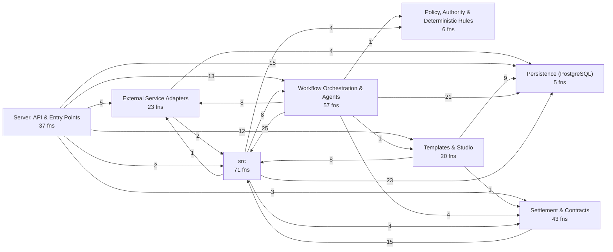
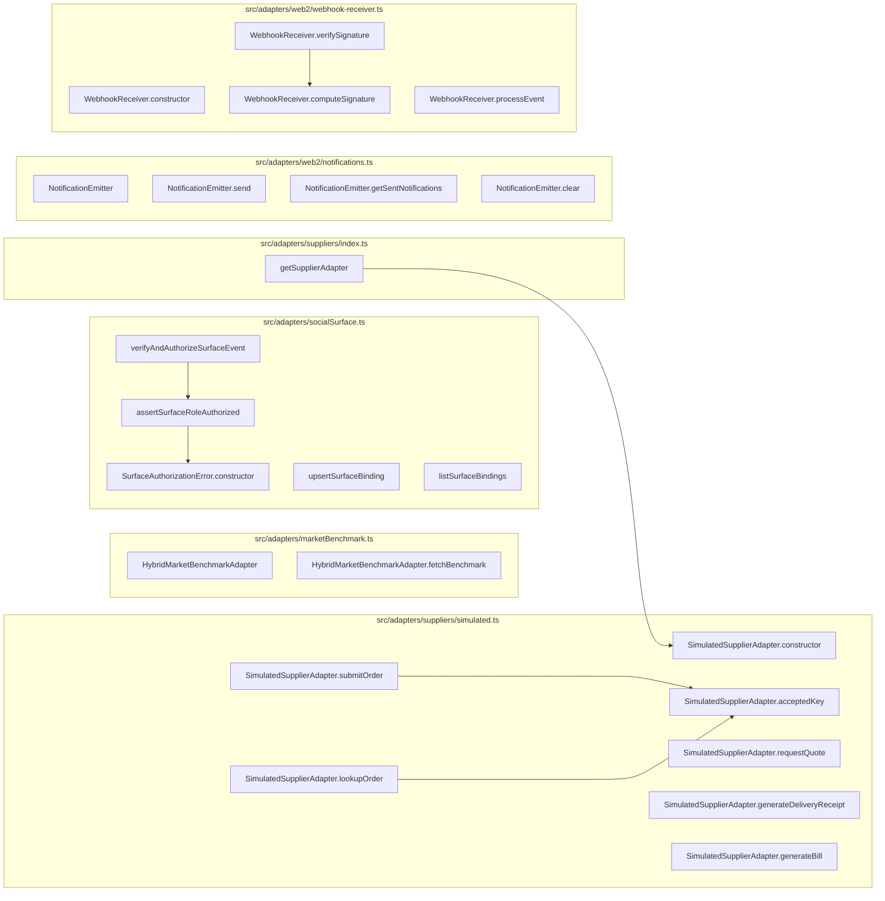
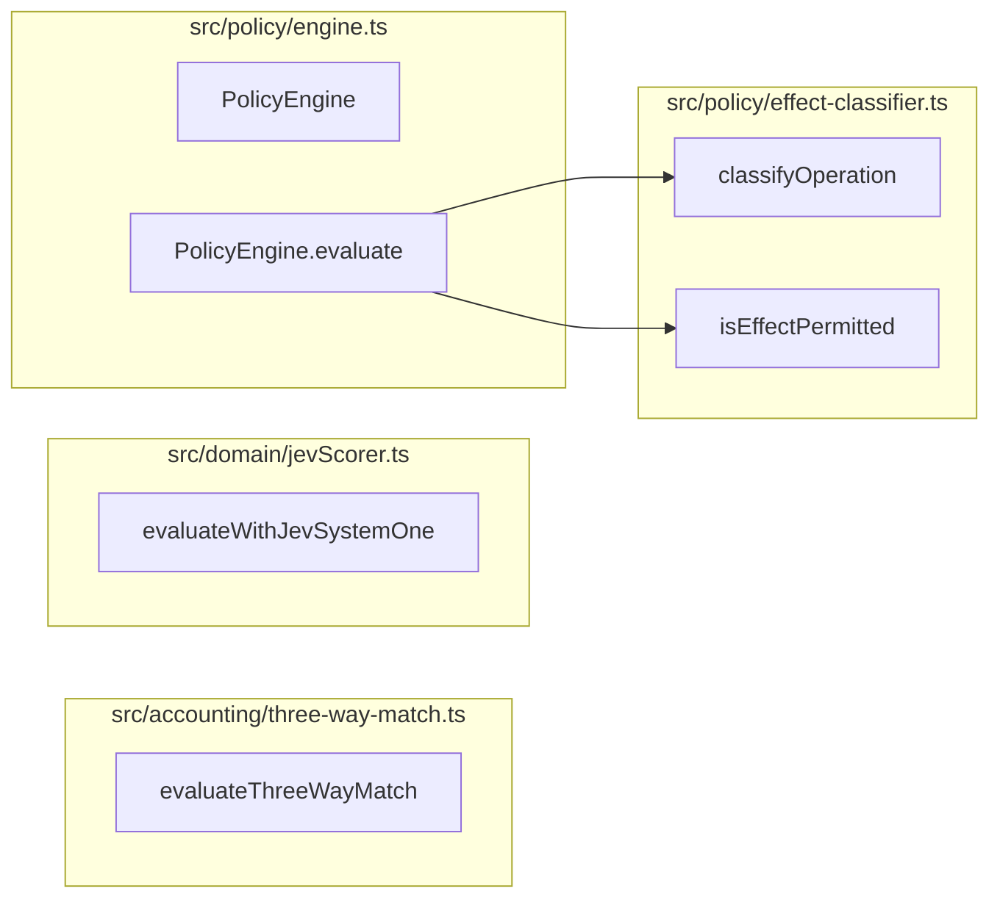
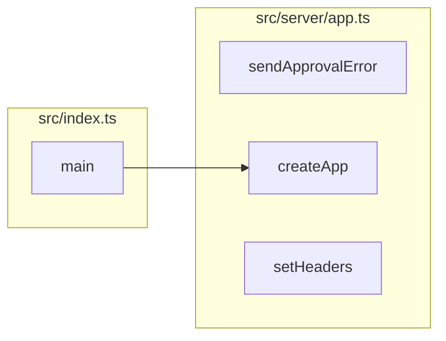
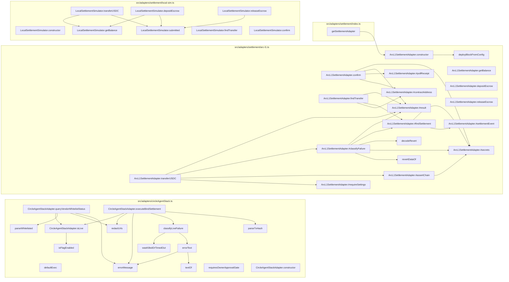
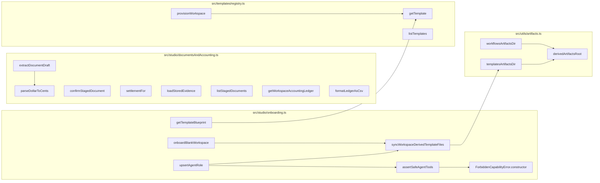
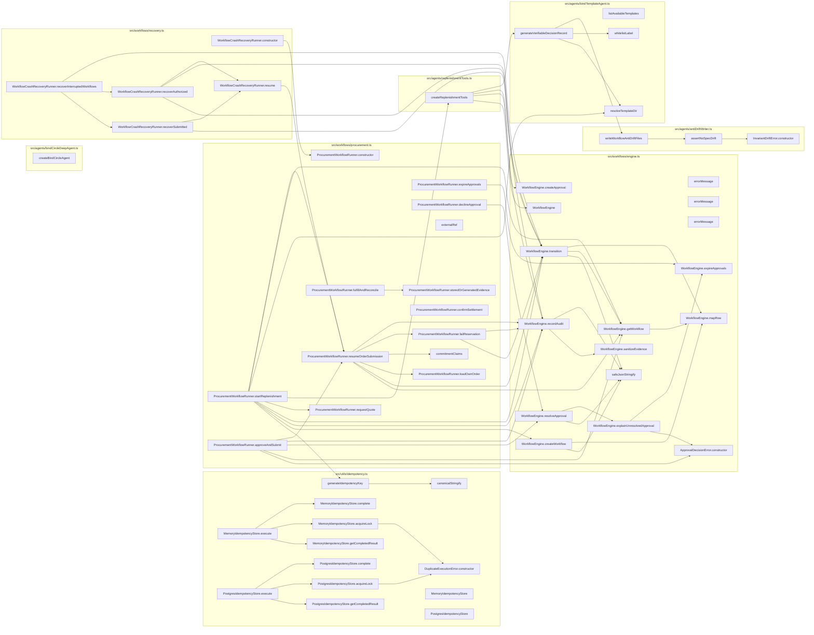
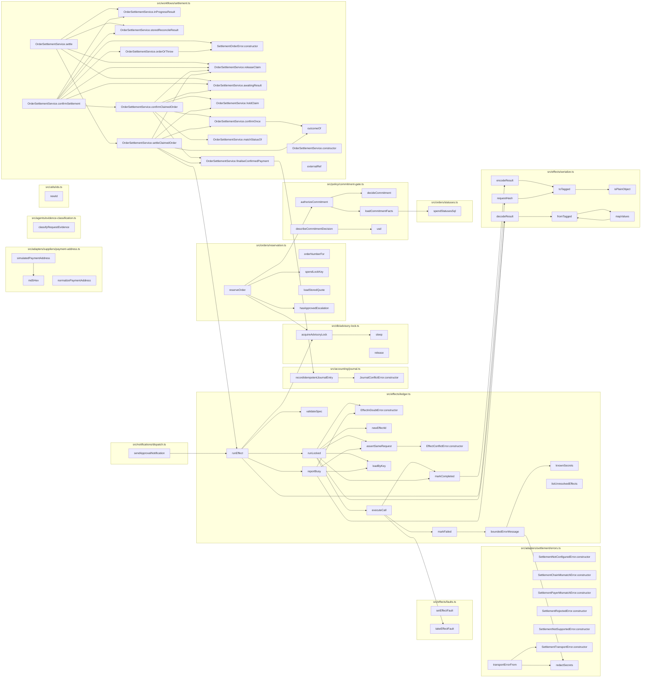

# Codebase map: functions and calls

Generated by `npx tsx scripts/map-functions.ts` from the TypeScript compiler's symbol table. Do not edit by hand.
The browser UI (`src/ui`, plain JavaScript) and the Solidity contract are not included here; see `.ua/knowledge-graph.json` for the contract.

- Functions, methods, handlers and classes: **473** (262 in production code, 211 in tests)
- Resolved call edges: **848**
- HTTP routes: **33**

## Layers and cross-layer calls

## HTTP surface: route to what it calls

| Route | Line | Calls directly |
| --- | --- | --- |
| `GET /health` | 86 | `query` |
| `GET /api/templates` | 96 | `listTemplates` |
| `GET /api/templates/:id/blueprint` | 100 | `getTemplateBlueprint` |
| `GET /api/workspaces` | 109 | `query` |
| `POST /api/workspaces/onboard` | 115 | `onboardBlankWorkspace` |
| `POST /api/workspaces` | 124 | `provisionWorkspace` |
| `GET /api/workspaces/:id` | 137 | `query`, `getSettlementAdapter`, `ArcL1SettlementAdapter.getBalance`, `LocalSettlementSimulator.getBalance` |
| `PUT /api/workspaces/:id/policy` | 157 | `query`, `syncWorkspaceDerivedTemplateFiles` |
| `GET /api/workspaces/:id/inventory` | 195 | `query` |
| `POST /api/workspaces/:id/inventory` | 204 | `query` |
| `POST /api/workspaces/:id/replenish` | 244 | `ProcurementWorkflowRunner.startReplenishment` |
| `GET /api/workspaces/:id/approvals` | 259 | `ProcurementWorkflowRunner.expireApprovals`, `query` |
| `POST /api/approvals/:id/approve` | 269 | `ProcurementWorkflowRunner.approveAndSubmit`, `sendApprovalError` |
| `POST /api/approvals/:id/reject` | 280 | `ProcurementWorkflowRunner.declineApproval`, `sendApprovalError` |
| `POST /api/approvals/:id/revoke` | 296 | `ProcurementWorkflowRunner.declineApproval`, `sendApprovalError` |
| `POST /api/orders/:id/reconcile` | 313 | `ProcurementWorkflowRunner.fulfillAndReconcile` |
| `POST /api/orders/:id/confirm-settlement` | 324 | `ProcurementWorkflowRunner.confirmSettlement` |
| `GET /api/workspaces/:id/workflows` | 340 | `query` |
| `GET /api/workspaces/:id/orders` | 350 | `query` |
| `GET /api/workspaces/:id/suppliers` | 375 | `query` |
| `POST /api/workspaces/:id/suppliers` | 384 | `normalizePaymentAddress`, `simulatedPaymentAddress`, `query` |
| `GET /api/workspaces/:id/agents` | 430 | `query` |
| `POST /api/workspaces/:id/agents` | 443 | `upsertAgentRole` |
| `GET /api/workspaces/:id/surfaces` | 457 | `listSurfaceBindings` |
| `POST /api/workspaces/:id/surfaces` | 463 | `upsertSurfaceBinding` |
| `GET /api/workspaces/:id/documents` | 474 | `listStagedDocuments` |
| `POST /api/workspaces/:id/documents/extract` | 480 | `extractDocumentDraft` |
| `POST /api/workspaces/:id/documents/:docId/confirm` | 490 | `confirmStagedDocument` |
| `GET /api/workspaces/:id/accounting/ledger` | 500 | `getWorkspaceAccountingLedger`, `formatLedgerAsCsv` |
| `GET /api/workspaces/:id/audit` | 520 | `query` |
| `POST /api/workspaces/:id/recover` | 530 | `WorkflowCrashRecoveryRunner.recoverInterruptedWorkflows` |
| `POST /api/webhooks/incoming` | 540 | `verifyAndAuthorizeSurfaceEvent`, `query`, `ProcurementWorkflowRunner.startReplenishment`, `ProcurementWorkflowRunner.approveAndSubmit`, `sendApprovalError`, `ProcurementWorkflowRunner.declineApproval`, `WebhookReceiver.verifySignature`, `WebhookReceiver.processEvent` |
| `GET *` | 669 | SQL or inline logic only |

## External Service Adapters

| Function | File:lines | Kind | Params | Exported | Called by (prod / tests) | Calls |
| --- | --- | --- | --- | --- | --- | --- |
| `HybridMarketBenchmarkAdapter` | src/adapters/marketBenchmark.ts:19-113 | class | 0 | yes | 2 / 1 | 0 |
| `HybridMarketBenchmarkAdapter.fetchBenchmark` | src/adapters/marketBenchmark.ts:20-112 | method | 2 | yes | 2 / 1 | 0 |
| `SurfaceAuthorizationError.constructor` | src/adapters/socialSurface.ts:70-73 | constructor | 1 | yes | 1 / 0 | 0 |
| `assertSurfaceRoleAuthorized` | src/adapters/socialSurface.ts:79-102 | function | 2 | yes | 1 / 1 | 1 |
| `verifyAndAuthorizeSurfaceEvent` | src/adapters/socialSurface.ts:108-125 | function | 1 | yes | 1 / 0 | 2 |
| `upsertSurfaceBinding` | src/adapters/socialSurface.ts:127-172 | function | 2 | yes | 1 / 0 | 2 |
| `listSurfaceBindings` | src/adapters/socialSurface.ts:174-180 | function | 1 | yes | 1 / 0 | 1 |
| `getSupplierAdapter` | src/adapters/suppliers/index.ts:24-34 | function | 1 | yes | 0 / 2 | 1 |
| `SimulatedSupplierAdapter.constructor` | src/adapters/suppliers/simulated.ts:20-25 | constructor | 4 | yes | 2 / 2 | 0 |
| `SimulatedSupplierAdapter.acceptedKey` | src/adapters/suppliers/simulated.ts:27-29 | method | 2 | yes | 2 / 0 | 0 |
| `SimulatedSupplierAdapter.requestQuote` | src/adapters/suppliers/simulated.ts:31-62 | method | 1 | yes | 1 / 1 | 0 |
| `SimulatedSupplierAdapter.submitOrder` | src/adapters/suppliers/simulated.ts:65-80 | method | 1 | yes | 1 / 2 | 1 |
| `SimulatedSupplierAdapter.lookupOrder` | src/adapters/suppliers/simulated.ts:83-87 | method | 1 | yes | 0 / 2 | 1 |
| `SimulatedSupplierAdapter.generateDeliveryReceipt` | src/adapters/suppliers/simulated.ts:89-99 | method | 3 | yes | 1 / 1 | 0 |
| `SimulatedSupplierAdapter.generateBill` | src/adapters/suppliers/simulated.ts:101-114 | method | 5 | yes | 1 / 2 | 0 |
| `NotificationEmitter` | src/adapters/web2/notifications.ts:4-32 | class | 0 | yes | 1 / 0 | 0 |
| `NotificationEmitter.send` | src/adapters/web2/notifications.ts:7-20 | method | 1 | yes | 1 / 0 | 1 |
| `NotificationEmitter.getSentNotifications` | src/adapters/web2/notifications.ts:22-27 | method | 1 | yes | 0 / 1 | 0 |
| `NotificationEmitter.clear` | src/adapters/web2/notifications.ts:29-31 | method | 0 | yes | 0 / 2 | 0 |
| `WebhookReceiver.constructor` | src/adapters/web2/webhook-receiver.ts:6-6 | constructor | 1 | yes | 1 / 0 | 0 |
| `WebhookReceiver.computeSignature` | src/adapters/web2/webhook-receiver.ts:11-16 | method | 2 | yes | 1 / 1 | 0 |
| `WebhookReceiver.verifySignature` | src/adapters/web2/webhook-receiver.ts:21-33 | method | 3 | yes | 1 / 1 | 1 |
| `WebhookReceiver.processEvent` | src/adapters/web2/webhook-receiver.ts:39-60 | method | 1 | yes | 1 / 1 | 1 |

## Persistence (PostgreSQL)

| Function | File:lines | Kind | Params | Exported | Called by (prod / tests) | Calls |
| --- | --- | --- | --- | --- | --- | --- |
| `query` | src/db/client.ts:13-18 | function | 2 | yes | 68 / 59 | 0 |
| `getClient` | src/db/client.ts:20-22 | function | 0 | yes | 0 / 0 | 0 |
| `withTransaction` | src/db/client.ts:24-39 | function | 1 | yes | 3 / 0 | 0 |
| `closePool` | src/db/client.ts:41-43 | function | 0 | yes | 0 / 19 | 0 |
| `runMigrations` | src/db/migrate.ts:9-22 | function | 0 | yes | 2 / 20 | 0 |

## Policy, Authority & Deterministic Rules

| Function | File:lines | Kind | Params | Exported | Called by (prod / tests) | Calls |
| --- | --- | --- | --- | --- | --- | --- |
| `evaluateThreeWayMatch` | src/accounting/three-way-match.ts:18-99 | function | 3 | yes | 1 / 1 | 0 |
| `evaluateWithJevSystemOne` | src/domain/jevScorer.ts:50-241 | function | 1 | yes | 1 / 1 | 0 |
| `classifyOperation` | src/policy/effect-classifier.ts:39-48 | function | 1 | yes | 2 / 2 | 0 |
| `isEffectPermitted` | src/policy/effect-classifier.ts:53-58 | function | 2 | yes | 1 / 0 | 0 |
| `PolicyEngine` | src/policy/engine.ts:14-60 | class | 0 | yes | 1 / 1 | 0 |
| `PolicyEngine.evaluate` | src/policy/engine.ts:15-59 | method | 1 | yes | 1 / 1 | 2 |

## Server, API & Entry Points

| Function | File:lines | Kind | Params | Exported | Called by (prod / tests) | Calls |
| --- | --- | --- | --- | --- | --- | --- |
| `main` | src/index.ts:6-27 | function | 0 | no | 1 / 0 | 3 |
| `sendApprovalError` | src/server/app.ts:48-58 | function | 2 | no | 4 / 0 | 0 |
| `createApp` | src/server/app.ts:60-677 | function | 0 | yes | 1 / 5 | 2 |
| `setHeaders` | src/server/app.ts:77-81 | arrow | 1 | no | 0 / 0 | 0 |

## Settlement & Contracts

| Function | File:lines | Kind | Params | Exported | Called by (prod / tests) | Calls |
| --- | --- | --- | --- | --- | --- | --- |
| `defaultExec` | src/adapters/circleAgentStack.ts:70-73 | arrow | 3 | no | 0 / 0 | 0 |
| `requiresOwnerApprovalGate` | src/adapters/circleAgentStack.ts:75-78 | function | 1 | yes | 0 / 1 | 0 |
| `isFlagEnabled` | src/adapters/circleAgentStack.ts:83-86 | function | 1 | yes | 1 / 1 | 0 |
| `redactUrls` | src/adapters/circleAgentStack.ts:88-90 | function | 1 | no | 2 / 0 | 0 |
| `errorMessage` | src/adapters/circleAgentStack.ts:92-94 | function | 1 | no | 3 / 0 | 0 |
| `textOf` | src/adapters/circleAgentStack.ts:96-100 | function | 1 | no | 1 / 0 | 0 |
| `errorText` | src/adapters/circleAgentStack.ts:103-112 | function | 1 | no | 1 / 0 | 2 |
| `wasKilledOrTimedOut` | src/adapters/circleAgentStack.ts:115-119 | function | 1 | no | 1 / 0 | 0 |
| `classifyLiveFailure` | src/adapters/circleAgentStack.ts:121-124 | function | 1 | no | 1 / 0 | 2 |
| `parseWhitelisted` | src/adapters/circleAgentStack.ts:126-134 | function | 1 | no | 1 / 0 | 0 |
| `parseTxHash` | src/adapters/circleAgentStack.ts:137-146 | function | 1 | no | 1 / 0 | 0 |
| `CircleAgentStackAdapter.constructor` | src/adapters/circleAgentStack.ts:153-157 | constructor | 2 | yes | 1 / 2 | 0 |
| `CircleAgentStackAdapter.isLive` | src/adapters/circleAgentStack.ts:160-162 | method | 0 | yes | 2 / 0 | 1 |
| `CircleAgentStackAdapter.queryVendorWhitelistStatus` | src/adapters/circleAgentStack.ts:167-209 | method | 1 | yes | 1 / 2 | 4 |
| `CircleAgentStackAdapter.executeBindSettlement` | src/adapters/circleAgentStack.ts:215-276 | method | 1 | yes | 1 / 2 | 5 |
| `revertDataOf` | src/adapters/settlement/arc-l1.ts:135-143 | function | 1 | no | 1 / 0 | 0 |
| `decodeRevert` | src/adapters/settlement/arc-l1.ts:145-152 | function | 1 | no | 1 / 0 | 0 |
| `deployBlockFromConfig` | src/adapters/settlement/arc-l1.ts:154-156 | function | 0 | no | 1 / 0 | 0 |
| `ArcL1SettlementAdapter.constructor` | src/adapters/settlement/arc-l1.ts:180-196 | constructor | 1 | yes | 1 / 5 | 1 |
| `ArcL1SettlementAdapter.getBalance` | src/adapters/settlement/arc-l1.ts:198-212 | method | 1 | yes | 1 / 2 | 0 |
| `ArcL1SettlementAdapter.transferUSDC` | src/adapters/settlement/arc-l1.ts:218-258 | method | 1 | yes | 1 / 3 | 6 |
| `ArcL1SettlementAdapter.confirm` | src/adapters/settlement/arc-l1.ts:265-288 | method | 1 | yes | 1 / 1 | 6 |
| `ArcL1SettlementAdapter.findTransfer` | src/adapters/settlement/arc-l1.ts:299-307 | method | 1 | yes | 0 / 1 | 4 |
| `ArcL1SettlementAdapter.depositEscrow` | src/adapters/settlement/arc-l1.ts:309-311 | method | 2 | yes | 0 / 2 | 1 |
| `ArcL1SettlementAdapter.releaseEscrow` | src/adapters/settlement/arc-l1.ts:313-315 | method | 2 | yes | 0 / 2 | 1 |
| `ArcL1SettlementAdapter.#result` | src/adapters/settlement/arc-l1.ts:317-328 | method | 3 | yes | 4 / 0 | 0 |
| `ArcL1SettlementAdapter.#secrets` | src/adapters/settlement/arc-l1.ts:331-333 | method | 0 | yes | 4 / 0 | 0 |
| `ArcL1SettlementAdapter.#classifyFailure` | src/adapters/settlement/arc-l1.ts:339-355 | method | 4 | yes | 1 / 0 | 7 |
| `ArcL1SettlementAdapter.#contractAddress` | src/adapters/settlement/arc-l1.ts:357-363 | method | 0 | yes | 2 / 0 | 1 |
| `ArcL1SettlementAdapter.#requireSettings` | src/adapters/settlement/arc-l1.ts:366-385 | method | 0 | yes | 1 / 0 | 1 |
| `ArcL1SettlementAdapter.#assertChain` | src/adapters/settlement/arc-l1.ts:388-398 | method | 0 | yes | 1 / 0 | 3 |
| `ArcL1SettlementAdapter.#settlementEvent` | src/adapters/settlement/arc-l1.ts:400-404 | method | 0 | yes | 1 / 0 | 0 |
| `ArcL1SettlementAdapter.#findSettlement` | src/adapters/settlement/arc-l1.ts:410-428 | method | 2 | yes | 2 / 0 | 3 |
| `ArcL1SettlementAdapter.#pollReceipt` | src/adapters/settlement/arc-l1.ts:430-443 | method | 1 | yes | 1 / 0 | 0 |
| `getSettlementAdapter` | src/adapters/settlement/index.ts:14-27 | function | 1 | yes | 3 / 0 | 1 |
| `LocalSettlementSimulator.constructor` | src/adapters/settlement/local-sim.ts:24-27 | constructor | 0 | yes | 1 / 1 | 0 |
| `LocalSettlementSimulator.getBalance` | src/adapters/settlement/local-sim.ts:29-31 | method | 1 | yes | 3 / 1 | 0 |
| `LocalSettlementSimulator.transferUSDC` | src/adapters/settlement/local-sim.ts:33-56 | method | 1 | yes | 1 / 1 | 2 |
| `LocalSettlementSimulator.findTransfer` | src/adapters/settlement/local-sim.ts:59-61 | method | 1 | yes | 0 / 1 | 0 |
| `LocalSettlementSimulator.confirm` | src/adapters/settlement/local-sim.ts:63-66 | method | 1 | yes | 1 / 1 | 1 |
| `LocalSettlementSimulator.depositEscrow` | src/adapters/settlement/local-sim.ts:68-83 | method | 2 | yes | 0 / 0 | 2 |
| `LocalSettlementSimulator.releaseEscrow` | src/adapters/settlement/local-sim.ts:85-100 | method | 2 | yes | 0 / 0 | 1 |
| `LocalSettlementSimulator.submitted` | src/adapters/settlement/local-sim.ts:102-110 | method | 0 | yes | 3 / 0 | 0 |

## Templates & Studio

| Function | File:lines | Kind | Params | Exported | Called by (prod / tests) | Calls |
| --- | --- | --- | --- | --- | --- | --- |
| `parseDollarToCents` | src/studio/documentsAndAccounting.ts:30-37 | function | 1 | no | 1 / 0 | 0 |
| `extractDocumentDraft` | src/studio/documentsAndAccounting.ts:43-209 | function | 2 | yes | 1 / 1 | 3 |
| `confirmStagedDocument` | src/studio/documentsAndAccounting.ts:216-463 | function | 4 | yes | 1 / 2 | 3 |
| `settlementFor` | src/studio/documentsAndAccounting.ts:408-408 | arrow | 1 | no | 0 / 0 | 1 |
| `loadStoredEvidence` | src/studio/documentsAndAccounting.ts:412-436 | arrow | 1 | no | 0 / 0 | 1 |
| `listStagedDocuments` | src/studio/documentsAndAccounting.ts:465-471 | function | 1 | yes | 1 / 0 | 1 |
| `getWorkspaceAccountingLedger` | src/studio/documentsAndAccounting.ts:473-496 | function | 1 | yes | 1 / 0 | 2 |
| `formatLedgerAsCsv` | src/studio/documentsAndAccounting.ts:498-533 | function | 1 | yes | 1 / 0 | 0 |
| `ForbiddenCapabilityError.constructor` | src/studio/onboarding.ts:30-33 | constructor | 1 | yes | 1 / 0 | 0 |
| `assertSafeAgentTools` | src/studio/onboarding.ts:114-128 | function | 1 | yes | 1 / 0 | 1 |
| `getTemplateBlueprint` | src/studio/onboarding.ts:133-173 | function | 1 | yes | 1 / 0 | 1 |
| `onboardBlankWorkspace` | src/studio/onboarding.ts:179-323 | function | 1 | yes | 1 / 0 | 4 |
| `upsertAgentRole` | src/studio/onboarding.ts:328-398 | function | 2 | yes | 1 / 0 | 4 |
| `syncWorkspaceDerivedTemplateFiles` | src/studio/onboarding.ts:404-488 | function | 1 | yes | 3 / 0 | 2 |
| `getTemplate` | src/templates/registry.ts:12-16 | function | 1 | yes | 2 / 1 | 0 |
| `listTemplates` | src/templates/registry.ts:18-20 | function | 0 | yes | 1 / 1 | 0 |
| `provisionWorkspace` | src/templates/registry.ts:33-160 | function | 4 | yes | 2 / 16 | 3 |
| `derivedArtifactsRoot` | src/utils/artifacts.ts:12-20 | function | 0 | yes | 2 / 0 | 0 |
| `workflowsArtifactsDir` | src/utils/artifacts.ts:22-24 | function | 0 | yes | 1 / 0 | 1 |
| `templatesArtifactsDir` | src/utils/artifacts.ts:26-28 | function | 0 | yes | 1 / 0 | 1 |

## Workflow Orchestration & Agents

| Function | File:lines | Kind | Params | Exported | Called by (prod / tests) | Calls |
| --- | --- | --- | --- | --- | --- | --- |
| `InvariantDriftError.constructor` | src/agents/antiDriftWriter.ts:33-36 | constructor | 1 | yes | 1 / 0 | 0 |
| `assertNoSpecDrift` | src/agents/antiDriftWriter.ts:42-78 | function | 1 | yes | 1 / 1 | 1 |
| `writeWorkflowAntiDriftFiles` | src/agents/antiDriftWriter.ts:91-241 | function | 2 | yes | 2 / 1 | 2 |
| `createBindCircleAgent` | src/agents/bindCircleDeepAgent.ts:15-108 | function | 1 | yes | 0 / 0 | 5 |
| `listAvailableTemplates` | src/agents/bindTemplateAgent.ts:25-43 | function | 0 | yes | 0 / 1 | 0 |
| `resolveTemplateDir` | src/agents/bindTemplateAgent.ts:48-59 | function | 1 | yes | 2 / 1 | 0 |
| `whitelistLabel` | src/agents/bindTemplateAgent.ts:105-109 | function | 1 | no | 1 / 0 | 0 |
| `generateVerifiableDecisionRecord` | src/agents/bindTemplateAgent.ts:113-274 | function | 1 | yes | 1 / 2 | 5 |
| `createReplenishmentTools` | src/agents/replenishmentTools.ts:23-657 | function | 1 | yes | 1 / 6 | 13 |
| `DuplicateExecutionError.constructor` | src/utils/idempotency.ts:5-8 | constructor | 1 | yes | 2 / 0 | 0 |
| `canonicalStringify` | src/utils/idempotency.ts:15-24 | function | 1 | yes | 2 / 0 | 0 |
| `generateIdempotencyKey` | src/utils/idempotency.ts:29-40 | function | 3 | yes | 1 / 1 | 1 |
| `MemoryIdempotencyStore` | src/utils/idempotency.ts:50-95 | class | 0 | yes | 0 / 1 | 0 |
| `MemoryIdempotencyStore.acquireLock` | src/utils/idempotency.ts:53-60 | method | 3 | yes | 1 / 1 | 1 |
| `MemoryIdempotencyStore.complete` | src/utils/idempotency.ts:62-68 | method | 2 | yes | 1 / 0 | 0 |
| `MemoryIdempotencyStore.getCompletedResult` | src/utils/idempotency.ts:70-76 | method | 1 | yes | 1 / 0 | 0 |
| `MemoryIdempotencyStore.execute` | src/utils/idempotency.ts:78-94 | method | 4 | yes | 0 / 1 | 3 |
| `PostgresIdempotencyStore` | src/utils/idempotency.ts:98-157 | class | 0 | yes | 0 / 0 | 0 |
| `PostgresIdempotencyStore.acquireLock` | src/utils/idempotency.ts:99-119 | method | 3 | yes | 1 / 0 | 2 |
| `PostgresIdempotencyStore.complete` | src/utils/idempotency.ts:121-128 | method | 2 | yes | 1 / 0 | 1 |
| `PostgresIdempotencyStore.getCompletedResult` | src/utils/idempotency.ts:130-139 | method | 1 | yes | 1 / 0 | 1 |
| `PostgresIdempotencyStore.execute` | src/utils/idempotency.ts:141-156 | method | 4 | yes | 0 / 0 | 4 |
| `safeJsonStringify` | src/workflows/engine.ts:7-11 | function | 1 | no | 4 / 0 | 0 |
| `errorMessage` | src/workflows/engine.ts:19-19 | arrow | 0 | no | 0 / 0 | 0 |
| `errorMessage` | src/workflows/engine.ts:22-22 | arrow | 1 | no | 0 / 0 | 0 |
| `errorMessage` | src/workflows/engine.ts:26-26 | arrow | 1 | no | 0 / 0 | 0 |
| `ApprovalDecisionError.constructor` | src/workflows/engine.ts:37-42 | constructor | 3 | yes | 2 / 0 | 0 |
| `WorkflowEngine` | src/workflows/engine.ts:45-294 | class | 0 | yes | 2 / 5 | 0 |
| `WorkflowEngine.mapRow` | src/workflows/engine.ts:46-59 | method | 1 | yes | 3 / 0 | 0 |
| `WorkflowEngine.createWorkflow` | src/workflows/engine.ts:64-79 | method | 5 | yes | 1 / 7 | 3 |
| `WorkflowEngine.getWorkflow` | src/workflows/engine.ts:84-90 | method | 1 | yes | 5 / 4 | 2 |
| `WorkflowEngine.transition` | src/workflows/engine.ts:95-121 | method | 2 | yes | 7 / 5 | 4 |
| `WorkflowEngine.recordAudit` | src/workflows/engine.ts:126-157 | method | 9 | yes | 10 / 0 | 4 |
| `WorkflowEngine.createApproval` | src/workflows/engine.ts:162-179 | method | 8 | yes | 1 / 3 | 1 |
| `WorkflowEngine.resolveApproval` | src/workflows/engine.ts:189-226 | method | 4 | yes | 2 / 0 | 3 |
| `WorkflowEngine.expireApprovals` | src/workflows/engine.ts:232-253 | method | 1 | yes | 2 / 1 | 1 |
| `WorkflowEngine.explainUnresolvedApproval` | src/workflows/engine.ts:259-276 | method | 1 | yes | 1 / 0 | 3 |
| `WorkflowEngine.sanitizeEvidence` | src/workflows/engine.ts:278-293 | method | 1 | yes | 1 / 0 | 0 |
| `commitmentClaims` | src/workflows/procurement.ts:48-58 | function | 3 | no | 1 / 0 | 0 |
| `ProcurementWorkflowRunner.constructor` | src/workflows/procurement.ts:68-73 | constructor | 1 | yes | 2 / 9 | 2 |
| `ProcurementWorkflowRunner.startReplenishment` | src/workflows/procurement.ts:78-301 | method | 3 | yes | 2 / 8 | 12 |
| `ProcurementWorkflowRunner.approveAndSubmit` | src/workflows/procurement.ts:306-357 | method | 2 | yes | 2 / 2 | 8 |
| `ProcurementWorkflowRunner.expireApprovals` | src/workflows/procurement.ts:362-364 | method | 1 | yes | 1 / 0 | 1 |
| `ProcurementWorkflowRunner.declineApproval` | src/workflows/procurement.ts:370-378 | method | 4 | yes | 3 / 0 | 1 |
| `ProcurementWorkflowRunner.requestQuote` | src/workflows/procurement.ts:385-434 | method | 1 | yes | 1 / 1 | 3 |
| `ProcurementWorkflowRunner.resumeOrderSubmission` | src/workflows/procurement.ts:444-610 | method | 1 | yes | 3 / 1 | 13 |
| `externalRef` | src/workflows/procurement.ts:543-543 | arrow | 1 | no | 0 / 0 | 0 |
| `ProcurementWorkflowRunner.loadOwnOrder` | src/workflows/procurement.ts:613-620 | method | 2 | yes | 1 / 0 | 1 |
| `ProcurementWorkflowRunner.failReservation` | src/workflows/procurement.ts:623-648 | method | 3 | yes | 1 / 0 | 3 |
| `ProcurementWorkflowRunner.fulfillAndReconcile` | src/workflows/procurement.ts:655-660 | method | 1 | yes | 1 / 6 | 2 |
| `ProcurementWorkflowRunner.confirmSettlement` | src/workflows/procurement.ts:666-668 | method | 1 | yes | 1 / 1 | 1 |
| `ProcurementWorkflowRunner.storedOrGeneratedEvidence` | src/workflows/procurement.ts:670-754 | method | 1 | yes | 1 / 0 | 3 |
| `WorkflowCrashRecoveryRunner.constructor` | src/workflows/recovery.ts:34-36 | constructor | 1 | yes | 1 / 2 | 1 |
| `WorkflowCrashRecoveryRunner.recoverInterruptedWorkflows` | src/workflows/recovery.ts:43-82 | method | 0 | yes | 1 / 2 | 4 |
| `WorkflowCrashRecoveryRunner.recoverSubmitted` | src/workflows/recovery.ts:84-118 | method | 2 | yes | 1 / 0 | 3 |
| `WorkflowCrashRecoveryRunner.recoverAuthorized` | src/workflows/recovery.ts:120-164 | method | 2 | yes | 1 / 0 | 6 |
| `WorkflowCrashRecoveryRunner.resume` | src/workflows/recovery.ts:166-174 | method | 3 | yes | 2 / 0 | 1 |

## src

| Function | File:lines | Kind | Params | Exported | Called by (prod / tests) | Calls |
| --- | --- | --- | --- | --- | --- | --- |
| `JournalConflictError.constructor` | src/accounting/journal.ts:8-11 | constructor | 1 | yes | 1 / 0 | 0 |
| `recordIdempotentJournalEntry` | src/accounting/journal.ts:20-59 | function | 1 | yes | 2 / 1 | 2 |
| `SettlementNotConfiguredError.constructor` | src/adapters/settlement/errors.ts:10-14 | constructor | 1 | yes | 2 / 0 | 0 |
| `SettlementChainMismatchError.constructor` | src/adapters/settlement/errors.ts:22-27 | constructor | 2 | yes | 1 / 0 | 0 |
| `SettlementPayerMismatchError.constructor` | src/adapters/settlement/errors.ts:32-35 | constructor | 0 | yes | 1 / 0 | 0 |
| `SettlementRejectedError.constructor` | src/adapters/settlement/errors.ts:43-48 | constructor | 2 | yes | 4 / 1 | 0 |
| `SettlementNotSupportedError.constructor` | src/adapters/settlement/errors.ts:53-56 | constructor | 1 | yes | 2 / 0 | 0 |
| `SettlementTransportError.constructor` | src/adapters/settlement/errors.ts:66-70 | constructor | 2 | yes | 2 / 1 | 0 |
| `redactSecrets` | src/adapters/settlement/errors.ts:79-85 | function | 2 | yes | 2 / 1 | 0 |
| `transportErrorFrom` | src/adapters/settlement/errors.ts:88-97 | function | 3 | yes | 4 / 0 | 2 |
| `md5Hex` | src/adapters/suppliers/payment-address.ts:4-6 | function | 1 | no | 1 / 0 | 0 |
| `simulatedPaymentAddress` | src/adapters/suppliers/payment-address.ts:14-16 | function | 1 | yes | 4 / 3 | 1 |
| `normalizePaymentAddress` | src/adapters/suppliers/payment-address.ts:22-26 | function | 1 | yes | 1 / 1 | 0 |
| `classifyRequestEvidence` | src/agents/evidence-classification.ts:12-23 | function | 1 | yes | 1 / 1 | 0 |
| `sleep` | src/db/advisory-lock.ts:21-21 | arrow | 1 | no | 1 / 0 | 0 |
| `acquireAdvisoryLock` | src/db/advisory-lock.ts:24-52 | function | 2 | yes | 2 / 0 | 1 |
| `release` | src/db/advisory-lock.ts:40-44 | arrow | 0 | no | 0 / 0 | 0 |
| `setEffectFault` | src/effects/faults.ts:24-29 | function | 1 | yes | 0 / 5 | 0 |
| `takeEffectFault` | src/effects/faults.ts:32-37 | function | 2 | yes | 1 / 0 | 0 |
| `EffectConflictError.constructor` | src/effects/ledger.ts:71-74 | constructor | 1 | yes | 1 / 0 | 0 |
| `EffectInDoubtError.constructor` | src/effects/ledger.ts:83-92 | constructor | 3 | yes | 2 / 0 | 0 |
| `newEffectId` | src/effects/ledger.ts:104-106 | function | 0 | no | 1 / 0 | 0 |
| `validateSpec` | src/effects/ledger.ts:108-127 | function | 1 | no | 1 / 0 | 1 |
| `knownSecrets` | src/effects/ledger.ts:130-142 | function | 0 | no | 1 / 0 | 0 |
| `boundedErrorMessage` | src/effects/ledger.ts:145-148 | function | 1 | yes | 2 / 0 | 2 |
| `assertSameRequest` | src/effects/ledger.ts:150-154 | function | 3 | no | 2 / 0 | 1 |
| `loadByKey` | src/effects/ledger.ts:156-172 | function | 1 | no | 2 / 0 | 1 |
| `markCompleted` | src/effects/ledger.ts:174-181 | function | 3 | no | 2 / 0 | 2 |
| `markFailed` | src/effects/ledger.ts:183-192 | function | 2 | no | 1 / 0 | 2 |
| `executeCall` | src/effects/ledger.ts:195-212 | function | 4 | no | 1 / 0 | 3 |
| `runLocked` | src/effects/ledger.ts:214-269 | function | 4 | no | 1 / 0 | 8 |
| `reportBusy` | src/effects/ledger.ts:272-280 | function | 2 | no | 1 / 0 | 4 |
| `runEffect` | src/effects/ledger.ts:286-302 | function | 3 | yes | 4 / 2 | 5 |
| `listUnresolvedEffects` | src/effects/ledger.ts:305-329 | function | 1 | yes | 0 / 3 | 1 |
| `isPlainObject` | src/effects/serialize.ts:20-23 | function | 1 | no | 1 / 0 | 0 |
| `toTagged` | src/effects/serialize.ts:26-62 | function | 2 | no | 2 / 0 | 1 |
| `fromTagged` | src/effects/serialize.ts:64-88 | function | 1 | no | 2 / 0 | 1 |
| `mapValues` | src/effects/serialize.ts:90-94 | function | 1 | no | 1 / 0 | 1 |
| `encodeResult` | src/effects/serialize.ts:100-103 | function | 1 | yes | 1 / 1 | 1 |
| `decodeResult` | src/effects/serialize.ts:106-108 | function | 1 | yes | 2 / 2 | 1 |
| `requestHash` | src/effects/serialize.ts:114-118 | function | 1 | yes | 1 / 2 | 2 |
| `sendApprovalNotification` | src/notifications/dispatch.ts:19-58 | function | 1 | yes | 1 / 1 | 3 |
| `orderNumberFor` | src/orders/reservation.ts:33-35 | function | 1 | yes | 1 / 2 | 0 |
| `spendLockKey` | src/orders/reservation.ts:37-39 | function | 1 | yes | 1 / 0 | 0 |
| `loadStoredQuote` | src/orders/reservation.ts:41-61 | function | 2 | yes | 1 / 0 | 1 |
| `hasApprovedEscalation` | src/orders/reservation.ts:64-70 | function | 2 | yes | 2 / 0 | 1 |
| `reserveOrder` | src/orders/reservation.ts:94-145 | function | 1 | yes | 1 / 0 | 5 |
| `spendStatusesSql` | src/orders/statuses.ts:20-22 | function | 0 | yes | 2 / 1 | 0 |
| `decideCommitment` | src/policy/commitment-gate.ts:71-160 | function | 2 | yes | 1 / 1 | 2 |
| `loadCommitmentFacts` | src/policy/commitment-gate.ts:163-228 | function | 1 | yes | 1 / 0 | 2 |
| `authorizeCommitment` | src/policy/commitment-gate.ts:230-232 | function | 1 | yes | 5 / 1 | 2 |
| `usd` | src/policy/commitment-gate.ts:247-249 | function | 1 | no | 1 / 0 | 0 |
| `describeCommitmentDecision` | src/policy/commitment-gate.ts:252-265 | function | 1 | yes | 4 / 0 | 1 |
| `newId` | src/utils/ids.ts:9-14 | function | 1 | yes | 8 / 1 | 0 |
| `SettlementOrderError.constructor` | src/workflows/settlement.ts:55-63 | constructor | 2 | yes | 2 / 0 | 0 |
| `outcomeOf` | src/workflows/settlement.ts:94-98 | function | 1 | no | 2 / 0 | 0 |
| `OrderSettlementService.constructor` | src/workflows/settlement.ts:110-112 | constructor | 1 | yes | 2 / 2 | 0 |
| `OrderSettlementService.settle` | src/workflows/settlement.ts:123-194 | method | 2 | yes | 2 / 1 | 6 |
| `OrderSettlementService.confirmSettlement` | src/workflows/settlement.ts:202-238 | method | 1 | yes | 1 / 0 | 8 |
| `OrderSettlementService.releaseClaim` | src/workflows/settlement.ts:241-246 | method | 2 | yes | 4 / 0 | 1 |
| `OrderSettlementService.inProgressResult` | src/workflows/settlement.ts:249-256 | method | 1 | yes | 2 / 0 | 1 |
| `OrderSettlementService.storedReconcileResult` | src/workflows/settlement.ts:258-266 | method | 1 | yes | 2 / 0 | 1 |
| `OrderSettlementService.awaitingResult` | src/workflows/settlement.ts:272-280 | method | 2 | yes | 3 / 0 | 1 |
| `OrderSettlementService.orderOrThrow` | src/workflows/settlement.ts:282-288 | method | 1 | yes | 1 / 0 | 2 |
| `OrderSettlementService.holdClaim` | src/workflows/settlement.ts:294-309 | method | 3 | yes | 2 / 0 | 2 |
| `OrderSettlementService.confirmOnce` | src/workflows/settlement.ts:312-320 | method | 2 | yes | 2 / 0 | 9 |
| `OrderSettlementService.confirmClaimedOrder` | src/workflows/settlement.ts:327-384 | method | 1 | yes | 1 / 0 | 7 |
| `OrderSettlementService.matchStatusOf` | src/workflows/settlement.ts:386-389 | method | 1 | yes | 1 / 0 | 1 |
| `OrderSettlementService.finaliseConfirmedPayment` | src/workflows/settlement.ts:397-472 | method | 2 | yes | 2 / 0 | 7 |
| `OrderSettlementService.settleClaimedOrder` | src/workflows/settlement.ts:474-711 | method | 4 | yes | 1 / 0 | 17 |
| `externalRef` | src/workflows/settlement.ts:626-626 | arrow | 1 | no | 0 / 0 | 0 |

## Exported but never called from production code

These are exported symbols with no caller in `src/` or `scripts/`. Some are entry points (`main`) or called only from tests, which is the signal that matters.

| Function | File:line | Called from tests |
| --- | --- | --- |
| `requiresOwnerApprovalGate` | src/adapters/circleAgentStack.ts:75 | yes |
| `ArcL1SettlementAdapter.findTransfer` | src/adapters/settlement/arc-l1.ts:299 | yes |
| `ArcL1SettlementAdapter.depositEscrow` | src/adapters/settlement/arc-l1.ts:309 | yes |
| `ArcL1SettlementAdapter.releaseEscrow` | src/adapters/settlement/arc-l1.ts:313 | yes |
| `LocalSettlementSimulator.findTransfer` | src/adapters/settlement/local-sim.ts:59 | yes |
| `LocalSettlementSimulator.depositEscrow` | src/adapters/settlement/local-sim.ts:68 | no |
| `LocalSettlementSimulator.releaseEscrow` | src/adapters/settlement/local-sim.ts:85 | no |
| `getSupplierAdapter` | src/adapters/suppliers/index.ts:24 | yes |
| `SimulatedSupplierAdapter.lookupOrder` | src/adapters/suppliers/simulated.ts:83 | yes |
| `NotificationEmitter.getSentNotifications` | src/adapters/web2/notifications.ts:22 | yes |
| `NotificationEmitter.clear` | src/adapters/web2/notifications.ts:29 | yes |
| `createBindCircleAgent` | src/agents/bindCircleDeepAgent.ts:15 | no |
| `listAvailableTemplates` | src/agents/bindTemplateAgent.ts:25 | yes |
| `getClient` | src/db/client.ts:20 | no |
| `closePool` | src/db/client.ts:41 | yes |
| `setEffectFault` | src/effects/faults.ts:24 | yes |
| `listUnresolvedEffects` | src/effects/ledger.ts:305 | yes |
| `MemoryIdempotencyStore` | src/utils/idempotency.ts:50 | yes |
| `MemoryIdempotencyStore.execute` | src/utils/idempotency.ts:78 | yes |
| `PostgresIdempotencyStore` | src/utils/idempotency.ts:98 | no |
| `PostgresIdempotencyStore.execute` | src/utils/idempotency.ts:141 | no |

## Production functions with no direct test caller

137 of 229. Indirect coverage through other functions is not counted here.

- `src/accounting/journal.ts`: `JournalConflictError.constructor`
- `src/adapters/circleAgentStack.ts`: `defaultExec`, `redactUrls`, `errorMessage`, `textOf`, `errorText`, `wasKilledOrTimedOut`, `classifyLiveFailure`, `parseWhitelisted`, `parseTxHash`, `CircleAgentStackAdapter.isLive`
- `src/adapters/settlement/arc-l1.ts`: `revertDataOf`, `decodeRevert`, `deployBlockFromConfig`, `ArcL1SettlementAdapter.#result`, `ArcL1SettlementAdapter.#secrets`, `ArcL1SettlementAdapter.#classifyFailure`, `ArcL1SettlementAdapter.#contractAddress`, `ArcL1SettlementAdapter.#requireSettings`, `ArcL1SettlementAdapter.#assertChain`, `ArcL1SettlementAdapter.#settlementEvent`, `ArcL1SettlementAdapter.#findSettlement`, `ArcL1SettlementAdapter.#pollReceipt`
- `src/adapters/settlement/errors.ts`: `SettlementNotConfiguredError.constructor`, `SettlementChainMismatchError.constructor`, `SettlementPayerMismatchError.constructor`, `SettlementNotSupportedError.constructor`, `transportErrorFrom`
- `src/adapters/settlement/index.ts`: `getSettlementAdapter`
- `src/adapters/settlement/local-sim.ts`: `LocalSettlementSimulator.depositEscrow`, `LocalSettlementSimulator.releaseEscrow`, `LocalSettlementSimulator.submitted`
- `src/adapters/socialSurface.ts`: `SurfaceAuthorizationError.constructor`, `verifyAndAuthorizeSurfaceEvent`, `upsertSurfaceBinding`, `listSurfaceBindings`
- `src/adapters/suppliers/payment-address.ts`: `md5Hex`
- `src/adapters/suppliers/simulated.ts`: `SimulatedSupplierAdapter.acceptedKey`
- `src/adapters/web2/notifications.ts`: `NotificationEmitter`, `NotificationEmitter.send`
- `src/adapters/web2/webhook-receiver.ts`: `WebhookReceiver.constructor`
- `src/agents/antiDriftWriter.ts`: `InvariantDriftError.constructor`
- `src/agents/bindCircleDeepAgent.ts`: `createBindCircleAgent`
- `src/agents/bindTemplateAgent.ts`: `whitelistLabel`
- `src/db/advisory-lock.ts`: `sleep`, `acquireAdvisoryLock`, `release`
- `src/db/client.ts`: `getClient`, `withTransaction`
- `src/effects/faults.ts`: `takeEffectFault`
- `src/effects/ledger.ts`: `EffectConflictError.constructor`, `EffectInDoubtError.constructor`, `newEffectId`, `validateSpec`, `knownSecrets`, `boundedErrorMessage`, `assertSameRequest`, `loadByKey`, `markCompleted`, `markFailed`, `executeCall`, `runLocked`, `reportBusy`
- `src/effects/serialize.ts`: `isPlainObject`, `toTagged`, `fromTagged`, `mapValues`
- `src/index.ts`: `main`
- `src/orders/reservation.ts`: `spendLockKey`, `loadStoredQuote`, `hasApprovedEscalation`, `reserveOrder`
- `src/policy/commitment-gate.ts`: `loadCommitmentFacts`, `usd`, `describeCommitmentDecision`
- `src/policy/effect-classifier.ts`: `isEffectPermitted`
- `src/server/app.ts`: `sendApprovalError`, `setHeaders`
- `src/studio/documentsAndAccounting.ts`: `parseDollarToCents`, `settlementFor`, `loadStoredEvidence`, `listStagedDocuments`, `getWorkspaceAccountingLedger`, `formatLedgerAsCsv`
- `src/studio/onboarding.ts`: `ForbiddenCapabilityError.constructor`, `assertSafeAgentTools`, `getTemplateBlueprint`, `onboardBlankWorkspace`, `upsertAgentRole`, `syncWorkspaceDerivedTemplateFiles`
- `src/utils/artifacts.ts`: `derivedArtifactsRoot`, `workflowsArtifactsDir`, `templatesArtifactsDir`
- `src/utils/idempotency.ts`: `DuplicateExecutionError.constructor`, `canonicalStringify`, `MemoryIdempotencyStore.complete`, `MemoryIdempotencyStore.getCompletedResult`, `PostgresIdempotencyStore`, `PostgresIdempotencyStore.acquireLock`, `PostgresIdempotencyStore.complete`, `PostgresIdempotencyStore.getCompletedResult`, `PostgresIdempotencyStore.execute`
- `src/workflows/engine.ts`: `safeJsonStringify`, `errorMessage`, `errorMessage`, `errorMessage`, `ApprovalDecisionError.constructor`, `WorkflowEngine.mapRow`, `WorkflowEngine.recordAudit`, `WorkflowEngine.resolveApproval`, `WorkflowEngine.explainUnresolvedApproval`, `WorkflowEngine.sanitizeEvidence`
- `src/workflows/procurement.ts`: `commitmentClaims`, `ProcurementWorkflowRunner.expireApprovals`, `ProcurementWorkflowRunner.declineApproval`, `externalRef`, `ProcurementWorkflowRunner.loadOwnOrder`, `ProcurementWorkflowRunner.failReservation`, `ProcurementWorkflowRunner.storedOrGeneratedEvidence`
- `src/workflows/recovery.ts`: `WorkflowCrashRecoveryRunner.recoverSubmitted`, `WorkflowCrashRecoveryRunner.recoverAuthorized`, `WorkflowCrashRecoveryRunner.resume`
- `src/workflows/settlement.ts`: `SettlementOrderError.constructor`, `outcomeOf`, `OrderSettlementService.confirmSettlement`, `OrderSettlementService.releaseClaim`, `OrderSettlementService.inProgressResult`, `OrderSettlementService.storedReconcileResult`, `OrderSettlementService.awaitingResult`, `OrderSettlementService.orderOrThrow`, `OrderSettlementService.holdClaim`, `OrderSettlementService.confirmOnce`, `OrderSettlementService.confirmClaimedOrder`, `OrderSettlementService.matchStatusOf`, `OrderSettlementService.finaliseConfirmedPayment`, `OrderSettlementService.settleClaimedOrder`, `externalRef`
