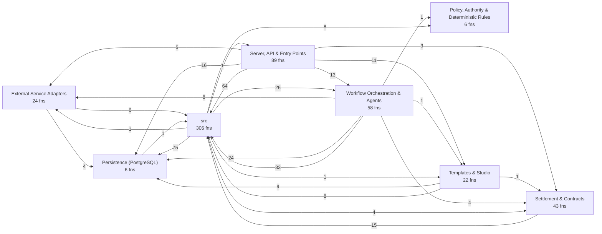
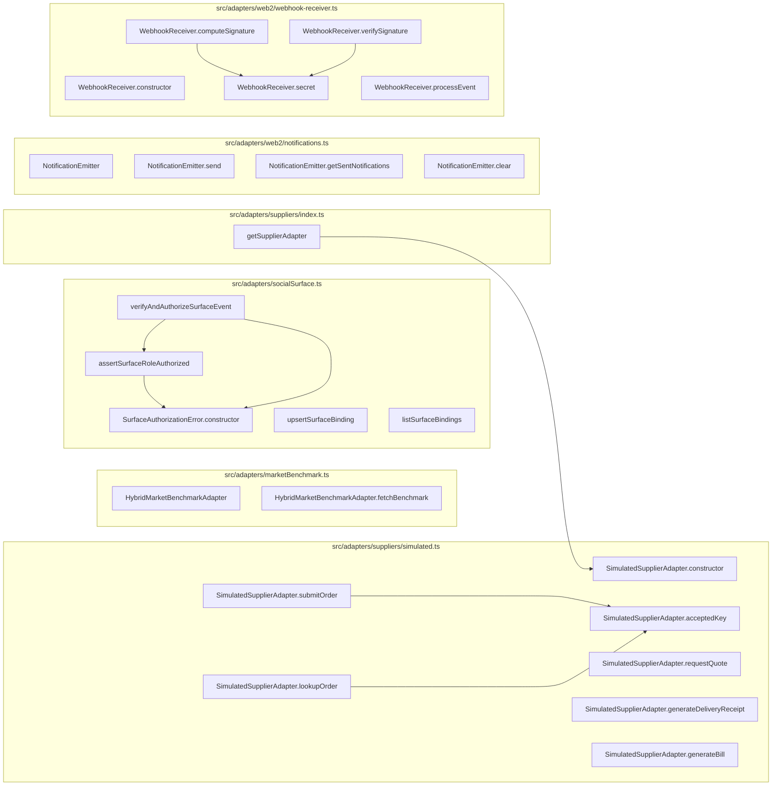
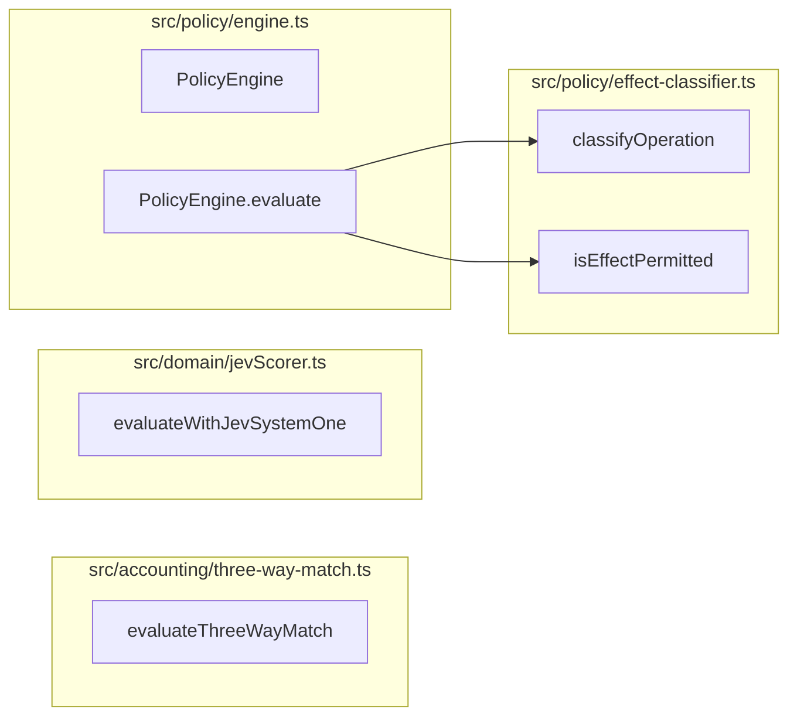
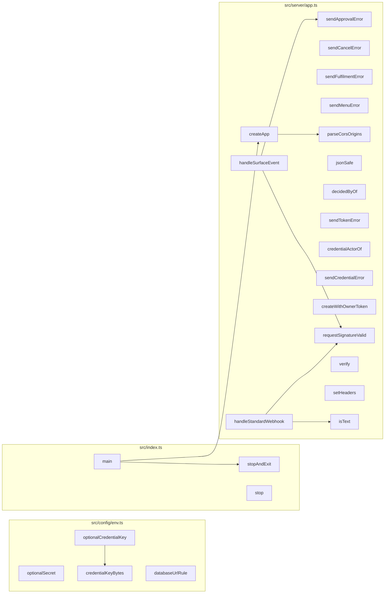
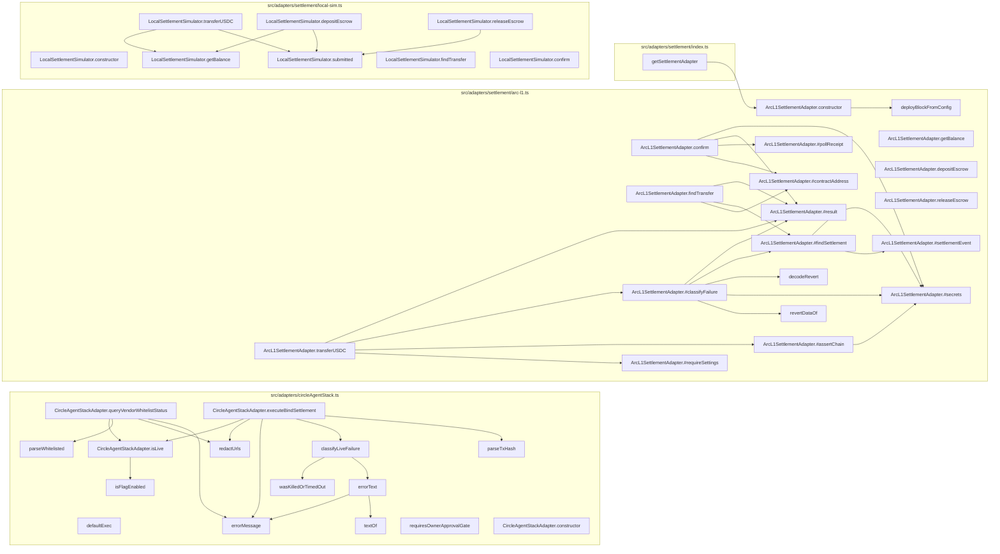
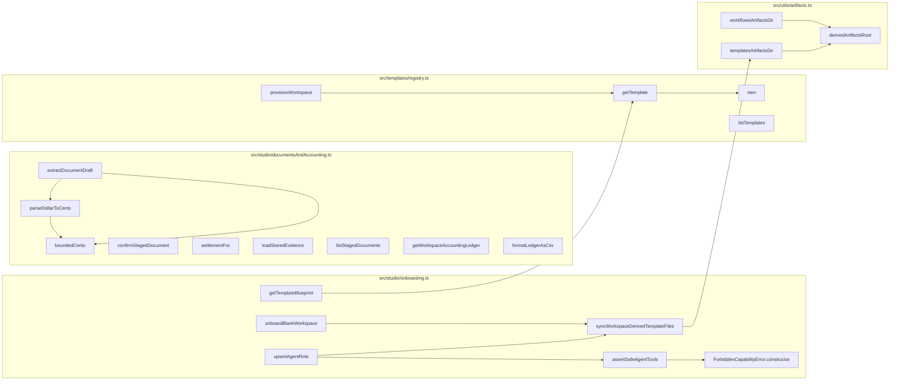
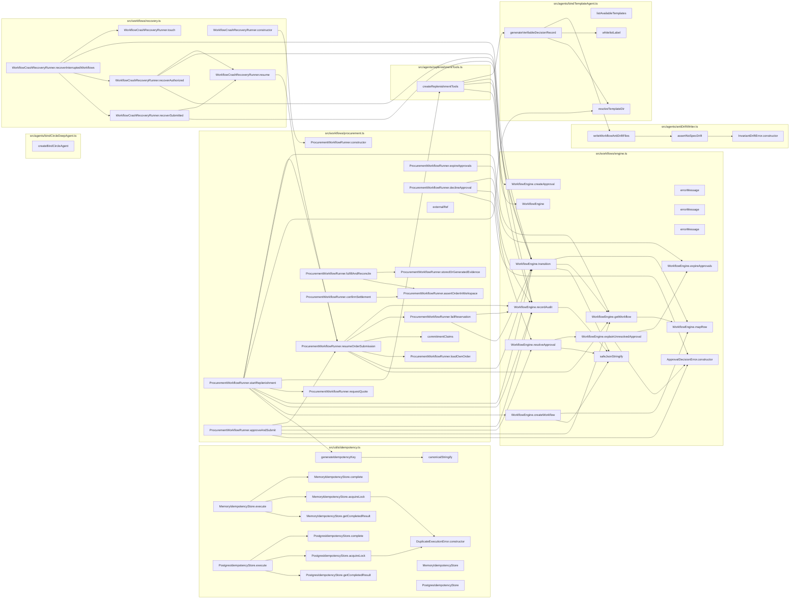

# Codebase map: functions and calls

Generated by `npx tsx scripts/map-functions.ts` from the TypeScript compiler's symbol table. Do not edit by hand.
The browser UI (`src/ui`, plain JavaScript) and the Solidity contract are not included here; see `.ua/knowledge-graph.json` for the contract.

- Functions, methods, handlers and classes: **1074** (554 in production code, 520 in tests)
- Resolved call edges: **2080**
- HTTP routes: **66**

## Layers and cross-layer calls



## HTTP surface: route to what it calls

| Route | Line | Calls directly |
| --- | --- | --- |
| `GET /x` | 161 | SQL or inline logic only |
| `GET /y` | 164 | SQL or inline logic only |
| `GET /health` | 416 | `query` |
| `GET /ready` | 427 | `checkReadiness` |
| `GET /api/templates` | 441 | `jsonSafe`, `listTemplates` |
| `GET /api/templates/:id/blueprint` | 445 | `getTemplateBlueprint` |
| `GET /api/workspaces` | 454 | `query` |
| `POST /api/workspaces/onboard` | 464 | `createWithOwnerToken`, `onboardBlankWorkspace`, `jsonSafe`, `publicErrorMessage` |
| `POST /api/workspaces` | 479 | `createWithOwnerToken`, `provisionWorkspace`, `jsonSafe`, `publicErrorMessage` |
| `GET /api/workspaces/:id` | 497 | `query`, `getSettlementAdapter`, `ArcL1SettlementAdapter.getBalance`, `LocalSettlementSimulator.getBalance` |
| `PUT /api/workspaces/:id/policy` | 517 | `normalizePaymentAddress`, `query`, `syncWorkspaceDerivedTemplateFiles`, `publicErrorMessage` |
| `GET /api/workspaces/:id/inventory` | 561 | `query` |
| `POST /api/workspaces/:id/inventory` | 570 | `query`, `publicErrorMessage` |
| `POST /api/workspaces/:id/replenish` | 610 | `ProcurementWorkflowRunner.startReplenishment`, `publicErrorMessage` |
| `GET /api/workspaces/:id/approvals` | 625 | `ProcurementWorkflowRunner.expireApprovals`, `query` |
| `POST /api/approvals/:id/approve` | 635 | `ProcurementWorkflowRunner.approveAndSubmit`, `decidedByOf`, `sendApprovalError` |
| `POST /api/approvals/:id/reject` | 646 | `ProcurementWorkflowRunner.declineApproval`, `decidedByOf`, `sendApprovalError` |
| `POST /api/approvals/:id/revoke` | 664 | `ProcurementWorkflowRunner.declineApproval`, `decidedByOf`, `sendApprovalError` |
| `POST /api/orders/:id/reconcile` | 683 | `ProcurementWorkflowRunner.fulfillAndReconcile`, `publicErrorMessage` |
| `POST /api/orders/:id/confirm-settlement` | 699 | `ProcurementWorkflowRunner.confirmSettlement`, `publicErrorMessage` |
| `GET /api/workspaces/:id/customer-orders` | 716 | `listCustomerOrders`, `sendFulfilmentError` |
| `POST /api/workspaces/:id/customer-orders` | 724 | `sendFulfilmentError`, `acceptCustomerOrder` |
| `GET /api/workspaces/:id/customer-orders/:orderId` | 749 | `getCustomerOrder`, `sendFulfilmentError` |
| `POST /api/workspaces/:id/customer-orders/:orderId/accept` | 759 | `acceptHeldOrder`, `sendFulfilmentError` |
| `POST /api/workspaces/:id/customer-orders/:orderId/cancel` | 767 | `cancelCustomerOrder`, `sendFulfilmentError` |
| `POST /api/workspaces/:id/customer-orders/:orderId/fulfil` | 776 | `fulfilCustomerOrder`, `sendFulfilmentError` |
| `GET /api/workspaces/:id/kitchen-capacity` | 785 | `listKitchenCapacity`, `sendFulfilmentError` |
| `PUT /api/workspaces/:id/kitchen-capacity` | 793 | `sendFulfilmentError`, `setKitchenCapacity` |
| `POST /api/workspaces/:id/feedback` | 815 | `sendMenuError`, `ingestFeedback` |
| `GET /api/workspaces/:id/feedback` | 835 | `listFeedback`, `sendMenuError` |
| `GET /api/workspaces/:id/feedback/summary` | 843 | `sendMenuError`, `summarizeFeedback` |
| `POST /api/workspaces/:id/menu-proposals` | 862 | `sendMenuError`, `proposeMenuChange` |
| `GET /api/workspaces/:id/menu-proposals` | 889 | `listMenuProposals`, `sendMenuError` |
| `POST /api/workspaces/:id/menu-proposals/:proposalId/approve` | 897 | `approveMenuProposal`, `sendMenuError` |
| `POST /api/workspaces/:id/menu-proposals/:proposalId/reject` | 905 | `rejectMenuProposal`, `sendMenuError` |
| `POST /api/workspaces/:id/menu-proposals/:proposalId/cancel` | 913 | `cancelMenuProposal`, `sendMenuError` |
| `POST /api/workspaces/:id/menu-proposals/:proposalId/publish` | 921 | `publishMenuChange`, `sendMenuError` |
| `GET /api/workspaces/:id/menu` | 929 | `listMenu`, `sendMenuError` |
| `GET /api/workspaces/:id/workflows` | 938 | `query` |
| `POST /api/workspaces/:id/workflows/:workflowId/cancel` | 948 | `cancelWorkflow`, `sendCancelError` |
| `GET /api/workspaces/:id/needs-attention` | 969 | `listNeedsAttention` |
| `GET /api/workspaces/:id/orders` | 974 | `query` |
| `GET /api/workspaces/:id/suppliers` | 999 | `query` |
| `POST /api/workspaces/:id/suppliers` | 1008 | `normalizePaymentAddress`, `simulatedPaymentAddress`, `query`, `publicErrorMessage` |
| `GET /api/workspaces/:id/agents` | 1060 | `query` |
| `POST /api/workspaces/:id/agents` | 1073 | `upsertAgentRole`, `publicErrorMessage` |
| `GET /api/workspaces/:id/surfaces` | 1088 | `listSurfaceBindings` |
| `POST /api/workspaces/:id/surfaces` | 1094 | `upsertSurfaceBinding`, `decidedByOf`, `publicErrorMessage` |
| `GET /api/workspaces/:id/documents` | 1105 | `listStagedDocuments` |
| `POST /api/workspaces/:id/documents/extract` | 1111 | `extractDocumentDraft`, `publicErrorMessage` |
| `POST /api/workspaces/:id/documents/:docId/confirm` | 1122 | `confirmStagedDocument`, `decidedByOf`, `publicErrorMessage` |
| `GET /api/workspaces/:id/accounting/ledger` | 1138 | `getWorkspaceAccountingLedger`, `formatLedgerAsCsv` |
| `GET /api/workspaces/:id/audit` | 1154 | `query` |
| `POST /api/workspaces/:id/recover` | 1164 | `WorkflowCrashRecoveryRunner.recoverInterruptedWorkflows`, `publicErrorMessage` |
| `POST /api/workspaces/:id/tokens` | 1174 | `issueToken`, `sendTokenError` |
| `GET /api/workspaces/:id/tokens` | 1188 | `listTokens`, `sendTokenError` |
| `DELETE /api/workspaces/:id/tokens/:tokenId` | 1196 | `revokeToken`, `sendTokenError` |
| `PUT /api/workspaces/:id/agents-paused` | 1208 | `setAgentsPaused`, `decidedByOf` |
| `GET /api/workspaces/:id/webhook-secret` | 1224 | `viewWebhookSecret`, `decidedByOf` |
| `POST /api/workspaces/:id/webhook-secret/rotate` | 1236 | `rotateWebhookSecret`, `decidedByOf` |
| `GET /api/workspaces/:id/connectors` | 1250 | `listConnectors`, `sendCredentialError` |
| `PUT /api/workspaces/:id/connectors/:connectorId` | 1258 | `setCredential`, `credentialActorOf`, `sendCredentialError` |
| `DELETE /api/workspaces/:id/connectors/:connectorId` | 1273 | `revokeCredential`, `credentialActorOf`, `sendCredentialError` |
| `POST /api/workspaces/:id/connectors/:connectorId/verify` | 1283 | `verifyCredential`, `credentialActorOf`, `sendCredentialError` |
| `POST /api/webhooks/incoming` | 1294 | `handleSurfaceEvent`, `handleStandardWebhook` |
| `GET *` | 1483 | SQL or inline logic only |

## External Service Adapters

| Function | File:lines | Kind | Params | Exported | Called by (prod / tests) | Calls |
| --- | --- | --- | --- | --- | --- | --- |
| `HybridMarketBenchmarkAdapter` | src/adapters/marketBenchmark.ts:19-113 | class | 0 | yes | 2 / 1 | 0 |
| `HybridMarketBenchmarkAdapter.fetchBenchmark` | src/adapters/marketBenchmark.ts:20-112 | method | 2 | yes | 2 / 1 | 0 |
| `SurfaceAuthorizationError.constructor` | src/adapters/socialSurface.ts:74-77 | constructor | 1 | yes | 2 / 0 | 0 |
| `assertSurfaceRoleAuthorized` | src/adapters/socialSurface.ts:83-106 | function | 2 | yes | 1 / 1 | 1 |
| `verifyAndAuthorizeSurfaceEvent` | src/adapters/socialSurface.ts:113-135 | function | 1 | yes | 1 / 0 | 3 |
| `upsertSurfaceBinding` | src/adapters/socialSurface.ts:143-190 | function | 3 | yes | 1 / 4 | 2 |
| `listSurfaceBindings` | src/adapters/socialSurface.ts:192-198 | function | 1 | yes | 1 / 0 | 1 |
| `getSupplierAdapter` | src/adapters/suppliers/index.ts:24-34 | function | 1 | yes | 0 / 2 | 1 |
| `SimulatedSupplierAdapter.constructor` | src/adapters/suppliers/simulated.ts:20-25 | constructor | 4 | yes | 2 / 6 | 0 |
| `SimulatedSupplierAdapter.acceptedKey` | src/adapters/suppliers/simulated.ts:27-29 | method | 2 | yes | 2 / 0 | 0 |
| `SimulatedSupplierAdapter.requestQuote` | src/adapters/suppliers/simulated.ts:31-62 | method | 1 | yes | 1 / 5 | 0 |
| `SimulatedSupplierAdapter.submitOrder` | src/adapters/suppliers/simulated.ts:65-80 | method | 1 | yes | 1 / 6 | 1 |
| `SimulatedSupplierAdapter.lookupOrder` | src/adapters/suppliers/simulated.ts:83-87 | method | 1 | yes | 0 / 3 | 1 |
| `SimulatedSupplierAdapter.generateDeliveryReceipt` | src/adapters/suppliers/simulated.ts:89-99 | method | 3 | yes | 1 / 5 | 0 |
| `SimulatedSupplierAdapter.generateBill` | src/adapters/suppliers/simulated.ts:101-114 | method | 5 | yes | 1 / 6 | 0 |
| `NotificationEmitter` | src/adapters/web2/notifications.ts:4-32 | class | 0 | yes | 1 / 0 | 0 |
| `NotificationEmitter.send` | src/adapters/web2/notifications.ts:7-20 | method | 1 | yes | 1 / 0 | 1 |
| `NotificationEmitter.getSentNotifications` | src/adapters/web2/notifications.ts:22-27 | method | 1 | yes | 0 / 2 | 0 |
| `NotificationEmitter.clear` | src/adapters/web2/notifications.ts:29-31 | method | 0 | yes | 0 / 4 | 0 |
| `WebhookReceiver.constructor` | src/adapters/web2/webhook-receiver.ts:27-29 | constructor | 1 | yes | 2 / 0 | 0 |
| `WebhookReceiver.secret` | src/adapters/web2/webhook-receiver.ts:31-35 | method | 0 | yes | 2 / 0 | 1 |
| `WebhookReceiver.computeSignature` | src/adapters/web2/webhook-receiver.ts:38-40 | method | 2 | yes | 0 / 1 | 2 |
| `WebhookReceiver.verifySignature` | src/adapters/web2/webhook-receiver.ts:43-50 | method | 3 | yes | 0 / 1 | 2 |
| `WebhookReceiver.processEvent` | src/adapters/web2/webhook-receiver.ts:56-77 | method | 1 | yes | 1 / 1 | 2 |



## Persistence (PostgreSQL)

| Function | File:lines | Kind | Params | Exported | Called by (prod / tests) | Calls |
| --- | --- | --- | --- | --- | --- | --- |
| `query` | src/db/client.ts:13-18 | function | 2 | yes | 103 / 159 | 0 |
| `getClient` | src/db/client.ts:20-22 | function | 0 | yes | 0 / 0 | 0 |
| `withTransaction` | src/db/client.ts:24-39 | function | 1 | yes | 24 / 0 | 0 |
| `closePool` | src/db/client.ts:41-43 | function | 0 | yes | 0 / 39 | 0 |
| `runMigrations` | src/db/migrate.ts:24-49 | function | 1 | yes | 2 / 40 | 1 |
| `isDirectRun` | src/db/migrate.ts:55-57 | function | 2 | yes | 1 / 1 | 0 |

## Policy, Authority & Deterministic Rules

| Function | File:lines | Kind | Params | Exported | Called by (prod / tests) | Calls |
| --- | --- | --- | --- | --- | --- | --- |
| `evaluateThreeWayMatch` | src/accounting/three-way-match.ts:19-100 | function | 3 | yes | 1 / 1 | 0 |
| `evaluateWithJevSystemOne` | src/domain/jevScorer.ts:50-241 | function | 1 | yes | 1 / 1 | 0 |
| `classifyOperation` | src/policy/effect-classifier.ts:45-54 | function | 1 | yes | 2 / 2 | 0 |
| `isEffectPermitted` | src/policy/effect-classifier.ts:59-64 | function | 2 | yes | 1 / 0 | 0 |
| `PolicyEngine` | src/policy/engine.ts:14-60 | class | 0 | yes | 3 / 1 | 0 |
| `PolicyEngine.evaluate` | src/policy/engine.ts:15-59 | method | 1 | yes | 3 / 1 | 2 |



## Server, API & Entry Points

| Function | File:lines | Kind | Params | Exported | Called by (prod / tests) | Calls |
| --- | --- | --- | --- | --- | --- | --- |
| `optionalSecret` | src/config/env.ts:9-14 | function | 1 | no | 1 / 0 | 0 |
| `credentialKeyBytes` | src/config/env.ts:20-24 | function | 1 | yes | 2 / 0 | 0 |
| `optionalCredentialKey` | src/config/env.ts:27-35 | function | 1 | no | 1 / 0 | 1 |
| `databaseUrlRule` | src/config/env.ts:100-104 | function | 1 | yes | 1 / 1 | 0 |
| `stopAndExit` | src/index.ts:19-30 | function | 2 | no | 1 / 0 | 0 |
| `main` | src/index.ts:32-81 | function | 0 | no | 1 / 0 | 6 |
| `stop` | src/index.ts:65-65 | arrow | 0 | no | 0 / 0 | 0 |
| `sendApprovalError` | src/server/app.ts:108-118 | function | 2 | no | 4 / 0 | 1 |
| `sendCancelError` | src/server/app.ts:121-132 | function | 2 | no | 1 / 0 | 0 |
| `sendFulfilmentError` | src/server/app.ts:140-149 | function | 2 | no | 8 / 0 | 0 |
| `sendMenuError` | src/server/app.ts:176-192 | function | 2 | no | 10 / 0 | 0 |
| `parseCorsOrigins` | src/server/app.ts:225-230 | function | 1 | yes | 1 / 0 | 0 |
| `jsonSafe` | src/server/app.ts:236-238 | function | 1 | no | 3 / 0 | 0 |
| `decidedByOf` | src/server/app.ts:241-243 | function | 1 | no | 8 / 0 | 0 |
| `sendTokenError` | src/server/app.ts:246-252 | function | 2 | no | 3 / 0 | 0 |
| `credentialActorOf` | src/server/app.ts:255-257 | function | 1 | no | 3 / 0 | 0 |
| `sendCredentialError` | src/server/app.ts:260-271 | function | 2 | no | 4 / 0 | 1 |
| `createWithOwnerToken` | src/server/app.ts:283-303 | function | 2 | no | 2 / 0 | 3 |
| `requestSignatureValid` | src/server/app.ts:340-348 | function | 2 | no | 2 / 0 | 1 |
| `createApp` | src/server/app.ts:350-1494 | function | 1 | yes | 1 / 19 | 9 |
| `verify` | src/server/app.ts:393-395 | arrow | 3 | no | 0 / 0 | 0 |
| `setHeaders` | src/server/app.ts:407-411 | arrow | 1 | no | 0 / 0 | 0 |
| `handleSurfaceEvent` | src/server/app.ts:1308-1446 | function | 3 | no | 1 / 0 | 11 |
| `handleStandardWebhook` | src/server/app.ts:1448-1475 | function | 2 | no | 1 / 0 | 3 |
| `isText` | src/server/app.ts:1460-1461 | arrow | 1 | no | 1 / 0 | 0 |



## Settlement & Contracts

| Function | File:lines | Kind | Params | Exported | Called by (prod / tests) | Calls |
| --- | --- | --- | --- | --- | --- | --- |
| `defaultExec` | src/adapters/circleAgentStack.ts:70-73 | arrow | 3 | no | 0 / 0 | 0 |
| `requiresOwnerApprovalGate` | src/adapters/circleAgentStack.ts:75-78 | function | 1 | yes | 0 / 1 | 0 |
| `isFlagEnabled` | src/adapters/circleAgentStack.ts:83-86 | function | 1 | yes | 1 / 1 | 0 |
| `redactUrls` | src/adapters/circleAgentStack.ts:88-90 | function | 1 | no | 2 / 0 | 0 |
| `errorMessage` | src/adapters/circleAgentStack.ts:92-94 | function | 1 | no | 3 / 0 | 0 |
| `textOf` | src/adapters/circleAgentStack.ts:96-100 | function | 1 | no | 1 / 0 | 0 |
| `errorText` | src/adapters/circleAgentStack.ts:103-112 | function | 1 | no | 1 / 0 | 2 |
| `wasKilledOrTimedOut` | src/adapters/circleAgentStack.ts:115-119 | function | 1 | no | 1 / 0 | 0 |
| `classifyLiveFailure` | src/adapters/circleAgentStack.ts:121-124 | function | 1 | no | 1 / 0 | 2 |
| `parseWhitelisted` | src/adapters/circleAgentStack.ts:126-134 | function | 1 | no | 1 / 0 | 0 |
| `parseTxHash` | src/adapters/circleAgentStack.ts:137-146 | function | 1 | no | 1 / 0 | 0 |
| `CircleAgentStackAdapter.constructor` | src/adapters/circleAgentStack.ts:153-157 | constructor | 2 | yes | 1 / 2 | 0 |
| `CircleAgentStackAdapter.isLive` | src/adapters/circleAgentStack.ts:160-162 | method | 0 | yes | 2 / 0 | 1 |
| `CircleAgentStackAdapter.queryVendorWhitelistStatus` | src/adapters/circleAgentStack.ts:167-209 | method | 1 | yes | 1 / 2 | 4 |
| `CircleAgentStackAdapter.executeBindSettlement` | src/adapters/circleAgentStack.ts:215-276 | method | 1 | yes | 1 / 2 | 5 |
| `revertDataOf` | src/adapters/settlement/arc-l1.ts:135-143 | function | 1 | no | 1 / 0 | 0 |
| `decodeRevert` | src/adapters/settlement/arc-l1.ts:145-152 | function | 1 | no | 1 / 0 | 0 |
| `deployBlockFromConfig` | src/adapters/settlement/arc-l1.ts:154-156 | function | 0 | no | 1 / 0 | 0 |
| `ArcL1SettlementAdapter.constructor` | src/adapters/settlement/arc-l1.ts:180-196 | constructor | 1 | yes | 1 / 5 | 1 |
| `ArcL1SettlementAdapter.getBalance` | src/adapters/settlement/arc-l1.ts:198-212 | method | 1 | yes | 1 / 2 | 0 |
| `ArcL1SettlementAdapter.transferUSDC` | src/adapters/settlement/arc-l1.ts:218-258 | method | 1 | yes | 1 / 3 | 6 |
| `ArcL1SettlementAdapter.confirm` | src/adapters/settlement/arc-l1.ts:265-288 | method | 1 | yes | 1 / 1 | 6 |
| `ArcL1SettlementAdapter.findTransfer` | src/adapters/settlement/arc-l1.ts:299-307 | method | 1 | yes | 0 / 1 | 4 |
| `ArcL1SettlementAdapter.depositEscrow` | src/adapters/settlement/arc-l1.ts:309-311 | method | 2 | yes | 0 / 2 | 1 |
| `ArcL1SettlementAdapter.releaseEscrow` | src/adapters/settlement/arc-l1.ts:313-315 | method | 2 | yes | 0 / 2 | 1 |
| `ArcL1SettlementAdapter.#result` | src/adapters/settlement/arc-l1.ts:317-328 | method | 3 | yes | 4 / 0 | 0 |
| `ArcL1SettlementAdapter.#secrets` | src/adapters/settlement/arc-l1.ts:331-333 | method | 0 | yes | 4 / 0 | 0 |
| `ArcL1SettlementAdapter.#classifyFailure` | src/adapters/settlement/arc-l1.ts:339-355 | method | 4 | yes | 1 / 0 | 7 |
| `ArcL1SettlementAdapter.#contractAddress` | src/adapters/settlement/arc-l1.ts:357-363 | method | 0 | yes | 2 / 0 | 1 |
| `ArcL1SettlementAdapter.#requireSettings` | src/adapters/settlement/arc-l1.ts:366-385 | method | 0 | yes | 1 / 0 | 1 |
| `ArcL1SettlementAdapter.#assertChain` | src/adapters/settlement/arc-l1.ts:388-398 | method | 0 | yes | 1 / 0 | 3 |
| `ArcL1SettlementAdapter.#settlementEvent` | src/adapters/settlement/arc-l1.ts:400-404 | method | 0 | yes | 1 / 0 | 0 |
| `ArcL1SettlementAdapter.#findSettlement` | src/adapters/settlement/arc-l1.ts:410-428 | method | 2 | yes | 2 / 0 | 3 |
| `ArcL1SettlementAdapter.#pollReceipt` | src/adapters/settlement/arc-l1.ts:430-443 | method | 1 | yes | 1 / 0 | 0 |
| `getSettlementAdapter` | src/adapters/settlement/index.ts:14-27 | function | 1 | yes | 3 / 0 | 1 |
| `LocalSettlementSimulator.constructor` | src/adapters/settlement/local-sim.ts:24-27 | constructor | 0 | yes | 1 / 1 | 0 |
| `LocalSettlementSimulator.getBalance` | src/adapters/settlement/local-sim.ts:29-31 | method | 1 | yes | 3 / 1 | 0 |
| `LocalSettlementSimulator.transferUSDC` | src/adapters/settlement/local-sim.ts:33-56 | method | 1 | yes | 1 / 1 | 2 |
| `LocalSettlementSimulator.findTransfer` | src/adapters/settlement/local-sim.ts:59-61 | method | 1 | yes | 0 / 1 | 0 |
| `LocalSettlementSimulator.confirm` | src/adapters/settlement/local-sim.ts:63-66 | method | 1 | yes | 1 / 1 | 1 |
| `LocalSettlementSimulator.depositEscrow` | src/adapters/settlement/local-sim.ts:68-83 | method | 2 | yes | 0 / 0 | 2 |
| `LocalSettlementSimulator.releaseEscrow` | src/adapters/settlement/local-sim.ts:85-100 | method | 2 | yes | 0 / 0 | 1 |
| `LocalSettlementSimulator.submitted` | src/adapters/settlement/local-sim.ts:102-110 | method | 0 | yes | 3 / 0 | 0 |



## Templates & Studio

| Function | File:lines | Kind | Params | Exported | Called by (prod / tests) | Calls |
| --- | --- | --- | --- | --- | --- | --- |
| `parseDollarToCents` | src/studio/documentsAndAccounting.ts:33-40 | function | 1 | no | 1 / 0 | 1 |
| `boundedCents` | src/studio/documentsAndAccounting.ts:43-45 | function | 1 | no | 2 / 0 | 0 |
| `extractDocumentDraft` | src/studio/documentsAndAccounting.ts:51-230 | function | 3 | yes | 1 / 1 | 4 |
| `confirmStagedDocument` | src/studio/documentsAndAccounting.ts:237-484 | function | 4 | yes | 1 / 2 | 3 |
| `settlementFor` | src/studio/documentsAndAccounting.ts:429-429 | arrow | 1 | no | 0 / 0 | 1 |
| `loadStoredEvidence` | src/studio/documentsAndAccounting.ts:433-457 | arrow | 1 | no | 0 / 0 | 1 |
| `listStagedDocuments` | src/studio/documentsAndAccounting.ts:486-492 | function | 1 | yes | 1 / 0 | 1 |
| `getWorkspaceAccountingLedger` | src/studio/documentsAndAccounting.ts:494-517 | function | 1 | yes | 1 / 0 | 2 |
| `formatLedgerAsCsv` | src/studio/documentsAndAccounting.ts:519-554 | function | 1 | yes | 1 / 0 | 0 |
| `ForbiddenCapabilityError.constructor` | src/studio/onboarding.ts:31-34 | constructor | 1 | yes | 1 / 0 | 0 |
| `assertSafeAgentTools` | src/studio/onboarding.ts:115-129 | function | 1 | yes | 1 / 0 | 1 |
| `getTemplateBlueprint` | src/studio/onboarding.ts:134-174 | function | 1 | yes | 1 / 0 | 1 |
| `onboardBlankWorkspace` | src/studio/onboarding.ts:180-326 | function | 2 | yes | 1 / 0 | 4 |
| `upsertAgentRole` | src/studio/onboarding.ts:331-403 | function | 3 | yes | 1 / 0 | 4 |
| `syncWorkspaceDerivedTemplateFiles` | src/studio/onboarding.ts:409-493 | function | 1 | yes | 3 / 0 | 2 |
| `getTemplate` | src/templates/registry.ts:12-19 | function | 1 | yes | 2 / 1 | 1 |
| `own` | src/templates/registry.ts:14-15 | arrow | 1 | no | 1 / 0 | 0 |
| `listTemplates` | src/templates/registry.ts:21-23 | function | 0 | yes | 1 / 1 | 0 |
| `provisionWorkspace` | src/templates/registry.ts:41-182 | function | 4 | yes | 2 / 36 | 3 |
| `derivedArtifactsRoot` | src/utils/artifacts.ts:12-20 | function | 0 | yes | 2 / 0 | 0 |
| `workflowsArtifactsDir` | src/utils/artifacts.ts:22-24 | function | 0 | yes | 1 / 0 | 1 |
| `templatesArtifactsDir` | src/utils/artifacts.ts:26-28 | function | 0 | yes | 1 / 0 | 1 |



## Workflow Orchestration & Agents

| Function | File:lines | Kind | Params | Exported | Called by (prod / tests) | Calls |
| --- | --- | --- | --- | --- | --- | --- |
| `InvariantDriftError.constructor` | src/agents/antiDriftWriter.ts:33-36 | constructor | 1 | yes | 1 / 0 | 0 |
| `assertNoSpecDrift` | src/agents/antiDriftWriter.ts:42-78 | function | 1 | yes | 1 / 1 | 1 |
| `writeWorkflowAntiDriftFiles` | src/agents/antiDriftWriter.ts:91-241 | function | 2 | yes | 2 / 1 | 2 |
| `createBindCircleAgent` | src/agents/bindCircleDeepAgent.ts:15-108 | function | 1 | yes | 0 / 0 | 5 |
| `listAvailableTemplates` | src/agents/bindTemplateAgent.ts:26-44 | function | 0 | yes | 0 / 1 | 0 |
| `resolveTemplateDir` | src/agents/bindTemplateAgent.ts:49-60 | function | 1 | yes | 2 / 1 | 0 |
| `whitelistLabel` | src/agents/bindTemplateAgent.ts:106-110 | function | 1 | no | 1 / 0 | 0 |
| `generateVerifiableDecisionRecord` | src/agents/bindTemplateAgent.ts:114-273 | function | 1 | yes | 1 / 2 | 5 |
| `createReplenishmentTools` | src/agents/replenishmentTools.ts:25-684 | function | 1 | yes | 1 / 8 | 15 |
| `DuplicateExecutionError.constructor` | src/utils/idempotency.ts:5-8 | constructor | 1 | yes | 2 / 0 | 0 |
| `canonicalStringify` | src/utils/idempotency.ts:15-24 | function | 1 | yes | 2 / 0 | 0 |
| `generateIdempotencyKey` | src/utils/idempotency.ts:29-40 | function | 3 | yes | 1 / 2 | 1 |
| `MemoryIdempotencyStore` | src/utils/idempotency.ts:50-95 | class | 0 | yes | 0 / 1 | 0 |
| `MemoryIdempotencyStore.acquireLock` | src/utils/idempotency.ts:53-60 | method | 3 | yes | 1 / 1 | 1 |
| `MemoryIdempotencyStore.complete` | src/utils/idempotency.ts:62-68 | method | 2 | yes | 1 / 0 | 0 |
| `MemoryIdempotencyStore.getCompletedResult` | src/utils/idempotency.ts:70-76 | method | 1 | yes | 1 / 0 | 0 |
| `MemoryIdempotencyStore.execute` | src/utils/idempotency.ts:78-94 | method | 4 | yes | 0 / 1 | 3 |
| `PostgresIdempotencyStore` | src/utils/idempotency.ts:98-157 | class | 0 | yes | 0 / 0 | 0 |
| `PostgresIdempotencyStore.acquireLock` | src/utils/idempotency.ts:99-119 | method | 3 | yes | 1 / 0 | 2 |
| `PostgresIdempotencyStore.complete` | src/utils/idempotency.ts:121-128 | method | 2 | yes | 1 / 0 | 1 |
| `PostgresIdempotencyStore.getCompletedResult` | src/utils/idempotency.ts:130-139 | method | 1 | yes | 1 / 0 | 1 |
| `PostgresIdempotencyStore.execute` | src/utils/idempotency.ts:141-156 | method | 4 | yes | 0 / 0 | 4 |
| `safeJsonStringify` | src/workflows/engine.ts:8-12 | function | 1 | no | 4 / 0 | 0 |
| `errorMessage` | src/workflows/engine.ts:20-20 | arrow | 0 | no | 0 / 0 | 0 |
| `errorMessage` | src/workflows/engine.ts:23-23 | arrow | 1 | no | 0 / 0 | 0 |
| `errorMessage` | src/workflows/engine.ts:27-27 | arrow | 1 | no | 0 / 0 | 0 |
| `ApprovalDecisionError.constructor` | src/workflows/engine.ts:38-43 | constructor | 3 | yes | 3 / 0 | 0 |
| `WorkflowEngine` | src/workflows/engine.ts:46-290 | class | 0 | yes | 6 / 13 | 0 |
| `WorkflowEngine.mapRow` | src/workflows/engine.ts:47-60 | method | 1 | yes | 3 / 0 | 0 |
| `WorkflowEngine.createWorkflow` | src/workflows/engine.ts:65-80 | method | 5 | yes | 1 / 16 | 3 |
| `WorkflowEngine.getWorkflow` | src/workflows/engine.ts:85-91 | method | 1 | yes | 5 / 8 | 2 |
| `WorkflowEngine.transition` | src/workflows/engine.ts:96-122 | method | 2 | yes | 8 / 11 | 4 |
| `WorkflowEngine.recordAudit` | src/workflows/engine.ts:127-158 | method | 9 | yes | 14 / 0 | 4 |
| `WorkflowEngine.createApproval` | src/workflows/engine.ts:163-180 | method | 8 | yes | 1 / 8 | 1 |
| `WorkflowEngine.resolveApproval` | src/workflows/engine.ts:190-227 | method | 4 | yes | 2 / 1 | 3 |
| `WorkflowEngine.expireApprovals` | src/workflows/engine.ts:237-266 | method | 1 | yes | 3 / 1 | 1 |
| `WorkflowEngine.explainUnresolvedApproval` | src/workflows/engine.ts:272-289 | method | 1 | yes | 1 / 0 | 3 |
| `commitmentClaims` | src/workflows/procurement.ts:53-63 | function | 3 | no | 1 / 0 | 0 |
| `ProcurementWorkflowRunner.constructor` | src/workflows/procurement.ts:73-78 | constructor | 1 | yes | 6 / 17 | 2 |
| `ProcurementWorkflowRunner.startReplenishment` | src/workflows/procurement.ts:83-340 | method | 4 | yes | 4 / 17 | 12 |
| `ProcurementWorkflowRunner.approveAndSubmit` | src/workflows/procurement.ts:345-408 | method | 3 | yes | 2 / 3 | 8 |
| `ProcurementWorkflowRunner.expireApprovals` | src/workflows/procurement.ts:413-415 | method | 1 | yes | 1 / 0 | 1 |
| `ProcurementWorkflowRunner.declineApproval` | src/workflows/procurement.ts:421-445 | method | 5 | yes | 4 / 0 | 4 |
| `ProcurementWorkflowRunner.requestQuote` | src/workflows/procurement.ts:452-508 | method | 1 | yes | 1 / 1 | 5 |
| `ProcurementWorkflowRunner.resumeOrderSubmission` | src/workflows/procurement.ts:518-707 | method | 1 | yes | 3 / 1 | 15 |
| `externalRef` | src/workflows/procurement.ts:623-623 | arrow | 1 | no | 0 / 0 | 0 |
| `ProcurementWorkflowRunner.loadOwnOrder` | src/workflows/procurement.ts:710-717 | method | 2 | yes | 1 / 0 | 1 |
| `ProcurementWorkflowRunner.failReservation` | src/workflows/procurement.ts:720-745 | method | 3 | yes | 1 / 0 | 3 |
| `ProcurementWorkflowRunner.fulfillAndReconcile` | src/workflows/procurement.ts:752-758 | method | 2 | yes | 1 / 10 | 3 |
| `ProcurementWorkflowRunner.confirmSettlement` | src/workflows/procurement.ts:764-767 | method | 2 | yes | 2 / 2 | 2 |
| `ProcurementWorkflowRunner.assertOrderInWorkspace` | src/workflows/procurement.ts:770-775 | method | 2 | yes | 2 / 0 | 2 |
| `ProcurementWorkflowRunner.storedOrGeneratedEvidence` | src/workflows/procurement.ts:777-861 | method | 1 | yes | 1 / 0 | 3 |
| `WorkflowCrashRecoveryRunner.constructor` | src/workflows/recovery.ts:34-36 | constructor | 1 | yes | 2 / 3 | 1 |
| `WorkflowCrashRecoveryRunner.recoverInterruptedWorkflows` | src/workflows/recovery.ts:48-96 | method | 1 | yes | 2 / 3 | 5 |
| `WorkflowCrashRecoveryRunner.touch` | src/workflows/recovery.ts:99-105 | method | 1 | yes | 1 / 0 | 1 |
| `WorkflowCrashRecoveryRunner.recoverSubmitted` | src/workflows/recovery.ts:107-141 | method | 2 | yes | 1 / 0 | 3 |
| `WorkflowCrashRecoveryRunner.recoverAuthorized` | src/workflows/recovery.ts:143-187 | method | 2 | yes | 1 / 0 | 6 |
| `WorkflowCrashRecoveryRunner.resume` | src/workflows/recovery.ts:189-197 | method | 3 | yes | 2 / 0 | 1 |



## src

| Function | File:lines | Kind | Params | Exported | Called by (prod / tests) | Calls |
| --- | --- | --- | --- | --- | --- | --- |
| `JournalConflictError.constructor` | src/accounting/journal.ts:8-11 | constructor | 1 | yes | 1 / 0 | 0 |
| `recordIdempotentJournalEntry` | src/accounting/journal.ts:20-59 | function | 1 | yes | 2 / 1 | 2 |
| `SettlementNotConfiguredError.constructor` | src/adapters/settlement/errors.ts:12-16 | constructor | 1 | yes | 2 / 0 | 0 |
| `SettlementChainMismatchError.constructor` | src/adapters/settlement/errors.ts:24-29 | constructor | 2 | yes | 1 / 0 | 0 |
| `SettlementPayerMismatchError.constructor` | src/adapters/settlement/errors.ts:34-37 | constructor | 0 | yes | 1 / 0 | 0 |
| `SettlementRejectedError.constructor` | src/adapters/settlement/errors.ts:45-50 | constructor | 2 | yes | 4 / 1 | 0 |
| `SettlementNotSupportedError.constructor` | src/adapters/settlement/errors.ts:55-58 | constructor | 1 | yes | 2 / 0 | 0 |
| `SettlementTransportError.constructor` | src/adapters/settlement/errors.ts:68-72 | constructor | 2 | yes | 2 / 1 | 0 |
| `redactSecrets` | src/adapters/settlement/errors.ts:79-81 | function | 2 | yes | 1 / 1 | 2 |
| `transportErrorFrom` | src/adapters/settlement/errors.ts:84-93 | function | 3 | yes | 4 / 0 | 2 |
| `md5Hex` | src/adapters/suppliers/payment-address.ts:4-6 | function | 1 | no | 1 / 0 | 0 |
| `simulatedPaymentAddress` | src/adapters/suppliers/payment-address.ts:14-16 | function | 1 | yes | 4 / 3 | 1 |
| `normalizePaymentAddress` | src/adapters/suppliers/payment-address.ts:22-26 | function | 1 | yes | 2 / 1 | 0 |
| `SupplierResponseInvalidError.constructor` | src/adapters/suppliers/validate.ts:47-51 | constructor | 1 | yes | 2 / 1 | 0 |
| `isBoundedAmount` | src/adapters/suppliers/validate.ts:54-56 | function | 1 | no | 1 / 0 | 0 |
| `isValidDate` | src/adapters/suppliers/validate.ts:58-60 | function | 1 | no | 1 / 0 | 0 |
| `validateQuoteResponse` | src/adapters/suppliers/validate.ts:67-105 | function | 3 | yes | 1 / 2 | 2 |
| `validateOrderResponse` | src/adapters/suppliers/validate.ts:111-124 | function | 2 | yes | 1 / 1 | 0 |
| `classifyRequestEvidence` | src/agents/evidence-classification.ts:12-23 | function | 1 | yes | 1 / 1 | 0 |
| `bearerToken` | src/auth/middleware.ts:19-24 | function | 1 | no | 1 / 0 | 0 |
| `authenticate` | src/auth/middleware.ts:30-49 | function | 3 | yes | 0 / 0 | 2 |
| `scopeToWorkspace` | src/auth/middleware.ts:55-65 | function | 3 | yes | 0 / 0 | 0 |
| `requireRole` | src/auth/middleware.ts:68-80 | function | 1 | yes | 1 / 0 | 0 |
| `TokenError.constructor` | src/auth/tokens.ts:55-59 | constructor | 2 | yes | 3 / 0 | 0 |
| `generateToken` | src/auth/tokens.ts:62-64 | function | 0 | yes | 1 / 1 | 0 |
| `hashToken` | src/auth/tokens.ts:66-68 | function | 1 | yes | 3 / 1 | 0 |
| `isWellFormedToken` | src/auth/tokens.ts:70-72 | function | 1 | yes | 2 / 0 | 0 |
| `validateIssue` | src/auth/tokens.ts:74-83 | function | 2 | no | 2 / 0 | 1 |
| `writeTokenAudit` | src/auth/tokens.ts:85-97 | function | 5 | no | 2 / 0 | 1 |
| `issueToken` | src/auth/tokens.ts:103-125 | function | 4 | yes | 2 / 20 | 6 |
| `resolveToken` | src/auth/tokens.ts:131-146 | function | 1 | yes | 1 / 1 | 3 |
| `revokeToken` | src/auth/tokens.ts:153-191 | function | 3 | yes | 1 / 0 | 3 |
| `listTokens` | src/auth/tokens.ts:194-207 | function | 1 | yes | 1 / 0 | 1 |
| `ensureSecretOwnerToken` | src/auth/tokens.ts:214-227 | function | 3 | yes | 1 / 0 | 6 |
| `CredentialStoreDisabledError.constructor` | src/credentials/crypto.ts:16-19 | constructor | 0 | yes | 1 / 0 | 0 |
| `CredentialDecryptError.constructor` | src/credentials/crypto.ts:24-27 | constructor | 1 | yes | 1 / 0 | 0 |
| `keyIdOf` | src/credentials/crypto.ts:65-67 | function | 1 | yes | 1 / 0 | 0 |
| `credentialKeyFromBase64` | src/credentials/crypto.ts:70-74 | function | 1 | yes | 1 / 1 | 2 |
| `keyringFromConfig` | src/credentials/crypto.ts:80-88 | function | 0 | yes | 6 / 0 | 2 |
| `aadOf` | src/credentials/crypto.ts:90-92 | function | 1 | no | 2 / 0 | 0 |
| `fingerprintOf` | src/credentials/crypto.ts:94-97 | function | 2 | no | 1 / 0 | 0 |
| `encryptSecret` | src/credentials/crypto.ts:100-113 | function | 3 | yes | 2 / 1 | 2 |
| `decryptSecret` | src/credentials/crypto.ts:116-130 | function | 3 | yes | 3 / 1 | 2 |
| `CredentialInputError.constructor` | src/credentials/store.ts:72-75 | constructor | 1 | yes | 3 / 0 | 0 |
| `CredentialNotFoundError.constructor` | src/credentials/store.ts:80-83 | constructor | 0 | yes | 1 / 0 | 0 |
| `checkConnectorId` | src/credentials/store.ts:86-93 | function | 1 | no | 3 / 0 | 1 |
| `checkKind` | src/credentials/store.ts:95-100 | function | 1 | no | 1 / 0 | 1 |
| `checkSecret` | src/credentials/store.ts:102-107 | function | 1 | no | 1 / 0 | 1 |
| `summaryOf` | src/credentials/store.ts:109-118 | function | 1 | no | 2 / 0 | 0 |
| `writeCredentialAudit` | src/credentials/store.ts:123-136 | function | 6 | no | 4 / 0 | 1 |
| `setCredential` | src/credentials/store.ts:142-175 | function | 1 | yes | 1 / 2 | 9 |
| `listConnectors` | src/credentials/store.ts:178-185 | function | 1 | yes | 1 / 1 | 2 |
| `revokeCredential` | src/credentials/store.ts:191-215 | function | 3 | yes | 1 / 1 | 5 |
| `getCredentialForAdapter` | src/credentials/store.ts:222-242 | function | 2 | yes | 0 / 1 | 3 |
| `verifyCredential` | src/credentials/store.ts:249-336 | function | 3 | yes | 1 / 1 | 10 |
| `rotateCredentialKeys` | src/credentials/store.ts:343-389 | function | 0 | yes | 0 / 1 | 6 |
| `registerVerifier` | src/credentials/verifiers.ts:22-26 | function | 2 | yes | 0 / 2 | 0 |
| `findVerifier` | src/credentials/verifiers.ts:29-31 | function | 2 | yes | 1 / 0 | 0 |
| `clearVerifiers` | src/credentials/verifiers.ts:34-36 | function | 0 | yes | 0 / 2 | 0 |
| `sleep` | src/db/advisory-lock.ts:21-21 | arrow | 1 | no | 1 / 0 | 0 |
| `acquireAdvisoryLock` | src/db/advisory-lock.ts:24-52 | function | 2 | yes | 6 / 3 | 1 |
| `release` | src/db/advisory-lock.ts:40-44 | arrow | 0 | no | 0 / 0 | 0 |
| `setEffectFault` | src/effects/faults.ts:24-29 | function | 1 | yes | 0 / 8 | 0 |
| `takeEffectFault` | src/effects/faults.ts:32-37 | function | 2 | yes | 1 / 0 | 0 |
| `EffectConflictError.constructor` | src/effects/ledger.ts:70-73 | constructor | 1 | yes | 1 / 0 | 0 |
| `EffectInDoubtError.constructor` | src/effects/ledger.ts:82-91 | constructor | 3 | yes | 2 / 0 | 0 |
| `newEffectId` | src/effects/ledger.ts:103-105 | function | 0 | no | 1 / 0 | 0 |
| `validateSpec` | src/effects/ledger.ts:107-126 | function | 1 | no | 1 / 0 | 1 |
| `boundedErrorMessage` | src/effects/ledger.ts:132-135 | function | 1 | yes | 4 / 0 | 2 |
| `assertSameRequest` | src/effects/ledger.ts:137-141 | function | 3 | no | 2 / 0 | 1 |
| `loadByKey` | src/effects/ledger.ts:143-159 | function | 1 | no | 2 / 0 | 1 |
| `markCompleted` | src/effects/ledger.ts:161-168 | function | 3 | no | 2 / 0 | 2 |
| `markFailed` | src/effects/ledger.ts:170-179 | function | 2 | no | 1 / 0 | 2 |
| `executeCall` | src/effects/ledger.ts:182-199 | function | 4 | no | 1 / 0 | 3 |
| `runLocked` | src/effects/ledger.ts:201-256 | function | 4 | no | 1 / 0 | 8 |
| `reportBusy` | src/effects/ledger.ts:259-267 | function | 2 | no | 1 / 0 | 4 |
| `runEffect` | src/effects/ledger.ts:273-289 | function | 3 | yes | 4 / 2 | 5 |
| `listUnresolvedEffects` | src/effects/ledger.ts:292-316 | function | 1 | yes | 0 / 3 | 1 |
| `isPlainObject` | src/effects/serialize.ts:20-23 | function | 1 | no | 1 / 0 | 0 |
| `toTagged` | src/effects/serialize.ts:26-62 | function | 2 | no | 2 / 0 | 1 |
| `fromTagged` | src/effects/serialize.ts:64-88 | function | 1 | no | 2 / 0 | 1 |
| `mapValues` | src/effects/serialize.ts:90-94 | function | 1 | no | 1 / 0 | 1 |
| `encodeResult` | src/effects/serialize.ts:100-103 | function | 1 | yes | 1 / 1 | 1 |
| `decodeResult` | src/effects/serialize.ts:106-108 | function | 1 | yes | 2 / 2 | 1 |
| `requestHash` | src/effects/serialize.ts:114-118 | function | 1 | yes | 2 / 2 | 2 |
| `sendOwnerNotification` | src/notifications/dispatch.ts:33-76 | function | 1 | yes | 2 / 1 | 3 |
| `sendApprovalNotification` | src/notifications/dispatch.ts:82-90 | function | 1 | yes | 1 / 1 | 1 |
| `approvalLink` | src/notifications/links.ts:7-9 | function | 1 | yes | 1 / 0 | 0 |
| `customerOrderLink` | src/notifications/links.ts:15-17 | function | 1 | yes | 1 / 0 | 0 |
| `resolveOwnerRecipient` | src/notifications/recipients.ts:19-33 | function | 1 | yes | 2 / 1 | 1 |
| `setLogSink` | src/observability/logger.ts:27-32 | function | 1 | yes | 0 / 3 | 0 |
| `thresholdLevel` | src/observability/logger.ts:34-36 | function | 0 | no | 1 / 0 | 0 |
| `replacer` | src/observability/logger.ts:39-46 | function | 2 | no | 0 / 0 | 0 |
| `encode` | src/observability/logger.ts:48-61 | function | 3 | no | 1 / 0 | 2 |
| `fallbackLine` | src/observability/logger.ts:64-71 | function | 2 | no | 1 / 0 | 1 |
| `write` | src/observability/logger.ts:73-91 | function | 3 | no | 1 / 0 | 3 |
| `readSnapshot` | src/observability/metrics-route.ts:38-58 | function | 0 | no | 1 / 0 | 1 |
| `applySnapshot` | src/observability/metrics-route.ts:61-72 | function | 1 | no | 1 / 0 | 2 |
| `bearerMatches` | src/observability/metrics-route.ts:75-83 | function | 2 | yes | 1 / 0 | 0 |
| `createMetricsHandler` | src/observability/metrics-route.ts:92-123 | function | 1 | yes | 1 / 0 | 6 |
| `escapeLabelValue` | src/observability/metrics.ts:18-20 | function | 1 | yes | 1 / 1 | 0 |
| `escapeHelp` | src/observability/metrics.ts:23-25 | function | 1 | yes | 1 / 1 | 0 |
| `formatValue` | src/observability/metrics.ts:28-34 | function | 1 | yes | 3 / 1 | 0 |
| `renderLabels` | src/observability/metrics.ts:36-40 | function | 3 | no | 3 / 0 | 1 |
| `valuesFor` | src/observability/metrics.ts:42-47 | function | 2 | no | 6 / 0 | 0 |
| `keyOf` | src/observability/metrics.ts:49-51 | function | 1 | no | 6 / 0 | 0 |
| `BaseFamily.constructor` | src/observability/metrics.ts:61-70 | constructor | 3 | no | 1 / 0 | 0 |
| `BaseFamily.header` | src/observability/metrics.ts:72-74 | method | 1 | no | 3 / 0 | 1 |
| `Counter` | src/observability/metrics.ts:78-102 | class | 0 | yes | 1 / 0 | 0 |
| `Counter.inc` | src/observability/metrics.ts:82-89 | method | 2 | yes | 3 / 1 | 2 |
| `Counter.get` | src/observability/metrics.ts:91-93 | method | 1 | yes | 0 / 0 | 2 |
| `Counter.render` | src/observability/metrics.ts:95-101 | method | 0 | yes | 1 / 0 | 3 |
| `Gauge` | src/observability/metrics.ts:105-131 | class | 0 | yes | 1 / 0 | 0 |
| `Gauge.set` | src/observability/metrics.ts:109-113 | method | 2 | yes | 4 / 1 | 2 |
| `Gauge.replaceAll` | src/observability/metrics.ts:115-118 | method | 1 | yes | 1 / 1 | 1 |
| `Gauge.get` | src/observability/metrics.ts:120-122 | method | 1 | yes | 0 / 0 | 2 |
| `Gauge.render` | src/observability/metrics.ts:124-130 | method | 0 | yes | 1 / 0 | 3 |
| `Histogram.constructor` | src/observability/metrics.ts:146-151 | constructor | 4 | yes | 1 / 0 | 1 |
| `Histogram.observe` | src/observability/metrics.ts:153-167 | method | 2 | yes | 2 / 1 | 2 |
| `Histogram.countOf` | src/observability/metrics.ts:170-172 | method | 1 | yes | 0 / 0 | 2 |
| `Histogram.render` | src/observability/metrics.ts:174-187 | method | 0 | yes | 1 / 0 | 3 |
| `Registry` | src/observability/metrics.ts:190-217 | class | 0 | yes | 1 / 1 | 0 |
| `Registry.add` | src/observability/metrics.ts:193-197 | method | 1 | yes | 3 / 0 | 0 |
| `Registry.counter` | src/observability/metrics.ts:199-201 | method | 3 | yes | 1 / 1 | 2 |
| `Registry.gauge` | src/observability/metrics.ts:203-205 | method | 3 | yes | 1 / 1 | 2 |
| `Registry.histogram` | src/observability/metrics.ts:207-209 | method | 4 | yes | 1 / 1 | 2 |
| `Registry.render` | src/observability/metrics.ts:212-216 | method | 0 | yes | 1 / 1 | 3 |
| `recordWorkerTick` | src/observability/metrics.ts:280-285 | function | 3 | yes | 1 / 1 | 3 |
| `workerLagSeconds` | src/observability/metrics.ts:288-291 | function | 1 | yes | 1 / 1 | 0 |
| `DeadlineExceeded` | src/observability/readiness.ts:14-14 | class | 0 | no | 1 / 0 | 0 |
| `withDeadline` | src/observability/readiness.ts:17-23 | function | 2 | no | 1 / 0 | 1 |
| `checkReadiness` | src/observability/readiness.ts:25-46 | function | 0 | yes | 1 / 0 | 2 |
| `methodLabel` | src/observability/request-context.ts:31-34 | function | 1 | yes | 1 / 0 | 0 |
| `routePattern` | src/observability/request-context.ts:37-41 | function | 1 | yes | 1 / 0 | 0 |
| `statusClass` | src/observability/request-context.ts:44-46 | function | 1 | yes | 1 / 0 | 0 |
| `requestContext` | src/observability/request-context.ts:48-73 | function | 3 | yes | 0 / 0 | 5 |
| `orderNumberFor` | src/orders/reservation.ts:33-35 | function | 1 | yes | 1 / 2 | 0 |
| `spendLockKey` | src/orders/reservation.ts:37-39 | function | 1 | yes | 1 / 0 | 0 |
| `loadStoredQuote` | src/orders/reservation.ts:41-61 | function | 2 | yes | 1 / 0 | 1 |
| `hasApprovedEscalation` | src/orders/reservation.ts:64-70 | function | 2 | yes | 2 / 0 | 1 |
| `reserveOrder` | src/orders/reservation.ts:94-145 | function | 1 | yes | 1 / 0 | 5 |
| `spendStatusesSql` | src/orders/statuses.ts:20-22 | function | 0 | yes | 2 / 1 | 0 |
| `decideCommitment` | src/policy/commitment-gate.ts:78-171 | function | 2 | yes | 1 / 1 | 2 |
| `loadCommitmentFacts` | src/policy/commitment-gate.ts:174-240 | function | 1 | yes | 1 / 0 | 2 |
| `authorizeCommitment` | src/policy/commitment-gate.ts:242-244 | function | 1 | yes | 5 / 1 | 2 |
| `usd` | src/policy/commitment-gate.ts:260-262 | function | 1 | no | 1 / 0 | 0 |
| `describeCommitmentDecision` | src/policy/commitment-gate.ts:265-278 | function | 1 | yes | 4 / 0 | 1 |
| `ipHashOf` | src/security/rate-limit-middleware.ts:29-31 | function | 1 | yes | 1 / 0 | 0 |
| `clientIp` | src/security/rate-limit-middleware.ts:33-35 | function | 1 | no | 2 / 0 | 0 |
| `refuse` | src/security/rate-limit-middleware.ts:37-42 | function | 4 | no | 2 / 0 | 3 |
| `rateLimitGate` | src/security/rate-limit-middleware.ts:50-83 | function | 1 | yes | 1 / 0 | 2 |
| `tokenRateLimit` | src/security/rate-limit-middleware.ts:90-102 | function | 3 | yes | 0 / 0 | 1 |
| `createRateLimiter` | src/security/rate-limit.ts:53-131 | function | 1 | yes | 1 / 1 | 4 |
| `live` | src/security/rate-limit.ts:67-75 | function | 2 | no | 1 / 0 | 0 |
| `sweep` | src/security/rate-limit.ts:77-82 | function | 1 | no | 1 / 0 | 0 |
| `enforceBound` | src/security/rate-limit.ts:84-90 | function | 0 | no | 1 / 0 | 0 |
| `retryAfter` | src/security/rate-limit.ts:92-94 | function | 2 | no | 1 / 0 | 0 |
| `rateLimitsEnabled` | src/security/rate-limit.ts:147-151 | function | 1 | yes | 1 / 1 | 0 |
| `buildRateLimitScopes` | src/security/rate-limit.ts:193-200 | function | 1 | yes | 1 / 0 | 1 |
| `provisionDemoWorkspace` | src/server/demo.ts:11-16 | function | 0 | yes | 1 / 0 | 2 |
| `isInfrastructureError` | src/server/errors.ts:22-27 | function | 1 | yes | 1 / 1 | 0 |
| `publicErrorMessage` | src/server/errors.ts:33-38 | function | 1 | yes | 16 / 1 | 2 |
| `containsNul` | src/server/errors.ts:41-63 | function | 1 | yes | 1 / 1 | 0 |
| `rejectNulInput` | src/server/errors.ts:69-82 | function | 3 | yes | 0 / 0 | 1 |
| `requestErrorHandler` | src/server/errors.ts:88-115 | function | 4 | yes | 0 / 0 | 0 |
| `wrapAsyncHandler` | src/server/errors.ts:127-144 | function | 1 | yes | 1 / 0 | 0 |
| `wrapped` | src/server/errors.ts:129-141 | arrow | 4 | no | 0 / 0 | 0 |
| `wrapAsyncHandlers` | src/server/errors.ts:151-161 | function | 1 | yes | 1 / 1 | 1 |
| `createShutdown` | src/server/shutdown.ts:36-89 | function | 1 | yes | 1 / 1 | 1 |
| `run` | src/server/shutdown.ts:41-83 | function | 1 | no | 1 / 0 | 0 |
| `writeControlAudit` | src/studio/workspaceControls.ts:17-30 | function | 6 | no | 3 / 0 | 1 |
| `setAgentsPaused` | src/studio/workspaceControls.ts:36-55 | function | 4 | yes | 2 / 4 | 2 |
| `viewWebhookSecret` | src/studio/workspaceControls.ts:63-75 | function | 3 | yes | 1 / 0 | 3 |
| `rotateWebhookSecret` | src/studio/workspaceControls.ts:81-97 | function | 3 | yes | 1 / 0 | 3 |
| `newId` | src/utils/ids.ts:9-14 | function | 1 | yes | 27 / 1 | 0 |
| `safeString` | src/utils/redact.ts:66-73 | function | 1 | no | 2 / 0 | 0 |
| `configuredSecrets` | src/utils/redact.ts:76-93 | function | 0 | no | 1 / 0 | 0 |
| `scrubUrl` | src/utils/redact.ts:96-111 | function | 1 | no | 1 / 0 | 0 |
| `redactText` | src/utils/redact.ts:118-134 | function | 2 | yes | 8 / 1 | 3 |
| `redactUrls` | src/utils/redact.ts:140-142 | function | 1 | yes | 3 / 0 | 1 |
| `keyNamesSecret` | src/utils/redact.ts:149-159 | function | 1 | yes | 1 / 0 | 0 |
| `redactDeep` | src/utils/redact.ts:165-171 | function | 2 | yes | 2 / 1 | 1 |
| `walk` | src/utils/redact.ts:173-205 | function | 4 | no | 1 / 0 | 2 |
| `WebhookNotConfiguredError.constructor` | src/webhooks/signing.ts:13-16 | constructor | 0 | yes | 2 / 0 | 0 |
| `workspaceWebhookSecret` | src/webhooks/signing.ts:30-36 | function | 3 | yes | 3 / 6 | 1 |
| `signPayload` | src/webhooks/signing.ts:39-45 | function | 3 | yes | 2 / 9 | 0 |
| `verifySignature` | src/webhooks/signing.ts:62-82 | function | 1 | yes | 2 / 1 | 1 |
| `emptyReport` | src/workers/runner.ts:97-106 | function | 0 | no | 1 / 0 | 0 |
| `boundedMessage` | src/workers/runner.ts:109-112 | function | 1 | no | 4 / 0 | 1 |
| `resolved` | src/workers/runner.ts:114-127 | function | 1 | no | 1 / 0 | 0 |
| `runStep` | src/workers/runner.ts:134-154 | function | 3 | no | 1 / 0 | 2 |
| `expiryStep` | src/workers/runner.ts:156-158 | function | 2 | no | 1 / 0 | 2 |
| `recoveryStep` | src/workers/runner.ts:160-169 | function | 2 | no | 1 / 0 | 2 |
| `settlementPollStep` | src/workers/runner.ts:176-205 | function | 2 | no | 1 / 0 | 4 |
| `stuckSettlingStep` | src/workers/runner.ts:212-229 | function | 2 | no | 1 / 0 | 3 |
| `recoverStuckOrder` | src/workers/runner.ts:236-272 | function | 2 | no | 1 / 0 | 2 |
| `restockSweepStep` | src/workers/runner.ts:281-333 | function | 2 | no | 1 / 0 | 6 |
| `runTick` | src/workers/runner.ts:339-357 | function | 1 | yes | 1 / 4 | 9 |
| `startWorker` | src/workers/runner.ts:363-416 | function | 1 | yes | 1 / 1 | 2 |
| `runOnce` | src/workers/runner.ts:371-378 | arrow | 0 | no | 2 / 0 | 1 |
| `schedule` | src/workers/runner.ts:380-393 | arrow | 0 | no | 1 / 0 | 1 |
| `WorkflowCancelError.constructor` | src/workflows/cancel.ts:39-45 | constructor | 3 | yes | 2 / 0 | 0 |
| `currentState` | src/workflows/cancel.ts:71-74 | function | 2 | no | 2 / 0 | 1 |
| `stateChanged` | src/workflows/cancel.ts:77-82 | function | 2 | no | 1 / 0 | 2 |
| `cancelWorkflow` | src/workflows/cancel.ts:88-149 | function | 4 | yes | 1 / 0 | 9 |
| `recordCancelled` | src/workflows/cancel.ts:152-169 | function | 5 | no | 1 / 0 | 1 |
| `termsOf` | src/workflows/feedback-summary.ts:48-56 | function | 1 | no | 1 / 0 | 0 |
| `compareText` | src/workflows/feedback-summary.ts:58-60 | function | 2 | no | 1 / 0 | 0 |
| `firstCharacters` | src/workflows/feedback-summary.ts:63-65 | function | 2 | no | 1 / 0 | 0 |
| `summarizeTexts` | src/workflows/feedback-summary.ts:67-87 | function | 1 | yes | 1 / 2 | 3 |
| `FeedbackError.constructor` | src/workflows/feedback.ts:18-22 | constructor | 2 | yes | 1 / 0 | 0 |
| `invalid` | src/workflows/feedback.ts:39-41 | function | 1 | no | 2 / 0 | 1 |
| `writeAudit` | src/workflows/feedback.ts:44-56 | function | 5 | no | 1 / 0 | 1 |
| `ingestFeedback` | src/workflows/feedback.ts:62-104 | function | 1 | yes | 1 / 3 | 4 |
| `summarizeFeedback` | src/workflows/feedback.ts:121-135 | function | 2 | yes | 1 / 1 | 3 |
| `listFeedback` | src/workflows/feedback.ts:138-152 | function | 1 | yes | 1 / 1 | 1 |
| `hasOwn` | src/workflows/fulfilment-promise.ts:54-54 | arrow | 2 | no | 1 / 0 | 0 |
| `invalidLineReasons` | src/workflows/fulfilment-promise.ts:57-71 | function | 1 | no | 1 / 0 | 0 |
| `decidePromise` | src/workflows/fulfilment-promise.ts:73-121 | function | 2 | yes | 1 / 1 | 2 |
| `FulfilmentError.constructor` | src/workflows/fulfilment.ts:66-70 | constructor | 2 | yes | 8 / 0 | 0 |
| `invalid` | src/workflows/fulfilment.ts:159-161 | function | 1 | no | 6 / 0 | 1 |
| `checkExternalRef` | src/workflows/fulfilment.ts:163-168 | function | 1 | no | 1 / 0 | 1 |
| `checkLines` | src/workflows/fulfilment.ts:170-181 | function | 1 | no | 1 / 0 | 1 |
| `checkDate` | src/workflows/fulfilment.ts:183-187 | function | 2 | no | 2 / 0 | 1 |
| `normaliseNote` | src/workflows/fulfilment.ts:190-195 | function | 1 | yes | 1 / 0 | 0 |
| `compareSku` | src/workflows/fulfilment.ts:197-199 | function | 2 | no | 1 / 0 | 0 |
| `identityHash` | src/workflows/fulfilment.ts:202-209 | function | 2 | no | 1 / 0 | 2 |
| `toView` | src/workflows/fulfilment.ts:211-227 | function | 2 | no | 3 / 0 | 0 |
| `loadLines` | src/workflows/fulfilment.ts:229-242 | function | 2 | no | 4 / 0 | 0 |
| `lockOrder` | src/workflows/fulfilment.ts:245-252 | function | 3 | no | 3 / 0 | 1 |
| `writeAudit` | src/workflows/fulfilment.ts:254-281 | function | 2 | no | 4 / 0 | 1 |
| `decideLocked` | src/workflows/fulfilment.ts:287-359 | function | 6 | no | 2 / 0 | 3 |
| `recordDecision` | src/workflows/fulfilment.ts:362-425 | function | 2 | no | 2 / 0 | 2 |
| `resultOf` | src/workflows/fulfilment.ts:427-435 | function | 2 | no | 1 / 0 | 0 |
| `acceptCustomerOrder` | src/workflows/fulfilment.ts:442-507 | function | 3 | yes | 1 / 3 | 13 |
| `acceptHeldOrder` | src/workflows/fulfilment.ts:513-547 | function | 4 | yes | 1 / 2 | 8 |
| `noticeMessage` | src/workflows/fulfilment.ts:579-585 | function | 3 | no | 1 / 0 | 0 |
| `recordSystemAudit` | src/workflows/fulfilment.ts:593-606 | function | 6 | no | 2 / 0 | 1 |
| `notifyOwnerOfDecision` | src/workflows/fulfilment.ts:612-656 | function | 4 | no | 1 / 0 | 6 |
| `availableLevel` | src/workflows/fulfilment.ts:659-670 | function | 2 | no | 1 / 0 | 1 |
| `restockIfLow` | src/workflows/fulfilment.ts:677-722 | function | 3 | no | 1 / 0 | 6 |
| `triggerRestockAfterAcceptance` | src/workflows/fulfilment.ts:725-731 | function | 3 | no | 1 / 0 | 1 |
| `afterNewDecision` | src/workflows/fulfilment.ts:734-743 | function | 3 | no | 2 / 0 | 2 |
| `cancelCustomerOrder` | src/workflows/fulfilment.ts:749-783 | function | 3 | yes | 1 / 1 | 5 |
| `fulfilCustomerOrder` | src/workflows/fulfilment.ts:789-844 | function | 3 | yes | 1 / 1 | 5 |
| `setKitchenCapacity` | src/workflows/fulfilment.ts:850-899 | function | 3 | yes | 1 / 3 | 7 |
| `listKitchenCapacity` | src/workflows/fulfilment.ts:901-920 | function | 2 | yes | 2 / 0 | 0 |
| `viewAfter` | src/workflows/fulfilment.ts:922-927 | function | 3 | no | 2 / 0 | 3 |
| `getCustomerOrder` | src/workflows/fulfilment.ts:930-935 | function | 2 | yes | 1 / 1 | 3 |
| `listCustomerOrders` | src/workflows/fulfilment.ts:938-946 | function | 1 | yes | 1 / 0 | 3 |
| `MenuError.constructor` | src/workflows/menu.ts:42-46 | constructor | 2 | yes | 8 / 0 | 0 |
| `invalid` | src/workflows/menu.ts:93-95 | function | 1 | no | 9 / 0 | 1 |
| `characterCount` | src/workflows/menu.ts:97-99 | function | 1 | no | 2 / 0 | 0 |
| `checkName` | src/workflows/menu.ts:101-109 | function | 1 | no | 1 / 0 | 2 |
| `checkOptionalText` | src/workflows/menu.ts:112-119 | function | 3 | no | 2 / 0 | 2 |
| `checkPrice` | src/workflows/menu.ts:121-126 | function | 1 | no | 1 / 0 | 1 |
| `checkItemId` | src/workflows/menu.ts:128-133 | function | 1 | no | 1 / 0 | 1 |
| `checkChange` | src/workflows/menu.ts:135-155 | function | 1 | no | 1 / 0 | 5 |
| `checkSourceFeedbackIds` | src/workflows/menu.ts:157-169 | function | 1 | no | 1 / 0 | 1 |
| `requireWorkspace` | src/workflows/menu.ts:171-174 | function | 1 | no | 4 / 0 | 1 |
| `requireLabel` | src/workflows/menu.ts:176-179 | function | 1 | no | 4 / 0 | 1 |
| `identityOf` | src/workflows/menu.ts:182-184 | function | 1 | no | 2 / 0 | 0 |
| `requireGrant` | src/workflows/menu.ts:187-206 | function | 4 | no | 2 / 0 | 3 |
| `requireNotPaused` | src/workflows/menu.ts:212-215 | function | 2 | no | 2 / 0 | 1 |
| `writeAudit` | src/workflows/menu.ts:217-235 | function | 2 | no | 4 / 0 | 1 |
| `lockProposal` | src/workflows/menu.ts:238-245 | function | 3 | no | 3 / 0 | 1 |
| `requireItem` | src/workflows/menu.ts:247-254 | function | 4 | no | 2 / 0 | 1 |
| `toProposalView` | src/workflows/menu.ts:256-269 | function | 1 | no | 4 / 0 | 0 |
| `withRefusalAudit` | src/workflows/menu.ts:291-313 | function | 2 | no | 2 / 0 | 2 |
| `proposeMenuChange` | src/workflows/menu.ts:320-371 | function | 2 | yes | 1 / 3 | 14 |
| `approveMenuProposal` | src/workflows/menu.ts:374-376 | function | 3 | yes | 1 / 2 | 2 |
| `rejectMenuProposal` | src/workflows/menu.ts:379-381 | function | 3 | yes | 1 / 1 | 2 |
| `decideProposal` | src/workflows/menu.ts:383-410 | function | 5 | no | 2 / 0 | 6 |
| `cancelMenuProposal` | src/workflows/menu.ts:413-435 | function | 3 | yes | 1 / 1 | 7 |
| `publishMenuChange` | src/workflows/menu.ts:442-526 | function | 3 | yes | 1 / 2 | 12 |
| `listMenuProposals` | src/workflows/menu.ts:529-535 | function | 1 | yes | 1 / 1 | 1 |
| `listMenu` | src/workflows/menu.ts:538-552 | function | 1 | yes | 1 / 2 | 1 |
| `codesOnly` | src/workflows/needs-attention.ts:45-47 | function | 1 | no | 6 / 0 | 0 |
| `iso` | src/workflows/needs-attention.ts:49-51 | function | 1 | no | 7 / 0 | 0 |
| `assembleAttention` | src/workflows/needs-attention.ts:57-65 | function | 2 | yes | 1 / 0 | 0 |
| `effectsInDoubt` | src/workflows/needs-attention.ts:68-82 | function | 1 | no | 1 / 0 | 3 |
| `paymentHolds` | src/workflows/needs-attention.ts:85-103 | function | 1 | no | 1 / 0 | 3 |
| `settlementsUnconfirmed` | src/workflows/needs-attention.ts:110-133 | function | 1 | no | 1 / 0 | 3 |
| `orderSubmissionsInDoubt` | src/workflows/needs-attention.ts:136-152 | function | 1 | no | 1 / 0 | 2 |
| `customerOrdersHeld` | src/workflows/needs-attention.ts:155-173 | function | 1 | no | 1 / 0 | 3 |
| `menuProposalsAwaiting` | src/workflows/needs-attention.ts:176-190 | function | 1 | no | 1 / 0 | 3 |
| `approvalsPending` | src/workflows/needs-attention.ts:193-207 | function | 1 | no | 1 / 0 | 3 |
| `listNeedsAttention` | src/workflows/needs-attention.ts:210-221 | function | 1 | yes | 1 / 0 | 8 |
| `SettlementOrderError.constructor` | src/workflows/settlement.ts:60-68 | constructor | 2 | yes | 3 / 0 | 0 |
| `outcomeOf` | src/workflows/settlement.ts:99-103 | function | 1 | no | 2 / 0 | 0 |
| `OrderSettlementService.constructor` | src/workflows/settlement.ts:115-117 | constructor | 1 | yes | 2 / 2 | 0 |
| `OrderSettlementService.settle` | src/workflows/settlement.ts:128-199 | method | 2 | yes | 2 / 1 | 6 |
| `OrderSettlementService.confirmSettlement` | src/workflows/settlement.ts:207-243 | method | 1 | yes | 1 / 0 | 8 |
| `OrderSettlementService.releaseClaim` | src/workflows/settlement.ts:246-251 | method | 2 | yes | 4 / 0 | 1 |
| `OrderSettlementService.inProgressResult` | src/workflows/settlement.ts:254-261 | method | 1 | yes | 2 / 0 | 1 |
| `OrderSettlementService.storedReconcileResult` | src/workflows/settlement.ts:263-271 | method | 1 | yes | 2 / 0 | 1 |
| `OrderSettlementService.awaitingResult` | src/workflows/settlement.ts:277-285 | method | 2 | yes | 3 / 0 | 1 |
| `OrderSettlementService.orderOrThrow` | src/workflows/settlement.ts:287-293 | method | 1 | yes | 1 / 0 | 2 |
| `OrderSettlementService.holdClaim` | src/workflows/settlement.ts:299-314 | method | 3 | yes | 2 / 0 | 2 |
| `OrderSettlementService.confirmOnce` | src/workflows/settlement.ts:317-325 | method | 2 | yes | 2 / 0 | 14 |
| `OrderSettlementService.confirmClaimedOrder` | src/workflows/settlement.ts:332-389 | method | 1 | yes | 1 / 0 | 7 |
| `OrderSettlementService.matchStatusOf` | src/workflows/settlement.ts:391-394 | method | 1 | yes | 1 / 0 | 1 |
| `OrderSettlementService.finaliseConfirmedPayment` | src/workflows/settlement.ts:402-477 | method | 2 | yes | 2 / 0 | 7 |
| `OrderSettlementService.reattachLostTransfer` | src/workflows/settlement.ts:485-525 | method | 4 | yes | 1 / 0 | 3 |
| `OrderSettlementService.settleClaimedOrder` | src/workflows/settlement.ts:527-792 | method | 4 | yes | 1 / 0 | 23 |
| `externalRef` | src/workflows/settlement.ts:699-699 | arrow | 1 | no | 0 / 0 | 0 |

```mermaid
flowchart LR
  subgraph F0["src/accounting/journal.ts"]
    n0["JournalConflictError.constructor"]
    n1["recordIdempotentJournalEntry"]
  end
  subgraph F1["src/adapters/settlement/errors.ts"]
    n39["SettlementNotConfiguredError.constructor"]
    n40["SettlementChainMismatchError.constructor"]
    n41["SettlementPayerMismatchError.constructor"]
    n42["SettlementRejectedError.constructor"]
    n43["SettlementNotSupportedError.constructor"]
    n44["SettlementTransportError.constructor"]
    n45["redactSecrets"]
    n46["transportErrorFrom"]
  end
  subgraph F2["src/adapters/suppliers/payment-address.ts"]
    n62["md5Hex"]
    n63["simulatedPaymentAddress"]
    n64["normalizePaymentAddress"]
  end
  subgraph F3["src/adapters/suppliers/validate.ts"]
    n72["SupplierResponseInvalidError.constructor"]
    n73["isBoundedAmount"]
    n74["isValidDate"]
    n75["validateQuoteResponse"]
    n76["validateOrderResponse"]
  end
  subgraph F4["src/agents/evidence-classification.ts"]
    n94["classifyRequestEvidence"]
  end
  subgraph F5["src/auth/middleware.ts"]
    n96["bearerToken"]
    n97["authenticate"]
    n98["scopeToWorkspace"]
    n99["requireRole"]
  end
  subgraph F6["src/auth/tokens.ts"]
    n100["TokenError.constructor"]
    n101["generateToken"]
    n102["hashToken"]
    n103["isWellFormedToken"]
    n104["validateIssue"]
    n105["writeTokenAudit"]
    n106["issueToken"]
    n107["resolveToken"]
    n108["revokeToken"]
    n109["listTokens"]
    n110["ensureSecretOwnerToken"]
  end
  subgraph F7["src/credentials/crypto.ts"]
    n115["CredentialStoreDisabledError.constructor"]
    n116["CredentialDecryptError.constructor"]
    n117["keyIdOf"]
    n118["credentialKeyFromBase64"]
    n119["keyringFromConfig"]
    n120["aadOf"]
    n121["fingerprintOf"]
    n122["encryptSecret"]
    n123["decryptSecret"]
  end
  subgraph F8["src/credentials/store.ts"]
    n124["CredentialInputError.constructor"]
    n125["CredentialNotFoundError.constructor"]
    n126["checkConnectorId"]
    n127["checkKind"]
    n128["checkSecret"]
    n129["summaryOf"]
    n130["writeCredentialAudit"]
    n131["setCredential"]
    n132["listConnectors"]
    n133["revokeCredential"]
    n134["getCredentialForAdapter"]
    n135["verifyCredential"]
    n136["rotateCredentialKeys"]
  end
  subgraph F9["src/credentials/verifiers.ts"]
    n137["registerVerifier"]
    n138["findVerifier"]
    n139["clearVerifiers"]
  end
  subgraph F10["src/db/advisory-lock.ts"]
    n140["sleep"]
    n141["acquireAdvisoryLock"]
    n142["release"]
  end
  subgraph F11["src/effects/faults.ts"]
    n150["setEffectFault"]
    n151["takeEffectFault"]
  end
  subgraph F12["src/effects/ledger.ts"]
    n152["EffectConflictError.constructor"]
    n153["EffectInDoubtError.constructor"]
    n154["newEffectId"]
    n155["validateSpec"]
    n156["boundedErrorMessage"]
    n157["assertSameRequest"]
    n158["loadByKey"]
    n159["markCompleted"]
    n160["markFailed"]
    n161["executeCall"]
    n162["runLocked"]
    n163["reportBusy"]
    n164["runEffect"]
    n165["listUnresolvedEffects"]
  end
  subgraph F13["src/effects/serialize.ts"]
    n166["isPlainObject"]
    n167["toTagged"]
    n168["fromTagged"]
    n169["mapValues"]
    n170["encodeResult"]
    n171["decodeResult"]
    n172["requestHash"]
  end
  subgraph F14["src/notifications/dispatch.ts"]
    n176["sendOwnerNotification"]
    n177["sendApprovalNotification"]
  end
  subgraph F15["src/notifications/links.ts"]
    n178["approvalLink"]
    n179["customerOrderLink"]
  end
  subgraph F16["src/notifications/recipients.ts"]
    n180["resolveOwnerRecipient"]
  end
  subgraph F17["src/observability/logger.ts"]
    n181["setLogSink"]
    n182["thresholdLevel"]
    n183["replacer"]
    n184["encode"]
    n185["fallbackLine"]
    n186["write"]
  end
  subgraph F18["src/observability/metrics-route.ts"]
    n187["readSnapshot"]
    n188["applySnapshot"]
    n189["bearerMatches"]
    n190["createMetricsHandler"]
  end
  subgraph F19["src/observability/metrics.ts"]
    n191["escapeLabelValue"]
    n192["escapeHelp"]
    n193["formatValue"]
    n194["renderLabels"]
    n195["valuesFor"]
    n196["keyOf"]
    n197["BaseFamily.constructor"]
    n198["BaseFamily.header"]
    n199["Counter"]
    n200["Counter.inc"]
    n201["Counter.get"]
    n202["Counter.render"]
    n203["Gauge"]
    n204["Gauge.set"]
    n205["Gauge.replaceAll"]
    n206["Gauge.get"]
    n207["Gauge.render"]
    n208["Histogram.constructor"]
    n209["Histogram.observe"]
    n210["Histogram.countOf"]
    n211["Histogram.render"]
    n212["Registry"]
    n213["Registry.add"]
    n214["Registry.counter"]
    n215["Registry.gauge"]
    n216["Registry.histogram"]
    n217["Registry.render"]
    n218["recordWorkerTick"]
    n219["workerLagSeconds"]
  end
  subgraph F20["src/observability/readiness.ts"]
    n220["DeadlineExceeded"]
    n221["withDeadline"]
    n222["checkReadiness"]
  end
  subgraph F21["src/observability/request-context.ts"]
    n223["methodLabel"]
    n224["routePattern"]
    n225["statusClass"]
    n226["requestContext"]
  end
  subgraph F22["src/orders/reservation.ts"]
    n227["orderNumberFor"]
    n228["spendLockKey"]
    n229["loadStoredQuote"]
    n230["hasApprovedEscalation"]
    n231["reserveOrder"]
  end
  subgraph F23["src/orders/statuses.ts"]
    n232["spendStatusesSql"]
  end
  subgraph F24["src/policy/commitment-gate.ts"]
    n233["decideCommitment"]
    n234["loadCommitmentFacts"]
    n235["authorizeCommitment"]
    n236["usd"]
    n237["describeCommitmentDecision"]
  end
  subgraph F25["src/security/rate-limit-middleware.ts"]
    n242["ipHashOf"]
    n243["clientIp"]
    n244["refuse"]
    n245["rateLimitGate"]
    n246["tokenRateLimit"]
  end
  subgraph F26["src/security/rate-limit.ts"]
    n247["createRateLimiter"]
    n248["live"]
    n249["sweep"]
    n250["enforceBound"]
    n251["retryAfter"]
    n252["rateLimitsEnabled"]
    n253["buildRateLimitScopes"]
  end
  subgraph F27["src/server/demo.ts"]
    n336["provisionDemoWorkspace"]
  end
  subgraph F28["src/server/errors.ts"]
    n337["isInfrastructureError"]
    n338["publicErrorMessage"]
    n339["containsNul"]
    n340["rejectNulInput"]
    n341["requestErrorHandler"]
    n342["wrapAsyncHandler"]
    n343["wrapped"]
    n344["wrapAsyncHandlers"]
  end
  subgraph F29["src/server/shutdown.ts"]
    n345["createShutdown"]
    n346["run"]
  end
  subgraph F30["src/studio/workspaceControls.ts"]
    n362["writeControlAudit"]
    n363["setAgentsPaused"]
    n364["viewWebhookSecret"]
    n365["rotateWebhookSecret"]
  end
  subgraph F31["src/utils/ids.ts"]
    n386["newId"]
  end
  subgraph F32["src/utils/redact.ts"]
    n387["safeString"]
    n388["configuredSecrets"]
    n389["scrubUrl"]
    n390["redactText"]
    n391["redactUrls"]
    n392["keyNamesSecret"]
    n393["redactDeep"]
    n394["walk"]
  end
  subgraph F33["src/webhooks/signing.ts"]
    n395["WebhookNotConfiguredError.constructor"]
    n396["workspaceWebhookSecret"]
    n397["signPayload"]
    n398["verifySignature"]
  end
  subgraph F34["src/workers/runner.ts"]
    n399["emptyReport"]
    n400["boundedMessage"]
    n401["resolved"]
    n402["runStep"]
    n403["expiryStep"]
    n404["recoveryStep"]
    n405["settlementPollStep"]
    n406["stuckSettlingStep"]
    n407["recoverStuckOrder"]
    n408["restockSweepStep"]
    n409["runTick"]
    n410["startWorker"]
    n411["runOnce"]
    n412["schedule"]
  end
  subgraph F35["src/workflows/cancel.ts"]
    n413["WorkflowCancelError.constructor"]
    n414["currentState"]
    n415["stateChanged"]
    n416["cancelWorkflow"]
    n417["recordCancelled"]
  end
  subgraph F36["src/workflows/feedback-summary.ts"]
    n433["termsOf"]
    n434["compareText"]
    n435["firstCharacters"]
    n436["summarizeTexts"]
  end
  subgraph F37["src/workflows/feedback.ts"]
    n437["FeedbackError.constructor"]
    n438["invalid"]
    n439["writeAudit"]
    n440["ingestFeedback"]
    n441["summarizeFeedback"]
    n442["listFeedback"]
  end
  subgraph F38["src/workflows/fulfilment-promise.ts"]
    n443["hasOwn"]
    n444["invalidLineReasons"]
    n445["decidePromise"]
  end
  subgraph F39["src/workflows/fulfilment.ts"]
    n446["FulfilmentError.constructor"]
    n447["invalid"]
    n448["checkExternalRef"]
    n449["checkLines"]
    n450["checkDate"]
    n451["normaliseNote"]
    n452["compareSku"]
    n453["identityHash"]
    n454["toView"]
    n455["loadLines"]
    n456["lockOrder"]
    n457["writeAudit"]
    n458["decideLocked"]
    n459["recordDecision"]
    n460["resultOf"]
    n461["acceptCustomerOrder"]
    n462["acceptHeldOrder"]
    n463["noticeMessage"]
    n464["recordSystemAudit"]
    n465["notifyOwnerOfDecision"]
    n466["availableLevel"]
    n467["restockIfLow"]
    n468["triggerRestockAfterAcceptance"]
    n469["afterNewDecision"]
    n470["cancelCustomerOrder"]
    n471["fulfilCustomerOrder"]
    n472["setKitchenCapacity"]
    n473["listKitchenCapacity"]
    n474["viewAfter"]
    n475["getCustomerOrder"]
    n476["listCustomerOrders"]
  end
  subgraph F40["src/workflows/menu.ts"]
    n477["MenuError.constructor"]
    n478["invalid"]
    n479["characterCount"]
    n480["checkName"]
    n481["checkOptionalText"]
    n482["checkPrice"]
    n483["checkItemId"]
    n484["checkChange"]
    n485["checkSourceFeedbackIds"]
    n486["requireWorkspace"]
    n487["requireLabel"]
    n488["identityOf"]
    n489["requireGrant"]
    n490["requireNotPaused"]
    n491["writeAudit"]
    n492["lockProposal"]
    n493["requireItem"]
    n494["toProposalView"]
    n495["withRefusalAudit"]
    n496["proposeMenuChange"]
    n497["approveMenuProposal"]
    n498["rejectMenuProposal"]
    n499["decideProposal"]
    n500["cancelMenuProposal"]
    n501["publishMenuChange"]
    n502["listMenuProposals"]
    n503["listMenu"]
  end
  subgraph F41["src/workflows/needs-attention.ts"]
    n504["codesOnly"]
    n505["iso"]
    n506["assembleAttention"]
    n507["effectsInDoubt"]
    n508["paymentHolds"]
    n509["settlementsUnconfirmed"]
    n510["orderSubmissionsInDoubt"]
    n511["customerOrdersHeld"]
    n512["menuProposalsAwaiting"]
    n513["approvalsPending"]
    n514["listNeedsAttention"]
  end
  subgraph F42["src/workflows/settlement.ts"]
    n536["SettlementOrderError.constructor"]
    n537["outcomeOf"]
    n538["OrderSettlementService.constructor"]
    n539["OrderSettlementService.settle"]
    n540["OrderSettlementService.confirmSettlement"]
    n541["OrderSettlementService.releaseClaim"]
    n542["OrderSettlementService.inProgressResult"]
    n543["OrderSettlementService.storedReconcileResult"]
    n544["OrderSettlementService.awaitingResult"]
    n545["OrderSettlementService.orderOrThrow"]
    n546["OrderSettlementService.holdClaim"]
    n547["OrderSettlementService.confirmOnce"]
    n548["OrderSettlementService.confirmClaimedOrder"]
    n549["OrderSettlementService.matchStatusOf"]
    n550["OrderSettlementService.finaliseConfirmedPayment"]
    n551["OrderSettlementService.reattachLostTransfer"]
    n552["OrderSettlementService.settleClaimedOrder"]
    n553["externalRef"]
  end
  n1 --> n0
  n45 --> n390
  n45 --> n391
  n46 --> n44
  n46 --> n45
  n63 --> n62
  n75 --> n73
  n75 --> n74
  n97 --> n96
  n97 --> n107
  n104 --> n100
  n105 --> n386
  n106 --> n104
  n106 --> n101
  n106 --> n386
  n106 --> n102
  n106 --> n105
  n107 --> n103
  n107 --> n102
  n108 --> n100
  n108 --> n105
  n110 --> n103
  n110 --> n100
  n110 --> n104
  n110 --> n386
  n110 --> n102
  n118 --> n117
  n119 --> n115
  n119 --> n118
  n122 --> n120
  n122 --> n121
  n123 --> n116
  n123 --> n120
  n126 --> n124
  n127 --> n124
  n128 --> n124
  n130 --> n386
  n131 --> n119
  n131 --> n126
  n131 --> n127
  n131 --> n128
  n131 --> n122
  n131 --> n386
  n131 --> n130
  n131 --> n129
  n132 --> n119
  n133 --> n119
  n133 --> n126
  n133 --> n130
  n133 --> n129
  n134 --> n119
  n134 --> n123
  n135 --> n119
  n135 --> n126
  n135 --> n125
  n135 --> n138
  n135 --> n123
  n135 --> n390
  n135 --> n391
  n135 --> n130
  n136 --> n119
  n136 --> n123
  n136 --> n122
  n136 --> n130
  n141 --> n140
  n156 --> n390
  n156 --> n391
  n157 --> n152
  n159 --> n170
  n160 --> n156
  n161 --> n151
  n161 --> n160
  n161 --> n159
  n162 --> n154
  n162 --> n161
  n162 --> n158
  n162 --> n157
  n162 --> n171
  n162 --> n159
  n162 --> n153
  n163 --> n158
  n163 --> n157
  n163 --> n171
  n163 --> n153
  n164 --> n155
  n164 --> n172
  n164 --> n141
  n164 --> n163
  n164 --> n162
  n167 --> n166
  n168 --> n169
  n169 --> n168
  n170 --> n167
  n171 --> n168
  n172 --> n167
  n176 --> n164
  n177 --> n176
  n184 --> n390
  n184 --> n393
  n185 --> n390
  n186 --> n182
  n186 --> n184
  n186 --> n185
  n188 --> n205
  n188 --> n204
  n190 --> n189
  n190 --> n187
  n190 --> n188
  n190 --> n204
  n190 --> n219
  n190 --> n217
  n194 --> n191
  n198 --> n192
  n200 --> n195
  n200 --> n196
  n201 --> n196
  n201 --> n195
  n202 --> n198
  n202 --> n194
  n202 --> n193
  n204 --> n195
  n204 --> n196
  n205 --> n204
  n206 --> n196
  n206 --> n195
  n207 --> n198
  n207 --> n194
  n207 --> n193
  n208 --> n197
  n209 --> n195
  n209 --> n196
  n210 --> n196
  n210 --> n195
  n211 --> n198
  n211 --> n194
  n211 --> n193
  n214 --> n213
  n214 --> n199
  n215 --> n213
  n215 --> n203
  n216 --> n213
  n216 --> n208
  n217 --> n202
  n217 --> n207
  n217 --> n211
  n218 --> n209
  n218 --> n200
  n218 --> n204
  n221 --> n220
  n222 --> n221
  n226 --> n223
  n226 --> n224
  n226 --> n200
  n226 --> n225
  n226 --> n209
  n231 --> n141
  n231 --> n228
  n231 --> n235
  n231 --> n230
  n234 --> n232
  n235 --> n233
  n235 --> n234
  n237 --> n236
  n244 --> n200
  n244 --> n242
  n244 --> n243
  n245 --> n243
  n245 --> n244
  n246 --> n244
  n247 --> n249
  n247 --> n248
  n247 --> n250
  n247 --> n251
  n253 --> n247
  n336 --> n110
  n338 --> n337
  n338 --> n390
  n340 --> n339
  n344 --> n342
  n345 --> n346
  n362 --> n386
  n363 --> n362
  n364 --> n362
  n364 --> n396
  n365 --> n362
  n365 --> n396
  n390 --> n387
  n390 --> n388
  n390 --> n389
  n391 --> n387
  n393 --> n394
  n394 --> n390
  n394 --> n392
  n396 --> n395
  n398 --> n397
  n400 --> n390
  n402 --> n141
  n402 --> n400
  n405 --> n400
  n406 --> n407
  n406 --> n400
  n407 --> n386
  n408 --> n400
  n409 --> n401
  n409 --> n399
  n409 --> n402
  n409 --> n403
  n409 --> n404
  n409 --> n405
  n409 --> n406
  n409 --> n408
  n409 --> n218
  n410 --> n412
  n410 --> n411
  n411 --> n409
  n412 --> n411
  n415 --> n414
  n415 --> n413
  n416 --> n414
  n416 --> n413
  n416 --> n415
  n416 --> n417
  n436 --> n433
  n436 --> n434
  n436 --> n435
  n438 --> n437
  n439 --> n386
  n440 --> n438
  n440 --> n386
  n440 --> n439
  n441 --> n438
  n441 --> n436
  n445 --> n444
  n445 --> n443
  n447 --> n446
  n448 --> n447
  n449 --> n447
  n450 --> n447
  n453 --> n172
  n453 --> n452
  n456 --> n446
  n457 --> n386
  n458 --> n445
  n459 --> n386
  n459 --> n457
  n461 --> n447
  n461 --> n448
  n461 --> n449
  n461 --> n450
  n461 --> n451
  n461 --> n453
  n461 --> n386
  n461 --> n446
  n461 --> n460
  n461 --> n458
  n461 --> n459
  n461 --> n469
  n462 --> n447
  n462 --> n456
  n462 --> n446
  n462 --> n455
  n462 --> n458
  n462 --> n459
  n462 --> n469
  n465 --> n180
  n465 --> n464
  n465 --> n176
  n465 --> n463
  n465 --> n179
  n465 --> n156
  n467 --> n141
  n467 --> n464
  n467 --> n156
  n467 --> n466
  n468 --> n467
  n469 --> n465
  n469 --> n468
  n470 --> n456
  n470 --> n446
  n470 --> n474
  n470 --> n457
  n471 --> n456
  n471 --> n474
  n471 --> n446
  n471 --> n457
  n472 --> n447
  n472 --> n450
  n472 --> n386
  n472 --> n446
  n472 --> n457
  n472 --> n473
  n474 --> n446
  n474 --> n455
  n474 --> n454
  n475 --> n455
  n475 --> n454
  n476 --> n455
  n476 --> n454
  n478 --> n477
  n480 --> n478
  n480 --> n479
  n481 --> n478
  n481 --> n479
  n482 --> n478
  n483 --> n478
  n484 --> n478
  n484 --> n481
  n484 --> n480
  n484 --> n482
  n484 --> n483
  n485 --> n478
  n486 --> n478
  n487 --> n478
  n489 --> n477
  n490 --> n477
  n491 --> n386
  n492 --> n477
  n493 --> n477
  n495 --> n386
  n496 --> n486
  n496 --> n484
  n496 --> n481
  n496 --> n485
  n496 --> n488
  n496 --> n386
  n496 --> n495
  n496 --> n489
  n496 --> n490
  n496 --> n493
  n496 --> n478
  n496 --> n491
  n496 --> n494
  n497 --> n499
  n497 --> n487
  n498 --> n499
  n498 --> n487
  n499 --> n486
  n499 --> n492
  n499 --> n477
  n499 --> n491
  n499 --> n494
  n500 --> n486
  n500 --> n487
  n500 --> n492
  n500 --> n494
  n500 --> n477
  n500 --> n491
  n501 --> n486
  n501 --> n488
  n501 --> n487
  n501 --> n495
  n501 --> n489
  n501 --> n490
  n501 --> n492
  n501 --> n494
  n501 --> n477
  n501 --> n493
  n501 --> n491
  n507 --> n505
  n507 --> n504
  n508 --> n505
  n508 --> n504
  n509 --> n505
  n509 --> n504
  n510 --> n505
  n511 --> n504
  n511 --> n505
  n512 --> n505
  n512 --> n504
  n513 --> n505
  n513 --> n504
  n514 --> n507
  n514 --> n508
  n514 --> n509
  n514 --> n510
  n514 --> n511
  n514 --> n512
  n514 --> n513
  n514 --> n506
  n539 --> n543
  n539 --> n542
  n539 --> n544
  n539 --> n552
  n539 --> n541
  n540 --> n548
  n540 --> n541
  n540 --> n545
  n540 --> n543
  n540 --> n542
  n540 --> n544
  n540 --> n536
  n545 --> n536
  n547 --> n537
  n548 --> n547
  n548 --> n546
  n548 --> n549
  n548 --> n541
  n548 --> n544
  n548 --> n550
  n550 --> n1
  n551 --> n386
  n552 --> n541
  n552 --> n546
  n552 --> n164
  n552 --> n551
  n552 --> n537
  n552 --> n547
  n552 --> n550
```

## Exported but never called from production code

These are exported symbols with no caller in `src/` or `scripts/`. Some are entry points (`main`) or called only from tests, which is the signal that matters.

| Function | File:line | Called from tests |
| --- | --- | --- |
| `requiresOwnerApprovalGate` | src/adapters/circleAgentStack.ts:75 | yes |
| `ArcL1SettlementAdapter.findTransfer` | src/adapters/settlement/arc-l1.ts:299 | yes |
| `ArcL1SettlementAdapter.depositEscrow` | src/adapters/settlement/arc-l1.ts:309 | yes |
| `ArcL1SettlementAdapter.releaseEscrow` | src/adapters/settlement/arc-l1.ts:313 | yes |
| `LocalSettlementSimulator.findTransfer` | src/adapters/settlement/local-sim.ts:59 | yes |
| `LocalSettlementSimulator.depositEscrow` | src/adapters/settlement/local-sim.ts:68 | no |
| `LocalSettlementSimulator.releaseEscrow` | src/adapters/settlement/local-sim.ts:85 | no |
| `getSupplierAdapter` | src/adapters/suppliers/index.ts:24 | yes |
| `SimulatedSupplierAdapter.lookupOrder` | src/adapters/suppliers/simulated.ts:83 | yes |
| `NotificationEmitter.getSentNotifications` | src/adapters/web2/notifications.ts:22 | yes |
| `NotificationEmitter.clear` | src/adapters/web2/notifications.ts:29 | yes |
| `WebhookReceiver.computeSignature` | src/adapters/web2/webhook-receiver.ts:38 | yes |
| `WebhookReceiver.verifySignature` | src/adapters/web2/webhook-receiver.ts:43 | yes |
| `createBindCircleAgent` | src/agents/bindCircleDeepAgent.ts:15 | no |
| `listAvailableTemplates` | src/agents/bindTemplateAgent.ts:26 | yes |
| `authenticate` | src/auth/middleware.ts:30 | no |
| `scopeToWorkspace` | src/auth/middleware.ts:55 | no |
| `getCredentialForAdapter` | src/credentials/store.ts:222 | yes |
| `rotateCredentialKeys` | src/credentials/store.ts:343 | yes |
| `registerVerifier` | src/credentials/verifiers.ts:22 | yes |
| `clearVerifiers` | src/credentials/verifiers.ts:34 | yes |
| `getClient` | src/db/client.ts:20 | no |
| `closePool` | src/db/client.ts:41 | yes |
| `setEffectFault` | src/effects/faults.ts:24 | yes |
| `listUnresolvedEffects` | src/effects/ledger.ts:292 | yes |
| `setLogSink` | src/observability/logger.ts:27 | yes |
| `Counter.get` | src/observability/metrics.ts:91 | no |
| `Gauge.get` | src/observability/metrics.ts:120 | no |
| `Histogram.countOf` | src/observability/metrics.ts:170 | no |
| `requestContext` | src/observability/request-context.ts:48 | no |
| `tokenRateLimit` | src/security/rate-limit-middleware.ts:90 | no |
| `rejectNulInput` | src/server/errors.ts:69 | no |
| `requestErrorHandler` | src/server/errors.ts:88 | no |
| `MemoryIdempotencyStore` | src/utils/idempotency.ts:50 | yes |
| `MemoryIdempotencyStore.execute` | src/utils/idempotency.ts:78 | yes |
| `PostgresIdempotencyStore` | src/utils/idempotency.ts:98 | no |
| `PostgresIdempotencyStore.execute` | src/utils/idempotency.ts:141 | no |

## Production functions with no direct test caller

325 of 490. Indirect coverage through other functions is not counted here.

- `src/accounting/journal.ts`: `JournalConflictError.constructor`
- `src/adapters/circleAgentStack.ts`: `defaultExec`, `redactUrls`, `errorMessage`, `textOf`, `errorText`, `wasKilledOrTimedOut`, `classifyLiveFailure`, `parseWhitelisted`, `parseTxHash`, `CircleAgentStackAdapter.isLive`
- `src/adapters/settlement/arc-l1.ts`: `revertDataOf`, `decodeRevert`, `deployBlockFromConfig`, `ArcL1SettlementAdapter.#result`, `ArcL1SettlementAdapter.#secrets`, `ArcL1SettlementAdapter.#classifyFailure`, `ArcL1SettlementAdapter.#contractAddress`, `ArcL1SettlementAdapter.#requireSettings`, `ArcL1SettlementAdapter.#assertChain`, `ArcL1SettlementAdapter.#settlementEvent`, `ArcL1SettlementAdapter.#findSettlement`, `ArcL1SettlementAdapter.#pollReceipt`
- `src/adapters/settlement/errors.ts`: `SettlementNotConfiguredError.constructor`, `SettlementChainMismatchError.constructor`, `SettlementPayerMismatchError.constructor`, `SettlementNotSupportedError.constructor`, `transportErrorFrom`
- `src/adapters/settlement/index.ts`: `getSettlementAdapter`
- `src/adapters/settlement/local-sim.ts`: `LocalSettlementSimulator.depositEscrow`, `LocalSettlementSimulator.releaseEscrow`, `LocalSettlementSimulator.submitted`
- `src/adapters/socialSurface.ts`: `SurfaceAuthorizationError.constructor`, `verifyAndAuthorizeSurfaceEvent`, `listSurfaceBindings`
- `src/adapters/suppliers/payment-address.ts`: `md5Hex`
- `src/adapters/suppliers/simulated.ts`: `SimulatedSupplierAdapter.acceptedKey`
- `src/adapters/suppliers/validate.ts`: `isBoundedAmount`, `isValidDate`
- `src/adapters/web2/notifications.ts`: `NotificationEmitter`, `NotificationEmitter.send`
- `src/adapters/web2/webhook-receiver.ts`: `WebhookReceiver.constructor`, `WebhookReceiver.secret`
- `src/agents/antiDriftWriter.ts`: `InvariantDriftError.constructor`
- `src/agents/bindCircleDeepAgent.ts`: `createBindCircleAgent`
- `src/agents/bindTemplateAgent.ts`: `whitelistLabel`
- `src/auth/middleware.ts`: `bearerToken`, `authenticate`, `scopeToWorkspace`, `requireRole`
- `src/auth/tokens.ts`: `TokenError.constructor`, `isWellFormedToken`, `validateIssue`, `writeTokenAudit`, `revokeToken`, `listTokens`, `ensureSecretOwnerToken`
- `src/config/env.ts`: `optionalSecret`, `credentialKeyBytes`, `optionalCredentialKey`
- `src/credentials/crypto.ts`: `CredentialStoreDisabledError.constructor`, `CredentialDecryptError.constructor`, `keyIdOf`, `keyringFromConfig`, `aadOf`, `fingerprintOf`
- `src/credentials/store.ts`: `CredentialInputError.constructor`, `CredentialNotFoundError.constructor`, `checkConnectorId`, `checkKind`, `checkSecret`, `summaryOf`, `writeCredentialAudit`
- `src/credentials/verifiers.ts`: `findVerifier`
- `src/db/advisory-lock.ts`: `sleep`, `release`
- `src/db/client.ts`: `getClient`, `withTransaction`
- `src/effects/faults.ts`: `takeEffectFault`
- `src/effects/ledger.ts`: `EffectConflictError.constructor`, `EffectInDoubtError.constructor`, `newEffectId`, `validateSpec`, `boundedErrorMessage`, `assertSameRequest`, `loadByKey`, `markCompleted`, `markFailed`, `executeCall`, `runLocked`, `reportBusy`
- `src/effects/serialize.ts`: `isPlainObject`, `toTagged`, `fromTagged`, `mapValues`
- `src/index.ts`: `stopAndExit`, `main`, `stop`
- `src/notifications/links.ts`: `approvalLink`, `customerOrderLink`
- `src/observability/logger.ts`: `thresholdLevel`, `replacer`, `encode`, `fallbackLine`, `write`
- `src/observability/metrics-route.ts`: `readSnapshot`, `applySnapshot`, `bearerMatches`, `createMetricsHandler`
- `src/observability/metrics.ts`: `renderLabels`, `valuesFor`, `keyOf`, `BaseFamily.constructor`, `BaseFamily.header`, `Counter`, `Counter.get`, `Counter.render`, `Gauge`, `Gauge.get`, `Gauge.render`, `Histogram.constructor`, `Histogram.countOf`, `Histogram.render`, `Registry.add`
- `src/observability/readiness.ts`: `DeadlineExceeded`, `withDeadline`, `checkReadiness`
- `src/observability/request-context.ts`: `methodLabel`, `routePattern`, `statusClass`, `requestContext`
- `src/orders/reservation.ts`: `spendLockKey`, `loadStoredQuote`, `hasApprovedEscalation`, `reserveOrder`
- `src/policy/commitment-gate.ts`: `loadCommitmentFacts`, `usd`, `describeCommitmentDecision`
- `src/policy/effect-classifier.ts`: `isEffectPermitted`
- `src/security/rate-limit-middleware.ts`: `ipHashOf`, `clientIp`, `refuse`, `rateLimitGate`, `tokenRateLimit`
- `src/security/rate-limit.ts`: `live`, `sweep`, `enforceBound`, `retryAfter`, `buildRateLimitScopes`
- `src/server/app.ts`: `sendApprovalError`, `sendCancelError`, `sendFulfilmentError`, `sendMenuError`, `parseCorsOrigins`, `jsonSafe`, `decidedByOf`, `sendTokenError`, `credentialActorOf`, `sendCredentialError`, `createWithOwnerToken`, `requestSignatureValid`, `verify`, `setHeaders`, `handleSurfaceEvent`, `handleStandardWebhook`, `isText`
- `src/server/demo.ts`: `provisionDemoWorkspace`
- `src/server/errors.ts`: `rejectNulInput`, `requestErrorHandler`, `wrapAsyncHandler`, `wrapped`
- `src/server/shutdown.ts`: `run`
- `src/studio/documentsAndAccounting.ts`: `parseDollarToCents`, `boundedCents`, `settlementFor`, `loadStoredEvidence`, `listStagedDocuments`, `getWorkspaceAccountingLedger`, `formatLedgerAsCsv`
- `src/studio/onboarding.ts`: `ForbiddenCapabilityError.constructor`, `assertSafeAgentTools`, `getTemplateBlueprint`, `onboardBlankWorkspace`, `upsertAgentRole`, `syncWorkspaceDerivedTemplateFiles`
- `src/studio/workspaceControls.ts`: `writeControlAudit`, `viewWebhookSecret`, `rotateWebhookSecret`
- `src/templates/registry.ts`: `own`
- `src/utils/artifacts.ts`: `derivedArtifactsRoot`, `workflowsArtifactsDir`, `templatesArtifactsDir`
- `src/utils/idempotency.ts`: `DuplicateExecutionError.constructor`, `canonicalStringify`, `MemoryIdempotencyStore.complete`, `MemoryIdempotencyStore.getCompletedResult`, `PostgresIdempotencyStore`, `PostgresIdempotencyStore.acquireLock`, `PostgresIdempotencyStore.complete`, `PostgresIdempotencyStore.getCompletedResult`, `PostgresIdempotencyStore.execute`
- `src/utils/redact.ts`: `safeString`, `configuredSecrets`, `scrubUrl`, `redactUrls`, `keyNamesSecret`, `walk`
- `src/webhooks/signing.ts`: `WebhookNotConfiguredError.constructor`
- `src/workers/runner.ts`: `emptyReport`, `boundedMessage`, `resolved`, `runStep`, `expiryStep`, `recoveryStep`, `settlementPollStep`, `stuckSettlingStep`, `recoverStuckOrder`, `restockSweepStep`, `runOnce`, `schedule`
- `src/workflows/cancel.ts`: `WorkflowCancelError.constructor`, `currentState`, `stateChanged`, `cancelWorkflow`, `recordCancelled`
- `src/workflows/engine.ts`: `safeJsonStringify`, `errorMessage`, `errorMessage`, `errorMessage`, `ApprovalDecisionError.constructor`, `WorkflowEngine.mapRow`, `WorkflowEngine.recordAudit`, `WorkflowEngine.explainUnresolvedApproval`
- `src/workflows/feedback-summary.ts`: `termsOf`, `compareText`, `firstCharacters`
- `src/workflows/feedback.ts`: `FeedbackError.constructor`, `invalid`, `writeAudit`
- `src/workflows/fulfilment-promise.ts`: `hasOwn`, `invalidLineReasons`
- `src/workflows/fulfilment.ts`: `FulfilmentError.constructor`, `invalid`, `checkExternalRef`, `checkLines`, `checkDate`, `normaliseNote`, `compareSku`, `identityHash`, `toView`, `loadLines`, `lockOrder`, `writeAudit`, `decideLocked`, `recordDecision`, `resultOf`, `noticeMessage`, `recordSystemAudit`, `notifyOwnerOfDecision`, `availableLevel`, `restockIfLow`, `triggerRestockAfterAcceptance`, `afterNewDecision`, `listKitchenCapacity`, `viewAfter`, `listCustomerOrders`
- `src/workflows/menu.ts`: `MenuError.constructor`, `invalid`, `characterCount`, `checkName`, `checkOptionalText`, `checkPrice`, `checkItemId`, `checkChange`, `checkSourceFeedbackIds`, `requireWorkspace`, `requireLabel`, `identityOf`, `requireGrant`, `requireNotPaused`, `writeAudit`, `lockProposal`, `requireItem`, `toProposalView`, `withRefusalAudit`, `decideProposal`
- `src/workflows/needs-attention.ts`: `codesOnly`, `iso`, `assembleAttention`, `effectsInDoubt`, `paymentHolds`, `settlementsUnconfirmed`, `orderSubmissionsInDoubt`, `customerOrdersHeld`, `menuProposalsAwaiting`, `approvalsPending`, `listNeedsAttention`
- `src/workflows/procurement.ts`: `commitmentClaims`, `ProcurementWorkflowRunner.expireApprovals`, `ProcurementWorkflowRunner.declineApproval`, `externalRef`, `ProcurementWorkflowRunner.loadOwnOrder`, `ProcurementWorkflowRunner.failReservation`, `ProcurementWorkflowRunner.assertOrderInWorkspace`, `ProcurementWorkflowRunner.storedOrGeneratedEvidence`
- `src/workflows/recovery.ts`: `WorkflowCrashRecoveryRunner.touch`, `WorkflowCrashRecoveryRunner.recoverSubmitted`, `WorkflowCrashRecoveryRunner.recoverAuthorized`, `WorkflowCrashRecoveryRunner.resume`
- `src/workflows/settlement.ts`: `SettlementOrderError.constructor`, `outcomeOf`, `OrderSettlementService.confirmSettlement`, `OrderSettlementService.releaseClaim`, `OrderSettlementService.inProgressResult`, `OrderSettlementService.storedReconcileResult`, `OrderSettlementService.awaitingResult`, `OrderSettlementService.orderOrThrow`, `OrderSettlementService.holdClaim`, `OrderSettlementService.confirmOnce`, `OrderSettlementService.confirmClaimedOrder`, `OrderSettlementService.matchStatusOf`, `OrderSettlementService.finaliseConfirmedPayment`, `OrderSettlementService.reattachLostTransfer`, `OrderSettlementService.settleClaimedOrder`, `externalRef`
