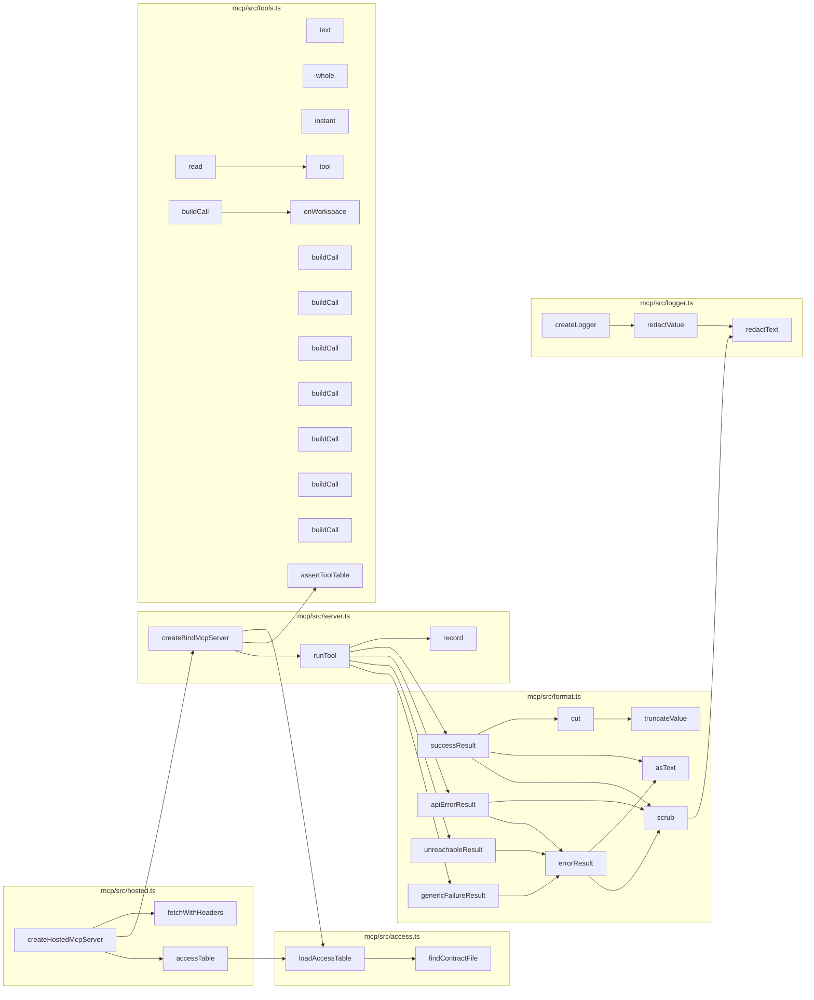

# Codebase map: functions and calls

Generated by `npx tsx scripts/map-functions.ts` from the TypeScript compiler's symbol table. Do not edit by hand.
The browser UI (`src/ui`, plain JavaScript) and the Solidity contract are not included here; see `.ua/knowledge-graph.json` for the contract.

- Functions, methods, handlers and classes: **2403** (1143 in production code, 1260 in tests)
- Resolved call edges: **4442**
- HTTP routes: **95**

## Layers and cross-layer calls


## HTTP surface: route to what it calls

| Route | Line | Calls directly |
| --- | --- | --- |
| `GET /x` | 161 | SQL or inline logic only |
| `GET /y` | 164 | SQL or inline logic only |
| `GET /health` | 652 | `query` |
| `GET /ready` | 663 | `checkReadiness` |
| `GET /api/public-config` | 677 | SQL or inline logic only |
| `GET /api/templates` | 692 | `jsonSafe`, `listTemplates`, `templateHasStock`, `templateHasSuppliers` |
| `GET /api/templates/:id/blueprint` | 703 | `getTemplateBlueprint` |
| `GET /api/openapi.json` | 716 | `serializeOpenApiDocument`, `buildOpenApiDocument` |
| `GET /api/workspaces` | 723 | `query` |
| `GET /api/me` | 734 | `query` |
| `POST /api/workspaces/onboard` | 756 | `createWithOwnerToken`, `onboardBlankWorkspace`, `jsonSafe`, `publicErrorMessage` |
| `POST /api/workspaces` | 771 | `createWithOwnerToken`, `provisionWorkspace`, `jsonSafe`, `publicErrorMessage` |
| `POST /api/demo` | 792 | `sendDemoDisabled`, `createDemoWorkspace`, `demoBody`, `sendDemoError` |
| `POST /api/workspaces/:id/demo/reset` | 805 | `sendDemoDisabled`, `resetDemoWorkspace`, `demoBody`, `sendDemoError` |
| `GET /api/workspaces/:id` | 816 | `query`, `getSettlementAdapter`, `effectiveSettlementMode`, `ArcL1SettlementAdapter.getBalance`, `LocalSettlementSimulator.getBalance` |
| `PUT /api/workspaces/:id/policy` | 837 | `normalizePaymentAddress`, `query`, `syncWorkspaceDerivedTemplateFiles`, `publicErrorMessage` |
| `GET /api/workspaces/:id/inventory` | 882 | `query` |
| `POST /api/workspaces/:id/inventory` | 891 | `query`, `refusesStock`, `publicErrorMessage` |
| `POST /api/workspaces/:id/replenish` | 936 | `ProcurementWorkflowRunner.startReplenishment`, `publicErrorMessage` |
| `GET /api/workspaces/:id/approvals` | 960 | `ProcurementWorkflowRunner.expireApprovals`, `query` |
| `GET /api/workspaces/:id/approvals/:approvalId` | 970 | `ProcurementWorkflowRunner.expireApprovals`, `query` |
| `POST /api/approvals/:id/approve` | 978 | `ProcurementWorkflowRunner.approveAndSubmit`, `decidedByOf`, `sendApprovalError` |
| `POST /api/approvals/:id/reject` | 989 | `parseDecisionBody`, `ProcurementWorkflowRunner.declineApproval`, `decidedByOf`, `sendApprovalError` |
| `POST /api/approvals/:id/revoke` | 1009 | `parseDecisionBody`, `ProcurementWorkflowRunner.declineApproval`, `decidedByOf`, `sendApprovalError` |
| `POST /api/orders/:id/reconcile` | 1030 | `ProcurementWorkflowRunner.fulfillAndReconcile`, `publicErrorMessage` |
| `POST /api/orders/:id/confirm-settlement` | 1046 | `ProcurementWorkflowRunner.confirmSettlement`, `publicErrorMessage` |
| `GET /api/workspaces/:id/customer-orders` | 1063 | `listCustomerOrders`, `sendFulfilmentError` |
| `POST /api/workspaces/:id/customer-orders` | 1071 | `sendFulfilmentError`, `acceptCustomerOrder` |
| `GET /api/workspaces/:id/customer-orders/:orderId` | 1096 | `getCustomerOrder`, `sendFulfilmentError` |
| `POST /api/workspaces/:id/customer-orders/:orderId/accept` | 1106 | `acceptHeldOrder`, `sendFulfilmentError` |
| `POST /api/workspaces/:id/customer-orders/:orderId/cancel` | 1114 | `cancelCustomerOrder`, `sendFulfilmentError` |
| `POST /api/workspaces/:id/customer-orders/:orderId/fulfil` | 1123 | `fulfilCustomerOrder`, `sendFulfilmentError` |
| `GET /api/workspaces/:id/kitchen-capacity` | 1132 | `listKitchenCapacity`, `sendFulfilmentError` |
| `PUT /api/workspaces/:id/kitchen-capacity` | 1140 | `sendFulfilmentError`, `setKitchenCapacity` |
| `POST /api/workspaces/:id/feedback` | 1162 | `sendMenuError`, `ingestFeedback` |
| `GET /api/workspaces/:id/feedback` | 1182 | `listFeedback`, `sendMenuError` |
| `GET /api/workspaces/:id/feedback/summary` | 1190 | `sendMenuError`, `summarizeFeedback` |
| `POST /api/workspaces/:id/menu-proposals` | 1209 | `sendMenuError`, `proposeMenuChange` |
| `GET /api/workspaces/:id/menu-proposals` | 1236 | `listMenuProposals`, `sendMenuError` |
| `POST /api/workspaces/:id/menu-proposals/:proposalId/approve` | 1244 | `approveMenuProposal`, `sendMenuError` |
| `POST /api/workspaces/:id/menu-proposals/:proposalId/reject` | 1252 | `rejectMenuProposal`, `sendMenuError` |
| `POST /api/workspaces/:id/menu-proposals/:proposalId/cancel` | 1260 | `cancelMenuProposal`, `sendMenuError` |
| `POST /api/workspaces/:id/menu-proposals/:proposalId/publish` | 1268 | `publishMenuChange`, `sendMenuError` |
| `GET /api/workspaces/:id/menu` | 1276 | `listMenu`, `sendMenuError` |
| `GET /api/workspaces/:id/workflows` | 1285 | `query` |
| `GET /api/workspaces/:id/workflows/:workflowId` | 1294 | `query` |
| `POST /api/workspaces/:id/workflows/:workflowId/cancel` | 1302 | `cancelWorkflow`, `sendCancelError` |
| `GET /api/workspaces/:id/needs-attention` | 1323 | `listNeedsAttention` |
| `GET /api/workspaces/:id/orders/:orderId` | 1328 | `query` |
| `GET /api/workspaces/:id/orders` | 1343 | `query` |
| `POST /api/workspaces/:id/tabs/charges` | 1371 | `parseChargeAmountMicro`, `TabLedger.accrueCharge`, `tabActorOf`, `entryJson`, `sendTabError` |
| `GET /api/workspaces/:id/tabs` | 1399 | `TabLedger.listTabs`, `sendTabError` |
| `GET /api/workspaces/:id/tabs/settlements` | 1419 | `TabLedger.listHeldSettlements`, `sendTabError` |
| `POST /api/workspaces/:id/tabs/settlements/:settlementId/resolve` | 1435 | `TabLedger.loadSettlement`, `TabLedger.reconcileHeld`, `tabActorOf`, `TabLedger.cancelHeldAndRestore`, `restoreAnswer`, `sendTabError` |
| `GET /api/workspaces/:id/tabs/:counterpartyId` | 1475 | `TabLedger.tabDetail`, `sendTabError` |
| `POST /api/workspaces/:id/tabs/:counterpartyId/settle` | 1490 | `TabLedger.settleTab`, `tabActorOf`, `settleResultJson`, `sendTabError` |
| `GET /api/workspaces/:id/suppliers` | 1503 | `query` |
| `POST /api/workspaces/:id/suppliers` | 1512 | `isDemoWorkspace`, `normalizePaymentAddress`, `simulatedPaymentAddress`, `query`, `publicErrorMessage` |
| `GET /api/workspaces/:id/agents` | 1569 | `query` |
| `POST /api/workspaces/:id/agents` | 1582 | `upsertAgentRole`, `publicErrorMessage` |
| `GET /api/workspaces/:id/surfaces` | 1597 | `listSurfaceBindings` |
| `POST /api/workspaces/:id/surfaces` | 1603 | `upsertSurfaceBinding`, `decidedByOf`, `publicErrorMessage` |
| `GET /api/workspaces/:id/notifications` | 1614 | `jsonSafe`, `listNotificationChannels`, `sendOwnerEmailError` |
| `POST /api/workspaces/:id/notifications/email` | 1622 | `requestOwnerEmailVerification`, `jsonSafe`, `sendOwnerEmailError` |
| `POST /api/workspaces/:id/notifications/email/verify` | 1634 | `jsonSafe`, `verifyOwnerEmail`, `sendOwnerEmailError` |
| `DELETE /api/workspaces/:id/notifications/email/:emailId` | 1645 | `jsonSafe`, `removeOwnerEmail`, `sendOwnerEmailError` |
| `GET /api/workspaces/:id/documents` | 1654 | `listStagedDocuments` |
| `POST /api/workspaces/:id/documents/extract` | 1660 | `extractDocumentDraft`, `publicErrorMessage` |
| `POST /api/workspaces/:id/documents/:docId/confirm` | 1671 | `confirmStagedDocument`, `decidedByOf`, `publicErrorMessage`, `redactText` |
| `GET /api/workspaces/:id/accounting/ledger` | 1696 | `getWorkspaceAccountingLedger`, `formatLedgerAsCsv` |
| `GET /api/workspaces/:id/audit` | 1712 | `query` |
| `POST /api/workspaces/:id/recover` | 1726 | `WorkflowCrashRecoveryRunner.recoverInterruptedWorkflows`, `publicErrorMessage` |
| `POST /api/auth/session` | 1737 | `upsertAccount`, `createSession`, `sendAccountError` |
| `POST /api/auth/sign-out` | 1751 | `revokeSession` |
| `GET /api/account/workspaces` | 1758 | `listAccountWorkspaces` |
| `POST /api/account/workspaces` | 1762 | `createAccountWorkspace`, `publicErrorMessage` |
| `POST /api/account/invites/accept` | 1775 | `acceptInvite`, `sendAccountError` |
| `POST /api/workspaces/:id/invites` | 1785 | `createInvite`, `sendAccountError` |
| `GET /api/workspaces/:id/invites` | 1795 | `jsonSafe`, `listInvites` |
| `DELETE /api/workspaces/:id/invites/:inviteId` | 1799 | `revokeInvite` |
| `GET /api/workspaces/:id/members` | 1805 | `jsonSafe`, `listMembers` |
| `PUT /api/workspaces/:id/members/:accountId` | 1809 | `jsonSafe`, `setMemberRole`, `sendAccountError` |
| `DELETE /api/workspaces/:id/members/:accountId` | 1819 | `removeMember`, `sendAccountError` |
| `POST /api/workspaces/:id/tokens` | 1829 | `issueToken`, `sendTokenError` |
| `GET /api/workspaces/:id/tokens` | 1843 | `listTokens`, `sendTokenError` |
| `DELETE /api/workspaces/:id/tokens/:tokenId` | 1851 | `revokeToken`, `sendTokenError` |
| `PUT /api/workspaces/:id/agents-paused` | 1863 | `setAgentsPaused`, `decidedByOf` |
| `GET /api/workspaces/:id/webhook-secret` | 1880 | `viewWebhookSecret`, `decidedByOf` |
| `POST /api/workspaces/:id/webhook-secret/rotate` | 1892 | `rotateWebhookSecret`, `decidedByOf` |
| `GET /api/workspaces/:id/connectors` | 1906 | `listConnectors`, `sendCredentialError` |
| `PUT /api/workspaces/:id/connectors/:connectorId` | 1914 | `setCredential`, `credentialActorOf`, `sendCredentialError` |
| `DELETE /api/workspaces/:id/connectors/:connectorId` | 1929 | `revokeCredential`, `credentialActorOf`, `sendCredentialError` |
| `POST /api/workspaces/:id/connectors/:connectorId/verify` | 1939 | `verifyCredential`, `credentialActorOf`, `sendCredentialError` |
| `POST /api/webhooks/incoming` | 1950 | `handleSurfaceEvent`, `handleStandardWebhook` |
| `GET *` | 2155 | SQL or inline logic only |

## mcp

| Function | File:lines | Kind | Params | Exported | Called by (prod / tests) | Calls |
| --- | --- | --- | --- | --- | --- | --- |
| `findContractFile` | mcp/src/access.ts:16-26 | function | 0 | no | 1 / 0 | 0 |
| `loadAccessTable` | mcp/src/access.ts:29-53 | function | 1 | yes | 2 / 3 | 1 |
| `truncateValue` | mcp/src/format.ts:24-44 | function | 3 | yes | 1 / 0 | 0 |
| `cut` | mcp/src/format.ts:47-51 | function | 2 | yes | 1 / 0 | 1 |
| `scrub` | mcp/src/format.ts:54-56 | function | 2 | no | 3 / 0 | 1 |
| `asText` | mcp/src/format.ts:58-60 | function | 1 | no | 2 / 0 | 0 |
| `successResult` | mcp/src/format.ts:70-86 | function | 1 | yes | 1 / 0 | 3 |
| `errorResult` | mcp/src/format.ts:88-93 | function | 2 | no | 3 / 0 | 2 |
| `apiErrorResult` | mcp/src/format.ts:96-108 | function | 2 | yes | 1 / 0 | 2 |
| `unreachableResult` | mcp/src/format.ts:111-113 | function | 1 | yes | 1 / 0 | 1 |
| `genericFailureResult` | mcp/src/format.ts:116-118 | function | 1 | yes | 1 / 0 | 1 |
| `accessTable` | mcp/src/hosted.ts:38-41 | function | 0 | no | 1 / 0 | 1 |
| `fetchWithHeaders` | mcp/src/hosted.ts:44-50 | function | 1 | no | 1 / 0 | 0 |
| `createHostedMcpServer` | mcp/src/hosted.ts:53-69 | function | 1 | yes | 0 / 1 | 4 |
| `redactText` | mcp/src/logger.ts:21-27 | function | 2 | yes | 2 / 0 | 0 |
| `redactValue` | mcp/src/logger.ts:30-40 | function | 3 | yes | 1 / 0 | 1 |
| `createLogger` | mcp/src/logger.ts:52-62 | function | 1 | yes | 0 / 2 | 1 |
| `createBindMcpServer` | mcp/src/server.ts:55-91 | function | 1 | yes | 1 / 3 | 3 |
| `runTool` | mcp/src/server.ts:102-149 | function | 3 | no | 1 / 0 | 6 |
| `record` | mcp/src/server.ts:106-115 | arrow | 2 | no | 1 / 0 | 0 |
| `text` | mcp/src/tools.ts:72-77 | function | 3 | no | 1 / 0 | 0 |
| `whole` | mcp/src/tools.ts:79-85 | function | 3 | no | 1 / 0 | 0 |
| `instant` | mcp/src/tools.ts:87-92 | function | 1 | no | 1 / 0 | 0 |
| `tool` | mcp/src/tools.ts:195-221 | function | 1 | no | 2 / 0 | 0 |
| `onWorkspace` | mcp/src/tools.ts:223-223 | arrow | 1 | no | 1 / 0 | 0 |
| `read` | mcp/src/tools.ts:225-240 | function | 1 | no | 1 / 0 | 1 |
| `buildCall` | mcp/src/tools.ts:238-238 | arrow | 2 | no | 0 / 0 | 1 |
| `buildCall` | mcp/src/tools.ts:315-319 | arrow | 2 | no | 0 / 0 | 0 |
| `buildCall` | mcp/src/tools.ts:338-344 | arrow | 2 | no | 0 / 0 | 0 |
| `buildCall` | mcp/src/tools.ts:357-361 | arrow | 2 | no | 0 / 0 | 0 |
| `buildCall` | mcp/src/tools.ts:374-383 | arrow | 2 | no | 0 / 0 | 0 |
| `buildCall` | mcp/src/tools.ts:396-399 | arrow | 2 | no | 0 / 0 | 0 |
| `buildCall` | mcp/src/tools.ts:411-414 | arrow | 2 | no | 0 / 0 | 0 |
| `buildCall` | mcp/src/tools.ts:427-434 | arrow | 2 | no | 0 / 0 | 0 |
| `assertToolTable` | mcp/src/tools.ts:443-468 | function | 2 | yes | 1 / 0 | 0 |



## scripts

| Function | File:lines | Kind | Params | Exported | Called by (prod / tests) | Calls |
| --- | --- | --- | --- | --- | --- | --- |
| `WorkspaceNotFoundError.constructor` | scripts/backfill-journal.ts:22-25 | constructor | 0 | yes | 1 / 0 | 0 |
| `parseBackfillArgs` | scripts/backfill-journal.ts:29-38 | function | 1 | yes | 1 / 1 | 0 |
| `runJournalBackfill` | scripts/backfill-journal.ts:41-56 | function | 1 | yes | 1 / 1 | 3 |
| `main` | scripts/backfill-journal.ts:58-73 | function | 0 | no | 1 / 0 | 2 |
| `isFixtureWorkspaceId` | scripts/clean-test-fixtures.ts:78-82 | function | 1 | yes | 1 / 1 | 0 |
| `isTrackedByGit` | scripts/clean-test-fixtures.ts:88-93 | function | 1 | yes | 1 / 0 | 0 |
| `planFixtureCleanup` | scripts/clean-test-fixtures.ts:102-116 | function | 0 | yes | 1 / 0 | 2 |
| `applyFixtureCleanup` | scripts/clean-test-fixtures.ts:119-128 | function | 1 | yes | 1 / 0 | 2 |
| `main` | scripts/clean-test-fixtures.ts:130-154 | function | 0 | no | 1 / 0 | 2 |
| `readJson` | scripts/generate-capabilities.ts:67-69 | function | 1 | no | 1 / 0 | 0 |
| `sdkConvenienceOperations` | scripts/generate-capabilities.ts:72-75 | function | 0 | no | 1 / 0 | 0 |
| `buildCatalogue` | scripts/generate-capabilities.ts:77-123 | function | 0 | yes | 1 / 1 | 2 |
| `serialiseCatalogue` | scripts/generate-capabilities.ts:125-127 | function | 0 | yes | 1 / 1 | 1 |
| `operationRows` | scripts/generate-sdk.ts:32-48 | function | 1 | yes | 1 / 0 | 0 |
| `operationsSource` | scripts/generate-sdk.ts:50-70 | function | 1 | no | 1 / 0 | 0 |
| `generateSdkFiles` | scripts/generate-sdk.ts:73-83 | function | 1 | yes | 1 / 1 | 2 |
| `writeSdkFiles` | scripts/generate-sdk.ts:86-91 | function | 2 | yes | 1 / 1 | 0 |
| `main` | scripts/generate-sdk.ts:93-97 | function | 0 | no | 1 / 0 | 2 |
| `RefusedError.constructor` | scripts/live-recovery-arc.ts:98-102 | constructor | 1 | yes | 7 / 1 | 0 |
| `BlockedError.constructor` | scripts/live-recovery-arc.ts:107-110 | constructor | 1 | yes | 10 / 0 | 0 |
| `RpcError.constructor` | scripts/live-recovery-arc.ts:116-121 | constructor | 3 | yes | 1 / 0 | 0 |
| `parseArgs` | scripts/live-recovery-arc.ts:151-207 | function | 2 | yes | 1 / 1 | 1 |
| `value` | scripts/live-recovery-arc.ts:164-169 | arrow | 1 | no | 1 / 0 | 0 |
| `databaseHostProblem` | scripts/live-recovery-arc.ts:225-245 | function | 1 | yes | 1 / 1 | 0 |
| `isHttpUrl` | scripts/live-recovery-arc.ts:247-255 | function | 1 | no | 2 / 0 | 0 |
| `signerAddressOf` | scripts/live-recovery-arc.ts:258-265 | function | 1 | yes | 4 / 1 | 0 |
| `staticGuards` | scripts/live-recovery-arc.ts:271-310 | function | 3 | yes | 2 / 1 | 4 |
| `add` | scripts/live-recovery-arc.ts:273-275 | arrow | 2 | no | 1 / 0 | 0 |
| `httpRpc` | scripts/live-recovery-arc.ts:319-340 | function | 3 | yes | 2 / 1 | 1 |
| `blockedOn` | scripts/live-recovery-arc.ts:342-350 | function | 2 | no | 9 / 0 | 1 |
| `hexQuantity` | scripts/live-recovery-arc.ts:352-355 | function | 2 | no | 7 / 0 | 1 |
| `hexData` | scripts/live-recovery-arc.ts:357-360 | function | 2 | no | 2 / 0 | 1 |
| `ethCall` | scripts/live-recovery-arc.ts:362-364 | function | 3 | no | 4 / 0 | 1 |
| `readChainId` | scripts/live-recovery-arc.ts:366-368 | function | 1 | yes | 1 / 0 | 2 |
| `readNonce` | scripts/live-recovery-arc.ts:370-372 | function | 3 | yes | 5 / 0 | 2 |
| `readContractGuards` | scripts/live-recovery-arc.ts:385-410 | function | 3 | yes | 1 / 0 | 3 |
| `contractGuardFailures` | scripts/live-recovery-arc.ts:413-424 | function | 2 | yes | 1 / 1 | 0 |
| `assertContractGuards` | scripts/live-recovery-arc.ts:427-435 | function | 2 | yes | 4 / 1 | 3 |
| `readSettledOrder` | scripts/live-recovery-arc.ts:449-459 | function | 3 | yes | 2 / 1 | 2 |
| `assertNotSettled` | scripts/live-recovery-arc.ts:462-466 | function | 3 | yes | 1 / 4 | 2 |
| `assertDeployBlockCode` | scripts/live-recovery-arc.ts:468-477 | function | 3 | yes | 3 / 1 | 4 |
| `readVendorBalance` | scripts/live-recovery-arc.ts:479-484 | function | 2 | yes | 2 / 0 | 2 |
| `readDecimals` | scripts/live-recovery-arc.ts:486-491 | function | 1 | yes | 2 / 0 | 2 |
| `oneCentInBaseUnits` | scripts/live-recovery-arc.ts:494-497 | function | 1 | yes | 1 / 1 | 1 |
| `readSettlementLogs` | scripts/live-recovery-arc.ts:508-533 | function | 4 | yes | 4 / 1 | 3 |
| `fetchRange` | scripts/live-recovery-arc.ts:521-530 | arrow | 2 | no | 0 / 0 | 2 |
| `readReceipt` | scripts/live-recovery-arc.ts:543-557 | function | 2 | yes | 2 / 0 | 2 |
| `explainRevert` | scripts/live-recovery-arc.ts:563-582 | function | 2 | yes | 1 / 0 | 1 |
| `parseState` | scripts/live-recovery-arc.ts:618-631 | function | 1 | yes | 1 / 1 | 0 |
| `assertStateMatches` | scripts/live-recovery-arc.ts:634-638 | function | 2 | yes | 3 / 1 | 1 |
| `assertPhaseAllowed` | scripts/live-recovery-arc.ts:644-657 | function | 3 | yes | 3 / 1 | 2 |
| `sameAddress` | scripts/live-recovery-arc.ts:679-685 | function | 2 | no | 1 / 0 | 0 |
| `guardedAdapter` | scripts/live-recovery-arc.ts:691-721 | function | 3 | yes | 1 / 2 | 0 |
| `getBalance` | scripts/live-recovery-arc.ts:694-694 | arrow | 1 | no | 0 / 0 | 16 |
| `transferUSDC` | scripts/live-recovery-arc.ts:695-712 | arrow | 1 | no | 0 / 0 | 18 |
| `confirm` | scripts/live-recovery-arc.ts:713-716 | arrow | 1 | no | 0 / 0 | 16 |
| `depositEscrow` | scripts/live-recovery-arc.ts:718-718 | arrow | 2 | no | 0 / 0 | 16 |
| `releaseEscrow` | scripts/live-recovery-arc.ts:719-719 | arrow | 2 | no | 0 / 0 | 16 |
| `makeTimeoutTransport` | scripts/live-recovery-arc.ts:728-747 | function | 2 | yes | 1 / 1 | 0 |
| `request` | scripts/live-recovery-arc.ts:734-743 | arrow | 1 | no | 0 / 0 | 0 |
| `check` | scripts/live-recovery-arc.ts:759-759 | arrow | 3 | no | 3 / 0 | 0 |
| `info` | scripts/live-recovery-arc.ts:760-760 | arrow | 2 | no | 2 / 0 | 0 |
| `skipped` | scripts/live-recovery-arc.ts:761-761 | arrow | 1 | no | 2 / 0 | 0 |
| `countOf` | scripts/live-recovery-arc.ts:782-784 | function | 2 | yes | 2 / 1 | 0 |
| `preRestartAssertions` | scripts/live-recovery-arc.ts:787-825 | function | 2 | yes | 2 / 2 | 2 |
| `crashAssertions` | scripts/live-recovery-arc.ts:847-936 | function | 1 | yes | 1 / 1 | 4 |
| `timeoutAssertions` | scripts/live-recovery-arc.ts:952-1036 | function | 1 | yes | 1 / 1 | 3 |
| `verdictOf` | scripts/live-recovery-arc.ts:1042-1046 | function | 2 | yes | 1 / 1 | 0 |
| `toSnapshot` | scripts/live-recovery-arc.ts:1049-1074 | function | 3 | yes | 1 / 1 | 3 |
| `iso` | scripts/live-recovery-arc.ts:1055-1055 | arrow | 1 | no | 1 / 0 | 0 |
| `str` | scripts/live-recovery-arc.ts:1056-1056 | arrow | 1 | no | 1 / 0 | 0 |
| `scenarioRecoverPlan` | scripts/live-recovery-arc.ts:1082-1086 | function | 1 | yes | 1 / 1 | 0 |
| `waitUntil` | scripts/live-recovery-arc.ts:1092-1103 | function | 2 | yes | 3 / 1 | 0 |
| `makeScrubber` | scripts/live-recovery-arc.ts:1109-1116 | function | 1 | yes | 3 / 2 | 2 |
| `jsonText` | scripts/live-recovery-arc.ts:1119-1125 | function | 2 | yes | 6 / 0 | 0 |
| `childArgs` | scripts/live-recovery-arc.ts:1171-1182 | function | 2 | no | 2 / 0 | 0 |
| `ReportBuilder.constructor` | scripts/live-recovery-arc.ts:1198-1203 | constructor | 2 | no | 1 / 0 | 0 |
| `ReportBuilder.step` | scripts/live-recovery-arc.ts:1205-1207 | method | 2 | no | 3 / 0 | 0 |
| `ReportBuilder.child` | scripts/live-recovery-arc.ts:1209-1219 | method | 2 | no | 2 / 0 | 0 |
| `ReportBuilder.setChain` | scripts/live-recovery-arc.ts:1221-1223 | method | 1 | no | 1 / 0 | 0 |
| `ReportBuilder.setIds` | scripts/live-recovery-arc.ts:1225-1227 | method | 1 | no | 1 / 0 | 0 |
| `ReportBuilder.setAssertions` | scripts/live-recovery-arc.ts:1229-1231 | method | 1 | no | 1 / 0 | 0 |
| `ReportBuilder.end` | scripts/live-recovery-arc.ts:1233-1276 | method | 2 | no | 2 / 0 | 1 |
| `runResume` | scripts/live-recovery-arc.ts:1291-1415 | function | 3 | no | 1 / 0 | 19 |
| `loadState` | scripts/live-recovery-arc.ts:1417-1423 | function | 2 | no | 4 / 0 | 2 |
| `saveState` | scripts/live-recovery-arc.ts:1425-1427 | function | 3 | no | 2 / 0 | 1 |
| `updateState` | scripts/live-recovery-arc.ts:1433-1439 | function | 3 | no | 2 / 0 | 3 |
| `chainFacts` | scripts/live-recovery-arc.ts:1442-1464 | function | 3 | no | 1 / 0 | 6 |
| `repeatFromRecover` | scripts/live-recovery-arc.ts:1466-1471 | function | 1 | no | 1 / 0 | 0 |
| `verifyRun` | scripts/live-recovery-arc.ts:1474-1531 | function | 4 | no | 2 / 0 | 11 |
| `runOrchestrator` | scripts/live-recovery-arc.ts:1537-1692 | function | 2 | yes | 1 / 2 | 24 |
| `childStop` | scripts/live-recovery-arc.ts:1698-1710 | function | 1 | no | 2 / 0 | 0 |
| `buildAdapter` | scripts/live-recovery-arc.ts:1722-1739 | function | 5 | yes | 1 / 0 | 3 |
| `emitResult` | scripts/live-recovery-arc.ts:1742-1744 | function | 2 | no | 1 / 0 | 1 |
| `runChildPhase` | scripts/live-recovery-arc.ts:1746-1872 | function | 4 | yes | 1 / 0 | 18 |
| `timeoutAfterTransfer` | scripts/live-recovery-arc.ts:1782-1787 | arrow | 1 | no | 0 / 0 | 0 |
| `kill` | scripts/live-recovery-arc.ts:1788-1792 | arrow | 0 | no | 1 / 0 | 0 |
| `beforeTransfer` | scripts/live-recovery-arc.ts:1796-1801 | arrow | 0 | no | 0 / 0 | 2 |
| `settlementFor` | scripts/live-recovery-arc.ts:1814-1814 | arrow | 0 | no | 0 / 0 | 0 |
| `now` | scripts/live-recovery-arc.ts:1837-1837 | arrow | 0 | no | 0 / 0 | 0 |
| `sleep` | scripts/live-recovery-arc.ts:1838-1838 | arrow | 1 | no | 0 / 0 | 0 |
| `guardedSettlementFor` | scripts/live-recovery-arc.ts:1852-1852 | arrow | 0 | no | 0 / 0 | 0 |
| `sleep` | scripts/live-recovery-arc.ts:1853-1853 | arrow | 1 | no | 0 / 0 | 0 |
| `timeoutSequence` | scripts/live-recovery-arc.ts:1875-1934 | function | 1 | no | 1 / 0 | 4 |
| `attempt` | scripts/live-recovery-arc.ts:1890-1898 | arrow | 1 | no | 1 / 0 | 0 |
| `recoverSequence` | scripts/live-recovery-arc.ts:1937-1985 | function | 1 | no | 1 / 0 | 2 |
| `realFiles` | scripts/live-recovery-arc.ts:1995-2001 | function | 1 | yes | 2 / 1 | 0 |
| `exists` | scripts/live-recovery-arc.ts:1997-1997 | arrow | 1 | no | 0 / 0 | 0 |
| `read` | scripts/live-recovery-arc.ts:1998-1998 | arrow | 1 | no | 0 / 0 | 0 |
| `write` | scripts/live-recovery-arc.ts:1999-1999 | arrow | 3 | no | 0 / 0 | 0 |
| `openRealDb` | scripts/live-recovery-arc.ts:2003-2060 | function | 0 | yes | 1 / 0 | 2 |
| `close` | scripts/live-recovery-arc.ts:2058-2058 | arrow | 0 | no | 0 / 0 | 0 |
| `lineSplitter` | scripts/live-recovery-arc.ts:2063-2079 | function | 1 | no | 1 / 0 | 0 |
| `spawnChildProcess` | scripts/live-recovery-arc.ts:2082-2119 | function | 3 | yes | 1 / 0 | 1 |
| `keep` | scripts/live-recovery-arc.ts:2089-2089 | arrow | 1 | no | 0 / 0 | 0 |
| `realPorts` | scripts/live-recovery-arc.ts:2121-2144 | function | 3 | no | 1 / 0 | 3 |
| `db` | scripts/live-recovery-arc.ts:2123-2123 | arrow | 0 | no | 3 / 0 | 1 |
| `notify` | scripts/live-recovery-arc.ts:2127-2129 | arrow | 1 | no | 0 / 0 | 0 |
| `prepare` | scripts/live-recovery-arc.ts:2133-2133 | arrow | 1 | no | 0 / 0 | 1 |
| `orderTotalCents` | scripts/live-recovery-arc.ts:2134-2134 | arrow | 2 | no | 0 / 0 | 1 |
| `snapshot` | scripts/live-recovery-arc.ts:2135-2135 | arrow | 2 | no | 0 / 0 | 1 |
| `close` | scripts/live-recovery-arc.ts:2136-2138 | arrow | 0 | no | 0 / 0 | 0 |
| `spawnPhase` | scripts/live-recovery-arc.ts:2140-2140 | arrow | 2 | no | 0 / 0 | 1 |
| `sleep` | scripts/live-recovery-arc.ts:2141-2141 | arrow | 1 | no | 0 / 0 | 0 |
| `now` | scripts/live-recovery-arc.ts:2142-2142 | arrow | 0 | no | 0 / 0 | 0 |
| `cli` | scripts/live-recovery-arc.ts:2147-2164 | function | 2 | yes | 1 / 0 | 7 |
| `emit` | scripts/live-recovery-arc.ts:2149-2151 | arrow | 1 | no | 1 / 0 | 0 |
| `RpcTransportError.constructor` | scripts/verify-live-arc.ts:97-103 | constructor | 2 | yes | 2 / 1 | 0 |
| `secretsOf` | scripts/verify-live-arc.ts:130-142 | function | 1 | yes | 3 / 0 | 0 |
| `scrubber` | scripts/verify-live-arc.ts:145-148 | function | 1 | yes | 1 / 0 | 2 |
| `revertSelectorOf` | scripts/verify-live-arc.ts:154-159 | function | 1 | yes | 1 / 1 | 0 |
| `firstLine` | scripts/verify-live-arc.ts:161-163 | function | 1 | no | 2 / 0 | 0 |
| `isHex` | scripts/verify-live-arc.ts:165-167 | function | 1 | no | 1 / 0 | 0 |
| `gate` | scripts/verify-live-arc.ts:169-171 | function | 3 | no | 6 / 0 | 0 |
| `resolveSender` | scripts/verify-live-arc.ts:184-220 | function | 1 | yes | 1 / 1 | 0 |
| `rpcBlocked` | scripts/verify-live-arc.ts:231-244 | function | 2 | no | 1 / 0 | 1 |
| `castReadOutcome` | scripts/verify-live-arc.ts:247-264 | function | 3 | no | 1 / 0 | 2 |
| `castRevertGate` | scripts/verify-live-arc.ts:270-291 | function | 5 | no | 1 / 0 | 3 |
| `runLiveArcVerification` | scripts/verify-live-arc.ts:294-329 | function | 1 | yes | 1 / 1 | 3 |
| `evaluateGates` | scripts/verify-live-arc.ts:331-444 | function | 1 | no | 1 / 0 | 9 |
| `rpc` | scripts/verify-live-arc.ts:333-343 | arrow | 2 | no | 1 / 0 | 1 |
| `cast` | scripts/verify-live-arc.ts:344-344 | arrow | 1 | no | 1 / 0 | 0 |
| `senderBlock` | scripts/verify-live-arc.ts:345-345 | arrow | 2 | no | 1 / 0 | 1 |
| `buildCastEnv` | scripts/verify-live-arc.ts:453-457 | function | 2 | yes | 1 / 1 | 0 |
| `makeExecCast` | scripts/verify-live-arc.ts:468-492 | function | 2 | yes | 1 / 1 | 1 |
| `fetchRpc` | scripts/verify-live-arc.ts:500-519 | arrow | 1 | yes | 0 / 0 | 1 |
| `defaultMainDeps` | scripts/verify-live-arc.ts:528-541 | function | 0 | yes | 0 / 0 | 0 |
| `now` | scripts/verify-live-arc.ts:533-533 | arrow | 0 | no | 0 / 0 | 0 |
| `log` | scripts/verify-live-arc.ts:534-534 | arrow | 1 | no | 0 / 0 | 0 |
| `writeNewFile` | scripts/verify-live-arc.ts:535-535 | arrow | 2 | no | 0 / 0 | 0 |
| `fileExists` | scripts/verify-live-arc.ts:536-539 | arrow | 1 | no | 0 / 0 | 0 |
| `main` | scripts/verify-live-arc.ts:547-579 | function | 2 | yes | 1 / 1 | 1 |

```mermaid
flowchart LR
  subgraph F0["scripts/backfill-journal.ts"]
    n35["WorkspaceNotFoundError.constructor"]
    n36["parseBackfillArgs"]
    n37["runJournalBackfill"]
    n38["main"]
  end
  subgraph F1["scripts/clean-test-fixtures.ts"]
    n39["isFixtureWorkspaceId"]
    n40["isTrackedByGit"]
    n41["planFixtureCleanup"]
    n42["applyFixtureCleanup"]
    n43["main"]
  end
  subgraph F2["scripts/generate-capabilities.ts"]
    n44["readJson"]
    n45["sdkConvenienceOperations"]
    n46["buildCatalogue"]
    n47["serialiseCatalogue"]
  end
  subgraph F3["scripts/generate-sdk.ts"]
    n48["operationRows"]
    n49["operationsSource"]
    n50["generateSdkFiles"]
    n51["writeSdkFiles"]
    n52["main"]
  end
  subgraph F4["scripts/live-recovery-arc.ts"]
    n53["RefusedError.constructor"]
    n54["BlockedError.constructor"]
    n55["RpcError.constructor"]
    n56["parseArgs"]
    n57["value"]
    n58["databaseHostProblem"]
    n59["isHttpUrl"]
    n60["signerAddressOf"]
    n61["staticGuards"]
    n62["add"]
    n63["httpRpc"]
    n64["blockedOn"]
    n65["hexQuantity"]
    n66["hexData"]
    n67["ethCall"]
    n68["readChainId"]
    n69["readNonce"]
    n70["readContractGuards"]
    n71["contractGuardFailures"]
    n72["assertContractGuards"]
    n73["readSettledOrder"]
    n74["assertNotSettled"]
    n75["assertDeployBlockCode"]
    n76["readVendorBalance"]
    n77["readDecimals"]
    n78["oneCentInBaseUnits"]
    n79["readSettlementLogs"]
    n80["fetchRange"]
    n81["readReceipt"]
    n82["explainRevert"]
    n83["parseState"]
    n84["assertStateMatches"]
    n85["assertPhaseAllowed"]
    n86["sameAddress"]
    n87["guardedAdapter"]
    n88["getBalance"]
    n89["transferUSDC"]
    n90["confirm"]
    n91["depositEscrow"]
    n92["releaseEscrow"]
    n93["makeTimeoutTransport"]
    n94["request"]
    n95["check"]
    n96["info"]
    n97["skipped"]
    n98["countOf"]
    n99["preRestartAssertions"]
    n100["crashAssertions"]
    n101["timeoutAssertions"]
    n102["verdictOf"]
    n103["toSnapshot"]
    n104["iso"]
    n105["str"]
    n106["scenarioRecoverPlan"]
    n107["waitUntil"]
    n108["makeScrubber"]
    n109["jsonText"]
    n110["childArgs"]
    n111["ReportBuilder.constructor"]
    n112["ReportBuilder.step"]
    n113["ReportBuilder.child"]
    n114["ReportBuilder.setChain"]
    n115["ReportBuilder.setIds"]
    n116["ReportBuilder.setAssertions"]
    n117["ReportBuilder.end"]
    n118["runResume"]
    n119["loadState"]
    n120["saveState"]
    n121["updateState"]
    n122["chainFacts"]
    n123["repeatFromRecover"]
    n124["verifyRun"]
    n125["runOrchestrator"]
    n126["childStop"]
    n127["buildAdapter"]
    n128["emitResult"]
    n129["runChildPhase"]
    n130["timeoutAfterTransfer"]
    n131["kill"]
    n132["beforeTransfer"]
    n133["settlementFor"]
    n134["now"]
    n135["sleep"]
    n136["guardedSettlementFor"]
    n137["sleep"]
    n138["timeoutSequence"]
    n139["attempt"]
    n140["recoverSequence"]
    n141["realFiles"]
    n142["exists"]
    n143["read"]
    n144["write"]
    n145["openRealDb"]
    n146["close"]
    n147["lineSplitter"]
    n148["spawnChildProcess"]
    n149["keep"]
    n150["realPorts"]
    n151["db"]
    n152["notify"]
    n153["prepare"]
    n154["orderTotalCents"]
    n155["snapshot"]
    n156["close"]
    n157["spawnPhase"]
    n158["sleep"]
    n159["now"]
    n160["cli"]
    n161["emit"]
  end
  subgraph F5["scripts/verify-live-arc.ts"]
    n162["RpcTransportError.constructor"]
    n163["secretsOf"]
    n164["scrubber"]
    n165["revertSelectorOf"]
    n166["firstLine"]
    n167["isHex"]
    n168["gate"]
    n169["resolveSender"]
    n170["rpcBlocked"]
    n171["castReadOutcome"]
    n172["castRevertGate"]
    n173["runLiveArcVerification"]
    n174["evaluateGates"]
    n175["rpc"]
    n176["cast"]
    n177["senderBlock"]
    n178["buildCastEnv"]
    n179["makeExecCast"]
    n180["fetchRpc"]
    n181["defaultMainDeps"]
    n182["now"]
    n183["log"]
    n184["writeNewFile"]
    n185["fileExists"]
    n186["main"]
  end
  n37 --> n35
  n38 --> n36
  n38 --> n37
  n41 --> n40
  n42 --> n39
  n43 --> n41
  n43 --> n42
  n46 --> n44
  n46 --> n45
  n47 --> n46
  n50 --> n48
  n50 --> n49
  n52 --> n51
  n52 --> n50
  n56 --> n57
  n61 --> n62
  n61 --> n58
  n61 --> n59
  n61 --> n60
  n63 --> n55
  n64 --> n54
  n65 --> n54
  n66 --> n54
  n67 --> n66
  n68 --> n64
  n68 --> n65
  n69 --> n64
  n69 --> n65
  n70 --> n68
  n70 --> n64
  n70 --> n67
  n72 --> n70
  n72 --> n71
  n72 --> n53
  n73 --> n64
  n73 --> n67
  n74 --> n73
  n74 --> n53
  n75 --> n64
  n75 --> n65
  n75 --> n54
  n75 --> n66
  n76 --> n64
  n76 --> n67
  n77 --> n64
  n77 --> n67
  n78 --> n54
  n79 --> n64
  n79 --> n65
  n80 --> n54
  n80 --> n65
  n81 --> n64
  n81 --> n65
  n82 --> n65
  n84 --> n53
  n85 --> n53
  n85 --> n84
  n89 --> n53
  n89 --> n86
  n99 --> n95
  n99 --> n98
  n100 --> n95
  n100 --> n97
  n100 --> n98
  n100 --> n96
  n101 --> n95
  n101 --> n97
  n101 --> n96
  n103 --> n54
  n103 --> n105
  n103 --> n104
  n108 --> n163
  n117 --> n109
  n118 --> n119
  n118 --> n117
  n118 --> n84
  n118 --> n60
  n118 --> n72
  n118 --> n75
  n118 --> n112
  n118 --> n77
  n118 --> n121
  n118 --> n73
  n118 --> n79
  n118 --> n107
  n118 --> n69
  n118 --> n99
  n118 --> n85
  n118 --> n110
  n118 --> n113
  n118 --> n126
  n118 --> n124
  n119 --> n83
  n119 --> n53
  n120 --> n109
  n121 --> n119
  n121 --> n54
  n121 --> n120
  n122 --> n54
  n122 --> n69
  n122 --> n76
  n122 --> n79
  n122 --> n81
  n122 --> n78
  n124 --> n112
  n124 --> n54
  n124 --> n122
  n124 --> n114
  n124 --> n81
  n124 --> n82
  n124 --> n101
  n124 --> n100
  n124 --> n123
  n124 --> n116
  n124 --> n102
  n125 --> n111
  n125 --> n61
  n125 --> n117
  n125 --> n118
  n125 --> n119
  n125 --> n84
  n125 --> n60
  n125 --> n72
  n125 --> n75
  n125 --> n112
  n125 --> n120
  n125 --> n115
  n125 --> n85
  n125 --> n77
  n125 --> n69
  n125 --> n76
  n125 --> n110
  n125 --> n113
  n125 --> n121
  n125 --> n126
  n125 --> n99
  n125 --> n107
  n125 --> n79
  n125 --> n124
  n127 --> n93
  n128 --> n109
  n129 --> n63
  n129 --> n60
  n129 --> n141
  n129 --> n108
  n129 --> n61
  n129 --> n53
  n129 --> n119
  n129 --> n85
  n129 --> n72
  n129 --> n75
  n129 --> n109
  n129 --> n127
  n129 --> n87
  n129 --> n131
  n129 --> n128
  n129 --> n138
  n129 --> n140
  n132 --> n72
  n132 --> n74
  n138 --> n139
  n138 --> n107
  n138 --> n79
  n138 --> n69
  n140 --> n106
  n140 --> n69
  n145 --> n103
  n148 --> n147
  n150 --> n141
  n150 --> n59
  n150 --> n63
  n151 --> n145
  n153 --> n151
  n154 --> n151
  n155 --> n151
  n157 --> n148
  n160 --> n108
  n160 --> n56
  n160 --> n161
  n160 --> n109
  n160 --> n129
  n160 --> n125
  n160 --> n150
  n164 --> n163
  n170 --> n168
  n171 --> n168
  n171 --> n166
  n172 --> n168
  n172 --> n166
  n172 --> n165
  n173 --> n164
  n173 --> n168
  n173 --> n174
  n174 --> n175
  n174 --> n170
  n174 --> n168
  n174 --> n167
  n174 --> n176
  n174 --> n171
  n174 --> n169
  n174 --> n177
  n174 --> n172
  n175 --> n162
  n177 --> n168
  n179 --> n178
  n180 --> n162
  n186 --> n173
```



## sdk

| Function | File:lines | Kind | Params | Exported | Called by (prod / tests) | Calls |
| --- | --- | --- | --- | --- | --- | --- |
| `parseBaseUrl` | sdk/src/client.ts:93-106 | function | 1 | no | 1 / 0 | 0 |
| `checkToken` | sdk/src/client.ts:108-113 | function | 1 | no | 1 / 0 | 0 |
| `checkInteger` | sdk/src/client.ts:115-119 | function | 4 | no | 1 / 0 | 0 |
| `abortReason` | sdk/src/client.ts:122-125 | function | 1 | no | 4 / 0 | 0 |
| `newRequestId` | sdk/src/client.ts:128-132 | function | 0 | no | 1 / 0 | 0 |
| `defaultSleep` | sdk/src/client.ts:134-144 | function | 2 | no | 0 / 0 | 0 |
| `done` | sdk/src/client.ts:137-141 | function | 0 | no | 0 / 0 | 0 |
| `abortable` | sdk/src/client.ts:147-167 | function | 2 | no | 1 / 0 | 0 |
| `onAbort` | sdk/src/client.ts:149-149 | arrow | 0 | no | 0 / 0 | 1 |
| `BindClient.constructor` | sdk/src/client.ts:191-205 | constructor | 1 | yes | 1 / 5 | 4 |
| `BindClient.toJSON` | sdk/src/client.ts:208-215 | method | 0 | yes | 0 / 0 | 1 |
| `BindClient.toString` | sdk/src/client.ts:217-219 | method | 0 | yes | 0 / 0 | 1 |
| `BindClient.[INSPECT]` | sdk/src/client.ts:221-223 | method | 0 | yes | 0 / 0 | 1 |
| `BindClient.#baseLabel` | sdk/src/client.ts:225-227 | method | 0 | yes | 3 / 0 | 0 |
| `BindClient.call` | sdk/src/client.ts:234-261 | method | 2 | yes | 48 / 3 | 6 |
| `BindClient.workspace` | sdk/src/client.ts:265-267 | method | 1 | yes | 0 / 2 | 1 |
| `BindClient.me` | sdk/src/client.ts:270-272 | method | 0 | yes | 0 / 1 | 1 |
| `BindClient.listInventory` | sdk/src/client.ts:274-276 | method | 1 | yes | 0 / 1 | 1 |
| `BindClient.upsertInventory` | sdk/src/client.ts:278-280 | method | 2 | yes | 0 / 3 | 1 |
| `BindClient.replenish` | sdk/src/client.ts:282-284 | method | 2 | yes | 0 / 2 | 1 |
| `BindClient.listApprovals` | sdk/src/client.ts:286-288 | method | 1 | yes | 0 / 1 | 1 |
| `BindClient.listOrders` | sdk/src/client.ts:290-292 | method | 1 | yes | 0 / 1 | 1 |
| `BindClient.listWorkflows` | sdk/src/client.ts:294-296 | method | 1 | yes | 0 / 1 | 1 |
| `BindClient.needsAttention` | sdk/src/client.ts:298-300 | method | 1 | yes | 0 / 1 | 1 |
| `BindClient.createCustomerOrder` | sdk/src/client.ts:302-304 | method | 2 | yes | 0 / 1 | 1 |
| `BindClient.listCustomerOrders` | sdk/src/client.ts:306-308 | method | 1 | yes | 0 / 1 | 1 |
| `BindClient.cancelCustomerOrder` | sdk/src/client.ts:310-312 | method | 2 | yes | 0 / 1 | 1 |
| `BindClient.ingestFeedback` | sdk/src/client.ts:314-316 | method | 2 | yes | 0 / 1 | 1 |
| `BindClient.feedbackSummary` | sdk/src/client.ts:318-320 | method | 2 | yes | 0 / 2 | 1 |
| `BindClient.proposeMenuChange` | sdk/src/client.ts:322-324 | method | 2 | yes | 0 / 1 | 1 |
| `BindClient.listMenu` | sdk/src/client.ts:326-328 | method | 1 | yes | 0 / 1 | 1 |
| `BindClient.listAudit` | sdk/src/client.ts:330-332 | method | 1 | yes | 0 / 2 | 1 |
| `BindClient.pollEvents` | sdk/src/client.ts:335-341 | method | 2 | yes | 0 / 3 | 1 |
| `BindClient.events` | sdk/src/client.ts:352-374 | method | 2 | yes | 0 / 2 | 2 |
| `open` | sdk/src/client.ts:356-363 | arrow | 2 | no | 0 / 0 | 1 |
| `describeError` | sdk/src/client.ts:364-364 | arrow | 1 | no | 0 / 0 | 1 |
| `sleep` | sdk/src/client.ts:365-365 | arrow | 2 | no | 0 / 0 | 0 |
| `random` | sdk/src/client.ts:366-366 | arrow | 0 | no | 0 / 0 | 0 |
| `pin` | sdk/src/client.ts:368-371 | arrow | 1 | no | 0 / 0 | 1 |
| `BindClient.#url` | sdk/src/client.ts:379-391 | method | 3 | yes | 2 / 0 | 1 |
| `BindClient.#path` | sdk/src/client.ts:393-406 | method | 2 | yes | 1 / 0 | 0 |
| `BindClient.#run` | sdk/src/client.ts:409-446 | method | 5 | yes | 1 / 0 | 4 |
| `BindClient.#exchange` | sdk/src/client.ts:452-501 | method | 6 | yes | 2 / 0 | 6 |
| `onCallerAbort` | sdk/src/client.ts:469-469 | arrow | 0 | no | 0 / 0 | 0 |
| `release` | sdk/src/client.ts:475-478 | arrow | 0 | no | 1 / 0 | 0 |
| `timedOut` | sdk/src/client.ts:500-500 | arrow | 0 | no | 0 / 0 | 0 |
| `BindClient.#backoff` | sdk/src/client.ts:503-505 | method | 1 | yes | 1 / 0 | 0 |
| `BindClient.#pause` | sdk/src/client.ts:507-511 | method | 2 | yes | 1 / 0 | 1 |
| `readBody` | sdk/src/client.ts:515-528 | function | 1 | no | 1 / 0 | 1 |
| `OwnerOperations.constructor` | sdk/src/client.ts:537-539 | constructor | 1 | yes | 1 / 0 | 0 |
| `OwnerOperations.approveApproval` | sdk/src/client.ts:541-543 | method | 1 | yes | 0 / 0 | 1 |
| `OwnerOperations.rejectApproval` | sdk/src/client.ts:545-547 | method | 2 | yes | 0 / 0 | 1 |
| `OwnerOperations.revokeApproval` | sdk/src/client.ts:549-551 | method | 2 | yes | 0 / 0 | 1 |
| `OwnerOperations.reconcileOrder` | sdk/src/client.ts:554-556 | method | 1 | yes | 0 / 0 | 1 |
| `OwnerOperations.confirmOrderSettlement` | sdk/src/client.ts:559-561 | method | 1 | yes | 0 / 0 | 1 |
| `OwnerOperations.acceptCustomerOrder` | sdk/src/client.ts:563-565 | method | 2 | yes | 0 / 0 | 1 |
| `OwnerOperations.cancelWorkflow` | sdk/src/client.ts:567-569 | method | 3 | yes | 0 / 0 | 1 |
| `OwnerOperations.recoverWorkflows` | sdk/src/client.ts:571-573 | method | 1 | yes | 0 / 0 | 1 |
| `OwnerOperations.updatePolicy` | sdk/src/client.ts:575-577 | method | 2 | yes | 0 / 2 | 1 |
| `OwnerOperations.setKitchenCapacity` | sdk/src/client.ts:579-581 | method | 2 | yes | 0 / 0 | 1 |
| `OwnerOperations.upsertSupplier` | sdk/src/client.ts:583-585 | method | 2 | yes | 0 / 0 | 1 |
| `OwnerOperations.upsertAgentRole` | sdk/src/client.ts:587-589 | method | 2 | yes | 0 / 0 | 1 |
| `OwnerOperations.upsertSurfaceBinding` | sdk/src/client.ts:591-593 | method | 2 | yes | 0 / 0 | 1 |
| `OwnerOperations.setAgentsPaused` | sdk/src/client.ts:596-598 | method | 2 | yes | 0 / 2 | 1 |
| `OwnerOperations.issueToken` | sdk/src/client.ts:600-602 | method | 2 | yes | 0 / 1 | 1 |
| `OwnerOperations.listTokens` | sdk/src/client.ts:604-606 | method | 1 | yes | 0 / 0 | 1 |
| `OwnerOperations.revokeToken` | sdk/src/client.ts:608-610 | method | 2 | yes | 0 / 0 | 1 |
| `OwnerOperations.getWebhookSecret` | sdk/src/client.ts:612-614 | method | 1 | yes | 0 / 0 | 1 |
| `OwnerOperations.rotateWebhookSecret` | sdk/src/client.ts:616-618 | method | 1 | yes | 0 / 0 | 1 |
| `OwnerOperations.listConnectors` | sdk/src/client.ts:620-622 | method | 1 | yes | 0 / 0 | 1 |
| `OwnerOperations.setConnector` | sdk/src/client.ts:624-626 | method | 3 | yes | 0 / 0 | 1 |
| `OwnerOperations.revokeConnector` | sdk/src/client.ts:628-630 | method | 2 | yes | 0 / 0 | 1 |
| `OwnerOperations.verifyConnector` | sdk/src/client.ts:632-634 | method | 2 | yes | 0 / 0 | 1 |
| `OwnerOperations.confirmDocument` | sdk/src/client.ts:636-638 | method | 3 | yes | 0 / 0 | 1 |
| `OwnerOperations.approveMenuProposal` | sdk/src/client.ts:640-642 | method | 2 | yes | 0 / 0 | 1 |
| `OwnerOperations.rejectMenuProposal` | sdk/src/client.ts:644-646 | method | 2 | yes | 0 / 0 | 1 |
| `OwnerOperations.cancelMenuProposal` | sdk/src/client.ts:648-650 | method | 2 | yes | 0 / 0 | 1 |
| `OwnerOperations.publishMenuProposal` | sdk/src/client.ts:652-654 | method | 2 | yes | 0 / 0 | 1 |
| `BindError.constructor` | sdk/src/errors.ts:9-12 | constructor | 1 | yes | 5 / 0 | 0 |
| `BindApiError.constructor` | sdk/src/errors.ts:34-43 | constructor | 1 | yes | 1 / 1 | 1 |
| `BindNetworkError.constructor` | sdk/src/errors.ts:50-54 | constructor | 1 | yes | 2 / 1 | 1 |
| `BindTimeoutError.constructor` | sdk/src/errors.ts:61-65 | constructor | 1 | yes | 2 / 1 | 1 |
| `BindStreamError.constructor` | sdk/src/errors.ts:72-76 | constructor | 1 | yes | 2 / 0 | 1 |
| `scrubText` | sdk/src/errors.ts:82-88 | function | 2 | yes | 2 / 0 | 0 |
| `scrubValue` | sdk/src/errors.ts:91-100 | function | 3 | yes | 1 / 0 | 1 |
| `parseRetryAfter` | sdk/src/errors.ts:103-110 | function | 2 | yes | 1 / 0 | 0 |
| `isRecord` | sdk/src/errors.ts:112-114 | function | 1 | no | 1 / 0 | 0 |
| `apiErrorFrom` | sdk/src/errors.ts:120-151 | function | 2 | yes | 2 / 0 | 5 |
| `Parser` | sdk/src/events.ts:38-127 | class | 0 | no | 1 / 0 | 0 |
| `Parser.lastEventId` | sdk/src/events.ts:48-50 | method | 0 | no | 0 / 0 | 0 |
| `Parser.retry` | sdk/src/events.ts:52-54 | method | 0 | no | 0 / 0 | 0 |
| `Parser.push` | sdk/src/events.ts:56-88 | method | 1 | no | 1 / 2 | 1 |
| `Parser.handleLine` | sdk/src/events.ts:90-117 | method | 2 | no | 1 / 0 | 1 |
| `Parser.dispatch` | sdk/src/events.ts:119-126 | method | 1 | no | 1 / 0 | 0 |
| `createSseParser` | sdk/src/events.ts:130-132 | function | 0 | yes | 1 / 2 | 1 |
| `settlePin` | sdk/src/events.ts:180-188 | function | 1 | no | 2 / 0 | 0 |
| `retryablePinError` | sdk/src/events.ts:191-194 | function | 1 | no | 1 / 0 | 0 |
| `parseCursor` | sdk/src/events.ts:206-210 | function | 1 | yes | 3 / 0 | 0 |
| `compareCursor` | sdk/src/events.ts:212-216 | function | 2 | no | 1 / 0 | 0 |
| `isRecord` | sdk/src/events.ts:218-220 | function | 1 | no | 1 / 0 | 0 |
| `toBindEvent` | sdk/src/events.ts:223-243 | function | 1 | no | 1 / 0 | 3 |
| `backoffMs` | sdk/src/events.ts:246-249 | function | 4 | yes | 1 / 0 | 0 |
| `positiveInteger` | sdk/src/events.ts:251-255 | function | 3 | no | 1 / 0 | 0 |
| `readEventStream` | sdk/src/events.ts:261-273 | function | 2 | yes | 1 / 0 | 4 |
| `run` | sdk/src/events.ts:275-414 | function | 3 | no | 1 / 0 | 9 |
| `onCallerAbort` | sdk/src/events.ts:284-284 | arrow | 0 | no | 0 / 0 | 0 |
| `random` | sdk/src/events.ts:292-292 | arrow | 0 | no | 0 / 0 | 0 |
| `cancelBody` | sdk/src/events.ts:356-358 | arrow | 0 | no | 0 / 0 | 0 |

```mermaid
flowchart LR
  subgraph F0["sdk/src/client.ts"]
    n187["parseBaseUrl"]
    n188["checkToken"]
    n189["checkInteger"]
    n190["abortReason"]
    n191["newRequestId"]
    n192["defaultSleep"]
    n193["done"]
    n194["abortable"]
    n195["onAbort"]
    n196["BindClient.constructor"]
    n197["BindClient.toJSON"]
    n198["BindClient.toString"]
    n199["BindClient.[INSPECT]"]
    n200["BindClient.#baseLabel"]
    n201["BindClient.call"]
    n202["BindClient.workspace"]
    n203["BindClient.me"]
    n204["BindClient.listInventory"]
    n205["BindClient.upsertInventory"]
    n206["BindClient.replenish"]
    n207["BindClient.listApprovals"]
    n208["BindClient.listOrders"]
    n209["BindClient.listWorkflows"]
    n210["BindClient.needsAttention"]
    n211["BindClient.createCustomerOrder"]
    n212["BindClient.listCustomerOrders"]
    n213["BindClient.cancelCustomerOrder"]
    n214["BindClient.ingestFeedback"]
    n215["BindClient.feedbackSummary"]
    n216["BindClient.proposeMenuChange"]
    n217["BindClient.listMenu"]
    n218["BindClient.listAudit"]
    n219["BindClient.pollEvents"]
    n220["BindClient.events"]
    n221["open"]
    n222["describeError"]
    n223["sleep"]
    n224["random"]
    n225["pin"]
    n226["BindClient.#url"]
    n227["BindClient.#path"]
    n228["BindClient.#run"]
    n229["BindClient.#exchange"]
    n230["onCallerAbort"]
    n231["release"]
    n232["timedOut"]
    n233["BindClient.#backoff"]
    n234["BindClient.#pause"]
    n235["readBody"]
    n236["OwnerOperations.constructor"]
    n237["OwnerOperations.approveApproval"]
    n238["OwnerOperations.rejectApproval"]
    n239["OwnerOperations.revokeApproval"]
    n240["OwnerOperations.reconcileOrder"]
    n241["OwnerOperations.confirmOrderSettlement"]
    n242["OwnerOperations.acceptCustomerOrder"]
    n243["OwnerOperations.cancelWorkflow"]
    n244["OwnerOperations.recoverWorkflows"]
    n245["OwnerOperations.updatePolicy"]
    n246["OwnerOperations.setKitchenCapacity"]
    n247["OwnerOperations.upsertSupplier"]
    n248["OwnerOperations.upsertAgentRole"]
    n249["OwnerOperations.upsertSurfaceBinding"]
    n250["OwnerOperations.setAgentsPaused"]
    n251["OwnerOperations.issueToken"]
    n252["OwnerOperations.listTokens"]
    n253["OwnerOperations.revokeToken"]
    n254["OwnerOperations.getWebhookSecret"]
    n255["OwnerOperations.rotateWebhookSecret"]
    n256["OwnerOperations.listConnectors"]
    n257["OwnerOperations.setConnector"]
    n258["OwnerOperations.revokeConnector"]
    n259["OwnerOperations.verifyConnector"]
    n260["OwnerOperations.confirmDocument"]
    n261["OwnerOperations.approveMenuProposal"]
    n262["OwnerOperations.rejectMenuProposal"]
    n263["OwnerOperations.cancelMenuProposal"]
    n264["OwnerOperations.publishMenuProposal"]
  end
  subgraph F1["sdk/src/errors.ts"]
    n265["BindError.constructor"]
    n266["BindApiError.constructor"]
    n267["BindNetworkError.constructor"]
    n268["BindTimeoutError.constructor"]
    n269["BindStreamError.constructor"]
    n270["scrubText"]
    n271["scrubValue"]
    n272["parseRetryAfter"]
    n273["isRecord"]
    n274["apiErrorFrom"]
  end
  subgraph F2["sdk/src/events.ts"]
    n275["Parser"]
    n276["Parser.lastEventId"]
    n277["Parser.retry"]
    n278["Parser.push"]
    n279["Parser.handleLine"]
    n280["Parser.dispatch"]
    n281["createSseParser"]
    n282["settlePin"]
    n283["retryablePinError"]
    n284["parseCursor"]
    n285["compareCursor"]
    n286["isRecord"]
    n287["toBindEvent"]
    n288["backoffMs"]
    n289["positiveInteger"]
    n290["readEventStream"]
    n291["run"]
    n292["onCallerAbort"]
    n293["random"]
    n294["cancelBody"]
  end
  n195 --> n190
  n196 --> n187
  n196 --> n188
  n196 --> n189
  n196 --> n236
  n197 --> n200
  n198 --> n200
  n199 --> n200
  n201 --> n226
  n201 --> n228
  n201 --> n235
  n201 --> n268
  n201 --> n190
  n201 --> n267
  n202 --> n201
  n203 --> n201
  n204 --> n201
  n205 --> n201
  n206 --> n201
  n207 --> n201
  n208 --> n201
  n209 --> n201
  n210 --> n201
  n211 --> n201
  n212 --> n201
  n213 --> n201
  n214 --> n201
  n215 --> n201
  n216 --> n201
  n217 --> n201
  n218 --> n201
  n219 --> n201
  n220 --> n226
  n220 --> n290
  n221 --> n229
  n222 --> n274
  n225 --> n201
  n226 --> n227
  n228 --> n229
  n228 --> n234
  n228 --> n233
  n228 --> n274
  n229 --> n190
  n229 --> n191
  n229 --> n194
  n229 --> n231
  n229 --> n268
  n229 --> n267
  n234 --> n190
  n235 --> n265
  n237 --> n201
  n238 --> n201
  n239 --> n201
  n240 --> n201
  n241 --> n201
  n242 --> n201
  n243 --> n201
  n244 --> n201
  n245 --> n201
  n246 --> n201
  n247 --> n201
  n248 --> n201
  n249 --> n201
  n250 --> n201
  n251 --> n201
  n252 --> n201
  n253 --> n201
  n254 --> n201
  n255 --> n201
  n256 --> n201
  n257 --> n201
  n258 --> n201
  n259 --> n201
  n260 --> n201
  n261 --> n201
  n262 --> n201
  n263 --> n201
  n264 --> n201
  n266 --> n265
  n267 --> n265
  n268 --> n265
  n269 --> n265
  n271 --> n270
  n274 --> n271
  n274 --> n273
  n274 --> n266
  n274 --> n270
  n274 --> n272
  n278 --> n279
  n279 --> n280
  n281 --> n275
  n287 --> n269
  n287 --> n286
  n287 --> n284
  n290 --> n289
  n290 --> n284
  n290 --> n282
  n290 --> n291
  n291 --> n284
  n291 --> n283
  n291 --> n288
  n291 --> n282
  n291 --> n269
  n291 --> n281
  n291 --> n278
  n291 --> n287
  n291 --> n285
```



## src

| Function | File:lines | Kind | Params | Exported | Called by (prod / tests) | Calls |
| --- | --- | --- | --- | --- | --- | --- |
| `JournalConflictError.constructor` | src/accounting/journal.ts:8-11 | constructor | 1 | yes | 1 / 0 | 0 |
| `recordIdempotentJournalEntry` | src/accounting/journal.ts:20-59 | function | 1 | yes | 2 / 1 | 2 |
| `evaluateThreeWayMatch` | src/accounting/three-way-match.ts:19-100 | function | 3 | yes | 1 / 1 | 0 |
| `b64urlToBuffer` | src/accounts/privy.ts:31-34 | function | 1 | no | 1 / 0 | 0 |
| `parseJson` | src/accounts/privy.ts:36-43 | function | 1 | no | 1 / 0 | 0 |
| `parseVerificationKeys` | src/accounts/privy.ts:52-73 | function | 1 | no | 1 / 0 | 0 |
| `createPrivyVerifier` | src/accounts/privy.ts:79-125 | function | 1 | yes | 1 / 5 | 3 |
| `AccountError.constructor` | src/accounts/service.ts:26-30 | constructor | 2 | yes | 5 / 0 | 0 |
| `hasControl` | src/accounts/service.ts:39-45 | function | 1 | no | 2 / 0 | 0 |
| `sha256` | src/accounts/service.ts:47-47 | arrow | 1 | no | 2 / 0 | 0 |
| `audit` | src/accounts/service.ts:53-59 | function | 5 | no | 6 / 0 | 2 |
| `cleanName` | src/accounts/service.ts:61-67 | function | 1 | no | 1 / 0 | 2 |
| `upsertAccount` | src/accounts/service.ts:76-86 | function | 2 | yes | 2 / 4 | 3 |
| `listAccountWorkspaces` | src/accounts/service.ts:94-101 | function | 1 | yes | 1 / 0 | 1 |
| `createAccountWorkspace` | src/accounts/service.ts:107-127 | function | 4 | yes | 1 / 0 | 5 |
| `createInvite` | src/accounts/service.ts:140-163 | function | 4 | yes | 1 / 0 | 6 |
| `listInvites` | src/accounts/service.ts:165-171 | function | 1 | yes | 1 / 0 | 1 |
| `revokeInvite` | src/accounts/service.ts:173-183 | function | 3 | yes | 1 / 0 | 2 |
| `acceptInvite` | src/accounts/service.ts:190-216 | function | 2 | yes | 1 / 0 | 4 |
| `listMembers` | src/accounts/service.ts:225-232 | function | 1 | yes | 1 / 0 | 1 |
| `activeOwnerCredentials` | src/accounts/service.ts:235-239 | function | 2 | no | 2 / 0 | 0 |
| `setMemberRole` | src/accounts/service.ts:242-260 | function | 4 | yes | 1 / 0 | 4 |
| `removeMember` | src/accounts/service.ts:263-277 | function | 3 | yes | 1 / 0 | 4 |
| `isSessionToken` | src/accounts/sessions.ts:15-17 | function | 1 | yes | 2 / 0 | 0 |
| `hash` | src/accounts/sessions.ts:19-21 | function | 1 | no | 2 / 0 | 0 |
| `createSession` | src/accounts/sessions.ts:32-47 | function | 3 | yes | 1 / 4 | 3 |
| `resolveSession` | src/accounts/sessions.ts:50-65 | function | 1 | yes | 1 / 0 | 3 |
| `revokeSession` | src/accounts/sessions.ts:67-70 | function | 1 | yes | 1 / 1 | 1 |
| `defaultExec` | src/adapters/circleAgentStack.ts:70-73 | arrow | 3 | no | 0 / 0 | 0 |
| `requiresOwnerApprovalGate` | src/adapters/circleAgentStack.ts:75-78 | function | 1 | yes | 0 / 1 | 0 |
| `isFlagEnabled` | src/adapters/circleAgentStack.ts:83-86 | function | 1 | yes | 1 / 1 | 0 |
| `redactUrls` | src/adapters/circleAgentStack.ts:88-90 | function | 1 | no | 2 / 0 | 0 |
| `errorMessage` | src/adapters/circleAgentStack.ts:92-94 | function | 1 | no | 3 / 0 | 0 |
| `textOf` | src/adapters/circleAgentStack.ts:96-100 | function | 1 | no | 1 / 0 | 0 |
| `errorText` | src/adapters/circleAgentStack.ts:103-112 | function | 1 | no | 1 / 0 | 2 |
| `wasKilledOrTimedOut` | src/adapters/circleAgentStack.ts:115-119 | function | 1 | no | 1 / 0 | 0 |
| `classifyLiveFailure` | src/adapters/circleAgentStack.ts:121-124 | function | 1 | no | 1 / 0 | 2 |
| `parseWhitelisted` | src/adapters/circleAgentStack.ts:126-134 | function | 1 | no | 1 / 0 | 0 |
| `parseTxHash` | src/adapters/circleAgentStack.ts:137-146 | function | 1 | no | 1 / 0 | 0 |
| `CircleAgentStackAdapter.constructor` | src/adapters/circleAgentStack.ts:153-157 | constructor | 2 | yes | 1 / 2 | 0 |
| `CircleAgentStackAdapter.isLive` | src/adapters/circleAgentStack.ts:160-162 | method | 0 | yes | 2 / 0 | 1 |
| `CircleAgentStackAdapter.queryVendorWhitelistStatus` | src/adapters/circleAgentStack.ts:167-209 | method | 1 | yes | 1 / 2 | 4 |
| `CircleAgentStackAdapter.executeBindSettlement` | src/adapters/circleAgentStack.ts:215-276 | method | 1 | yes | 1 / 2 | 5 |
| `EmailTransportError.constructor` | src/adapters/email/resend.ts:25-30 | constructor | 2 | yes | 1 / 0 | 1 |
| `describe` | src/adapters/email/resend.ts:33-44 | function | 2 | no | 1 / 0 | 0 |
| `createResendTransport` | src/adapters/email/resend.ts:62-113 | function | 1 | yes | 1 / 2 | 1 |
| `HybridMarketBenchmarkAdapter` | src/adapters/marketBenchmark.ts:19-119 | class | 0 | yes | 2 / 2 | 0 |
| `HybridMarketBenchmarkAdapter.fetchBenchmark` | src/adapters/marketBenchmark.ts:24-118 | method | 3 | yes | 2 / 2 | 0 |
| `revertDataOf` | src/adapters/settlement/arc-l1.ts:139-147 | function | 1 | no | 1 / 0 | 0 |
| `decodeRevert` | src/adapters/settlement/arc-l1.ts:149-156 | function | 1 | no | 1 / 0 | 0 |
| `deployBlockFromConfig` | src/adapters/settlement/arc-l1.ts:158-160 | function | 0 | no | 1 / 0 | 0 |
| `ArcL1SettlementAdapter.constructor` | src/adapters/settlement/arc-l1.ts:185-202 | constructor | 1 | yes | 2 / 10 | 1 |
| `ArcL1SettlementAdapter.getBalance` | src/adapters/settlement/arc-l1.ts:204-218 | method | 1 | yes | 2 / 2 | 0 |
| `ArcL1SettlementAdapter.transferUSDC` | src/adapters/settlement/arc-l1.ts:224-270 | method | 1 | yes | 3 / 7 | 7 |
| `ArcL1SettlementAdapter.confirm` | src/adapters/settlement/arc-l1.ts:277-300 | method | 1 | yes | 4 / 3 | 6 |
| `ArcL1SettlementAdapter.findTransfer` | src/adapters/settlement/arc-l1.ts:311-319 | method | 1 | yes | 3 / 3 | 4 |
| `ArcL1SettlementAdapter.isOrderSettled` | src/adapters/settlement/arc-l1.ts:325-343 | method | 1 | yes | 0 / 1 | 5 |
| `ArcL1SettlementAdapter.depositEscrow` | src/adapters/settlement/arc-l1.ts:345-347 | method | 2 | yes | 1 / 2 | 1 |
| `ArcL1SettlementAdapter.releaseEscrow` | src/adapters/settlement/arc-l1.ts:349-351 | method | 2 | yes | 1 / 2 | 1 |
| `ArcL1SettlementAdapter.#result` | src/adapters/settlement/arc-l1.ts:353-364 | method | 3 | yes | 4 / 0 | 0 |
| `ArcL1SettlementAdapter.#secrets` | src/adapters/settlement/arc-l1.ts:367-369 | method | 0 | yes | 5 / 0 | 0 |
| `ArcL1SettlementAdapter.#classifyFailure` | src/adapters/settlement/arc-l1.ts:375-391 | method | 4 | yes | 1 / 0 | 7 |
| `ArcL1SettlementAdapter.#contractAddress` | src/adapters/settlement/arc-l1.ts:393-399 | method | 0 | yes | 3 / 0 | 1 |
| `ArcL1SettlementAdapter.#requireSettings` | src/adapters/settlement/arc-l1.ts:402-421 | method | 0 | yes | 1 / 0 | 1 |
| `ArcL1SettlementAdapter.#assertChain` | src/adapters/settlement/arc-l1.ts:424-434 | method | 0 | yes | 2 / 0 | 3 |
| `ArcL1SettlementAdapter.#settlementEvent` | src/adapters/settlement/arc-l1.ts:436-440 | method | 0 | yes | 1 / 0 | 0 |
| `ArcL1SettlementAdapter.#findSettlement` | src/adapters/settlement/arc-l1.ts:452-479 | method | 2 | yes | 2 / 0 | 4 |
| `fetchRange` | src/adapters/settlement/arc-l1.ts:465-472 | arrow | 2 | no | 0 / 0 | 0 |
| `ArcL1SettlementAdapter.#pollReceipt` | src/adapters/settlement/arc-l1.ts:481-494 | method | 1 | yes | 1 / 0 | 0 |
| `SettlementNotConfiguredError.constructor` | src/adapters/settlement/errors.ts:12-16 | constructor | 1 | yes | 2 / 0 | 0 |
| `SettlementChainMismatchError.constructor` | src/adapters/settlement/errors.ts:24-29 | constructor | 2 | yes | 1 / 0 | 0 |
| `SettlementPayerMismatchError.constructor` | src/adapters/settlement/errors.ts:34-37 | constructor | 0 | yes | 1 / 0 | 0 |
| `SettlementRejectedError.constructor` | src/adapters/settlement/errors.ts:45-54 | constructor | 3 | yes | 5 / 4 | 0 |
| `assertPayableCentAmount` | src/adapters/settlement/errors.ts:71-81 | function | 1 | yes | 3 / 1 | 1 |
| `SettlementNotSupportedError.constructor` | src/adapters/settlement/errors.ts:85-88 | constructor | 1 | yes | 2 / 0 | 0 |
| `SettlementTransportError.constructor` | src/adapters/settlement/errors.ts:98-102 | constructor | 2 | yes | 3 / 1 | 0 |
| `redactSecrets` | src/adapters/settlement/errors.ts:109-111 | function | 2 | yes | 1 / 1 | 2 |
| `transportErrorFrom` | src/adapters/settlement/errors.ts:114-123 | function | 3 | yes | 5 / 0 | 2 |
| `getSettlementAdapter` | src/adapters/settlement/index.ts:14-27 | function | 1 | yes | 4 / 0 | 1 |
| `LocalSettlementSimulator.constructor` | src/adapters/settlement/local-sim.ts:24-27 | constructor | 0 | yes | 2 / 3 | 0 |
| `LocalSettlementSimulator.getBalance` | src/adapters/settlement/local-sim.ts:29-31 | method | 1 | yes | 4 / 2 | 0 |
| `LocalSettlementSimulator.transferUSDC` | src/adapters/settlement/local-sim.ts:33-58 | method | 1 | yes | 3 / 5 | 3 |
| `LocalSettlementSimulator.isOrderSettled` | src/adapters/settlement/local-sim.ts:61-63 | method | 1 | yes | 0 / 1 | 0 |
| `LocalSettlementSimulator.findTransfer` | src/adapters/settlement/local-sim.ts:66-68 | method | 1 | yes | 3 / 2 | 0 |
| `LocalSettlementSimulator.confirm` | src/adapters/settlement/local-sim.ts:70-73 | method | 1 | yes | 4 / 2 | 1 |
| `LocalSettlementSimulator.depositEscrow` | src/adapters/settlement/local-sim.ts:75-91 | method | 2 | yes | 1 / 1 | 3 |
| `LocalSettlementSimulator.releaseEscrow` | src/adapters/settlement/local-sim.ts:93-108 | method | 2 | yes | 1 / 0 | 1 |
| `LocalSettlementSimulator.submitted` | src/adapters/settlement/local-sim.ts:110-118 | method | 0 | yes | 3 / 0 | 0 |
| `windowsNewestFirst` | src/adapters/settlement/log-scan.ts:33-44 | function | 3 | yes | 0 / 1 | 0 |
| `scanLogWindows` | src/adapters/settlement/log-scan.ts:50-79 | function | 2 | yes | 2 / 1 | 0 |
| `findNewestLog` | src/adapters/settlement/log-scan.ts:82-90 | function | 1 | yes | 1 / 1 | 1 |
| `collectLogs` | src/adapters/settlement/log-scan.ts:93-100 | function | 1 | yes | 1 / 1 | 1 |
| `rangeLimitOfError` | src/adapters/settlement/log-scan.ts:106-121 | function | 1 | yes | 0 / 1 | 0 |
| `SurfaceAuthorizationError.constructor` | src/adapters/socialSurface.ts:76-79 | constructor | 1 | yes | 2 / 0 | 0 |
| `assertSurfaceRoleAuthorized` | src/adapters/socialSurface.ts:85-108 | function | 2 | yes | 1 / 1 | 1 |
| `verifyAndAuthorizeSurfaceEvent` | src/adapters/socialSurface.ts:115-137 | function | 1 | yes | 1 / 0 | 3 |
| `effectiveIntegrationStatus` | src/adapters/socialSurface.ts:149-151 | function | 1 | yes | 2 / 1 | 0 |
| `surfaceBindingId` | src/adapters/socialSurface.ts:158-160 | function | 3 | yes | 2 / 0 | 0 |
| `upsertSurfaceBinding` | src/adapters/socialSurface.ts:162-205 | function | 3 | yes | 1 / 5 | 5 |
| `listSurfaceBindings` | src/adapters/socialSurface.ts:207-213 | function | 1 | yes | 1 / 0 | 1 |
| `getSupplierAdapter` | src/adapters/suppliers/index.ts:24-34 | function | 1 | yes | 0 / 2 | 1 |
| `md5Hex` | src/adapters/suppliers/payment-address.ts:4-6 | function | 1 | no | 1 / 0 | 0 |
| `simulatedPaymentAddress` | src/adapters/suppliers/payment-address.ts:14-16 | function | 1 | yes | 4 / 3 | 1 |
| `normalizePaymentAddress` | src/adapters/suppliers/payment-address.ts:22-26 | function | 1 | yes | 2 / 1 | 0 |
| `SimulatedSupplierAdapter.constructor` | src/adapters/suppliers/simulated.ts:20-25 | constructor | 4 | yes | 2 / 9 | 0 |
| `SimulatedSupplierAdapter.acceptedKey` | src/adapters/suppliers/simulated.ts:27-29 | method | 2 | yes | 2 / 0 | 0 |
| `SimulatedSupplierAdapter.requestQuote` | src/adapters/suppliers/simulated.ts:31-62 | method | 1 | yes | 1 / 7 | 0 |
| `SimulatedSupplierAdapter.submitOrder` | src/adapters/suppliers/simulated.ts:65-80 | method | 1 | yes | 1 / 8 | 1 |
| `SimulatedSupplierAdapter.lookupOrder` | src/adapters/suppliers/simulated.ts:83-87 | method | 1 | yes | 0 / 3 | 1 |
| `SimulatedSupplierAdapter.generateDeliveryReceipt` | src/adapters/suppliers/simulated.ts:89-99 | method | 3 | yes | 1 / 7 | 0 |
| `SimulatedSupplierAdapter.generateBill` | src/adapters/suppliers/simulated.ts:101-114 | method | 5 | yes | 1 / 8 | 0 |
| `SupplierResponseInvalidError.constructor` | src/adapters/suppliers/validate.ts:47-51 | constructor | 1 | yes | 2 / 1 | 0 |
| `isBoundedAmount` | src/adapters/suppliers/validate.ts:54-56 | function | 1 | no | 1 / 0 | 0 |
| `isValidDate` | src/adapters/suppliers/validate.ts:58-60 | function | 1 | no | 1 / 0 | 0 |
| `validateQuoteResponse` | src/adapters/suppliers/validate.ts:67-105 | function | 3 | yes | 1 / 2 | 2 |
| `validateOrderResponse` | src/adapters/suppliers/validate.ts:111-124 | function | 2 | yes | 1 / 1 | 0 |
| `NotificationEmitter` | src/adapters/web2/notifications.ts:6-41 | class | 0 | yes | 1 / 0 | 0 |
| `NotificationEmitter.send` | src/adapters/web2/notifications.ts:9-29 | method | 1 | yes | 1 / 0 | 2 |
| `NotificationEmitter.getSentNotifications` | src/adapters/web2/notifications.ts:31-36 | method | 1 | yes | 0 / 3 | 0 |
| `NotificationEmitter.clear` | src/adapters/web2/notifications.ts:38-40 | method | 0 | yes | 0 / 5 | 0 |
| `WebhookReceiver.constructor` | src/adapters/web2/webhook-receiver.ts:27-29 | constructor | 1 | yes | 2 / 0 | 0 |
| `WebhookReceiver.secret` | src/adapters/web2/webhook-receiver.ts:31-35 | method | 0 | yes | 2 / 0 | 1 |
| `WebhookReceiver.computeSignature` | src/adapters/web2/webhook-receiver.ts:38-40 | method | 2 | yes | 0 / 1 | 2 |
| `WebhookReceiver.verifySignature` | src/adapters/web2/webhook-receiver.ts:43-50 | method | 3 | yes | 0 / 1 | 2 |
| `WebhookReceiver.processEvent` | src/adapters/web2/webhook-receiver.ts:56-77 | method | 1 | yes | 1 / 1 | 2 |
| `InvariantDriftError.constructor` | src/agents/antiDriftWriter.ts:33-36 | constructor | 1 | yes | 1 / 0 | 0 |
| `assertNoSpecDrift` | src/agents/antiDriftWriter.ts:42-78 | function | 1 | yes | 1 / 1 | 1 |
| `writeWorkflowAntiDriftFiles` | src/agents/antiDriftWriter.ts:91-241 | function | 2 | yes | 2 / 1 | 2 |
| `createBindCircleAgent` | src/agents/bindCircleDeepAgent.ts:15-108 | function | 1 | yes | 0 / 0 | 5 |
| `listAvailableTemplates` | src/agents/bindTemplateAgent.ts:26-44 | function | 0 | yes | 0 / 1 | 0 |
| `resolveTemplateDir` | src/agents/bindTemplateAgent.ts:49-60 | function | 1 | yes | 2 / 1 | 0 |
| `whitelistLabel` | src/agents/bindTemplateAgent.ts:106-110 | function | 1 | no | 1 / 0 | 0 |
| `generateVerifiableDecisionRecord` | src/agents/bindTemplateAgent.ts:114-274 | function | 1 | yes | 1 / 2 | 5 |
| `classifyRequestEvidence` | src/agents/evidence-classification.ts:12-23 | function | 1 | yes | 1 / 1 | 0 |
| `createReplenishmentTools` | src/agents/replenishmentTools.ts:28-712 | function | 1 | yes | 1 / 9 | 18 |
| `eventNameOf` | src/api/event-catalogue.ts:78-80 | function | 1 | yes | 1 / 0 | 0 |
| `positiveInteger` | src/api/event-routes.ts:69-73 | function | 3 | no | 1 / 0 | 0 |
| `resolveEventsOptions` | src/api/event-routes.ts:76-87 | function | 1 | yes | 1 / 0 | 1 |
| `eventFrame` | src/api/event-routes.ts:90-93 | function | 1 | yes | 1 / 0 | 0 |
| `requestedCursor` | src/api/event-routes.ts:96-103 | function | 1 | no | 1 / 0 | 2 |
| `sendInvalidCursor` | src/api/event-routes.ts:105-107 | function | 1 | no | 2 / 0 | 0 |
| `tokenStillActive` | src/api/event-routes.ts:114-125 | function | 1 | no | 1 / 0 | 1 |
| `eventStreamHandler` | src/api/event-routes.ts:128-264 | function | 1 | yes | 1 / 0 | 6 |
| `close` | src/api/event-routes.ts:141-141 | arrow | 1 | no | 0 / 0 | 1 |
| `end` | src/api/event-routes.ts:162-174 | function | 1 | no | 4 / 0 | 0 |
| `waitFor` | src/api/event-routes.ts:199-212 | arrow | 1 | no | 1 / 0 | 0 |
| `done` | src/api/event-routes.ts:207-211 | function | 0 | no | 0 / 0 | 0 |
| `send` | src/api/event-routes.ts:215-220 | arrow | 1 | no | 1 / 0 | 2 |
| `run` | src/api/event-routes.ts:222-260 | arrow | 0 | no | 1 / 0 | 7 |
| `eventPollHandler` | src/api/event-routes.ts:267-297 | function | 0 | yes | 1 / 0 | 5 |
| `publishCount` | src/api/event-streams.ts:30-32 | function | 0 | no | 2 / 0 | 1 |
| `claimStream` | src/api/event-streams.ts:38-66 | function | 2 | yes | 1 / 0 | 2 |
| `release` | src/api/event-streams.ts:59-64 | arrow | 0 | no | 0 / 0 | 1 |
| `countOpenStreams` | src/api/event-streams.ts:69-71 | function | 0 | yes | 0 / 2 | 0 |
| `countOpenStreamsFor` | src/api/event-streams.ts:74-82 | function | 1 | yes | 0 / 1 | 0 |
| `closeAllEventStreams` | src/api/event-streams.ts:88-98 | function | 1 | yes | 1 / 6 | 0 |
| `writeWithBackpressure` | src/api/event-streams.ts:114-134 | function | 3 | yes | 1 / 1 | 1 |
| `finish` | src/api/event-streams.ts:122-127 | arrow | 1 | no | 3 / 0 | 0 |
| `onDrain` | src/api/event-streams.ts:128-128 | arrow | 0 | no | 0 / 0 | 1 |
| `onClose` | src/api/event-streams.ts:129-129 | arrow | 0 | no | 0 / 0 | 1 |
| `parseCursor` | src/api/events.ts:52-60 | function | 1 | yes | 3 / 1 | 0 |
| `formatCursor` | src/api/events.ts:63-65 | function | 2 | yes | 5 / 1 | 0 |
| `allowedValue` | src/api/events.ts:105-113 | function | 1 | no | 1 / 0 | 0 |
| `eventData` | src/api/events.ts:119-128 | function | 2 | yes | 1 / 1 | 2 |
| `isVisibleToRole` | src/api/events.ts:131-134 | function | 2 | yes | 2 / 3 | 0 |
| `objectIdOf` | src/api/events.ts:137-143 | function | 3 | no | 1 / 0 | 0 |
| `mapAuditRow` | src/api/events.ts:149-168 | function | 1 | yes | 0 / 1 | 5 |
| `assertLimit` | src/api/events.ts:194-198 | function | 1 | no | 2 / 0 | 0 |
| `cursorOf` | src/api/events.ts:200-202 | function | 1 | no | 3 / 0 | 1 |
| `pageOf` | src/api/events.ts:204-217 | function | 4 | no | 1 / 0 | 2 |
| `readEvents` | src/api/events.ts:223-240 | function | 4 | yes | 2 / 0 | 5 |
| `readLatestEvents` | src/api/events.ts:246-263 | function | 3 | yes | 1 / 0 | 4 |
| `latestCursor` | src/api/events.ts:269-278 | function | 1 | yes | 1 / 0 | 2 |
| `toOpenApiPath` | src/api/openapi.ts:40-42 | function | 1 | yes | 1 / 0 | 0 |
| `jsonSchema` | src/api/openapi.ts:50-60 | function | 1 | no | 3 / 0 | 0 |
| `schemaOrRef` | src/api/openapi.ts:62-65 | function | 1 | no | 2 / 0 | 1 |
| `queryParameters` | src/api/openapi.ts:67-75 | function | 1 | no | 1 / 0 | 1 |
| `responsesOf` | src/api/openapi.ts:77-97 | function | 2 | no | 1 / 0 | 1 |
| `operationOf` | src/api/openapi.ts:99-134 | function | 1 | no | 1 / 0 | 3 |
| `sortKeysDeep` | src/api/openapi.ts:137-147 | function | 1 | yes | 1 / 0 | 0 |
| `buildOpenApiDocument` | src/api/openapi.ts:153-187 | function | 2 | yes | 1 / 2 | 4 |
| `serializeOpenApiDocument` | src/api/openapi.ts:190-192 | function | 1 | yes | 1 / 2 | 0 |
| `err` | src/api/registry.ts:156-156 | arrow | 1 | no | 2 / 0 | 0 |
| `ok` | src/api/registry.ts:157-157 | arrow | 2 | no | 1 / 0 | 0 |
| `list` | src/api/registry.ts:158-158 | arrow | 1 | no | 1 / 0 | 0 |
| `withGenericErrors` | src/api/registry.ts:167-193 | function | 1 | no | 1 / 0 | 1 |
| `bearerToken` | src/auth/middleware.ts:25-30 | function | 1 | yes | 3 / 0 | 0 |
| `authenticate` | src/auth/middleware.ts:36-55 | function | 3 | yes | 0 / 0 | 2 |
| `scopeToWorkspace` | src/auth/middleware.ts:61-71 | function | 3 | yes | 0 / 0 | 0 |
| `requireRole` | src/auth/middleware.ts:74-86 | function | 1 | yes | 1 / 0 | 0 |
| `authenticateAccount` | src/auth/middleware.ts:103-126 | function | 3 | yes | 0 / 0 | 2 |
| `TokenError.constructor` | src/auth/tokens.ts:57-61 | constructor | 2 | yes | 3 / 0 | 0 |
| `generateToken` | src/auth/tokens.ts:64-66 | function | 0 | yes | 1 / 1 | 0 |
| `hashToken` | src/auth/tokens.ts:68-70 | function | 1 | yes | 3 / 1 | 0 |
| `isWellFormedToken` | src/auth/tokens.ts:72-74 | function | 1 | yes | 2 / 0 | 0 |
| `validateIssue` | src/auth/tokens.ts:76-85 | function | 2 | no | 2 / 0 | 1 |
| `writeTokenAudit` | src/auth/tokens.ts:87-99 | function | 5 | no | 2 / 0 | 2 |
| `issueToken` | src/auth/tokens.ts:105-127 | function | 4 | yes | 3 / 42 | 6 |
| `resolveToken` | src/auth/tokens.ts:134-153 | function | 1 | yes | 1 / 1 | 5 |
| `revokeToken` | src/auth/tokens.ts:160-203 | function | 3 | yes | 1 / 4 | 3 |
| `listTokens` | src/auth/tokens.ts:206-219 | function | 1 | yes | 1 / 0 | 1 |
| `ensureSecretOwnerToken` | src/auth/tokens.ts:226-239 | function | 3 | yes | 1 / 0 | 6 |
| `optionalSecret` | src/config/env.ts:9-14 | function | 1 | no | 1 / 0 | 0 |
| `credentialKeyBytes` | src/config/env.ts:20-24 | function | 1 | yes | 2 / 0 | 0 |
| `optionalCredentialKey` | src/config/env.ts:27-35 | function | 1 | no | 1 / 0 | 1 |
| `emailBaseUrlAllowed` | src/config/env.ts:42-52 | function | 2 | yes | 2 / 1 | 0 |
| `optionalEmailText` | src/config/env.ts:55-57 | function | 1 | no | 1 / 0 | 0 |
| `databaseUrlRule` | src/config/env.ts:197-201 | function | 1 | yes | 1 / 1 | 0 |
| `CredentialStoreDisabledError.constructor` | src/credentials/crypto.ts:16-19 | constructor | 0 | yes | 1 / 0 | 0 |
| `CredentialDecryptError.constructor` | src/credentials/crypto.ts:24-27 | constructor | 1 | yes | 1 / 0 | 0 |
| `keyIdOf` | src/credentials/crypto.ts:65-67 | function | 1 | yes | 1 / 0 | 0 |
| `credentialKeyFromBase64` | src/credentials/crypto.ts:70-74 | function | 1 | yes | 1 / 1 | 2 |
| `keyringFromConfig` | src/credentials/crypto.ts:80-88 | function | 0 | yes | 6 / 0 | 2 |
| `aadOf` | src/credentials/crypto.ts:90-92 | function | 1 | no | 2 / 0 | 0 |
| `fingerprintOf` | src/credentials/crypto.ts:94-97 | function | 2 | no | 1 / 0 | 0 |
| `encryptSecret` | src/credentials/crypto.ts:100-113 | function | 3 | yes | 2 / 1 | 2 |
| `decryptSecret` | src/credentials/crypto.ts:116-130 | function | 3 | yes | 3 / 1 | 2 |
| `CredentialInputError.constructor` | src/credentials/store.ts:73-76 | constructor | 1 | yes | 3 / 0 | 0 |
| `CredentialNotFoundError.constructor` | src/credentials/store.ts:81-84 | constructor | 0 | yes | 1 / 0 | 0 |
| `checkConnectorId` | src/credentials/store.ts:87-94 | function | 1 | no | 3 / 0 | 1 |
| `checkKind` | src/credentials/store.ts:96-101 | function | 1 | no | 1 / 0 | 1 |
| `checkSecret` | src/credentials/store.ts:103-108 | function | 1 | no | 1 / 0 | 1 |
| `summaryOf` | src/credentials/store.ts:110-119 | function | 1 | no | 2 / 0 | 0 |
| `writeCredentialAudit` | src/credentials/store.ts:124-137 | function | 6 | no | 4 / 0 | 2 |
| `setCredential` | src/credentials/store.ts:143-176 | function | 1 | yes | 1 / 2 | 9 |
| `listConnectors` | src/credentials/store.ts:179-186 | function | 1 | yes | 1 / 1 | 2 |
| `revokeCredential` | src/credentials/store.ts:192-216 | function | 3 | yes | 1 / 1 | 5 |
| `getCredentialForAdapter` | src/credentials/store.ts:223-243 | function | 2 | yes | 0 / 1 | 3 |
| `verifyCredential` | src/credentials/store.ts:250-337 | function | 3 | yes | 1 / 1 | 10 |
| `rotateCredentialKeys` | src/credentials/store.ts:349-404 | function | 1 | yes | 0 / 1 | 6 |
| `registerVerifier` | src/credentials/verifiers.ts:22-26 | function | 2 | yes | 0 / 2 | 0 |
| `findVerifier` | src/credentials/verifiers.ts:29-31 | function | 2 | yes | 1 / 0 | 0 |
| `clearVerifiers` | src/credentials/verifiers.ts:34-36 | function | 0 | yes | 0 / 2 | 0 |
| `sleep` | src/db/advisory-lock.ts:21-21 | arrow | 1 | no | 1 / 0 | 0 |
| `acquireAdvisoryLock` | src/db/advisory-lock.ts:24-52 | function | 2 | yes | 13 / 4 | 1 |
| `release` | src/db/advisory-lock.ts:40-44 | arrow | 0 | no | 0 / 0 | 0 |
| `query` | src/db/client.ts:13-18 | function | 2 | yes | 145 / 256 | 0 |
| `getClient` | src/db/client.ts:20-22 | function | 0 | yes | 0 / 1 | 0 |
| `withTransaction` | src/db/client.ts:24-39 | function | 1 | yes | 48 / 1 | 0 |
| `closePool` | src/db/client.ts:41-43 | function | 0 | yes | 2 / 78 | 0 |
| `runMigrations` | src/db/migrate.ts:24-49 | function | 1 | yes | 2 / 77 | 1 |
| `isDirectRun` | src/db/migrate.ts:55-57 | function | 2 | yes | 1 / 1 | 0 |
| `demoEnabled` | src/demo/policy.ts:33-37 | function | 1 | yes | 1 / 1 | 0 |
| `isDemoWorkspaceId` | src/demo/policy.ts:39-41 | function | 1 | yes | 1 / 1 | 0 |
| `effectiveSettlementMode` | src/demo/policy.ts:44-47 | function | 1 | yes | 9 / 1 | 0 |
| `DemoSafetyError.constructor` | src/demo/policy.ts:53-56 | constructor | 1 | yes | 1 / 0 | 0 |
| `assertDemoAdapterSimulated` | src/demo/policy.ts:60-62 | function | 1 | yes | 3 / 1 | 1 |
| `childOfRoot` | src/demo/purge.ts:25-31 | function | 2 | yes | 1 / 1 | 0 |
| `removeDemoArtifacts` | src/demo/purge.ts:37-50 | function | 1 | yes | 2 / 1 | 5 |
| `deleteDemoRows` | src/demo/purge.ts:56-64 | function | 2 | yes | 2 / 0 | 1 |
| `purgeExpiredDemos` | src/demo/purge.ts:74-91 | function | 1 | yes | 2 / 2 | 3 |
| `DemoError.constructor` | src/demo/service.ts:39-43 | constructor | 2 | yes | 3 / 0 | 0 |
| `withCreateLock` | src/demo/service.ts:64-72 | function | 1 | no | 2 / 0 | 2 |
| `countActiveDemos` | src/demo/service.ts:74-77 | function | 0 | no | 2 / 0 | 1 |
| `assertCapacity` | src/demo/service.ts:80-84 | function | 2 | no | 2 / 0 | 1 |
| `provisionDemo` | src/demo/service.ts:91-117 | function | 1 | no | 2 / 0 | 5 |
| `seedDemo` | src/demo/service.ts:123-131 | function | 2 | yes | 2 / 0 | 2 |
| `purgeExpiredBeforeCreate` | src/demo/service.ts:134-145 | function | 0 | no | 1 / 0 | 2 |
| `createDemoWorkspace` | src/demo/service.ts:148-156 | function | 1 | yes | 1 / 3 | 6 |
| `resetDemoWorkspace` | src/demo/service.ts:164-184 | function | 2 | yes | 1 / 0 | 10 |
| `isDemoWorkspace` | src/demo/status.ts:4-7 | function | 1 | yes | 5 / 0 | 1 |
| `evaluateWithJevSystemOne` | src/domain/jevScorer.ts:52-244 | function | 1 | yes | 1 / 1 | 0 |
| `setEffectFault` | src/effects/faults.ts:24-29 | function | 1 | yes | 0 / 15 | 0 |
| `takeEffectFault` | src/effects/faults.ts:32-37 | function | 2 | yes | 1 / 0 | 0 |
| `EffectConflictError.constructor` | src/effects/ledger.ts:70-73 | constructor | 1 | yes | 1 / 0 | 0 |
| `EffectInDoubtError.constructor` | src/effects/ledger.ts:82-91 | constructor | 3 | yes | 2 / 0 | 0 |
| `newEffectId` | src/effects/ledger.ts:103-105 | function | 0 | no | 1 / 0 | 0 |
| `validateSpec` | src/effects/ledger.ts:107-126 | function | 1 | no | 1 / 0 | 1 |
| `boundedErrorMessage` | src/effects/ledger.ts:132-135 | function | 1 | yes | 5 / 0 | 2 |
| `assertSameRequest` | src/effects/ledger.ts:137-141 | function | 3 | no | 2 / 0 | 1 |
| `loadByKey` | src/effects/ledger.ts:143-159 | function | 1 | no | 2 / 0 | 1 |
| `markCompleted` | src/effects/ledger.ts:161-168 | function | 3 | no | 2 / 0 | 2 |
| `markFailed` | src/effects/ledger.ts:170-179 | function | 2 | no | 1 / 0 | 2 |
| `executeCall` | src/effects/ledger.ts:182-199 | function | 4 | no | 1 / 0 | 3 |
| `runLocked` | src/effects/ledger.ts:201-256 | function | 4 | no | 1 / 0 | 8 |
| `reportBusy` | src/effects/ledger.ts:259-267 | function | 2 | no | 1 / 0 | 4 |
| `runEffect` | src/effects/ledger.ts:273-289 | function | 3 | yes | 5 / 2 | 5 |
| `listUnresolvedEffects` | src/effects/ledger.ts:292-316 | function | 1 | yes | 0 / 3 | 1 |
| `isPlainObject` | src/effects/serialize.ts:20-23 | function | 1 | no | 1 / 0 | 0 |
| `toTagged` | src/effects/serialize.ts:26-62 | function | 2 | no | 2 / 0 | 1 |
| `fromTagged` | src/effects/serialize.ts:64-88 | function | 1 | no | 2 / 0 | 1 |
| `mapValues` | src/effects/serialize.ts:90-94 | function | 1 | no | 1 / 0 | 1 |
| `encodeResult` | src/effects/serialize.ts:100-103 | function | 1 | yes | 1 / 1 | 1 |
| `decodeResult` | src/effects/serialize.ts:106-108 | function | 1 | yes | 2 / 2 | 1 |
| `requestHash` | src/effects/serialize.ts:114-118 | function | 1 | yes | 2 / 3 | 2 |
| `stopAndExit` | src/index.ts:20-31 | function | 2 | no | 1 / 0 | 0 |
| `main` | src/index.ts:33-87 | function | 0 | no | 1 / 0 | 6 |
| `load` | src/index.ts:48-48 | arrow | 0 | no | 0 / 0 | 0 |
| `stop` | src/index.ts:67-67 | arrow | 0 | no | 0 / 0 | 0 |
| `beforeClose` | src/index.ts:72-74 | arrow | 0 | no | 0 / 0 | 1 |
| `skipUnverified` | src/notifications/dispatch.ts:18-35 | function | 4 | no | 1 / 0 | 1 |
| `sendOwnerNotification` | src/notifications/dispatch.ts:60-129 | function | 1 | yes | 2 / 2 | 5 |
| `sendApprovalNotification` | src/notifications/dispatch.ts:135-144 | function | 1 | yes | 1 / 2 | 1 |
| `EmailRecipientNotVerifiedError.constructor` | src/notifications/email.ts:9-12 | constructor | 0 | yes | 1 / 0 | 0 |
| `isUnsafeCodePoint` | src/notifications/email.ts:38-42 | function | 1 | no | 1 / 0 | 0 |
| `sanitizeUntrustedText` | src/notifications/email.ts:49-59 | function | 2 | yes | 1 / 1 | 1 |
| `maskEmailAddress` | src/notifications/email.ts:62-70 | function | 1 | yes | 3 / 1 | 0 |
| `supplierNameIsShowable` | src/notifications/email.ts:91-95 | function | 1 | yes | 1 / 0 | 0 |
| `normaliseEmailAddress` | src/notifications/email.ts:101-106 | function | 1 | yes | 2 / 1 | 0 |
| `emailLinkBase` | src/notifications/email.ts:109-115 | function | 0 | yes | 1 / 0 | 1 |
| `emailDeliveryOn` | src/notifications/email.ts:118-120 | function | 0 | yes | 2 / 0 | 0 |
| `configuredEmailTransport` | src/notifications/email.ts:123-132 | function | 0 | yes | 2 / 0 | 1 |
| `amountText` | src/notifications/email.ts:134-137 | function | 1 | no | 1 / 0 | 0 |
| `noticeSentence` | src/notifications/email.ts:140-159 | function | 2 | no | 1 / 0 | 3 |
| `buildOwnerNoticeEmail` | src/notifications/email.ts:165-179 | function | 1 | yes | 1 / 1 | 1 |
| `buildVerificationEmail` | src/notifications/email.ts:182-193 | function | 1 | yes | 1 / 1 | 0 |
| `sendOwnerNoticeEmail` | src/notifications/email.ts:199-211 | function | 1 | yes | 1 / 1 | 6 |
| `approvalLink` | src/notifications/links.ts:7-9 | function | 1 | yes | 1 / 0 | 0 |
| `customerOrderLink` | src/notifications/links.ts:15-17 | function | 1 | yes | 1 / 0 | 0 |
| `OwnerEmailError.constructor` | src/notifications/owner-emails.ts:57-63 | constructor | 4 | yes | 5 / 0 | 0 |
| `sha256Hex` | src/notifications/owner-emails.ts:96-96 | arrow | 1 | no | 2 / 0 | 0 |
| `requireDelivery` | src/notifications/owner-emails.ts:98-102 | function | 0 | no | 2 / 0 | 2 |
| `refuseDemo` | src/notifications/owner-emails.ts:105-110 | function | 2 | no | 2 / 0 | 1 |
| `failureWindow` | src/notifications/owner-emails.ts:116-126 | function | 3 | no | 2 / 0 | 0 |
| `listNotificationChannels` | src/notifications/owner-emails.ts:131-144 | function | 1 | yes | 1 / 0 | 2 |
| `summaryOf` | src/notifications/owner-emails.ts:146-157 | function | 1 | no | 0 / 0 | 0 |
| `requestOwnerEmailVerification` | src/notifications/owner-emails.ts:164-301 | function | 3 | yes | 1 / 1 | 13 |
| `verifyOwnerEmail` | src/notifications/owner-emails.ts:308-426 | function | 4 | yes | 1 / 1 | 11 |
| `masked` | src/notifications/owner-emails.ts:392-392 | arrow | 1 | no | 1 / 0 | 1 |
| `removeOwnerEmail` | src/notifications/owner-emails.ts:433-470 | function | 3 | yes | 1 / 0 | 4 |
| `resolveOwnerRecipients` | src/notifications/recipients.ts:29-66 | function | 1 | yes | 3 / 1 | 1 |
| `isVerifiedOwnerAddress` | src/notifications/recipients.ts:72-82 | function | 2 | yes | 2 / 1 | 1 |
| `resolveOwnerRecipient` | src/notifications/recipients.ts:88-91 | function | 1 | yes | 0 / 1 | 1 |
| `setLogSink` | src/observability/logger.ts:27-32 | function | 1 | yes | 0 / 10 | 0 |
| `thresholdLevel` | src/observability/logger.ts:34-36 | function | 0 | no | 1 / 0 | 0 |
| `replacer` | src/observability/logger.ts:39-46 | function | 2 | no | 0 / 0 | 0 |
| `encode` | src/observability/logger.ts:48-61 | function | 3 | no | 1 / 0 | 2 |
| `fallbackLine` | src/observability/logger.ts:64-71 | function | 2 | no | 1 / 0 | 1 |
| `write` | src/observability/logger.ts:73-91 | function | 3 | no | 1 / 0 | 3 |
| `readSnapshot` | src/observability/metrics-route.ts:38-58 | function | 0 | no | 1 / 0 | 1 |
| `applySnapshot` | src/observability/metrics-route.ts:61-72 | function | 1 | no | 1 / 0 | 2 |
| `bearerMatches` | src/observability/metrics-route.ts:75-83 | function | 2 | yes | 1 / 0 | 0 |
| `createMetricsHandler` | src/observability/metrics-route.ts:92-123 | function | 1 | yes | 1 / 0 | 6 |
| `escapeLabelValue` | src/observability/metrics.ts:18-20 | function | 1 | yes | 1 / 1 | 0 |
| `escapeHelp` | src/observability/metrics.ts:23-25 | function | 1 | yes | 1 / 1 | 0 |
| `formatValue` | src/observability/metrics.ts:28-34 | function | 1 | yes | 3 / 1 | 0 |
| `renderLabels` | src/observability/metrics.ts:36-40 | function | 3 | no | 3 / 0 | 1 |
| `valuesFor` | src/observability/metrics.ts:42-47 | function | 2 | no | 6 / 0 | 0 |
| `keyOf` | src/observability/metrics.ts:49-51 | function | 1 | no | 6 / 0 | 0 |
| `BaseFamily.constructor` | src/observability/metrics.ts:61-70 | constructor | 3 | no | 1 / 0 | 0 |
| `BaseFamily.header` | src/observability/metrics.ts:72-74 | method | 1 | no | 3 / 0 | 1 |
| `Counter` | src/observability/metrics.ts:78-102 | class | 0 | yes | 1 / 0 | 0 |
| `Counter.inc` | src/observability/metrics.ts:82-89 | method | 2 | yes | 6 / 1 | 2 |
| `Counter.get` | src/observability/metrics.ts:91-93 | method | 1 | yes | 0 / 0 | 2 |
| `Counter.render` | src/observability/metrics.ts:95-101 | method | 0 | yes | 1 / 0 | 3 |
| `Gauge` | src/observability/metrics.ts:105-131 | class | 0 | yes | 1 / 0 | 0 |
| `Gauge.set` | src/observability/metrics.ts:109-113 | method | 2 | yes | 6 / 1 | 2 |
| `Gauge.replaceAll` | src/observability/metrics.ts:115-118 | method | 1 | yes | 1 / 1 | 1 |
| `Gauge.get` | src/observability/metrics.ts:120-122 | method | 1 | yes | 0 / 0 | 2 |
| `Gauge.render` | src/observability/metrics.ts:124-130 | method | 0 | yes | 1 / 0 | 3 |
| `Histogram.constructor` | src/observability/metrics.ts:146-151 | constructor | 4 | yes | 1 / 0 | 1 |
| `Histogram.observe` | src/observability/metrics.ts:153-167 | method | 2 | yes | 2 / 1 | 2 |
| `Histogram.countOf` | src/observability/metrics.ts:170-172 | method | 1 | yes | 0 / 0 | 2 |
| `Histogram.render` | src/observability/metrics.ts:174-187 | method | 0 | yes | 1 / 0 | 3 |
| `Registry` | src/observability/metrics.ts:190-217 | class | 0 | yes | 1 / 1 | 0 |
| `Registry.add` | src/observability/metrics.ts:193-197 | method | 1 | yes | 3 / 0 | 0 |
| `Registry.counter` | src/observability/metrics.ts:199-201 | method | 3 | yes | 1 / 1 | 2 |
| `Registry.gauge` | src/observability/metrics.ts:203-205 | method | 3 | yes | 1 / 1 | 2 |
| `Registry.histogram` | src/observability/metrics.ts:207-209 | method | 4 | yes | 1 / 1 | 2 |
| `Registry.render` | src/observability/metrics.ts:212-216 | method | 0 | yes | 1 / 1 | 3 |
| `recordWorkerTick` | src/observability/metrics.ts:294-299 | function | 3 | yes | 1 / 1 | 3 |
| `workerLagSeconds` | src/observability/metrics.ts:302-305 | function | 1 | yes | 1 / 1 | 0 |
| `DeadlineExceeded` | src/observability/readiness.ts:14-14 | class | 0 | no | 1 / 0 | 0 |
| `withDeadline` | src/observability/readiness.ts:17-23 | function | 2 | no | 1 / 0 | 1 |
| `checkReadiness` | src/observability/readiness.ts:25-46 | function | 0 | yes | 1 / 0 | 2 |
| `methodLabel` | src/observability/request-context.ts:32-35 | function | 1 | yes | 1 / 0 | 0 |
| `routePattern` | src/observability/request-context.ts:38-42 | function | 1 | yes | 1 / 0 | 0 |
| `statusClass` | src/observability/request-context.ts:45-47 | function | 1 | yes | 1 / 0 | 0 |
| `requestContext` | src/observability/request-context.ts:49-74 | function | 3 | yes | 0 / 0 | 5 |
| `currentRequestId` | src/observability/request-context.ts:83-85 | function | 0 | yes | 19 / 0 | 0 |
| `bindRequestId` | src/observability/request-context.ts:88-90 | function | 3 | yes | 0 / 0 | 0 |
| `orderNumberFor` | src/orders/reservation.ts:33-35 | function | 1 | yes | 1 / 2 | 0 |
| `spendLockKey` | src/orders/reservation.ts:37-39 | function | 1 | yes | 2 / 0 | 0 |
| `loadStoredQuote` | src/orders/reservation.ts:41-61 | function | 2 | yes | 1 / 0 | 1 |
| `hasApprovedEscalation` | src/orders/reservation.ts:64-70 | function | 2 | yes | 2 / 0 | 1 |
| `reserveOrder` | src/orders/reservation.ts:94-145 | function | 1 | yes | 1 / 0 | 5 |
| `spendStatusesSql` | src/orders/statuses.ts:20-22 | function | 0 | yes | 3 / 1 | 0 |
| `decideCommitment` | src/policy/commitment-gate.ts:80-173 | function | 2 | yes | 1 / 1 | 2 |
| `loadCommitmentFacts` | src/policy/commitment-gate.ts:176-243 | function | 1 | yes | 1 / 0 | 2 |
| `authorizeCommitment` | src/policy/commitment-gate.ts:245-247 | function | 1 | yes | 5 / 2 | 2 |
| `usd` | src/policy/commitment-gate.ts:263-265 | function | 1 | no | 1 / 0 | 0 |
| `describeCommitmentDecision` | src/policy/commitment-gate.ts:268-281 | function | 1 | yes | 4 / 0 | 1 |
| `classifyOperation` | src/policy/effect-classifier.ts:45-54 | function | 1 | yes | 2 / 2 | 0 |
| `isEffectPermitted` | src/policy/effect-classifier.ts:59-64 | function | 2 | yes | 1 / 0 | 0 |
| `PolicyEngine` | src/policy/engine.ts:14-60 | class | 0 | yes | 3 / 1 | 0 |
| `PolicyEngine.evaluate` | src/policy/engine.ts:15-59 | method | 1 | yes | 3 / 1 | 2 |
| `ipHashOf` | src/security/rate-limit-middleware.ts:32-34 | function | 1 | yes | 1 / 0 | 0 |
| `clientIp` | src/security/rate-limit-middleware.ts:36-38 | function | 1 | no | 2 / 0 | 0 |
| `refuse` | src/security/rate-limit-middleware.ts:40-45 | function | 4 | no | 2 / 0 | 3 |
| `rateLimitGate` | src/security/rate-limit-middleware.ts:53-98 | function | 1 | yes | 1 / 0 | 3 |
| `tokenRateLimit` | src/security/rate-limit-middleware.ts:105-117 | function | 3 | yes | 0 / 0 | 1 |
| `createRateLimiter` | src/security/rate-limit.ts:53-131 | function | 1 | yes | 1 / 1 | 4 |
| `live` | src/security/rate-limit.ts:67-75 | function | 2 | no | 1 / 0 | 0 |
| `sweep` | src/security/rate-limit.ts:77-82 | function | 1 | no | 1 / 0 | 0 |
| `enforceBound` | src/security/rate-limit.ts:84-90 | function | 0 | no | 1 / 0 | 0 |
| `retryAfter` | src/security/rate-limit.ts:92-94 | function | 2 | no | 1 / 0 | 0 |
| `rateLimitsEnabled` | src/security/rate-limit.ts:147-151 | function | 1 | yes | 1 / 1 | 0 |
| `buildRateLimitScopes` | src/security/rate-limit.ts:196-203 | function | 1 | yes | 1 / 0 | 1 |
| `parseDecisionBody` | src/server/app.ts:174-181 | function | 2 | no | 2 / 0 | 0 |
| `sendApprovalError` | src/server/app.ts:184-194 | function | 2 | no | 4 / 0 | 1 |
| `sendCancelError` | src/server/app.ts:197-208 | function | 2 | no | 1 / 0 | 0 |
| `sendFulfilmentError` | src/server/app.ts:211-220 | function | 2 | no | 8 / 0 | 0 |
| `sendMenuError` | src/server/app.ts:226-242 | function | 2 | no | 10 / 0 | 0 |
| `parseCorsOrigins` | src/server/app.ts:247-252 | function | 1 | yes | 1 / 0 | 0 |
| `jsonSafe` | src/server/app.ts:258-260 | function | 1 | no | 10 / 0 | 0 |
| `decidedByOf` | src/server/app.ts:263-265 | function | 1 | no | 8 / 0 | 0 |
| `sendOwnerEmailError` | src/server/app.ts:269-276 | function | 2 | no | 4 / 0 | 0 |
| `sendAccountError` | src/server/app.ts:278-289 | function | 2 | no | 5 / 0 | 0 |
| `sendTokenError` | src/server/app.ts:291-297 | function | 2 | no | 3 / 0 | 0 |
| `credentialActorOf` | src/server/app.ts:300-302 | function | 1 | no | 3 / 0 | 0 |
| `sendCredentialError` | src/server/app.ts:305-316 | function | 2 | no | 4 / 0 | 1 |
| `createWithOwnerToken` | src/server/app.ts:328-348 | function | 2 | no | 2 / 0 | 3 |
| `demoBody` | src/server/app.ts:401-403 | function | 1 | no | 2 / 0 | 0 |
| `sendDemoDisabled` | src/server/app.ts:405-407 | function | 1 | no | 2 / 0 | 0 |
| `sendDemoError` | src/server/app.ts:410-417 | function | 2 | no | 2 / 0 | 0 |
| `requestSignatureValid` | src/server/app.ts:429-437 | function | 2 | no | 2 / 0 | 1 |
| `tabActorOf` | src/server/app.ts:440-443 | function | 1 | no | 3 / 0 | 0 |
| `sendTabError` | src/server/app.ts:445-451 | function | 2 | no | 6 / 0 | 0 |
| `entryJson` | src/server/app.ts:453-465 | function | 1 | no | 1 / 0 | 0 |
| `settlementJson` | src/server/app.ts:467-482 | function | 1 | no | 0 / 0 | 0 |
| `heldSettlementJson` | src/server/app.ts:484-497 | function | 1 | no | 0 / 0 | 0 |
| `settleResultJson` | src/server/app.ts:499-519 | function | 1 | no | 1 / 0 | 0 |
| `createApp` | src/server/app.ts:521-2164 | function | 1 | yes | 1 / 46 | 15 |
| `verify` | src/server/app.ts:601-603 | arrow | 3 | no | 0 / 0 | 0 |
| `setHeaders` | src/server/app.ts:618-618 | arrow | 1 | no | 0 / 0 | 0 |
| `setHeaders` | src/server/app.ts:635-635 | arrow | 1 | no | 0 / 0 | 0 |
| `setHeaders` | src/server/app.ts:645-647 | arrow | 2 | no | 0 / 0 | 0 |
| `handleSurfaceEvent` | src/server/app.ts:1964-2117 | function | 3 | no | 1 / 0 | 12 |
| `handleStandardWebhook` | src/server/app.ts:2119-2146 | function | 2 | no | 1 / 0 | 3 |
| `isText` | src/server/app.ts:2131-2132 | arrow | 1 | no | 1 / 0 | 0 |
| `provisionDemoWorkspace` | src/server/demo.ts:11-16 | function | 0 | yes | 1 / 0 | 2 |
| `genericCode` | src/server/error-contract.ts:80-89 | function | 1 | no | 1 / 0 | 0 |
| `shapeFromStatus` | src/server/error-contract.ts:92-102 | function | 1 | no | 1 / 0 | 0 |
| `recoveryFor` | src/server/error-contract.ts:104-124 | function | 2 | no | 1 / 0 | 0 |
| `retryAfterFrom` | src/server/error-contract.ts:129-133 | function | 1 | no | 1 / 0 | 0 |
| `enrichErrorBody` | src/server/error-contract.ts:136-160 | function | 3 | yes | 1 / 1 | 4 |
| `errorContract` | src/server/error-contract.ts:163-168 | function | 3 | yes | 0 / 0 | 1 |
| `isInfrastructureError` | src/server/errors.ts:22-27 | function | 1 | yes | 1 / 1 | 0 |
| `publicErrorMessage` | src/server/errors.ts:33-38 | function | 1 | yes | 17 / 1 | 2 |
| `containsNul` | src/server/errors.ts:41-63 | function | 1 | yes | 1 / 1 | 0 |
| `rejectNulInput` | src/server/errors.ts:69-82 | function | 3 | yes | 0 / 0 | 1 |
| `requestErrorHandler` | src/server/errors.ts:88-115 | function | 4 | yes | 0 / 0 | 0 |
| `wrapAsyncHandler` | src/server/errors.ts:127-144 | function | 1 | yes | 1 / 0 | 0 |
| `wrapped` | src/server/errors.ts:129-141 | arrow | 4 | no | 0 / 0 | 0 |
| `wrapAsyncHandlers` | src/server/errors.ts:151-161 | function | 1 | yes | 1 / 1 | 1 |
| `withoutSecrets` | src/server/idempotency.ts:50-58 | function | 2 | no | 1 / 0 | 0 |
| `canonical` | src/server/idempotency.ts:66-76 | function | 1 | no | 1 / 0 | 0 |
| `fingerprintOf` | src/server/idempotency.ts:78-80 | function | 3 | yes | 1 / 0 | 1 |
| `isStorable` | src/server/idempotency.ts:83-86 | function | 1 | no | 1 / 0 | 0 |
| `idempotency` | src/server/idempotency.ts:88-180 | function | 3 | yes | 0 / 0 | 5 |
| `claim` | src/server/idempotency.ts:182-190 | function | 5 | no | 1 / 0 | 1 |
| `markLoopback` | src/server/loopback.ts:18-20 | function | 1 | yes | 1 / 0 | 0 |
| `isLoopbackRequest` | src/server/loopback.ts:23-25 | function | 1 | yes | 1 / 0 | 0 |
| `parsePublicOrigin` | src/server/mcp-route.ts:78-89 | function | 1 | yes | 1 / 1 | 0 |
| `resolvePublicOrigin` | src/server/mcp-route.ts:111-130 | function | 1 | yes | 1 / 1 | 1 |
| `endpointOrigin` | src/server/mcp-route.ts:133-136 | function | 2 | no | 2 / 0 | 0 |
| `unconfigured` | src/server/mcp-route.ts:139-141 | arrow | 0 | no | 0 / 0 | 0 |
| `originGate` | src/server/mcp-route.ts:144-163 | function | 1 | no | 1 / 0 | 1 |
| `noStore` | src/server/mcp-route.ts:165-168 | function | 3 | no | 0 / 0 | 0 |
| `staffKeyOnly` | src/server/mcp-route.ts:171-178 | function | 3 | no | 0 / 0 | 0 |
| `loopbackListener` | src/server/mcp-route.ts:184-224 | function | 1 | no | 1 / 0 | 1 |
| `recordAgentToolCall` | src/server/mcp-route.ts:231-256 | function | 1 | no | 1 / 0 | 3 |
| `mountHostedMcp` | src/server/mcp-route.ts:259-375 | function | 2 | yes | 1 / 0 | 5 |
| `configured` | src/server/mcp-route.ts:270-270 | arrow | 0 | no | 1 / 0 | 0 |
| `loadModule` | src/server/mcp-route.ts:274-280 | arrow | 0 | no | 1 / 0 | 0 |
| `notAllowed` | src/server/mcp-route.ts:285-293 | arrow | 2 | no | 0 / 0 | 2 |
| `toolLog` | src/server/mcp-route.ts:322-327 | arrow | 1 | no | 0 / 0 | 0 |
| `onToolCall` | src/server/mcp-route.ts:346-354 | arrow | 1 | no | 0 / 0 | 1 |
| `close` | src/server/mcp-route.ts:374-374 | arrow | 0 | no | 0 / 0 | 0 |
| `str` | src/server/response-meta.ts:40-40 | arrow | 1 | no | 5 / 0 | 0 |
| `eventsPath` | src/server/response-meta.ts:41-41 | arrow | 1 | no | 1 / 0 | 0 |
| `ownerOnly` | src/server/response-meta.ts:43-45 | function | 2 | no | 1 / 0 | 0 |
| `workflowStatus` | src/server/response-meta.ts:48-61 | function | 1 | no | 1 / 0 | 0 |
| `procurementLinks` | src/server/response-meta.ts:64-74 | function | 1 | no | 1 / 0 | 1 |
| `procurement` | src/server/response-meta.ts:76-95 | function | 1 | no | 1 / 0 | 5 |
| `customerOrder` | src/server/response-meta.ts:97-117 | function | 1 | no | 0 / 0 | 1 |
| `approvalDecision` | src/server/response-meta.ts:119-123 | function | 1 | no | 0 / 0 | 1 |
| `approve` | src/server/response-meta.ts:125-133 | function | 1 | no | 0 / 0 | 1 |
| `recorded` | src/server/response-meta.ts:135-140 | function | 1 | no | 1 / 0 | 1 |
| `buildMeta` | src/server/response-meta.ts:157-172 | function | 4 | yes | 1 / 1 | 0 |
| `responseMeta` | src/server/response-meta.ts:175-191 | function | 3 | yes | 0 / 0 | 1 |
| `createShutdown` | src/server/shutdown.ts:42-104 | function | 1 | yes | 1 / 2 | 1 |
| `run` | src/server/shutdown.ts:47-98 | function | 1 | no | 1 / 0 | 0 |
| `parseDollarToCents` | src/studio/documentsAndAccounting.ts:34-41 | function | 1 | no | 1 / 0 | 1 |
| `boundedCents` | src/studio/documentsAndAccounting.ts:44-46 | function | 1 | no | 2 / 0 | 0 |
| `extractDocumentDraft` | src/studio/documentsAndAccounting.ts:52-232 | function | 3 | yes | 1 / 1 | 5 |
| `confirmStagedDocument` | src/studio/documentsAndAccounting.ts:239-487 | function | 4 | yes | 1 / 2 | 4 |
| `settlementFor` | src/studio/documentsAndAccounting.ts:432-432 | arrow | 1 | no | 0 / 0 | 1 |
| `loadStoredEvidence` | src/studio/documentsAndAccounting.ts:436-460 | arrow | 1 | no | 0 / 0 | 1 |
| `listStagedDocuments` | src/studio/documentsAndAccounting.ts:489-495 | function | 1 | yes | 1 / 0 | 1 |
| `backfillReconciledJournalEntries` | src/studio/documentsAndAccounting.ts:517-563 | function | 2 | yes | 1 / 0 | 2 |
| `getWorkspaceAccountingLedger` | src/studio/documentsAndAccounting.ts:566-572 | function | 1 | yes | 1 / 0 | 1 |
| `formatLedgerAsCsv` | src/studio/documentsAndAccounting.ts:574-609 | function | 1 | yes | 1 / 0 | 0 |
| `ForbiddenCapabilityError.constructor` | src/studio/onboarding.ts:32-35 | constructor | 1 | yes | 1 / 0 | 0 |
| `assertSafeAgentTools` | src/studio/onboarding.ts:116-130 | function | 1 | yes | 1 / 0 | 1 |
| `getTemplateBlueprint` | src/studio/onboarding.ts:135-175 | function | 1 | yes | 1 / 0 | 1 |
| `onboardBlankWorkspace` | src/studio/onboarding.ts:181-328 | function | 2 | yes | 1 / 0 | 5 |
| `upsertAgentRole` | src/studio/onboarding.ts:333-406 | function | 3 | yes | 1 / 0 | 5 |
| `syncWorkspaceDerivedTemplateFiles` | src/studio/onboarding.ts:412-496 | function | 1 | yes | 3 / 0 | 2 |
| `writeControlAudit` | src/studio/workspaceControls.ts:18-31 | function | 6 | no | 3 / 0 | 2 |
| `setAgentsPaused` | src/studio/workspaceControls.ts:37-56 | function | 4 | yes | 2 / 4 | 2 |
| `viewWebhookSecret` | src/studio/workspaceControls.ts:64-76 | function | 3 | yes | 1 / 0 | 3 |
| `rotateWebhookSecret` | src/studio/workspaceControls.ts:82-98 | function | 3 | yes | 1 / 0 | 3 |
| `TabError.constructor` | src/tabs/errors.ts:26-31 | constructor | 2 | yes | 9 / 0 | 0 |
| `TabIdempotencyConflictError.constructor` | src/tabs/errors.ts:36-39 | constructor | 0 | yes | 1 / 0 | 1 |
| `restoreAnswer` | src/tabs/held-responses.ts:12-46 | function | 1 | yes | 1 / 1 | 0 |
| `isTxHash` | src/tabs/ledger.ts:198-200 | function | 1 | no | 1 / 0 | 0 |
| `balanceOf` | src/tabs/ledger.ts:245-252 | function | 3 | no | 2 / 0 | 0 |
| `committedSpendTodayCents` | src/tabs/ledger.ts:259-267 | function | 2 | yes | 1 / 1 | 1 |
| `writeAudit` | src/tabs/ledger.ts:269-294 | function | 7 | no | 10 / 0 | 2 |
| `toEntry` | src/tabs/ledger.ts:296-308 | function | 1 | no | 1 / 0 | 0 |
| `toSettlement` | src/tabs/ledger.ts:310-325 | function | 1 | no | 1 / 0 | 0 |
| `assertWorkspaceId` | src/tabs/ledger.ts:330-334 | function | 1 | no | 3 / 0 | 1 |
| `assertIds` | src/tabs/ledger.ts:336-341 | function | 2 | no | 3 / 0 | 2 |
| `normaliseDescription` | src/tabs/ledger.ts:343-350 | function | 1 | no | 1 / 0 | 1 |
| `logOutcomeUnknown` | src/tabs/ledger.ts:353-355 | function | 3 | no | 3 / 0 | 0 |
| `auditOncePerDay` | src/tabs/ledger.ts:376-405 | function | 7 | no | 1 / 0 | 2 |
| `rejectionCodeOf` | src/tabs/ledger.ts:408-412 | function | 1 | no | 1 / 0 | 0 |
| `lookupForRestore` | src/tabs/ledger.ts:415-428 | function | 3 | no | 1 / 0 | 0 |
| `settledForRestore` | src/tabs/ledger.ts:431-444 | function | 3 | no | 1 / 0 | 0 |
| `TabLedger.constructor` | src/tabs/ledger.ts:453-458 | constructor | 1 | yes | 1 / 10 | 1 |
| `TabLedger.accrueCharge` | src/tabs/ledger.ts:467-521 | method | 1 | yes | 1 / 11 | 10 |
| `TabLedger.tabBalance` | src/tabs/ledger.ts:524-530 | method | 2 | yes | 1 / 8 | 5 |
| `query` | src/tabs/ledger.ts:528-528 | arrow | 2 | no | 0 / 0 | 1 |
| `TabLedger.listTabs` | src/tabs/ledger.ts:533-555 | method | 1 | yes | 1 / 1 | 3 |
| `TabLedger.tabDetail` | src/tabs/ledger.ts:558-573 | method | 2 | yes | 1 / 1 | 2 |
| `TabLedger.listHeldSettlements` | src/tabs/ledger.ts:581-604 | method | 2 | yes | 1 / 0 | 2 |
| `TabLedger.loadSettlement` | src/tabs/ledger.ts:607-613 | method | 2 | yes | 3 / 0 | 2 |
| `TabLedger.settleTab` | src/tabs/ledger.ts:616-620 | method | 1 | yes | 2 / 8 | 2 |
| `TabLedger.reserveSettlement` | src/tabs/ledger.ts:626-639 | method | 1 | yes | 1 / 7 | 5 |
| `TabLedger.reserveUnderSpendLock` | src/tabs/ledger.ts:641-790 | method | 1 | yes | 1 / 0 | 11 |
| `TabLedger.executeSettlement` | src/tabs/ledger.ts:803-811 | method | 1 | yes | 2 / 6 | 2 |
| `TabLedger.executeLocked` | src/tabs/ledger.ts:813-925 | method | 1 | yes | 1 / 0 | 28 |
| `externalRef` | src/tabs/ledger.ts:887-887 | arrow | 1 | no | 0 / 0 | 0 |
| `TabLedger.unrecordedHash` | src/tabs/ledger.ts:932-949 | method | 2 | yes | 1 / 0 | 2 |
| `TabLedger.reconcileHeld` | src/tabs/ledger.ts:961-969 | method | 2 | yes | 2 / 4 | 2 |
| `TabLedger.reconcileLocked` | src/tabs/ledger.ts:971-1046 | method | 2 | yes | 1 / 0 | 16 |
| `TabLedger.settlementWithMode` | src/tabs/ledger.ts:1048-1059 | method | 1 | yes | 2 / 0 | 1 |
| `TabLedger.cancelHeldAndRestore` | src/tabs/ledger.ts:1078-1089 | method | 2 | yes | 1 / 2 | 2 |
| `TabLedger.restoreLocked` | src/tabs/ledger.ts:1091-1163 | method | 2 | yes | 1 / 0 | 10 |
| `TabLedger.proveRestore` | src/tabs/ledger.ts:1166-1221 | method | 5 | yes | 1 / 0 | 19 |
| `TabLedger.confirmSettlement` | src/tabs/ledger.ts:1228-1281 | method | 1 | yes | 3 / 0 | 8 |
| `TabLedger.finishSettlement` | src/tabs/ledger.ts:1284-1297 | method | 1 | yes | 1 / 0 | 3 |
| `TabLedger.cancelPending` | src/tabs/ledger.ts:1302-1331 | method | 2 | yes | 1 / 0 | 5 |
| `TabLedger.recordSubmitted` | src/tabs/ledger.ts:1334-1350 | method | 2 | yes | 1 / 0 | 2 |
| `TabLedger.hold` | src/tabs/ledger.ts:1353-1375 | method | 5 | yes | 2 / 0 | 2 |
| `TabLedger.confirmOnce` | src/tabs/ledger.ts:1378-1392 | method | 3 | yes | 1 / 0 | 17 |
| `TabLedger.adoptConfirmedDuplicate` | src/tabs/ledger.ts:1399-1432 | method | 2 | yes | 1 / 0 | 10 |
| `parseChargeAmountMicro` | src/tabs/units.ts:39-47 | function | 1 | yes | 1 / 1 | 1 |
| `assertChargeAmountMicro` | src/tabs/units.ts:50-54 | function | 1 | yes | 1 / 1 | 1 |
| `invalidAmount` | src/tabs/units.ts:56-58 | function | 1 | no | 2 / 0 | 1 |
| `settleableCents` | src/tabs/units.ts:64-67 | function | 1 | yes | 3 / 1 | 0 |
| `centsToMicro` | src/tabs/units.ts:70-73 | function | 1 | yes | 3 / 1 | 0 |
| `tabMatchHash` | src/tabs/units.ts:79-81 | function | 1 | yes | 1 / 1 | 0 |
| `tabAdapterOrderId` | src/tabs/units.ts:87-89 | function | 1 | yes | 4 / 1 | 0 |
| `charge` | src/tabs/units.ts:93-93 | arrow | 1 | no | 1 / 1 | 0 |
| `clear` | src/tabs/units.ts:94-94 | arrow | 1 | no | 1 / 1 | 0 |
| `reversal` | src/tabs/units.ts:95-95 | arrow | 1 | no | 2 / 1 | 0 |
| `effect` | src/tabs/units.ts:97-97 | arrow | 2 | no | 4 / 1 | 0 |
| `adapterIdempotency` | src/tabs/units.ts:99-99 | arrow | 1 | no | 1 / 1 | 0 |
| `emptyTabCounts` | src/tabs/worker.ts:64-66 | function | 0 | yes | 1 / 0 | 0 |
| `boundedMessage` | src/tabs/worker.ts:69-72 | function | 1 | no | 1 / 0 | 0 |
| `runTabSettlementStep` | src/tabs/worker.ts:74-195 | function | 1 | yes | 1 / 4 | 10 |
| `countReconcileAttempt` | src/tabs/worker.ts:198-203 | function | 1 | no | 1 / 0 | 1 |
| `recordFailedAttempt` | src/tabs/worker.ts:209-220 | function | 2 | no | 1 / 0 | 1 |
| `templateHasStock` | src/templates/registry.ts:19-21 | function | 1 | yes | 2 / 1 | 0 |
| `templateHasSuppliers` | src/templates/registry.ts:24-26 | function | 1 | yes | 1 / 1 | 0 |
| `refusesStock` | src/templates/registry.ts:32-36 | function | 1 | yes | 2 / 1 | 2 |
| `NoStockModuleError.constructor` | src/templates/registry.ts:42-45 | constructor | 0 | yes | 1 / 0 | 0 |
| `getTemplate` | src/templates/registry.ts:48-55 | function | 1 | yes | 3 / 2 | 1 |
| `own` | src/templates/registry.ts:50-51 | arrow | 1 | no | 1 / 0 | 0 |
| `listTemplates` | src/templates/registry.ts:57-59 | function | 0 | yes | 1 / 2 | 0 |
| `provisionWorkspace` | src/templates/registry.ts:82-227 | function | 4 | yes | 4 / 62 | 3 |
| `derivedArtifactsRoot` | src/utils/artifacts.ts:12-20 | function | 0 | yes | 2 / 0 | 0 |
| `workflowsArtifactsDir` | src/utils/artifacts.ts:22-24 | function | 0 | yes | 2 / 0 | 1 |
| `templatesArtifactsDir` | src/utils/artifacts.ts:26-28 | function | 0 | yes | 2 / 0 | 1 |
| `canonicalStringify` | src/utils/idempotency.ts:7-16 | function | 1 | yes | 2 / 0 | 0 |
| `generateIdempotencyKey` | src/utils/idempotency.ts:21-32 | function | 3 | yes | 1 / 3 | 1 |
| `newId` | src/utils/ids.ts:9-14 | function | 1 | yes | 40 / 5 | 0 |
| `safeString` | src/utils/redact.ts:67-74 | function | 1 | no | 2 / 0 | 0 |
| `configuredSecrets` | src/utils/redact.ts:77-94 | function | 0 | no | 1 / 0 | 0 |
| `scrubUrl` | src/utils/redact.ts:97-112 | function | 1 | no | 1 / 0 | 0 |
| `redactText` | src/utils/redact.ts:119-135 | function | 2 | yes | 19 / 1 | 3 |
| `redactUrls` | src/utils/redact.ts:141-143 | function | 1 | yes | 3 / 0 | 1 |
| `keyNamesSecret` | src/utils/redact.ts:150-160 | function | 1 | yes | 1 / 0 | 0 |
| `redactDeep` | src/utils/redact.ts:166-172 | function | 2 | yes | 3 / 1 | 1 |
| `walk` | src/utils/redact.ts:174-206 | function | 4 | no | 1 / 0 | 2 |
| `utcDayStart` | src/utils/utc-day.ts:11-13 | function | 1 | yes | 2 / 0 | 0 |
| `utcDayKey` | src/utils/utc-day.ts:16-18 | function | 1 | yes | 1 / 0 | 1 |
| `WebhookNotConfiguredError.constructor` | src/webhooks/signing.ts:13-16 | constructor | 0 | yes | 2 / 0 | 0 |
| `workspaceWebhookSecret` | src/webhooks/signing.ts:30-36 | function | 3 | yes | 3 / 9 | 1 |
| `signPayload` | src/webhooks/signing.ts:39-45 | function | 3 | yes | 2 / 12 | 0 |
| `verifySignature` | src/webhooks/signing.ts:62-82 | function | 1 | yes | 2 / 1 | 1 |
| `emptyReport` | src/workers/runner.ts:134-146 | function | 0 | no | 1 / 0 | 0 |
| `boundedMessage` | src/workers/runner.ts:149-152 | function | 1 | no | 5 / 0 | 1 |
| `resolved` | src/workers/runner.ts:154-174 | function | 1 | no | 1 / 0 | 0 |
| `runStep` | src/workers/runner.ts:181-201 | function | 3 | no | 1 / 0 | 2 |
| `tabSettlementsStep` | src/workers/runner.ts:207-229 | function | 2 | no | 1 / 0 | 2 |
| `expiryStep` | src/workers/runner.ts:231-233 | function | 2 | no | 1 / 0 | 2 |
| `recoveryStep` | src/workers/runner.ts:235-244 | function | 2 | no | 1 / 0 | 2 |
| `settlementPollStep` | src/workers/runner.ts:251-280 | function | 2 | no | 1 / 0 | 4 |
| `stuckSettlingStep` | src/workers/runner.ts:293-310 | function | 2 | no | 1 / 0 | 3 |
| `recoverStuckOrder` | src/workers/runner.ts:317-354 | function | 2 | no | 1 / 0 | 3 |
| `idempotencySweepStep` | src/workers/runner.ts:360-371 | function | 2 | no | 1 / 0 | 1 |
| `restockSweepStep` | src/workers/runner.ts:380-431 | function | 2 | no | 1 / 0 | 6 |
| `demoExpiryStep` | src/workers/runner.ts:437-444 | function | 2 | no | 1 / 0 | 2 |
| `runTick` | src/workers/runner.ts:450-471 | function | 1 | yes | 1 / 9 | 12 |
| `startWorker` | src/workers/runner.ts:477-530 | function | 1 | yes | 1 / 1 | 2 |
| `runOnce` | src/workers/runner.ts:485-492 | arrow | 0 | no | 2 / 0 | 1 |
| `schedule` | src/workers/runner.ts:494-507 | arrow | 0 | no | 1 / 0 | 1 |
| `WorkflowCancelError.constructor` | src/workflows/cancel.ts:39-45 | constructor | 3 | yes | 2 / 0 | 0 |
| `currentState` | src/workflows/cancel.ts:71-74 | function | 2 | no | 2 / 0 | 1 |
| `stateChanged` | src/workflows/cancel.ts:77-82 | function | 2 | no | 1 / 0 | 2 |
| `cancelWorkflow` | src/workflows/cancel.ts:88-149 | function | 4 | yes | 1 / 0 | 9 |
| `recordCancelled` | src/workflows/cancel.ts:152-169 | function | 5 | no | 1 / 0 | 1 |
| `safeJsonStringify` | src/workflows/engine.ts:10-14 | function | 1 | no | 4 / 0 | 0 |
| `errorMessage` | src/workflows/engine.ts:22-22 | arrow | 0 | no | 0 / 0 | 0 |
| `errorMessage` | src/workflows/engine.ts:25-25 | arrow | 1 | no | 0 / 0 | 0 |
| `errorMessage` | src/workflows/engine.ts:29-29 | arrow | 1 | no | 0 / 0 | 0 |
| `ApprovalDecisionError.constructor` | src/workflows/engine.ts:40-45 | constructor | 3 | yes | 3 / 0 | 0 |
| `WorkflowEngine` | src/workflows/engine.ts:48-302 | class | 0 | yes | 8 / 17 | 0 |
| `WorkflowEngine.mapRow` | src/workflows/engine.ts:49-62 | method | 1 | yes | 3 / 0 | 0 |
| `WorkflowEngine.createWorkflow` | src/workflows/engine.ts:68-85 | method | 5 | yes | 1 / 19 | 3 |
| `WorkflowEngine.getWorkflow` | src/workflows/engine.ts:90-96 | method | 1 | yes | 5 / 8 | 2 |
| `WorkflowEngine.transition` | src/workflows/engine.ts:101-127 | method | 2 | yes | 8 / 13 | 4 |
| `WorkflowEngine.recordAudit` | src/workflows/engine.ts:132-169 | method | 10 | yes | 19 / 1 | 5 |
| `WorkflowEngine.createApproval` | src/workflows/engine.ts:174-191 | method | 8 | yes | 1 / 10 | 1 |
| `WorkflowEngine.resolveApproval` | src/workflows/engine.ts:201-239 | method | 5 | yes | 2 / 1 | 3 |
| `WorkflowEngine.expireApprovals` | src/workflows/engine.ts:249-278 | method | 1 | yes | 3 / 1 | 1 |
| `WorkflowEngine.explainUnresolvedApproval` | src/workflows/engine.ts:284-301 | method | 1 | yes | 1 / 0 | 3 |
| `termsOf` | src/workflows/feedback-summary.ts:48-56 | function | 1 | no | 1 / 0 | 0 |
| `compareText` | src/workflows/feedback-summary.ts:58-60 | function | 2 | no | 1 / 0 | 0 |
| `firstCharacters` | src/workflows/feedback-summary.ts:63-65 | function | 2 | no | 1 / 0 | 0 |
| `summarizeTexts` | src/workflows/feedback-summary.ts:67-87 | function | 1 | yes | 1 / 2 | 3 |
| `FeedbackError.constructor` | src/workflows/feedback.ts:19-23 | constructor | 2 | yes | 1 / 0 | 0 |
| `invalid` | src/workflows/feedback.ts:40-42 | function | 1 | no | 2 / 0 | 1 |
| `writeAudit` | src/workflows/feedback.ts:45-57 | function | 5 | no | 1 / 0 | 2 |
| `ingestFeedback` | src/workflows/feedback.ts:63-105 | function | 1 | yes | 1 / 3 | 4 |
| `summarizeFeedback` | src/workflows/feedback.ts:122-136 | function | 2 | yes | 1 / 1 | 3 |
| `listFeedback` | src/workflows/feedback.ts:139-153 | function | 1 | yes | 1 / 1 | 1 |
| `hasOwn` | src/workflows/fulfilment-promise.ts:54-54 | arrow | 2 | no | 1 / 0 | 0 |
| `invalidLineReasons` | src/workflows/fulfilment-promise.ts:57-71 | function | 1 | no | 1 / 0 | 0 |
| `decidePromise` | src/workflows/fulfilment-promise.ts:73-121 | function | 2 | yes | 1 / 1 | 2 |
| `FulfilmentError.constructor` | src/workflows/fulfilment.ts:67-71 | constructor | 2 | yes | 8 / 0 | 0 |
| `invalid` | src/workflows/fulfilment.ts:158-160 | function | 1 | no | 6 / 0 | 1 |
| `checkExternalRef` | src/workflows/fulfilment.ts:162-167 | function | 1 | no | 1 / 0 | 1 |
| `checkLines` | src/workflows/fulfilment.ts:169-180 | function | 1 | no | 1 / 0 | 1 |
| `checkDate` | src/workflows/fulfilment.ts:182-186 | function | 2 | no | 2 / 0 | 1 |
| `normaliseNote` | src/workflows/fulfilment.ts:189-194 | function | 1 | yes | 1 / 0 | 0 |
| `compareSku` | src/workflows/fulfilment.ts:196-198 | function | 2 | no | 1 / 0 | 0 |
| `identityHash` | src/workflows/fulfilment.ts:201-208 | function | 2 | no | 1 / 0 | 2 |
| `toView` | src/workflows/fulfilment.ts:210-226 | function | 2 | no | 3 / 0 | 0 |
| `loadLines` | src/workflows/fulfilment.ts:228-241 | function | 2 | no | 4 / 0 | 0 |
| `lockOrder` | src/workflows/fulfilment.ts:244-251 | function | 3 | no | 3 / 0 | 1 |
| `writeAudit` | src/workflows/fulfilment.ts:253-281 | function | 2 | no | 4 / 0 | 2 |
| `decideLocked` | src/workflows/fulfilment.ts:287-359 | function | 6 | no | 2 / 0 | 3 |
| `recordDecision` | src/workflows/fulfilment.ts:362-425 | function | 2 | no | 2 / 0 | 2 |
| `resultOf` | src/workflows/fulfilment.ts:427-435 | function | 2 | no | 1 / 0 | 0 |
| `acceptCustomerOrder` | src/workflows/fulfilment.ts:442-507 | function | 3 | yes | 1 / 3 | 13 |
| `acceptHeldOrder` | src/workflows/fulfilment.ts:513-547 | function | 4 | yes | 1 / 2 | 8 |
| `noticeMessage` | src/workflows/fulfilment.ts:579-585 | function | 3 | no | 1 / 0 | 0 |
| `recordSystemAudit` | src/workflows/fulfilment.ts:593-606 | function | 6 | no | 2 / 0 | 1 |
| `notifyOwnerOfDecision` | src/workflows/fulfilment.ts:612-671 | function | 4 | no | 1 / 0 | 6 |
| `availableLevel` | src/workflows/fulfilment.ts:674-685 | function | 2 | no | 1 / 0 | 1 |
| `restockIfLow` | src/workflows/fulfilment.ts:692-736 | function | 3 | no | 1 / 0 | 6 |
| `triggerRestockAfterAcceptance` | src/workflows/fulfilment.ts:739-745 | function | 3 | no | 1 / 0 | 1 |
| `afterNewDecision` | src/workflows/fulfilment.ts:748-757 | function | 3 | no | 2 / 0 | 2 |
| `cancelCustomerOrder` | src/workflows/fulfilment.ts:763-797 | function | 3 | yes | 1 / 1 | 5 |
| `fulfilCustomerOrder` | src/workflows/fulfilment.ts:803-858 | function | 3 | yes | 1 / 1 | 5 |
| `setKitchenCapacity` | src/workflows/fulfilment.ts:864-913 | function | 3 | yes | 1 / 3 | 7 |
| `listKitchenCapacity` | src/workflows/fulfilment.ts:915-934 | function | 2 | yes | 2 / 0 | 0 |
| `viewAfter` | src/workflows/fulfilment.ts:936-941 | function | 3 | no | 2 / 0 | 3 |
| `getCustomerOrder` | src/workflows/fulfilment.ts:944-949 | function | 2 | yes | 1 / 1 | 3 |
| `listCustomerOrders` | src/workflows/fulfilment.ts:952-960 | function | 1 | yes | 1 / 0 | 3 |
| `MenuError.constructor` | src/workflows/menu.ts:43-47 | constructor | 2 | yes | 8 / 0 | 0 |
| `invalid` | src/workflows/menu.ts:94-96 | function | 1 | no | 9 / 0 | 1 |
| `characterCount` | src/workflows/menu.ts:98-100 | function | 1 | no | 2 / 0 | 0 |
| `checkName` | src/workflows/menu.ts:102-110 | function | 1 | no | 1 / 0 | 2 |
| `checkOptionalText` | src/workflows/menu.ts:113-120 | function | 3 | no | 2 / 0 | 2 |
| `checkPrice` | src/workflows/menu.ts:122-127 | function | 1 | no | 1 / 0 | 1 |
| `checkItemId` | src/workflows/menu.ts:129-134 | function | 1 | no | 1 / 0 | 1 |
| `checkChange` | src/workflows/menu.ts:136-156 | function | 1 | no | 1 / 0 | 5 |
| `checkSourceFeedbackIds` | src/workflows/menu.ts:158-170 | function | 1 | no | 1 / 0 | 1 |
| `requireWorkspace` | src/workflows/menu.ts:172-175 | function | 1 | no | 4 / 0 | 1 |
| `requireLabel` | src/workflows/menu.ts:177-180 | function | 1 | no | 4 / 0 | 1 |
| `identityOf` | src/workflows/menu.ts:183-185 | function | 1 | no | 2 / 0 | 0 |
| `requireGrant` | src/workflows/menu.ts:188-207 | function | 4 | no | 2 / 0 | 3 |
| `requireNotPaused` | src/workflows/menu.ts:213-216 | function | 2 | no | 2 / 0 | 1 |
| `writeAudit` | src/workflows/menu.ts:218-236 | function | 2 | no | 4 / 0 | 2 |
| `lockProposal` | src/workflows/menu.ts:239-246 | function | 3 | no | 3 / 0 | 1 |
| `requireItem` | src/workflows/menu.ts:248-255 | function | 4 | no | 2 / 0 | 1 |
| `toProposalView` | src/workflows/menu.ts:257-270 | function | 1 | no | 4 / 0 | 0 |
| `withRefusalAudit` | src/workflows/menu.ts:292-314 | function | 2 | no | 2 / 0 | 3 |
| `proposeMenuChange` | src/workflows/menu.ts:321-372 | function | 2 | yes | 1 / 3 | 14 |
| `approveMenuProposal` | src/workflows/menu.ts:375-377 | function | 3 | yes | 1 / 2 | 2 |
| `rejectMenuProposal` | src/workflows/menu.ts:380-382 | function | 3 | yes | 1 / 1 | 2 |
| `decideProposal` | src/workflows/menu.ts:384-411 | function | 5 | no | 2 / 0 | 6 |
| `cancelMenuProposal` | src/workflows/menu.ts:414-436 | function | 3 | yes | 1 / 1 | 7 |
| `publishMenuChange` | src/workflows/menu.ts:443-527 | function | 3 | yes | 1 / 2 | 12 |
| `listMenuProposals` | src/workflows/menu.ts:530-536 | function | 1 | yes | 1 / 1 | 1 |
| `listMenu` | src/workflows/menu.ts:539-553 | function | 1 | yes | 1 / 2 | 1 |
| `codesOnly` | src/workflows/needs-attention.ts:45-47 | function | 1 | no | 6 / 0 | 0 |
| `iso` | src/workflows/needs-attention.ts:49-51 | function | 1 | no | 7 / 0 | 0 |
| `assembleAttention` | src/workflows/needs-attention.ts:57-65 | function | 2 | yes | 1 / 0 | 0 |
| `effectsInDoubt` | src/workflows/needs-attention.ts:68-82 | function | 1 | no | 1 / 0 | 3 |
| `paymentHolds` | src/workflows/needs-attention.ts:85-103 | function | 1 | no | 1 / 0 | 3 |
| `settlementsUnconfirmed` | src/workflows/needs-attention.ts:110-133 | function | 1 | no | 1 / 0 | 3 |
| `orderSubmissionsInDoubt` | src/workflows/needs-attention.ts:136-152 | function | 1 | no | 1 / 0 | 2 |
| `customerOrdersHeld` | src/workflows/needs-attention.ts:155-173 | function | 1 | no | 1 / 0 | 3 |
| `menuProposalsAwaiting` | src/workflows/needs-attention.ts:176-190 | function | 1 | no | 1 / 0 | 3 |
| `approvalsPending` | src/workflows/needs-attention.ts:193-207 | function | 1 | no | 1 / 0 | 3 |
| `listNeedsAttention` | src/workflows/needs-attention.ts:210-221 | function | 1 | yes | 1 / 0 | 8 |
| `AgentsPausedError.constructor` | src/workflows/procurement.ts:49-54 | constructor | 0 | yes | 1 / 0 | 0 |
| `commitmentClaims` | src/workflows/procurement.ts:72-82 | function | 3 | no | 1 / 0 | 0 |
| `ProcurementWorkflowRunner.constructor` | src/workflows/procurement.ts:92-97 | constructor | 1 | yes | 6 / 23 | 2 |
| `ProcurementWorkflowRunner.startReplenishment` | src/workflows/procurement.ts:102-392 | method | 4 | yes | 6 / 22 | 16 |
| `ProcurementWorkflowRunner.approveAndSubmit` | src/workflows/procurement.ts:397-472 | method | 3 | yes | 2 / 4 | 9 |
| `ProcurementWorkflowRunner.expireApprovals` | src/workflows/procurement.ts:477-479 | method | 1 | yes | 2 / 0 | 1 |
| `ProcurementWorkflowRunner.declineApproval` | src/workflows/procurement.ts:485-515 | method | 5 | yes | 4 / 1 | 5 |
| `ProcurementWorkflowRunner.requestQuote` | src/workflows/procurement.ts:522-580 | method | 1 | yes | 1 / 1 | 7 |
| `ProcurementWorkflowRunner.resumeOrderSubmission` | src/workflows/procurement.ts:590-780 | method | 1 | yes | 3 / 1 | 17 |
| `externalRef` | src/workflows/procurement.ts:696-696 | arrow | 1 | no | 0 / 0 | 0 |
| `ProcurementWorkflowRunner.loadOwnOrder` | src/workflows/procurement.ts:783-790 | method | 2 | yes | 1 / 0 | 1 |
| `ProcurementWorkflowRunner.failReservation` | src/workflows/procurement.ts:793-818 | method | 3 | yes | 1 / 0 | 3 |
| `ProcurementWorkflowRunner.fulfillAndReconcile` | src/workflows/procurement.ts:825-831 | method | 2 | yes | 2 / 12 | 3 |
| `ProcurementWorkflowRunner.confirmSettlement` | src/workflows/procurement.ts:837-840 | method | 2 | yes | 2 / 3 | 2 |
| `ProcurementWorkflowRunner.assertOrderInWorkspace` | src/workflows/procurement.ts:843-848 | method | 2 | yes | 2 / 0 | 2 |
| `ProcurementWorkflowRunner.storedOrGeneratedEvidence` | src/workflows/procurement.ts:850-935 | method | 1 | yes | 1 / 0 | 5 |
| `WorkflowCrashRecoveryRunner.constructor` | src/workflows/recovery.ts:34-36 | constructor | 1 | yes | 2 / 3 | 1 |
| `WorkflowCrashRecoveryRunner.recoverInterruptedWorkflows` | src/workflows/recovery.ts:48-96 | method | 1 | yes | 2 / 3 | 5 |
| `WorkflowCrashRecoveryRunner.touch` | src/workflows/recovery.ts:99-105 | method | 1 | yes | 1 / 0 | 1 |
| `WorkflowCrashRecoveryRunner.recoverSubmitted` | src/workflows/recovery.ts:107-141 | method | 2 | yes | 1 / 0 | 3 |
| `WorkflowCrashRecoveryRunner.recoverAuthorized` | src/workflows/recovery.ts:143-187 | method | 2 | yes | 1 / 0 | 6 |
| `WorkflowCrashRecoveryRunner.resume` | src/workflows/recovery.ts:189-197 | method | 3 | yes | 2 / 0 | 1 |
| `SettlementOrderError.constructor` | src/workflows/settlement.ts:62-70 | constructor | 2 | yes | 3 / 0 | 0 |
| `outcomeOf` | src/workflows/settlement.ts:101-107 | function | 1 | no | 1 / 0 | 0 |
| `insertSettlementAudit` | src/workflows/settlement.ts:116-138 | function | 6 | no | 4 / 0 | 2 |
| `OrderSettlementService.constructor` | src/workflows/settlement.ts:150-152 | constructor | 1 | yes | 2 / 2 | 0 |
| `OrderSettlementService.settle` | src/workflows/settlement.ts:163-234 | method | 2 | yes | 2 / 1 | 6 |
| `OrderSettlementService.confirmSettlement` | src/workflows/settlement.ts:242-278 | method | 1 | yes | 2 / 0 | 8 |
| `OrderSettlementService.releaseClaim` | src/workflows/settlement.ts:281-286 | method | 2 | yes | 4 / 0 | 1 |
| `OrderSettlementService.inProgressResult` | src/workflows/settlement.ts:289-296 | method | 1 | yes | 2 / 0 | 1 |
| `OrderSettlementService.storedReconcileResult` | src/workflows/settlement.ts:298-306 | method | 1 | yes | 2 / 0 | 1 |
| `OrderSettlementService.awaitingResult` | src/workflows/settlement.ts:312-320 | method | 2 | yes | 3 / 0 | 1 |
| `OrderSettlementService.orderOrThrow` | src/workflows/settlement.ts:322-328 | method | 1 | yes | 1 / 0 | 2 |
| `OrderSettlementService.holdClaim` | src/workflows/settlement.ts:334-349 | method | 3 | yes | 2 / 0 | 2 |
| `OrderSettlementService.confirmOnce` | src/workflows/settlement.ts:352-360 | method | 2 | yes | 1 / 0 | 17 |
| `OrderSettlementService.confirmClaimedOrder` | src/workflows/settlement.ts:367-438 | method | 1 | yes | 1 / 0 | 9 |
| `OrderSettlementService.adoptConfirmedDuplicate` | src/workflows/settlement.ts:451-486 | method | 2 | yes | 1 / 0 | 7 |
| `OrderSettlementService.matchStatusOf` | src/workflows/settlement.ts:488-491 | method | 1 | yes | 1 / 0 | 1 |
| `OrderSettlementService.finaliseConfirmedPayment` | src/workflows/settlement.ts:499-586 | method | 2 | yes | 1 / 0 | 8 |
| `OrderSettlementService.reattachLostTransfer` | src/workflows/settlement.ts:594-626 | method | 4 | yes | 1 / 0 | 3 |
| `OrderSettlementService.settleClaimedOrder` | src/workflows/settlement.ts:628-865 | method | 4 | yes | 1 / 0 | 26 |
| `externalRef` | src/workflows/settlement.ts:800-800 | arrow | 1 | no | 0 / 0 | 0 |
| `OrderSettlementService.recordSubmitted` | src/workflows/settlement.ts:873-897 | method | 3 | yes | 1 / 0 | 2 |

```mermaid
flowchart LR
  subgraph F0["src/accounting/journal.ts"]
    n295["JournalConflictError.constructor"]
    n296["recordIdempotentJournalEntry"]
  end
  subgraph F1["src/accounting/three-way-match.ts"]
    n297["evaluateThreeWayMatch"]
  end
  subgraph F2["src/accounts/privy.ts"]
    n298["b64urlToBuffer"]
    n299["parseJson"]
    n300["parseVerificationKeys"]
    n301["createPrivyVerifier"]
  end
  subgraph F3["src/accounts/service.ts"]
    n302["AccountError.constructor"]
    n303["hasControl"]
    n304["sha256"]
    n305["audit"]
    n306["cleanName"]
    n307["upsertAccount"]
    n308["listAccountWorkspaces"]
    n309["createAccountWorkspace"]
    n310["createInvite"]
    n311["listInvites"]
    n312["revokeInvite"]
    n313["acceptInvite"]
    n314["listMembers"]
    n315["activeOwnerCredentials"]
    n316["setMemberRole"]
    n317["removeMember"]
  end
  subgraph F4["src/accounts/sessions.ts"]
    n318["isSessionToken"]
    n319["hash"]
    n320["createSession"]
    n321["resolveSession"]
    n322["revokeSession"]
  end
  subgraph F5["src/adapters/circleAgentStack.ts"]
    n323["defaultExec"]
    n324["requiresOwnerApprovalGate"]
    n325["isFlagEnabled"]
    n326["redactUrls"]
    n327["errorMessage"]
    n328["textOf"]
    n329["errorText"]
    n330["wasKilledOrTimedOut"]
    n331["classifyLiveFailure"]
    n332["parseWhitelisted"]
    n333["parseTxHash"]
    n334["CircleAgentStackAdapter.constructor"]
    n335["CircleAgentStackAdapter.isLive"]
    n336["CircleAgentStackAdapter.queryVendorWhitelistStatus"]
    n337["CircleAgentStackAdapter.executeBindSettlement"]
  end
  subgraph F6["src/adapters/email/resend.ts"]
    n338["EmailTransportError.constructor"]
    n339["describe"]
    n340["createResendTransport"]
  end
  subgraph F7["src/adapters/marketBenchmark.ts"]
    n341["HybridMarketBenchmarkAdapter"]
    n342["HybridMarketBenchmarkAdapter.fetchBenchmark"]
  end
  subgraph F8["src/adapters/settlement/arc-l1.ts"]
    n343["revertDataOf"]
    n344["decodeRevert"]
    n345["deployBlockFromConfig"]
    n346["ArcL1SettlementAdapter.constructor"]
    n347["ArcL1SettlementAdapter.getBalance"]
    n348["ArcL1SettlementAdapter.transferUSDC"]
    n349["ArcL1SettlementAdapter.confirm"]
    n350["ArcL1SettlementAdapter.findTransfer"]
    n351["ArcL1SettlementAdapter.isOrderSettled"]
    n352["ArcL1SettlementAdapter.depositEscrow"]
    n353["ArcL1SettlementAdapter.releaseEscrow"]
    n354["ArcL1SettlementAdapter.#result"]
    n355["ArcL1SettlementAdapter.#secrets"]
    n356["ArcL1SettlementAdapter.#classifyFailure"]
    n357["ArcL1SettlementAdapter.#contractAddress"]
    n358["ArcL1SettlementAdapter.#requireSettings"]
    n359["ArcL1SettlementAdapter.#assertChain"]
    n360["ArcL1SettlementAdapter.#settlementEvent"]
    n361["ArcL1SettlementAdapter.#findSettlement"]
    n362["fetchRange"]
    n363["ArcL1SettlementAdapter.#pollReceipt"]
  end
  subgraph F9["src/adapters/settlement/errors.ts"]
    n364["SettlementNotConfiguredError.constructor"]
    n365["SettlementChainMismatchError.constructor"]
    n366["SettlementPayerMismatchError.constructor"]
    n367["SettlementRejectedError.constructor"]
    n368["assertPayableCentAmount"]
    n369["SettlementNotSupportedError.constructor"]
    n370["SettlementTransportError.constructor"]
    n371["redactSecrets"]
    n372["transportErrorFrom"]
  end
  subgraph F10["src/adapters/settlement/index.ts"]
    n373["getSettlementAdapter"]
  end
  subgraph F11["src/adapters/settlement/local-sim.ts"]
    n374["LocalSettlementSimulator.constructor"]
    n375["LocalSettlementSimulator.getBalance"]
    n376["LocalSettlementSimulator.transferUSDC"]
    n377["LocalSettlementSimulator.isOrderSettled"]
    n378["LocalSettlementSimulator.findTransfer"]
    n379["LocalSettlementSimulator.confirm"]
    n380["LocalSettlementSimulator.depositEscrow"]
    n381["LocalSettlementSimulator.releaseEscrow"]
    n382["LocalSettlementSimulator.submitted"]
  end
  subgraph F12["src/adapters/settlement/log-scan.ts"]
    n383["windowsNewestFirst"]
    n384["scanLogWindows"]
    n385["findNewestLog"]
    n386["collectLogs"]
    n387["rangeLimitOfError"]
  end
  subgraph F13["src/adapters/socialSurface.ts"]
    n388["SurfaceAuthorizationError.constructor"]
    n389["assertSurfaceRoleAuthorized"]
    n390["verifyAndAuthorizeSurfaceEvent"]
    n391["effectiveIntegrationStatus"]
    n392["surfaceBindingId"]
    n393["upsertSurfaceBinding"]
    n394["listSurfaceBindings"]
  end
  subgraph F14["src/adapters/suppliers/index.ts"]
    n395["getSupplierAdapter"]
  end
  subgraph F15["src/adapters/suppliers/payment-address.ts"]
    n396["md5Hex"]
    n397["simulatedPaymentAddress"]
    n398["normalizePaymentAddress"]
  end
  subgraph F16["src/adapters/suppliers/simulated.ts"]
    n399["SimulatedSupplierAdapter.constructor"]
    n400["SimulatedSupplierAdapter.acceptedKey"]
    n401["SimulatedSupplierAdapter.requestQuote"]
    n402["SimulatedSupplierAdapter.submitOrder"]
    n403["SimulatedSupplierAdapter.lookupOrder"]
    n404["SimulatedSupplierAdapter.generateDeliveryReceipt"]
    n405["SimulatedSupplierAdapter.generateBill"]
  end
  subgraph F17["src/adapters/suppliers/validate.ts"]
    n406["SupplierResponseInvalidError.constructor"]
    n407["isBoundedAmount"]
    n408["isValidDate"]
    n409["validateQuoteResponse"]
    n410["validateOrderResponse"]
  end
  subgraph F18["src/adapters/web2/notifications.ts"]
    n411["NotificationEmitter"]
    n412["NotificationEmitter.send"]
    n413["NotificationEmitter.getSentNotifications"]
    n414["NotificationEmitter.clear"]
  end
  subgraph F19["src/adapters/web2/webhook-receiver.ts"]
    n415["WebhookReceiver.constructor"]
    n416["WebhookReceiver.secret"]
    n417["WebhookReceiver.computeSignature"]
    n418["WebhookReceiver.verifySignature"]
    n419["WebhookReceiver.processEvent"]
  end
  subgraph F20["src/agents/antiDriftWriter.ts"]
    n420["InvariantDriftError.constructor"]
    n421["assertNoSpecDrift"]
    n422["writeWorkflowAntiDriftFiles"]
  end
  subgraph F21["src/agents/bindCircleDeepAgent.ts"]
    n423["createBindCircleAgent"]
  end
  subgraph F22["src/agents/bindTemplateAgent.ts"]
    n424["listAvailableTemplates"]
    n425["resolveTemplateDir"]
    n426["whitelistLabel"]
    n427["generateVerifiableDecisionRecord"]
  end
  subgraph F23["src/agents/evidence-classification.ts"]
    n428["classifyRequestEvidence"]
  end
  subgraph F24["src/agents/replenishmentTools.ts"]
    n429["createReplenishmentTools"]
  end
  subgraph F25["src/api/event-catalogue.ts"]
    n430["eventNameOf"]
  end
  subgraph F26["src/api/event-routes.ts"]
    n431["positiveInteger"]
    n432["resolveEventsOptions"]
    n433["eventFrame"]
    n434["requestedCursor"]
    n435["sendInvalidCursor"]
    n436["tokenStillActive"]
    n437["eventStreamHandler"]
    n438["close"]
    n439["end"]
    n440["waitFor"]
    n441["done"]
    n442["send"]
    n443["run"]
    n444["eventPollHandler"]
  end
  subgraph F27["src/api/event-streams.ts"]
    n445["publishCount"]
    n446["claimStream"]
    n447["release"]
    n448["countOpenStreams"]
    n449["countOpenStreamsFor"]
    n450["closeAllEventStreams"]
    n451["writeWithBackpressure"]
    n452["finish"]
    n453["onDrain"]
    n454["onClose"]
  end
  subgraph F28["src/api/events.ts"]
    n455["parseCursor"]
    n456["formatCursor"]
    n457["allowedValue"]
    n458["eventData"]
    n459["isVisibleToRole"]
    n460["objectIdOf"]
    n461["mapAuditRow"]
    n462["assertLimit"]
    n463["cursorOf"]
    n464["pageOf"]
    n465["readEvents"]
    n466["readLatestEvents"]
    n467["latestCursor"]
  end
  subgraph F29["src/api/openapi.ts"]
    n468["toOpenApiPath"]
    n469["jsonSchema"]
    n470["schemaOrRef"]
    n471["queryParameters"]
    n472["responsesOf"]
    n473["operationOf"]
    n474["sortKeysDeep"]
    n475["buildOpenApiDocument"]
    n476["serializeOpenApiDocument"]
  end
  subgraph F30["src/api/registry.ts"]
    n477["err"]
    n478["ok"]
    n479["list"]
    n480["withGenericErrors"]
  end
  subgraph F31["src/auth/middleware.ts"]
    n481["bearerToken"]
    n482["authenticate"]
    n483["scopeToWorkspace"]
    n484["requireRole"]
    n485["authenticateAccount"]
  end
  subgraph F32["src/auth/tokens.ts"]
    n486["TokenError.constructor"]
    n487["generateToken"]
    n488["hashToken"]
    n489["isWellFormedToken"]
    n490["validateIssue"]
    n491["writeTokenAudit"]
    n492["issueToken"]
    n493["resolveToken"]
    n494["revokeToken"]
    n495["listTokens"]
    n496["ensureSecretOwnerToken"]
  end
  subgraph F33["src/config/env.ts"]
    n497["optionalSecret"]
    n498["credentialKeyBytes"]
    n499["optionalCredentialKey"]
    n500["emailBaseUrlAllowed"]
    n501["optionalEmailText"]
    n502["databaseUrlRule"]
  end
  subgraph F34["src/credentials/crypto.ts"]
    n503["CredentialStoreDisabledError.constructor"]
    n504["CredentialDecryptError.constructor"]
    n505["keyIdOf"]
    n506["credentialKeyFromBase64"]
    n507["keyringFromConfig"]
    n508["aadOf"]
    n509["fingerprintOf"]
    n510["encryptSecret"]
    n511["decryptSecret"]
  end
  subgraph F35["src/credentials/store.ts"]
    n512["CredentialInputError.constructor"]
    n513["CredentialNotFoundError.constructor"]
    n514["checkConnectorId"]
    n515["checkKind"]
    n516["checkSecret"]
    n517["summaryOf"]
    n518["writeCredentialAudit"]
    n519["setCredential"]
    n520["listConnectors"]
    n521["revokeCredential"]
    n522["getCredentialForAdapter"]
    n523["verifyCredential"]
    n524["rotateCredentialKeys"]
  end
  subgraph F36["src/credentials/verifiers.ts"]
    n525["registerVerifier"]
    n526["findVerifier"]
    n527["clearVerifiers"]
  end
  subgraph F37["src/db/advisory-lock.ts"]
    n528["sleep"]
    n529["acquireAdvisoryLock"]
    n530["release"]
  end
  subgraph F38["src/db/client.ts"]
    n531["query"]
    n532["getClient"]
    n533["withTransaction"]
    n534["closePool"]
  end
  subgraph F39["src/db/migrate.ts"]
    n535["runMigrations"]
    n536["isDirectRun"]
  end
  subgraph F40["src/demo/policy.ts"]
    n537["demoEnabled"]
    n538["isDemoWorkspaceId"]
    n539["effectiveSettlementMode"]
    n540["DemoSafetyError.constructor"]
    n541["assertDemoAdapterSimulated"]
  end
  subgraph F41["src/demo/purge.ts"]
    n542["childOfRoot"]
    n543["removeDemoArtifacts"]
    n544["deleteDemoRows"]
    n545["purgeExpiredDemos"]
  end
  subgraph F42["src/demo/service.ts"]
    n546["DemoError.constructor"]
    n547["withCreateLock"]
    n548["countActiveDemos"]
    n549["assertCapacity"]
    n550["provisionDemo"]
    n551["seedDemo"]
    n552["purgeExpiredBeforeCreate"]
    n553["createDemoWorkspace"]
    n554["resetDemoWorkspace"]
  end
  subgraph F43["src/demo/status.ts"]
    n555["isDemoWorkspace"]
  end
  subgraph F44["src/domain/jevScorer.ts"]
    n556["evaluateWithJevSystemOne"]
  end
  subgraph F45["src/effects/faults.ts"]
    n557["setEffectFault"]
    n558["takeEffectFault"]
  end
  subgraph F46["src/effects/ledger.ts"]
    n559["EffectConflictError.constructor"]
    n560["EffectInDoubtError.constructor"]
    n561["newEffectId"]
    n562["validateSpec"]
    n563["boundedErrorMessage"]
    n564["assertSameRequest"]
    n565["loadByKey"]
    n566["markCompleted"]
    n567["markFailed"]
    n568["executeCall"]
    n569["runLocked"]
    n570["reportBusy"]
    n571["runEffect"]
    n572["listUnresolvedEffects"]
  end
  subgraph F47["src/effects/serialize.ts"]
    n573["isPlainObject"]
    n574["toTagged"]
    n575["fromTagged"]
    n576["mapValues"]
    n577["encodeResult"]
    n578["decodeResult"]
    n579["requestHash"]
  end
  subgraph F48["src/index.ts"]
    n580["stopAndExit"]
    n581["main"]
    n582["load"]
    n583["stop"]
    n584["beforeClose"]
  end
  subgraph F49["src/notifications/dispatch.ts"]
    n585["skipUnverified"]
    n586["sendOwnerNotification"]
    n587["sendApprovalNotification"]
  end
  subgraph F50["src/notifications/email.ts"]
    n588["EmailRecipientNotVerifiedError.constructor"]
    n589["isUnsafeCodePoint"]
    n590["sanitizeUntrustedText"]
    n591["maskEmailAddress"]
    n592["supplierNameIsShowable"]
    n593["normaliseEmailAddress"]
    n594["emailLinkBase"]
    n595["emailDeliveryOn"]
    n596["configuredEmailTransport"]
    n597["amountText"]
    n598["noticeSentence"]
    n599["buildOwnerNoticeEmail"]
    n600["buildVerificationEmail"]
    n601["sendOwnerNoticeEmail"]
  end
  subgraph F51["src/notifications/links.ts"]
    n602["approvalLink"]
    n603["customerOrderLink"]
  end
  subgraph F52["src/notifications/owner-emails.ts"]
    n604["OwnerEmailError.constructor"]
    n605["sha256Hex"]
    n606["requireDelivery"]
    n607["refuseDemo"]
    n608["failureWindow"]
    n609["listNotificationChannels"]
    n610["summaryOf"]
    n611["requestOwnerEmailVerification"]
    n612["verifyOwnerEmail"]
    n613["masked"]
    n614["removeOwnerEmail"]
  end
  subgraph F53["src/notifications/recipients.ts"]
    n615["resolveOwnerRecipients"]
    n616["isVerifiedOwnerAddress"]
    n617["resolveOwnerRecipient"]
  end
  subgraph F54["src/observability/logger.ts"]
    n618["setLogSink"]
    n619["thresholdLevel"]
    n620["replacer"]
    n621["encode"]
    n622["fallbackLine"]
    n623["write"]
  end
  subgraph F55["src/observability/metrics-route.ts"]
    n624["readSnapshot"]
    n625["applySnapshot"]
    n626["bearerMatches"]
    n627["createMetricsHandler"]
  end
  subgraph F56["src/observability/metrics.ts"]
    n628["escapeLabelValue"]
    n629["escapeHelp"]
    n630["formatValue"]
    n631["renderLabels"]
    n632["valuesFor"]
    n633["keyOf"]
    n634["BaseFamily.constructor"]
    n635["BaseFamily.header"]
    n636["Counter"]
    n637["Counter.inc"]
    n638["Counter.get"]
    n639["Counter.render"]
    n640["Gauge"]
    n641["Gauge.set"]
    n642["Gauge.replaceAll"]
    n643["Gauge.get"]
    n644["Gauge.render"]
    n645["Histogram.constructor"]
    n646["Histogram.observe"]
    n647["Histogram.countOf"]
    n648["Histogram.render"]
    n649["Registry"]
    n650["Registry.add"]
    n651["Registry.counter"]
    n652["Registry.gauge"]
    n653["Registry.histogram"]
    n654["Registry.render"]
    n655["recordWorkerTick"]
    n656["workerLagSeconds"]
  end
  subgraph F57["src/observability/readiness.ts"]
    n657["DeadlineExceeded"]
    n658["withDeadline"]
    n659["checkReadiness"]
  end
  subgraph F58["src/observability/request-context.ts"]
    n660["methodLabel"]
    n661["routePattern"]
    n662["statusClass"]
    n663["requestContext"]
    n664["currentRequestId"]
    n665["bindRequestId"]
  end
  subgraph F59["src/orders/reservation.ts"]
    n666["orderNumberFor"]
    n667["spendLockKey"]
    n668["loadStoredQuote"]
    n669["hasApprovedEscalation"]
    n670["reserveOrder"]
  end
  subgraph F60["src/orders/statuses.ts"]
    n671["spendStatusesSql"]
  end
  subgraph F61["src/policy/commitment-gate.ts"]
    n672["decideCommitment"]
    n673["loadCommitmentFacts"]
    n674["authorizeCommitment"]
    n675["usd"]
    n676["describeCommitmentDecision"]
  end
  subgraph F62["src/policy/effect-classifier.ts"]
    n677["classifyOperation"]
    n678["isEffectPermitted"]
  end
  subgraph F63["src/policy/engine.ts"]
    n679["PolicyEngine"]
    n680["PolicyEngine.evaluate"]
  end
  subgraph F64["src/security/rate-limit-middleware.ts"]
    n681["ipHashOf"]
    n682["clientIp"]
    n683["refuse"]
    n684["rateLimitGate"]
    n685["tokenRateLimit"]
  end
  subgraph F65["src/security/rate-limit.ts"]
    n686["createRateLimiter"]
    n687["live"]
    n688["sweep"]
    n689["enforceBound"]
    n690["retryAfter"]
    n691["rateLimitsEnabled"]
    n692["buildRateLimitScopes"]
  end
  subgraph F66["src/server/app.ts"]
    n693["parseDecisionBody"]
    n694["sendApprovalError"]
    n695["sendCancelError"]
    n696["sendFulfilmentError"]
    n697["sendMenuError"]
    n698["parseCorsOrigins"]
    n699["jsonSafe"]
    n700["decidedByOf"]
    n701["sendOwnerEmailError"]
    n702["sendAccountError"]
    n703["sendTokenError"]
    n704["credentialActorOf"]
    n705["sendCredentialError"]
    n706["createWithOwnerToken"]
    n707["demoBody"]
    n708["sendDemoDisabled"]
    n709["sendDemoError"]
    n710["requestSignatureValid"]
    n711["tabActorOf"]
    n712["sendTabError"]
    n713["entryJson"]
    n714["settlementJson"]
    n715["heldSettlementJson"]
    n716["settleResultJson"]
    n717["createApp"]
    n718["verify"]
    n719["setHeaders"]
    n720["setHeaders"]
    n721["setHeaders"]
    n814["handleSurfaceEvent"]
    n815["handleStandardWebhook"]
    n816["isText"]
  end
  subgraph F67["src/server/demo.ts"]
    n818["provisionDemoWorkspace"]
  end
  subgraph F68["src/server/error-contract.ts"]
    n819["genericCode"]
    n820["shapeFromStatus"]
    n821["recoveryFor"]
    n822["retryAfterFrom"]
    n823["enrichErrorBody"]
    n824["errorContract"]
  end
  subgraph F69["src/server/errors.ts"]
    n825["isInfrastructureError"]
    n826["publicErrorMessage"]
    n827["containsNul"]
    n828["rejectNulInput"]
    n829["requestErrorHandler"]
    n830["wrapAsyncHandler"]
    n831["wrapped"]
    n832["wrapAsyncHandlers"]
  end
  subgraph F70["src/server/idempotency.ts"]
    n833["withoutSecrets"]
    n834["canonical"]
    n835["fingerprintOf"]
    n836["isStorable"]
    n837["idempotency"]
    n838["claim"]
  end
  subgraph F71["src/server/loopback.ts"]
    n839["markLoopback"]
    n840["isLoopbackRequest"]
  end
  subgraph F72["src/server/mcp-route.ts"]
    n841["parsePublicOrigin"]
    n842["resolvePublicOrigin"]
    n843["endpointOrigin"]
    n844["unconfigured"]
    n845["originGate"]
    n846["noStore"]
    n847["staffKeyOnly"]
    n848["loopbackListener"]
    n849["recordAgentToolCall"]
    n850["mountHostedMcp"]
    n851["configured"]
    n852["loadModule"]
    n853["notAllowed"]
    n854["toolLog"]
    n855["onToolCall"]
    n856["close"]
  end
  subgraph F73["src/server/response-meta.ts"]
    n857["str"]
    n858["eventsPath"]
    n859["ownerOnly"]
    n860["workflowStatus"]
    n861["procurementLinks"]
    n862["procurement"]
    n863["customerOrder"]
    n864["approvalDecision"]
    n865["approve"]
    n866["recorded"]
    n867["buildMeta"]
    n868["responseMeta"]
  end
  subgraph F74["src/server/shutdown.ts"]
    n869["createShutdown"]
    n870["run"]
  end
  subgraph F75["src/studio/documentsAndAccounting.ts"]
    n871["parseDollarToCents"]
    n872["boundedCents"]
    n873["extractDocumentDraft"]
    n874["confirmStagedDocument"]
    n875["settlementFor"]
    n876["loadStoredEvidence"]
    n877["listStagedDocuments"]
    n878["backfillReconciledJournalEntries"]
    n879["getWorkspaceAccountingLedger"]
    n880["formatLedgerAsCsv"]
  end
  subgraph F76["src/studio/onboarding.ts"]
    n881["ForbiddenCapabilityError.constructor"]
    n882["assertSafeAgentTools"]
    n883["getTemplateBlueprint"]
    n884["onboardBlankWorkspace"]
    n885["upsertAgentRole"]
    n886["syncWorkspaceDerivedTemplateFiles"]
  end
  subgraph F77["src/studio/workspaceControls.ts"]
    n887["writeControlAudit"]
    n888["setAgentsPaused"]
    n889["viewWebhookSecret"]
    n890["rotateWebhookSecret"]
  end
  subgraph F78["src/tabs/errors.ts"]
    n891["TabError.constructor"]
    n892["TabIdempotencyConflictError.constructor"]
  end
  subgraph F79["src/tabs/held-responses.ts"]
    n893["restoreAnswer"]
  end
  subgraph F80["src/tabs/ledger.ts"]
    n894["isTxHash"]
    n895["balanceOf"]
    n896["committedSpendTodayCents"]
    n897["writeAudit"]
    n898["toEntry"]
    n899["toSettlement"]
    n900["assertWorkspaceId"]
    n901["assertIds"]
    n902["normaliseDescription"]
    n903["logOutcomeUnknown"]
    n904["auditOncePerDay"]
    n905["rejectionCodeOf"]
    n906["lookupForRestore"]
    n907["settledForRestore"]
    n908["TabLedger.constructor"]
    n909["TabLedger.accrueCharge"]
    n910["TabLedger.tabBalance"]
    n911["query"]
    n912["TabLedger.listTabs"]
    n913["TabLedger.tabDetail"]
    n914["TabLedger.listHeldSettlements"]
    n915["TabLedger.loadSettlement"]
    n916["TabLedger.settleTab"]
    n917["TabLedger.reserveSettlement"]
    n918["TabLedger.reserveUnderSpendLock"]
    n919["TabLedger.executeSettlement"]
    n920["TabLedger.executeLocked"]
    n921["externalRef"]
    n922["TabLedger.unrecordedHash"]
    n923["TabLedger.reconcileHeld"]
    n924["TabLedger.reconcileLocked"]
    n925["TabLedger.settlementWithMode"]
    n926["TabLedger.cancelHeldAndRestore"]
    n927["TabLedger.restoreLocked"]
    n928["TabLedger.proveRestore"]
    n929["TabLedger.confirmSettlement"]
    n930["TabLedger.finishSettlement"]
    n931["TabLedger.cancelPending"]
    n932["TabLedger.recordSubmitted"]
    n933["TabLedger.hold"]
    n934["TabLedger.confirmOnce"]
    n935["TabLedger.adoptConfirmedDuplicate"]
  end
  subgraph F81["src/tabs/units.ts"]
    n936["parseChargeAmountMicro"]
    n937["assertChargeAmountMicro"]
    n938["invalidAmount"]
    n939["settleableCents"]
    n940["centsToMicro"]
    n941["tabMatchHash"]
    n942["tabAdapterOrderId"]
    n943["charge"]
    n944["clear"]
    n945["reversal"]
    n946["effect"]
    n947["adapterIdempotency"]
  end
  subgraph F82["src/tabs/worker.ts"]
    n948["emptyTabCounts"]
    n949["boundedMessage"]
    n950["runTabSettlementStep"]
    n951["countReconcileAttempt"]
    n952["recordFailedAttempt"]
  end
  subgraph F83["src/templates/registry.ts"]
    n953["templateHasStock"]
    n954["templateHasSuppliers"]
    n955["refusesStock"]
    n956["NoStockModuleError.constructor"]
    n957["getTemplate"]
    n958["own"]
    n959["listTemplates"]
    n960["provisionWorkspace"]
  end
  subgraph F84["src/utils/artifacts.ts"]
    n961["derivedArtifactsRoot"]
    n962["workflowsArtifactsDir"]
    n963["templatesArtifactsDir"]
  end
  subgraph F85["src/utils/idempotency.ts"]
    n964["canonicalStringify"]
    n965["generateIdempotencyKey"]
  end
  subgraph F86["src/utils/ids.ts"]
    n966["newId"]
  end
  subgraph F87["src/utils/redact.ts"]
    n967["safeString"]
    n968["configuredSecrets"]
    n969["scrubUrl"]
    n970["redactText"]
    n971["redactUrls"]
    n972["keyNamesSecret"]
    n973["redactDeep"]
    n974["walk"]
  end
  subgraph F88["src/utils/utc-day.ts"]
    n975["utcDayStart"]
    n976["utcDayKey"]
  end
  subgraph F89["src/webhooks/signing.ts"]
    n977["WebhookNotConfiguredError.constructor"]
    n978["workspaceWebhookSecret"]
    n979["signPayload"]
    n980["verifySignature"]
  end
  subgraph F90["src/workers/runner.ts"]
    n981["emptyReport"]
    n982["boundedMessage"]
    n983["resolved"]
    n984["runStep"]
    n985["tabSettlementsStep"]
    n986["expiryStep"]
    n987["recoveryStep"]
    n988["settlementPollStep"]
    n989["stuckSettlingStep"]
    n990["recoverStuckOrder"]
    n991["idempotencySweepStep"]
    n992["restockSweepStep"]
    n993["demoExpiryStep"]
    n994["runTick"]
    n995["startWorker"]
    n996["runOnce"]
    n997["schedule"]
  end
  subgraph F91["src/workflows/cancel.ts"]
    n998["WorkflowCancelError.constructor"]
    n999["currentState"]
    n1000["stateChanged"]
    n1001["cancelWorkflow"]
    n1002["recordCancelled"]
  end
  subgraph F92["src/workflows/engine.ts"]
    n1003["safeJsonStringify"]
    n1004["errorMessage"]
    n1005["errorMessage"]
    n1006["errorMessage"]
    n1007["ApprovalDecisionError.constructor"]
    n1008["WorkflowEngine"]
    n1009["WorkflowEngine.mapRow"]
    n1010["WorkflowEngine.createWorkflow"]
    n1011["WorkflowEngine.getWorkflow"]
    n1012["WorkflowEngine.transition"]
    n1013["WorkflowEngine.recordAudit"]
    n1014["WorkflowEngine.createApproval"]
    n1015["WorkflowEngine.resolveApproval"]
    n1016["WorkflowEngine.expireApprovals"]
    n1017["WorkflowEngine.explainUnresolvedApproval"]
  end
  subgraph F93["src/workflows/feedback-summary.ts"]
    n1018["termsOf"]
    n1019["compareText"]
    n1020["firstCharacters"]
    n1021["summarizeTexts"]
  end
  subgraph F94["src/workflows/feedback.ts"]
    n1022["FeedbackError.constructor"]
    n1023["invalid"]
    n1024["writeAudit"]
    n1025["ingestFeedback"]
    n1026["summarizeFeedback"]
    n1027["listFeedback"]
  end
  subgraph F95["src/workflows/fulfilment-promise.ts"]
    n1028["hasOwn"]
    n1029["invalidLineReasons"]
    n1030["decidePromise"]
  end
  subgraph F96["src/workflows/fulfilment.ts"]
    n1031["FulfilmentError.constructor"]
    n1032["invalid"]
    n1033["checkExternalRef"]
    n1034["checkLines"]
    n1035["checkDate"]
    n1036["normaliseNote"]
    n1037["compareSku"]
    n1038["identityHash"]
    n1039["toView"]
    n1040["loadLines"]
    n1041["lockOrder"]
    n1042["writeAudit"]
    n1043["decideLocked"]
    n1044["recordDecision"]
    n1045["resultOf"]
    n1046["acceptCustomerOrder"]
    n1047["acceptHeldOrder"]
    n1048["noticeMessage"]
    n1049["recordSystemAudit"]
    n1050["notifyOwnerOfDecision"]
    n1051["availableLevel"]
    n1052["restockIfLow"]
    n1053["triggerRestockAfterAcceptance"]
    n1054["afterNewDecision"]
    n1055["cancelCustomerOrder"]
    n1056["fulfilCustomerOrder"]
    n1057["setKitchenCapacity"]
    n1058["listKitchenCapacity"]
    n1059["viewAfter"]
    n1060["getCustomerOrder"]
    n1061["listCustomerOrders"]
  end
  subgraph F97["src/workflows/menu.ts"]
    n1062["MenuError.constructor"]
    n1063["invalid"]
    n1064["characterCount"]
    n1065["checkName"]
    n1066["checkOptionalText"]
    n1067["checkPrice"]
    n1068["checkItemId"]
    n1069["checkChange"]
    n1070["checkSourceFeedbackIds"]
    n1071["requireWorkspace"]
    n1072["requireLabel"]
    n1073["identityOf"]
    n1074["requireGrant"]
    n1075["requireNotPaused"]
    n1076["writeAudit"]
    n1077["lockProposal"]
    n1078["requireItem"]
    n1079["toProposalView"]
    n1080["withRefusalAudit"]
    n1081["proposeMenuChange"]
    n1082["approveMenuProposal"]
    n1083["rejectMenuProposal"]
    n1084["decideProposal"]
    n1085["cancelMenuProposal"]
    n1086["publishMenuChange"]
    n1087["listMenuProposals"]
    n1088["listMenu"]
  end
  subgraph F98["src/workflows/needs-attention.ts"]
    n1089["codesOnly"]
    n1090["iso"]
    n1091["assembleAttention"]
    n1092["effectsInDoubt"]
    n1093["paymentHolds"]
    n1094["settlementsUnconfirmed"]
    n1095["orderSubmissionsInDoubt"]
    n1096["customerOrdersHeld"]
    n1097["menuProposalsAwaiting"]
    n1098["approvalsPending"]
    n1099["listNeedsAttention"]
  end
  subgraph F99["src/workflows/procurement.ts"]
    n1100["AgentsPausedError.constructor"]
    n1101["commitmentClaims"]
    n1102["ProcurementWorkflowRunner.constructor"]
    n1103["ProcurementWorkflowRunner.startReplenishment"]
    n1104["ProcurementWorkflowRunner.approveAndSubmit"]
    n1105["ProcurementWorkflowRunner.expireApprovals"]
    n1106["ProcurementWorkflowRunner.declineApproval"]
    n1107["ProcurementWorkflowRunner.requestQuote"]
    n1108["ProcurementWorkflowRunner.resumeOrderSubmission"]
    n1109["externalRef"]
    n1110["ProcurementWorkflowRunner.loadOwnOrder"]
    n1111["ProcurementWorkflowRunner.failReservation"]
    n1112["ProcurementWorkflowRunner.fulfillAndReconcile"]
    n1113["ProcurementWorkflowRunner.confirmSettlement"]
    n1114["ProcurementWorkflowRunner.assertOrderInWorkspace"]
    n1115["ProcurementWorkflowRunner.storedOrGeneratedEvidence"]
  end
  subgraph F100["src/workflows/recovery.ts"]
    n1116["WorkflowCrashRecoveryRunner.constructor"]
    n1117["WorkflowCrashRecoveryRunner.recoverInterruptedWorkflows"]
    n1118["WorkflowCrashRecoveryRunner.touch"]
    n1119["WorkflowCrashRecoveryRunner.recoverSubmitted"]
    n1120["WorkflowCrashRecoveryRunner.recoverAuthorized"]
    n1121["WorkflowCrashRecoveryRunner.resume"]
  end
  subgraph F101["src/workflows/settlement.ts"]
    n1122["SettlementOrderError.constructor"]
    n1123["outcomeOf"]
    n1124["insertSettlementAudit"]
    n1125["OrderSettlementService.constructor"]
    n1126["OrderSettlementService.settle"]
    n1127["OrderSettlementService.confirmSettlement"]
    n1128["OrderSettlementService.releaseClaim"]
    n1129["OrderSettlementService.inProgressResult"]
    n1130["OrderSettlementService.storedReconcileResult"]
    n1131["OrderSettlementService.awaitingResult"]
    n1132["OrderSettlementService.orderOrThrow"]
    n1133["OrderSettlementService.holdClaim"]
    n1134["OrderSettlementService.confirmOnce"]
    n1135["OrderSettlementService.confirmClaimedOrder"]
    n1136["OrderSettlementService.adoptConfirmedDuplicate"]
    n1137["OrderSettlementService.matchStatusOf"]
    n1138["OrderSettlementService.finaliseConfirmedPayment"]
    n1139["OrderSettlementService.reattachLostTransfer"]
    n1140["OrderSettlementService.settleClaimedOrder"]
    n1141["externalRef"]
    n1142["OrderSettlementService.recordSubmitted"]
  end
  n296 --> n531
  n296 --> n295
  n301 --> n300
  n301 --> n298
  n301 --> n299
  n305 --> n966
  n305 --> n664
  n306 --> n303
  n306 --> n302
  n307 --> n306
  n307 --> n531
  n307 --> n966
  n308 --> n531
  n309 --> n529
  n309 --> n531
  n309 --> n960
  n309 --> n533
  n309 --> n305
  n310 --> n303
  n310 --> n302
  n310 --> n966
  n310 --> n533
  n310 --> n304
  n310 --> n305
  n311 --> n531
  n312 --> n533
  n312 --> n305
  n313 --> n302
  n313 --> n533
  n313 --> n304
  n313 --> n305
  n314 --> n531
  n316 --> n302
  n316 --> n533
  n316 --> n315
  n316 --> n305
  n317 --> n533
  n317 --> n315
  n317 --> n302
  n317 --> n305
  n320 --> n531
  n320 --> n966
  n320 --> n319
  n321 --> n318
  n321 --> n531
  n321 --> n319
  n322 --> n531
  n329 --> n327
  n329 --> n328
  n331 --> n330
  n331 --> n329
  n335 --> n325
  n336 --> n335
  n336 --> n332
  n336 --> n326
  n336 --> n327
  n337 --> n335
  n337 --> n326
  n337 --> n327
  n337 --> n331
  n337 --> n333
  n338 --> n339
  n340 --> n338
  n346 --> n345
  n348 --> n368
  n348 --> n358
  n348 --> n359
  n348 --> n366
  n348 --> n367
  n348 --> n356
  n348 --> n354
  n349 --> n367
  n349 --> n357
  n349 --> n363
  n349 --> n354
  n349 --> n372
  n349 --> n355
  n350 --> n357
  n350 --> n361
  n350 --> n370
  n350 --> n354
  n351 --> n357
  n351 --> n359
  n351 --> n372
  n351 --> n355
  n351 --> n370
  n352 --> n369
  n353 --> n369
  n356 --> n343
  n356 --> n372
  n356 --> n355
  n356 --> n344
  n356 --> n367
  n356 --> n361
  n356 --> n354
  n357 --> n364
  n358 --> n364
  n359 --> n372
  n359 --> n355
  n359 --> n365
  n361 --> n360
  n361 --> n385
  n361 --> n372
  n361 --> n355
  n368 --> n367
  n371 --> n970
  n371 --> n971
  n372 --> n370
  n372 --> n371
  n373 --> n346
  n376 --> n368
  n376 --> n375
  n376 --> n382
  n379 --> n367
  n380 --> n368
  n380 --> n375
  n380 --> n382
  n381 --> n382
  n385 --> n384
  n386 --> n384
  n389 --> n388
  n390 --> n531
  n390 --> n388
  n390 --> n389
  n393 --> n391
  n393 --> n392
  n393 --> n531
  n393 --> n966
  n393 --> n664
  n394 --> n531
  n395 --> n399
  n397 --> n396
  n402 --> n400
  n403 --> n400
  n409 --> n407
  n409 --> n408
  n412 --> n601
  n412 --> n966
  n416 --> n977
  n417 --> n979
  n417 --> n416
  n418 --> n980
  n418 --> n416
  n419 --> n531
  n419 --> n966
  n421 --> n420
  n422 --> n421
  n422 --> n962
  n423 --> n334
  n423 --> n341
  n423 --> n336
  n423 --> n342
  n423 --> n337
  n427 --> n425
  n427 --> n341
  n427 --> n342
  n427 --> n426
  n427 --> n422
  n429 --> n1008
  n429 --> n531
  n429 --> n671
  n429 --> n539
  n429 --> n555
  n429 --> n556
  n429 --> n966
  n429 --> n664
  n429 --> n674
  n429 --> n676
  n429 --> n1013
  n429 --> n1014
  n429 --> n615
  n429 --> n587
  n429 --> n602
  n429 --> n563
  n429 --> n427
  n429 --> n428
  n432 --> n431
  n434 --> n455
  n434 --> n456
  n436 --> n531
  n437 --> n434
  n437 --> n435
  n437 --> n446
  n437 --> n439
  n437 --> n467
  n437 --> n443
  n438 --> n439
  n442 --> n451
  n442 --> n439
  n443 --> n439
  n443 --> n436
  n443 --> n465
  n443 --> n442
  n443 --> n433
  n443 --> n637
  n443 --> n440
  n444 --> n466
  n444 --> n455
  n444 --> n435
  n444 --> n465
  n444 --> n456
  n445 --> n641
  n446 --> n637
  n446 --> n445
  n447 --> n445
  n451 --> n452
  n453 --> n452
  n454 --> n452
  n458 --> n457
  n458 --> n973
  n461 --> n458
  n461 --> n456
  n461 --> n430
  n461 --> n970
  n461 --> n460
  n463 --> n456
  n464 --> n463
  n464 --> n459
  n465 --> n455
  n465 --> n462
  n465 --> n531
  n465 --> n464
  n465 --> n456
  n466 --> n462
  n466 --> n531
  n466 --> n463
  n466 --> n459
  n467 --> n531
  n467 --> n463
  n470 --> n469
  n471 --> n469
  n472 --> n470
  n473 --> n471
  n473 --> n472
  n473 --> n470
  n475 --> n468
  n475 --> n473
  n475 --> n474
  n475 --> n469
  n480 --> n477
  n482 --> n481
  n482 --> n493
  n485 --> n481
  n485 --> n307
  n490 --> n486
  n491 --> n966
  n491 --> n664
  n492 --> n490
  n492 --> n487
  n492 --> n966
  n492 --> n533
  n492 --> n488
  n492 --> n491
  n493 --> n318
  n493 --> n321
  n493 --> n489
  n493 --> n531
  n493 --> n488
  n494 --> n533
  n494 --> n486
  n494 --> n491
  n495 --> n531
  n496 --> n489
  n496 --> n486
  n496 --> n490
  n496 --> n531
  n496 --> n966
  n496 --> n488
  n499 --> n498
  n506 --> n498
  n506 --> n505
  n507 --> n503
  n507 --> n506
  n510 --> n508
  n510 --> n509
  n511 --> n504
  n511 --> n508
  n514 --> n512
  n515 --> n512
  n516 --> n512
  n518 --> n966
  n518 --> n664
  n519 --> n507
  n519 --> n514
  n519 --> n515
  n519 --> n516
  n519 --> n510
  n519 --> n533
  n519 --> n966
  n519 --> n518
  n519 --> n517
  n520 --> n507
  n520 --> n531
  n521 --> n507
  n521 --> n514
  n521 --> n533
  n521 --> n518
  n521 --> n517
  n522 --> n507
  n522 --> n531
  n522 --> n511
  n523 --> n507
  n523 --> n514
  n523 --> n531
  n523 --> n513
  n523 --> n526
  n523 --> n511
  n523 --> n970
  n523 --> n971
  n523 --> n533
  n523 --> n518
  n524 --> n507
  n524 --> n531
  n524 --> n533
  n524 --> n511
  n524 --> n510
  n524 --> n518
  n529 --> n528
  n535 --> n529
  n541 --> n540
  n543 --> n538
  n543 --> n531
  n543 --> n542
  n543 --> n963
  n543 --> n962
  n544 --> n533
  n545 --> n531
  n545 --> n543
  n545 --> n544
  n547 --> n529
  n547 --> n546
  n548 --> n531
  n549 --> n546
  n550 --> n960
  n550 --> n492
  n550 --> n1013
  n550 --> n1008
  n550 --> n531
  n551 --> n1103
  n551 --> n970
  n552 --> n545
  n552 --> n970
  n553 --> n552
  n553 --> n547
  n553 --> n549
  n553 --> n548
  n553 --> n550
  n553 --> n551
  n554 --> n547
  n554 --> n531
  n554 --> n546
  n554 --> n549
  n554 --> n548
  n554 --> n550
  n554 --> n543
  n554 --> n544
  n554 --> n970
  n554 --> n551
  n555 --> n531
  n562 --> n677
  n563 --> n970
  n563 --> n971
  n564 --> n559
  n565 --> n531
  n566 --> n577
  n566 --> n531
  n567 --> n531
  n567 --> n563
  n568 --> n558
  n568 --> n567
  n568 --> n566
  n569 --> n561
  n569 --> n531
  n569 --> n568
  n569 --> n565
  n569 --> n564
  n569 --> n578
  n569 --> n566
  n569 --> n560
  n570 --> n565
  n570 --> n564
  n570 --> n578
  n570 --> n560
  n571 --> n562
  n571 --> n579
  n571 --> n529
  n571 --> n570
  n571 --> n569
  n572 --> n531
  n574 --> n573
  n575 --> n576
  n576 --> n575
  n577 --> n574
  n578 --> n575
  n579 --> n574
  n579 --> n964
  n581 --> n535
  n581 --> n818
  n581 --> n717
  n581 --> n995
  n581 --> n869
  n581 --> n580
  n584 --> n450
  n585 --> n1013
  n586 --> n616
  n586 --> n585
  n586 --> n571
  n586 --> n412
  n586 --> n1013
  n587 --> n586
  n590 --> n589
  n594 --> n500
  n596 --> n340
  n598 --> n590
  n598 --> n592
  n598 --> n597
  n599 --> n598
  n601 --> n593
  n601 --> n616
  n601 --> n588
  n601 --> n599
  n601 --> n594
  n601 --> n596
  n606 --> n595
  n606 --> n604
  n607 --> n604
  n609 --> n531
  n609 --> n595
  n611 --> n606
  n611 --> n593
  n611 --> n604
  n611 --> n533
  n611 --> n607
  n611 --> n966
  n611 --> n608
  n611 --> n605
  n611 --> n591
  n611 --> n596
  n611 --> n600
  n611 --> n1013
  n611 --> n563
  n612 --> n606
  n612 --> n604
  n612 --> n533
  n612 --> n607
  n612 --> n608
  n612 --> n605
  n612 --> n966
  n612 --> n392
  n612 --> n391
  n612 --> n1013
  n612 --> n613
  n613 --> n591
  n614 --> n533
  n614 --> n1013
  n614 --> n591
  n614 --> n604
  n615 --> n531
  n616 --> n531
  n617 --> n615
  n621 --> n970
  n621 --> n973
  n622 --> n970
  n623 --> n619
  n623 --> n621
  n623 --> n622
  n624 --> n531
  n625 --> n642
  n625 --> n641
  n627 --> n626
  n627 --> n624
  n627 --> n625
  n627 --> n641
  n627 --> n656
  n627 --> n654
  n631 --> n628
  n635 --> n629
  n637 --> n632
  n637 --> n633
  n638 --> n633
  n638 --> n632
  n639 --> n635
  n639 --> n631
  n639 --> n630
  n641 --> n632
  n641 --> n633
  n642 --> n641
  n643 --> n633
  n643 --> n632
  n644 --> n635
  n644 --> n631
  n644 --> n630
  n645 --> n634
  n646 --> n632
  n646 --> n633
  n647 --> n633
  n647 --> n632
  n648 --> n635
  n648 --> n631
  n648 --> n630
  n651 --> n650
  n651 --> n636
  n652 --> n650
  n652 --> n640
  n653 --> n650
  n653 --> n645
  n654 --> n639
  n654 --> n644
  n654 --> n648
  n655 --> n646
  n655 --> n637
  n655 --> n641
  n658 --> n657
  n659 --> n658
  n659 --> n531
  n663 --> n660
  n663 --> n661
  n663 --> n637
  n663 --> n662
  n663 --> n646
  n668 --> n531
  n669 --> n531
  n670 --> n529
  n670 --> n667
  n670 --> n531
  n670 --> n674
  n670 --> n669
  n672 --> n680
  n672 --> n679
  n673 --> n531
  n673 --> n671
  n674 --> n672
  n674 --> n673
  n676 --> n675
  n680 --> n677
  n680 --> n678
  n683 --> n637
  n683 --> n681
  n683 --> n682
  n684 --> n840
  n684 --> n682
  n684 --> n683
  n685 --> n683
  n686 --> n688
  n686 --> n687
  n686 --> n689
  n686 --> n690
  n692 --> n686
  n694 --> n826
  n705 --> n826
  n706 --> n529
  n706 --> n531
  n706 --> n492
  n710 --> n980
  n717 --> n832
  n717 --> n691
  n717 --> n692
  n717 --> n684
  n717 --> n432
  n717 --> n537
  n717 --> n1102
  n717 --> n1116
  n717 --> n698
  n717 --> n301
  n717 --> n415
  n717 --> n627
  n717 --> n850
  n717 --> n437
  n717 --> n444
  n814 --> n531
  n814 --> n978
  n814 --> n710
  n814 --> n966
  n814 --> n390
  n814 --> n970
  n814 --> n1103
  n814 --> n826
  n814 --> n1104
  n814 --> n694
  n814 --> n1106
  n814 --> n888
  n815 --> n710
  n815 --> n816
  n815 --> n419
  n818 --> n960
  n818 --> n496
  n823 --> n819
  n823 --> n820
  n823 --> n822
  n823 --> n821
  n824 --> n823
  n826 --> n825
  n826 --> n970
  n828 --> n827
  n832 --> n830
  n835 --> n834
  n837 --> n835
  n837 --> n838
  n837 --> n531
  n837 --> n836
  n837 --> n833
  n838 --> n531
  n842 --> n841
  n845 --> n843
  n848 --> n839
  n849 --> n970
  n849 --> n531
  n849 --> n966
  n850 --> n842
  n850 --> n848
  n850 --> n845
  n850 --> n481
  n850 --> n852
  n853 --> n843
  n853 --> n851
  n855 --> n849
  n861 --> n857
  n862 --> n857
  n862 --> n860
  n862 --> n861
  n862 --> n858
  n862 --> n859
  n863 --> n857
  n864 --> n857
  n865 --> n862
  n866 --> n857
  n868 --> n867
  n869 --> n870
  n871 --> n872
  n873 --> n531
  n873 --> n871
  n873 --> n872
  n873 --> n966
  n873 --> n664
  n874 --> n531
  n874 --> n664
  n874 --> n1125
  n874 --> n1126
  n875 --> n373
  n876 --> n531
  n877 --> n531
  n878 --> n531
  n878 --> n296
  n879 --> n531
  n882 --> n881
  n883 --> n957
  n884 --> n397
  n884 --> n533
  n884 --> n966
  n884 --> n664
  n884 --> n886
  n885 --> n882
  n885 --> n531
  n885 --> n966
  n885 --> n664
  n885 --> n886
  n886 --> n531
  n886 --> n963
  n887 --> n966
  n887 --> n664
  n888 --> n533
  n888 --> n887
  n889 --> n533
  n889 --> n887
  n889 --> n978
  n890 --> n533
  n890 --> n887
  n890 --> n978
  n892 --> n891
  n896 --> n671
  n897 --> n966
  n897 --> n664
  n900 --> n891
  n901 --> n900
  n901 --> n891
  n902 --> n891
  n904 --> n966
  n904 --> n664
  n908 --> n373
  n909 --> n901
  n909 --> n891
  n909 --> n937
  n909 --> n902
  n909 --> n943
  n909 --> n533
  n909 --> n892
  n909 --> n898
  n909 --> n966
  n909 --> n897
  n910 --> n901
  n910 --> n531
  n910 --> n891
  n910 --> n895
  n910 --> n939
  n911 --> n531
  n912 --> n900
  n912 --> n531
  n912 --> n939
  n913 --> n910
  n913 --> n531
  n914 --> n900
  n914 --> n531
  n915 --> n531
  n915 --> n899
  n916 --> n917
  n916 --> n930
  n917 --> n901
  n917 --> n529
  n917 --> n667
  n917 --> n891
  n917 --> n918
  n918 --> n975
  n918 --> n533
  n918 --> n891
  n918 --> n895
  n918 --> n939
  n918 --> n904
  n918 --> n966
  n918 --> n897
  n918 --> n896
  n918 --> n940
  n918 --> n944
  n919 --> n529
  n919 --> n920
  n920 --> n531
  n920 --> n946
  n920 --> n931
  n920 --> n933
  n920 --> n942
  n920 --> n947
  n920 --> n941
  n920 --> n539
  n920 --> n571
  n920 --> n348
  n920 --> n376
  n920 --> n905
  n920 --> n932
  n920 --> n922
  n922 --> n533
  n922 --> n897
  n923 --> n529
  n923 --> n924
  n924 --> n925
  n924 --> n531
  n924 --> n946
  n924 --> n894
  n924 --> n539
  n924 --> n350
  n924 --> n378
  n924 --> n942
  n924 --> n903
  n924 --> n533
  n924 --> n897
  n924 --> n915
  n924 --> n929
  n925 --> n531
  n926 --> n529
  n926 --> n927
  n927 --> n925
  n927 --> n531
  n927 --> n946
  n927 --> n539
  n927 --> n928
  n927 --> n533
  n927 --> n897
  n927 --> n966
  n927 --> n940
  n927 --> n945
  n928 --> n942
  n928 --> n349
  n928 --> n379
  n928 --> n906
  n928 --> n907
  n929 --> n529
  n929 --> n531
  n929 --> n539
  n929 --> n934
  n929 --> n935
  n929 --> n933
  n929 --> n533
  n929 --> n897
  n930 --> n919
  n930 --> n929
  n930 --> n915
  n931 --> n533
  n931 --> n966
  n931 --> n940
  n931 --> n945
  n931 --> n897
  n932 --> n533
  n932 --> n897
  n933 --> n533
  n933 --> n897
  n934 --> n349
  n934 --> n379
  n934 --> n903
  n935 --> n350
  n935 --> n378
  n935 --> n942
  n935 --> n903
  n935 --> n533
  n935 --> n946
  n935 --> n897
  n936 --> n938
  n937 --> n938
  n938 --> n891
  n950 --> n948
  n950 --> n531
  n950 --> n919
  n950 --> n929
  n950 --> n949
  n950 --> n923
  n950 --> n951
  n950 --> n976
  n950 --> n916
  n950 --> n952
  n951 --> n531
  n952 --> n531
  n955 --> n957
  n955 --> n953
  n957 --> n958
  n960 --> n957
  n960 --> n397
  n960 --> n533
  n962 --> n961
  n963 --> n961
  n965 --> n964
  n970 --> n967
  n970 --> n968
  n970 --> n969
  n971 --> n967
  n973 --> n974
  n974 --> n970
  n974 --> n972
  n976 --> n975
  n978 --> n977
  n980 --> n979
  n982 --> n970
  n984 --> n529
  n984 --> n982
  n985 --> n950
  n985 --> n970
  n986 --> n1016
  n986 --> n1008
  n987 --> n1117
  n987 --> n1116
  n988 --> n531
  n988 --> n1102
  n988 --> n1113
  n988 --> n982
  n989 --> n531
  n989 --> n990
  n989 --> n982
  n990 --> n533
  n990 --> n966
  n990 --> n664
  n991 --> n531
  n992 --> n531
  n992 --> n1102
  n992 --> n1008
  n992 --> n1103
  n992 --> n1013
  n992 --> n982
  n993 --> n545
  n993 --> n982
  n994 --> n983
  n994 --> n981
  n994 --> n984
  n994 --> n986
  n994 --> n987
  n994 --> n988
  n994 --> n989
  n994 --> n985
  n994 --> n992
  n994 --> n991
  n994 --> n993
  n994 --> n655
  n995 --> n997
  n995 --> n996
  n996 --> n994
  n997 --> n996
  n999 --> n531
  n1000 --> n999
  n1000 --> n998
  n1001 --> n999
  n1001 --> n998
  n1001 --> n1008
  n1001 --> n531
  n1001 --> n1106
  n1001 --> n1102
  n1001 --> n1000
  n1001 --> n1002
  n1001 --> n1012
  n1002 --> n1013
  n1010 --> n531
  n1010 --> n1003
  n1010 --> n1009
  n1011 --> n531
  n1011 --> n1009
  n1012 --> n1003
  n1012 --> n531
  n1012 --> n1011
  n1012 --> n1009
  n1013 --> n966
  n1013 --> n973
  n1013 --> n1003
  n1013 --> n664
  n1013 --> n531
  n1014 --> n531
  n1015 --> n1003
  n1015 --> n531
  n1015 --> n1017
  n1016 --> n531
  n1017 --> n531
  n1017 --> n1007
  n1017 --> n1016
  n1021 --> n1018
  n1021 --> n1019
  n1021 --> n1020
  n1023 --> n1022
  n1024 --> n966
  n1024 --> n664
  n1025 --> n1023
  n1025 --> n533
  n1025 --> n966
  n1025 --> n1024
  n1026 --> n1023
  n1026 --> n531
  n1026 --> n1021
  n1027 --> n531
  n1030 --> n1029
  n1030 --> n1028
  n1032 --> n1031
  n1033 --> n1032
  n1034 --> n1032
  n1035 --> n1032
  n1038 --> n579
  n1038 --> n1037
  n1041 --> n1031
  n1042 --> n966
  n1042 --> n664
  n1043 --> n680
  n1043 --> n679
  n1043 --> n1030
  n1044 --> n966
  n1044 --> n1042
  n1046 --> n1032
  n1046 --> n1033
  n1046 --> n1034
  n1046 --> n1035
  n1046 --> n1036
  n1046 --> n1038
  n1046 --> n533
  n1046 --> n966
  n1046 --> n1031
  n1046 --> n1045
  n1046 --> n1043
  n1046 --> n1044
  n1046 --> n1054
  n1047 --> n1032
  n1047 --> n533
  n1047 --> n1041
  n1047 --> n1031
  n1047 --> n1040
  n1047 --> n1043
  n1047 --> n1044
  n1047 --> n1054
  n1049 --> n1013
  n1050 --> n615
  n1050 --> n1049
  n1050 --> n586
  n1050 --> n1048
  n1050 --> n603
  n1050 --> n563
  n1051 --> n531
  n1052 --> n529
  n1052 --> n1049
  n1052 --> n563
  n1052 --> n1051
  n1052 --> n1103
  n1052 --> n1102
  n1053 --> n1052
  n1054 --> n1050
  n1054 --> n1053
  n1055 --> n533
  n1055 --> n1041
  n1055 --> n1031
  n1055 --> n1059
  n1055 --> n1042
  n1056 --> n533
  n1056 --> n1041
  n1056 --> n1059
  n1056 --> n1031
  n1056 --> n1042
  n1057 --> n1032
  n1057 --> n1035
  n1057 --> n533
  n1057 --> n966
  n1057 --> n1031
  n1057 --> n1042
  n1057 --> n1058
  n1059 --> n1031
  n1059 --> n1040
  n1059 --> n1039
  n1060 --> n531
  n1060 --> n1040
  n1060 --> n1039
  n1061 --> n531
  n1061 --> n1040
  n1061 --> n1039
  n1063 --> n1062
  n1065 --> n1063
  n1065 --> n1064
  n1066 --> n1063
  n1066 --> n1064
  n1067 --> n1063
  n1068 --> n1063
  n1069 --> n1063
  n1069 --> n1066
  n1069 --> n1065
  n1069 --> n1067
  n1069 --> n1068
  n1070 --> n1063
  n1071 --> n1063
  n1072 --> n1063
  n1074 --> n1062
  n1074 --> n680
  n1074 --> n679
  n1075 --> n1062
  n1076 --> n966
  n1076 --> n664
  n1077 --> n1062
  n1078 --> n1062
  n1080 --> n531
  n1080 --> n966
  n1080 --> n664
  n1081 --> n1071
  n1081 --> n1069
  n1081 --> n1066
  n1081 --> n1070
  n1081 --> n1073
  n1081 --> n966
  n1081 --> n1080
  n1081 --> n533
  n1081 --> n1074
  n1081 --> n1075
  n1081 --> n1078
  n1081 --> n1063
  n1081 --> n1076
  n1081 --> n1079
  n1082 --> n1084
  n1082 --> n1072
  n1083 --> n1084
  n1083 --> n1072
  n1084 --> n1071
  n1084 --> n533
  n1084 --> n1077
  n1084 --> n1062
  n1084 --> n1076
  n1084 --> n1079
  n1085 --> n1071
  n1085 --> n1072
  n1085 --> n533
  n1085 --> n1077
  n1085 --> n1079
  n1085 --> n1062
  n1085 --> n1076
  n1086 --> n1071
  n1086 --> n1073
  n1086 --> n1072
  n1086 --> n1080
  n1086 --> n533
  n1086 --> n1074
  n1086 --> n1075
  n1086 --> n1077
  n1086 --> n1079
  n1086 --> n1062
  n1086 --> n1078
  n1086 --> n1076
  n1087 --> n531
  n1088 --> n531
  n1092 --> n531
  n1092 --> n1090
  n1092 --> n1089
  n1093 --> n531
  n1093 --> n1090
  n1093 --> n1089
  n1094 --> n531
  n1094 --> n1090
  n1094 --> n1089
  n1095 --> n531
  n1095 --> n1090
  n1096 --> n531
  n1096 --> n1089
  n1096 --> n1090
  n1097 --> n531
  n1097 --> n1090
  n1097 --> n1089
  n1098 --> n531
  n1098 --> n1090
  n1098 --> n1089
  n1099 --> n1092
  n1099 --> n1093
  n1099 --> n1094
  n1099 --> n1095
  n1099 --> n1096
  n1099 --> n1097
  n1099 --> n1098
  n1099 --> n1091
  n1102 --> n373
  n1102 --> n1125
  n1103 --> n531
  n1103 --> n1100
  n1103 --> n955
  n1103 --> n956
  n1103 --> n966
  n1103 --> n965
  n1103 --> n1010
  n1103 --> n1013
  n1103 --> n1012
  n1103 --> n397
  n1103 --> n1107
  n1103 --> n429
  n1103 --> n425
  n1103 --> n539
  n1103 --> n1011
  n1103 --> n1108
  n1104 --> n531
  n1104 --> n1007
  n1104 --> n1011
  n1104 --> n674
  n1104 --> n533
  n1104 --> n1015
  n1104 --> n1013
  n1104 --> n676
  n1104 --> n1108
  n1105 --> n1016
  n1106 --> n531
  n1106 --> n1007
  n1106 --> n533
  n1106 --> n1015
  n1106 --> n1013
  n1107 --> n541
  n1107 --> n555
  n1107 --> n571
  n1107 --> n401
  n1107 --> n409
  n1107 --> n406
  n1107 --> n531
  n1108 --> n1011
  n1108 --> n1012
  n1108 --> n1110
  n1108 --> n668
  n1108 --> n674
  n1108 --> n1101
  n1108 --> n1111
  n1108 --> n670
  n1108 --> n666
  n1108 --> n541
  n1108 --> n555
  n1108 --> n571
  n1108 --> n402
  n1108 --> n410
  n1108 --> n406
  n1108 --> n531
  n1108 --> n1013
  n1110 --> n531
  n1111 --> n676
  n1111 --> n1012
  n1111 --> n1013
  n1112 --> n1114
  n1112 --> n1126
  n1112 --> n1115
  n1113 --> n1114
  n1113 --> n1127
  n1114 --> n531
  n1114 --> n1122
  n1115 --> n541
  n1115 --> n555
  n1115 --> n531
  n1115 --> n404
  n1115 --> n405
  n1116 --> n1102
  n1117 --> n531
  n1117 --> n1119
  n1117 --> n1120
  n1117 --> n1012
  n1117 --> n1118
  n1118 --> n531
  n1119 --> n531
  n1119 --> n1012
  n1119 --> n1121
  n1120 --> n674
  n1120 --> n669
  n1120 --> n676
  n1120 --> n1012
  n1120 --> n1013
  n1120 --> n1121
  n1121 --> n1108
  n1124 --> n966
  n1124 --> n664
  n1126 --> n531
  n1126 --> n1130
  n1126 --> n1129
  n1126 --> n1131
  n1126 --> n1140
  n1126 --> n1128
  n1127 --> n531
  n1127 --> n1135
  n1127 --> n1128
  n1127 --> n1132
  n1127 --> n1130
  n1127 --> n1129
  n1127 --> n1131
  n1127 --> n1122
  n1128 --> n531
  n1129 --> n531
  n1130 --> n531
  n1131 --> n531
  n1132 --> n531
  n1132 --> n1122
  n1133 --> n531
  n1133 --> n1013
  n1134 --> n1123
  n1134 --> n349
  n1134 --> n379
  n1135 --> n531
  n1135 --> n539
  n1135 --> n1134
  n1135 --> n1136
  n1135 --> n1133
  n1135 --> n1137
  n1135 --> n1128
  n1135 --> n1131
  n1135 --> n1138
  n1136 --> n350
  n1136 --> n378
  n1136 --> n533
  n1136 --> n1124
  n1137 --> n531
  n1138 --> n533
  n1138 --> n1124
  n1138 --> n531
  n1138 --> n1011
  n1138 --> n422
  n1138 --> n1012
  n1138 --> n1013
  n1138 --> n296
  n1139 --> n531
  n1139 --> n533
  n1139 --> n1124
  n1140 --> n1128
  n1140 --> n297
  n1140 --> n1013
  n1140 --> n531
  n1140 --> n1133
  n1140 --> n539
  n1140 --> n571
  n1140 --> n348
  n1140 --> n376
  n1140 --> n1139
  n1140 --> n1142
  n1140 --> n1127
  n1142 --> n533
  n1142 --> n1124
```

## Exported but never called from production code

These are exported symbols with no caller in `src/` or `scripts/`. Some are entry points (`main`) or called only from tests, which is the signal that matters.

| Function | File:line | Called from tests |
| --- | --- | --- |
| `createHostedMcpServer` | mcp/src/hosted.ts:53 | yes |
| `createLogger` | mcp/src/logger.ts:52 | yes |
| `fetchRpc` | scripts/verify-live-arc.ts:500 | no |
| `defaultMainDeps` | scripts/verify-live-arc.ts:528 | no |
| `BindClient.toJSON` | sdk/src/client.ts:208 | no |
| `BindClient.toString` | sdk/src/client.ts:217 | no |
| `BindClient.[INSPECT]` | sdk/src/client.ts:221 | no |
| `BindClient.workspace` | sdk/src/client.ts:265 | yes |
| `BindClient.me` | sdk/src/client.ts:270 | yes |
| `BindClient.listInventory` | sdk/src/client.ts:274 | yes |
| `BindClient.upsertInventory` | sdk/src/client.ts:278 | yes |
| `BindClient.replenish` | sdk/src/client.ts:282 | yes |
| `BindClient.listApprovals` | sdk/src/client.ts:286 | yes |
| `BindClient.listOrders` | sdk/src/client.ts:290 | yes |
| `BindClient.listWorkflows` | sdk/src/client.ts:294 | yes |
| `BindClient.needsAttention` | sdk/src/client.ts:298 | yes |
| `BindClient.createCustomerOrder` | sdk/src/client.ts:302 | yes |
| `BindClient.listCustomerOrders` | sdk/src/client.ts:306 | yes |
| `BindClient.cancelCustomerOrder` | sdk/src/client.ts:310 | yes |
| `BindClient.ingestFeedback` | sdk/src/client.ts:314 | yes |
| `BindClient.feedbackSummary` | sdk/src/client.ts:318 | yes |
| `BindClient.proposeMenuChange` | sdk/src/client.ts:322 | yes |
| `BindClient.listMenu` | sdk/src/client.ts:326 | yes |
| `BindClient.listAudit` | sdk/src/client.ts:330 | yes |
| `BindClient.pollEvents` | sdk/src/client.ts:335 | yes |
| `BindClient.events` | sdk/src/client.ts:352 | yes |
| `OwnerOperations.approveApproval` | sdk/src/client.ts:541 | no |
| `OwnerOperations.rejectApproval` | sdk/src/client.ts:545 | no |
| `OwnerOperations.revokeApproval` | sdk/src/client.ts:549 | no |
| `OwnerOperations.reconcileOrder` | sdk/src/client.ts:554 | no |
| `OwnerOperations.confirmOrderSettlement` | sdk/src/client.ts:559 | no |
| `OwnerOperations.acceptCustomerOrder` | sdk/src/client.ts:563 | no |
| `OwnerOperations.cancelWorkflow` | sdk/src/client.ts:567 | no |
| `OwnerOperations.recoverWorkflows` | sdk/src/client.ts:571 | no |
| `OwnerOperations.updatePolicy` | sdk/src/client.ts:575 | yes |
| `OwnerOperations.setKitchenCapacity` | sdk/src/client.ts:579 | no |
| `OwnerOperations.upsertSupplier` | sdk/src/client.ts:583 | no |
| `OwnerOperations.upsertAgentRole` | sdk/src/client.ts:587 | no |
| `OwnerOperations.upsertSurfaceBinding` | sdk/src/client.ts:591 | no |
| `OwnerOperations.setAgentsPaused` | sdk/src/client.ts:596 | yes |
| `OwnerOperations.issueToken` | sdk/src/client.ts:600 | yes |
| `OwnerOperations.listTokens` | sdk/src/client.ts:604 | no |
| `OwnerOperations.revokeToken` | sdk/src/client.ts:608 | no |
| `OwnerOperations.getWebhookSecret` | sdk/src/client.ts:612 | no |
| `OwnerOperations.rotateWebhookSecret` | sdk/src/client.ts:616 | no |
| `OwnerOperations.listConnectors` | sdk/src/client.ts:620 | no |
| `OwnerOperations.setConnector` | sdk/src/client.ts:624 | no |
| `OwnerOperations.revokeConnector` | sdk/src/client.ts:628 | no |
| `OwnerOperations.verifyConnector` | sdk/src/client.ts:632 | no |
| `OwnerOperations.confirmDocument` | sdk/src/client.ts:636 | no |
| `OwnerOperations.approveMenuProposal` | sdk/src/client.ts:640 | no |
| `OwnerOperations.rejectMenuProposal` | sdk/src/client.ts:644 | no |
| `OwnerOperations.cancelMenuProposal` | sdk/src/client.ts:648 | no |
| `OwnerOperations.publishMenuProposal` | sdk/src/client.ts:652 | no |
| `requiresOwnerApprovalGate` | src/adapters/circleAgentStack.ts:75 | yes |
| `ArcL1SettlementAdapter.isOrderSettled` | src/adapters/settlement/arc-l1.ts:325 | yes |
| `LocalSettlementSimulator.isOrderSettled` | src/adapters/settlement/local-sim.ts:61 | yes |
| `windowsNewestFirst` | src/adapters/settlement/log-scan.ts:33 | yes |
| `rangeLimitOfError` | src/adapters/settlement/log-scan.ts:106 | yes |
| `getSupplierAdapter` | src/adapters/suppliers/index.ts:24 | yes |
| `SimulatedSupplierAdapter.lookupOrder` | src/adapters/suppliers/simulated.ts:83 | yes |
| `NotificationEmitter.getSentNotifications` | src/adapters/web2/notifications.ts:31 | yes |
| `NotificationEmitter.clear` | src/adapters/web2/notifications.ts:38 | yes |
| `WebhookReceiver.computeSignature` | src/adapters/web2/webhook-receiver.ts:38 | yes |
| `WebhookReceiver.verifySignature` | src/adapters/web2/webhook-receiver.ts:43 | yes |
| `createBindCircleAgent` | src/agents/bindCircleDeepAgent.ts:15 | no |
| `listAvailableTemplates` | src/agents/bindTemplateAgent.ts:26 | yes |
| `countOpenStreams` | src/api/event-streams.ts:69 | yes |
| `countOpenStreamsFor` | src/api/event-streams.ts:74 | yes |
| `mapAuditRow` | src/api/events.ts:149 | yes |
| `authenticate` | src/auth/middleware.ts:36 | no |
| `scopeToWorkspace` | src/auth/middleware.ts:61 | no |
| `authenticateAccount` | src/auth/middleware.ts:103 | no |
| `getCredentialForAdapter` | src/credentials/store.ts:223 | yes |
| `rotateCredentialKeys` | src/credentials/store.ts:349 | yes |
| `registerVerifier` | src/credentials/verifiers.ts:22 | yes |
| `clearVerifiers` | src/credentials/verifiers.ts:34 | yes |
| `getClient` | src/db/client.ts:20 | yes |
| `setEffectFault` | src/effects/faults.ts:24 | yes |
| `listUnresolvedEffects` | src/effects/ledger.ts:292 | yes |
| `resolveOwnerRecipient` | src/notifications/recipients.ts:88 | yes |
| `setLogSink` | src/observability/logger.ts:27 | yes |
| `Counter.get` | src/observability/metrics.ts:91 | no |
| `Gauge.get` | src/observability/metrics.ts:120 | no |
| `Histogram.countOf` | src/observability/metrics.ts:170 | no |
| `requestContext` | src/observability/request-context.ts:49 | no |
| `bindRequestId` | src/observability/request-context.ts:88 | no |
| `tokenRateLimit` | src/security/rate-limit-middleware.ts:105 | no |
| `errorContract` | src/server/error-contract.ts:163 | no |
| `rejectNulInput` | src/server/errors.ts:69 | no |
| `requestErrorHandler` | src/server/errors.ts:88 | no |
| `idempotency` | src/server/idempotency.ts:88 | no |
| `responseMeta` | src/server/response-meta.ts:175 | no |

## Production functions with no direct test caller

512 of 755. Indirect coverage through other functions is not counted here.

- `src/accounting/journal.ts`: `JournalConflictError.constructor`
- `src/accounts/privy.ts`: `b64urlToBuffer`, `parseJson`, `parseVerificationKeys`
- `src/accounts/service.ts`: `AccountError.constructor`, `hasControl`, `sha256`, `audit`, `cleanName`, `listAccountWorkspaces`, `createAccountWorkspace`, `createInvite`, `listInvites`, `revokeInvite`, `acceptInvite`, `listMembers`, `activeOwnerCredentials`, `setMemberRole`, `removeMember`
- `src/accounts/sessions.ts`: `isSessionToken`, `hash`, `resolveSession`
- `src/adapters/circleAgentStack.ts`: `defaultExec`, `redactUrls`, `errorMessage`, `textOf`, `errorText`, `wasKilledOrTimedOut`, `classifyLiveFailure`, `parseWhitelisted`, `parseTxHash`, `CircleAgentStackAdapter.isLive`
- `src/adapters/email/resend.ts`: `EmailTransportError.constructor`, `describe`
- `src/adapters/settlement/arc-l1.ts`: `revertDataOf`, `decodeRevert`, `deployBlockFromConfig`, `ArcL1SettlementAdapter.#result`, `ArcL1SettlementAdapter.#secrets`, `ArcL1SettlementAdapter.#classifyFailure`, `ArcL1SettlementAdapter.#contractAddress`, `ArcL1SettlementAdapter.#requireSettings`, `ArcL1SettlementAdapter.#assertChain`, `ArcL1SettlementAdapter.#settlementEvent`, `ArcL1SettlementAdapter.#findSettlement`, `fetchRange`, `ArcL1SettlementAdapter.#pollReceipt`
- `src/adapters/settlement/errors.ts`: `SettlementNotConfiguredError.constructor`, `SettlementChainMismatchError.constructor`, `SettlementPayerMismatchError.constructor`, `SettlementNotSupportedError.constructor`, `transportErrorFrom`
- `src/adapters/settlement/index.ts`: `getSettlementAdapter`
- `src/adapters/settlement/local-sim.ts`: `LocalSettlementSimulator.releaseEscrow`, `LocalSettlementSimulator.submitted`
- `src/adapters/socialSurface.ts`: `SurfaceAuthorizationError.constructor`, `verifyAndAuthorizeSurfaceEvent`, `surfaceBindingId`, `listSurfaceBindings`
- `src/adapters/suppliers/payment-address.ts`: `md5Hex`
- `src/adapters/suppliers/simulated.ts`: `SimulatedSupplierAdapter.acceptedKey`
- `src/adapters/suppliers/validate.ts`: `isBoundedAmount`, `isValidDate`
- `src/adapters/web2/notifications.ts`: `NotificationEmitter`, `NotificationEmitter.send`
- `src/adapters/web2/webhook-receiver.ts`: `WebhookReceiver.constructor`, `WebhookReceiver.secret`
- `src/agents/antiDriftWriter.ts`: `InvariantDriftError.constructor`
- `src/agents/bindCircleDeepAgent.ts`: `createBindCircleAgent`
- `src/agents/bindTemplateAgent.ts`: `whitelistLabel`
- `src/api/event-catalogue.ts`: `eventNameOf`
- `src/api/event-routes.ts`: `positiveInteger`, `resolveEventsOptions`, `eventFrame`, `requestedCursor`, `sendInvalidCursor`, `tokenStillActive`, `eventStreamHandler`, `close`, `end`, `waitFor`, `done`, `send`, `run`, `eventPollHandler`
- `src/api/event-streams.ts`: `publishCount`, `claimStream`, `release`, `finish`, `onDrain`, `onClose`
- `src/api/events.ts`: `allowedValue`, `objectIdOf`, `assertLimit`, `cursorOf`, `pageOf`, `readEvents`, `readLatestEvents`, `latestCursor`
- `src/api/openapi.ts`: `toOpenApiPath`, `jsonSchema`, `schemaOrRef`, `queryParameters`, `responsesOf`, `operationOf`, `sortKeysDeep`
- `src/api/registry.ts`: `err`, `ok`, `list`, `withGenericErrors`
- `src/auth/middleware.ts`: `bearerToken`, `authenticate`, `scopeToWorkspace`, `requireRole`, `authenticateAccount`
- `src/auth/tokens.ts`: `TokenError.constructor`, `isWellFormedToken`, `validateIssue`, `writeTokenAudit`, `listTokens`, `ensureSecretOwnerToken`
- `src/config/env.ts`: `optionalSecret`, `credentialKeyBytes`, `optionalCredentialKey`, `optionalEmailText`
- `src/credentials/crypto.ts`: `CredentialStoreDisabledError.constructor`, `CredentialDecryptError.constructor`, `keyIdOf`, `keyringFromConfig`, `aadOf`, `fingerprintOf`
- `src/credentials/store.ts`: `CredentialInputError.constructor`, `CredentialNotFoundError.constructor`, `checkConnectorId`, `checkKind`, `checkSecret`, `summaryOf`, `writeCredentialAudit`
- `src/credentials/verifiers.ts`: `findVerifier`
- `src/db/advisory-lock.ts`: `sleep`, `release`
- `src/demo/policy.ts`: `DemoSafetyError.constructor`
- `src/demo/purge.ts`: `deleteDemoRows`
- `src/demo/service.ts`: `DemoError.constructor`, `withCreateLock`, `countActiveDemos`, `assertCapacity`, `provisionDemo`, `seedDemo`, `purgeExpiredBeforeCreate`, `resetDemoWorkspace`
- `src/demo/status.ts`: `isDemoWorkspace`
- `src/effects/faults.ts`: `takeEffectFault`
- `src/effects/ledger.ts`: `EffectConflictError.constructor`, `EffectInDoubtError.constructor`, `newEffectId`, `validateSpec`, `boundedErrorMessage`, `assertSameRequest`, `loadByKey`, `markCompleted`, `markFailed`, `executeCall`, `runLocked`, `reportBusy`
- `src/effects/serialize.ts`: `isPlainObject`, `toTagged`, `fromTagged`, `mapValues`
- `src/index.ts`: `stopAndExit`, `main`, `load`, `stop`, `beforeClose`
- `src/notifications/dispatch.ts`: `skipUnverified`
- `src/notifications/email.ts`: `EmailRecipientNotVerifiedError.constructor`, `isUnsafeCodePoint`, `supplierNameIsShowable`, `emailLinkBase`, `emailDeliveryOn`, `configuredEmailTransport`, `amountText`, `noticeSentence`
- `src/notifications/links.ts`: `approvalLink`, `customerOrderLink`
- `src/notifications/owner-emails.ts`: `OwnerEmailError.constructor`, `sha256Hex`, `requireDelivery`, `refuseDemo`, `failureWindow`, `listNotificationChannels`, `summaryOf`, `masked`, `removeOwnerEmail`
- `src/observability/logger.ts`: `thresholdLevel`, `replacer`, `encode`, `fallbackLine`, `write`
- `src/observability/metrics-route.ts`: `readSnapshot`, `applySnapshot`, `bearerMatches`, `createMetricsHandler`
- `src/observability/metrics.ts`: `renderLabels`, `valuesFor`, `keyOf`, `BaseFamily.constructor`, `BaseFamily.header`, `Counter`, `Counter.get`, `Counter.render`, `Gauge`, `Gauge.get`, `Gauge.render`, `Histogram.constructor`, `Histogram.countOf`, `Histogram.render`, `Registry.add`
- `src/observability/readiness.ts`: `DeadlineExceeded`, `withDeadline`, `checkReadiness`
- `src/observability/request-context.ts`: `methodLabel`, `routePattern`, `statusClass`, `requestContext`, `currentRequestId`, `bindRequestId`
- `src/orders/reservation.ts`: `spendLockKey`, `loadStoredQuote`, `hasApprovedEscalation`, `reserveOrder`
- `src/policy/commitment-gate.ts`: `loadCommitmentFacts`, `usd`, `describeCommitmentDecision`
- `src/policy/effect-classifier.ts`: `isEffectPermitted`
- `src/security/rate-limit-middleware.ts`: `ipHashOf`, `clientIp`, `refuse`, `rateLimitGate`, `tokenRateLimit`
- `src/security/rate-limit.ts`: `live`, `sweep`, `enforceBound`, `retryAfter`, `buildRateLimitScopes`
- `src/server/app.ts`: `parseDecisionBody`, `sendApprovalError`, `sendCancelError`, `sendFulfilmentError`, `sendMenuError`, `parseCorsOrigins`, `jsonSafe`, `decidedByOf`, `sendOwnerEmailError`, `sendAccountError`, `sendTokenError`, `credentialActorOf`, `sendCredentialError`, `createWithOwnerToken`, `demoBody`, `sendDemoDisabled`, `sendDemoError`, `requestSignatureValid`, `tabActorOf`, `sendTabError`, `entryJson`, `settlementJson`, `heldSettlementJson`, `settleResultJson`, `verify`, `setHeaders`, `setHeaders`, `setHeaders`, `handleSurfaceEvent`, `handleStandardWebhook`, `isText`
- `src/server/demo.ts`: `provisionDemoWorkspace`
- `src/server/error-contract.ts`: `genericCode`, `shapeFromStatus`, `recoveryFor`, `retryAfterFrom`, `errorContract`
- `src/server/errors.ts`: `rejectNulInput`, `requestErrorHandler`, `wrapAsyncHandler`, `wrapped`
- `src/server/idempotency.ts`: `withoutSecrets`, `canonical`, `fingerprintOf`, `isStorable`, `idempotency`, `claim`
- `src/server/loopback.ts`: `markLoopback`, `isLoopbackRequest`
- `src/server/mcp-route.ts`: `endpointOrigin`, `unconfigured`, `originGate`, `noStore`, `staffKeyOnly`, `loopbackListener`, `recordAgentToolCall`, `mountHostedMcp`, `configured`, `loadModule`, `notAllowed`, `toolLog`, `onToolCall`, `close`
- `src/server/response-meta.ts`: `str`, `eventsPath`, `ownerOnly`, `workflowStatus`, `procurementLinks`, `procurement`, `customerOrder`, `approvalDecision`, `approve`, `recorded`, `responseMeta`
- `src/server/shutdown.ts`: `run`
- `src/studio/documentsAndAccounting.ts`: `parseDollarToCents`, `boundedCents`, `settlementFor`, `loadStoredEvidence`, `listStagedDocuments`, `backfillReconciledJournalEntries`, `getWorkspaceAccountingLedger`, `formatLedgerAsCsv`
- `src/studio/onboarding.ts`: `ForbiddenCapabilityError.constructor`, `assertSafeAgentTools`, `getTemplateBlueprint`, `onboardBlankWorkspace`, `upsertAgentRole`, `syncWorkspaceDerivedTemplateFiles`
- `src/studio/workspaceControls.ts`: `writeControlAudit`, `viewWebhookSecret`, `rotateWebhookSecret`
- `src/tabs/errors.ts`: `TabError.constructor`, `TabIdempotencyConflictError.constructor`
- `src/tabs/ledger.ts`: `isTxHash`, `balanceOf`, `writeAudit`, `toEntry`, `toSettlement`, `assertWorkspaceId`, `assertIds`, `normaliseDescription`, `logOutcomeUnknown`, `auditOncePerDay`, `rejectionCodeOf`, `lookupForRestore`, `settledForRestore`, `query`, `TabLedger.listHeldSettlements`, `TabLedger.loadSettlement`, `TabLedger.reserveUnderSpendLock`, `TabLedger.executeLocked`, `externalRef`, `TabLedger.unrecordedHash`, `TabLedger.reconcileLocked`, `TabLedger.settlementWithMode`, `TabLedger.restoreLocked`, `TabLedger.proveRestore`, `TabLedger.confirmSettlement`, `TabLedger.finishSettlement`, `TabLedger.cancelPending`, `TabLedger.recordSubmitted`, `TabLedger.hold`, `TabLedger.confirmOnce`, `TabLedger.adoptConfirmedDuplicate`
- `src/tabs/units.ts`: `invalidAmount`
- `src/tabs/worker.ts`: `emptyTabCounts`, `boundedMessage`, `countReconcileAttempt`, `recordFailedAttempt`
- `src/templates/registry.ts`: `NoStockModuleError.constructor`, `own`
- `src/utils/artifacts.ts`: `derivedArtifactsRoot`, `workflowsArtifactsDir`, `templatesArtifactsDir`
- `src/utils/idempotency.ts`: `canonicalStringify`
- `src/utils/redact.ts`: `safeString`, `configuredSecrets`, `scrubUrl`, `redactUrls`, `keyNamesSecret`, `walk`
- `src/utils/utc-day.ts`: `utcDayStart`, `utcDayKey`
- `src/webhooks/signing.ts`: `WebhookNotConfiguredError.constructor`
- `src/workers/runner.ts`: `emptyReport`, `boundedMessage`, `resolved`, `runStep`, `tabSettlementsStep`, `expiryStep`, `recoveryStep`, `settlementPollStep`, `stuckSettlingStep`, `recoverStuckOrder`, `idempotencySweepStep`, `restockSweepStep`, `demoExpiryStep`, `runOnce`, `schedule`
- `src/workflows/cancel.ts`: `WorkflowCancelError.constructor`, `currentState`, `stateChanged`, `cancelWorkflow`, `recordCancelled`
- `src/workflows/engine.ts`: `safeJsonStringify`, `errorMessage`, `errorMessage`, `errorMessage`, `ApprovalDecisionError.constructor`, `WorkflowEngine.mapRow`, `WorkflowEngine.explainUnresolvedApproval`
- `src/workflows/feedback-summary.ts`: `termsOf`, `compareText`, `firstCharacters`
- `src/workflows/feedback.ts`: `FeedbackError.constructor`, `invalid`, `writeAudit`
- `src/workflows/fulfilment-promise.ts`: `hasOwn`, `invalidLineReasons`
- `src/workflows/fulfilment.ts`: `FulfilmentError.constructor`, `invalid`, `checkExternalRef`, `checkLines`, `checkDate`, `normaliseNote`, `compareSku`, `identityHash`, `toView`, `loadLines`, `lockOrder`, `writeAudit`, `decideLocked`, `recordDecision`, `resultOf`, `noticeMessage`, `recordSystemAudit`, `notifyOwnerOfDecision`, `availableLevel`, `restockIfLow`, `triggerRestockAfterAcceptance`, `afterNewDecision`, `listKitchenCapacity`, `viewAfter`, `listCustomerOrders`
- `src/workflows/menu.ts`: `MenuError.constructor`, `invalid`, `characterCount`, `checkName`, `checkOptionalText`, `checkPrice`, `checkItemId`, `checkChange`, `checkSourceFeedbackIds`, `requireWorkspace`, `requireLabel`, `identityOf`, `requireGrant`, `requireNotPaused`, `writeAudit`, `lockProposal`, `requireItem`, `toProposalView`, `withRefusalAudit`, `decideProposal`
- `src/workflows/needs-attention.ts`: `codesOnly`, `iso`, `assembleAttention`, `effectsInDoubt`, `paymentHolds`, `settlementsUnconfirmed`, `orderSubmissionsInDoubt`, `customerOrdersHeld`, `menuProposalsAwaiting`, `approvalsPending`, `listNeedsAttention`
- `src/workflows/procurement.ts`: `AgentsPausedError.constructor`, `commitmentClaims`, `ProcurementWorkflowRunner.expireApprovals`, `externalRef`, `ProcurementWorkflowRunner.loadOwnOrder`, `ProcurementWorkflowRunner.failReservation`, `ProcurementWorkflowRunner.assertOrderInWorkspace`, `ProcurementWorkflowRunner.storedOrGeneratedEvidence`
- `src/workflows/recovery.ts`: `WorkflowCrashRecoveryRunner.touch`, `WorkflowCrashRecoveryRunner.recoverSubmitted`, `WorkflowCrashRecoveryRunner.recoverAuthorized`, `WorkflowCrashRecoveryRunner.resume`
- `src/workflows/settlement.ts`: `SettlementOrderError.constructor`, `outcomeOf`, `insertSettlementAudit`, `OrderSettlementService.confirmSettlement`, `OrderSettlementService.releaseClaim`, `OrderSettlementService.inProgressResult`, `OrderSettlementService.storedReconcileResult`, `OrderSettlementService.awaitingResult`, `OrderSettlementService.orderOrThrow`, `OrderSettlementService.holdClaim`, `OrderSettlementService.confirmOnce`, `OrderSettlementService.confirmClaimedOrder`, `OrderSettlementService.adoptConfirmedDuplicate`, `OrderSettlementService.matchStatusOf`, `OrderSettlementService.finaliseConfirmedPayment`, `OrderSettlementService.reattachLostTransfer`, `OrderSettlementService.settleClaimedOrder`, `externalRef`, `OrderSettlementService.recordSubmitted`
