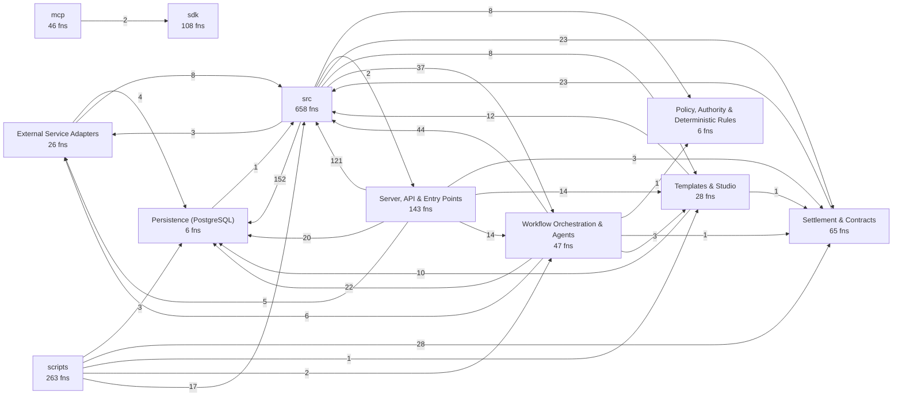
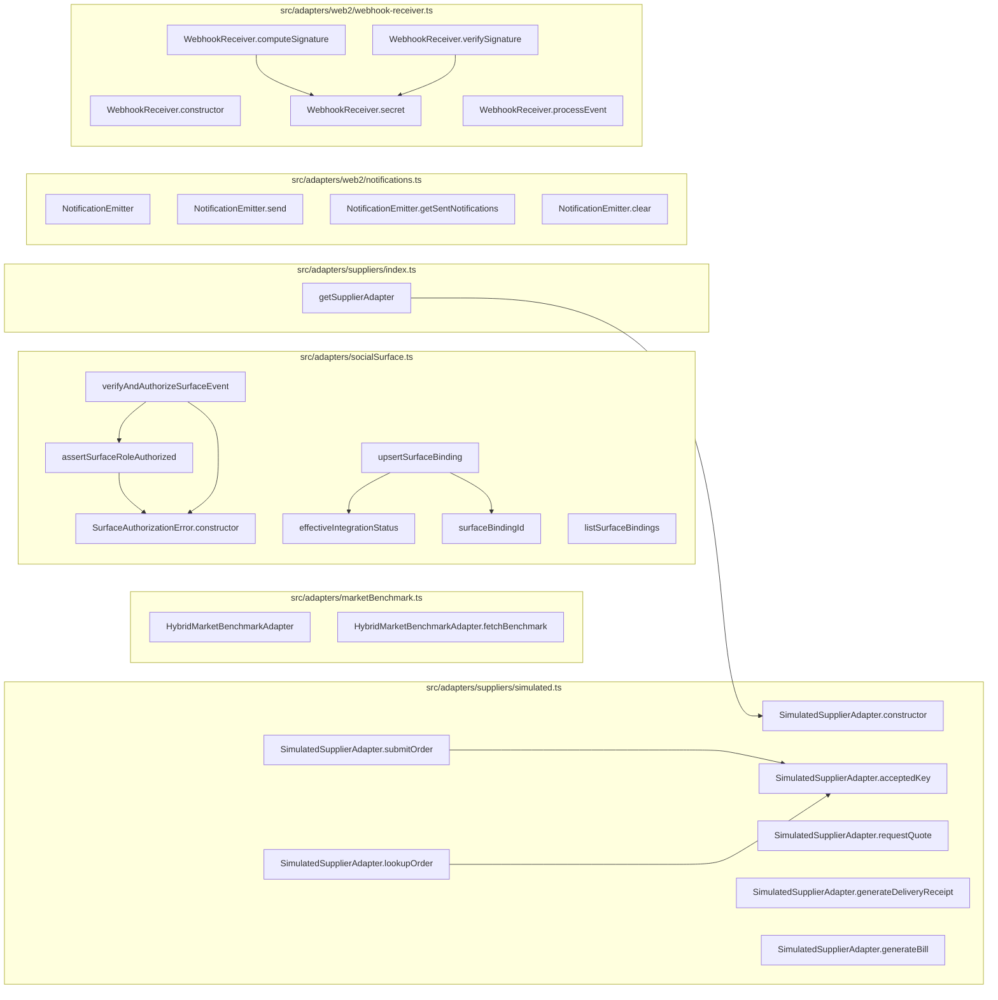
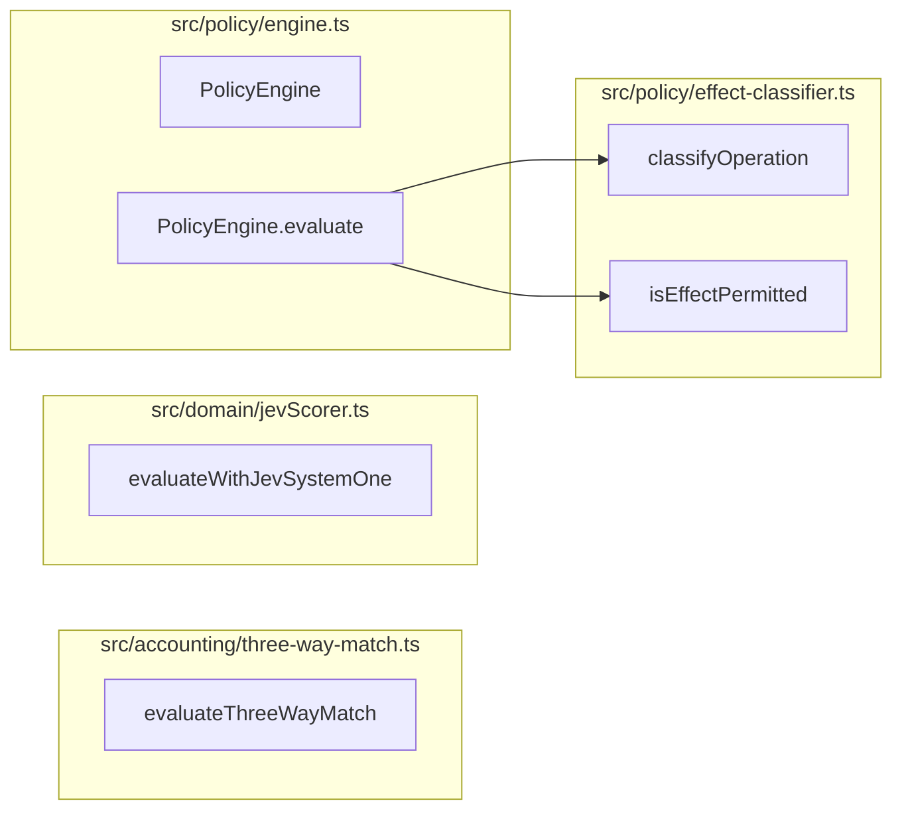
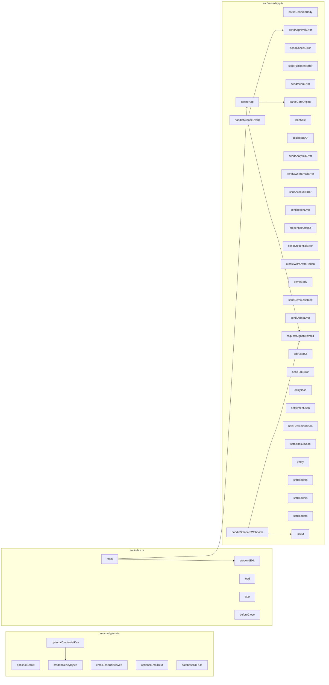
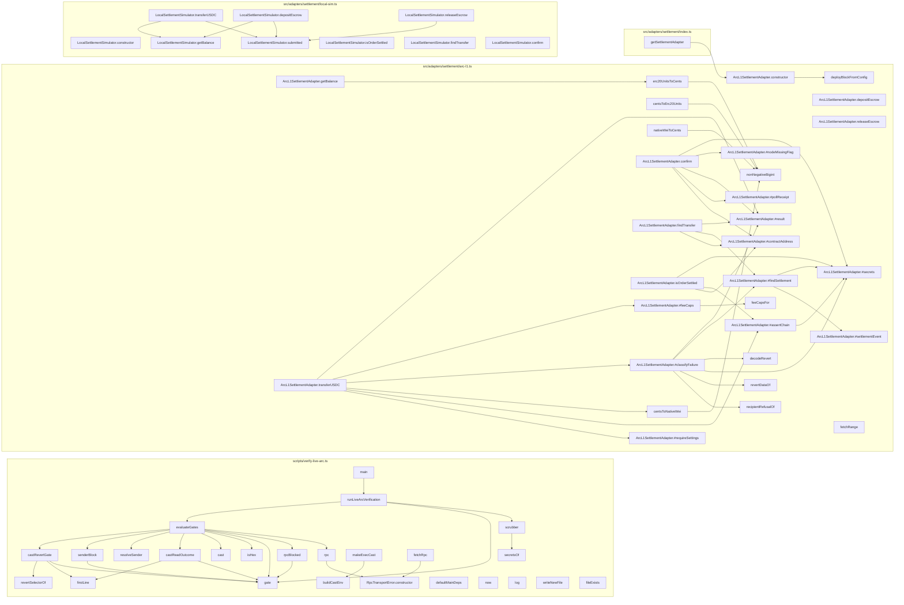
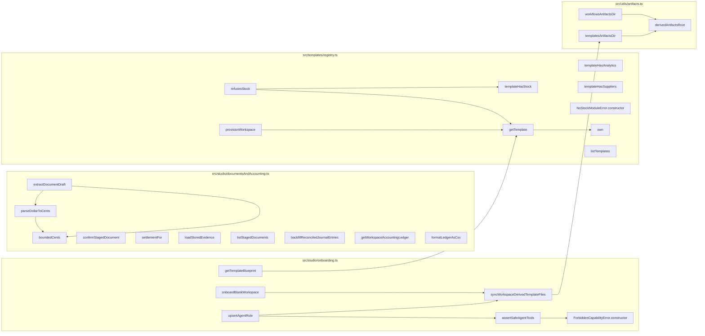
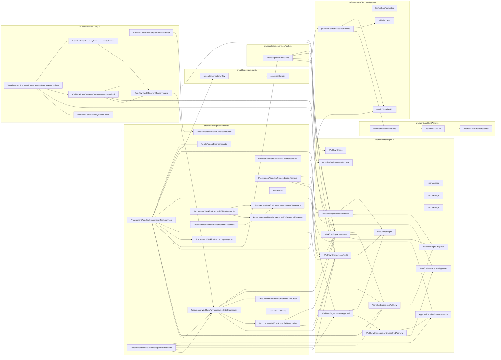
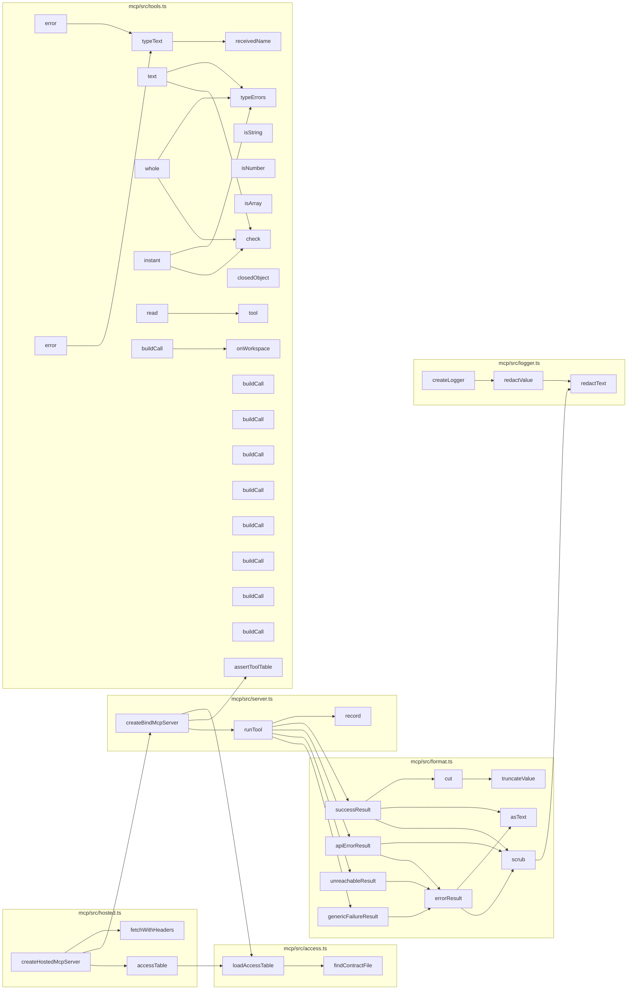

# Codebase map: functions and calls

Generated by `npx tsx scripts/map-functions.ts` from the TypeScript compiler's symbol table. Do not edit by hand.
The browser UI (`src/ui`, plain JavaScript) and the Solidity contract are not included here; see `.ua/knowledge-graph.json` for the contract.

- Functions, methods, handlers and classes: **2889** (1396 in production code, 1493 in tests)
- Resolved call edges: **5374**
- HTTP routes: **101**

## Layers and cross-layer calls



## HTTP surface: route to what it calls

| Route | Line | Calls directly |
| --- | --- | --- |
| `GET /x` | 161 | SQL or inline logic only |
| `GET /y` | 164 | SQL or inline logic only |
| `GET /health` | 688 | `query` |
| `GET /ready` | 699 | `checkReadiness` |
| `GET /api/public-config` | 713 | SQL or inline logic only |
| `GET /api/templates` | 728 | `jsonSafe`, `listTemplates`, `templateHasStock`, `templateHasSuppliers` |
| `GET /api/templates/:id/blueprint` | 739 | `getTemplateBlueprint` |
| `GET /api/openapi.json` | 752 | `serializeOpenApiDocument`, `buildOpenApiDocument` |
| `GET /api/workspaces` | 759 | `query` |
| `GET /api/me` | 770 | `query` |
| `POST /api/workspaces/onboard` | 792 | `createWithOwnerToken`, `onboardBlankWorkspace`, `jsonSafe`, `publicErrorMessage` |
| `POST /api/workspaces` | 807 | `createWithOwnerToken`, `provisionWorkspace`, `jsonSafe`, `publicErrorMessage` |
| `POST /api/demo` | 828 | `sendDemoDisabled`, `createDemoWorkspace`, `demoBody`, `sendDemoError` |
| `POST /api/workspaces/:id/demo/reset` | 841 | `sendDemoDisabled`, `resetDemoWorkspace`, `demoBody`, `sendDemoError` |
| `GET /api/workspaces/:id` | 852 | `query`, `getSettlementAdapter`, `effectiveSettlementMode`, `ArcL1SettlementAdapter.getBalance`, `LocalSettlementSimulator.getBalance` |
| `PUT /api/workspaces/:id/policy` | 873 | `normalizePaymentAddress`, `query`, `syncWorkspaceDerivedTemplateFiles`, `publicErrorMessage` |
| `GET /api/workspaces/:id/inventory` | 918 | `query` |
| `POST /api/workspaces/:id/inventory` | 927 | `query`, `refusesStock`, `publicErrorMessage` |
| `POST /api/workspaces/:id/replenish` | 972 | `ProcurementWorkflowRunner.startReplenishment`, `publicErrorMessage` |
| `GET /api/workspaces/:id/approvals` | 996 | `ProcurementWorkflowRunner.expireApprovals`, `query` |
| `GET /api/workspaces/:id/approvals/:approvalId` | 1006 | `ProcurementWorkflowRunner.expireApprovals`, `query` |
| `POST /api/approvals/:id/approve` | 1014 | `ProcurementWorkflowRunner.approveAndSubmit`, `decidedByOf`, `sendApprovalError` |
| `POST /api/approvals/:id/reject` | 1025 | `parseDecisionBody`, `ProcurementWorkflowRunner.declineApproval`, `decidedByOf`, `sendApprovalError` |
| `POST /api/approvals/:id/revoke` | 1045 | `parseDecisionBody`, `ProcurementWorkflowRunner.declineApproval`, `decidedByOf`, `sendApprovalError` |
| `POST /api/orders/:id/reconcile` | 1066 | `ProcurementWorkflowRunner.fulfillAndReconcile`, `publicErrorMessage` |
| `POST /api/orders/:id/confirm-settlement` | 1082 | `ProcurementWorkflowRunner.confirmSettlement`, `publicErrorMessage` |
| `GET /api/workspaces/:id/customer-orders` | 1099 | `listCustomerOrders`, `sendFulfilmentError` |
| `POST /api/workspaces/:id/customer-orders` | 1107 | `sendFulfilmentError`, `acceptCustomerOrder` |
| `GET /api/workspaces/:id/customer-orders/:orderId` | 1132 | `getCustomerOrder`, `sendFulfilmentError` |
| `POST /api/workspaces/:id/customer-orders/:orderId/accept` | 1142 | `acceptHeldOrder`, `sendFulfilmentError` |
| `POST /api/workspaces/:id/customer-orders/:orderId/cancel` | 1150 | `cancelCustomerOrder`, `sendFulfilmentError` |
| `POST /api/workspaces/:id/customer-orders/:orderId/fulfil` | 1159 | `fulfilCustomerOrder`, `sendFulfilmentError` |
| `GET /api/workspaces/:id/kitchen-capacity` | 1168 | `listKitchenCapacity`, `sendFulfilmentError` |
| `PUT /api/workspaces/:id/kitchen-capacity` | 1176 | `sendFulfilmentError`, `setKitchenCapacity` |
| `POST /api/workspaces/:id/feedback` | 1198 | `sendMenuError`, `ingestFeedback` |
| `GET /api/workspaces/:id/feedback` | 1218 | `listFeedback`, `sendMenuError` |
| `GET /api/workspaces/:id/feedback/summary` | 1226 | `sendMenuError`, `summarizeFeedback` |
| `POST /api/workspaces/:id/menu-proposals` | 1245 | `sendMenuError`, `proposeMenuChange` |
| `GET /api/workspaces/:id/menu-proposals` | 1272 | `listMenuProposals`, `sendMenuError` |
| `POST /api/workspaces/:id/menu-proposals/:proposalId/approve` | 1280 | `approveMenuProposal`, `sendMenuError` |
| `POST /api/workspaces/:id/menu-proposals/:proposalId/reject` | 1288 | `rejectMenuProposal`, `sendMenuError` |
| `POST /api/workspaces/:id/menu-proposals/:proposalId/cancel` | 1296 | `cancelMenuProposal`, `sendMenuError` |
| `POST /api/workspaces/:id/menu-proposals/:proposalId/publish` | 1304 | `publishMenuChange`, `sendMenuError` |
| `GET /api/workspaces/:id/menu` | 1312 | `listMenu`, `sendMenuError` |
| `GET /api/workspaces/:id/workflows` | 1321 | `query` |
| `GET /api/workspaces/:id/workflows/:workflowId` | 1330 | `query` |
| `POST /api/workspaces/:id/workflows/:workflowId/cancel` | 1338 | `validationFields`, `cancelWorkflow`, `sendCancelError` |
| `GET /api/workspaces/:id/needs-attention` | 1359 | `listNeedsAttention` |
| `GET /api/workspaces/:id/orders/:orderId` | 1364 | `query` |
| `GET /api/workspaces/:id/orders` | 1379 | `query` |
| `POST /api/workspaces/:id/tabs/charges` | 1407 | `parseChargeAmountMicro`, `TabLedger.accrueCharge`, `tabActorOf`, `entryJson`, `sendTabError` |
| `GET /api/workspaces/:id/tabs` | 1435 | `TabLedger.listTabs`, `sendTabError` |
| `GET /api/workspaces/:id/tabs/settlements` | 1455 | `TabLedger.listHeldSettlements`, `sendTabError` |
| `POST /api/workspaces/:id/tabs/settlements/:settlementId/resolve` | 1471 | `TabLedger.loadSettlement`, `TabLedger.reconcileHeld`, `tabActorOf`, `TabLedger.cancelHeldAndRestore`, `restoreAnswer`, `sendTabError` |
| `GET /api/workspaces/:id/tabs/:counterpartyId` | 1511 | `TabLedger.tabDetail`, `sendTabError` |
| `POST /api/workspaces/:id/tabs/:counterpartyId/settle` | 1526 | `TabLedger.settleTab`, `tabActorOf`, `settleResultJson`, `sendTabError` |
| `GET /api/workspaces/:id/suppliers` | 1539 | `query` |
| `POST /api/workspaces/:id/suppliers` | 1548 | `isDemoWorkspace`, `normalizePaymentAddress`, `simulatedPaymentAddress`, `query`, `publicErrorMessage` |
| `GET /api/workspaces/:id/agents` | 1605 | `query` |
| `POST /api/workspaces/:id/agents` | 1618 | `upsertAgentRole`, `publicErrorMessage` |
| `GET /api/workspaces/:id/surfaces` | 1633 | `listSurfaceBindings` |
| `POST /api/workspaces/:id/surfaces` | 1639 | `upsertSurfaceBinding`, `decidedByOf`, `publicErrorMessage` |
| `GET /api/workspaces/:id/notifications` | 1650 | `jsonSafe`, `listNotificationChannels`, `sendOwnerEmailError` |
| `POST /api/workspaces/:id/notifications/email` | 1658 | `requestOwnerEmailVerification`, `jsonSafe`, `sendOwnerEmailError` |
| `POST /api/workspaces/:id/notifications/email/verify` | 1670 | `jsonSafe`, `verifyOwnerEmail`, `sendOwnerEmailError` |
| `DELETE /api/workspaces/:id/notifications/email/:emailId` | 1681 | `jsonSafe`, `removeOwnerEmail`, `sendOwnerEmailError` |
| `GET /api/workspaces/:id/analytics/accounts` | 1691 | `jsonSafe`, `listAnalyticsAccounts`, `sendAnalyticsError` |
| `POST /api/workspaces/:id/analytics/accounts` | 1699 | `AnalyticsError.constructor`, `createAnalyticsAccount`, `jsonSafe`, `sendAnalyticsError` |
| `POST /api/workspaces/:id/analytics/accounts/:accountId/sync` | 1710 | `jsonSafe`, `syncAccount`, `sendAnalyticsError` |
| `GET /api/workspaces/:id/analytics/reports` | 1718 | `jsonSafe`, `listAnalyticsReports`, `sendAnalyticsError` |
| `GET /api/workspaces/:id/analytics/reports/:reportId` | 1726 | `jsonSafe`, `getAnalyticsReport`, `sendAnalyticsError` |
| `POST /api/workspaces/:id/analytics/reports` | 1734 | `AnalyticsError.constructor`, `parsePeriod`, `defaultOnDemandPeriod`, `generateReport`, `jsonSafe`, `sendAnalyticsError` |
| `GET /api/workspaces/:id/documents` | 1758 | `listStagedDocuments` |
| `POST /api/workspaces/:id/documents/extract` | 1764 | `extractDocumentDraft`, `publicErrorMessage` |
| `POST /api/workspaces/:id/documents/:docId/confirm` | 1775 | `confirmStagedDocument`, `decidedByOf`, `publicErrorMessage`, `redactText` |
| `GET /api/workspaces/:id/accounting/ledger` | 1800 | `getWorkspaceAccountingLedger`, `formatLedgerAsCsv` |
| `GET /api/workspaces/:id/audit` | 1816 | `query` |
| `POST /api/workspaces/:id/recover` | 1830 | `WorkflowCrashRecoveryRunner.recoverInterruptedWorkflows`, `publicErrorMessage` |
| `POST /api/auth/session` | 1841 | `upsertAccount`, `createSession`, `sendAccountError` |
| `POST /api/auth/sign-out` | 1855 | `revokeSession` |
| `GET /api/account/workspaces` | 1862 | `listAccountWorkspaces` |
| `POST /api/account/workspaces` | 1866 | `createAccountWorkspace`, `publicErrorMessage` |
| `POST /api/account/invites/accept` | 1879 | `acceptInvite`, `sendAccountError` |
| `POST /api/workspaces/:id/invites` | 1889 | `createInvite`, `sendAccountError` |
| `GET /api/workspaces/:id/invites` | 1899 | `jsonSafe`, `listInvites` |
| `DELETE /api/workspaces/:id/invites/:inviteId` | 1903 | `revokeInvite` |
| `GET /api/workspaces/:id/members` | 1909 | `jsonSafe`, `listMembers` |
| `PUT /api/workspaces/:id/members/:accountId` | 1913 | `jsonSafe`, `setMemberRole`, `sendAccountError` |
| `DELETE /api/workspaces/:id/members/:accountId` | 1923 | `removeMember`, `sendAccountError` |
| `POST /api/workspaces/:id/tokens` | 1933 | `issueToken`, `sendTokenError` |
| `GET /api/workspaces/:id/tokens` | 1947 | `listTokens`, `sendTokenError` |
| `DELETE /api/workspaces/:id/tokens/:tokenId` | 1955 | `revokeToken`, `sendTokenError` |
| `PUT /api/workspaces/:id/agents-paused` | 1967 | `setAgentsPaused`, `decidedByOf` |
| `GET /api/workspaces/:id/webhook-secret` | 1984 | `viewWebhookSecret`, `decidedByOf` |
| `POST /api/workspaces/:id/webhook-secret/rotate` | 1996 | `rotateWebhookSecret`, `decidedByOf` |
| `GET /api/workspaces/:id/connectors` | 2010 | `listConnectors`, `sendCredentialError` |
| `PUT /api/workspaces/:id/connectors/:connectorId` | 2018 | `setCredential`, `credentialActorOf`, `sendCredentialError` |
| `DELETE /api/workspaces/:id/connectors/:connectorId` | 2033 | `revokeCredential`, `credentialActorOf`, `sendCredentialError` |
| `POST /api/workspaces/:id/connectors/:connectorId/verify` | 2043 | `verifyCredential`, `credentialActorOf`, `sendCredentialError` |
| `POST /api/webhooks/incoming` | 2054 | `handleSurfaceEvent`, `handleStandardWebhook` |
| `GET *` | 2259 | SQL or inline logic only |

## External Service Adapters

| Function | File:lines | Kind | Params | Exported | Called by (prod / tests) | Calls |
| --- | --- | --- | --- | --- | --- | --- |
| `HybridMarketBenchmarkAdapter` | src/adapters/marketBenchmark.ts:19-119 | class | 0 | yes | 1 / 2 | 0 |
| `HybridMarketBenchmarkAdapter.fetchBenchmark` | src/adapters/marketBenchmark.ts:24-118 | method | 3 | yes | 1 / 2 | 0 |
| `SurfaceAuthorizationError.constructor` | src/adapters/socialSurface.ts:76-79 | constructor | 1 | yes | 2 / 0 | 0 |
| `assertSurfaceRoleAuthorized` | src/adapters/socialSurface.ts:85-108 | function | 2 | yes | 1 / 1 | 1 |
| `verifyAndAuthorizeSurfaceEvent` | src/adapters/socialSurface.ts:115-137 | function | 1 | yes | 1 / 0 | 3 |
| `effectiveIntegrationStatus` | src/adapters/socialSurface.ts:149-151 | function | 1 | yes | 2 / 1 | 0 |
| `surfaceBindingId` | src/adapters/socialSurface.ts:158-160 | function | 3 | yes | 2 / 0 | 0 |
| `upsertSurfaceBinding` | src/adapters/socialSurface.ts:162-205 | function | 3 | yes | 1 / 6 | 5 |
| `listSurfaceBindings` | src/adapters/socialSurface.ts:207-213 | function | 1 | yes | 1 / 0 | 1 |
| `getSupplierAdapter` | src/adapters/suppliers/index.ts:24-34 | function | 1 | yes | 0 / 2 | 1 |
| `SimulatedSupplierAdapter.constructor` | src/adapters/suppliers/simulated.ts:20-25 | constructor | 4 | yes | 2 / 9 | 0 |
| `SimulatedSupplierAdapter.acceptedKey` | src/adapters/suppliers/simulated.ts:27-29 | method | 2 | yes | 2 / 0 | 0 |
| `SimulatedSupplierAdapter.requestQuote` | src/adapters/suppliers/simulated.ts:31-62 | method | 1 | yes | 1 / 7 | 0 |
| `SimulatedSupplierAdapter.submitOrder` | src/adapters/suppliers/simulated.ts:65-80 | method | 1 | yes | 1 / 8 | 1 |
| `SimulatedSupplierAdapter.lookupOrder` | src/adapters/suppliers/simulated.ts:83-87 | method | 1 | yes | 0 / 3 | 1 |
| `SimulatedSupplierAdapter.generateDeliveryReceipt` | src/adapters/suppliers/simulated.ts:89-99 | method | 3 | yes | 1 / 7 | 0 |
| `SimulatedSupplierAdapter.generateBill` | src/adapters/suppliers/simulated.ts:101-114 | method | 5 | yes | 1 / 8 | 0 |
| `NotificationEmitter` | src/adapters/web2/notifications.ts:6-41 | class | 0 | yes | 1 / 0 | 0 |
| `NotificationEmitter.send` | src/adapters/web2/notifications.ts:9-29 | method | 1 | yes | 1 / 0 | 2 |
| `NotificationEmitter.getSentNotifications` | src/adapters/web2/notifications.ts:31-36 | method | 1 | yes | 0 / 4 | 0 |
| `NotificationEmitter.clear` | src/adapters/web2/notifications.ts:38-40 | method | 0 | yes | 0 / 6 | 0 |
| `WebhookReceiver.constructor` | src/adapters/web2/webhook-receiver.ts:27-29 | constructor | 1 | yes | 2 / 0 | 0 |
| `WebhookReceiver.secret` | src/adapters/web2/webhook-receiver.ts:31-35 | method | 0 | yes | 2 / 0 | 1 |
| `WebhookReceiver.computeSignature` | src/adapters/web2/webhook-receiver.ts:38-40 | method | 2 | yes | 0 / 1 | 2 |
| `WebhookReceiver.verifySignature` | src/adapters/web2/webhook-receiver.ts:43-50 | method | 3 | yes | 0 / 1 | 2 |
| `WebhookReceiver.processEvent` | src/adapters/web2/webhook-receiver.ts:56-77 | method | 1 | yes | 1 / 1 | 2 |



## Persistence (PostgreSQL)

| Function | File:lines | Kind | Params | Exported | Called by (prod / tests) | Calls |
| --- | --- | --- | --- | --- | --- | --- |
| `query` | src/db/client.ts:13-18 | function | 2 | yes | 159 / 271 | 0 |
| `getClient` | src/db/client.ts:20-22 | function | 0 | yes | 0 / 1 | 0 |
| `withTransaction` | src/db/client.ts:24-39 | function | 1 | yes | 51 / 1 | 0 |
| `closePool` | src/db/client.ts:41-43 | function | 0 | yes | 2 / 83 | 0 |
| `runMigrations` | src/db/migrate.ts:24-49 | function | 1 | yes | 2 / 82 | 1 |
| `isDirectRun` | src/db/migrate.ts:55-57 | function | 2 | yes | 1 / 1 | 0 |

## Policy, Authority & Deterministic Rules

| Function | File:lines | Kind | Params | Exported | Called by (prod / tests) | Calls |
| --- | --- | --- | --- | --- | --- | --- |
| `evaluateThreeWayMatch` | src/accounting/three-way-match.ts:19-100 | function | 3 | yes | 1 / 1 | 0 |
| `evaluateWithJevSystemOne` | src/domain/jevScorer.ts:52-244 | function | 1 | yes | 1 / 1 | 0 |
| `classifyOperation` | src/policy/effect-classifier.ts:45-54 | function | 1 | yes | 2 / 3 | 0 |
| `isEffectPermitted` | src/policy/effect-classifier.ts:59-64 | function | 2 | yes | 1 / 0 | 0 |
| `PolicyEngine` | src/policy/engine.ts:14-60 | class | 0 | yes | 3 / 1 | 0 |
| `PolicyEngine.evaluate` | src/policy/engine.ts:15-59 | method | 1 | yes | 3 / 1 | 2 |



## Server, API & Entry Points

| Function | File:lines | Kind | Params | Exported | Called by (prod / tests) | Calls |
| --- | --- | --- | --- | --- | --- | --- |
| `optionalSecret` | src/config/env.ts:9-14 | function | 1 | no | 1 / 0 | 0 |
| `credentialKeyBytes` | src/config/env.ts:20-24 | function | 1 | yes | 2 / 0 | 0 |
| `optionalCredentialKey` | src/config/env.ts:27-35 | function | 1 | no | 1 / 0 | 1 |
| `emailBaseUrlAllowed` | src/config/env.ts:42-52 | function | 2 | yes | 2 / 1 | 0 |
| `optionalEmailText` | src/config/env.ts:55-57 | function | 1 | no | 1 / 0 | 0 |
| `databaseUrlRule` | src/config/env.ts:202-206 | function | 1 | yes | 1 / 1 | 0 |
| `stopAndExit` | src/index.ts:21-32 | function | 2 | no | 1 / 0 | 0 |
| `main` | src/index.ts:34-90 | function | 0 | no | 1 / 0 | 7 |
| `load` | src/index.ts:49-49 | arrow | 0 | no | 0 / 0 | 0 |
| `stop` | src/index.ts:70-70 | arrow | 0 | no | 0 / 0 | 0 |
| `beforeClose` | src/index.ts:75-77 | arrow | 0 | no | 0 / 0 | 1 |
| `parseDecisionBody` | src/server/app.ts:192-199 | function | 2 | no | 2 / 0 | 1 |
| `sendApprovalError` | src/server/app.ts:202-212 | function | 2 | no | 4 / 0 | 1 |
| `sendCancelError` | src/server/app.ts:215-226 | function | 2 | no | 1 / 0 | 0 |
| `sendFulfilmentError` | src/server/app.ts:229-238 | function | 2 | no | 8 / 0 | 1 |
| `sendMenuError` | src/server/app.ts:244-260 | function | 2 | no | 10 / 0 | 1 |
| `parseCorsOrigins` | src/server/app.ts:265-270 | function | 1 | yes | 1 / 0 | 0 |
| `jsonSafe` | src/server/app.ts:276-278 | function | 1 | no | 16 / 0 | 0 |
| `decidedByOf` | src/server/app.ts:281-283 | function | 1 | no | 8 / 0 | 0 |
| `sendAnalyticsError` | src/server/app.ts:291-303 | function | 2 | no | 6 / 0 | 0 |
| `sendOwnerEmailError` | src/server/app.ts:305-312 | function | 2 | no | 4 / 0 | 0 |
| `sendAccountError` | src/server/app.ts:314-325 | function | 2 | no | 5 / 0 | 0 |
| `sendTokenError` | src/server/app.ts:327-333 | function | 2 | no | 3 / 0 | 0 |
| `credentialActorOf` | src/server/app.ts:336-338 | function | 1 | no | 3 / 0 | 0 |
| `sendCredentialError` | src/server/app.ts:341-352 | function | 2 | no | 4 / 0 | 1 |
| `createWithOwnerToken` | src/server/app.ts:364-384 | function | 2 | no | 2 / 0 | 3 |
| `demoBody` | src/server/app.ts:437-439 | function | 1 | no | 2 / 0 | 0 |
| `sendDemoDisabled` | src/server/app.ts:441-443 | function | 1 | no | 2 / 0 | 0 |
| `sendDemoError` | src/server/app.ts:446-453 | function | 2 | no | 2 / 0 | 0 |
| `requestSignatureValid` | src/server/app.ts:465-473 | function | 2 | no | 2 / 0 | 1 |
| `tabActorOf` | src/server/app.ts:476-479 | function | 1 | no | 3 / 0 | 0 |
| `sendTabError` | src/server/app.ts:481-487 | function | 2 | no | 6 / 0 | 0 |
| `entryJson` | src/server/app.ts:489-501 | function | 1 | no | 1 / 0 | 0 |
| `settlementJson` | src/server/app.ts:503-518 | function | 1 | no | 0 / 0 | 0 |
| `heldSettlementJson` | src/server/app.ts:520-533 | function | 1 | no | 0 / 0 | 0 |
| `settleResultJson` | src/server/app.ts:535-555 | function | 1 | no | 1 / 0 | 0 |
| `createApp` | src/server/app.ts:557-2268 | function | 1 | yes | 1 / 48 | 15 |
| `verify` | src/server/app.ts:637-639 | arrow | 3 | no | 0 / 0 | 0 |
| `setHeaders` | src/server/app.ts:654-654 | arrow | 1 | no | 0 / 0 | 0 |
| `setHeaders` | src/server/app.ts:671-671 | arrow | 1 | no | 0 / 0 | 0 |
| `setHeaders` | src/server/app.ts:681-683 | arrow | 2 | no | 0 / 0 | 0 |
| `handleSurfaceEvent` | src/server/app.ts:2068-2221 | function | 3 | no | 1 / 0 | 12 |
| `handleStandardWebhook` | src/server/app.ts:2223-2250 | function | 2 | no | 1 / 0 | 3 |
| `isText` | src/server/app.ts:2235-2236 | arrow | 1 | no | 1 / 0 | 0 |



## Settlement & Contracts

| Function | File:lines | Kind | Params | Exported | Called by (prod / tests) | Calls |
| --- | --- | --- | --- | --- | --- | --- |
| `RpcTransportError.constructor` | scripts/verify-live-arc.ts:97-103 | constructor | 2 | yes | 2 / 1 | 0 |
| `secretsOf` | scripts/verify-live-arc.ts:130-142 | function | 1 | yes | 3 / 0 | 0 |
| `scrubber` | scripts/verify-live-arc.ts:145-148 | function | 1 | yes | 1 / 0 | 2 |
| `revertSelectorOf` | scripts/verify-live-arc.ts:154-159 | function | 1 | yes | 1 / 1 | 0 |
| `firstLine` | scripts/verify-live-arc.ts:161-163 | function | 1 | no | 2 / 0 | 0 |
| `isHex` | scripts/verify-live-arc.ts:165-167 | function | 1 | no | 1 / 0 | 0 |
| `gate` | scripts/verify-live-arc.ts:169-171 | function | 3 | no | 6 / 0 | 0 |
| `resolveSender` | scripts/verify-live-arc.ts:184-220 | function | 1 | yes | 1 / 1 | 0 |
| `rpcBlocked` | scripts/verify-live-arc.ts:231-244 | function | 2 | no | 1 / 0 | 1 |
| `castReadOutcome` | scripts/verify-live-arc.ts:247-264 | function | 3 | no | 1 / 0 | 2 |
| `castRevertGate` | scripts/verify-live-arc.ts:270-291 | function | 5 | no | 1 / 0 | 3 |
| `runLiveArcVerification` | scripts/verify-live-arc.ts:294-329 | function | 1 | yes | 1 / 1 | 3 |
| `evaluateGates` | scripts/verify-live-arc.ts:331-444 | function | 1 | no | 1 / 0 | 9 |
| `rpc` | scripts/verify-live-arc.ts:333-343 | arrow | 2 | no | 1 / 0 | 1 |
| `cast` | scripts/verify-live-arc.ts:344-344 | arrow | 1 | no | 1 / 0 | 0 |
| `senderBlock` | scripts/verify-live-arc.ts:345-345 | arrow | 2 | no | 1 / 0 | 1 |
| `buildCastEnv` | scripts/verify-live-arc.ts:453-457 | function | 2 | yes | 1 / 1 | 0 |
| `makeExecCast` | scripts/verify-live-arc.ts:468-492 | function | 2 | yes | 1 / 1 | 1 |
| `fetchRpc` | scripts/verify-live-arc.ts:500-519 | arrow | 1 | yes | 0 / 0 | 1 |
| `defaultMainDeps` | scripts/verify-live-arc.ts:528-541 | function | 0 | yes | 0 / 0 | 0 |
| `now` | scripts/verify-live-arc.ts:533-533 | arrow | 0 | no | 0 / 0 | 0 |
| `log` | scripts/verify-live-arc.ts:534-534 | arrow | 1 | no | 0 / 0 | 0 |
| `writeNewFile` | scripts/verify-live-arc.ts:535-535 | arrow | 2 | no | 0 / 0 | 0 |
| `fileExists` | scripts/verify-live-arc.ts:536-539 | arrow | 1 | no | 0 / 0 | 0 |
| `main` | scripts/verify-live-arc.ts:547-579 | function | 2 | yes | 1 / 1 | 1 |
| `nonNegativeBigint` | src/adapters/settlement/arc-l1.ts:154-157 | function | 2 | no | 4 / 0 | 0 |
| `centsToNativeWei` | src/adapters/settlement/arc-l1.ts:160-162 | function | 1 | yes | 2 / 1 | 1 |
| `centsToErc20Units` | src/adapters/settlement/arc-l1.ts:165-167 | function | 1 | yes | 0 / 1 | 1 |
| `erc20UnitsToCents` | src/adapters/settlement/arc-l1.ts:170-172 | function | 1 | yes | 1 / 1 | 1 |
| `nativeWeiToCents` | src/adapters/settlement/arc-l1.ts:175-177 | function | 1 | yes | 0 / 1 | 1 |
| `feeCapsFor` | src/adapters/settlement/arc-l1.ts:194-203 | function | 1 | yes | 1 / 1 | 0 |
| `recipientRefusalOf` | src/adapters/settlement/arc-l1.ts:215-233 | function | 1 | no | 1 / 0 | 0 |
| `revertDataOf` | src/adapters/settlement/arc-l1.ts:249-257 | function | 1 | no | 1 / 0 | 0 |
| `decodeRevert` | src/adapters/settlement/arc-l1.ts:259-266 | function | 1 | no | 1 / 0 | 0 |
| `deployBlockFromConfig` | src/adapters/settlement/arc-l1.ts:268-270 | function | 0 | no | 1 / 0 | 0 |
| `ArcL1SettlementAdapter.constructor` | src/adapters/settlement/arc-l1.ts:295-312 | constructor | 1 | yes | 3 / 11 | 1 |
| `ArcL1SettlementAdapter.getBalance` | src/adapters/settlement/arc-l1.ts:314-328 | method | 1 | yes | 3 / 3 | 1 |
| `ArcL1SettlementAdapter.transferUSDC` | src/adapters/settlement/arc-l1.ts:334-389 | method | 1 | yes | 4 / 11 | 9 |
| `ArcL1SettlementAdapter.confirm` | src/adapters/settlement/arc-l1.ts:396-423 | method | 1 | yes | 6 / 5 | 7 |
| `ArcL1SettlementAdapter.findTransfer` | src/adapters/settlement/arc-l1.ts:434-442 | method | 1 | yes | 4 / 4 | 4 |
| `ArcL1SettlementAdapter.isOrderSettled` | src/adapters/settlement/arc-l1.ts:448-466 | method | 1 | yes | 1 / 1 | 5 |
| `ArcL1SettlementAdapter.depositEscrow` | src/adapters/settlement/arc-l1.ts:468-470 | method | 2 | yes | 1 / 2 | 1 |
| `ArcL1SettlementAdapter.releaseEscrow` | src/adapters/settlement/arc-l1.ts:472-474 | method | 2 | yes | 1 / 2 | 1 |
| `ArcL1SettlementAdapter.#result` | src/adapters/settlement/arc-l1.ts:476-487 | method | 3 | yes | 4 / 0 | 0 |
| `ArcL1SettlementAdapter.#secrets` | src/adapters/settlement/arc-l1.ts:490-492 | method | 0 | yes | 5 / 0 | 0 |
| `ArcL1SettlementAdapter.#classifyFailure` | src/adapters/settlement/arc-l1.ts:498-522 | method | 4 | yes | 1 / 0 | 8 |
| `ArcL1SettlementAdapter.#contractAddress` | src/adapters/settlement/arc-l1.ts:524-530 | method | 0 | yes | 3 / 0 | 1 |
| `ArcL1SettlementAdapter.#requireSettings` | src/adapters/settlement/arc-l1.ts:533-552 | method | 0 | yes | 1 / 0 | 1 |
| `ArcL1SettlementAdapter.#assertChain` | src/adapters/settlement/arc-l1.ts:555-565 | method | 0 | yes | 2 / 0 | 3 |
| `ArcL1SettlementAdapter.#settlementEvent` | src/adapters/settlement/arc-l1.ts:567-571 | method | 0 | yes | 1 / 0 | 0 |
| `ArcL1SettlementAdapter.#findSettlement` | src/adapters/settlement/arc-l1.ts:583-613 | method | 2 | yes | 2 / 0 | 4 |
| `fetchRange` | src/adapters/settlement/arc-l1.ts:596-606 | arrow | 2 | no | 0 / 0 | 0 |
| `ArcL1SettlementAdapter.#feeCaps` | src/adapters/settlement/arc-l1.ts:619-629 | method | 0 | yes | 1 / 0 | 1 |
| `ArcL1SettlementAdapter.#nodeMissingFlag` | src/adapters/settlement/arc-l1.ts:635-642 | method | 1 | yes | 1 / 0 | 0 |
| `ArcL1SettlementAdapter.#pollReceipt` | src/adapters/settlement/arc-l1.ts:648-661 | method | 1 | yes | 1 / 0 | 0 |
| `getSettlementAdapter` | src/adapters/settlement/index.ts:14-27 | function | 1 | yes | 4 / 0 | 1 |
| `LocalSettlementSimulator.constructor` | src/adapters/settlement/local-sim.ts:25-28 | constructor | 0 | yes | 3 / 4 | 0 |
| `LocalSettlementSimulator.getBalance` | src/adapters/settlement/local-sim.ts:30-32 | method | 1 | yes | 6 / 3 | 0 |
| `LocalSettlementSimulator.transferUSDC` | src/adapters/settlement/local-sim.ts:34-63 | method | 1 | yes | 5 / 7 | 4 |
| `LocalSettlementSimulator.isOrderSettled` | src/adapters/settlement/local-sim.ts:66-68 | method | 1 | yes | 2 / 1 | 0 |
| `LocalSettlementSimulator.findTransfer` | src/adapters/settlement/local-sim.ts:71-73 | method | 1 | yes | 5 / 2 | 0 |
| `LocalSettlementSimulator.confirm` | src/adapters/settlement/local-sim.ts:75-78 | method | 1 | yes | 7 / 4 | 1 |
| `LocalSettlementSimulator.depositEscrow` | src/adapters/settlement/local-sim.ts:80-96 | method | 2 | yes | 2 / 1 | 3 |
| `LocalSettlementSimulator.releaseEscrow` | src/adapters/settlement/local-sim.ts:98-113 | method | 2 | yes | 2 / 0 | 1 |
| `LocalSettlementSimulator.submitted` | src/adapters/settlement/local-sim.ts:115-123 | method | 0 | yes | 3 / 0 | 0 |



## Templates & Studio

| Function | File:lines | Kind | Params | Exported | Called by (prod / tests) | Calls |
| --- | --- | --- | --- | --- | --- | --- |
| `parseDollarToCents` | src/studio/documentsAndAccounting.ts:34-41 | function | 1 | no | 1 / 0 | 1 |
| `boundedCents` | src/studio/documentsAndAccounting.ts:44-46 | function | 1 | no | 2 / 0 | 0 |
| `extractDocumentDraft` | src/studio/documentsAndAccounting.ts:52-232 | function | 3 | yes | 1 / 1 | 5 |
| `confirmStagedDocument` | src/studio/documentsAndAccounting.ts:239-487 | function | 4 | yes | 1 / 2 | 4 |
| `settlementFor` | src/studio/documentsAndAccounting.ts:432-432 | arrow | 1 | no | 0 / 0 | 1 |
| `loadStoredEvidence` | src/studio/documentsAndAccounting.ts:436-460 | arrow | 1 | no | 0 / 0 | 1 |
| `listStagedDocuments` | src/studio/documentsAndAccounting.ts:489-495 | function | 1 | yes | 1 / 0 | 1 |
| `backfillReconciledJournalEntries` | src/studio/documentsAndAccounting.ts:517-563 | function | 2 | yes | 1 / 0 | 2 |
| `getWorkspaceAccountingLedger` | src/studio/documentsAndAccounting.ts:566-572 | function | 1 | yes | 1 / 0 | 1 |
| `formatLedgerAsCsv` | src/studio/documentsAndAccounting.ts:574-609 | function | 1 | yes | 1 / 0 | 0 |
| `ForbiddenCapabilityError.constructor` | src/studio/onboarding.ts:32-35 | constructor | 1 | yes | 1 / 0 | 0 |
| `assertSafeAgentTools` | src/studio/onboarding.ts:116-130 | function | 1 | yes | 1 / 0 | 1 |
| `getTemplateBlueprint` | src/studio/onboarding.ts:135-175 | function | 1 | yes | 1 / 0 | 1 |
| `onboardBlankWorkspace` | src/studio/onboarding.ts:181-328 | function | 2 | yes | 1 / 0 | 5 |
| `upsertAgentRole` | src/studio/onboarding.ts:333-406 | function | 3 | yes | 1 / 0 | 5 |
| `syncWorkspaceDerivedTemplateFiles` | src/studio/onboarding.ts:412-496 | function | 1 | yes | 3 / 0 | 2 |
| `templateHasStock` | src/templates/registry.ts:19-21 | function | 1 | yes | 2 / 1 | 0 |
| `templateHasAnalytics` | src/templates/registry.ts:24-26 | function | 1 | yes | 1 / 1 | 0 |
| `templateHasSuppliers` | src/templates/registry.ts:29-31 | function | 1 | yes | 1 / 1 | 0 |
| `refusesStock` | src/templates/registry.ts:37-41 | function | 1 | yes | 2 / 1 | 2 |
| `NoStockModuleError.constructor` | src/templates/registry.ts:47-50 | constructor | 0 | yes | 1 / 0 | 0 |
| `getTemplate` | src/templates/registry.ts:53-60 | function | 1 | yes | 4 / 3 | 1 |
| `own` | src/templates/registry.ts:55-56 | arrow | 1 | no | 1 / 0 | 0 |
| `listTemplates` | src/templates/registry.ts:62-64 | function | 0 | yes | 2 / 3 | 0 |
| `provisionWorkspace` | src/templates/registry.ts:87-232 | function | 4 | yes | 4 / 67 | 3 |
| `derivedArtifactsRoot` | src/utils/artifacts.ts:12-20 | function | 0 | yes | 2 / 0 | 0 |
| `workflowsArtifactsDir` | src/utils/artifacts.ts:22-24 | function | 0 | yes | 2 / 0 | 1 |
| `templatesArtifactsDir` | src/utils/artifacts.ts:26-28 | function | 0 | yes | 2 / 0 | 1 |



## Workflow Orchestration & Agents

| Function | File:lines | Kind | Params | Exported | Called by (prod / tests) | Calls |
| --- | --- | --- | --- | --- | --- | --- |
| `InvariantDriftError.constructor` | src/agents/antiDriftWriter.ts:33-36 | constructor | 1 | yes | 1 / 0 | 0 |
| `assertNoSpecDrift` | src/agents/antiDriftWriter.ts:42-78 | function | 1 | yes | 1 / 1 | 1 |
| `writeWorkflowAntiDriftFiles` | src/agents/antiDriftWriter.ts:91-229 | function | 2 | yes | 2 / 1 | 2 |
| `listAvailableTemplates` | src/agents/bindTemplateAgent.ts:26-44 | function | 0 | yes | 0 / 1 | 0 |
| `resolveTemplateDir` | src/agents/bindTemplateAgent.ts:49-60 | function | 1 | yes | 2 / 1 | 0 |
| `whitelistLabel` | src/agents/bindTemplateAgent.ts:106-110 | function | 1 | no | 1 / 0 | 0 |
| `generateVerifiableDecisionRecord` | src/agents/bindTemplateAgent.ts:114-274 | function | 1 | yes | 1 / 2 | 5 |
| `createReplenishmentTools` | src/agents/replenishmentTools.ts:28-712 | function | 1 | yes | 1 / 9 | 18 |
| `canonicalStringify` | src/utils/idempotency.ts:7-16 | function | 1 | yes | 2 / 0 | 0 |
| `generateIdempotencyKey` | src/utils/idempotency.ts:21-32 | function | 3 | yes | 1 / 3 | 1 |
| `safeJsonStringify` | src/workflows/engine.ts:10-14 | function | 1 | no | 4 / 0 | 0 |
| `errorMessage` | src/workflows/engine.ts:22-22 | arrow | 0 | no | 0 / 0 | 0 |
| `errorMessage` | src/workflows/engine.ts:25-25 | arrow | 1 | no | 0 / 0 | 0 |
| `errorMessage` | src/workflows/engine.ts:29-29 | arrow | 1 | no | 0 / 0 | 0 |
| `ApprovalDecisionError.constructor` | src/workflows/engine.ts:40-45 | constructor | 3 | yes | 3 / 0 | 0 |
| `WorkflowEngine` | src/workflows/engine.ts:48-302 | class | 0 | yes | 9 / 17 | 0 |
| `WorkflowEngine.mapRow` | src/workflows/engine.ts:49-62 | method | 1 | yes | 3 / 0 | 0 |
| `WorkflowEngine.createWorkflow` | src/workflows/engine.ts:68-85 | method | 5 | yes | 1 / 19 | 3 |
| `WorkflowEngine.getWorkflow` | src/workflows/engine.ts:90-96 | method | 1 | yes | 5 / 8 | 2 |
| `WorkflowEngine.transition` | src/workflows/engine.ts:101-127 | method | 2 | yes | 8 / 13 | 4 |
| `WorkflowEngine.recordAudit` | src/workflows/engine.ts:132-169 | method | 10 | yes | 23 / 1 | 5 |
| `WorkflowEngine.createApproval` | src/workflows/engine.ts:174-191 | method | 8 | yes | 1 / 10 | 1 |
| `WorkflowEngine.resolveApproval` | src/workflows/engine.ts:201-239 | method | 5 | yes | 2 / 1 | 3 |
| `WorkflowEngine.expireApprovals` | src/workflows/engine.ts:249-278 | method | 1 | yes | 3 / 1 | 1 |
| `WorkflowEngine.explainUnresolvedApproval` | src/workflows/engine.ts:284-301 | method | 1 | yes | 1 / 0 | 3 |
| `AgentsPausedError.constructor` | src/workflows/procurement.ts:51-56 | constructor | 0 | yes | 1 / 0 | 0 |
| `commitmentClaims` | src/workflows/procurement.ts:74-84 | function | 3 | no | 1 / 0 | 0 |
| `ProcurementWorkflowRunner.constructor` | src/workflows/procurement.ts:94-99 | constructor | 1 | yes | 6 / 24 | 2 |
| `ProcurementWorkflowRunner.startReplenishment` | src/workflows/procurement.ts:104-394 | method | 4 | yes | 6 / 23 | 16 |
| `ProcurementWorkflowRunner.approveAndSubmit` | src/workflows/procurement.ts:399-474 | method | 3 | yes | 2 / 4 | 9 |
| `ProcurementWorkflowRunner.expireApprovals` | src/workflows/procurement.ts:479-481 | method | 1 | yes | 2 / 0 | 1 |
| `ProcurementWorkflowRunner.declineApproval` | src/workflows/procurement.ts:487-517 | method | 5 | yes | 4 / 1 | 5 |
| `ProcurementWorkflowRunner.requestQuote` | src/workflows/procurement.ts:524-582 | method | 1 | yes | 1 / 1 | 7 |
| `ProcurementWorkflowRunner.resumeOrderSubmission` | src/workflows/procurement.ts:592-782 | method | 1 | yes | 3 / 1 | 17 |
| `externalRef` | src/workflows/procurement.ts:698-698 | arrow | 1 | no | 0 / 0 | 0 |
| `ProcurementWorkflowRunner.loadOwnOrder` | src/workflows/procurement.ts:785-792 | method | 2 | yes | 1 / 0 | 1 |
| `ProcurementWorkflowRunner.failReservation` | src/workflows/procurement.ts:795-820 | method | 3 | yes | 1 / 0 | 3 |
| `ProcurementWorkflowRunner.fulfillAndReconcile` | src/workflows/procurement.ts:827-833 | method | 2 | yes | 2 / 13 | 3 |
| `ProcurementWorkflowRunner.confirmSettlement` | src/workflows/procurement.ts:839-842 | method | 2 | yes | 2 / 3 | 2 |
| `ProcurementWorkflowRunner.assertOrderInWorkspace` | src/workflows/procurement.ts:845-850 | method | 2 | yes | 2 / 0 | 2 |
| `ProcurementWorkflowRunner.storedOrGeneratedEvidence` | src/workflows/procurement.ts:852-937 | method | 1 | yes | 1 / 0 | 5 |
| `WorkflowCrashRecoveryRunner.constructor` | src/workflows/recovery.ts:34-36 | constructor | 1 | yes | 2 / 3 | 1 |
| `WorkflowCrashRecoveryRunner.recoverInterruptedWorkflows` | src/workflows/recovery.ts:48-96 | method | 1 | yes | 2 / 3 | 5 |
| `WorkflowCrashRecoveryRunner.touch` | src/workflows/recovery.ts:99-105 | method | 1 | yes | 1 / 0 | 1 |
| `WorkflowCrashRecoveryRunner.recoverSubmitted` | src/workflows/recovery.ts:107-141 | method | 2 | yes | 1 / 0 | 3 |
| `WorkflowCrashRecoveryRunner.recoverAuthorized` | src/workflows/recovery.ts:143-187 | method | 2 | yes | 1 / 0 | 6 |
| `WorkflowCrashRecoveryRunner.resume` | src/workflows/recovery.ts:189-197 | method | 3 | yes | 2 / 0 | 1 |



## mcp

| Function | File:lines | Kind | Params | Exported | Called by (prod / tests) | Calls |
| --- | --- | --- | --- | --- | --- | --- |
| `findContractFile` | mcp/src/access.ts:16-26 | function | 0 | no | 1 / 0 | 0 |
| `loadAccessTable` | mcp/src/access.ts:29-53 | function | 1 | yes | 2 / 3 | 1 |
| `truncateValue` | mcp/src/format.ts:24-44 | function | 3 | yes | 1 / 0 | 0 |
| `cut` | mcp/src/format.ts:47-51 | function | 2 | yes | 1 / 0 | 1 |
| `scrub` | mcp/src/format.ts:54-56 | function | 2 | no | 3 / 0 | 1 |
| `asText` | mcp/src/format.ts:58-60 | function | 1 | no | 2 / 0 | 0 |
| `successResult` | mcp/src/format.ts:70-86 | function | 1 | yes | 1 / 0 | 3 |
| `errorResult` | mcp/src/format.ts:88-93 | function | 2 | no | 3 / 0 | 2 |
| `apiErrorResult` | mcp/src/format.ts:96-108 | function | 2 | yes | 1 / 0 | 2 |
| `unreachableResult` | mcp/src/format.ts:111-113 | function | 1 | yes | 1 / 0 | 1 |
| `genericFailureResult` | mcp/src/format.ts:116-118 | function | 1 | yes | 1 / 0 | 1 |
| `accessTable` | mcp/src/hosted.ts:38-41 | function | 0 | no | 1 / 0 | 1 |
| `fetchWithHeaders` | mcp/src/hosted.ts:44-50 | function | 1 | no | 1 / 0 | 0 |
| `createHostedMcpServer` | mcp/src/hosted.ts:53-69 | function | 1 | yes | 0 / 1 | 4 |
| `redactText` | mcp/src/logger.ts:21-27 | function | 2 | yes | 2 / 0 | 0 |
| `redactValue` | mcp/src/logger.ts:30-40 | function | 3 | yes | 1 / 0 | 1 |
| `createLogger` | mcp/src/logger.ts:52-62 | function | 1 | yes | 0 / 3 | 1 |
| `createBindMcpServer` | mcp/src/server.ts:55-91 | function | 1 | yes | 1 / 4 | 3 |
| `runTool` | mcp/src/server.ts:102-149 | function | 3 | no | 1 / 0 | 6 |
| `record` | mcp/src/server.ts:106-115 | arrow | 2 | no | 1 / 0 | 0 |
| `receivedName` | mcp/src/tools.ts:77-83 | function | 1 | no | 1 / 0 | 0 |
| `typeErrors` | mcp/src/tools.ts:90-92 | function | 2 | no | 4 / 0 | 0 |
| `error` | mcp/src/tools.ts:91-91 | arrow | 1 | no | 0 / 0 | 1 |
| `typeText` | mcp/src/tools.ts:100-104 | function | 3 | no | 2 / 0 | 1 |
| `isString` | mcp/src/tools.ts:110-110 | arrow | 1 | no | 0 / 0 | 0 |
| `isNumber` | mcp/src/tools.ts:111-111 | arrow | 1 | no | 0 / 0 | 0 |
| `isArray` | mcp/src/tools.ts:112-112 | arrow | 1 | no | 0 / 0 | 0 |
| `check` | mcp/src/tools.ts:114-116 | function | 2 | no | 4 / 0 | 0 |
| `text` | mcp/src/tools.ts:118-123 | function | 3 | no | 1 / 0 | 2 |
| `whole` | mcp/src/tools.ts:125-131 | function | 3 | no | 1 / 0 | 2 |
| `instant` | mcp/src/tools.ts:133-142 | function | 1 | no | 1 / 0 | 2 |
| `closedObject` | mcp/src/tools.ts:148-152 | function | 2 | no | 1 / 0 | 0 |
| `error` | mcp/src/tools.ts:150-150 | arrow | 1 | no | 0 / 0 | 1 |
| `tool` | mcp/src/tools.ts:265-291 | function | 1 | no | 2 / 0 | 0 |
| `onWorkspace` | mcp/src/tools.ts:293-293 | arrow | 1 | no | 1 / 0 | 0 |
| `read` | mcp/src/tools.ts:295-310 | function | 1 | no | 1 / 0 | 1 |
| `buildCall` | mcp/src/tools.ts:308-308 | arrow | 2 | no | 0 / 0 | 1 |
| `buildCall` | mcp/src/tools.ts:385-389 | arrow | 2 | no | 0 / 0 | 0 |
| `buildCall` | mcp/src/tools.ts:415-415 | arrow | 2 | no | 0 / 0 | 0 |
| `buildCall` | mcp/src/tools.ts:427-433 | arrow | 2 | no | 0 / 0 | 0 |
| `buildCall` | mcp/src/tools.ts:446-450 | arrow | 2 | no | 0 / 0 | 0 |
| `buildCall` | mcp/src/tools.ts:463-472 | arrow | 2 | no | 0 / 0 | 0 |
| `buildCall` | mcp/src/tools.ts:485-488 | arrow | 2 | no | 0 / 0 | 0 |
| `buildCall` | mcp/src/tools.ts:500-503 | arrow | 2 | no | 0 / 0 | 0 |
| `buildCall` | mcp/src/tools.ts:516-523 | arrow | 2 | no | 0 / 0 | 0 |
| `assertToolTable` | mcp/src/tools.ts:532-557 | function | 2 | yes | 1 / 0 | 0 |



## scripts

| Function | File:lines | Kind | Params | Exported | Called by (prod / tests) | Calls |
| --- | --- | --- | --- | --- | --- | --- |
| `WorkspaceNotFoundError.constructor` | scripts/backfill-journal.ts:22-25 | constructor | 0 | yes | 1 / 0 | 0 |
| `parseBackfillArgs` | scripts/backfill-journal.ts:29-38 | function | 1 | yes | 1 / 1 | 0 |
| `runJournalBackfill` | scripts/backfill-journal.ts:41-56 | function | 1 | yes | 1 / 1 | 3 |
| `main` | scripts/backfill-journal.ts:58-73 | function | 0 | no | 1 / 0 | 2 |
| `isFixtureWorkspaceId` | scripts/clean-test-fixtures.ts:78-82 | function | 1 | yes | 1 / 1 | 0 |
| `isTrackedByGit` | scripts/clean-test-fixtures.ts:88-93 | function | 1 | yes | 1 / 0 | 0 |
| `planFixtureCleanup` | scripts/clean-test-fixtures.ts:102-116 | function | 0 | yes | 1 / 0 | 2 |
| `applyFixtureCleanup` | scripts/clean-test-fixtures.ts:119-128 | function | 1 | yes | 1 / 0 | 2 |
| `main` | scripts/clean-test-fixtures.ts:130-154 | function | 0 | no | 1 / 0 | 2 |
| `readJson` | scripts/generate-capabilities.ts:67-69 | function | 1 | no | 1 / 0 | 0 |
| `sdkConvenienceOperations` | scripts/generate-capabilities.ts:72-75 | function | 0 | no | 1 / 0 | 0 |
| `buildCatalogue` | scripts/generate-capabilities.ts:77-123 | function | 0 | yes | 1 / 1 | 2 |
| `serialiseCatalogue` | scripts/generate-capabilities.ts:125-127 | function | 0 | yes | 1 / 1 | 1 |
| `operationRows` | scripts/generate-sdk.ts:32-48 | function | 1 | yes | 1 / 0 | 0 |
| `operationsSource` | scripts/generate-sdk.ts:50-70 | function | 1 | no | 1 / 0 | 0 |
| `generateSdkFiles` | scripts/generate-sdk.ts:73-83 | function | 1 | yes | 1 / 1 | 2 |
| `writeSdkFiles` | scripts/generate-sdk.ts:86-91 | function | 2 | yes | 1 / 1 | 0 |
| `main` | scripts/generate-sdk.ts:93-97 | function | 0 | no | 1 / 0 | 2 |
| `RefusedError.constructor` | scripts/live-recovery-arc.ts:98-102 | constructor | 1 | yes | 22 / 3 | 0 |
| `BlockedError.constructor` | scripts/live-recovery-arc.ts:107-110 | constructor | 1 | yes | 17 / 0 | 0 |
| `RpcError.constructor` | scripts/live-recovery-arc.ts:116-121 | constructor | 3 | yes | 1 / 0 | 0 |
| `parseArgs` | scripts/live-recovery-arc.ts:151-207 | function | 2 | yes | 1 / 1 | 1 |
| `value` | scripts/live-recovery-arc.ts:164-169 | arrow | 1 | no | 1 / 0 | 0 |
| `databaseHostProblem` | scripts/live-recovery-arc.ts:225-245 | function | 1 | yes | 2 / 1 | 0 |
| `isHttpUrl` | scripts/live-recovery-arc.ts:247-255 | function | 1 | no | 2 / 0 | 0 |
| `signerAddressOf` | scripts/live-recovery-arc.ts:258-265 | function | 1 | yes | 6 / 2 | 0 |
| `staticGuards` | scripts/live-recovery-arc.ts:271-310 | function | 3 | yes | 2 / 1 | 4 |
| `add` | scripts/live-recovery-arc.ts:273-275 | arrow | 2 | no | 1 / 0 | 0 |
| `httpRpc` | scripts/live-recovery-arc.ts:319-340 | function | 3 | yes | 4 / 1 | 1 |
| `blockedOn` | scripts/live-recovery-arc.ts:342-350 | function | 2 | no | 9 / 0 | 1 |
| `hexQuantity` | scripts/live-recovery-arc.ts:352-355 | function | 2 | no | 7 / 0 | 1 |
| `hexData` | scripts/live-recovery-arc.ts:357-360 | function | 2 | no | 2 / 0 | 1 |
| `ethCall` | scripts/live-recovery-arc.ts:362-364 | function | 3 | no | 4 / 0 | 1 |
| `readChainId` | scripts/live-recovery-arc.ts:366-368 | function | 1 | yes | 1 / 0 | 2 |
| `readNonce` | scripts/live-recovery-arc.ts:370-372 | function | 3 | yes | 14 / 0 | 2 |
| `readContractGuards` | scripts/live-recovery-arc.ts:385-410 | function | 3 | yes | 1 / 0 | 3 |
| `contractGuardFailures` | scripts/live-recovery-arc.ts:413-424 | function | 2 | yes | 1 / 1 | 0 |
| `assertContractGuards` | scripts/live-recovery-arc.ts:427-435 | function | 2 | yes | 8 / 2 | 3 |
| `readSettledOrder` | scripts/live-recovery-arc.ts:449-459 | function | 3 | yes | 4 / 1 | 2 |
| `assertNotSettled` | scripts/live-recovery-arc.ts:462-466 | function | 3 | yes | 1 / 5 | 2 |
| `assertDeployBlockCode` | scripts/live-recovery-arc.ts:468-477 | function | 3 | yes | 6 / 1 | 4 |
| `readVendorBalance` | scripts/live-recovery-arc.ts:479-484 | function | 2 | yes | 4 / 0 | 2 |
| `readDecimals` | scripts/live-recovery-arc.ts:486-491 | function | 1 | yes | 3 / 0 | 2 |
| `oneCentInBaseUnits` | scripts/live-recovery-arc.ts:494-497 | function | 1 | yes | 2 / 2 | 1 |
| `readSettlementLogs` | scripts/live-recovery-arc.ts:508-533 | function | 4 | yes | 9 / 1 | 3 |
| `fetchRange` | scripts/live-recovery-arc.ts:521-530 | arrow | 2 | no | 0 / 0 | 2 |
| `readReceipt` | scripts/live-recovery-arc.ts:543-557 | function | 2 | yes | 3 / 0 | 2 |
| `explainRevert` | scripts/live-recovery-arc.ts:563-582 | function | 2 | yes | 1 / 0 | 1 |
| `parseState` | scripts/live-recovery-arc.ts:618-631 | function | 1 | yes | 1 / 1 | 0 |
| `assertStateMatches` | scripts/live-recovery-arc.ts:634-638 | function | 2 | yes | 3 / 1 | 1 |
| `assertPhaseAllowed` | scripts/live-recovery-arc.ts:644-657 | function | 3 | yes | 3 / 1 | 2 |
| `sameAddress` | scripts/live-recovery-arc.ts:679-685 | function | 2 | no | 1 / 0 | 0 |
| `guardedAdapter` | scripts/live-recovery-arc.ts:691-721 | function | 3 | yes | 1 / 2 | 0 |
| `getBalance` | scripts/live-recovery-arc.ts:694-694 | arrow | 1 | no | 0 / 0 | 17 |
| `transferUSDC` | scripts/live-recovery-arc.ts:695-712 | arrow | 1 | no | 0 / 0 | 19 |
| `confirm` | scripts/live-recovery-arc.ts:713-716 | arrow | 1 | no | 0 / 0 | 17 |
| `depositEscrow` | scripts/live-recovery-arc.ts:718-718 | arrow | 2 | no | 0 / 0 | 17 |
| `releaseEscrow` | scripts/live-recovery-arc.ts:719-719 | arrow | 2 | no | 0 / 0 | 17 |
| `makeTimeoutTransport` | scripts/live-recovery-arc.ts:728-747 | function | 2 | yes | 2 / 1 | 0 |
| `request` | scripts/live-recovery-arc.ts:734-743 | arrow | 1 | no | 0 / 0 | 0 |
| `check` | scripts/live-recovery-arc.ts:759-759 | arrow | 3 | no | 3 / 0 | 0 |
| `info` | scripts/live-recovery-arc.ts:760-760 | arrow | 2 | no | 2 / 0 | 0 |
| `skipped` | scripts/live-recovery-arc.ts:761-761 | arrow | 1 | no | 2 / 0 | 0 |
| `countOf` | scripts/live-recovery-arc.ts:782-784 | function | 2 | yes | 2 / 1 | 0 |
| `preRestartAssertions` | scripts/live-recovery-arc.ts:787-825 | function | 2 | yes | 2 / 2 | 2 |
| `crashAssertions` | scripts/live-recovery-arc.ts:847-936 | function | 1 | yes | 1 / 1 | 4 |
| `timeoutAssertions` | scripts/live-recovery-arc.ts:952-1036 | function | 1 | yes | 1 / 1 | 3 |
| `verdictOf` | scripts/live-recovery-arc.ts:1042-1046 | function | 2 | yes | 2 / 2 | 0 |
| `toSnapshot` | scripts/live-recovery-arc.ts:1049-1074 | function | 3 | yes | 1 / 1 | 3 |
| `iso` | scripts/live-recovery-arc.ts:1055-1055 | arrow | 1 | no | 1 / 0 | 0 |
| `str` | scripts/live-recovery-arc.ts:1056-1056 | arrow | 1 | no | 1 / 0 | 0 |
| `scenarioRecoverPlan` | scripts/live-recovery-arc.ts:1082-1086 | function | 1 | yes | 1 / 1 | 0 |
| `waitUntil` | scripts/live-recovery-arc.ts:1092-1103 | function | 2 | yes | 5 / 1 | 0 |
| `makeScrubber` | scripts/live-recovery-arc.ts:1109-1116 | function | 1 | yes | 6 / 3 | 2 |
| `jsonText` | scripts/live-recovery-arc.ts:1119-1125 | function | 2 | yes | 13 / 0 | 0 |
| `childArgs` | scripts/live-recovery-arc.ts:1171-1182 | function | 2 | no | 2 / 0 | 0 |
| `ReportBuilder.constructor` | scripts/live-recovery-arc.ts:1198-1203 | constructor | 2 | no | 1 / 0 | 0 |
| `ReportBuilder.step` | scripts/live-recovery-arc.ts:1205-1207 | method | 2 | no | 3 / 0 | 0 |
| `ReportBuilder.child` | scripts/live-recovery-arc.ts:1209-1219 | method | 2 | no | 2 / 0 | 0 |
| `ReportBuilder.setChain` | scripts/live-recovery-arc.ts:1221-1223 | method | 1 | no | 1 / 0 | 0 |
| `ReportBuilder.setIds` | scripts/live-recovery-arc.ts:1225-1227 | method | 1 | no | 1 / 0 | 0 |
| `ReportBuilder.setAssertions` | scripts/live-recovery-arc.ts:1229-1231 | method | 1 | no | 1 / 0 | 0 |
| `ReportBuilder.end` | scripts/live-recovery-arc.ts:1233-1276 | method | 2 | no | 2 / 0 | 1 |
| `runResume` | scripts/live-recovery-arc.ts:1291-1415 | function | 3 | no | 1 / 0 | 19 |
| `loadState` | scripts/live-recovery-arc.ts:1417-1423 | function | 2 | no | 4 / 0 | 2 |
| `saveState` | scripts/live-recovery-arc.ts:1425-1427 | function | 3 | no | 2 / 0 | 1 |
| `updateState` | scripts/live-recovery-arc.ts:1433-1439 | function | 3 | no | 2 / 0 | 3 |
| `chainFacts` | scripts/live-recovery-arc.ts:1442-1464 | function | 3 | no | 1 / 0 | 6 |
| `repeatFromRecover` | scripts/live-recovery-arc.ts:1466-1471 | function | 1 | no | 1 / 0 | 0 |
| `verifyRun` | scripts/live-recovery-arc.ts:1474-1531 | function | 4 | no | 2 / 0 | 11 |
| `runOrchestrator` | scripts/live-recovery-arc.ts:1537-1692 | function | 2 | yes | 1 / 2 | 24 |
| `childStop` | scripts/live-recovery-arc.ts:1698-1710 | function | 1 | no | 2 / 0 | 0 |
| `buildAdapter` | scripts/live-recovery-arc.ts:1722-1739 | function | 5 | yes | 1 / 0 | 3 |
| `emitResult` | scripts/live-recovery-arc.ts:1742-1744 | function | 2 | no | 1 / 0 | 1 |
| `runChildPhase` | scripts/live-recovery-arc.ts:1746-1872 | function | 4 | yes | 1 / 0 | 18 |
| `timeoutAfterTransfer` | scripts/live-recovery-arc.ts:1782-1787 | arrow | 1 | no | 0 / 0 | 0 |
| `kill` | scripts/live-recovery-arc.ts:1788-1792 | arrow | 0 | no | 1 / 0 | 0 |
| `beforeTransfer` | scripts/live-recovery-arc.ts:1796-1801 | arrow | 0 | no | 0 / 0 | 2 |
| `settlementFor` | scripts/live-recovery-arc.ts:1814-1814 | arrow | 0 | no | 0 / 0 | 0 |
| `now` | scripts/live-recovery-arc.ts:1837-1837 | arrow | 0 | no | 0 / 0 | 0 |
| `sleep` | scripts/live-recovery-arc.ts:1838-1838 | arrow | 1 | no | 0 / 0 | 0 |
| `guardedSettlementFor` | scripts/live-recovery-arc.ts:1852-1852 | arrow | 0 | no | 0 / 0 | 0 |
| `sleep` | scripts/live-recovery-arc.ts:1853-1853 | arrow | 1 | no | 0 / 0 | 0 |
| `timeoutSequence` | scripts/live-recovery-arc.ts:1875-1934 | function | 1 | no | 1 / 0 | 4 |
| `attempt` | scripts/live-recovery-arc.ts:1890-1898 | arrow | 1 | no | 1 / 0 | 0 |
| `recoverSequence` | scripts/live-recovery-arc.ts:1937-1985 | function | 1 | no | 1 / 0 | 2 |
| `realFiles` | scripts/live-recovery-arc.ts:1995-2001 | function | 1 | yes | 4 / 3 | 0 |
| `exists` | scripts/live-recovery-arc.ts:1997-1997 | arrow | 1 | no | 0 / 0 | 0 |
| `read` | scripts/live-recovery-arc.ts:1998-1998 | arrow | 1 | no | 0 / 0 | 0 |
| `write` | scripts/live-recovery-arc.ts:1999-1999 | arrow | 3 | no | 0 / 0 | 0 |
| `openRealDb` | scripts/live-recovery-arc.ts:2003-2060 | function | 0 | yes | 1 / 0 | 2 |
| `close` | scripts/live-recovery-arc.ts:2058-2058 | arrow | 0 | no | 0 / 0 | 0 |
| `lineSplitter` | scripts/live-recovery-arc.ts:2063-2079 | function | 1 | no | 1 / 0 | 0 |
| `spawnChildProcess` | scripts/live-recovery-arc.ts:2082-2119 | function | 3 | yes | 1 / 0 | 1 |
| `keep` | scripts/live-recovery-arc.ts:2089-2089 | arrow | 1 | no | 0 / 0 | 0 |
| `realPorts` | scripts/live-recovery-arc.ts:2121-2144 | function | 3 | no | 1 / 0 | 3 |
| `db` | scripts/live-recovery-arc.ts:2123-2123 | arrow | 0 | no | 3 / 0 | 1 |
| `notify` | scripts/live-recovery-arc.ts:2127-2129 | arrow | 1 | no | 0 / 0 | 0 |
| `prepare` | scripts/live-recovery-arc.ts:2133-2133 | arrow | 1 | no | 0 / 0 | 1 |
| `orderTotalCents` | scripts/live-recovery-arc.ts:2134-2134 | arrow | 2 | no | 0 / 0 | 1 |
| `snapshot` | scripts/live-recovery-arc.ts:2135-2135 | arrow | 2 | no | 0 / 0 | 1 |
| `close` | scripts/live-recovery-arc.ts:2136-2138 | arrow | 0 | no | 0 / 0 | 0 |
| `spawnPhase` | scripts/live-recovery-arc.ts:2140-2140 | arrow | 2 | no | 0 / 0 | 1 |
| `sleep` | scripts/live-recovery-arc.ts:2141-2141 | arrow | 1 | no | 0 / 0 | 0 |
| `now` | scripts/live-recovery-arc.ts:2142-2142 | arrow | 0 | no | 0 / 0 | 0 |
| `cli` | scripts/live-recovery-arc.ts:2147-2164 | function | 2 | yes | 1 / 0 | 7 |
| `emit` | scripts/live-recovery-arc.ts:2149-2151 | arrow | 1 | no | 1 / 0 | 0 |
| `payerOf` | scripts/live-tab-arc.ts:115-117 | function | 1 | no | 3 / 0 | 1 |
| `effectiveDeployBlock` | scripts/live-tab-arc.ts:154-159 | function | 1 | yes | 4 / 1 | 0 |
| `parseTabArgs` | scripts/live-tab-arc.ts:190-239 | function | 2 | yes | 1 / 1 | 1 |
| `value` | scripts/live-tab-arc.ts:202-207 | arrow | 1 | no | 1 / 0 | 0 |
| `isHttpUrl` | scripts/live-tab-arc.ts:250-258 | function | 1 | no | 3 / 0 | 0 |
| `isLoopbackRpcUrl` | scripts/live-tab-arc.ts:261-265 | function | 1 | yes | 1 / 1 | 1 |
| `tabStaticGuards` | scripts/live-tab-arc.ts:268-303 | function | 3 | yes | 3 / 2 | 4 |
| `add` | scripts/live-tab-arc.ts:270-272 | arrow | 2 | no | 1 / 0 | 0 |
| `sameAddress` | scripts/live-tab-arc.ts:309-315 | function | 2 | no | 1 / 0 | 0 |
| `assertOneCentSettlement` | scripts/live-tab-arc.ts:318-323 | function | 1 | yes | 1 / 1 | 1 |
| `pinSettlement` | scripts/live-tab-arc.ts:326-341 | function | 4 | yes | 1 / 1 | 2 |
| `tabGuardedAdapter` | scripts/live-tab-arc.ts:372-408 | function | 3 | yes | 1 / 2 | 0 |
| `getBalance` | scripts/live-tab-arc.ts:380-380 | arrow | 1 | no | 0 / 0 | 17 |
| `transferUSDC` | scripts/live-tab-arc.ts:381-393 | arrow | 1 | no | 0 / 0 | 19 |
| `confirm` | scripts/live-tab-arc.ts:394-397 | arrow | 1 | no | 0 / 0 | 17 |
| `depositEscrow` | scripts/live-tab-arc.ts:400-402 | arrow | 0 | no | 0 / 0 | 1 |
| `releaseEscrow` | scripts/live-tab-arc.ts:403-405 | arrow | 0 | no | 0 / 0 | 1 |
| `transferCalls` | scripts/live-tab-arc.ts:407-407 | arrow | 0 | no | 0 / 0 | 0 |
| `realSpendLedger` | scripts/live-tab-arc.ts:448-512 | function | 1 | yes | 1 / 1 | 2 |
| `totalCapReasons` | scripts/live-tab-arc.ts:515-528 | function | 2 | yes | 2 / 1 | 0 |
| `balanceReasons` | scripts/live-tab-arc.ts:531-534 | function | 1 | yes | 2 / 1 | 0 |
| `settleOrderCall` | scripts/live-tab-arc.ts:537-547 | function | 1 | yes | 1 / 1 | 0 |
| `readNativeBalance` | scripts/live-tab-arc.ts:550-559 | function | 2 | yes | 2 / 1 | 1 |
| `assertSimulates` | scripts/live-tab-arc.ts:565-574 | function | 3 | yes | 1 / 1 | 1 |
| `refusal` | scripts/live-tab-arc.ts:566-566 | arrow | 0 | no | 1 / 0 | 1 |
| `countVendorPayments` | scripts/live-tab-arc.ts:577-579 | function | 5 | yes | 2 / 1 | 1 |
| `assertOrderUnpaid` | scripts/live-tab-arc.ts:585-589 | function | 4 | yes | 1 / 1 | 3 |
| `assertNoCodeBefore` | scripts/live-tab-arc.ts:595-607 | function | 3 | yes | 3 / 1 | 2 |
| `assertCapAndBalance` | scripts/live-tab-arc.ts:619-626 | function | 1 | yes | 2 / 1 | 5 |
| `buildSendHooks` | scripts/live-tab-arc.ts:642-688 | function | 1 | yes | 1 / 3 | 0 |
| `beforeTransfer` | scripts/live-tab-arc.ts:645-682 | arrow | 1 | no | 0 / 0 | 8 |
| `release` | scripts/live-tab-arc.ts:683-686 | arrow | 0 | no | 0 / 0 | 0 |
| `classifySendFacts` | scripts/live-tab-arc.ts:713-738 | function | 1 | yes | 1 / 1 | 1 |
| `hardStop` | scripts/live-tab-arc.ts:714-714 | arrow | 1 | no | 1 / 0 | 0 |
| `recordedBroadcastHashes` | scripts/live-tab-arc.ts:741-751 | function | 1 | yes | 2 / 1 | 0 |
| `readSendFacts` | scripts/live-tab-arc.ts:754-772 | function | 3 | yes | 1 / 0 | 5 |
| `classifyPriorSend` | scripts/live-tab-arc.ts:777-793 | function | 3 | yes | 3 / 1 | 4 |
| `unknown` | scripts/live-tab-arc.ts:782-782 | arrow | 1 | no | 1 / 0 | 1 |
| `broadcastReportingTransport` | scripts/live-tab-arc.ts:799-810 | function | 2 | yes | 1 / 0 | 0 |
| `request` | scripts/live-tab-arc.ts:802-806 | arrow | 1 | no | 0 / 0 | 0 |
| `localRehearsalAdapter` | scripts/live-tab-arc.ts:817-832 | function | 0 | yes | 1 / 1 | 1 |
| `getBalance` | scripts/live-tab-arc.ts:821-821 | arrow | 1 | no | 0 / 0 | 1 |
| `transferUSDC` | scripts/live-tab-arc.ts:822-822 | arrow | 1 | no | 0 / 0 | 1 |
| `confirm` | scripts/live-tab-arc.ts:823-823 | arrow | 1 | no | 0 / 0 | 1 |
| `findTransfer` | scripts/live-tab-arc.ts:824-827 | arrow | 1 | no | 0 / 0 | 1 |
| `isOrderSettled` | scripts/live-tab-arc.ts:828-828 | arrow | 1 | no | 0 / 0 | 1 |
| `depositEscrow` | scripts/live-tab-arc.ts:829-829 | arrow | 2 | no | 0 / 0 | 1 |
| `releaseEscrow` | scripts/live-tab-arc.ts:830-830 | arrow | 2 | no | 0 / 0 | 1 |
| `parseTabState` | scripts/live-tab-arc.ts:868-881 | function | 1 | yes | 1 / 1 | 0 |
| `assertTabStateMatches` | scripts/live-tab-arc.ts:883-887 | function | 2 | yes | 4 / 1 | 1 |
| `assertTabPhase` | scripts/live-tab-arc.ts:893-904 | function | 3 | yes | 3 / 1 | 2 |
| `resumeProblems` | scripts/live-tab-arc.ts:911-952 | function | 4 | yes | 1 / 1 | 2 |
| `tabRecoverPlan` | scripts/live-tab-arc.ts:955-958 | function | 1 | yes | 1 / 1 | 0 |
| `iso` | scripts/live-tab-arc.ts:1013-1013 | arrow | 1 | no | 1 / 0 | 0 |
| `str` | scripts/live-tab-arc.ts:1014-1014 | arrow | 1 | no | 1 / 0 | 0 |
| `toTabSnapshot` | scripts/live-tab-arc.ts:1017-1055 | function | 1 | yes | 1 / 3 | 3 |
| `countAudits` | scripts/live-tab-arc.ts:1057-1059 | function | 2 | yes | 4 / 1 | 0 |
| `auditIndex` | scripts/live-tab-arc.ts:1062-1064 | function | 2 | yes | 1 / 1 | 0 |
| `clearCountOf` | scripts/live-tab-arc.ts:1066-1068 | function | 2 | yes | 2 / 1 | 0 |
| `reversalCount` | scripts/live-tab-arc.ts:1070-1072 | function | 1 | yes | 3 / 1 | 0 |
| `preparedTabAssertions` | scripts/live-tab-arc.ts:1075-1083 | function | 1 | yes | 1 / 1 | 1 |
| `preRestartAssertions` | scripts/live-tab-arc.ts:1086-1098 | function | 1 | yes | 2 / 1 | 4 |
| `check` | scripts/live-tab-arc.ts:1104-1104 | arrow | 3 | no | 8 / 0 | 0 |
| `info` | scripts/live-tab-arc.ts:1105-1105 | arrow | 2 | no | 1 / 0 | 0 |
| `skipped` | scripts/live-tab-arc.ts:1106-1106 | arrow | 1 | no | 2 / 0 | 0 |
| `stepOf` | scripts/live-tab-arc.ts:1144-1146 | function | 2 | yes | 3 / 0 | 0 |
| `tabAssertions` | scripts/live-tab-arc.ts:1163-1330 | function | 1 | yes | 1 / 1 | 9 |
| `onChain` | scripts/live-tab-arc.ts:1165-1166 | arrow | 3 | no | 1 / 0 | 2 |
| `settleChildAssertions` | scripts/live-tab-arc.ts:1332-1346 | function | 1 | no | 1 / 0 | 2 |
| `crashChildAssertions` | scripts/live-tab-arc.ts:1348-1361 | function | 1 | no | 1 / 0 | 2 |
| `heldChildAssertions` | scripts/live-tab-arc.ts:1363-1432 | function | 1 | no | 1 / 0 | 5 |
| `nonceOk` | scripts/live-tab-arc.ts:1375-1375 | arrow | 1 | no | 1 / 0 | 0 |
| `databaseNameProblem` | scripts/live-tab-arc.ts:1460-1463 | function | 2 | yes | 1 / 1 | 0 |
| `workspaceRowsProblem` | scripts/live-tab-arc.ts:1469-1476 | function | 2 | yes | 1 / 1 | 0 |
| `TabReport.constructor` | scripts/live-tab-arc.ts:1508-1513 | constructor | 2 | no | 1 / 0 | 0 |
| `TabReport.noteSubmitted` | scripts/live-tab-arc.ts:1515-1517 | method | 1 | no | 3 / 0 | 0 |
| `TabReport.setConfirmed` | scripts/live-tab-arc.ts:1519-1521 | method | 2 | no | 1 / 0 | 0 |
| `TabReport.step` | scripts/live-tab-arc.ts:1523-1525 | method | 2 | no | 4 / 0 | 0 |
| `TabReport.child` | scripts/live-tab-arc.ts:1527-1537 | method | 2 | no | 2 / 0 | 0 |
| `TabReport.setChain` | scripts/live-tab-arc.ts:1539-1541 | method | 1 | no | 1 / 0 | 0 |
| `TabReport.setIds` | scripts/live-tab-arc.ts:1543-1545 | method | 1 | no | 3 / 0 | 0 |
| `TabReport.setAssertions` | scripts/live-tab-arc.ts:1547-1549 | method | 1 | no | 1 / 0 | 0 |
| `TabReport.end` | scripts/live-tab-arc.ts:1551-1614 | method | 2 | no | 3 / 0 | 2 |
| `loadState` | scripts/live-tab-arc.ts:1621-1627 | function | 2 | no | 5 / 0 | 2 |
| `saveState` | scripts/live-tab-arc.ts:1629-1631 | function | 3 | no | 2 / 0 | 1 |
| `updateState` | scripts/live-tab-arc.ts:1637-1643 | function | 3 | no | 3 / 0 | 3 |
| `broadcastsFromOutcome` | scripts/live-tab-arc.ts:1646-1654 | function | 1 | yes | 1 / 1 | 0 |
| `readPaymentsFromSigner` | scripts/live-tab-arc.ts:1660-1685 | function | 5 | yes | 3 / 1 | 1 |
| `fetchRange` | scripts/live-tab-arc.ts:1678-1683 | arrow | 2 | no | 0 / 0 | 0 |
| `chainFacts` | scripts/live-tab-arc.ts:1687-1711 | function | 6 | no | 1 / 0 | 5 |
| `verifyTab` | scripts/live-tab-arc.ts:1714-1770 | function | 4 | no | 1 / 0 | 12 |
| `verdictFor` | scripts/live-tab-arc.ts:1785-1799 | function | 5 | yes | 1 / 1 | 1 |
| `afterSend` | scripts/live-tab-arc.ts:1802-1861 | function | 6 | no | 2 / 0 | 14 |
| `runTabOrchestrator` | scripts/live-tab-arc.ts:1863-2022 | function | 2 | yes | 1 / 1 | 29 |
| `runTabResume` | scripts/live-tab-arc.ts:2025-2052 | function | 5 | no | 1 / 0 | 9 |
| `runTabPreflight` | scripts/live-tab-arc.ts:2059-2160 | function | 2 | yes | 1 / 1 | 16 |
| `finish` | scripts/live-tab-arc.ts:2061-2082 | arrow | 4 | no | 1 / 0 | 1 |
| `childArgs` | scripts/live-tab-arc.ts:2162-2173 | function | 2 | no | 2 / 0 | 0 |
| `childStop` | scripts/live-tab-arc.ts:2176-2188 | function | 1 | no | 2 / 0 | 0 |
| `describeError` | scripts/live-tab-arc.ts:2217-2220 | function | 1 | no | 1 / 0 | 0 |
| `serialise` | scripts/live-tab-arc.ts:2222-2224 | function | 1 | no | 1 / 0 | 0 |
| `runTabChild` | scripts/live-tab-arc.ts:2227-2402 | function | 5 | yes | 1 / 1 | 27 |
| `noChainRpc` | scripts/live-tab-arc.ts:2235-2237 | arrow | 0 | no | 0 / 0 | 1 |
| `onBroadcast` | scripts/live-tab-arc.ts:2270-2274 | arrow | 1 | no | 1 / 0 | 0 |
| `kill` | scripts/live-tab-arc.ts:2293-2297 | arrow | 0 | no | 1 / 0 | 0 |
| `beforeConfirm` | scripts/live-tab-arc.ts:2327-2337 | arrow | 1 | no | 0 / 0 | 1 |
| `settlementFor` | scripts/live-tab-arc.ts:2343-2343 | arrow | 0 | no | 0 / 0 | 0 |
| `emitResult` | scripts/live-tab-arc.ts:2404-2406 | function | 2 | no | 1 / 0 | 1 |
| `runSettleSend` | scripts/live-tab-arc.ts:2409-2422 | function | 1 | no | 1 / 0 | 2 |
| `runCrashSend` | scripts/live-tab-arc.ts:2425-2431 | function | 1 | no | 1 / 0 | 1 |
| `runRecoverTicks` | scripts/live-tab-arc.ts:2434-2461 | function | 1 | no | 1 / 0 | 2 |
| `settlementFor` | scripts/live-tab-arc.ts:2447-2447 | arrow | 0 | no | 0 / 0 | 0 |
| `runHeldSend` | scripts/live-tab-arc.ts:2472-2595 | function | 1 | no | 1 / 0 | 11 |
| `now` | scripts/live-tab-arc.ts:2504-2504 | arrow | 0 | no | 0 / 0 | 0 |
| `sleep` | scripts/live-tab-arc.ts:2504-2504 | arrow | 1 | no | 0 / 0 | 0 |
| `settlementFor` | scripts/live-tab-arc.ts:2569-2569 | arrow | 0 | no | 0 / 0 | 0 |
| `lineSplitter` | scripts/live-tab-arc.ts:2602-2618 | function | 1 | no | 1 / 0 | 0 |
| `spawnTabChild` | scripts/live-tab-arc.ts:2621-2658 | function | 3 | yes | 1 / 0 | 1 |
| `keep` | scripts/live-tab-arc.ts:2628-2628 | arrow | 1 | no | 0 / 0 | 0 |
| `openRealTabDb` | scripts/live-tab-arc.ts:2661-2778 | function | 0 | yes | 1 / 0 | 3 |
| `readSnapshot` | scripts/live-tab-arc.ts:2665-2691 | arrow | 2 | no | 0 / 0 | 2 |
| `rowsCheck` | scripts/live-tab-arc.ts:2693-2705 | arrow | 1 | no | 1 / 0 | 2 |
| `close` | scripts/live-tab-arc.ts:2776-2776 | arrow | 0 | no | 0 / 0 | 0 |
| `realTabPorts` | scripts/live-tab-arc.ts:2781-2806 | function | 3 | no | 1 / 0 | 4 |
| `db` | scripts/live-tab-arc.ts:2783-2783 | arrow | 0 | no | 4 / 0 | 1 |
| `notify` | scripts/live-tab-arc.ts:2787-2789 | arrow | 1 | no | 0 / 0 | 0 |
| `precheck` | scripts/live-tab-arc.ts:2793-2793 | arrow | 0 | no | 0 / 0 | 1 |
| `rowsCheck` | scripts/live-tab-arc.ts:2794-2794 | arrow | 1 | no | 0 / 0 | 1 |
| `prepare` | scripts/live-tab-arc.ts:2795-2795 | arrow | 1 | no | 0 / 0 | 1 |
| `snapshot` | scripts/live-tab-arc.ts:2796-2796 | arrow | 2 | no | 0 / 0 | 1 |
| `close` | scripts/live-tab-arc.ts:2797-2799 | arrow | 0 | no | 0 / 0 | 0 |
| `spawnPhase` | scripts/live-tab-arc.ts:2802-2802 | arrow | 2 | no | 0 / 0 | 1 |
| `sleep` | scripts/live-tab-arc.ts:2803-2803 | arrow | 1 | no | 0 / 0 | 0 |
| `now` | scripts/live-tab-arc.ts:2804-2804 | arrow | 0 | no | 0 / 0 | 0 |
| `cli` | scripts/live-tab-arc.ts:2809-2827 | function | 2 | yes | 1 / 0 | 8 |
| `emit` | scripts/live-tab-arc.ts:2811-2813 | arrow | 1 | no | 1 / 0 | 0 |

```mermaid
flowchart LR
  subgraph F0["scripts/backfill-journal.ts"]
    n46["WorkspaceNotFoundError.constructor"]
    n47["parseBackfillArgs"]
    n48["runJournalBackfill"]
    n49["main"]
  end
  subgraph F1["scripts/clean-test-fixtures.ts"]
    n50["isFixtureWorkspaceId"]
    n51["isTrackedByGit"]
    n52["planFixtureCleanup"]
    n53["applyFixtureCleanup"]
    n54["main"]
  end
  subgraph F2["scripts/generate-capabilities.ts"]
    n55["readJson"]
    n56["sdkConvenienceOperations"]
    n57["buildCatalogue"]
    n58["serialiseCatalogue"]
  end
  subgraph F3["scripts/generate-sdk.ts"]
    n59["operationRows"]
    n60["operationsSource"]
    n61["generateSdkFiles"]
    n62["writeSdkFiles"]
    n63["main"]
  end
  subgraph F4["scripts/live-recovery-arc.ts"]
    n64["RefusedError.constructor"]
    n65["BlockedError.constructor"]
    n66["RpcError.constructor"]
    n67["parseArgs"]
    n68["value"]
    n69["databaseHostProblem"]
    n70["isHttpUrl"]
    n71["signerAddressOf"]
    n72["staticGuards"]
    n73["add"]
    n74["httpRpc"]
    n75["blockedOn"]
    n76["hexQuantity"]
    n77["hexData"]
    n78["ethCall"]
    n79["readChainId"]
    n80["readNonce"]
    n81["readContractGuards"]
    n82["contractGuardFailures"]
    n83["assertContractGuards"]
    n84["readSettledOrder"]
    n85["assertNotSettled"]
    n86["assertDeployBlockCode"]
    n87["readVendorBalance"]
    n88["readDecimals"]
    n89["oneCentInBaseUnits"]
    n90["readSettlementLogs"]
    n91["fetchRange"]
    n92["readReceipt"]
    n93["explainRevert"]
    n94["parseState"]
    n95["assertStateMatches"]
    n96["assertPhaseAllowed"]
    n97["sameAddress"]
    n98["guardedAdapter"]
    n99["getBalance"]
    n100["transferUSDC"]
    n101["confirm"]
    n102["depositEscrow"]
    n103["releaseEscrow"]
    n104["makeTimeoutTransport"]
    n105["request"]
    n106["check"]
    n107["info"]
    n108["skipped"]
    n109["countOf"]
    n110["preRestartAssertions"]
    n111["crashAssertions"]
    n112["timeoutAssertions"]
    n113["verdictOf"]
    n114["toSnapshot"]
    n115["iso"]
    n116["str"]
    n117["scenarioRecoverPlan"]
    n118["waitUntil"]
    n119["makeScrubber"]
    n120["jsonText"]
    n121["childArgs"]
    n122["ReportBuilder.constructor"]
    n123["ReportBuilder.step"]
    n124["ReportBuilder.child"]
    n125["ReportBuilder.setChain"]
    n126["ReportBuilder.setIds"]
    n127["ReportBuilder.setAssertions"]
    n128["ReportBuilder.end"]
    n129["runResume"]
    n130["loadState"]
    n131["saveState"]
    n132["updateState"]
    n133["chainFacts"]
    n134["repeatFromRecover"]
    n135["verifyRun"]
    n136["runOrchestrator"]
    n137["childStop"]
    n138["buildAdapter"]
    n139["emitResult"]
    n140["runChildPhase"]
    n141["timeoutAfterTransfer"]
    n142["kill"]
    n143["beforeTransfer"]
    n144["settlementFor"]
    n145["now"]
    n146["sleep"]
    n147["guardedSettlementFor"]
    n148["sleep"]
    n149["timeoutSequence"]
    n150["attempt"]
    n151["recoverSequence"]
    n152["realFiles"]
    n153["exists"]
    n154["read"]
    n155["write"]
    n156["openRealDb"]
    n157["close"]
    n158["lineSplitter"]
    n159["spawnChildProcess"]
    n160["keep"]
    n161["realPorts"]
    n162["db"]
    n163["notify"]
    n164["prepare"]
    n165["orderTotalCents"]
    n166["snapshot"]
    n167["close"]
    n168["spawnPhase"]
    n169["sleep"]
    n170["now"]
    n171["cli"]
    n172["emit"]
  end
  subgraph F5["scripts/live-tab-arc.ts"]
    n173["payerOf"]
    n174["effectiveDeployBlock"]
    n175["parseTabArgs"]
    n176["value"]
    n177["isHttpUrl"]
    n178["isLoopbackRpcUrl"]
    n179["tabStaticGuards"]
    n180["add"]
    n181["sameAddress"]
    n182["assertOneCentSettlement"]
    n183["pinSettlement"]
    n184["tabGuardedAdapter"]
    n185["getBalance"]
    n186["transferUSDC"]
    n187["confirm"]
    n188["depositEscrow"]
    n189["releaseEscrow"]
    n190["transferCalls"]
    n191["realSpendLedger"]
    n192["totalCapReasons"]
    n193["balanceReasons"]
    n194["settleOrderCall"]
    n195["readNativeBalance"]
    n196["assertSimulates"]
    n197["refusal"]
    n198["countVendorPayments"]
    n199["assertOrderUnpaid"]
    n200["assertNoCodeBefore"]
    n201["assertCapAndBalance"]
    n202["buildSendHooks"]
    n203["beforeTransfer"]
    n204["release"]
    n205["classifySendFacts"]
    n206["hardStop"]
    n207["recordedBroadcastHashes"]
    n208["readSendFacts"]
    n209["classifyPriorSend"]
    n210["unknown"]
    n211["broadcastReportingTransport"]
    n212["request"]
    n213["localRehearsalAdapter"]
    n214["getBalance"]
    n215["transferUSDC"]
    n216["confirm"]
    n217["findTransfer"]
    n218["isOrderSettled"]
    n219["depositEscrow"]
    n220["releaseEscrow"]
    n221["parseTabState"]
    n222["assertTabStateMatches"]
    n223["assertTabPhase"]
    n224["resumeProblems"]
    n225["tabRecoverPlan"]
    n226["iso"]
    n227["str"]
    n228["toTabSnapshot"]
    n229["countAudits"]
    n230["auditIndex"]
    n231["clearCountOf"]
    n232["reversalCount"]
    n233["preparedTabAssertions"]
    n234["preRestartAssertions"]
    n235["check"]
    n236["info"]
    n237["skipped"]
    n238["stepOf"]
    n239["tabAssertions"]
    n240["onChain"]
    n241["settleChildAssertions"]
    n242["crashChildAssertions"]
    n243["heldChildAssertions"]
    n244["nonceOk"]
    n245["databaseNameProblem"]
    n246["workspaceRowsProblem"]
    n247["TabReport.constructor"]
    n248["TabReport.noteSubmitted"]
    n249["TabReport.setConfirmed"]
    n250["TabReport.step"]
    n251["TabReport.child"]
    n252["TabReport.setChain"]
    n253["TabReport.setIds"]
    n254["TabReport.setAssertions"]
    n255["TabReport.end"]
    n256["loadState"]
    n257["saveState"]
    n258["updateState"]
    n259["broadcastsFromOutcome"]
    n260["readPaymentsFromSigner"]
    n261["fetchRange"]
    n262["chainFacts"]
    n263["verifyTab"]
    n264["verdictFor"]
    n265["afterSend"]
    n266["runTabOrchestrator"]
    n267["runTabResume"]
    n268["runTabPreflight"]
    n269["finish"]
    n270["childArgs"]
    n271["childStop"]
    n272["describeError"]
    n273["serialise"]
    n274["runTabChild"]
    n275["noChainRpc"]
    n276["onBroadcast"]
    n277["kill"]
    n278["beforeConfirm"]
    n279["settlementFor"]
    n280["emitResult"]
    n281["runSettleSend"]
    n282["runCrashSend"]
    n283["runRecoverTicks"]
    n284["settlementFor"]
    n285["runHeldSend"]
    n286["now"]
    n287["sleep"]
    n288["settlementFor"]
    n289["lineSplitter"]
    n290["spawnTabChild"]
    n291["keep"]
    n292["openRealTabDb"]
    n293["readSnapshot"]
    n294["rowsCheck"]
    n295["close"]
    n296["realTabPorts"]
    n297["db"]
    n298["notify"]
    n299["precheck"]
    n300["rowsCheck"]
    n301["prepare"]
    n302["snapshot"]
    n303["close"]
    n304["spawnPhase"]
    n305["sleep"]
    n306["now"]
    n307["cli"]
    n308["emit"]
  end
  n48 --> n46
  n49 --> n47
  n49 --> n48
  n52 --> n51
  n53 --> n50
  n54 --> n52
  n54 --> n53
  n57 --> n55
  n57 --> n56
  n58 --> n57
  n61 --> n59
  n61 --> n60
  n63 --> n62
  n63 --> n61
  n67 --> n68
  n72 --> n73
  n72 --> n69
  n72 --> n70
  n72 --> n71
  n74 --> n66
  n75 --> n65
  n76 --> n65
  n77 --> n65
  n78 --> n77
  n79 --> n75
  n79 --> n76
  n80 --> n75
  n80 --> n76
  n81 --> n79
  n81 --> n75
  n81 --> n78
  n83 --> n81
  n83 --> n82
  n83 --> n64
  n84 --> n75
  n84 --> n78
  n85 --> n84
  n85 --> n64
  n86 --> n75
  n86 --> n76
  n86 --> n65
  n86 --> n77
  n87 --> n75
  n87 --> n78
  n88 --> n75
  n88 --> n78
  n89 --> n65
  n90 --> n75
  n90 --> n76
  n91 --> n65
  n91 --> n76
  n92 --> n75
  n92 --> n76
  n93 --> n76
  n95 --> n64
  n96 --> n64
  n96 --> n95
  n100 --> n64
  n100 --> n97
  n110 --> n106
  n110 --> n109
  n111 --> n106
  n111 --> n108
  n111 --> n109
  n111 --> n107
  n112 --> n106
  n112 --> n108
  n112 --> n107
  n114 --> n65
  n114 --> n116
  n114 --> n115
  n128 --> n120
  n129 --> n130
  n129 --> n128
  n129 --> n95
  n129 --> n71
  n129 --> n83
  n129 --> n86
  n129 --> n123
  n129 --> n88
  n129 --> n132
  n129 --> n84
  n129 --> n90
  n129 --> n118
  n129 --> n80
  n129 --> n110
  n129 --> n96
  n129 --> n121
  n129 --> n124
  n129 --> n137
  n129 --> n135
  n130 --> n94
  n130 --> n64
  n131 --> n120
  n132 --> n130
  n132 --> n65
  n132 --> n131
  n133 --> n65
  n133 --> n80
  n133 --> n87
  n133 --> n90
  n133 --> n92
  n133 --> n89
  n135 --> n123
  n135 --> n65
  n135 --> n133
  n135 --> n125
  n135 --> n92
  n135 --> n93
  n135 --> n112
  n135 --> n111
  n135 --> n134
  n135 --> n127
  n135 --> n113
  n136 --> n122
  n136 --> n72
  n136 --> n128
  n136 --> n129
  n136 --> n130
  n136 --> n95
  n136 --> n71
  n136 --> n83
  n136 --> n86
  n136 --> n123
  n136 --> n131
  n136 --> n126
  n136 --> n96
  n136 --> n88
  n136 --> n80
  n136 --> n87
  n136 --> n121
  n136 --> n124
  n136 --> n132
  n136 --> n137
  n136 --> n110
  n136 --> n118
  n136 --> n90
  n136 --> n135
  n138 --> n104
  n139 --> n120
  n140 --> n74
  n140 --> n71
  n140 --> n152
  n140 --> n119
  n140 --> n72
  n140 --> n64
  n140 --> n130
  n140 --> n96
  n140 --> n83
  n140 --> n86
  n140 --> n120
  n140 --> n138
  n140 --> n98
  n140 --> n142
  n140 --> n139
  n140 --> n149
  n140 --> n151
  n143 --> n83
  n143 --> n85
  n149 --> n150
  n149 --> n118
  n149 --> n90
  n149 --> n80
  n151 --> n117
  n151 --> n80
  n156 --> n114
  n159 --> n158
  n161 --> n152
  n161 --> n70
  n161 --> n74
  n162 --> n156
  n164 --> n162
  n165 --> n162
  n166 --> n162
  n168 --> n159
  n171 --> n119
  n171 --> n67
  n171 --> n172
  n171 --> n120
  n171 --> n140
  n171 --> n136
  n171 --> n161
  n173 --> n71
  n175 --> n176
  n178 --> n177
  n179 --> n180
  n179 --> n69
  n179 --> n177
  n179 --> n71
  n182 --> n64
  n183 --> n64
  n183 --> n182
  n186 --> n64
  n186 --> n181
  n188 --> n64
  n189 --> n64
  n191 --> n65
  n191 --> n64
  n195 --> n65
  n196 --> n197
  n197 --> n64
  n198 --> n260
  n199 --> n84
  n199 --> n64
  n199 --> n90
  n200 --> n65
  n200 --> n64
  n201 --> n198
  n201 --> n192
  n201 --> n193
  n201 --> n195
  n201 --> n64
  n203 --> n183
  n203 --> n83
  n203 --> n199
  n203 --> n80
  n203 --> n64
  n203 --> n201
  n203 --> n196
  n203 --> n194
  n205 --> n206
  n208 --> n90
  n208 --> n84
  n208 --> n80
  n208 --> n260
  n208 --> n207
  n209 --> n210
  n209 --> n208
  n209 --> n205
  n210 --> n65
  n222 --> n64
  n223 --> n64
  n223 --> n222
  n224 --> n222
  n224 --> n174
  n228 --> n227
  n228 --> n226
  n233 --> n235
  n234 --> n235
  n234 --> n231
  n234 --> n232
  n234 --> n229
  n239 --> n235
  n239 --> n240
  n239 --> n232
  n239 --> n236
  n239 --> n229
  n239 --> n230
  n239 --> n241
  n239 --> n242
  n239 --> n243
  n240 --> n235
  n240 --> n237
  n241 --> n238
  n241 --> n235
  n242 --> n238
  n242 --> n235
  n243 --> n238
  n243 --> n235
  n243 --> n237
  n243 --> n244
  n243 --> n229
  n255 --> n178
  n255 --> n120
  n256 --> n221
  n256 --> n64
  n257 --> n120
  n258 --> n256
  n258 --> n65
  n258 --> n257
  n262 --> n80
  n262 --> n87
  n262 --> n90
  n262 --> n260
  n262 --> n89
  n263 --> n250
  n263 --> n65
  n263 --> n262
  n263 --> n252
  n263 --> n92
  n263 --> n253
  n263 --> n239
  n263 --> n254
  n263 --> n248
  n263 --> n249
  n263 --> n264
  n264 --> n113
  n265 --> n248
  n265 --> n207
  n265 --> n255
  n265 --> n118
  n265 --> n90
  n265 --> n80
  n265 --> n250
  n265 --> n223
  n265 --> n270
  n265 --> n251
  n265 --> n258
  n265 --> n271
  n265 --> n263
  n266 --> n247
  n266 --> n179
  n266 --> n255
  n266 --> n173
  n266 --> n174
  n266 --> n83
  n266 --> n86
  n266 --> n200
  n266 --> n250
  n266 --> n267
  n266 --> n256
  n266 --> n222
  n266 --> n209
  n266 --> n257
  n266 --> n253
  n266 --> n233
  n266 --> n223
  n266 --> n80
  n266 --> n201
  n266 --> n87
  n266 --> n88
  n266 --> n270
  n266 --> n251
  n266 --> n258
  n266 --> n259
  n266 --> n248
  n266 --> n271
  n266 --> n234
  n266 --> n265
  n267 --> n256
  n267 --> n224
  n267 --> n255
  n267 --> n253
  n267 --> n250
  n267 --> n209
  n267 --> n258
  n267 --> n234
  n267 --> n265
  n268 --> n269
  n268 --> n179
  n268 --> n173
  n268 --> n174
  n268 --> n83
  n268 --> n86
  n268 --> n200
  n268 --> n235
  n268 --> n80
  n268 --> n195
  n268 --> n193
  n268 --> n198
  n268 --> n192
  n268 --> n256
  n268 --> n222
  n268 --> n209
  n269 --> n120
  n274 --> n119
  n274 --> n152
  n274 --> n74
  n274 --> n173
  n274 --> n179
  n274 --> n64
  n274 --> n256
  n274 --> n223
  n274 --> n83
  n274 --> n86
  n274 --> n174
  n274 --> n200
  n274 --> n120
  n274 --> n213
  n274 --> n104
  n274 --> n211
  n274 --> n202
  n274 --> n184
  n274 --> n277
  n274 --> n276
  n274 --> n273
  n274 --> n283
  n274 --> n281
  n274 --> n282
  n274 --> n285
  n274 --> n280
  n275 --> n65
  n278 --> n229
  n280 --> n120
  n281 --> n80
  n283 --> n225
  n283 --> n80
  n285 --> n272
  n285 --> n118
  n285 --> n90
  n285 --> n80
  n285 --> n231
  n285 --> n232
  n290 --> n289
  n292 --> n294
  n293 --> n228
  n294 --> n245
  n294 --> n246
  n296 --> n152
  n296 --> n177
  n296 --> n74
  n296 --> n191
  n297 --> n292
  n299 --> n297
  n300 --> n297
  n301 --> n297
  n302 --> n297
  n304 --> n290
  n307 --> n119
  n307 --> n175
  n307 --> n308
  n307 --> n120
  n307 --> n274
  n307 --> n268
  n307 --> n296
  n307 --> n266
```



## sdk

| Function | File:lines | Kind | Params | Exported | Called by (prod / tests) | Calls |
| --- | --- | --- | --- | --- | --- | --- |
| `parseBaseUrl` | sdk/src/client.ts:93-106 | function | 1 | no | 1 / 0 | 0 |
| `checkToken` | sdk/src/client.ts:108-113 | function | 1 | no | 1 / 0 | 0 |
| `checkInteger` | sdk/src/client.ts:115-119 | function | 4 | no | 1 / 0 | 0 |
| `abortReason` | sdk/src/client.ts:122-125 | function | 1 | no | 4 / 0 | 0 |
| `newRequestId` | sdk/src/client.ts:128-132 | function | 0 | no | 1 / 0 | 0 |
| `defaultSleep` | sdk/src/client.ts:134-144 | function | 2 | no | 0 / 0 | 0 |
| `done` | sdk/src/client.ts:137-141 | function | 0 | no | 0 / 0 | 0 |
| `abortable` | sdk/src/client.ts:147-167 | function | 2 | no | 1 / 0 | 0 |
| `onAbort` | sdk/src/client.ts:149-149 | arrow | 0 | no | 0 / 0 | 1 |
| `BindClient.constructor` | sdk/src/client.ts:191-205 | constructor | 1 | yes | 1 / 6 | 4 |
| `BindClient.toJSON` | sdk/src/client.ts:208-215 | method | 0 | yes | 0 / 0 | 1 |
| `BindClient.toString` | sdk/src/client.ts:217-219 | method | 0 | yes | 0 / 0 | 1 |
| `BindClient.[INSPECT]` | sdk/src/client.ts:221-223 | method | 0 | yes | 0 / 0 | 1 |
| `BindClient.#baseLabel` | sdk/src/client.ts:225-227 | method | 0 | yes | 3 / 0 | 0 |
| `BindClient.call` | sdk/src/client.ts:234-261 | method | 2 | yes | 48 / 3 | 6 |
| `BindClient.workspace` | sdk/src/client.ts:265-267 | method | 1 | yes | 0 / 2 | 1 |
| `BindClient.me` | sdk/src/client.ts:270-272 | method | 0 | yes | 0 / 1 | 1 |
| `BindClient.listInventory` | sdk/src/client.ts:274-276 | method | 1 | yes | 0 / 1 | 1 |
| `BindClient.upsertInventory` | sdk/src/client.ts:278-280 | method | 2 | yes | 0 / 3 | 1 |
| `BindClient.replenish` | sdk/src/client.ts:282-284 | method | 2 | yes | 0 / 2 | 1 |
| `BindClient.listApprovals` | sdk/src/client.ts:286-288 | method | 1 | yes | 0 / 1 | 1 |
| `BindClient.listOrders` | sdk/src/client.ts:290-292 | method | 1 | yes | 0 / 1 | 1 |
| `BindClient.listWorkflows` | sdk/src/client.ts:294-296 | method | 1 | yes | 0 / 1 | 1 |
| `BindClient.needsAttention` | sdk/src/client.ts:298-300 | method | 1 | yes | 0 / 1 | 1 |
| `BindClient.createCustomerOrder` | sdk/src/client.ts:302-304 | method | 2 | yes | 0 / 1 | 1 |
| `BindClient.listCustomerOrders` | sdk/src/client.ts:306-308 | method | 1 | yes | 0 / 1 | 1 |
| `BindClient.cancelCustomerOrder` | sdk/src/client.ts:310-312 | method | 2 | yes | 0 / 1 | 1 |
| `BindClient.ingestFeedback` | sdk/src/client.ts:314-316 | method | 2 | yes | 0 / 1 | 1 |
| `BindClient.feedbackSummary` | sdk/src/client.ts:318-320 | method | 2 | yes | 0 / 2 | 1 |
| `BindClient.proposeMenuChange` | sdk/src/client.ts:322-324 | method | 2 | yes | 0 / 1 | 1 |
| `BindClient.listMenu` | sdk/src/client.ts:326-328 | method | 1 | yes | 0 / 1 | 1 |
| `BindClient.listAudit` | sdk/src/client.ts:330-332 | method | 1 | yes | 0 / 2 | 1 |
| `BindClient.pollEvents` | sdk/src/client.ts:335-341 | method | 2 | yes | 0 / 3 | 1 |
| `BindClient.events` | sdk/src/client.ts:352-374 | method | 2 | yes | 0 / 2 | 2 |
| `open` | sdk/src/client.ts:356-363 | arrow | 2 | no | 0 / 0 | 1 |
| `describeError` | sdk/src/client.ts:364-364 | arrow | 1 | no | 0 / 0 | 1 |
| `sleep` | sdk/src/client.ts:365-365 | arrow | 2 | no | 0 / 0 | 0 |
| `random` | sdk/src/client.ts:366-366 | arrow | 0 | no | 0 / 0 | 0 |
| `pin` | sdk/src/client.ts:368-371 | arrow | 1 | no | 0 / 0 | 1 |
| `BindClient.#url` | sdk/src/client.ts:379-391 | method | 3 | yes | 2 / 0 | 1 |
| `BindClient.#path` | sdk/src/client.ts:393-406 | method | 2 | yes | 1 / 0 | 0 |
| `BindClient.#run` | sdk/src/client.ts:409-446 | method | 5 | yes | 1 / 0 | 4 |
| `BindClient.#exchange` | sdk/src/client.ts:452-501 | method | 6 | yes | 2 / 0 | 6 |
| `onCallerAbort` | sdk/src/client.ts:469-469 | arrow | 0 | no | 0 / 0 | 0 |
| `release` | sdk/src/client.ts:475-478 | arrow | 0 | no | 1 / 0 | 0 |
| `timedOut` | sdk/src/client.ts:500-500 | arrow | 0 | no | 0 / 0 | 0 |
| `BindClient.#backoff` | sdk/src/client.ts:503-505 | method | 1 | yes | 1 / 0 | 0 |
| `BindClient.#pause` | sdk/src/client.ts:507-511 | method | 2 | yes | 1 / 0 | 1 |
| `readBody` | sdk/src/client.ts:515-528 | function | 1 | no | 1 / 0 | 1 |
| `OwnerOperations.constructor` | sdk/src/client.ts:537-539 | constructor | 1 | yes | 1 / 0 | 0 |
| `OwnerOperations.approveApproval` | sdk/src/client.ts:541-543 | method | 1 | yes | 0 / 0 | 1 |
| `OwnerOperations.rejectApproval` | sdk/src/client.ts:545-547 | method | 2 | yes | 0 / 0 | 1 |
| `OwnerOperations.revokeApproval` | sdk/src/client.ts:549-551 | method | 2 | yes | 0 / 0 | 1 |
| `OwnerOperations.reconcileOrder` | sdk/src/client.ts:554-556 | method | 1 | yes | 0 / 0 | 1 |
| `OwnerOperations.confirmOrderSettlement` | sdk/src/client.ts:559-561 | method | 1 | yes | 0 / 0 | 1 |
| `OwnerOperations.acceptCustomerOrder` | sdk/src/client.ts:563-565 | method | 2 | yes | 0 / 0 | 1 |
| `OwnerOperations.cancelWorkflow` | sdk/src/client.ts:567-569 | method | 3 | yes | 0 / 0 | 1 |
| `OwnerOperations.recoverWorkflows` | sdk/src/client.ts:571-573 | method | 1 | yes | 0 / 0 | 1 |
| `OwnerOperations.updatePolicy` | sdk/src/client.ts:575-577 | method | 2 | yes | 0 / 2 | 1 |
| `OwnerOperations.setKitchenCapacity` | sdk/src/client.ts:579-581 | method | 2 | yes | 0 / 0 | 1 |
| `OwnerOperations.upsertSupplier` | sdk/src/client.ts:583-585 | method | 2 | yes | 0 / 0 | 1 |
| `OwnerOperations.upsertAgentRole` | sdk/src/client.ts:587-589 | method | 2 | yes | 0 / 0 | 1 |
| `OwnerOperations.upsertSurfaceBinding` | sdk/src/client.ts:591-593 | method | 2 | yes | 0 / 0 | 1 |
| `OwnerOperations.setAgentsPaused` | sdk/src/client.ts:596-598 | method | 2 | yes | 0 / 2 | 1 |
| `OwnerOperations.issueToken` | sdk/src/client.ts:600-602 | method | 2 | yes | 0 / 1 | 1 |
| `OwnerOperations.listTokens` | sdk/src/client.ts:604-606 | method | 1 | yes | 0 / 0 | 1 |
| `OwnerOperations.revokeToken` | sdk/src/client.ts:608-610 | method | 2 | yes | 0 / 0 | 1 |
| `OwnerOperations.getWebhookSecret` | sdk/src/client.ts:612-614 | method | 1 | yes | 0 / 0 | 1 |
| `OwnerOperations.rotateWebhookSecret` | sdk/src/client.ts:616-618 | method | 1 | yes | 0 / 0 | 1 |
| `OwnerOperations.listConnectors` | sdk/src/client.ts:620-622 | method | 1 | yes | 0 / 0 | 1 |
| `OwnerOperations.setConnector` | sdk/src/client.ts:624-626 | method | 3 | yes | 0 / 0 | 1 |
| `OwnerOperations.revokeConnector` | sdk/src/client.ts:628-630 | method | 2 | yes | 0 / 0 | 1 |
| `OwnerOperations.verifyConnector` | sdk/src/client.ts:632-634 | method | 2 | yes | 0 / 0 | 1 |
| `OwnerOperations.confirmDocument` | sdk/src/client.ts:636-638 | method | 3 | yes | 0 / 0 | 1 |
| `OwnerOperations.approveMenuProposal` | sdk/src/client.ts:640-642 | method | 2 | yes | 0 / 0 | 1 |
| `OwnerOperations.rejectMenuProposal` | sdk/src/client.ts:644-646 | method | 2 | yes | 0 / 0 | 1 |
| `OwnerOperations.cancelMenuProposal` | sdk/src/client.ts:648-650 | method | 2 | yes | 0 / 0 | 1 |
| `OwnerOperations.publishMenuProposal` | sdk/src/client.ts:652-654 | method | 2 | yes | 0 / 0 | 1 |
| `BindError.constructor` | sdk/src/errors.ts:9-12 | constructor | 1 | yes | 5 / 0 | 0 |
| `BindApiError.constructor` | sdk/src/errors.ts:34-43 | constructor | 1 | yes | 1 / 1 | 1 |
| `BindNetworkError.constructor` | sdk/src/errors.ts:50-54 | constructor | 1 | yes | 2 / 1 | 1 |
| `BindTimeoutError.constructor` | sdk/src/errors.ts:61-65 | constructor | 1 | yes | 2 / 1 | 1 |
| `BindStreamError.constructor` | sdk/src/errors.ts:72-76 | constructor | 1 | yes | 2 / 0 | 1 |
| `scrubText` | sdk/src/errors.ts:82-88 | function | 2 | yes | 2 / 0 | 0 |
| `scrubValue` | sdk/src/errors.ts:91-100 | function | 3 | yes | 1 / 0 | 1 |
| `parseRetryAfter` | sdk/src/errors.ts:103-110 | function | 2 | yes | 1 / 0 | 0 |
| `isRecord` | sdk/src/errors.ts:112-114 | function | 1 | no | 1 / 0 | 0 |
| `apiErrorFrom` | sdk/src/errors.ts:120-151 | function | 2 | yes | 2 / 0 | 5 |
| `Parser` | sdk/src/events.ts:38-127 | class | 0 | no | 1 / 0 | 0 |
| `Parser.lastEventId` | sdk/src/events.ts:48-50 | method | 0 | no | 0 / 0 | 0 |
| `Parser.retry` | sdk/src/events.ts:52-54 | method | 0 | no | 0 / 0 | 0 |
| `Parser.push` | sdk/src/events.ts:56-88 | method | 1 | no | 1 / 2 | 1 |
| `Parser.handleLine` | sdk/src/events.ts:90-117 | method | 2 | no | 1 / 0 | 1 |
| `Parser.dispatch` | sdk/src/events.ts:119-126 | method | 1 | no | 1 / 0 | 0 |
| `createSseParser` | sdk/src/events.ts:130-132 | function | 0 | yes | 1 / 2 | 1 |
| `settlePin` | sdk/src/events.ts:180-188 | function | 1 | no | 2 / 0 | 0 |
| `retryablePinError` | sdk/src/events.ts:191-194 | function | 1 | no | 1 / 0 | 0 |
| `parseCursor` | sdk/src/events.ts:206-210 | function | 1 | yes | 3 / 0 | 0 |
| `compareCursor` | sdk/src/events.ts:212-216 | function | 2 | no | 1 / 0 | 0 |
| `isRecord` | sdk/src/events.ts:218-220 | function | 1 | no | 1 / 0 | 0 |
| `toBindEvent` | sdk/src/events.ts:223-243 | function | 1 | no | 1 / 0 | 3 |
| `backoffMs` | sdk/src/events.ts:246-249 | function | 4 | yes | 1 / 0 | 0 |
| `positiveInteger` | sdk/src/events.ts:251-255 | function | 3 | no | 1 / 0 | 0 |
| `readEventStream` | sdk/src/events.ts:261-273 | function | 2 | yes | 1 / 0 | 4 |
| `run` | sdk/src/events.ts:275-414 | function | 3 | no | 1 / 0 | 9 |
| `onCallerAbort` | sdk/src/events.ts:284-284 | arrow | 0 | no | 0 / 0 | 0 |
| `random` | sdk/src/events.ts:292-292 | arrow | 0 | no | 0 / 0 | 0 |
| `cancelBody` | sdk/src/events.ts:356-358 | arrow | 0 | no | 0 / 0 | 0 |

```mermaid
flowchart LR
  subgraph F0["sdk/src/client.ts"]
    n187["parseBaseUrl"]
    n188["checkToken"]
    n189["checkInteger"]
    n190["abortReason"]
    n191["newRequestId"]
    n192["defaultSleep"]
    n193["done"]
    n194["abortable"]
    n195["onAbort"]
    n196["BindClient.constructor"]
    n197["BindClient.toJSON"]
    n198["BindClient.toString"]
    n199["BindClient.[INSPECT]"]
    n200["BindClient.#baseLabel"]
    n201["BindClient.call"]
    n202["BindClient.workspace"]
    n203["BindClient.me"]
    n204["BindClient.listInventory"]
    n205["BindClient.upsertInventory"]
    n206["BindClient.replenish"]
    n207["BindClient.listApprovals"]
    n208["BindClient.listOrders"]
    n209["BindClient.listWorkflows"]
    n210["BindClient.needsAttention"]
    n211["BindClient.createCustomerOrder"]
    n212["BindClient.listCustomerOrders"]
    n213["BindClient.cancelCustomerOrder"]
    n214["BindClient.ingestFeedback"]
    n215["BindClient.feedbackSummary"]
    n216["BindClient.proposeMenuChange"]
    n217["BindClient.listMenu"]
    n218["BindClient.listAudit"]
    n219["BindClient.pollEvents"]
    n220["BindClient.events"]
    n221["open"]
    n222["describeError"]
    n223["sleep"]
    n224["random"]
    n225["pin"]
    n226["BindClient.#url"]
    n227["BindClient.#path"]
    n228["BindClient.#run"]
    n229["BindClient.#exchange"]
    n230["onCallerAbort"]
    n231["release"]
    n232["timedOut"]
    n233["BindClient.#backoff"]
    n234["BindClient.#pause"]
    n235["readBody"]
    n236["OwnerOperations.constructor"]
    n237["OwnerOperations.approveApproval"]
    n238["OwnerOperations.rejectApproval"]
    n239["OwnerOperations.revokeApproval"]
    n240["OwnerOperations.reconcileOrder"]
    n241["OwnerOperations.confirmOrderSettlement"]
    n242["OwnerOperations.acceptCustomerOrder"]
    n243["OwnerOperations.cancelWorkflow"]
    n244["OwnerOperations.recoverWorkflows"]
    n245["OwnerOperations.updatePolicy"]
    n246["OwnerOperations.setKitchenCapacity"]
    n247["OwnerOperations.upsertSupplier"]
    n248["OwnerOperations.upsertAgentRole"]
    n249["OwnerOperations.upsertSurfaceBinding"]
    n250["OwnerOperations.setAgentsPaused"]
    n251["OwnerOperations.issueToken"]
    n252["OwnerOperations.listTokens"]
    n253["OwnerOperations.revokeToken"]
    n254["OwnerOperations.getWebhookSecret"]
    n255["OwnerOperations.rotateWebhookSecret"]
    n256["OwnerOperations.listConnectors"]
    n257["OwnerOperations.setConnector"]
    n258["OwnerOperations.revokeConnector"]
    n259["OwnerOperations.verifyConnector"]
    n260["OwnerOperations.confirmDocument"]
    n261["OwnerOperations.approveMenuProposal"]
    n262["OwnerOperations.rejectMenuProposal"]
    n263["OwnerOperations.cancelMenuProposal"]
    n264["OwnerOperations.publishMenuProposal"]
  end
  subgraph F1["sdk/src/errors.ts"]
    n265["BindError.constructor"]
    n266["BindApiError.constructor"]
    n267["BindNetworkError.constructor"]
    n268["BindTimeoutError.constructor"]
    n269["BindStreamError.constructor"]
    n270["scrubText"]
    n271["scrubValue"]
    n272["parseRetryAfter"]
    n273["isRecord"]
    n274["apiErrorFrom"]
  end
  subgraph F2["sdk/src/events.ts"]
    n275["Parser"]
    n276["Parser.lastEventId"]
    n277["Parser.retry"]
    n278["Parser.push"]
    n279["Parser.handleLine"]
    n280["Parser.dispatch"]
    n281["createSseParser"]
    n282["settlePin"]
    n283["retryablePinError"]
    n284["parseCursor"]
    n285["compareCursor"]
    n286["isRecord"]
    n287["toBindEvent"]
    n288["backoffMs"]
    n289["positiveInteger"]
    n290["readEventStream"]
    n291["run"]
    n292["onCallerAbort"]
    n293["random"]
    n294["cancelBody"]
  end
  n195 --> n190
  n196 --> n187
  n196 --> n188
  n196 --> n189
  n196 --> n236
  n197 --> n200
  n198 --> n200
  n199 --> n200
  n201 --> n226
  n201 --> n228
  n201 --> n235
  n201 --> n268
  n201 --> n190
  n201 --> n267
  n202 --> n201
  n203 --> n201
  n204 --> n201
  n205 --> n201
  n206 --> n201
  n207 --> n201
  n208 --> n201
  n209 --> n201
  n210 --> n201
  n211 --> n201
  n212 --> n201
  n213 --> n201
  n214 --> n201
  n215 --> n201
  n216 --> n201
  n217 --> n201
  n218 --> n201
  n219 --> n201
  n220 --> n226
  n220 --> n290
  n221 --> n229
  n222 --> n274
  n225 --> n201
  n226 --> n227
  n228 --> n229
  n228 --> n234
  n228 --> n233
  n228 --> n274
  n229 --> n190
  n229 --> n191
  n229 --> n194
  n229 --> n231
  n229 --> n268
  n229 --> n267
  n234 --> n190
  n235 --> n265
  n237 --> n201
  n238 --> n201
  n239 --> n201
  n240 --> n201
  n241 --> n201
  n242 --> n201
  n243 --> n201
  n244 --> n201
  n245 --> n201
  n246 --> n201
  n247 --> n201
  n248 --> n201
  n249 --> n201
  n250 --> n201
  n251 --> n201
  n252 --> n201
  n253 --> n201
  n254 --> n201
  n255 --> n201
  n256 --> n201
  n257 --> n201
  n258 --> n201
  n259 --> n201
  n260 --> n201
  n261 --> n201
  n262 --> n201
  n263 --> n201
  n264 --> n201
  n266 --> n265
  n267 --> n265
  n268 --> n265
  n269 --> n265
  n271 --> n270
  n274 --> n271
  n274 --> n273
  n274 --> n266
  n274 --> n270
  n274 --> n272
  n278 --> n279
  n279 --> n280
  n281 --> n275
  n287 --> n269
  n287 --> n286
  n287 --> n284
  n290 --> n289
  n290 --> n284
  n290 --> n282
  n290 --> n291
  n291 --> n284
  n291 --> n283
  n291 --> n288
  n291 --> n282
  n291 --> n269
  n291 --> n281
  n291 --> n278
  n291 --> n287
  n291 --> n285
```



## src

| Function | File:lines | Kind | Params | Exported | Called by (prod / tests) | Calls |
| --- | --- | --- | --- | --- | --- | --- |
| `JournalConflictError.constructor` | src/accounting/journal.ts:8-11 | constructor | 1 | yes | 1 / 0 | 0 |
| `recordIdempotentJournalEntry` | src/accounting/journal.ts:20-59 | function | 1 | yes | 2 / 1 | 2 |
| `b64urlToBuffer` | src/accounts/privy.ts:31-34 | function | 1 | no | 1 / 0 | 0 |
| `parseJson` | src/accounts/privy.ts:36-43 | function | 1 | no | 1 / 0 | 0 |
| `parseVerificationKeys` | src/accounts/privy.ts:52-73 | function | 1 | no | 1 / 0 | 0 |
| `createPrivyVerifier` | src/accounts/privy.ts:79-125 | function | 1 | yes | 1 / 5 | 3 |
| `AccountError.constructor` | src/accounts/service.ts:26-30 | constructor | 2 | yes | 5 / 0 | 0 |
| `hasControl` | src/accounts/service.ts:39-45 | function | 1 | no | 2 / 0 | 0 |
| `sha256` | src/accounts/service.ts:47-47 | arrow | 1 | no | 2 / 0 | 0 |
| `audit` | src/accounts/service.ts:53-59 | function | 5 | no | 6 / 0 | 2 |
| `cleanName` | src/accounts/service.ts:61-67 | function | 1 | no | 1 / 0 | 2 |
| `upsertAccount` | src/accounts/service.ts:76-86 | function | 2 | yes | 2 / 4 | 3 |
| `listAccountWorkspaces` | src/accounts/service.ts:94-101 | function | 1 | yes | 1 / 0 | 1 |
| `createAccountWorkspace` | src/accounts/service.ts:107-127 | function | 4 | yes | 1 / 0 | 5 |
| `createInvite` | src/accounts/service.ts:140-163 | function | 4 | yes | 1 / 0 | 6 |
| `listInvites` | src/accounts/service.ts:165-171 | function | 1 | yes | 1 / 0 | 1 |
| `revokeInvite` | src/accounts/service.ts:173-183 | function | 3 | yes | 1 / 0 | 2 |
| `acceptInvite` | src/accounts/service.ts:190-216 | function | 2 | yes | 1 / 0 | 4 |
| `listMembers` | src/accounts/service.ts:225-232 | function | 1 | yes | 1 / 0 | 1 |
| `activeOwnerCredentials` | src/accounts/service.ts:235-239 | function | 2 | no | 2 / 0 | 0 |
| `setMemberRole` | src/accounts/service.ts:242-260 | function | 4 | yes | 1 / 0 | 4 |
| `removeMember` | src/accounts/service.ts:263-277 | function | 3 | yes | 1 / 0 | 4 |
| `isSessionToken` | src/accounts/sessions.ts:15-17 | function | 1 | yes | 2 / 0 | 0 |
| `hash` | src/accounts/sessions.ts:19-21 | function | 1 | no | 2 / 0 | 0 |
| `createSession` | src/accounts/sessions.ts:32-47 | function | 3 | yes | 1 / 4 | 3 |
| `resolveSession` | src/accounts/sessions.ts:50-65 | function | 1 | yes | 1 / 0 | 3 |
| `revokeSession` | src/accounts/sessions.ts:67-70 | function | 1 | yes | 1 / 1 | 1 |
| `EmailTransportError.constructor` | src/adapters/email/resend.ts:25-30 | constructor | 2 | yes | 1 / 0 | 1 |
| `describe` | src/adapters/email/resend.ts:33-44 | function | 2 | no | 1 / 0 | 0 |
| `createResendTransport` | src/adapters/email/resend.ts:62-113 | function | 1 | yes | 1 / 2 | 1 |
| `assessDropped` | src/adapters/settlement/dropped.ts:24-52 | function | 2 | yes | 2 / 1 | 10 |
| `SettlementNotConfiguredError.constructor` | src/adapters/settlement/errors.ts:12-16 | constructor | 1 | yes | 2 / 0 | 0 |
| `SettlementChainMismatchError.constructor` | src/adapters/settlement/errors.ts:24-29 | constructor | 2 | yes | 1 / 0 | 0 |
| `SettlementPayerMismatchError.constructor` | src/adapters/settlement/errors.ts:34-37 | constructor | 0 | yes | 1 / 0 | 0 |
| `SettlementRejectedError.constructor` | src/adapters/settlement/errors.ts:45-54 | constructor | 3 | yes | 6 / 6 | 0 |
| `assertPayableCentAmount` | src/adapters/settlement/errors.ts:71-81 | function | 1 | yes | 3 / 1 | 1 |
| `SettlementNotSupportedError.constructor` | src/adapters/settlement/errors.ts:101-104 | constructor | 1 | yes | 2 / 0 | 0 |
| `SettlementTransportError.constructor` | src/adapters/settlement/errors.ts:114-118 | constructor | 2 | yes | 3 / 1 | 0 |
| `redactSecrets` | src/adapters/settlement/errors.ts:125-127 | function | 2 | yes | 1 / 1 | 2 |
| `transportErrorFrom` | src/adapters/settlement/errors.ts:130-139 | function | 3 | yes | 5 / 0 | 2 |
| `windowsNewestFirst` | src/adapters/settlement/log-scan.ts:33-44 | function | 3 | yes | 0 / 1 | 0 |
| `scanLogWindows` | src/adapters/settlement/log-scan.ts:50-79 | function | 2 | yes | 2 / 1 | 0 |
| `findNewestLog` | src/adapters/settlement/log-scan.ts:82-90 | function | 1 | yes | 1 / 1 | 1 |
| `collectLogs` | src/adapters/settlement/log-scan.ts:93-100 | function | 1 | yes | 2 / 1 | 1 |
| `rangeLimitOfError` | src/adapters/settlement/log-scan.ts:106-121 | function | 1 | yes | 0 / 1 | 0 |
| `md5Hex` | src/adapters/suppliers/payment-address.ts:4-6 | function | 1 | no | 1 / 0 | 0 |
| `simulatedPaymentAddress` | src/adapters/suppliers/payment-address.ts:14-16 | function | 1 | yes | 4 / 3 | 1 |
| `normalizePaymentAddress` | src/adapters/suppliers/payment-address.ts:22-26 | function | 1 | yes | 2 / 1 | 0 |
| `SupplierResponseInvalidError.constructor` | src/adapters/suppliers/validate.ts:47-51 | constructor | 1 | yes | 2 / 1 | 0 |
| `isBoundedAmount` | src/adapters/suppliers/validate.ts:54-56 | function | 1 | no | 1 / 0 | 0 |
| `isValidDate` | src/adapters/suppliers/validate.ts:58-60 | function | 1 | no | 1 / 0 | 0 |
| `validateQuoteResponse` | src/adapters/suppliers/validate.ts:67-105 | function | 3 | yes | 1 / 2 | 2 |
| `validateOrderResponse` | src/adapters/suppliers/validate.ts:111-124 | function | 2 | yes | 1 / 1 | 0 |
| `classifyRequestEvidence` | src/agents/evidence-classification.ts:12-23 | function | 1 | yes | 1 / 1 | 0 |
| `round4` | src/analytics/analyse.ts:128-130 | function | 1 | no | 4 / 0 | 0 |
| `median` | src/analytics/analyse.ts:132-137 | function | 1 | no | 2 / 0 | 0 |
| `engagementRate` | src/analytics/analyse.ts:140-144 | function | 1 | yes | 1 / 1 | 0 |
| `compareIds` | src/analytics/analyse.ts:146-148 | function | 2 | no | 3 / 0 | 0 |
| `canonical` | src/analytics/analyse.ts:151-153 | function | 1 | no | 1 / 0 | 1 |
| `groupOf` | src/analytics/analyse.ts:155-160 | function | 1 | no | 1 / 0 | 0 |
| `outcomeOf` | src/analytics/analyse.ts:169-173 | function | 2 | no | 2 / 0 | 0 |
| `round1` | src/analytics/analyse.ts:176-178 | function | 1 | no | 2 / 0 | 0 |
| `round3` | src/analytics/analyse.ts:181-183 | function | 1 | no | 1 / 0 | 0 |
| `formatFindings` | src/analytics/analyse.ts:185-225 | function | 2 | no | 1 / 0 | 6 |
| `hourFindings` | src/analytics/analyse.ts:227-254 | function | 3 | no | 1 / 0 | 4 |
| `followerFindings` | src/analytics/analyse.ts:256-273 | function | 2 | no | 1 / 0 | 1 |
| `countryFindings` | src/analytics/analyse.ts:275-292 | function | 2 | no | 1 / 0 | 2 |
| `rankFindings` | src/analytics/analyse.ts:294-314 | function | 1 | no | 1 / 0 | 2 |
| `toRow` | src/analytics/analyse.ts:301-307 | arrow | 1 | no | 0 / 0 | 1 |
| `analysePosts` | src/analytics/analyse.ts:317-333 | function | 2 | yes | 1 / 2 | 7 |
| `count` | src/analytics/analyse.ts:342-346 | function | 1 | no | 2 / 0 | 0 |
| `amount` | src/analytics/analyse.ts:349-351 | function | 1 | no | 2 / 0 | 1 |
| `percent` | src/analytics/analyse.ts:353-355 | function | 1 | no | 4 / 0 | 0 |
| `hourLabel` | src/analytics/analyse.ts:357-359 | function | 1 | no | 1 / 0 | 0 |
| `comparisonSentence` | src/analytics/analyse.ts:364-368 | function | 5 | no | 1 / 0 | 0 |
| `formatParagraph` | src/analytics/analyse.ts:370-405 | function | 2 | no | 1 / 0 | 3 |
| `hoursParagraph` | src/analytics/analyse.ts:407-416 | function | 1 | no | 1 / 0 | 2 |
| `followersParagraph` | src/analytics/analyse.ts:418-423 | function | 1 | no | 1 / 0 | 1 |
| `countriesParagraph` | src/analytics/analyse.ts:425-430 | function | 1 | no | 1 / 0 | 1 |
| `rankingsParagraph` | src/analytics/analyse.ts:432-436 | function | 2 | no | 1 / 0 | 0 |
| `describe` | src/analytics/analyse.ts:434-434 | arrow | 1 | no | 0 / 0 | 2 |
| `renderReportText` | src/analytics/analyse.ts:439-453 | function | 1 | yes | 1 / 1 | 6 |
| `analyticsModuleOf` | src/analytics/service.ts:111-117 | function | 1 | no | 4 / 0 | 3 |
| `assertAnalyticsModule` | src/analytics/service.ts:120-127 | function | 1 | yes | 1 / 0 | 2 |
| `assertWritable` | src/analytics/service.ts:130-135 | function | 1 | no | 3 / 0 | 2 |
| `setAnalyticsProviderForTests` | src/analytics/service.ts:159-166 | function | 2 | yes | 0 / 1 | 0 |
| `providerForAccount` | src/analytics/service.ts:169-176 | function | 1 | yes | 1 / 0 | 2 |
| `loadAccount` | src/analytics/service.ts:178-187 | function | 2 | no | 2 / 0 | 2 |
| `parseBrandLabel` | src/analytics/service.ts:194-202 | function | 1 | yes | 1 / 0 | 1 |
| `toAccountView` | src/analytics/service.ts:204-216 | function | 1 | yes | 2 / 0 | 0 |
| `listAnalyticsAccounts` | src/analytics/service.ts:219-231 | function | 1 | yes | 1 / 0 | 4 |
| `createAnalyticsAccount` | src/analytics/service.ts:238-283 | function | 3 | yes | 1 / 3 | 9 |
| `claimSyncAttempt` | src/analytics/service.ts:293-305 | function | 3 | no | 1 / 0 | 1 |
| `recordFailure` | src/analytics/service.ts:308-318 | function | 4 | no | 2 / 0 | 1 |
| `deferAccount` | src/analytics/service.ts:321-326 | function | 4 | no | 1 / 0 | 1 |
| `fetchWithTimeout` | src/analytics/service.ts:329-349 | function | 2 | no | 1 / 0 | 2 |
| `postArrays` | src/analytics/service.ts:382-399 | function | 1 | no | 1 / 0 | 1 |
| `col` | src/analytics/service.ts:383-383 | arrow | 1 | no | 1 / 0 | 0 |
| `byExternalId` | src/analytics/service.ts:402-404 | function | 2 | no | 0 / 0 | 0 |
| `syncAccount` | src/analytics/service.ts:411-480 | function | 4 | yes | 2 / 3 | 12 |
| `rowToPost` | src/analytics/service.ts:504-518 | function | 1 | no | 0 / 0 | 0 |
| `toReportView` | src/analytics/service.ts:531-543 | function | 1 | yes | 2 / 0 | 0 |
| `parsePeriod` | src/analytics/service.ts:549-557 | function | 2 | yes | 1 / 0 | 3 |
| `defaultOnDemandPeriod` | src/analytics/service.ts:560-563 | function | 1 | yes | 1 / 0 | 2 |
| `findReportRow` | src/analytics/service.ts:571-579 | function | 5 | no | 1 / 0 | 2 |
| `generateReport` | src/analytics/service.ts:587-654 | function | 4 | yes | 2 / 2 | 14 |
| `loadReportView` | src/analytics/service.ts:656-661 | function | 2 | no | 3 / 0 | 3 |
| `listAnalyticsReports` | src/analytics/service.ts:663-672 | function | 1 | yes | 1 / 0 | 3 |
| `getAnalyticsReport` | src/analytics/service.ts:675-680 | function | 2 | yes | 1 / 0 | 3 |
| `deliverReportNotice` | src/analytics/service.ts:710-770 | function | 2 | yes | 1 / 1 | 6 |
| `templateIdsWithAnalytics` | src/analytics/service.ts:792-794 | function | 0 | yes | 1 / 0 | 1 |
| `errorCode` | src/analytics/service.ts:796-798 | function | 1 | no | 2 / 0 | 0 |
| `runWeeklyAnalyticsReports` | src/analytics/service.ts:809-891 | function | 1 | yes | 1 / 1 | 13 |
| `outOfTime` | src/analytics/service.ts:816-816 | arrow | 0 | no | 1 / 0 | 0 |
| `note` | src/analytics/service.ts:817-817 | arrow | 1 | no | 1 / 0 | 1 |
| `generatorFor` | src/analytics/simulated-provider.ts:71-80 | function | 1 | no | 1 / 0 | 0 |
| `digest` | src/analytics/simulated-provider.ts:82-84 | function | 1 | no | 3 / 0 | 0 |
| `simulatedExternalAccountId` | src/analytics/simulated-provider.ts:87-89 | function | 2 | yes | 2 / 1 | 1 |
| `pick` | src/analytics/simulated-provider.ts:91-99 | function | 2 | no | 1 / 0 | 0 |
| `between` | src/analytics/simulated-provider.ts:101-103 | function | 3 | no | 2 / 0 | 0 |
| `postsOnDay` | src/analytics/simulated-provider.ts:106-148 | function | 3 | no | 1 / 0 | 5 |
| `engagement` | src/analytics/simulated-provider.ts:118-118 | arrow | 2 | no | 1 / 0 | 1 |
| `createSimulatedProvider` | src/analytics/simulated-provider.ts:154-185 | function | 1 | yes | 1 / 1 | 3 |
| `parseDay` | src/analytics/time.ts:13-18 | function | 1 | yes | 1 / 1 | 0 |
| `dayString` | src/analytics/time.ts:21-23 | function | 1 | yes | 3 / 0 | 0 |
| `startOfUtcDay` | src/analytics/time.ts:26-28 | function | 1 | yes | 5 / 1 | 0 |
| `startOfIsoWeek` | src/analytics/time.ts:31-35 | function | 1 | yes | 1 / 1 | 1 |
| `addDays` | src/analytics/time.ts:37-39 | function | 2 | yes | 3 / 0 | 0 |
| `isValidTimeZone` | src/analytics/time.ts:42-50 | function | 1 | yes | 2 / 0 | 0 |
| `hourInZone` | src/analytics/time.ts:56-61 | function | 2 | yes | 1 / 1 | 0 |
| `readableDay` | src/analytics/time.ts:64-66 | function | 2 | yes | 1 / 0 | 0 |
| `AnalyticsProviderOutputError.constructor` | src/analytics/types.ts:81-84 | constructor | 1 | yes | 1 / 0 | 0 |
| `AnalyticsError.constructor` | src/analytics/types.ts:94-100 | constructor | 4 | yes | 16 / 0 | 0 |
| `fail` | src/analytics/validate.ts:27-29 | function | 1 | no | 9 / 0 | 1 |
| `isPlainObject` | src/analytics/validate.ts:31-33 | function | 1 | no | 4 / 0 | 0 |
| `parseExternalId` | src/analytics/validate.ts:36-41 | function | 2 | yes | 2 / 0 | 1 |
| `parseCount` | src/analytics/validate.ts:44-49 | function | 2 | yes | 3 / 0 | 1 |
| `isRealCalendarDate` | src/analytics/validate.ts:52-56 | function | 1 | no | 1 / 0 | 0 |
| `parseInstant` | src/analytics/validate.ts:58-68 | function | 2 | no | 1 / 0 | 2 |
| `parseMediaType` | src/analytics/validate.ts:70-75 | function | 1 | no | 1 / 0 | 1 |
| `parseMetrics` | src/analytics/validate.ts:78-96 | function | 1 | no | 1 / 0 | 4 |
| `picked` | src/analytics/validate.ts:80-80 | arrow | 1 | no | 1 / 0 | 0 |
| `parseCountryReach` | src/analytics/validate.ts:98-110 | function | 2 | no | 1 / 0 | 3 |
| `parseProviderPost` | src/analytics/validate.ts:116-140 | function | 1 | yes | 1 / 2 | 8 |
| `parseProviderPosts` | src/analytics/validate.ts:143-153 | function | 1 | yes | 1 / 2 | 2 |
| `parseProviderAccounts` | src/analytics/validate.ts:156-163 | function | 1 | yes | 0 / 1 | 3 |
| `eventNameOf` | src/api/event-catalogue.ts:81-83 | function | 1 | yes | 1 / 0 | 0 |
| `positiveInteger` | src/api/event-routes.ts:69-73 | function | 3 | no | 1 / 0 | 0 |
| `resolveEventsOptions` | src/api/event-routes.ts:76-87 | function | 1 | yes | 1 / 0 | 1 |
| `eventFrame` | src/api/event-routes.ts:90-93 | function | 1 | yes | 1 / 0 | 0 |
| `requestedCursor` | src/api/event-routes.ts:96-103 | function | 1 | no | 1 / 0 | 2 |
| `sendInvalidCursor` | src/api/event-routes.ts:105-107 | function | 1 | no | 2 / 0 | 0 |
| `tokenStillActive` | src/api/event-routes.ts:114-125 | function | 1 | no | 1 / 0 | 1 |
| `eventStreamHandler` | src/api/event-routes.ts:128-264 | function | 1 | yes | 1 / 0 | 6 |
| `close` | src/api/event-routes.ts:141-141 | arrow | 1 | no | 0 / 0 | 1 |
| `end` | src/api/event-routes.ts:162-174 | function | 1 | no | 4 / 0 | 0 |
| `waitFor` | src/api/event-routes.ts:199-212 | arrow | 1 | no | 1 / 0 | 0 |
| `done` | src/api/event-routes.ts:207-211 | function | 0 | no | 0 / 0 | 0 |
| `send` | src/api/event-routes.ts:215-220 | arrow | 1 | no | 1 / 0 | 2 |
| `run` | src/api/event-routes.ts:222-260 | arrow | 0 | no | 1 / 0 | 7 |
| `eventPollHandler` | src/api/event-routes.ts:267-297 | function | 0 | yes | 1 / 0 | 5 |
| `publishCount` | src/api/event-streams.ts:30-32 | function | 0 | no | 2 / 0 | 1 |
| `claimStream` | src/api/event-streams.ts:38-66 | function | 2 | yes | 1 / 0 | 2 |
| `release` | src/api/event-streams.ts:59-64 | arrow | 0 | no | 0 / 0 | 1 |
| `countOpenStreams` | src/api/event-streams.ts:69-71 | function | 0 | yes | 0 / 2 | 0 |
| `countOpenStreamsFor` | src/api/event-streams.ts:74-82 | function | 1 | yes | 0 / 1 | 0 |
| `closeAllEventStreams` | src/api/event-streams.ts:88-98 | function | 1 | yes | 1 / 6 | 0 |
| `writeWithBackpressure` | src/api/event-streams.ts:114-134 | function | 3 | yes | 1 / 1 | 1 |
| `finish` | src/api/event-streams.ts:122-127 | arrow | 1 | no | 3 / 0 | 0 |
| `onDrain` | src/api/event-streams.ts:128-128 | arrow | 0 | no | 0 / 0 | 1 |
| `onClose` | src/api/event-streams.ts:129-129 | arrow | 0 | no | 0 / 0 | 1 |
| `parseCursor` | src/api/events.ts:54-62 | function | 1 | yes | 3 / 1 | 0 |
| `formatCursor` | src/api/events.ts:65-67 | function | 2 | yes | 5 / 1 | 0 |
| `allowedValue` | src/api/events.ts:107-115 | function | 1 | no | 1 / 0 | 0 |
| `eventData` | src/api/events.ts:121-132 | function | 2 | yes | 1 / 2 | 2 |
| `isVisibleToRole` | src/api/events.ts:135-138 | function | 2 | yes | 2 / 3 | 0 |
| `objectIdOf` | src/api/events.ts:141-147 | function | 3 | no | 1 / 0 | 0 |
| `mapAuditRow` | src/api/events.ts:153-172 | function | 1 | yes | 0 / 1 | 5 |
| `assertLimit` | src/api/events.ts:198-202 | function | 1 | no | 2 / 0 | 0 |
| `cursorOf` | src/api/events.ts:204-206 | function | 1 | no | 3 / 0 | 1 |
| `pageOf` | src/api/events.ts:208-221 | function | 4 | no | 1 / 0 | 2 |
| `readEvents` | src/api/events.ts:227-244 | function | 4 | yes | 2 / 0 | 5 |
| `readLatestEvents` | src/api/events.ts:250-267 | function | 3 | yes | 1 / 0 | 4 |
| `latestCursor` | src/api/events.ts:273-282 | function | 1 | yes | 1 / 0 | 2 |
| `isoDateTimeWithOffset` | src/api/isoDateTime.ts:19-21 | function | 1 | yes | 1 / 1 | 0 |
| `toOpenApiPath` | src/api/openapi.ts:39-41 | function | 1 | yes | 1 / 0 | 0 |
| `jsonSchema` | src/api/openapi.ts:49-60 | function | 1 | yes | 3 / 1 | 0 |
| `override` | src/api/openapi.ts:56-56 | arrow | 1 | no | 0 / 0 | 1 |
| `matchPreviousDocument` | src/api/openapi.ts:72-87 | function | 2 | no | 1 / 0 | 0 |
| `schemaOrRef` | src/api/openapi.ts:89-92 | function | 1 | no | 2 / 0 | 1 |
| `queryParameters` | src/api/openapi.ts:94-102 | function | 1 | no | 1 / 0 | 1 |
| `responsesOf` | src/api/openapi.ts:104-124 | function | 2 | no | 1 / 0 | 1 |
| `operationOf` | src/api/openapi.ts:126-161 | function | 1 | no | 1 / 0 | 3 |
| `sortKeysDeep` | src/api/openapi.ts:164-174 | function | 1 | yes | 1 / 0 | 0 |
| `buildOpenApiDocument` | src/api/openapi.ts:180-214 | function | 2 | yes | 1 / 2 | 4 |
| `serializeOpenApiDocument` | src/api/openapi.ts:217-219 | function | 1 | yes | 1 / 2 | 0 |
| `err` | src/api/registry.ts:162-162 | arrow | 1 | no | 2 / 0 | 0 |
| `ok` | src/api/registry.ts:163-163 | arrow | 2 | no | 1 / 0 | 0 |
| `list` | src/api/registry.ts:164-164 | arrow | 1 | no | 1 / 0 | 0 |
| `withGenericErrors` | src/api/registry.ts:173-199 | function | 1 | no | 1 / 0 | 1 |
| `bearerToken` | src/auth/middleware.ts:25-30 | function | 1 | yes | 3 / 0 | 0 |
| `authenticate` | src/auth/middleware.ts:36-55 | function | 3 | yes | 0 / 0 | 2 |
| `scopeToWorkspace` | src/auth/middleware.ts:61-71 | function | 3 | yes | 0 / 0 | 0 |
| `requireRole` | src/auth/middleware.ts:74-86 | function | 1 | yes | 1 / 0 | 0 |
| `authenticateAccount` | src/auth/middleware.ts:103-126 | function | 3 | yes | 0 / 0 | 2 |
| `TokenError.constructor` | src/auth/tokens.ts:57-61 | constructor | 2 | yes | 3 / 0 | 0 |
| `generateToken` | src/auth/tokens.ts:64-66 | function | 0 | yes | 1 / 1 | 0 |
| `hashToken` | src/auth/tokens.ts:68-70 | function | 1 | yes | 3 / 1 | 0 |
| `isWellFormedToken` | src/auth/tokens.ts:72-74 | function | 1 | yes | 2 / 0 | 0 |
| `validateIssue` | src/auth/tokens.ts:76-85 | function | 2 | no | 2 / 0 | 1 |
| `writeTokenAudit` | src/auth/tokens.ts:87-99 | function | 5 | no | 2 / 0 | 2 |
| `issueToken` | src/auth/tokens.ts:105-127 | function | 4 | yes | 3 / 45 | 6 |
| `resolveToken` | src/auth/tokens.ts:134-153 | function | 1 | yes | 1 / 1 | 5 |
| `revokeToken` | src/auth/tokens.ts:160-203 | function | 3 | yes | 1 / 4 | 3 |
| `listTokens` | src/auth/tokens.ts:206-219 | function | 1 | yes | 1 / 0 | 1 |
| `ensureSecretOwnerToken` | src/auth/tokens.ts:226-239 | function | 3 | yes | 1 / 0 | 6 |
| `CredentialStoreDisabledError.constructor` | src/credentials/crypto.ts:16-19 | constructor | 0 | yes | 1 / 0 | 0 |
| `CredentialDecryptError.constructor` | src/credentials/crypto.ts:24-27 | constructor | 1 | yes | 1 / 0 | 0 |
| `keyIdOf` | src/credentials/crypto.ts:65-67 | function | 1 | yes | 1 / 0 | 0 |
| `credentialKeyFromBase64` | src/credentials/crypto.ts:70-74 | function | 1 | yes | 1 / 1 | 2 |
| `keyringFromConfig` | src/credentials/crypto.ts:80-88 | function | 0 | yes | 6 / 0 | 2 |
| `aadOf` | src/credentials/crypto.ts:90-92 | function | 1 | no | 2 / 0 | 0 |
| `fingerprintOf` | src/credentials/crypto.ts:94-97 | function | 2 | no | 1 / 0 | 0 |
| `encryptSecret` | src/credentials/crypto.ts:100-113 | function | 3 | yes | 2 / 1 | 2 |
| `decryptSecret` | src/credentials/crypto.ts:116-130 | function | 3 | yes | 3 / 1 | 2 |
| `CredentialInputError.constructor` | src/credentials/store.ts:73-76 | constructor | 1 | yes | 3 / 0 | 0 |
| `CredentialNotFoundError.constructor` | src/credentials/store.ts:81-84 | constructor | 0 | yes | 1 / 0 | 0 |
| `checkConnectorId` | src/credentials/store.ts:87-94 | function | 1 | no | 3 / 0 | 1 |
| `checkKind` | src/credentials/store.ts:96-101 | function | 1 | no | 1 / 0 | 1 |
| `checkSecret` | src/credentials/store.ts:103-108 | function | 1 | no | 1 / 0 | 1 |
| `summaryOf` | src/credentials/store.ts:110-119 | function | 1 | no | 2 / 0 | 0 |
| `writeCredentialAudit` | src/credentials/store.ts:124-137 | function | 6 | no | 4 / 0 | 2 |
| `setCredential` | src/credentials/store.ts:143-176 | function | 1 | yes | 1 / 2 | 9 |
| `listConnectors` | src/credentials/store.ts:179-186 | function | 1 | yes | 1 / 1 | 2 |
| `revokeCredential` | src/credentials/store.ts:192-216 | function | 3 | yes | 1 / 1 | 5 |
| `getCredentialForAdapter` | src/credentials/store.ts:223-243 | function | 2 | yes | 0 / 1 | 3 |
| `verifyCredential` | src/credentials/store.ts:250-337 | function | 3 | yes | 1 / 1 | 10 |
| `rotateCredentialKeys` | src/credentials/store.ts:349-404 | function | 1 | yes | 0 / 1 | 6 |
| `registerVerifier` | src/credentials/verifiers.ts:22-26 | function | 2 | yes | 0 / 2 | 0 |
| `findVerifier` | src/credentials/verifiers.ts:29-31 | function | 2 | yes | 1 / 0 | 0 |
| `clearVerifiers` | src/credentials/verifiers.ts:34-36 | function | 0 | yes | 0 / 2 | 0 |
| `sleep` | src/db/advisory-lock.ts:21-21 | arrow | 1 | no | 1 / 0 | 0 |
| `acquireAdvisoryLock` | src/db/advisory-lock.ts:24-52 | function | 2 | yes | 13 / 4 | 1 |
| `release` | src/db/advisory-lock.ts:40-44 | arrow | 0 | no | 0 / 0 | 0 |
| `demoEnabled` | src/demo/policy.ts:33-37 | function | 1 | yes | 1 / 1 | 0 |
| `isDemoWorkspaceId` | src/demo/policy.ts:39-41 | function | 1 | yes | 1 / 1 | 0 |
| `effectiveSettlementMode` | src/demo/policy.ts:44-47 | function | 1 | yes | 9 / 1 | 0 |
| `DemoSafetyError.constructor` | src/demo/policy.ts:53-56 | constructor | 1 | yes | 1 / 0 | 0 |
| `assertDemoAdapterSimulated` | src/demo/policy.ts:60-62 | function | 1 | yes | 3 / 1 | 1 |
| `childOfRoot` | src/demo/purge.ts:25-31 | function | 2 | yes | 1 / 1 | 0 |
| `removeDemoArtifacts` | src/demo/purge.ts:37-50 | function | 1 | yes | 2 / 1 | 5 |
| `deleteDemoRows` | src/demo/purge.ts:56-64 | function | 2 | yes | 2 / 0 | 1 |
| `purgeExpiredDemos` | src/demo/purge.ts:74-91 | function | 1 | yes | 2 / 2 | 3 |
| `DemoError.constructor` | src/demo/service.ts:39-43 | constructor | 2 | yes | 3 / 0 | 0 |
| `withCreateLock` | src/demo/service.ts:64-72 | function | 1 | no | 2 / 0 | 2 |
| `countActiveDemos` | src/demo/service.ts:74-77 | function | 0 | no | 2 / 0 | 1 |
| `assertCapacity` | src/demo/service.ts:80-84 | function | 2 | no | 2 / 0 | 1 |
| `provisionDemo` | src/demo/service.ts:91-117 | function | 1 | no | 2 / 0 | 5 |
| `seedDemo` | src/demo/service.ts:123-131 | function | 2 | yes | 2 / 0 | 2 |
| `purgeExpiredBeforeCreate` | src/demo/service.ts:134-145 | function | 0 | no | 1 / 0 | 2 |
| `createDemoWorkspace` | src/demo/service.ts:148-156 | function | 1 | yes | 1 / 3 | 6 |
| `resetDemoWorkspace` | src/demo/service.ts:164-184 | function | 2 | yes | 1 / 0 | 10 |
| `isDemoWorkspace` | src/demo/status.ts:4-7 | function | 1 | yes | 5 / 0 | 1 |
| `setEffectFault` | src/effects/faults.ts:24-29 | function | 1 | yes | 0 / 17 | 0 |
| `takeEffectFault` | src/effects/faults.ts:32-37 | function | 2 | yes | 1 / 0 | 0 |
| `EffectConflictError.constructor` | src/effects/ledger.ts:70-73 | constructor | 1 | yes | 1 / 0 | 0 |
| `EffectInDoubtError.constructor` | src/effects/ledger.ts:82-91 | constructor | 3 | yes | 2 / 0 | 0 |
| `newEffectId` | src/effects/ledger.ts:103-105 | function | 0 | no | 1 / 0 | 0 |
| `validateSpec` | src/effects/ledger.ts:107-126 | function | 1 | no | 1 / 0 | 1 |
| `boundedErrorMessage` | src/effects/ledger.ts:132-135 | function | 1 | yes | 5 / 0 | 2 |
| `assertSameRequest` | src/effects/ledger.ts:137-141 | function | 3 | no | 2 / 0 | 1 |
| `loadByKey` | src/effects/ledger.ts:143-159 | function | 1 | no | 2 / 0 | 1 |
| `markCompleted` | src/effects/ledger.ts:161-168 | function | 3 | no | 2 / 0 | 2 |
| `markFailed` | src/effects/ledger.ts:170-179 | function | 2 | no | 1 / 0 | 2 |
| `executeCall` | src/effects/ledger.ts:182-199 | function | 4 | no | 1 / 0 | 3 |
| `runLocked` | src/effects/ledger.ts:201-256 | function | 4 | no | 1 / 0 | 8 |
| `reportBusy` | src/effects/ledger.ts:259-267 | function | 2 | no | 1 / 0 | 4 |
| `runEffect` | src/effects/ledger.ts:273-289 | function | 3 | yes | 5 / 2 | 5 |
| `listUnresolvedEffects` | src/effects/ledger.ts:292-316 | function | 1 | yes | 0 / 3 | 1 |
| `isPlainObject` | src/effects/serialize.ts:20-23 | function | 1 | no | 1 / 0 | 0 |
| `toTagged` | src/effects/serialize.ts:26-62 | function | 2 | no | 2 / 0 | 1 |
| `fromTagged` | src/effects/serialize.ts:64-88 | function | 1 | no | 2 / 0 | 1 |
| `mapValues` | src/effects/serialize.ts:90-94 | function | 1 | no | 1 / 0 | 1 |
| `encodeResult` | src/effects/serialize.ts:100-103 | function | 1 | yes | 1 / 1 | 1 |
| `decodeResult` | src/effects/serialize.ts:106-108 | function | 1 | yes | 2 / 2 | 1 |
| `requestHash` | src/effects/serialize.ts:114-118 | function | 1 | yes | 2 / 3 | 2 |
| `skipUnverified` | src/notifications/dispatch.ts:18-35 | function | 4 | no | 1 / 0 | 1 |
| `ownerNoticeIdempotencyKey` | src/notifications/dispatch.ts:57-59 | function | 4 | yes | 2 / 1 | 0 |
| `sendOwnerNotification` | src/notifications/dispatch.ts:70-138 | function | 1 | yes | 3 / 2 | 6 |
| `sendApprovalNotification` | src/notifications/dispatch.ts:144-153 | function | 1 | yes | 1 / 2 | 1 |
| `EmailRecipientNotVerifiedError.constructor` | src/notifications/email.ts:9-12 | constructor | 0 | yes | 1 / 0 | 0 |
| `isUnsafeCodePoint` | src/notifications/email.ts:38-42 | function | 1 | no | 1 / 0 | 0 |
| `sanitizeUntrustedText` | src/notifications/email.ts:49-59 | function | 2 | yes | 1 / 1 | 1 |
| `maskEmailAddress` | src/notifications/email.ts:62-70 | function | 1 | yes | 3 / 1 | 0 |
| `supplierNameIsShowable` | src/notifications/email.ts:91-95 | function | 1 | yes | 1 / 0 | 0 |
| `normaliseEmailAddress` | src/notifications/email.ts:101-106 | function | 1 | yes | 2 / 1 | 0 |
| `emailLinkBase` | src/notifications/email.ts:109-115 | function | 0 | yes | 1 / 0 | 1 |
| `emailDeliveryOn` | src/notifications/email.ts:118-120 | function | 0 | yes | 2 / 0 | 0 |
| `configuredEmailTransport` | src/notifications/email.ts:123-132 | function | 0 | yes | 2 / 0 | 1 |
| `amountText` | src/notifications/email.ts:134-137 | function | 1 | no | 1 / 0 | 0 |
| `noticeSentence` | src/notifications/email.ts:140-162 | function | 2 | no | 1 / 0 | 3 |
| `buildOwnerNoticeEmail` | src/notifications/email.ts:168-180 | function | 1 | yes | 1 / 2 | 1 |
| `buildVerificationEmail` | src/notifications/email.ts:183-194 | function | 1 | yes | 1 / 1 | 0 |
| `sendOwnerNoticeEmail` | src/notifications/email.ts:200-212 | function | 1 | yes | 1 / 1 | 6 |
| `approvalLink` | src/notifications/links.ts:7-9 | function | 1 | yes | 1 / 0 | 0 |
| `customerOrderLink` | src/notifications/links.ts:15-17 | function | 1 | yes | 1 / 0 | 0 |
| `OwnerEmailError.constructor` | src/notifications/owner-emails.ts:57-63 | constructor | 4 | yes | 5 / 0 | 0 |
| `sha256Hex` | src/notifications/owner-emails.ts:96-96 | arrow | 1 | no | 2 / 0 | 0 |
| `requireDelivery` | src/notifications/owner-emails.ts:98-102 | function | 0 | no | 2 / 0 | 2 |
| `refuseDemo` | src/notifications/owner-emails.ts:105-110 | function | 2 | no | 2 / 0 | 1 |
| `failureWindow` | src/notifications/owner-emails.ts:116-126 | function | 3 | no | 2 / 0 | 0 |
| `listNotificationChannels` | src/notifications/owner-emails.ts:131-144 | function | 1 | yes | 1 / 0 | 2 |
| `summaryOf` | src/notifications/owner-emails.ts:146-157 | function | 1 | no | 0 / 0 | 0 |
| `requestOwnerEmailVerification` | src/notifications/owner-emails.ts:164-301 | function | 3 | yes | 1 / 2 | 13 |
| `verifyOwnerEmail` | src/notifications/owner-emails.ts:308-426 | function | 4 | yes | 1 / 2 | 11 |
| `masked` | src/notifications/owner-emails.ts:392-392 | arrow | 1 | no | 1 / 0 | 1 |
| `removeOwnerEmail` | src/notifications/owner-emails.ts:433-470 | function | 3 | yes | 1 / 0 | 4 |
| `resolveOwnerRecipients` | src/notifications/recipients.ts:29-66 | function | 1 | yes | 4 / 1 | 1 |
| `isVerifiedOwnerAddress` | src/notifications/recipients.ts:72-82 | function | 2 | yes | 2 / 1 | 1 |
| `resolveOwnerRecipient` | src/notifications/recipients.ts:88-91 | function | 1 | yes | 0 / 1 | 1 |
| `setLogSink` | src/observability/logger.ts:27-32 | function | 1 | yes | 0 / 10 | 0 |
| `thresholdLevel` | src/observability/logger.ts:34-36 | function | 0 | no | 1 / 0 | 0 |
| `replacer` | src/observability/logger.ts:39-46 | function | 2 | no | 0 / 0 | 0 |
| `encode` | src/observability/logger.ts:48-61 | function | 3 | no | 1 / 0 | 2 |
| `fallbackLine` | src/observability/logger.ts:64-71 | function | 2 | no | 1 / 0 | 1 |
| `write` | src/observability/logger.ts:73-91 | function | 3 | no | 1 / 0 | 3 |
| `readSnapshot` | src/observability/metrics-route.ts:38-58 | function | 0 | no | 1 / 0 | 1 |
| `applySnapshot` | src/observability/metrics-route.ts:61-72 | function | 1 | no | 1 / 0 | 2 |
| `bearerMatches` | src/observability/metrics-route.ts:75-83 | function | 2 | yes | 1 / 0 | 0 |
| `createMetricsHandler` | src/observability/metrics-route.ts:92-123 | function | 1 | yes | 1 / 0 | 6 |
| `escapeLabelValue` | src/observability/metrics.ts:18-20 | function | 1 | yes | 1 / 1 | 0 |
| `escapeHelp` | src/observability/metrics.ts:23-25 | function | 1 | yes | 1 / 1 | 0 |
| `formatValue` | src/observability/metrics.ts:28-34 | function | 1 | yes | 3 / 1 | 0 |
| `renderLabels` | src/observability/metrics.ts:36-40 | function | 3 | no | 3 / 0 | 1 |
| `valuesFor` | src/observability/metrics.ts:42-47 | function | 2 | no | 6 / 0 | 0 |
| `keyOf` | src/observability/metrics.ts:49-51 | function | 1 | no | 6 / 0 | 0 |
| `BaseFamily.constructor` | src/observability/metrics.ts:61-70 | constructor | 3 | no | 1 / 0 | 0 |
| `BaseFamily.header` | src/observability/metrics.ts:72-74 | method | 1 | no | 3 / 0 | 1 |
| `Counter` | src/observability/metrics.ts:78-102 | class | 0 | yes | 1 / 0 | 0 |
| `Counter.inc` | src/observability/metrics.ts:82-89 | method | 2 | yes | 6 / 1 | 2 |
| `Counter.get` | src/observability/metrics.ts:91-93 | method | 1 | yes | 0 / 0 | 2 |
| `Counter.render` | src/observability/metrics.ts:95-101 | method | 0 | yes | 1 / 0 | 3 |
| `Gauge` | src/observability/metrics.ts:105-131 | class | 0 | yes | 1 / 0 | 0 |
| `Gauge.set` | src/observability/metrics.ts:109-113 | method | 2 | yes | 6 / 1 | 2 |
| `Gauge.replaceAll` | src/observability/metrics.ts:115-118 | method | 1 | yes | 1 / 1 | 1 |
| `Gauge.get` | src/observability/metrics.ts:120-122 | method | 1 | yes | 0 / 0 | 2 |
| `Gauge.render` | src/observability/metrics.ts:124-130 | method | 0 | yes | 1 / 0 | 3 |
| `Histogram.constructor` | src/observability/metrics.ts:146-151 | constructor | 4 | yes | 1 / 0 | 1 |
| `Histogram.observe` | src/observability/metrics.ts:153-167 | method | 2 | yes | 2 / 1 | 2 |
| `Histogram.countOf` | src/observability/metrics.ts:170-172 | method | 1 | yes | 0 / 0 | 2 |
| `Histogram.render` | src/observability/metrics.ts:174-187 | method | 0 | yes | 1 / 0 | 3 |
| `Registry` | src/observability/metrics.ts:190-217 | class | 0 | yes | 1 / 1 | 0 |
| `Registry.add` | src/observability/metrics.ts:193-197 | method | 1 | yes | 3 / 0 | 0 |
| `Registry.counter` | src/observability/metrics.ts:199-201 | method | 3 | yes | 1 / 1 | 2 |
| `Registry.gauge` | src/observability/metrics.ts:203-205 | method | 3 | yes | 1 / 1 | 2 |
| `Registry.histogram` | src/observability/metrics.ts:207-209 | method | 4 | yes | 1 / 1 | 2 |
| `Registry.render` | src/observability/metrics.ts:212-216 | method | 0 | yes | 1 / 1 | 3 |
| `recordWorkerTick` | src/observability/metrics.ts:294-299 | function | 3 | yes | 1 / 1 | 3 |
| `workerLagSeconds` | src/observability/metrics.ts:302-305 | function | 1 | yes | 1 / 1 | 0 |
| `DeadlineExceeded` | src/observability/readiness.ts:14-14 | class | 0 | no | 1 / 0 | 0 |
| `withDeadline` | src/observability/readiness.ts:17-23 | function | 2 | no | 1 / 0 | 1 |
| `checkReadiness` | src/observability/readiness.ts:25-46 | function | 0 | yes | 1 / 0 | 2 |
| `methodLabel` | src/observability/request-context.ts:32-35 | function | 1 | yes | 1 / 0 | 0 |
| `routePattern` | src/observability/request-context.ts:38-42 | function | 1 | yes | 1 / 0 | 0 |
| `statusClass` | src/observability/request-context.ts:45-47 | function | 1 | yes | 1 / 0 | 0 |
| `requestContext` | src/observability/request-context.ts:49-74 | function | 3 | yes | 0 / 0 | 5 |
| `currentRequestId` | src/observability/request-context.ts:83-85 | function | 0 | yes | 19 / 0 | 0 |
| `bindRequestId` | src/observability/request-context.ts:88-90 | function | 3 | yes | 0 / 0 | 0 |
| `orderNumberFor` | src/orders/reservation.ts:33-35 | function | 1 | yes | 1 / 2 | 0 |
| `spendLockKey` | src/orders/reservation.ts:37-39 | function | 1 | yes | 2 / 0 | 0 |
| `loadStoredQuote` | src/orders/reservation.ts:41-61 | function | 2 | yes | 1 / 0 | 1 |
| `hasApprovedEscalation` | src/orders/reservation.ts:64-70 | function | 2 | yes | 2 / 0 | 1 |
| `reserveOrder` | src/orders/reservation.ts:94-145 | function | 1 | yes | 1 / 0 | 5 |
| `spendStatusesSql` | src/orders/statuses.ts:20-22 | function | 0 | yes | 3 / 1 | 0 |
| `decideCommitment` | src/policy/commitment-gate.ts:80-173 | function | 2 | yes | 1 / 1 | 2 |
| `loadCommitmentFacts` | src/policy/commitment-gate.ts:176-243 | function | 1 | yes | 1 / 0 | 2 |
| `authorizeCommitment` | src/policy/commitment-gate.ts:245-247 | function | 1 | yes | 5 / 2 | 2 |
| `usd` | src/policy/commitment-gate.ts:263-265 | function | 1 | no | 1 / 0 | 0 |
| `describeCommitmentDecision` | src/policy/commitment-gate.ts:268-281 | function | 1 | yes | 4 / 0 | 1 |
| `ipHashOf` | src/security/rate-limit-middleware.ts:32-34 | function | 1 | yes | 1 / 0 | 0 |
| `clientIp` | src/security/rate-limit-middleware.ts:36-38 | function | 1 | no | 2 / 0 | 0 |
| `refuse` | src/security/rate-limit-middleware.ts:40-45 | function | 4 | no | 2 / 0 | 3 |
| `rateLimitGate` | src/security/rate-limit-middleware.ts:53-98 | function | 1 | yes | 1 / 0 | 3 |
| `tokenRateLimit` | src/security/rate-limit-middleware.ts:105-117 | function | 3 | yes | 0 / 0 | 1 |
| `createRateLimiter` | src/security/rate-limit.ts:53-131 | function | 1 | yes | 1 / 1 | 4 |
| `live` | src/security/rate-limit.ts:67-75 | function | 2 | no | 1 / 0 | 0 |
| `sweep` | src/security/rate-limit.ts:77-82 | function | 1 | no | 1 / 0 | 0 |
| `enforceBound` | src/security/rate-limit.ts:84-90 | function | 0 | no | 1 / 0 | 0 |
| `retryAfter` | src/security/rate-limit.ts:92-94 | function | 2 | no | 1 / 0 | 0 |
| `rateLimitsEnabled` | src/security/rate-limit.ts:147-151 | function | 1 | yes | 1 / 1 | 0 |
| `buildRateLimitScopes` | src/security/rate-limit.ts:196-203 | function | 1 | yes | 1 / 0 | 1 |
| `provisionDemoWorkspace` | src/server/demo.ts:11-16 | function | 0 | yes | 1 / 0 | 2 |
| `genericCode` | src/server/error-contract.ts:91-100 | function | 1 | no | 1 / 0 | 0 |
| `shapeFromStatus` | src/server/error-contract.ts:103-113 | function | 1 | no | 1 / 0 | 0 |
| `recoveryFor` | src/server/error-contract.ts:115-135 | function | 2 | no | 1 / 0 | 0 |
| `retryAfterFrom` | src/server/error-contract.ts:140-144 | function | 1 | no | 1 / 0 | 0 |
| `enrichErrorBody` | src/server/error-contract.ts:147-171 | function | 3 | yes | 1 / 1 | 4 |
| `errorContract` | src/server/error-contract.ts:174-179 | function | 3 | yes | 0 / 0 | 1 |
| `isInfrastructureError` | src/server/errors.ts:22-27 | function | 1 | yes | 1 / 1 | 0 |
| `validationFields` | src/server/errors.ts:35-49 | function | 1 | yes | 4 / 1 | 1 |
| `fieldOf` | src/server/errors.ts:36-36 | arrow | 1 | no | 1 / 0 | 0 |
| `publicErrorMessage` | src/server/errors.ts:55-60 | function | 1 | yes | 17 / 1 | 2 |
| `containsNul` | src/server/errors.ts:63-85 | function | 1 | yes | 1 / 1 | 0 |
| `rejectNulInput` | src/server/errors.ts:91-104 | function | 3 | yes | 0 / 0 | 1 |
| `requestErrorHandler` | src/server/errors.ts:110-137 | function | 4 | yes | 0 / 0 | 0 |
| `wrapAsyncHandler` | src/server/errors.ts:149-166 | function | 1 | yes | 1 / 0 | 0 |
| `wrapped` | src/server/errors.ts:151-163 | arrow | 4 | no | 0 / 0 | 0 |
| `wrapAsyncHandlers` | src/server/errors.ts:173-183 | function | 1 | yes | 1 / 1 | 1 |
| `withoutSecrets` | src/server/idempotency.ts:54-62 | function | 2 | no | 1 / 0 | 0 |
| `canonical` | src/server/idempotency.ts:70-80 | function | 1 | no | 1 / 0 | 0 |
| `fingerprintOf` | src/server/idempotency.ts:82-84 | function | 3 | yes | 1 / 0 | 1 |
| `isStorable` | src/server/idempotency.ts:87-90 | function | 1 | no | 1 / 0 | 0 |
| `idempotency` | src/server/idempotency.ts:92-184 | function | 3 | yes | 0 / 0 | 5 |
| `claim` | src/server/idempotency.ts:186-194 | function | 5 | no | 1 / 0 | 1 |
| `markLoopback` | src/server/loopback.ts:18-20 | function | 1 | yes | 1 / 0 | 0 |
| `isLoopbackRequest` | src/server/loopback.ts:23-25 | function | 1 | yes | 1 / 0 | 0 |
| `parsePublicOrigin` | src/server/mcp-route.ts:78-89 | function | 1 | yes | 1 / 1 | 0 |
| `resolvePublicOrigin` | src/server/mcp-route.ts:111-130 | function | 1 | yes | 1 / 1 | 1 |
| `endpointOrigin` | src/server/mcp-route.ts:133-136 | function | 2 | no | 2 / 0 | 0 |
| `unconfigured` | src/server/mcp-route.ts:139-141 | arrow | 0 | no | 0 / 0 | 0 |
| `originGate` | src/server/mcp-route.ts:144-163 | function | 1 | no | 1 / 0 | 1 |
| `noStore` | src/server/mcp-route.ts:165-168 | function | 3 | no | 0 / 0 | 0 |
| `staffKeyOnly` | src/server/mcp-route.ts:171-178 | function | 3 | no | 0 / 0 | 0 |
| `loopbackListener` | src/server/mcp-route.ts:184-224 | function | 1 | no | 1 / 0 | 1 |
| `recordAgentToolCall` | src/server/mcp-route.ts:231-256 | function | 1 | no | 1 / 0 | 3 |
| `mountHostedMcp` | src/server/mcp-route.ts:259-375 | function | 2 | yes | 1 / 0 | 5 |
| `configured` | src/server/mcp-route.ts:270-270 | arrow | 0 | no | 1 / 0 | 0 |
| `loadModule` | src/server/mcp-route.ts:274-280 | arrow | 0 | no | 1 / 0 | 0 |
| `notAllowed` | src/server/mcp-route.ts:285-293 | arrow | 2 | no | 0 / 0 | 2 |
| `toolLog` | src/server/mcp-route.ts:322-327 | arrow | 1 | no | 0 / 0 | 0 |
| `onToolCall` | src/server/mcp-route.ts:346-354 | arrow | 1 | no | 0 / 0 | 1 |
| `close` | src/server/mcp-route.ts:374-374 | arrow | 0 | no | 0 / 0 | 0 |
| `str` | src/server/response-meta.ts:40-40 | arrow | 1 | no | 5 / 0 | 0 |
| `eventsPath` | src/server/response-meta.ts:41-41 | arrow | 1 | no | 1 / 0 | 0 |
| `ownerOnly` | src/server/response-meta.ts:43-45 | function | 2 | no | 1 / 0 | 0 |
| `workflowStatus` | src/server/response-meta.ts:48-61 | function | 1 | no | 1 / 0 | 0 |
| `procurementLinks` | src/server/response-meta.ts:64-74 | function | 1 | no | 1 / 0 | 1 |
| `procurement` | src/server/response-meta.ts:76-95 | function | 1 | no | 1 / 0 | 5 |
| `customerOrder` | src/server/response-meta.ts:97-117 | function | 1 | no | 0 / 0 | 1 |
| `approvalDecision` | src/server/response-meta.ts:119-123 | function | 1 | no | 0 / 0 | 1 |
| `approve` | src/server/response-meta.ts:125-133 | function | 1 | no | 0 / 0 | 1 |
| `recorded` | src/server/response-meta.ts:135-140 | function | 1 | no | 1 / 0 | 1 |
| `buildMeta` | src/server/response-meta.ts:157-172 | function | 4 | yes | 1 / 1 | 0 |
| `responseMeta` | src/server/response-meta.ts:175-191 | function | 3 | yes | 0 / 0 | 1 |
| `createShutdown` | src/server/shutdown.ts:42-104 | function | 1 | yes | 1 / 2 | 1 |
| `run` | src/server/shutdown.ts:47-98 | function | 1 | no | 1 / 0 | 0 |
| `writeControlAudit` | src/studio/workspaceControls.ts:18-31 | function | 6 | no | 3 / 0 | 2 |
| `setAgentsPaused` | src/studio/workspaceControls.ts:37-56 | function | 4 | yes | 2 / 4 | 2 |
| `viewWebhookSecret` | src/studio/workspaceControls.ts:64-76 | function | 3 | yes | 1 / 0 | 3 |
| `rotateWebhookSecret` | src/studio/workspaceControls.ts:82-98 | function | 3 | yes | 1 / 0 | 3 |
| `TabError.constructor` | src/tabs/errors.ts:26-31 | constructor | 2 | yes | 9 / 0 | 0 |
| `TabIdempotencyConflictError.constructor` | src/tabs/errors.ts:36-39 | constructor | 0 | yes | 1 / 0 | 1 |
| `restoreAnswer` | src/tabs/held-responses.ts:12-46 | function | 1 | yes | 1 / 1 | 0 |
| `isTxHash` | src/tabs/ledger.ts:200-202 | function | 1 | no | 1 / 0 | 0 |
| `balanceOf` | src/tabs/ledger.ts:257-264 | function | 3 | no | 2 / 0 | 0 |
| `committedSpendTodayCents` | src/tabs/ledger.ts:271-279 | function | 2 | yes | 1 / 1 | 1 |
| `writeAudit` | src/tabs/ledger.ts:281-306 | function | 7 | no | 10 / 0 | 2 |
| `toEntry` | src/tabs/ledger.ts:308-320 | function | 1 | no | 1 / 0 | 0 |
| `toSettlement` | src/tabs/ledger.ts:322-337 | function | 1 | no | 1 / 0 | 0 |
| `assertWorkspaceId` | src/tabs/ledger.ts:342-346 | function | 1 | no | 3 / 0 | 1 |
| `assertIds` | src/tabs/ledger.ts:348-353 | function | 2 | no | 3 / 0 | 2 |
| `normaliseDescription` | src/tabs/ledger.ts:355-362 | function | 1 | no | 1 / 0 | 1 |
| `logOutcomeUnknown` | src/tabs/ledger.ts:365-367 | function | 3 | no | 3 / 0 | 0 |
| `auditOncePerDay` | src/tabs/ledger.ts:391-420 | function | 7 | no | 1 / 0 | 2 |
| `rejectionCodeOf` | src/tabs/ledger.ts:423-427 | function | 1 | no | 1 / 0 | 0 |
| `lookupForRestore` | src/tabs/ledger.ts:430-443 | function | 3 | no | 2 / 0 | 0 |
| `settledForRestore` | src/tabs/ledger.ts:446-459 | function | 3 | no | 2 / 0 | 0 |
| `TabLedger.constructor` | src/tabs/ledger.ts:470-476 | constructor | 1 | yes | 1 / 12 | 1 |
| `TabLedger.accrueCharge` | src/tabs/ledger.ts:485-539 | method | 1 | yes | 2 / 13 | 10 |
| `TabLedger.tabBalance` | src/tabs/ledger.ts:542-548 | method | 2 | yes | 1 / 8 | 5 |
| `query` | src/tabs/ledger.ts:546-546 | arrow | 2 | no | 0 / 0 | 1 |
| `TabLedger.listTabs` | src/tabs/ledger.ts:551-573 | method | 1 | yes | 1 / 1 | 3 |
| `TabLedger.tabDetail` | src/tabs/ledger.ts:576-591 | method | 2 | yes | 1 / 1 | 2 |
| `TabLedger.listHeldSettlements` | src/tabs/ledger.ts:599-622 | method | 2 | yes | 1 / 0 | 2 |
| `TabLedger.loadSettlement` | src/tabs/ledger.ts:625-631 | method | 2 | yes | 3 / 0 | 2 |
| `TabLedger.settleTab` | src/tabs/ledger.ts:634-638 | method | 1 | yes | 5 / 8 | 2 |
| `TabLedger.reserveSettlement` | src/tabs/ledger.ts:644-657 | method | 1 | yes | 1 / 9 | 5 |
| `TabLedger.reserveUnderSpendLock` | src/tabs/ledger.ts:659-808 | method | 1 | yes | 1 / 0 | 11 |
| `TabLedger.executeSettlement` | src/tabs/ledger.ts:821-829 | method | 1 | yes | 3 / 8 | 2 |
| `TabLedger.executeLocked` | src/tabs/ledger.ts:831-943 | method | 1 | yes | 1 / 0 | 29 |
| `externalRef` | src/tabs/ledger.ts:905-905 | arrow | 1 | no | 0 / 0 | 0 |
| `TabLedger.unrecordedHash` | src/tabs/ledger.ts:950-967 | method | 2 | yes | 1 / 0 | 2 |
| `TabLedger.reconcileHeld` | src/tabs/ledger.ts:979-987 | method | 2 | yes | 3 / 5 | 2 |
| `TabLedger.reconcileLocked` | src/tabs/ledger.ts:989-1064 | method | 2 | yes | 1 / 0 | 17 |
| `TabLedger.settlementWithMode` | src/tabs/ledger.ts:1066-1077 | method | 1 | yes | 2 / 0 | 1 |
| `TabLedger.cancelHeldAndRestore` | src/tabs/ledger.ts:1096-1107 | method | 2 | yes | 2 / 3 | 2 |
| `TabLedger.restoreLocked` | src/tabs/ledger.ts:1109-1181 | method | 2 | yes | 1 / 0 | 10 |
| `TabLedger.proveRestore` | src/tabs/ledger.ts:1184-1245 | method | 5 | yes | 1 / 0 | 21 |
| `TabLedger.proveDroppedRestore` | src/tabs/ledger.ts:1254-1293 | method | 6 | yes | 1 / 0 | 20 |
| `TabLedger.confirmSettlement` | src/tabs/ledger.ts:1300-1379 | method | 1 | yes | 3 / 1 | 11 |
| `TabLedger.finishSettlement` | src/tabs/ledger.ts:1382-1395 | method | 1 | yes | 1 / 0 | 3 |
| `TabLedger.cancelPending` | src/tabs/ledger.ts:1400-1429 | method | 2 | yes | 1 / 0 | 5 |
| `TabLedger.recordSubmitted` | src/tabs/ledger.ts:1432-1448 | method | 2 | yes | 1 / 0 | 2 |
| `TabLedger.hold` | src/tabs/ledger.ts:1451-1473 | method | 5 | yes | 2 / 0 | 2 |
| `TabLedger.confirmOnce` | src/tabs/ledger.ts:1476-1494 | method | 3 | yes | 1 / 0 | 18 |
| `TabLedger.adoptConfirmedDuplicate` | src/tabs/ledger.ts:1501-1518 | method | 2 | yes | 1 / 0 | 9 |
| `TabLedger.writeAdoptedHash` | src/tabs/ledger.ts:1525-1543 | method | 3 | yes | 2 / 0 | 3 |
| `parseChargeAmountMicro` | src/tabs/units.ts:39-47 | function | 1 | yes | 1 / 1 | 1 |
| `assertChargeAmountMicro` | src/tabs/units.ts:50-54 | function | 1 | yes | 1 / 1 | 1 |
| `invalidAmount` | src/tabs/units.ts:56-58 | function | 1 | no | 2 / 0 | 1 |
| `settleableCents` | src/tabs/units.ts:64-67 | function | 1 | yes | 3 / 1 | 0 |
| `centsToMicro` | src/tabs/units.ts:70-73 | function | 1 | yes | 4 / 1 | 0 |
| `tabMatchHash` | src/tabs/units.ts:79-81 | function | 1 | yes | 1 / 1 | 0 |
| `tabAdapterOrderId` | src/tabs/units.ts:87-89 | function | 1 | yes | 9 / 5 | 0 |
| `charge` | src/tabs/units.ts:93-93 | arrow | 1 | no | 1 / 1 | 0 |
| `clear` | src/tabs/units.ts:94-94 | arrow | 1 | no | 1 / 1 | 0 |
| `reversal` | src/tabs/units.ts:95-95 | arrow | 1 | no | 2 / 1 | 0 |
| `effect` | src/tabs/units.ts:97-97 | arrow | 2 | no | 7 / 2 | 0 |
| `adapterIdempotency` | src/tabs/units.ts:99-99 | arrow | 1 | no | 1 / 1 | 0 |
| `emptyTabCounts` | src/tabs/worker.ts:65-67 | function | 0 | yes | 1 / 0 | 0 |
| `boundedMessage` | src/tabs/worker.ts:70-73 | function | 1 | no | 1 / 0 | 0 |
| `runTabSettlementStep` | src/tabs/worker.ts:75-196 | function | 1 | yes | 1 / 5 | 10 |
| `countReconcileAttempt` | src/tabs/worker.ts:199-204 | function | 1 | no | 1 / 0 | 1 |
| `recordFailedAttempt` | src/tabs/worker.ts:210-221 | function | 2 | no | 1 / 0 | 1 |
| `newId` | src/utils/ids.ts:9-14 | function | 1 | yes | 42 / 5 | 0 |
| `safeString` | src/utils/redact.ts:67-74 | function | 1 | no | 2 / 0 | 0 |
| `configuredSecrets` | src/utils/redact.ts:77-94 | function | 0 | no | 1 / 0 | 0 |
| `scrubUrl` | src/utils/redact.ts:97-112 | function | 1 | no | 1 / 0 | 0 |
| `redactText` | src/utils/redact.ts:119-135 | function | 2 | yes | 20 / 1 | 3 |
| `redactUrls` | src/utils/redact.ts:141-143 | function | 1 | yes | 3 / 0 | 1 |
| `keyNamesSecret` | src/utils/redact.ts:150-160 | function | 1 | yes | 1 / 0 | 0 |
| `redactDeep` | src/utils/redact.ts:166-172 | function | 2 | yes | 3 / 1 | 1 |
| `walk` | src/utils/redact.ts:174-206 | function | 4 | no | 1 / 0 | 2 |
| `utcDayStart` | src/utils/utc-day.ts:11-13 | function | 1 | yes | 2 / 0 | 0 |
| `utcDayKey` | src/utils/utc-day.ts:16-18 | function | 1 | yes | 1 / 0 | 1 |
| `WebhookNotConfiguredError.constructor` | src/webhooks/signing.ts:13-16 | constructor | 0 | yes | 2 / 0 | 0 |
| `workspaceWebhookSecret` | src/webhooks/signing.ts:30-36 | function | 3 | yes | 3 / 9 | 1 |
| `signPayload` | src/webhooks/signing.ts:39-45 | function | 3 | yes | 2 / 12 | 0 |
| `verifySignature` | src/webhooks/signing.ts:62-82 | function | 1 | yes | 2 / 1 | 1 |
| `workerOptionsFromEnv` | src/workers/options.ts:8-13 | function | 1 | yes | 1 / 2 | 0 |
| `emptyReport` | src/workers/runner.ts:156-169 | function | 0 | no | 1 / 0 | 0 |
| `boundedMessage` | src/workers/runner.ts:172-175 | function | 1 | no | 5 / 0 | 1 |
| `resolved` | src/workers/runner.ts:177-198 | function | 1 | no | 1 / 0 | 0 |
| `runStep` | src/workers/runner.ts:205-225 | function | 3 | no | 1 / 0 | 2 |
| `tabSettlementsStep` | src/workers/runner.ts:231-253 | function | 2 | no | 1 / 0 | 2 |
| `analyticsReportsStep` | src/workers/runner.ts:259-272 | function | 2 | no | 1 / 0 | 2 |
| `expiryStep` | src/workers/runner.ts:274-276 | function | 2 | no | 1 / 0 | 2 |
| `recoveryStep` | src/workers/runner.ts:278-287 | function | 2 | no | 1 / 0 | 2 |
| `settlementPollStep` | src/workers/runner.ts:294-323 | function | 2 | no | 1 / 0 | 4 |
| `stuckSettlingStep` | src/workers/runner.ts:336-353 | function | 2 | no | 1 / 0 | 3 |
| `recoverStuckOrder` | src/workers/runner.ts:360-397 | function | 2 | no | 1 / 0 | 3 |
| `idempotencySweepStep` | src/workers/runner.ts:403-414 | function | 2 | no | 1 / 0 | 1 |
| `restockSweepStep` | src/workers/runner.ts:423-474 | function | 2 | no | 1 / 0 | 6 |
| `demoExpiryStep` | src/workers/runner.ts:480-487 | function | 2 | no | 1 / 0 | 2 |
| `runTick` | src/workers/runner.ts:493-519 | function | 1 | yes | 1 / 10 | 13 |
| `startWorker` | src/workers/runner.ts:525-578 | function | 1 | yes | 1 / 1 | 2 |
| `runOnce` | src/workers/runner.ts:533-540 | arrow | 0 | no | 2 / 0 | 1 |
| `schedule` | src/workers/runner.ts:542-555 | arrow | 0 | no | 1 / 0 | 1 |
| `WorkflowCancelError.constructor` | src/workflows/cancel.ts:39-45 | constructor | 3 | yes | 2 / 0 | 0 |
| `currentState` | src/workflows/cancel.ts:71-74 | function | 2 | no | 2 / 0 | 1 |
| `stateChanged` | src/workflows/cancel.ts:77-82 | function | 2 | no | 1 / 0 | 2 |
| `cancelWorkflow` | src/workflows/cancel.ts:88-149 | function | 4 | yes | 1 / 0 | 9 |
| `recordCancelled` | src/workflows/cancel.ts:152-169 | function | 5 | no | 1 / 0 | 1 |
| `termsOf` | src/workflows/feedback-summary.ts:48-56 | function | 1 | no | 1 / 0 | 0 |
| `compareText` | src/workflows/feedback-summary.ts:58-60 | function | 2 | no | 1 / 0 | 0 |
| `firstCharacters` | src/workflows/feedback-summary.ts:63-65 | function | 2 | no | 1 / 0 | 0 |
| `summarizeTexts` | src/workflows/feedback-summary.ts:67-87 | function | 1 | yes | 1 / 2 | 3 |
| `FeedbackError.constructor` | src/workflows/feedback.ts:19-23 | constructor | 2 | yes | 1 / 0 | 0 |
| `invalid` | src/workflows/feedback.ts:40-42 | function | 1 | no | 2 / 0 | 1 |
| `writeAudit` | src/workflows/feedback.ts:45-57 | function | 5 | no | 1 / 0 | 2 |
| `ingestFeedback` | src/workflows/feedback.ts:63-105 | function | 1 | yes | 1 / 3 | 4 |
| `summarizeFeedback` | src/workflows/feedback.ts:122-136 | function | 2 | yes | 1 / 1 | 3 |
| `listFeedback` | src/workflows/feedback.ts:139-153 | function | 1 | yes | 1 / 1 | 1 |
| `hasOwn` | src/workflows/fulfilment-promise.ts:54-54 | arrow | 2 | no | 1 / 0 | 0 |
| `invalidLineReasons` | src/workflows/fulfilment-promise.ts:57-71 | function | 1 | no | 1 / 0 | 0 |
| `decidePromise` | src/workflows/fulfilment-promise.ts:73-121 | function | 2 | yes | 1 / 1 | 2 |
| `FulfilmentError.constructor` | src/workflows/fulfilment.ts:67-71 | constructor | 2 | yes | 8 / 0 | 0 |
| `invalid` | src/workflows/fulfilment.ts:158-160 | function | 1 | no | 6 / 0 | 1 |
| `checkExternalRef` | src/workflows/fulfilment.ts:162-167 | function | 1 | no | 1 / 0 | 1 |
| `checkLines` | src/workflows/fulfilment.ts:169-180 | function | 1 | no | 1 / 0 | 1 |
| `checkDate` | src/workflows/fulfilment.ts:182-186 | function | 2 | no | 2 / 0 | 1 |
| `normaliseNote` | src/workflows/fulfilment.ts:189-194 | function | 1 | yes | 1 / 0 | 0 |
| `compareSku` | src/workflows/fulfilment.ts:196-198 | function | 2 | no | 1 / 0 | 0 |
| `identityHash` | src/workflows/fulfilment.ts:201-208 | function | 2 | no | 1 / 0 | 2 |
| `toView` | src/workflows/fulfilment.ts:210-226 | function | 2 | no | 3 / 0 | 0 |
| `loadLines` | src/workflows/fulfilment.ts:228-241 | function | 2 | no | 4 / 0 | 0 |
| `lockOrder` | src/workflows/fulfilment.ts:244-251 | function | 3 | no | 3 / 0 | 1 |
| `writeAudit` | src/workflows/fulfilment.ts:253-281 | function | 2 | no | 4 / 0 | 2 |
| `decideLocked` | src/workflows/fulfilment.ts:287-359 | function | 6 | no | 2 / 0 | 3 |
| `recordDecision` | src/workflows/fulfilment.ts:362-425 | function | 2 | no | 2 / 0 | 2 |
| `resultOf` | src/workflows/fulfilment.ts:427-435 | function | 2 | no | 1 / 0 | 0 |
| `acceptCustomerOrder` | src/workflows/fulfilment.ts:442-507 | function | 3 | yes | 1 / 3 | 13 |
| `acceptHeldOrder` | src/workflows/fulfilment.ts:513-547 | function | 4 | yes | 1 / 2 | 8 |
| `noticeMessage` | src/workflows/fulfilment.ts:579-585 | function | 3 | no | 1 / 0 | 0 |
| `recordSystemAudit` | src/workflows/fulfilment.ts:593-606 | function | 6 | no | 2 / 0 | 1 |
| `notifyOwnerOfDecision` | src/workflows/fulfilment.ts:612-671 | function | 4 | no | 1 / 0 | 6 |
| `availableLevel` | src/workflows/fulfilment.ts:674-685 | function | 2 | no | 1 / 0 | 1 |
| `restockIfLow` | src/workflows/fulfilment.ts:692-736 | function | 3 | no | 1 / 0 | 6 |
| `triggerRestockAfterAcceptance` | src/workflows/fulfilment.ts:739-745 | function | 3 | no | 1 / 0 | 1 |
| `afterNewDecision` | src/workflows/fulfilment.ts:748-757 | function | 3 | no | 2 / 0 | 2 |
| `cancelCustomerOrder` | src/workflows/fulfilment.ts:763-797 | function | 3 | yes | 1 / 1 | 5 |
| `fulfilCustomerOrder` | src/workflows/fulfilment.ts:803-858 | function | 3 | yes | 1 / 1 | 5 |
| `setKitchenCapacity` | src/workflows/fulfilment.ts:864-913 | function | 3 | yes | 1 / 3 | 7 |
| `listKitchenCapacity` | src/workflows/fulfilment.ts:915-934 | function | 2 | yes | 2 / 0 | 0 |
| `viewAfter` | src/workflows/fulfilment.ts:936-941 | function | 3 | no | 2 / 0 | 3 |
| `getCustomerOrder` | src/workflows/fulfilment.ts:944-949 | function | 2 | yes | 1 / 1 | 3 |
| `listCustomerOrders` | src/workflows/fulfilment.ts:952-960 | function | 1 | yes | 1 / 0 | 3 |
| `MenuError.constructor` | src/workflows/menu.ts:43-47 | constructor | 2 | yes | 8 / 0 | 0 |
| `invalid` | src/workflows/menu.ts:94-96 | function | 1 | no | 9 / 0 | 1 |
| `characterCount` | src/workflows/menu.ts:98-100 | function | 1 | no | 2 / 0 | 0 |
| `checkName` | src/workflows/menu.ts:102-110 | function | 1 | no | 1 / 0 | 2 |
| `checkOptionalText` | src/workflows/menu.ts:113-120 | function | 3 | no | 2 / 0 | 2 |
| `checkPrice` | src/workflows/menu.ts:122-127 | function | 1 | no | 1 / 0 | 1 |
| `checkItemId` | src/workflows/menu.ts:129-134 | function | 1 | no | 1 / 0 | 1 |
| `checkChange` | src/workflows/menu.ts:136-156 | function | 1 | no | 1 / 0 | 5 |
| `checkSourceFeedbackIds` | src/workflows/menu.ts:158-170 | function | 1 | no | 1 / 0 | 1 |
| `requireWorkspace` | src/workflows/menu.ts:172-175 | function | 1 | no | 4 / 0 | 1 |
| `requireLabel` | src/workflows/menu.ts:177-180 | function | 1 | no | 4 / 0 | 1 |
| `identityOf` | src/workflows/menu.ts:183-185 | function | 1 | no | 2 / 0 | 0 |
| `requireGrant` | src/workflows/menu.ts:188-207 | function | 4 | no | 2 / 0 | 3 |
| `requireNotPaused` | src/workflows/menu.ts:213-216 | function | 2 | no | 2 / 0 | 1 |
| `writeAudit` | src/workflows/menu.ts:218-236 | function | 2 | no | 4 / 0 | 2 |
| `lockProposal` | src/workflows/menu.ts:239-246 | function | 3 | no | 3 / 0 | 1 |
| `requireItem` | src/workflows/menu.ts:248-255 | function | 4 | no | 2 / 0 | 1 |
| `toProposalView` | src/workflows/menu.ts:257-270 | function | 1 | no | 4 / 0 | 0 |
| `withRefusalAudit` | src/workflows/menu.ts:292-314 | function | 2 | no | 2 / 0 | 3 |
| `proposeMenuChange` | src/workflows/menu.ts:321-372 | function | 2 | yes | 1 / 3 | 14 |
| `approveMenuProposal` | src/workflows/menu.ts:375-377 | function | 3 | yes | 1 / 2 | 2 |
| `rejectMenuProposal` | src/workflows/menu.ts:380-382 | function | 3 | yes | 1 / 1 | 2 |
| `decideProposal` | src/workflows/menu.ts:384-411 | function | 5 | no | 2 / 0 | 6 |
| `cancelMenuProposal` | src/workflows/menu.ts:414-436 | function | 3 | yes | 1 / 1 | 7 |
| `publishMenuChange` | src/workflows/menu.ts:443-527 | function | 3 | yes | 1 / 2 | 12 |
| `listMenuProposals` | src/workflows/menu.ts:530-536 | function | 1 | yes | 1 / 1 | 1 |
| `listMenu` | src/workflows/menu.ts:539-553 | function | 1 | yes | 1 / 2 | 1 |
| `codesOnly` | src/workflows/needs-attention.ts:45-47 | function | 1 | no | 6 / 0 | 0 |
| `iso` | src/workflows/needs-attention.ts:49-51 | function | 1 | no | 7 / 0 | 0 |
| `assembleAttention` | src/workflows/needs-attention.ts:57-65 | function | 2 | yes | 1 / 0 | 0 |
| `effectsInDoubt` | src/workflows/needs-attention.ts:68-82 | function | 1 | no | 1 / 0 | 3 |
| `paymentHolds` | src/workflows/needs-attention.ts:85-103 | function | 1 | no | 1 / 0 | 3 |
| `settlementsUnconfirmed` | src/workflows/needs-attention.ts:110-133 | function | 1 | no | 1 / 0 | 3 |
| `orderSubmissionsInDoubt` | src/workflows/needs-attention.ts:136-152 | function | 1 | no | 1 / 0 | 2 |
| `customerOrdersHeld` | src/workflows/needs-attention.ts:155-173 | function | 1 | no | 1 / 0 | 3 |
| `menuProposalsAwaiting` | src/workflows/needs-attention.ts:176-190 | function | 1 | no | 1 / 0 | 3 |
| `approvalsPending` | src/workflows/needs-attention.ts:193-207 | function | 1 | no | 1 / 0 | 3 |
| `listNeedsAttention` | src/workflows/needs-attention.ts:210-221 | function | 1 | yes | 1 / 0 | 8 |
| `SettlementOrderError.constructor` | src/workflows/settlement.ts:65-73 | constructor | 2 | yes | 3 / 0 | 0 |
| `outcomeOf` | src/workflows/settlement.ts:105-111 | function | 1 | no | 1 / 0 | 0 |
| `insertSettlementAudit` | src/workflows/settlement.ts:120-142 | function | 6 | no | 4 / 0 | 2 |
| `OrderSettlementService.constructor` | src/workflows/settlement.ts:155-158 | constructor | 1 | yes | 2 / 2 | 0 |
| `OrderSettlementService.settle` | src/workflows/settlement.ts:169-240 | method | 2 | yes | 2 / 1 | 6 |
| `OrderSettlementService.confirmSettlement` | src/workflows/settlement.ts:248-284 | method | 1 | yes | 2 / 0 | 8 |
| `OrderSettlementService.releaseClaim` | src/workflows/settlement.ts:287-292 | method | 2 | yes | 4 / 0 | 1 |
| `OrderSettlementService.inProgressResult` | src/workflows/settlement.ts:295-302 | method | 1 | yes | 2 / 0 | 1 |
| `OrderSettlementService.storedReconcileResult` | src/workflows/settlement.ts:304-312 | method | 1 | yes | 2 / 0 | 1 |
| `OrderSettlementService.awaitingResult` | src/workflows/settlement.ts:318-326 | method | 2 | yes | 3 / 0 | 1 |
| `OrderSettlementService.orderOrThrow` | src/workflows/settlement.ts:328-334 | method | 1 | yes | 1 / 0 | 2 |
| `OrderSettlementService.holdClaim` | src/workflows/settlement.ts:340-355 | method | 3 | yes | 2 / 0 | 2 |
| `OrderSettlementService.confirmOnce` | src/workflows/settlement.ts:358-366 | method | 2 | yes | 1 / 0 | 18 |
| `OrderSettlementService.confirmClaimedOrder` | src/workflows/settlement.ts:373-476 | method | 1 | yes | 1 / 0 | 12 |
| `OrderSettlementService.adoptConfirmedDuplicate` | src/workflows/settlement.ts:489-505 | method | 2 | yes | 1 / 0 | 7 |
| `OrderSettlementService.writeAdoptedHash` | src/workflows/settlement.ts:512-533 | method | 3 | yes | 2 / 0 | 2 |
| `OrderSettlementService.submittedAgeMs` | src/workflows/settlement.ts:538-545 | method | 1 | yes | 1 / 0 | 1 |
| `OrderSettlementService.matchStatusOf` | src/workflows/settlement.ts:547-550 | method | 1 | yes | 1 / 0 | 1 |
| `OrderSettlementService.finaliseConfirmedPayment` | src/workflows/settlement.ts:558-645 | method | 2 | yes | 1 / 0 | 8 |
| `OrderSettlementService.reattachLostTransfer` | src/workflows/settlement.ts:653-685 | method | 4 | yes | 1 / 0 | 3 |
| `OrderSettlementService.settleClaimedOrder` | src/workflows/settlement.ts:687-924 | method | 4 | yes | 1 / 0 | 27 |
| `externalRef` | src/workflows/settlement.ts:859-859 | arrow | 1 | no | 0 / 0 | 0 |
| `OrderSettlementService.recordSubmitted` | src/workflows/settlement.ts:932-956 | method | 3 | yes | 1 / 0 | 2 |

```mermaid
flowchart LR
  subgraph F0["src/accounting/journal.ts"]
    n442["JournalConflictError.constructor"]
    n443["recordIdempotentJournalEntry"]
  end
  subgraph F1["src/accounts/privy.ts"]
    n445["b64urlToBuffer"]
    n446["parseJson"]
    n447["parseVerificationKeys"]
    n448["createPrivyVerifier"]
  end
  subgraph F2["src/accounts/service.ts"]
    n449["AccountError.constructor"]
    n450["hasControl"]
    n451["sha256"]
    n452["audit"]
    n453["cleanName"]
    n454["upsertAccount"]
    n455["listAccountWorkspaces"]
    n456["createAccountWorkspace"]
    n457["createInvite"]
    n458["listInvites"]
    n459["revokeInvite"]
    n460["acceptInvite"]
    n461["listMembers"]
    n462["activeOwnerCredentials"]
    n463["setMemberRole"]
    n464["removeMember"]
  end
  subgraph F3["src/accounts/sessions.ts"]
    n465["isSessionToken"]
    n466["hash"]
    n467["createSession"]
    n468["resolveSession"]
    n469["revokeSession"]
  end
  subgraph F4["src/adapters/email/resend.ts"]
    n470["EmailTransportError.constructor"]
    n471["describe"]
    n472["createResendTransport"]
  end
  subgraph F5["src/adapters/settlement/dropped.ts"]
    n505["assessDropped"]
  end
  subgraph F6["src/adapters/settlement/errors.ts"]
    n506["SettlementNotConfiguredError.constructor"]
    n507["SettlementChainMismatchError.constructor"]
    n508["SettlementPayerMismatchError.constructor"]
    n509["SettlementRejectedError.constructor"]
    n510["assertPayableCentAmount"]
    n511["SettlementNotSupportedError.constructor"]
    n512["SettlementTransportError.constructor"]
    n513["redactSecrets"]
    n514["transportErrorFrom"]
  end
  subgraph F7["src/adapters/settlement/log-scan.ts"]
    n525["windowsNewestFirst"]
    n526["scanLogWindows"]
    n527["findNewestLog"]
    n528["collectLogs"]
    n529["rangeLimitOfError"]
  end
  subgraph F8["src/adapters/suppliers/payment-address.ts"]
    n538["md5Hex"]
    n539["simulatedPaymentAddress"]
    n540["normalizePaymentAddress"]
  end
  subgraph F9["src/adapters/suppliers/validate.ts"]
    n548["SupplierResponseInvalidError.constructor"]
    n549["isBoundedAmount"]
    n550["isValidDate"]
    n551["validateQuoteResponse"]
    n552["validateOrderResponse"]
  end
  subgraph F10["src/agents/evidence-classification.ts"]
    n569["classifyRequestEvidence"]
  end
  subgraph F11["src/analytics/analyse.ts"]
    n571["round4"]
    n572["median"]
    n573["engagementRate"]
    n574["compareIds"]
    n575["canonical"]
    n576["groupOf"]
    n577["outcomeOf"]
    n578["round1"]
    n579["round3"]
    n580["formatFindings"]
    n581["hourFindings"]
    n582["followerFindings"]
    n583["countryFindings"]
    n584["rankFindings"]
    n585["toRow"]
    n586["analysePosts"]
    n587["count"]
    n588["amount"]
    n589["percent"]
    n590["hourLabel"]
    n591["comparisonSentence"]
    n592["formatParagraph"]
    n593["hoursParagraph"]
    n594["followersParagraph"]
    n595["countriesParagraph"]
    n596["rankingsParagraph"]
    n597["describe"]
    n598["renderReportText"]
  end
  subgraph F12["src/analytics/service.ts"]
    n599["analyticsModuleOf"]
    n600["assertAnalyticsModule"]
    n601["assertWritable"]
    n602["setAnalyticsProviderForTests"]
    n603["providerForAccount"]
    n604["loadAccount"]
    n605["parseBrandLabel"]
    n606["toAccountView"]
    n607["listAnalyticsAccounts"]
    n608["createAnalyticsAccount"]
    n609["claimSyncAttempt"]
    n610["recordFailure"]
    n611["deferAccount"]
    n612["fetchWithTimeout"]
    n613["postArrays"]
    n614["col"]
    n615["byExternalId"]
    n616["syncAccount"]
    n617["rowToPost"]
    n618["toReportView"]
    n619["parsePeriod"]
    n620["defaultOnDemandPeriod"]
    n621["findReportRow"]
    n622["generateReport"]
    n623["loadReportView"]
    n624["listAnalyticsReports"]
    n625["getAnalyticsReport"]
    n626["deliverReportNotice"]
    n627["templateIdsWithAnalytics"]
    n628["errorCode"]
    n629["runWeeklyAnalyticsReports"]
    n630["outOfTime"]
    n631["note"]
  end
  subgraph F13["src/analytics/simulated-provider.ts"]
    n632["generatorFor"]
    n633["digest"]
    n634["simulatedExternalAccountId"]
    n635["pick"]
    n636["between"]
    n637["postsOnDay"]
    n638["engagement"]
    n639["createSimulatedProvider"]
  end
  subgraph F14["src/analytics/time.ts"]
    n640["parseDay"]
    n641["dayString"]
    n642["startOfUtcDay"]
    n643["startOfIsoWeek"]
    n644["addDays"]
    n645["isValidTimeZone"]
    n646["hourInZone"]
    n647["readableDay"]
  end
  subgraph F15["src/analytics/types.ts"]
    n648["AnalyticsProviderOutputError.constructor"]
    n649["AnalyticsError.constructor"]
  end
  subgraph F16["src/analytics/validate.ts"]
    n650["fail"]
    n651["isPlainObject"]
    n652["parseExternalId"]
    n653["parseCount"]
    n654["isRealCalendarDate"]
    n655["parseInstant"]
    n656["parseMediaType"]
    n657["parseMetrics"]
    n658["picked"]
    n659["parseCountryReach"]
    n660["parseProviderPost"]
    n661["parseProviderPosts"]
    n662["parseProviderAccounts"]
  end
  subgraph F17["src/api/event-catalogue.ts"]
    n663["eventNameOf"]
  end
  subgraph F18["src/api/event-routes.ts"]
    n664["positiveInteger"]
    n665["resolveEventsOptions"]
    n666["eventFrame"]
    n667["requestedCursor"]
    n668["sendInvalidCursor"]
    n669["tokenStillActive"]
    n670["eventStreamHandler"]
    n671["close"]
    n672["end"]
    n673["waitFor"]
    n674["done"]
    n675["send"]
    n676["run"]
    n677["eventPollHandler"]
  end
  subgraph F19["src/api/event-streams.ts"]
    n678["publishCount"]
    n679["claimStream"]
    n680["release"]
    n681["countOpenStreams"]
    n682["countOpenStreamsFor"]
    n683["closeAllEventStreams"]
    n684["writeWithBackpressure"]
    n685["finish"]
    n686["onDrain"]
    n687["onClose"]
  end
  subgraph F20["src/api/events.ts"]
    n688["parseCursor"]
    n689["formatCursor"]
    n690["allowedValue"]
    n691["eventData"]
    n692["isVisibleToRole"]
    n693["objectIdOf"]
    n694["mapAuditRow"]
    n695["assertLimit"]
    n696["cursorOf"]
    n697["pageOf"]
    n698["readEvents"]
    n699["readLatestEvents"]
    n700["latestCursor"]
  end
  subgraph F21["src/api/isoDateTime.ts"]
    n701["isoDateTimeWithOffset"]
  end
  subgraph F22["src/api/openapi.ts"]
    n702["toOpenApiPath"]
    n703["jsonSchema"]
    n704["override"]
    n705["matchPreviousDocument"]
    n706["schemaOrRef"]
    n707["queryParameters"]
    n708["responsesOf"]
    n709["operationOf"]
    n710["sortKeysDeep"]
    n711["buildOpenApiDocument"]
    n712["serializeOpenApiDocument"]
  end
  subgraph F23["src/api/registry.ts"]
    n713["err"]
    n714["ok"]
    n715["list"]
    n716["withGenericErrors"]
  end
  subgraph F24["src/auth/middleware.ts"]
    n717["bearerToken"]
    n718["authenticate"]
    n719["scopeToWorkspace"]
    n720["requireRole"]
    n721["authenticateAccount"]
  end
  subgraph F25["src/auth/tokens.ts"]
    n722["TokenError.constructor"]
    n723["generateToken"]
    n724["hashToken"]
    n725["isWellFormedToken"]
    n726["validateIssue"]
    n727["writeTokenAudit"]
    n728["issueToken"]
    n729["resolveToken"]
    n730["revokeToken"]
    n731["listTokens"]
    n732["ensureSecretOwnerToken"]
  end
  subgraph F26["src/credentials/crypto.ts"]
    n739["CredentialStoreDisabledError.constructor"]
    n740["CredentialDecryptError.constructor"]
    n741["keyIdOf"]
    n742["credentialKeyFromBase64"]
    n743["keyringFromConfig"]
    n744["aadOf"]
    n745["fingerprintOf"]
    n746["encryptSecret"]
    n747["decryptSecret"]
  end
  subgraph F27["src/credentials/store.ts"]
    n748["CredentialInputError.constructor"]
    n749["CredentialNotFoundError.constructor"]
    n750["checkConnectorId"]
    n751["checkKind"]
    n752["checkSecret"]
    n753["summaryOf"]
    n754["writeCredentialAudit"]
    n755["setCredential"]
    n756["listConnectors"]
    n757["revokeCredential"]
    n758["getCredentialForAdapter"]
    n759["verifyCredential"]
    n760["rotateCredentialKeys"]
  end
  subgraph F28["src/credentials/verifiers.ts"]
    n761["registerVerifier"]
    n762["findVerifier"]
    n763["clearVerifiers"]
  end
  subgraph F29["src/db/advisory-lock.ts"]
    n764["sleep"]
    n765["acquireAdvisoryLock"]
    n766["release"]
  end
  subgraph F30["src/demo/policy.ts"]
    n773["demoEnabled"]
    n774["isDemoWorkspaceId"]
    n775["effectiveSettlementMode"]
    n776["DemoSafetyError.constructor"]
    n777["assertDemoAdapterSimulated"]
  end
  subgraph F31["src/demo/purge.ts"]
    n778["childOfRoot"]
    n779["removeDemoArtifacts"]
    n780["deleteDemoRows"]
    n781["purgeExpiredDemos"]
  end
  subgraph F32["src/demo/service.ts"]
    n782["DemoError.constructor"]
    n783["withCreateLock"]
    n784["countActiveDemos"]
    n785["assertCapacity"]
    n786["provisionDemo"]
    n787["seedDemo"]
    n788["purgeExpiredBeforeCreate"]
    n789["createDemoWorkspace"]
    n790["resetDemoWorkspace"]
  end
  subgraph F33["src/demo/status.ts"]
    n791["isDemoWorkspace"]
  end
  subgraph F34["src/effects/faults.ts"]
    n793["setEffectFault"]
    n794["takeEffectFault"]
  end
  subgraph F35["src/effects/ledger.ts"]
    n795["EffectConflictError.constructor"]
    n796["EffectInDoubtError.constructor"]
    n797["newEffectId"]
    n798["validateSpec"]
    n799["boundedErrorMessage"]
    n800["assertSameRequest"]
    n801["loadByKey"]
    n802["markCompleted"]
    n803["markFailed"]
    n804["executeCall"]
    n805["runLocked"]
    n806["reportBusy"]
    n807["runEffect"]
    n808["listUnresolvedEffects"]
  end
  subgraph F36["src/effects/serialize.ts"]
    n809["isPlainObject"]
    n810["toTagged"]
    n811["fromTagged"]
    n812["mapValues"]
    n813["encodeResult"]
    n814["decodeResult"]
    n815["requestHash"]
  end
  subgraph F37["src/notifications/dispatch.ts"]
    n821["skipUnverified"]
    n822["ownerNoticeIdempotencyKey"]
    n823["sendOwnerNotification"]
    n824["sendApprovalNotification"]
  end
  subgraph F38["src/notifications/email.ts"]
    n825["EmailRecipientNotVerifiedError.constructor"]
    n826["isUnsafeCodePoint"]
    n827["sanitizeUntrustedText"]
    n828["maskEmailAddress"]
    n829["supplierNameIsShowable"]
    n830["normaliseEmailAddress"]
    n831["emailLinkBase"]
    n832["emailDeliveryOn"]
    n833["configuredEmailTransport"]
    n834["amountText"]
    n835["noticeSentence"]
    n836["buildOwnerNoticeEmail"]
    n837["buildVerificationEmail"]
    n838["sendOwnerNoticeEmail"]
  end
  subgraph F39["src/notifications/links.ts"]
    n839["approvalLink"]
    n840["customerOrderLink"]
  end
  subgraph F40["src/notifications/owner-emails.ts"]
    n841["OwnerEmailError.constructor"]
    n842["sha256Hex"]
    n843["requireDelivery"]
    n844["refuseDemo"]
    n845["failureWindow"]
    n846["listNotificationChannels"]
    n847["summaryOf"]
    n848["requestOwnerEmailVerification"]
    n849["verifyOwnerEmail"]
    n850["masked"]
    n851["removeOwnerEmail"]
  end
  subgraph F41["src/notifications/recipients.ts"]
    n852["resolveOwnerRecipients"]
    n853["isVerifiedOwnerAddress"]
    n854["resolveOwnerRecipient"]
  end
  subgraph F42["src/observability/logger.ts"]
    n855["setLogSink"]
    n856["thresholdLevel"]
    n857["replacer"]
    n858["encode"]
    n859["fallbackLine"]
    n860["write"]
  end
  subgraph F43["src/observability/metrics-route.ts"]
    n861["readSnapshot"]
    n862["applySnapshot"]
    n863["bearerMatches"]
    n864["createMetricsHandler"]
  end
  subgraph F44["src/observability/metrics.ts"]
    n865["escapeLabelValue"]
    n866["escapeHelp"]
    n867["formatValue"]
    n868["renderLabels"]
    n869["valuesFor"]
    n870["keyOf"]
    n871["BaseFamily.constructor"]
    n872["BaseFamily.header"]
    n873["Counter"]
    n874["Counter.inc"]
    n875["Counter.get"]
    n876["Counter.render"]
    n877["Gauge"]
    n878["Gauge.set"]
    n879["Gauge.replaceAll"]
    n880["Gauge.get"]
    n881["Gauge.render"]
    n882["Histogram.constructor"]
    n883["Histogram.observe"]
    n884["Histogram.countOf"]
    n885["Histogram.render"]
    n886["Registry"]
    n887["Registry.add"]
    n888["Registry.counter"]
    n889["Registry.gauge"]
    n890["Registry.histogram"]
    n891["Registry.render"]
    n892["recordWorkerTick"]
    n893["workerLagSeconds"]
  end
  subgraph F45["src/observability/readiness.ts"]
    n894["DeadlineExceeded"]
    n895["withDeadline"]
    n896["checkReadiness"]
  end
  subgraph F46["src/observability/request-context.ts"]
    n897["methodLabel"]
    n898["routePattern"]
    n899["statusClass"]
    n900["requestContext"]
    n901["currentRequestId"]
    n902["bindRequestId"]
  end
  subgraph F47["src/orders/reservation.ts"]
    n903["orderNumberFor"]
    n904["spendLockKey"]
    n905["loadStoredQuote"]
    n906["hasApprovedEscalation"]
    n907["reserveOrder"]
  end
  subgraph F48["src/orders/statuses.ts"]
    n908["spendStatusesSql"]
  end
  subgraph F49["src/policy/commitment-gate.ts"]
    n909["decideCommitment"]
    n910["loadCommitmentFacts"]
    n911["authorizeCommitment"]
    n912["usd"]
    n913["describeCommitmentDecision"]
  end
  subgraph F50["src/security/rate-limit-middleware.ts"]
    n918["ipHashOf"]
    n919["clientIp"]
    n920["refuse"]
    n921["rateLimitGate"]
    n922["tokenRateLimit"]
  end
  subgraph F51["src/security/rate-limit.ts"]
    n923["createRateLimiter"]
    n924["live"]
    n925["sweep"]
    n926["enforceBound"]
    n927["retryAfter"]
    n928["rateLimitsEnabled"]
    n929["buildRateLimitScopes"]
  end
  subgraph F52["src/server/demo.ts"]
    n1062["provisionDemoWorkspace"]
  end
  subgraph F53["src/server/error-contract.ts"]
    n1063["genericCode"]
    n1064["shapeFromStatus"]
    n1065["recoveryFor"]
    n1066["retryAfterFrom"]
    n1067["enrichErrorBody"]
    n1068["errorContract"]
  end
  subgraph F54["src/server/errors.ts"]
    n1069["isInfrastructureError"]
    n1070["validationFields"]
    n1071["fieldOf"]
    n1072["publicErrorMessage"]
    n1073["containsNul"]
    n1074["rejectNulInput"]
    n1075["requestErrorHandler"]
    n1076["wrapAsyncHandler"]
    n1077["wrapped"]
    n1078["wrapAsyncHandlers"]
  end
  subgraph F55["src/server/idempotency.ts"]
    n1079["withoutSecrets"]
    n1080["canonical"]
    n1081["fingerprintOf"]
    n1082["isStorable"]
    n1083["idempotency"]
    n1084["claim"]
  end
  subgraph F56["src/server/loopback.ts"]
    n1085["markLoopback"]
    n1086["isLoopbackRequest"]
  end
  subgraph F57["src/server/mcp-route.ts"]
    n1087["parsePublicOrigin"]
    n1088["resolvePublicOrigin"]
    n1089["endpointOrigin"]
    n1090["unconfigured"]
    n1091["originGate"]
    n1092["noStore"]
    n1093["staffKeyOnly"]
    n1094["loopbackListener"]
    n1095["recordAgentToolCall"]
    n1096["mountHostedMcp"]
    n1097["configured"]
    n1098["loadModule"]
    n1099["notAllowed"]
    n1100["toolLog"]
    n1101["onToolCall"]
    n1102["close"]
  end
  subgraph F58["src/server/response-meta.ts"]
    n1103["str"]
    n1104["eventsPath"]
    n1105["ownerOnly"]
    n1106["workflowStatus"]
    n1107["procurementLinks"]
    n1108["procurement"]
    n1109["customerOrder"]
    n1110["approvalDecision"]
    n1111["approve"]
    n1112["recorded"]
    n1113["buildMeta"]
    n1114["responseMeta"]
  end
  subgraph F59["src/server/shutdown.ts"]
    n1115["createShutdown"]
    n1116["run"]
  end
  subgraph F60["src/studio/workspaceControls.ts"]
    n1133["writeControlAudit"]
    n1134["setAgentsPaused"]
    n1135["viewWebhookSecret"]
    n1136["rotateWebhookSecret"]
  end
  subgraph F61["src/tabs/errors.ts"]
    n1137["TabError.constructor"]
    n1138["TabIdempotencyConflictError.constructor"]
  end
  subgraph F62["src/tabs/held-responses.ts"]
    n1139["restoreAnswer"]
  end
  subgraph F63["src/tabs/ledger.ts"]
    n1140["isTxHash"]
    n1141["balanceOf"]
    n1142["committedSpendTodayCents"]
    n1143["writeAudit"]
    n1144["toEntry"]
    n1145["toSettlement"]
    n1146["assertWorkspaceId"]
    n1147["assertIds"]
    n1148["normaliseDescription"]
    n1149["logOutcomeUnknown"]
    n1150["auditOncePerDay"]
    n1151["rejectionCodeOf"]
    n1152["lookupForRestore"]
    n1153["settledForRestore"]
    n1154["TabLedger.constructor"]
    n1155["TabLedger.accrueCharge"]
    n1156["TabLedger.tabBalance"]
    n1157["query"]
    n1158["TabLedger.listTabs"]
    n1159["TabLedger.tabDetail"]
    n1160["TabLedger.listHeldSettlements"]
    n1161["TabLedger.loadSettlement"]
    n1162["TabLedger.settleTab"]
    n1163["TabLedger.reserveSettlement"]
    n1164["TabLedger.reserveUnderSpendLock"]
    n1165["TabLedger.executeSettlement"]
    n1166["TabLedger.executeLocked"]
    n1167["externalRef"]
    n1168["TabLedger.unrecordedHash"]
    n1169["TabLedger.reconcileHeld"]
    n1170["TabLedger.reconcileLocked"]
    n1171["TabLedger.settlementWithMode"]
    n1172["TabLedger.cancelHeldAndRestore"]
    n1173["TabLedger.restoreLocked"]
    n1174["TabLedger.proveRestore"]
    n1175["TabLedger.proveDroppedRestore"]
    n1176["TabLedger.confirmSettlement"]
    n1177["TabLedger.finishSettlement"]
    n1178["TabLedger.cancelPending"]
    n1179["TabLedger.recordSubmitted"]
    n1180["TabLedger.hold"]
    n1181["TabLedger.confirmOnce"]
    n1182["TabLedger.adoptConfirmedDuplicate"]
    n1183["TabLedger.writeAdoptedHash"]
  end
  subgraph F64["src/tabs/units.ts"]
    n1184["parseChargeAmountMicro"]
    n1185["assertChargeAmountMicro"]
    n1186["invalidAmount"]
    n1187["settleableCents"]
    n1188["centsToMicro"]
    n1189["tabMatchHash"]
    n1190["tabAdapterOrderId"]
    n1191["charge"]
    n1192["clear"]
    n1193["reversal"]
    n1194["effect"]
    n1195["adapterIdempotency"]
  end
  subgraph F65["src/tabs/worker.ts"]
    n1196["emptyTabCounts"]
    n1197["boundedMessage"]
    n1198["runTabSettlementStep"]
    n1199["countReconcileAttempt"]
    n1200["recordFailedAttempt"]
  end
  subgraph F66["src/utils/ids.ts"]
    n1215["newId"]
  end
  subgraph F67["src/utils/redact.ts"]
    n1216["safeString"]
    n1217["configuredSecrets"]
    n1218["scrubUrl"]
    n1219["redactText"]
    n1220["redactUrls"]
    n1221["keyNamesSecret"]
    n1222["redactDeep"]
    n1223["walk"]
  end
  subgraph F68["src/utils/utc-day.ts"]
    n1224["utcDayStart"]
    n1225["utcDayKey"]
  end
  subgraph F69["src/webhooks/signing.ts"]
    n1226["WebhookNotConfiguredError.constructor"]
    n1227["workspaceWebhookSecret"]
    n1228["signPayload"]
    n1229["verifySignature"]
  end
  subgraph F70["src/workers/options.ts"]
    n1230["workerOptionsFromEnv"]
  end
  subgraph F71["src/workers/runner.ts"]
    n1231["emptyReport"]
    n1232["boundedMessage"]
    n1233["resolved"]
    n1234["runStep"]
    n1235["tabSettlementsStep"]
    n1236["analyticsReportsStep"]
    n1237["expiryStep"]
    n1238["recoveryStep"]
    n1239["settlementPollStep"]
    n1240["stuckSettlingStep"]
    n1241["recoverStuckOrder"]
    n1242["idempotencySweepStep"]
    n1243["restockSweepStep"]
    n1244["demoExpiryStep"]
    n1245["runTick"]
    n1246["startWorker"]
    n1247["runOnce"]
    n1248["schedule"]
  end
  subgraph F72["src/workflows/cancel.ts"]
    n1249["WorkflowCancelError.constructor"]
    n1250["currentState"]
    n1251["stateChanged"]
    n1252["cancelWorkflow"]
    n1253["recordCancelled"]
  end
  subgraph F73["src/workflows/feedback-summary.ts"]
    n1269["termsOf"]
    n1270["compareText"]
    n1271["firstCharacters"]
    n1272["summarizeTexts"]
  end
  subgraph F74["src/workflows/feedback.ts"]
    n1273["FeedbackError.constructor"]
    n1274["invalid"]
    n1275["writeAudit"]
    n1276["ingestFeedback"]
    n1277["summarizeFeedback"]
    n1278["listFeedback"]
  end
  subgraph F75["src/workflows/fulfilment-promise.ts"]
    n1279["hasOwn"]
    n1280["invalidLineReasons"]
    n1281["decidePromise"]
  end
  subgraph F76["src/workflows/fulfilment.ts"]
    n1282["FulfilmentError.constructor"]
    n1283["invalid"]
    n1284["checkExternalRef"]
    n1285["checkLines"]
    n1286["checkDate"]
    n1287["normaliseNote"]
    n1288["compareSku"]
    n1289["identityHash"]
    n1290["toView"]
    n1291["loadLines"]
    n1292["lockOrder"]
    n1293["writeAudit"]
    n1294["decideLocked"]
    n1295["recordDecision"]
    n1296["resultOf"]
    n1297["acceptCustomerOrder"]
    n1298["acceptHeldOrder"]
    n1299["noticeMessage"]
    n1300["recordSystemAudit"]
    n1301["notifyOwnerOfDecision"]
    n1302["availableLevel"]
    n1303["restockIfLow"]
    n1304["triggerRestockAfterAcceptance"]
    n1305["afterNewDecision"]
    n1306["cancelCustomerOrder"]
    n1307["fulfilCustomerOrder"]
    n1308["setKitchenCapacity"]
    n1309["listKitchenCapacity"]
    n1310["viewAfter"]
    n1311["getCustomerOrder"]
    n1312["listCustomerOrders"]
  end
  subgraph F77["src/workflows/menu.ts"]
    n1313["MenuError.constructor"]
    n1314["invalid"]
    n1315["characterCount"]
    n1316["checkName"]
    n1317["checkOptionalText"]
    n1318["checkPrice"]
    n1319["checkItemId"]
    n1320["checkChange"]
    n1321["checkSourceFeedbackIds"]
    n1322["requireWorkspace"]
    n1323["requireLabel"]
    n1324["identityOf"]
    n1325["requireGrant"]
    n1326["requireNotPaused"]
    n1327["writeAudit"]
    n1328["lockProposal"]
    n1329["requireItem"]
    n1330["toProposalView"]
    n1331["withRefusalAudit"]
    n1332["proposeMenuChange"]
    n1333["approveMenuProposal"]
    n1334["rejectMenuProposal"]
    n1335["decideProposal"]
    n1336["cancelMenuProposal"]
    n1337["publishMenuChange"]
    n1338["listMenuProposals"]
    n1339["listMenu"]
  end
  subgraph F78["src/workflows/needs-attention.ts"]
    n1340["codesOnly"]
    n1341["iso"]
    n1342["assembleAttention"]
    n1343["effectsInDoubt"]
    n1344["paymentHolds"]
    n1345["settlementsUnconfirmed"]
    n1346["orderSubmissionsInDoubt"]
    n1347["customerOrdersHeld"]
    n1348["menuProposalsAwaiting"]
    n1349["approvalsPending"]
    n1350["listNeedsAttention"]
  end
  subgraph F79["src/workflows/settlement.ts"]
    n1373["SettlementOrderError.constructor"]
    n1374["outcomeOf"]
    n1375["insertSettlementAudit"]
    n1376["OrderSettlementService.constructor"]
    n1377["OrderSettlementService.settle"]
    n1378["OrderSettlementService.confirmSettlement"]
    n1379["OrderSettlementService.releaseClaim"]
    n1380["OrderSettlementService.inProgressResult"]
    n1381["OrderSettlementService.storedReconcileResult"]
    n1382["OrderSettlementService.awaitingResult"]
    n1383["OrderSettlementService.orderOrThrow"]
    n1384["OrderSettlementService.holdClaim"]
    n1385["OrderSettlementService.confirmOnce"]
    n1386["OrderSettlementService.confirmClaimedOrder"]
    n1387["OrderSettlementService.adoptConfirmedDuplicate"]
    n1388["OrderSettlementService.writeAdoptedHash"]
    n1389["OrderSettlementService.submittedAgeMs"]
    n1390["OrderSettlementService.matchStatusOf"]
    n1391["OrderSettlementService.finaliseConfirmedPayment"]
    n1392["OrderSettlementService.reattachLostTransfer"]
    n1393["OrderSettlementService.settleClaimedOrder"]
    n1394["externalRef"]
    n1395["OrderSettlementService.recordSubmitted"]
  end
  n443 --> n442
  n448 --> n447
  n448 --> n445
  n448 --> n446
  n452 --> n1215
  n452 --> n901
  n453 --> n450
  n453 --> n449
  n454 --> n453
  n454 --> n1215
  n456 --> n765
  n456 --> n452
  n457 --> n450
  n457 --> n449
  n457 --> n1215
  n457 --> n451
  n457 --> n452
  n459 --> n452
  n460 --> n449
  n460 --> n451
  n460 --> n452
  n463 --> n449
  n463 --> n462
  n463 --> n452
  n464 --> n462
  n464 --> n449
  n464 --> n452
  n467 --> n1215
  n467 --> n466
  n468 --> n465
  n468 --> n466
  n470 --> n471
  n472 --> n470
  n510 --> n509
  n513 --> n1219
  n513 --> n1220
  n514 --> n512
  n514 --> n513
  n527 --> n526
  n528 --> n526
  n539 --> n538
  n551 --> n549
  n551 --> n550
  n575 --> n574
  n580 --> n576
  n580 --> n572
  n580 --> n571
  n580 --> n578
  n580 --> n577
  n580 --> n579
  n581 --> n646
  n581 --> n572
  n581 --> n577
  n581 --> n578
  n582 --> n571
  n583 --> n574
  n583 --> n571
  n584 --> n573
  n584 --> n574
  n585 --> n571
  n586 --> n645
  n586 --> n575
  n586 --> n580
  n586 --> n581
  n586 --> n582
  n586 --> n583
  n586 --> n584
  n588 --> n587
  n592 --> n591
  n592 --> n588
  n592 --> n589
  n593 --> n590
  n593 --> n588
  n594 --> n589
  n595 --> n589
  n597 --> n647
  n597 --> n589
  n598 --> n587
  n598 --> n592
  n598 --> n593
  n598 --> n594
  n598 --> n595
  n598 --> n596
  n600 --> n599
  n600 --> n649
  n601 --> n600
  n601 --> n649
  n603 --> n639
  n603 --> n649
  n604 --> n649
  n605 --> n649
  n607 --> n599
  n607 --> n649
  n607 --> n606
  n608 --> n649
  n608 --> n605
  n608 --> n645
  n608 --> n601
  n608 --> n1215
  n608 --> n634
  n608 --> n606
  n612 --> n649
  n612 --> n661
  n613 --> n614
  n616 --> n601
  n616 --> n604
  n616 --> n649
  n616 --> n609
  n616 --> n642
  n616 --> n644
  n616 --> n603
  n616 --> n612
  n616 --> n610
  n616 --> n613
  n619 --> n640
  n619 --> n649
  n619 --> n642
  n620 --> n642
  n620 --> n644
  n621 --> n641
  n622 --> n601
  n622 --> n649
  n622 --> n642
  n622 --> n621
  n622 --> n618
  n622 --> n604
  n622 --> n586
  n622 --> n598
  n622 --> n1215
  n622 --> n641
  n622 --> n623
  n623 --> n649
  n623 --> n618
  n624 --> n599
  n624 --> n649
  n625 --> n599
  n625 --> n649
  n625 --> n623
  n626 --> n623
  n626 --> n852
  n626 --> n822
  n626 --> n823
  n629 --> n627
  n629 --> n643
  n629 --> n644
  n629 --> n641
  n629 --> n630
  n629 --> n616
  n629 --> n628
  n629 --> n622
  n629 --> n626
  n629 --> n611
  n629 --> n631
  n629 --> n610
  n631 --> n628
  n634 --> n633
  n637 --> n632
  n637 --> n633
  n637 --> n635
  n637 --> n636
  n637 --> n638
  n638 --> n636
  n639 --> n633
  n639 --> n634
  n639 --> n637
  n643 --> n642
  n650 --> n648
  n652 --> n650
  n653 --> n650
  n655 --> n654
  n655 --> n650
  n656 --> n650
  n657 --> n651
  n657 --> n650
  n657 --> n653
  n657 --> n658
  n659 --> n651
  n659 --> n650
  n659 --> n653
  n660 --> n651
  n660 --> n650
  n660 --> n652
  n660 --> n655
  n660 --> n656
  n660 --> n657
  n660 --> n653
  n660 --> n659
  n661 --> n650
  n661 --> n660
  n662 --> n650
  n662 --> n651
  n662 --> n652
  n665 --> n664
  n667 --> n688
  n667 --> n689
  n670 --> n667
  n670 --> n668
  n670 --> n679
  n670 --> n672
  n670 --> n700
  n670 --> n676
  n671 --> n672
  n675 --> n684
  n675 --> n672
  n676 --> n672
  n676 --> n669
  n676 --> n698
  n676 --> n675
  n676 --> n666
  n676 --> n874
  n676 --> n673
  n677 --> n699
  n677 --> n688
  n677 --> n668
  n677 --> n698
  n677 --> n689
  n678 --> n878
  n679 --> n874
  n679 --> n678
  n680 --> n678
  n684 --> n685
  n686 --> n685
  n687 --> n685
  n691 --> n690
  n691 --> n1222
  n694 --> n691
  n694 --> n689
  n694 --> n663
  n694 --> n1219
  n694 --> n693
  n696 --> n689
  n697 --> n696
  n697 --> n692
  n698 --> n688
  n698 --> n695
  n698 --> n697
  n698 --> n689
  n699 --> n695
  n699 --> n696
  n699 --> n692
  n700 --> n696
  n704 --> n705
  n706 --> n703
  n707 --> n703
  n708 --> n706
  n709 --> n707
  n709 --> n708
  n709 --> n706
  n711 --> n702
  n711 --> n709
  n711 --> n710
  n711 --> n703
  n716 --> n713
  n718 --> n717
  n718 --> n729
  n721 --> n717
  n721 --> n454
  n726 --> n722
  n727 --> n1215
  n727 --> n901
  n728 --> n726
  n728 --> n723
  n728 --> n1215
  n728 --> n724
  n728 --> n727
  n729 --> n465
  n729 --> n468
  n729 --> n725
  n729 --> n724
  n730 --> n722
  n730 --> n727
  n732 --> n725
  n732 --> n722
  n732 --> n726
  n732 --> n1215
  n732 --> n724
  n742 --> n741
  n743 --> n739
  n743 --> n742
  n746 --> n744
  n746 --> n745
  n747 --> n740
  n747 --> n744
  n750 --> n748
  n751 --> n748
  n752 --> n748
  n754 --> n1215
  n754 --> n901
  n755 --> n743
  n755 --> n750
  n755 --> n751
  n755 --> n752
  n755 --> n746
  n755 --> n1215
  n755 --> n754
  n755 --> n753
  n756 --> n743
  n757 --> n743
  n757 --> n750
  n757 --> n754
  n757 --> n753
  n758 --> n743
  n758 --> n747
  n759 --> n743
  n759 --> n750
  n759 --> n749
  n759 --> n762
  n759 --> n747
  n759 --> n1219
  n759 --> n1220
  n759 --> n754
  n760 --> n743
  n760 --> n747
  n760 --> n746
  n760 --> n754
  n765 --> n764
  n777 --> n776
  n779 --> n774
  n779 --> n778
  n781 --> n779
  n781 --> n780
  n783 --> n765
  n783 --> n782
  n785 --> n782
  n786 --> n728
  n787 --> n1219
  n788 --> n781
  n788 --> n1219
  n789 --> n788
  n789 --> n783
  n789 --> n785
  n789 --> n784
  n789 --> n786
  n789 --> n787
  n790 --> n783
  n790 --> n782
  n790 --> n785
  n790 --> n784
  n790 --> n786
  n790 --> n779
  n790 --> n780
  n790 --> n1219
  n790 --> n787
  n799 --> n1219
  n799 --> n1220
  n800 --> n795
  n802 --> n813
  n803 --> n799
  n804 --> n794
  n804 --> n803
  n804 --> n802
  n805 --> n797
  n805 --> n804
  n805 --> n801
  n805 --> n800
  n805 --> n814
  n805 --> n802
  n805 --> n796
  n806 --> n801
  n806 --> n800
  n806 --> n814
  n806 --> n796
  n807 --> n798
  n807 --> n815
  n807 --> n765
  n807 --> n806
  n807 --> n805
  n810 --> n809
  n811 --> n812
  n812 --> n811
  n813 --> n810
  n814 --> n811
  n815 --> n810
  n823 --> n853
  n823 --> n821
  n823 --> n807
  n823 --> n822
  n824 --> n823
  n827 --> n826
  n833 --> n472
  n835 --> n827
  n835 --> n829
  n835 --> n834
  n836 --> n835
  n838 --> n830
  n838 --> n853
  n838 --> n825
  n838 --> n836
  n838 --> n831
  n838 --> n833
  n843 --> n832
  n843 --> n841
  n844 --> n841
  n846 --> n832
  n848 --> n843
  n848 --> n830
  n848 --> n841
  n848 --> n844
  n848 --> n1215
  n848 --> n845
  n848 --> n842
  n848 --> n828
  n848 --> n833
  n848 --> n837
  n848 --> n799
  n849 --> n843
  n849 --> n841
  n849 --> n844
  n849 --> n845
  n849 --> n842
  n849 --> n1215
  n849 --> n850
  n850 --> n828
  n851 --> n828
  n851 --> n841
  n854 --> n852
  n858 --> n1219
  n858 --> n1222
  n859 --> n1219
  n860 --> n856
  n860 --> n858
  n860 --> n859
  n862 --> n879
  n862 --> n878
  n864 --> n863
  n864 --> n861
  n864 --> n862
  n864 --> n878
  n864 --> n893
  n864 --> n891
  n868 --> n865
  n872 --> n866
  n874 --> n869
  n874 --> n870
  n875 --> n870
  n875 --> n869
  n876 --> n872
  n876 --> n868
  n876 --> n867
  n878 --> n869
  n878 --> n870
  n879 --> n878
  n880 --> n870
  n880 --> n869
  n881 --> n872
  n881 --> n868
  n881 --> n867
  n882 --> n871
  n883 --> n869
  n883 --> n870
  n884 --> n870
  n884 --> n869
  n885 --> n872
  n885 --> n868
  n885 --> n867
  n888 --> n887
  n888 --> n873
  n889 --> n887
  n889 --> n877
  n890 --> n887
  n890 --> n882
  n891 --> n876
  n891 --> n881
  n891 --> n885
  n892 --> n883
  n892 --> n874
  n892 --> n878
  n895 --> n894
  n896 --> n895
  n900 --> n897
  n900 --> n898
  n900 --> n874
  n900 --> n899
  n900 --> n883
  n907 --> n765
  n907 --> n904
  n907 --> n911
  n907 --> n906
  n910 --> n908
  n911 --> n909
  n911 --> n910
  n913 --> n912
  n920 --> n874
  n920 --> n918
  n920 --> n919
  n921 --> n1086
  n921 --> n919
  n921 --> n920
  n922 --> n920
  n923 --> n925
  n923 --> n924
  n923 --> n926
  n923 --> n927
  n929 --> n923
  n1062 --> n732
  n1067 --> n1063
  n1067 --> n1064
  n1067 --> n1066
  n1067 --> n1065
  n1068 --> n1067
  n1070 --> n1071
  n1072 --> n1069
  n1072 --> n1219
  n1074 --> n1073
  n1078 --> n1076
  n1081 --> n1080
  n1083 --> n1081
  n1083 --> n1084
  n1083 --> n1082
  n1083 --> n1079
  n1088 --> n1087
  n1091 --> n1089
  n1094 --> n1085
  n1095 --> n1219
  n1095 --> n1215
  n1096 --> n1088
  n1096 --> n1094
  n1096 --> n1091
  n1096 --> n717
  n1096 --> n1098
  n1099 --> n1089
  n1099 --> n1097
  n1101 --> n1095
  n1107 --> n1103
  n1108 --> n1103
  n1108 --> n1106
  n1108 --> n1107
  n1108 --> n1104
  n1108 --> n1105
  n1109 --> n1103
  n1110 --> n1103
  n1111 --> n1108
  n1112 --> n1103
  n1114 --> n1113
  n1115 --> n1116
  n1133 --> n1215
  n1133 --> n901
  n1134 --> n1133
  n1135 --> n1133
  n1135 --> n1227
  n1136 --> n1133
  n1136 --> n1227
  n1138 --> n1137
  n1142 --> n908
  n1143 --> n1215
  n1143 --> n901
  n1146 --> n1137
  n1147 --> n1146
  n1147 --> n1137
  n1148 --> n1137
  n1150 --> n1215
  n1150 --> n901
  n1155 --> n1147
  n1155 --> n1137
  n1155 --> n1185
  n1155 --> n1148
  n1155 --> n1191
  n1155 --> n1138
  n1155 --> n1144
  n1155 --> n1215
  n1155 --> n1143
  n1156 --> n1147
  n1156 --> n1137
  n1156 --> n1141
  n1156 --> n1187
  n1158 --> n1146
  n1158 --> n1187
  n1159 --> n1156
  n1160 --> n1146
  n1161 --> n1145
  n1162 --> n1163
  n1162 --> n1177
  n1163 --> n1147
  n1163 --> n765
  n1163 --> n904
  n1163 --> n1137
  n1163 --> n1164
  n1164 --> n1224
  n1164 --> n1137
  n1164 --> n1141
  n1164 --> n1187
  n1164 --> n1150
  n1164 --> n1215
  n1164 --> n1143
  n1164 --> n1142
  n1164 --> n1188
  n1164 --> n1192
  n1165 --> n765
  n1165 --> n1166
  n1166 --> n1194
  n1166 --> n1178
  n1166 --> n1180
  n1166 --> n1190
  n1166 --> n1195
  n1166 --> n1189
  n1166 --> n775
  n1166 --> n807
  n1166 --> n1151
  n1166 --> n1179
  n1166 --> n1168
  n1168 --> n1143
  n1169 --> n765
  n1169 --> n1170
  n1170 --> n1171
  n1170 --> n1194
  n1170 --> n1140
  n1170 --> n775
  n1170 --> n1190
  n1170 --> n1149
  n1170 --> n1143
  n1170 --> n1161
  n1170 --> n1176
  n1172 --> n765
  n1172 --> n1173
  n1173 --> n1171
  n1173 --> n1194
  n1173 --> n775
  n1173 --> n1174
  n1173 --> n1143
  n1173 --> n1215
  n1173 --> n1188
  n1173 --> n1193
  n1174 --> n1190
  n1174 --> n1175
  n1174 --> n1152
  n1174 --> n1153
  n1175 --> n1152
  n1175 --> n1153
  n1176 --> n765
  n1176 --> n775
  n1176 --> n1181
  n1176 --> n1182
  n1176 --> n505
  n1176 --> n1190
  n1176 --> n1180
  n1176 --> n1183
  n1176 --> n1143
  n1177 --> n1165
  n1177 --> n1176
  n1177 --> n1161
  n1178 --> n1215
  n1178 --> n1188
  n1178 --> n1193
  n1178 --> n1143
  n1179 --> n1143
  n1180 --> n1143
  n1181 --> n1149
  n1182 --> n1190
  n1182 --> n1149
  n1182 --> n1183
  n1183 --> n1194
  n1183 --> n1143
  n1184 --> n1186
  n1185 --> n1186
  n1186 --> n1137
  n1198 --> n1196
  n1198 --> n1165
  n1198 --> n1176
  n1198 --> n1197
  n1198 --> n1169
  n1198 --> n1199
  n1198 --> n1225
  n1198 --> n1162
  n1198 --> n1200
  n1219 --> n1216
  n1219 --> n1217
  n1219 --> n1218
  n1220 --> n1216
  n1222 --> n1223
  n1223 --> n1219
  n1223 --> n1221
  n1225 --> n1224
  n1227 --> n1226
  n1229 --> n1228
  n1232 --> n1219
  n1234 --> n765
  n1234 --> n1232
  n1235 --> n1198
  n1235 --> n1219
  n1236 --> n629
  n1236 --> n1219
  n1239 --> n1232
  n1240 --> n1241
  n1240 --> n1232
  n1241 --> n1215
  n1241 --> n901
  n1243 --> n1232
  n1244 --> n781
  n1244 --> n1232
  n1245 --> n1233
  n1245 --> n1231
  n1245 --> n1234
  n1245 --> n1237
  n1245 --> n1238
  n1245 --> n1239
  n1245 --> n1240
  n1245 --> n1235
  n1245 --> n1243
  n1245 --> n1236
  n1245 --> n1242
  n1245 --> n1244
  n1245 --> n892
  n1246 --> n1248
  n1246 --> n1247
  n1247 --> n1245
  n1248 --> n1247
  n1251 --> n1250
  n1251 --> n1249
  n1252 --> n1250
  n1252 --> n1249
  n1252 --> n1251
  n1252 --> n1253
  n1272 --> n1269
  n1272 --> n1270
  n1272 --> n1271
  n1274 --> n1273
  n1275 --> n1215
  n1275 --> n901
  n1276 --> n1274
  n1276 --> n1215
  n1276 --> n1275
  n1277 --> n1274
  n1277 --> n1272
  n1281 --> n1280
  n1281 --> n1279
  n1283 --> n1282
  n1284 --> n1283
  n1285 --> n1283
  n1286 --> n1283
  n1289 --> n815
  n1289 --> n1288
  n1292 --> n1282
  n1293 --> n1215
  n1293 --> n901
  n1294 --> n1281
  n1295 --> n1215
  n1295 --> n1293
  n1297 --> n1283
  n1297 --> n1284
  n1297 --> n1285
  n1297 --> n1286
  n1297 --> n1287
  n1297 --> n1289
  n1297 --> n1215
  n1297 --> n1282
  n1297 --> n1296
  n1297 --> n1294
  n1297 --> n1295
  n1297 --> n1305
  n1298 --> n1283
  n1298 --> n1292
  n1298 --> n1282
  n1298 --> n1291
  n1298 --> n1294
  n1298 --> n1295
  n1298 --> n1305
  n1301 --> n852
  n1301 --> n1300
  n1301 --> n823
  n1301 --> n1299
  n1301 --> n840
  n1301 --> n799
  n1303 --> n765
  n1303 --> n1300
  n1303 --> n799
  n1303 --> n1302
  n1304 --> n1303
  n1305 --> n1301
  n1305 --> n1304
  n1306 --> n1292
  n1306 --> n1282
  n1306 --> n1310
  n1306 --> n1293
  n1307 --> n1292
  n1307 --> n1310
  n1307 --> n1282
  n1307 --> n1293
  n1308 --> n1283
  n1308 --> n1286
  n1308 --> n1215
  n1308 --> n1282
  n1308 --> n1293
  n1308 --> n1309
  n1310 --> n1282
  n1310 --> n1291
  n1310 --> n1290
  n1311 --> n1291
  n1311 --> n1290
  n1312 --> n1291
  n1312 --> n1290
  n1314 --> n1313
  n1316 --> n1314
  n1316 --> n1315
  n1317 --> n1314
  n1317 --> n1315
  n1318 --> n1314
  n1319 --> n1314
  n1320 --> n1314
  n1320 --> n1317
  n1320 --> n1316
  n1320 --> n1318
  n1320 --> n1319
  n1321 --> n1314
  n1322 --> n1314
  n1323 --> n1314
  n1325 --> n1313
  n1326 --> n1313
  n1327 --> n1215
  n1327 --> n901
  n1328 --> n1313
  n1329 --> n1313
  n1331 --> n1215
  n1331 --> n901
  n1332 --> n1322
  n1332 --> n1320
  n1332 --> n1317
  n1332 --> n1321
  n1332 --> n1324
  n1332 --> n1215
  n1332 --> n1331
  n1332 --> n1325
  n1332 --> n1326
  n1332 --> n1329
  n1332 --> n1314
  n1332 --> n1327
  n1332 --> n1330
  n1333 --> n1335
  n1333 --> n1323
  n1334 --> n1335
  n1334 --> n1323
  n1335 --> n1322
  n1335 --> n1328
  n1335 --> n1313
  n1335 --> n1327
  n1335 --> n1330
  n1336 --> n1322
  n1336 --> n1323
  n1336 --> n1328
  n1336 --> n1330
  n1336 --> n1313
  n1336 --> n1327
  n1337 --> n1322
  n1337 --> n1324
  n1337 --> n1323
  n1337 --> n1331
  n1337 --> n1325
  n1337 --> n1326
  n1337 --> n1328
  n1337 --> n1330
  n1337 --> n1313
  n1337 --> n1329
  n1337 --> n1327
  n1343 --> n1341
  n1343 --> n1340
  n1344 --> n1341
  n1344 --> n1340
  n1345 --> n1341
  n1345 --> n1340
  n1346 --> n1341
  n1347 --> n1340
  n1347 --> n1341
  n1348 --> n1341
  n1348 --> n1340
  n1349 --> n1341
  n1349 --> n1340
  n1350 --> n1343
  n1350 --> n1344
  n1350 --> n1345
  n1350 --> n1346
  n1350 --> n1347
  n1350 --> n1348
  n1350 --> n1349
  n1350 --> n1342
  n1375 --> n1215
  n1375 --> n901
  n1377 --> n1381
  n1377 --> n1380
  n1377 --> n1382
  n1377 --> n1393
  n1377 --> n1379
  n1378 --> n1386
  n1378 --> n1379
  n1378 --> n1383
  n1378 --> n1381
  n1378 --> n1380
  n1378 --> n1382
  n1378 --> n1373
  n1383 --> n1373
  n1385 --> n1374
  n1386 --> n775
  n1386 --> n1385
  n1386 --> n1387
  n1386 --> n505
  n1386 --> n1389
  n1386 --> n1384
  n1386 --> n1390
  n1386 --> n1388
  n1386 --> n1379
  n1386 --> n1382
  n1386 --> n1391
  n1387 --> n1388
  n1388 --> n1375
  n1391 --> n1375
  n1391 --> n443
  n1392 --> n1375
  n1393 --> n1379
  n1393 --> n1384
  n1393 --> n775
  n1393 --> n807
  n1393 --> n1392
  n1393 --> n1395
  n1393 --> n1378
  n1395 --> n1375
```

## Exported but never called from production code

These are exported symbols with no caller in `src/` or `scripts/`. Some are entry points (`main`) or called only from tests, which is the signal that matters.

| Function | File:line | Called from tests |
| --- | --- | --- |
| `createHostedMcpServer` | mcp/src/hosted.ts:53 | yes |
| `createLogger` | mcp/src/logger.ts:52 | yes |
| `fetchRpc` | scripts/verify-live-arc.ts:500 | no |
| `defaultMainDeps` | scripts/verify-live-arc.ts:528 | no |
| `BindClient.toJSON` | sdk/src/client.ts:208 | no |
| `BindClient.toString` | sdk/src/client.ts:217 | no |
| `BindClient.[INSPECT]` | sdk/src/client.ts:221 | no |
| `BindClient.workspace` | sdk/src/client.ts:265 | yes |
| `BindClient.me` | sdk/src/client.ts:270 | yes |
| `BindClient.listInventory` | sdk/src/client.ts:274 | yes |
| `BindClient.upsertInventory` | sdk/src/client.ts:278 | yes |
| `BindClient.replenish` | sdk/src/client.ts:282 | yes |
| `BindClient.listApprovals` | sdk/src/client.ts:286 | yes |
| `BindClient.listOrders` | sdk/src/client.ts:290 | yes |
| `BindClient.listWorkflows` | sdk/src/client.ts:294 | yes |
| `BindClient.needsAttention` | sdk/src/client.ts:298 | yes |
| `BindClient.createCustomerOrder` | sdk/src/client.ts:302 | yes |
| `BindClient.listCustomerOrders` | sdk/src/client.ts:306 | yes |
| `BindClient.cancelCustomerOrder` | sdk/src/client.ts:310 | yes |
| `BindClient.ingestFeedback` | sdk/src/client.ts:314 | yes |
| `BindClient.feedbackSummary` | sdk/src/client.ts:318 | yes |
| `BindClient.proposeMenuChange` | sdk/src/client.ts:322 | yes |
| `BindClient.listMenu` | sdk/src/client.ts:326 | yes |
| `BindClient.listAudit` | sdk/src/client.ts:330 | yes |
| `BindClient.pollEvents` | sdk/src/client.ts:335 | yes |
| `BindClient.events` | sdk/src/client.ts:352 | yes |
| `OwnerOperations.approveApproval` | sdk/src/client.ts:541 | no |
| `OwnerOperations.rejectApproval` | sdk/src/client.ts:545 | no |
| `OwnerOperations.revokeApproval` | sdk/src/client.ts:549 | no |
| `OwnerOperations.reconcileOrder` | sdk/src/client.ts:554 | no |
| `OwnerOperations.confirmOrderSettlement` | sdk/src/client.ts:559 | no |
| `OwnerOperations.acceptCustomerOrder` | sdk/src/client.ts:563 | no |
| `OwnerOperations.cancelWorkflow` | sdk/src/client.ts:567 | no |
| `OwnerOperations.recoverWorkflows` | sdk/src/client.ts:571 | no |
| `OwnerOperations.updatePolicy` | sdk/src/client.ts:575 | yes |
| `OwnerOperations.setKitchenCapacity` | sdk/src/client.ts:579 | no |
| `OwnerOperations.upsertSupplier` | sdk/src/client.ts:583 | no |
| `OwnerOperations.upsertAgentRole` | sdk/src/client.ts:587 | no |
| `OwnerOperations.upsertSurfaceBinding` | sdk/src/client.ts:591 | no |
| `OwnerOperations.setAgentsPaused` | sdk/src/client.ts:596 | yes |
| `OwnerOperations.issueToken` | sdk/src/client.ts:600 | yes |
| `OwnerOperations.listTokens` | sdk/src/client.ts:604 | no |
| `OwnerOperations.revokeToken` | sdk/src/client.ts:608 | no |
| `OwnerOperations.getWebhookSecret` | sdk/src/client.ts:612 | no |
| `OwnerOperations.rotateWebhookSecret` | sdk/src/client.ts:616 | no |
| `OwnerOperations.listConnectors` | sdk/src/client.ts:620 | no |
| `OwnerOperations.setConnector` | sdk/src/client.ts:624 | no |
| `OwnerOperations.revokeConnector` | sdk/src/client.ts:628 | no |
| `OwnerOperations.verifyConnector` | sdk/src/client.ts:632 | no |
| `OwnerOperations.confirmDocument` | sdk/src/client.ts:636 | no |
| `OwnerOperations.approveMenuProposal` | sdk/src/client.ts:640 | no |
| `OwnerOperations.rejectMenuProposal` | sdk/src/client.ts:644 | no |
| `OwnerOperations.cancelMenuProposal` | sdk/src/client.ts:648 | no |
| `OwnerOperations.publishMenuProposal` | sdk/src/client.ts:652 | no |
| `centsToErc20Units` | src/adapters/settlement/arc-l1.ts:165 | yes |
| `nativeWeiToCents` | src/adapters/settlement/arc-l1.ts:175 | yes |
| `windowsNewestFirst` | src/adapters/settlement/log-scan.ts:33 | yes |
| `rangeLimitOfError` | src/adapters/settlement/log-scan.ts:106 | yes |
| `getSupplierAdapter` | src/adapters/suppliers/index.ts:24 | yes |
| `SimulatedSupplierAdapter.lookupOrder` | src/adapters/suppliers/simulated.ts:83 | yes |
| `NotificationEmitter.getSentNotifications` | src/adapters/web2/notifications.ts:31 | yes |
| `NotificationEmitter.clear` | src/adapters/web2/notifications.ts:38 | yes |
| `WebhookReceiver.computeSignature` | src/adapters/web2/webhook-receiver.ts:38 | yes |
| `WebhookReceiver.verifySignature` | src/adapters/web2/webhook-receiver.ts:43 | yes |
| `listAvailableTemplates` | src/agents/bindTemplateAgent.ts:26 | yes |
| `setAnalyticsProviderForTests` | src/analytics/service.ts:159 | yes |
| `parseProviderAccounts` | src/analytics/validate.ts:156 | yes |
| `countOpenStreams` | src/api/event-streams.ts:69 | yes |
| `countOpenStreamsFor` | src/api/event-streams.ts:74 | yes |
| `mapAuditRow` | src/api/events.ts:153 | yes |
| `authenticate` | src/auth/middleware.ts:36 | no |
| `scopeToWorkspace` | src/auth/middleware.ts:61 | no |
| `authenticateAccount` | src/auth/middleware.ts:103 | no |
| `getCredentialForAdapter` | src/credentials/store.ts:223 | yes |
| `rotateCredentialKeys` | src/credentials/store.ts:349 | yes |
| `registerVerifier` | src/credentials/verifiers.ts:22 | yes |
| `clearVerifiers` | src/credentials/verifiers.ts:34 | yes |
| `getClient` | src/db/client.ts:20 | yes |
| `setEffectFault` | src/effects/faults.ts:24 | yes |
| `listUnresolvedEffects` | src/effects/ledger.ts:292 | yes |
| `resolveOwnerRecipient` | src/notifications/recipients.ts:88 | yes |
| `setLogSink` | src/observability/logger.ts:27 | yes |
| `Counter.get` | src/observability/metrics.ts:91 | no |
| `Gauge.get` | src/observability/metrics.ts:120 | no |
| `Histogram.countOf` | src/observability/metrics.ts:170 | no |
| `requestContext` | src/observability/request-context.ts:49 | no |
| `bindRequestId` | src/observability/request-context.ts:88 | no |
| `tokenRateLimit` | src/security/rate-limit-middleware.ts:105 | no |
| `errorContract` | src/server/error-contract.ts:174 | no |
| `rejectNulInput` | src/server/errors.ts:91 | no |
| `requestErrorHandler` | src/server/errors.ts:110 | no |
| `idempotency` | src/server/idempotency.ts:92 | no |
| `responseMeta` | src/server/response-meta.ts:175 | no |

## Production functions with no direct test caller

586 of 855. Indirect coverage through other functions is not counted here.

- `src/accounting/journal.ts`: `JournalConflictError.constructor`
- `src/accounts/privy.ts`: `b64urlToBuffer`, `parseJson`, `parseVerificationKeys`
- `src/accounts/service.ts`: `AccountError.constructor`, `hasControl`, `sha256`, `audit`, `cleanName`, `listAccountWorkspaces`, `createAccountWorkspace`, `createInvite`, `listInvites`, `revokeInvite`, `acceptInvite`, `listMembers`, `activeOwnerCredentials`, `setMemberRole`, `removeMember`
- `src/accounts/sessions.ts`: `isSessionToken`, `hash`, `resolveSession`
- `src/adapters/email/resend.ts`: `EmailTransportError.constructor`, `describe`
- `src/adapters/settlement/arc-l1.ts`: `nonNegativeBigint`, `recipientRefusalOf`, `revertDataOf`, `decodeRevert`, `deployBlockFromConfig`, `ArcL1SettlementAdapter.#result`, `ArcL1SettlementAdapter.#secrets`, `ArcL1SettlementAdapter.#classifyFailure`, `ArcL1SettlementAdapter.#contractAddress`, `ArcL1SettlementAdapter.#requireSettings`, `ArcL1SettlementAdapter.#assertChain`, `ArcL1SettlementAdapter.#settlementEvent`, `ArcL1SettlementAdapter.#findSettlement`, `fetchRange`, `ArcL1SettlementAdapter.#feeCaps`, `ArcL1SettlementAdapter.#nodeMissingFlag`, `ArcL1SettlementAdapter.#pollReceipt`
- `src/adapters/settlement/errors.ts`: `SettlementNotConfiguredError.constructor`, `SettlementChainMismatchError.constructor`, `SettlementPayerMismatchError.constructor`, `SettlementNotSupportedError.constructor`, `transportErrorFrom`
- `src/adapters/settlement/index.ts`: `getSettlementAdapter`
- `src/adapters/settlement/local-sim.ts`: `LocalSettlementSimulator.releaseEscrow`, `LocalSettlementSimulator.submitted`
- `src/adapters/socialSurface.ts`: `SurfaceAuthorizationError.constructor`, `verifyAndAuthorizeSurfaceEvent`, `surfaceBindingId`, `listSurfaceBindings`
- `src/adapters/suppliers/payment-address.ts`: `md5Hex`
- `src/adapters/suppliers/simulated.ts`: `SimulatedSupplierAdapter.acceptedKey`
- `src/adapters/suppliers/validate.ts`: `isBoundedAmount`, `isValidDate`
- `src/adapters/web2/notifications.ts`: `NotificationEmitter`, `NotificationEmitter.send`
- `src/adapters/web2/webhook-receiver.ts`: `WebhookReceiver.constructor`, `WebhookReceiver.secret`
- `src/agents/antiDriftWriter.ts`: `InvariantDriftError.constructor`
- `src/agents/bindTemplateAgent.ts`: `whitelistLabel`
- `src/analytics/analyse.ts`: `round4`, `median`, `compareIds`, `canonical`, `groupOf`, `outcomeOf`, `round1`, `round3`, `formatFindings`, `hourFindings`, `followerFindings`, `countryFindings`, `rankFindings`, `toRow`, `count`, `amount`, `percent`, `hourLabel`, `comparisonSentence`, `formatParagraph`, `hoursParagraph`, `followersParagraph`, `countriesParagraph`, `rankingsParagraph`, `describe`
- `src/analytics/service.ts`: `analyticsModuleOf`, `assertAnalyticsModule`, `assertWritable`, `providerForAccount`, `loadAccount`, `parseBrandLabel`, `toAccountView`, `listAnalyticsAccounts`, `claimSyncAttempt`, `recordFailure`, `deferAccount`, `fetchWithTimeout`, `postArrays`, `col`, `byExternalId`, `rowToPost`, `toReportView`, `parsePeriod`, `defaultOnDemandPeriod`, `findReportRow`, `loadReportView`, `listAnalyticsReports`, `getAnalyticsReport`, `templateIdsWithAnalytics`, `errorCode`, `outOfTime`, `note`
- `src/analytics/simulated-provider.ts`: `generatorFor`, `digest`, `pick`, `between`, `postsOnDay`, `engagement`
- `src/analytics/time.ts`: `dayString`, `addDays`, `isValidTimeZone`, `readableDay`
- `src/analytics/types.ts`: `AnalyticsProviderOutputError.constructor`, `AnalyticsError.constructor`
- `src/analytics/validate.ts`: `fail`, `isPlainObject`, `parseExternalId`, `parseCount`, `isRealCalendarDate`, `parseInstant`, `parseMediaType`, `parseMetrics`, `picked`, `parseCountryReach`
- `src/api/event-catalogue.ts`: `eventNameOf`
- `src/api/event-routes.ts`: `positiveInteger`, `resolveEventsOptions`, `eventFrame`, `requestedCursor`, `sendInvalidCursor`, `tokenStillActive`, `eventStreamHandler`, `close`, `end`, `waitFor`, `done`, `send`, `run`, `eventPollHandler`
- `src/api/event-streams.ts`: `publishCount`, `claimStream`, `release`, `finish`, `onDrain`, `onClose`
- `src/api/events.ts`: `allowedValue`, `objectIdOf`, `assertLimit`, `cursorOf`, `pageOf`, `readEvents`, `readLatestEvents`, `latestCursor`
- `src/api/openapi.ts`: `toOpenApiPath`, `override`, `matchPreviousDocument`, `schemaOrRef`, `queryParameters`, `responsesOf`, `operationOf`, `sortKeysDeep`
- `src/api/registry.ts`: `err`, `ok`, `list`, `withGenericErrors`
- `src/auth/middleware.ts`: `bearerToken`, `authenticate`, `scopeToWorkspace`, `requireRole`, `authenticateAccount`
- `src/auth/tokens.ts`: `TokenError.constructor`, `isWellFormedToken`, `validateIssue`, `writeTokenAudit`, `listTokens`, `ensureSecretOwnerToken`
- `src/config/env.ts`: `optionalSecret`, `credentialKeyBytes`, `optionalCredentialKey`, `optionalEmailText`
- `src/credentials/crypto.ts`: `CredentialStoreDisabledError.constructor`, `CredentialDecryptError.constructor`, `keyIdOf`, `keyringFromConfig`, `aadOf`, `fingerprintOf`
- `src/credentials/store.ts`: `CredentialInputError.constructor`, `CredentialNotFoundError.constructor`, `checkConnectorId`, `checkKind`, `checkSecret`, `summaryOf`, `writeCredentialAudit`
- `src/credentials/verifiers.ts`: `findVerifier`
- `src/db/advisory-lock.ts`: `sleep`, `release`
- `src/demo/policy.ts`: `DemoSafetyError.constructor`
- `src/demo/purge.ts`: `deleteDemoRows`
- `src/demo/service.ts`: `DemoError.constructor`, `withCreateLock`, `countActiveDemos`, `assertCapacity`, `provisionDemo`, `seedDemo`, `purgeExpiredBeforeCreate`, `resetDemoWorkspace`
- `src/demo/status.ts`: `isDemoWorkspace`
- `src/effects/faults.ts`: `takeEffectFault`
- `src/effects/ledger.ts`: `EffectConflictError.constructor`, `EffectInDoubtError.constructor`, `newEffectId`, `validateSpec`, `boundedErrorMessage`, `assertSameRequest`, `loadByKey`, `markCompleted`, `markFailed`, `executeCall`, `runLocked`, `reportBusy`
- `src/effects/serialize.ts`: `isPlainObject`, `toTagged`, `fromTagged`, `mapValues`
- `src/index.ts`: `stopAndExit`, `main`, `load`, `stop`, `beforeClose`
- `src/notifications/dispatch.ts`: `skipUnverified`
- `src/notifications/email.ts`: `EmailRecipientNotVerifiedError.constructor`, `isUnsafeCodePoint`, `supplierNameIsShowable`, `emailLinkBase`, `emailDeliveryOn`, `configuredEmailTransport`, `amountText`, `noticeSentence`
- `src/notifications/links.ts`: `approvalLink`, `customerOrderLink`
- `src/notifications/owner-emails.ts`: `OwnerEmailError.constructor`, `sha256Hex`, `requireDelivery`, `refuseDemo`, `failureWindow`, `listNotificationChannels`, `summaryOf`, `masked`, `removeOwnerEmail`
- `src/observability/logger.ts`: `thresholdLevel`, `replacer`, `encode`, `fallbackLine`, `write`
- `src/observability/metrics-route.ts`: `readSnapshot`, `applySnapshot`, `bearerMatches`, `createMetricsHandler`
- `src/observability/metrics.ts`: `renderLabels`, `valuesFor`, `keyOf`, `BaseFamily.constructor`, `BaseFamily.header`, `Counter`, `Counter.get`, `Counter.render`, `Gauge`, `Gauge.get`, `Gauge.render`, `Histogram.constructor`, `Histogram.countOf`, `Histogram.render`, `Registry.add`
- `src/observability/readiness.ts`: `DeadlineExceeded`, `withDeadline`, `checkReadiness`
- `src/observability/request-context.ts`: `methodLabel`, `routePattern`, `statusClass`, `requestContext`, `currentRequestId`, `bindRequestId`
- `src/orders/reservation.ts`: `spendLockKey`, `loadStoredQuote`, `hasApprovedEscalation`, `reserveOrder`
- `src/policy/commitment-gate.ts`: `loadCommitmentFacts`, `usd`, `describeCommitmentDecision`
- `src/policy/effect-classifier.ts`: `isEffectPermitted`
- `src/security/rate-limit-middleware.ts`: `ipHashOf`, `clientIp`, `refuse`, `rateLimitGate`, `tokenRateLimit`
- `src/security/rate-limit.ts`: `live`, `sweep`, `enforceBound`, `retryAfter`, `buildRateLimitScopes`
- `src/server/app.ts`: `parseDecisionBody`, `sendApprovalError`, `sendCancelError`, `sendFulfilmentError`, `sendMenuError`, `parseCorsOrigins`, `jsonSafe`, `decidedByOf`, `sendAnalyticsError`, `sendOwnerEmailError`, `sendAccountError`, `sendTokenError`, `credentialActorOf`, `sendCredentialError`, `createWithOwnerToken`, `demoBody`, `sendDemoDisabled`, `sendDemoError`, `requestSignatureValid`, `tabActorOf`, `sendTabError`, `entryJson`, `settlementJson`, `heldSettlementJson`, `settleResultJson`, `verify`, `setHeaders`, `setHeaders`, `setHeaders`, `handleSurfaceEvent`, `handleStandardWebhook`, `isText`
- `src/server/demo.ts`: `provisionDemoWorkspace`
- `src/server/error-contract.ts`: `genericCode`, `shapeFromStatus`, `recoveryFor`, `retryAfterFrom`, `errorContract`
- `src/server/errors.ts`: `fieldOf`, `rejectNulInput`, `requestErrorHandler`, `wrapAsyncHandler`, `wrapped`
- `src/server/idempotency.ts`: `withoutSecrets`, `canonical`, `fingerprintOf`, `isStorable`, `idempotency`, `claim`
- `src/server/loopback.ts`: `markLoopback`, `isLoopbackRequest`
- `src/server/mcp-route.ts`: `endpointOrigin`, `unconfigured`, `originGate`, `noStore`, `staffKeyOnly`, `loopbackListener`, `recordAgentToolCall`, `mountHostedMcp`, `configured`, `loadModule`, `notAllowed`, `toolLog`, `onToolCall`, `close`
- `src/server/response-meta.ts`: `str`, `eventsPath`, `ownerOnly`, `workflowStatus`, `procurementLinks`, `procurement`, `customerOrder`, `approvalDecision`, `approve`, `recorded`, `responseMeta`
- `src/server/shutdown.ts`: `run`
- `src/studio/documentsAndAccounting.ts`: `parseDollarToCents`, `boundedCents`, `settlementFor`, `loadStoredEvidence`, `listStagedDocuments`, `backfillReconciledJournalEntries`, `getWorkspaceAccountingLedger`, `formatLedgerAsCsv`
- `src/studio/onboarding.ts`: `ForbiddenCapabilityError.constructor`, `assertSafeAgentTools`, `getTemplateBlueprint`, `onboardBlankWorkspace`, `upsertAgentRole`, `syncWorkspaceDerivedTemplateFiles`
- `src/studio/workspaceControls.ts`: `writeControlAudit`, `viewWebhookSecret`, `rotateWebhookSecret`
- `src/tabs/errors.ts`: `TabError.constructor`, `TabIdempotencyConflictError.constructor`
- `src/tabs/ledger.ts`: `isTxHash`, `balanceOf`, `writeAudit`, `toEntry`, `toSettlement`, `assertWorkspaceId`, `assertIds`, `normaliseDescription`, `logOutcomeUnknown`, `auditOncePerDay`, `rejectionCodeOf`, `lookupForRestore`, `settledForRestore`, `query`, `TabLedger.listHeldSettlements`, `TabLedger.loadSettlement`, `TabLedger.reserveUnderSpendLock`, `TabLedger.executeLocked`, `externalRef`, `TabLedger.unrecordedHash`, `TabLedger.reconcileLocked`, `TabLedger.settlementWithMode`, `TabLedger.restoreLocked`, `TabLedger.proveRestore`, `TabLedger.proveDroppedRestore`, `TabLedger.finishSettlement`, `TabLedger.cancelPending`, `TabLedger.recordSubmitted`, `TabLedger.hold`, `TabLedger.confirmOnce`, `TabLedger.adoptConfirmedDuplicate`, `TabLedger.writeAdoptedHash`
- `src/tabs/units.ts`: `invalidAmount`
- `src/tabs/worker.ts`: `emptyTabCounts`, `boundedMessage`, `countReconcileAttempt`, `recordFailedAttempt`
- `src/templates/registry.ts`: `NoStockModuleError.constructor`, `own`
- `src/utils/artifacts.ts`: `derivedArtifactsRoot`, `workflowsArtifactsDir`, `templatesArtifactsDir`
- `src/utils/idempotency.ts`: `canonicalStringify`
- `src/utils/redact.ts`: `safeString`, `configuredSecrets`, `scrubUrl`, `redactUrls`, `keyNamesSecret`, `walk`
- `src/utils/utc-day.ts`: `utcDayStart`, `utcDayKey`
- `src/webhooks/signing.ts`: `WebhookNotConfiguredError.constructor`
- `src/workers/runner.ts`: `emptyReport`, `boundedMessage`, `resolved`, `runStep`, `tabSettlementsStep`, `analyticsReportsStep`, `expiryStep`, `recoveryStep`, `settlementPollStep`, `stuckSettlingStep`, `recoverStuckOrder`, `idempotencySweepStep`, `restockSweepStep`, `demoExpiryStep`, `runOnce`, `schedule`
- `src/workflows/cancel.ts`: `WorkflowCancelError.constructor`, `currentState`, `stateChanged`, `cancelWorkflow`, `recordCancelled`
- `src/workflows/engine.ts`: `safeJsonStringify`, `errorMessage`, `errorMessage`, `errorMessage`, `ApprovalDecisionError.constructor`, `WorkflowEngine.mapRow`, `WorkflowEngine.explainUnresolvedApproval`
- `src/workflows/feedback-summary.ts`: `termsOf`, `compareText`, `firstCharacters`
- `src/workflows/feedback.ts`: `FeedbackError.constructor`, `invalid`, `writeAudit`
- `src/workflows/fulfilment-promise.ts`: `hasOwn`, `invalidLineReasons`
- `src/workflows/fulfilment.ts`: `FulfilmentError.constructor`, `invalid`, `checkExternalRef`, `checkLines`, `checkDate`, `normaliseNote`, `compareSku`, `identityHash`, `toView`, `loadLines`, `lockOrder`, `writeAudit`, `decideLocked`, `recordDecision`, `resultOf`, `noticeMessage`, `recordSystemAudit`, `notifyOwnerOfDecision`, `availableLevel`, `restockIfLow`, `triggerRestockAfterAcceptance`, `afterNewDecision`, `listKitchenCapacity`, `viewAfter`, `listCustomerOrders`
- `src/workflows/menu.ts`: `MenuError.constructor`, `invalid`, `characterCount`, `checkName`, `checkOptionalText`, `checkPrice`, `checkItemId`, `checkChange`, `checkSourceFeedbackIds`, `requireWorkspace`, `requireLabel`, `identityOf`, `requireGrant`, `requireNotPaused`, `writeAudit`, `lockProposal`, `requireItem`, `toProposalView`, `withRefusalAudit`, `decideProposal`
- `src/workflows/needs-attention.ts`: `codesOnly`, `iso`, `assembleAttention`, `effectsInDoubt`, `paymentHolds`, `settlementsUnconfirmed`, `orderSubmissionsInDoubt`, `customerOrdersHeld`, `menuProposalsAwaiting`, `approvalsPending`, `listNeedsAttention`
- `src/workflows/procurement.ts`: `AgentsPausedError.constructor`, `commitmentClaims`, `ProcurementWorkflowRunner.expireApprovals`, `externalRef`, `ProcurementWorkflowRunner.loadOwnOrder`, `ProcurementWorkflowRunner.failReservation`, `ProcurementWorkflowRunner.assertOrderInWorkspace`, `ProcurementWorkflowRunner.storedOrGeneratedEvidence`
- `src/workflows/recovery.ts`: `WorkflowCrashRecoveryRunner.touch`, `WorkflowCrashRecoveryRunner.recoverSubmitted`, `WorkflowCrashRecoveryRunner.recoverAuthorized`, `WorkflowCrashRecoveryRunner.resume`
- `src/workflows/settlement.ts`: `SettlementOrderError.constructor`, `outcomeOf`, `insertSettlementAudit`, `OrderSettlementService.confirmSettlement`, `OrderSettlementService.releaseClaim`, `OrderSettlementService.inProgressResult`, `OrderSettlementService.storedReconcileResult`, `OrderSettlementService.awaitingResult`, `OrderSettlementService.orderOrThrow`, `OrderSettlementService.holdClaim`, `OrderSettlementService.confirmOnce`, `OrderSettlementService.confirmClaimedOrder`, `OrderSettlementService.adoptConfirmedDuplicate`, `OrderSettlementService.writeAdoptedHash`, `OrderSettlementService.submittedAgeMs`, `OrderSettlementService.matchStatusOf`, `OrderSettlementService.finaliseConfirmedPayment`, `OrderSettlementService.reattachLostTransfer`, `OrderSettlementService.settleClaimedOrder`, `externalRef`, `OrderSettlementService.recordSubmitted`
