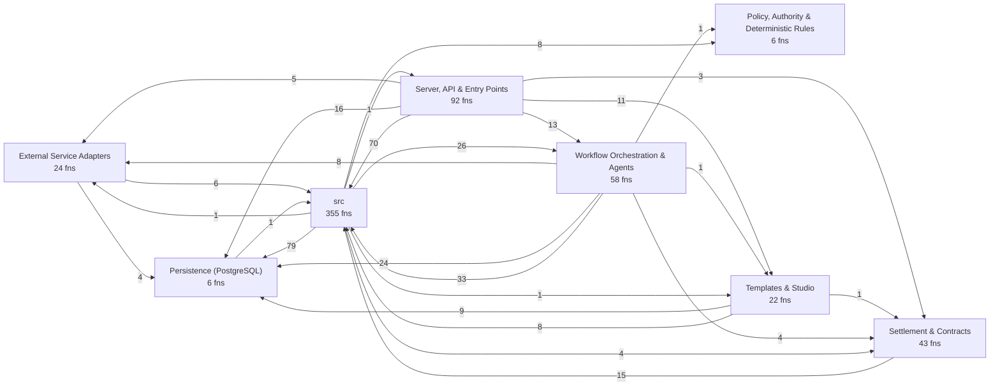
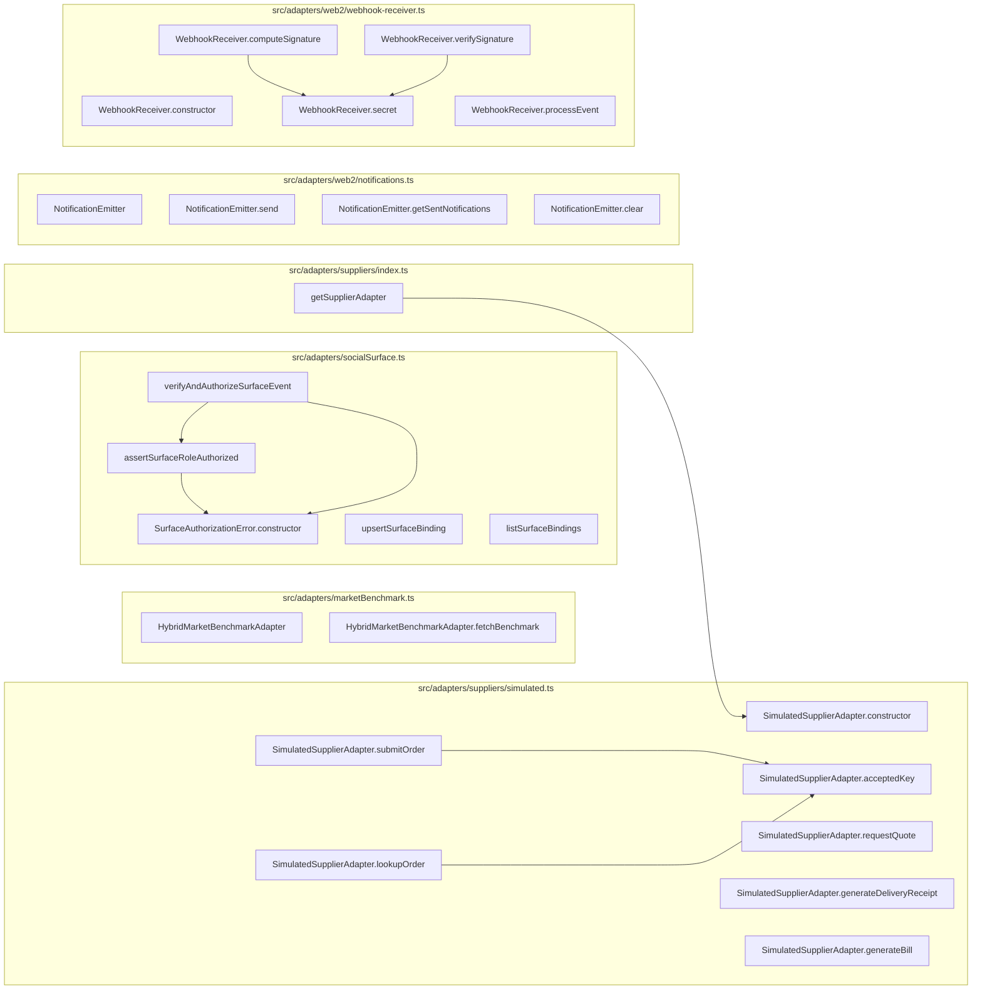
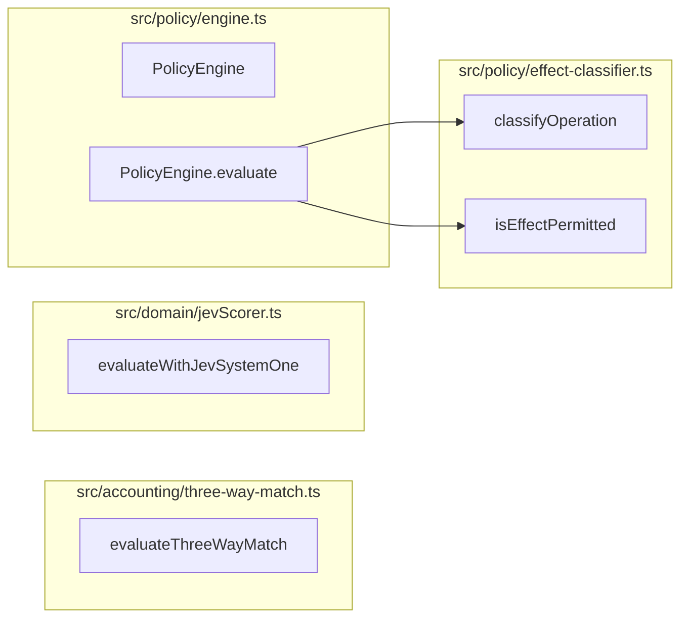
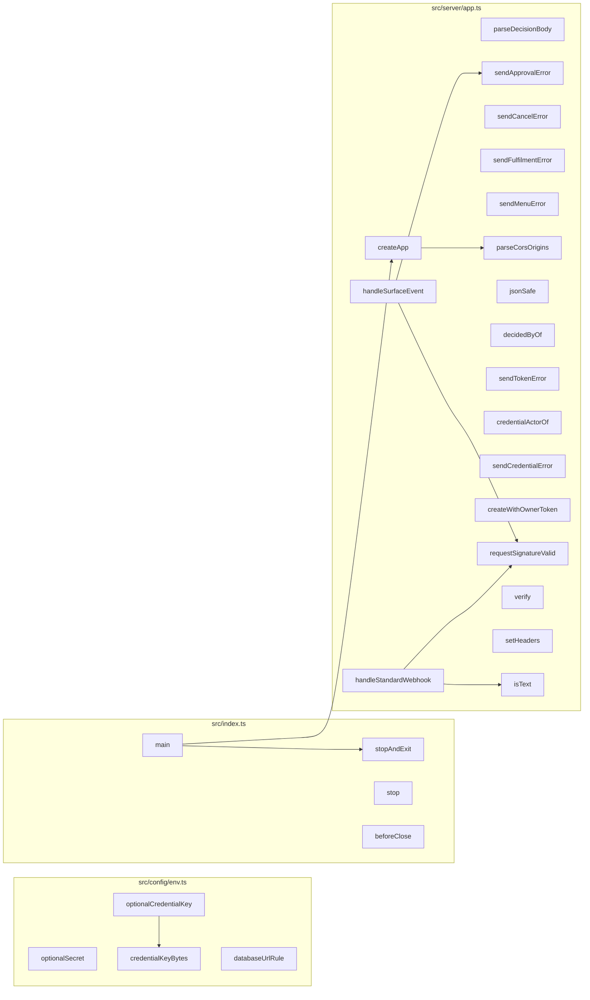
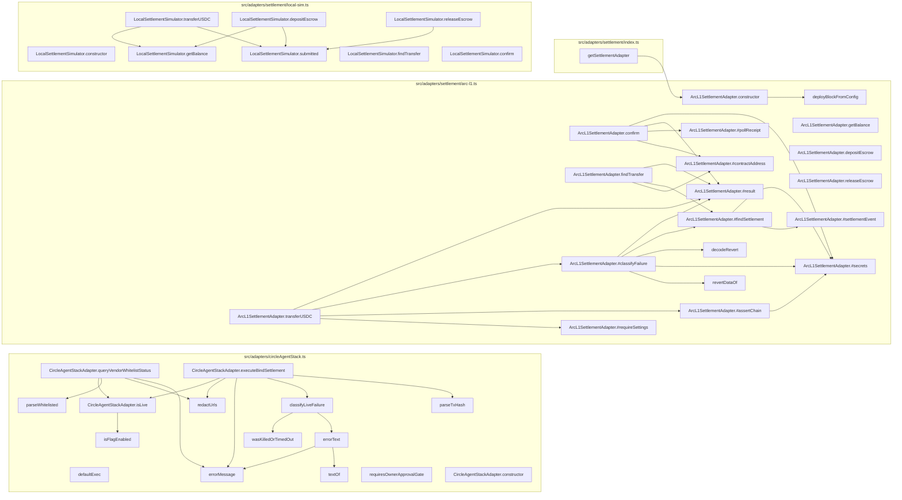
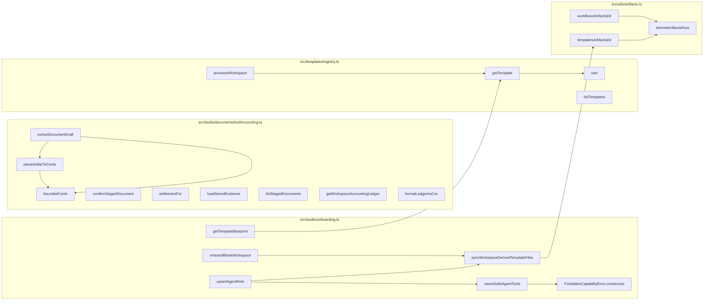
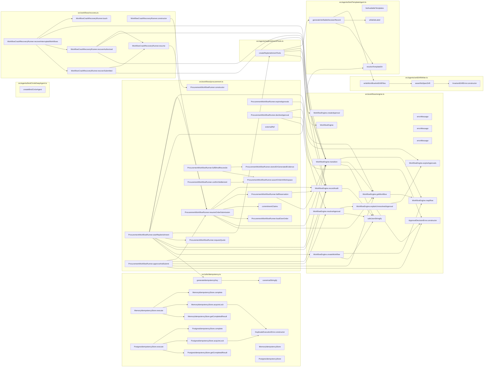

# Codebase map: functions and calls

Generated by `npx tsx scripts/map-functions.ts` from the TypeScript compiler's symbol table. Do not edit by hand.
The browser UI (`src/ui`, plain JavaScript) and the Solidity contract are not included here; see `.ua/knowledge-graph.json` for the contract.

- Functions, methods, handlers and classes: **1188** (606 in production code, 582 in tests)
- Resolved call edges: **2268**
- HTTP routes: **67**

## Layers and cross-layer calls



## HTTP surface: route to what it calls

| Route | Line | Calls directly |
| --- | --- | --- |
| `GET /x` | 161 | SQL or inline logic only |
| `GET /y` | 164 | SQL or inline logic only |
| `GET /health` | 396 | `query` |
| `GET /ready` | 407 | `checkReadiness` |
| `GET /api/templates` | 421 | `jsonSafe`, `listTemplates` |
| `GET /api/templates/:id/blueprint` | 425 | `getTemplateBlueprint` |
| `GET /api/openapi.json` | 435 | `serializeOpenApiDocument`, `buildOpenApiDocument` |
| `GET /api/workspaces` | 441 | `query` |
| `POST /api/workspaces/onboard` | 451 | `createWithOwnerToken`, `onboardBlankWorkspace`, `jsonSafe`, `publicErrorMessage` |
| `POST /api/workspaces` | 466 | `createWithOwnerToken`, `provisionWorkspace`, `jsonSafe`, `publicErrorMessage` |
| `GET /api/workspaces/:id` | 485 | `query`, `getSettlementAdapter`, `ArcL1SettlementAdapter.getBalance`, `LocalSettlementSimulator.getBalance` |
| `PUT /api/workspaces/:id/policy` | 505 | `normalizePaymentAddress`, `query`, `syncWorkspaceDerivedTemplateFiles`, `publicErrorMessage` |
| `GET /api/workspaces/:id/inventory` | 549 | `query` |
| `POST /api/workspaces/:id/inventory` | 558 | `query`, `publicErrorMessage` |
| `POST /api/workspaces/:id/replenish` | 598 | `ProcurementWorkflowRunner.startReplenishment`, `publicErrorMessage` |
| `GET /api/workspaces/:id/approvals` | 614 | `ProcurementWorkflowRunner.expireApprovals`, `query` |
| `POST /api/approvals/:id/approve` | 624 | `ProcurementWorkflowRunner.approveAndSubmit`, `decidedByOf`, `sendApprovalError` |
| `POST /api/approvals/:id/reject` | 635 | `parseDecisionBody`, `ProcurementWorkflowRunner.declineApproval`, `decidedByOf`, `sendApprovalError` |
| `POST /api/approvals/:id/revoke` | 655 | `parseDecisionBody`, `ProcurementWorkflowRunner.declineApproval`, `decidedByOf`, `sendApprovalError` |
| `POST /api/orders/:id/reconcile` | 676 | `ProcurementWorkflowRunner.fulfillAndReconcile`, `publicErrorMessage` |
| `POST /api/orders/:id/confirm-settlement` | 692 | `ProcurementWorkflowRunner.confirmSettlement`, `publicErrorMessage` |
| `GET /api/workspaces/:id/customer-orders` | 709 | `listCustomerOrders`, `sendFulfilmentError` |
| `POST /api/workspaces/:id/customer-orders` | 717 | `sendFulfilmentError`, `acceptCustomerOrder` |
| `GET /api/workspaces/:id/customer-orders/:orderId` | 742 | `getCustomerOrder`, `sendFulfilmentError` |
| `POST /api/workspaces/:id/customer-orders/:orderId/accept` | 752 | `acceptHeldOrder`, `sendFulfilmentError` |
| `POST /api/workspaces/:id/customer-orders/:orderId/cancel` | 760 | `cancelCustomerOrder`, `sendFulfilmentError` |
| `POST /api/workspaces/:id/customer-orders/:orderId/fulfil` | 769 | `fulfilCustomerOrder`, `sendFulfilmentError` |
| `GET /api/workspaces/:id/kitchen-capacity` | 778 | `listKitchenCapacity`, `sendFulfilmentError` |
| `PUT /api/workspaces/:id/kitchen-capacity` | 786 | `sendFulfilmentError`, `setKitchenCapacity` |
| `POST /api/workspaces/:id/feedback` | 808 | `sendMenuError`, `ingestFeedback` |
| `GET /api/workspaces/:id/feedback` | 828 | `listFeedback`, `sendMenuError` |
| `GET /api/workspaces/:id/feedback/summary` | 836 | `sendMenuError`, `summarizeFeedback` |
| `POST /api/workspaces/:id/menu-proposals` | 855 | `sendMenuError`, `proposeMenuChange` |
| `GET /api/workspaces/:id/menu-proposals` | 882 | `listMenuProposals`, `sendMenuError` |
| `POST /api/workspaces/:id/menu-proposals/:proposalId/approve` | 890 | `approveMenuProposal`, `sendMenuError` |
| `POST /api/workspaces/:id/menu-proposals/:proposalId/reject` | 898 | `rejectMenuProposal`, `sendMenuError` |
| `POST /api/workspaces/:id/menu-proposals/:proposalId/cancel` | 906 | `cancelMenuProposal`, `sendMenuError` |
| `POST /api/workspaces/:id/menu-proposals/:proposalId/publish` | 914 | `publishMenuChange`, `sendMenuError` |
| `GET /api/workspaces/:id/menu` | 922 | `listMenu`, `sendMenuError` |
| `GET /api/workspaces/:id/workflows` | 931 | `query` |
| `POST /api/workspaces/:id/workflows/:workflowId/cancel` | 941 | `cancelWorkflow`, `sendCancelError` |
| `GET /api/workspaces/:id/needs-attention` | 962 | `listNeedsAttention` |
| `GET /api/workspaces/:id/orders` | 967 | `query` |
| `GET /api/workspaces/:id/suppliers` | 992 | `query` |
| `POST /api/workspaces/:id/suppliers` | 1001 | `normalizePaymentAddress`, `simulatedPaymentAddress`, `query`, `publicErrorMessage` |
| `GET /api/workspaces/:id/agents` | 1053 | `query` |
| `POST /api/workspaces/:id/agents` | 1066 | `upsertAgentRole`, `publicErrorMessage` |
| `GET /api/workspaces/:id/surfaces` | 1081 | `listSurfaceBindings` |
| `POST /api/workspaces/:id/surfaces` | 1087 | `upsertSurfaceBinding`, `decidedByOf`, `publicErrorMessage` |
| `GET /api/workspaces/:id/documents` | 1098 | `listStagedDocuments` |
| `POST /api/workspaces/:id/documents/extract` | 1104 | `extractDocumentDraft`, `publicErrorMessage` |
| `POST /api/workspaces/:id/documents/:docId/confirm` | 1115 | `confirmStagedDocument`, `decidedByOf`, `publicErrorMessage` |
| `GET /api/workspaces/:id/accounting/ledger` | 1131 | `getWorkspaceAccountingLedger`, `formatLedgerAsCsv` |
| `GET /api/workspaces/:id/audit` | 1147 | `query` |
| `POST /api/workspaces/:id/recover` | 1161 | `WorkflowCrashRecoveryRunner.recoverInterruptedWorkflows`, `publicErrorMessage` |
| `POST /api/workspaces/:id/tokens` | 1171 | `issueToken`, `sendTokenError` |
| `GET /api/workspaces/:id/tokens` | 1185 | `listTokens`, `sendTokenError` |
| `DELETE /api/workspaces/:id/tokens/:tokenId` | 1193 | `revokeToken`, `sendTokenError` |
| `PUT /api/workspaces/:id/agents-paused` | 1205 | `setAgentsPaused`, `decidedByOf` |
| `GET /api/workspaces/:id/webhook-secret` | 1222 | `viewWebhookSecret`, `decidedByOf` |
| `POST /api/workspaces/:id/webhook-secret/rotate` | 1234 | `rotateWebhookSecret`, `decidedByOf` |
| `GET /api/workspaces/:id/connectors` | 1248 | `listConnectors`, `sendCredentialError` |
| `PUT /api/workspaces/:id/connectors/:connectorId` | 1256 | `setCredential`, `credentialActorOf`, `sendCredentialError` |
| `DELETE /api/workspaces/:id/connectors/:connectorId` | 1271 | `revokeCredential`, `credentialActorOf`, `sendCredentialError` |
| `POST /api/workspaces/:id/connectors/:connectorId/verify` | 1281 | `verifyCredential`, `credentialActorOf`, `sendCredentialError` |
| `POST /api/webhooks/incoming` | 1292 | `handleSurfaceEvent`, `handleStandardWebhook` |
| `GET *` | 1481 | SQL or inline logic only |

## External Service Adapters

| Function | File:lines | Kind | Params | Exported | Called by (prod / tests) | Calls |
| --- | --- | --- | --- | --- | --- | --- |
| `HybridMarketBenchmarkAdapter` | src/adapters/marketBenchmark.ts:19-113 | class | 0 | yes | 2 / 1 | 0 |
| `HybridMarketBenchmarkAdapter.fetchBenchmark` | src/adapters/marketBenchmark.ts:20-112 | method | 2 | yes | 2 / 1 | 0 |
| `SurfaceAuthorizationError.constructor` | src/adapters/socialSurface.ts:74-77 | constructor | 1 | yes | 2 / 0 | 0 |
| `assertSurfaceRoleAuthorized` | src/adapters/socialSurface.ts:83-106 | function | 2 | yes | 1 / 1 | 1 |
| `verifyAndAuthorizeSurfaceEvent` | src/adapters/socialSurface.ts:113-135 | function | 1 | yes | 1 / 0 | 3 |
| `upsertSurfaceBinding` | src/adapters/socialSurface.ts:143-190 | function | 3 | yes | 1 / 4 | 2 |
| `listSurfaceBindings` | src/adapters/socialSurface.ts:192-198 | function | 1 | yes | 1 / 0 | 1 |
| `getSupplierAdapter` | src/adapters/suppliers/index.ts:24-34 | function | 1 | yes | 0 / 2 | 1 |
| `SimulatedSupplierAdapter.constructor` | src/adapters/suppliers/simulated.ts:20-25 | constructor | 4 | yes | 2 / 6 | 0 |
| `SimulatedSupplierAdapter.acceptedKey` | src/adapters/suppliers/simulated.ts:27-29 | method | 2 | yes | 2 / 0 | 0 |
| `SimulatedSupplierAdapter.requestQuote` | src/adapters/suppliers/simulated.ts:31-62 | method | 1 | yes | 1 / 5 | 0 |
| `SimulatedSupplierAdapter.submitOrder` | src/adapters/suppliers/simulated.ts:65-80 | method | 1 | yes | 1 / 6 | 1 |
| `SimulatedSupplierAdapter.lookupOrder` | src/adapters/suppliers/simulated.ts:83-87 | method | 1 | yes | 0 / 3 | 1 |
| `SimulatedSupplierAdapter.generateDeliveryReceipt` | src/adapters/suppliers/simulated.ts:89-99 | method | 3 | yes | 1 / 5 | 0 |
| `SimulatedSupplierAdapter.generateBill` | src/adapters/suppliers/simulated.ts:101-114 | method | 5 | yes | 1 / 6 | 0 |
| `NotificationEmitter` | src/adapters/web2/notifications.ts:4-32 | class | 0 | yes | 1 / 0 | 0 |
| `NotificationEmitter.send` | src/adapters/web2/notifications.ts:7-20 | method | 1 | yes | 1 / 0 | 1 |
| `NotificationEmitter.getSentNotifications` | src/adapters/web2/notifications.ts:22-27 | method | 1 | yes | 0 / 2 | 0 |
| `NotificationEmitter.clear` | src/adapters/web2/notifications.ts:29-31 | method | 0 | yes | 0 / 4 | 0 |
| `WebhookReceiver.constructor` | src/adapters/web2/webhook-receiver.ts:27-29 | constructor | 1 | yes | 2 / 0 | 0 |
| `WebhookReceiver.secret` | src/adapters/web2/webhook-receiver.ts:31-35 | method | 0 | yes | 2 / 0 | 1 |
| `WebhookReceiver.computeSignature` | src/adapters/web2/webhook-receiver.ts:38-40 | method | 2 | yes | 0 / 1 | 2 |
| `WebhookReceiver.verifySignature` | src/adapters/web2/webhook-receiver.ts:43-50 | method | 3 | yes | 0 / 1 | 2 |
| `WebhookReceiver.processEvent` | src/adapters/web2/webhook-receiver.ts:56-77 | method | 1 | yes | 1 / 1 | 2 |



## Persistence (PostgreSQL)

| Function | File:lines | Kind | Params | Exported | Called by (prod / tests) | Calls |
| --- | --- | --- | --- | --- | --- | --- |
| `query` | src/db/client.ts:13-18 | function | 2 | yes | 107 / 166 | 0 |
| `getClient` | src/db/client.ts:20-22 | function | 0 | yes | 0 / 1 | 0 |
| `withTransaction` | src/db/client.ts:24-39 | function | 1 | yes | 24 / 0 | 0 |
| `closePool` | src/db/client.ts:41-43 | function | 0 | yes | 0 / 42 | 0 |
| `runMigrations` | src/db/migrate.ts:24-49 | function | 1 | yes | 2 / 43 | 1 |
| `isDirectRun` | src/db/migrate.ts:55-57 | function | 2 | yes | 1 / 1 | 0 |

## Policy, Authority & Deterministic Rules

| Function | File:lines | Kind | Params | Exported | Called by (prod / tests) | Calls |
| --- | --- | --- | --- | --- | --- | --- |
| `evaluateThreeWayMatch` | src/accounting/three-way-match.ts:19-100 | function | 3 | yes | 1 / 1 | 0 |
| `evaluateWithJevSystemOne` | src/domain/jevScorer.ts:50-241 | function | 1 | yes | 1 / 1 | 0 |
| `classifyOperation` | src/policy/effect-classifier.ts:45-54 | function | 1 | yes | 2 / 2 | 0 |
| `isEffectPermitted` | src/policy/effect-classifier.ts:59-64 | function | 2 | yes | 1 / 0 | 0 |
| `PolicyEngine` | src/policy/engine.ts:14-60 | class | 0 | yes | 3 / 1 | 0 |
| `PolicyEngine.evaluate` | src/policy/engine.ts:15-59 | method | 1 | yes | 3 / 1 | 2 |



## Server, API & Entry Points

| Function | File:lines | Kind | Params | Exported | Called by (prod / tests) | Calls |
| --- | --- | --- | --- | --- | --- | --- |
| `optionalSecret` | src/config/env.ts:9-14 | function | 1 | no | 1 / 0 | 0 |
| `credentialKeyBytes` | src/config/env.ts:20-24 | function | 1 | yes | 2 / 0 | 0 |
| `optionalCredentialKey` | src/config/env.ts:27-35 | function | 1 | no | 1 / 0 | 1 |
| `databaseUrlRule` | src/config/env.ts:100-104 | function | 1 | yes | 1 / 1 | 0 |
| `stopAndExit` | src/index.ts:20-31 | function | 2 | no | 1 / 0 | 0 |
| `main` | src/index.ts:33-86 | function | 0 | no | 1 / 0 | 6 |
| `stop` | src/index.ts:66-66 | arrow | 0 | no | 0 / 0 | 0 |
| `beforeClose` | src/index.ts:71-73 | arrow | 0 | no | 0 / 0 | 1 |
| `parseDecisionBody` | src/server/app.ts:126-133 | function | 2 | no | 2 / 0 | 0 |
| `sendApprovalError` | src/server/app.ts:136-146 | function | 2 | no | 4 / 0 | 1 |
| `sendCancelError` | src/server/app.ts:149-160 | function | 2 | no | 1 / 0 | 0 |
| `sendFulfilmentError` | src/server/app.ts:163-172 | function | 2 | no | 8 / 0 | 0 |
| `sendMenuError` | src/server/app.ts:178-194 | function | 2 | no | 10 / 0 | 0 |
| `parseCorsOrigins` | src/server/app.ts:199-204 | function | 1 | yes | 1 / 0 | 0 |
| `jsonSafe` | src/server/app.ts:210-212 | function | 1 | no | 3 / 0 | 0 |
| `decidedByOf` | src/server/app.ts:215-217 | function | 1 | no | 8 / 0 | 0 |
| `sendTokenError` | src/server/app.ts:220-226 | function | 2 | no | 3 / 0 | 0 |
| `credentialActorOf` | src/server/app.ts:229-231 | function | 1 | no | 3 / 0 | 0 |
| `sendCredentialError` | src/server/app.ts:234-245 | function | 2 | no | 4 / 0 | 1 |
| `createWithOwnerToken` | src/server/app.ts:257-277 | function | 2 | no | 2 / 0 | 3 |
| `requestSignatureValid` | src/server/app.ts:319-327 | function | 2 | no | 2 / 0 | 1 |
| `createApp` | src/server/app.ts:329-1492 | function | 1 | yes | 1 / 22 | 12 |
| `verify` | src/server/app.ts:373-375 | arrow | 3 | no | 0 / 0 | 0 |
| `setHeaders` | src/server/app.ts:387-391 | arrow | 1 | no | 0 / 0 | 0 |
| `handleSurfaceEvent` | src/server/app.ts:1306-1444 | function | 3 | no | 1 / 0 | 11 |
| `handleStandardWebhook` | src/server/app.ts:1446-1473 | function | 2 | no | 1 / 0 | 3 |
| `isText` | src/server/app.ts:1458-1459 | arrow | 1 | no | 1 / 0 | 0 |



## Settlement & Contracts

| Function | File:lines | Kind | Params | Exported | Called by (prod / tests) | Calls |
| --- | --- | --- | --- | --- | --- | --- |
| `defaultExec` | src/adapters/circleAgentStack.ts:70-73 | arrow | 3 | no | 0 / 0 | 0 |
| `requiresOwnerApprovalGate` | src/adapters/circleAgentStack.ts:75-78 | function | 1 | yes | 0 / 1 | 0 |
| `isFlagEnabled` | src/adapters/circleAgentStack.ts:83-86 | function | 1 | yes | 1 / 1 | 0 |
| `redactUrls` | src/adapters/circleAgentStack.ts:88-90 | function | 1 | no | 2 / 0 | 0 |
| `errorMessage` | src/adapters/circleAgentStack.ts:92-94 | function | 1 | no | 3 / 0 | 0 |
| `textOf` | src/adapters/circleAgentStack.ts:96-100 | function | 1 | no | 1 / 0 | 0 |
| `errorText` | src/adapters/circleAgentStack.ts:103-112 | function | 1 | no | 1 / 0 | 2 |
| `wasKilledOrTimedOut` | src/adapters/circleAgentStack.ts:115-119 | function | 1 | no | 1 / 0 | 0 |
| `classifyLiveFailure` | src/adapters/circleAgentStack.ts:121-124 | function | 1 | no | 1 / 0 | 2 |
| `parseWhitelisted` | src/adapters/circleAgentStack.ts:126-134 | function | 1 | no | 1 / 0 | 0 |
| `parseTxHash` | src/adapters/circleAgentStack.ts:137-146 | function | 1 | no | 1 / 0 | 0 |
| `CircleAgentStackAdapter.constructor` | src/adapters/circleAgentStack.ts:153-157 | constructor | 2 | yes | 1 / 2 | 0 |
| `CircleAgentStackAdapter.isLive` | src/adapters/circleAgentStack.ts:160-162 | method | 0 | yes | 2 / 0 | 1 |
| `CircleAgentStackAdapter.queryVendorWhitelistStatus` | src/adapters/circleAgentStack.ts:167-209 | method | 1 | yes | 1 / 2 | 4 |
| `CircleAgentStackAdapter.executeBindSettlement` | src/adapters/circleAgentStack.ts:215-276 | method | 1 | yes | 1 / 2 | 5 |
| `revertDataOf` | src/adapters/settlement/arc-l1.ts:135-143 | function | 1 | no | 1 / 0 | 0 |
| `decodeRevert` | src/adapters/settlement/arc-l1.ts:145-152 | function | 1 | no | 1 / 0 | 0 |
| `deployBlockFromConfig` | src/adapters/settlement/arc-l1.ts:154-156 | function | 0 | no | 1 / 0 | 0 |
| `ArcL1SettlementAdapter.constructor` | src/adapters/settlement/arc-l1.ts:180-196 | constructor | 1 | yes | 1 / 5 | 1 |
| `ArcL1SettlementAdapter.getBalance` | src/adapters/settlement/arc-l1.ts:198-212 | method | 1 | yes | 1 / 2 | 0 |
| `ArcL1SettlementAdapter.transferUSDC` | src/adapters/settlement/arc-l1.ts:218-258 | method | 1 | yes | 1 / 3 | 6 |
| `ArcL1SettlementAdapter.confirm` | src/adapters/settlement/arc-l1.ts:265-288 | method | 1 | yes | 1 / 1 | 6 |
| `ArcL1SettlementAdapter.findTransfer` | src/adapters/settlement/arc-l1.ts:299-307 | method | 1 | yes | 0 / 1 | 4 |
| `ArcL1SettlementAdapter.depositEscrow` | src/adapters/settlement/arc-l1.ts:309-311 | method | 2 | yes | 0 / 2 | 1 |
| `ArcL1SettlementAdapter.releaseEscrow` | src/adapters/settlement/arc-l1.ts:313-315 | method | 2 | yes | 0 / 2 | 1 |
| `ArcL1SettlementAdapter.#result` | src/adapters/settlement/arc-l1.ts:317-328 | method | 3 | yes | 4 / 0 | 0 |
| `ArcL1SettlementAdapter.#secrets` | src/adapters/settlement/arc-l1.ts:331-333 | method | 0 | yes | 4 / 0 | 0 |
| `ArcL1SettlementAdapter.#classifyFailure` | src/adapters/settlement/arc-l1.ts:339-355 | method | 4 | yes | 1 / 0 | 7 |
| `ArcL1SettlementAdapter.#contractAddress` | src/adapters/settlement/arc-l1.ts:357-363 | method | 0 | yes | 2 / 0 | 1 |
| `ArcL1SettlementAdapter.#requireSettings` | src/adapters/settlement/arc-l1.ts:366-385 | method | 0 | yes | 1 / 0 | 1 |
| `ArcL1SettlementAdapter.#assertChain` | src/adapters/settlement/arc-l1.ts:388-398 | method | 0 | yes | 1 / 0 | 3 |
| `ArcL1SettlementAdapter.#settlementEvent` | src/adapters/settlement/arc-l1.ts:400-404 | method | 0 | yes | 1 / 0 | 0 |
| `ArcL1SettlementAdapter.#findSettlement` | src/adapters/settlement/arc-l1.ts:410-428 | method | 2 | yes | 2 / 0 | 3 |
| `ArcL1SettlementAdapter.#pollReceipt` | src/adapters/settlement/arc-l1.ts:430-443 | method | 1 | yes | 1 / 0 | 0 |
| `getSettlementAdapter` | src/adapters/settlement/index.ts:14-27 | function | 1 | yes | 3 / 0 | 1 |
| `LocalSettlementSimulator.constructor` | src/adapters/settlement/local-sim.ts:24-27 | constructor | 0 | yes | 1 / 1 | 0 |
| `LocalSettlementSimulator.getBalance` | src/adapters/settlement/local-sim.ts:29-31 | method | 1 | yes | 3 / 1 | 0 |
| `LocalSettlementSimulator.transferUSDC` | src/adapters/settlement/local-sim.ts:33-56 | method | 1 | yes | 1 / 1 | 2 |
| `LocalSettlementSimulator.findTransfer` | src/adapters/settlement/local-sim.ts:59-61 | method | 1 | yes | 0 / 1 | 0 |
| `LocalSettlementSimulator.confirm` | src/adapters/settlement/local-sim.ts:63-66 | method | 1 | yes | 1 / 1 | 1 |
| `LocalSettlementSimulator.depositEscrow` | src/adapters/settlement/local-sim.ts:68-83 | method | 2 | yes | 0 / 0 | 2 |
| `LocalSettlementSimulator.releaseEscrow` | src/adapters/settlement/local-sim.ts:85-100 | method | 2 | yes | 0 / 0 | 1 |
| `LocalSettlementSimulator.submitted` | src/adapters/settlement/local-sim.ts:102-110 | method | 0 | yes | 3 / 0 | 0 |



## Templates & Studio

| Function | File:lines | Kind | Params | Exported | Called by (prod / tests) | Calls |
| --- | --- | --- | --- | --- | --- | --- |
| `parseDollarToCents` | src/studio/documentsAndAccounting.ts:33-40 | function | 1 | no | 1 / 0 | 1 |
| `boundedCents` | src/studio/documentsAndAccounting.ts:43-45 | function | 1 | no | 2 / 0 | 0 |
| `extractDocumentDraft` | src/studio/documentsAndAccounting.ts:51-230 | function | 3 | yes | 1 / 1 | 4 |
| `confirmStagedDocument` | src/studio/documentsAndAccounting.ts:237-484 | function | 4 | yes | 1 / 2 | 3 |
| `settlementFor` | src/studio/documentsAndAccounting.ts:429-429 | arrow | 1 | no | 0 / 0 | 1 |
| `loadStoredEvidence` | src/studio/documentsAndAccounting.ts:433-457 | arrow | 1 | no | 0 / 0 | 1 |
| `listStagedDocuments` | src/studio/documentsAndAccounting.ts:486-492 | function | 1 | yes | 1 / 0 | 1 |
| `getWorkspaceAccountingLedger` | src/studio/documentsAndAccounting.ts:494-517 | function | 1 | yes | 1 / 0 | 2 |
| `formatLedgerAsCsv` | src/studio/documentsAndAccounting.ts:519-554 | function | 1 | yes | 1 / 0 | 0 |
| `ForbiddenCapabilityError.constructor` | src/studio/onboarding.ts:31-34 | constructor | 1 | yes | 1 / 0 | 0 |
| `assertSafeAgentTools` | src/studio/onboarding.ts:115-129 | function | 1 | yes | 1 / 0 | 1 |
| `getTemplateBlueprint` | src/studio/onboarding.ts:134-174 | function | 1 | yes | 1 / 0 | 1 |
| `onboardBlankWorkspace` | src/studio/onboarding.ts:180-326 | function | 2 | yes | 1 / 0 | 4 |
| `upsertAgentRole` | src/studio/onboarding.ts:331-403 | function | 3 | yes | 1 / 0 | 4 |
| `syncWorkspaceDerivedTemplateFiles` | src/studio/onboarding.ts:409-493 | function | 1 | yes | 3 / 0 | 2 |
| `getTemplate` | src/templates/registry.ts:12-19 | function | 1 | yes | 2 / 1 | 1 |
| `own` | src/templates/registry.ts:14-15 | arrow | 1 | no | 1 / 0 | 0 |
| `listTemplates` | src/templates/registry.ts:21-23 | function | 0 | yes | 1 / 1 | 0 |
| `provisionWorkspace` | src/templates/registry.ts:41-182 | function | 4 | yes | 2 / 37 | 3 |
| `derivedArtifactsRoot` | src/utils/artifacts.ts:12-20 | function | 0 | yes | 2 / 0 | 0 |
| `workflowsArtifactsDir` | src/utils/artifacts.ts:22-24 | function | 0 | yes | 1 / 0 | 1 |
| `templatesArtifactsDir` | src/utils/artifacts.ts:26-28 | function | 0 | yes | 1 / 0 | 1 |



## Workflow Orchestration & Agents

| Function | File:lines | Kind | Params | Exported | Called by (prod / tests) | Calls |
| --- | --- | --- | --- | --- | --- | --- |
| `InvariantDriftError.constructor` | src/agents/antiDriftWriter.ts:33-36 | constructor | 1 | yes | 1 / 0 | 0 |
| `assertNoSpecDrift` | src/agents/antiDriftWriter.ts:42-78 | function | 1 | yes | 1 / 1 | 1 |
| `writeWorkflowAntiDriftFiles` | src/agents/antiDriftWriter.ts:91-241 | function | 2 | yes | 2 / 1 | 2 |
| `createBindCircleAgent` | src/agents/bindCircleDeepAgent.ts:15-108 | function | 1 | yes | 0 / 0 | 5 |
| `listAvailableTemplates` | src/agents/bindTemplateAgent.ts:26-44 | function | 0 | yes | 0 / 1 | 0 |
| `resolveTemplateDir` | src/agents/bindTemplateAgent.ts:49-60 | function | 1 | yes | 2 / 1 | 0 |
| `whitelistLabel` | src/agents/bindTemplateAgent.ts:106-110 | function | 1 | no | 1 / 0 | 0 |
| `generateVerifiableDecisionRecord` | src/agents/bindTemplateAgent.ts:114-273 | function | 1 | yes | 1 / 2 | 5 |
| `createReplenishmentTools` | src/agents/replenishmentTools.ts:25-684 | function | 1 | yes | 1 / 8 | 15 |
| `DuplicateExecutionError.constructor` | src/utils/idempotency.ts:5-8 | constructor | 1 | yes | 2 / 0 | 0 |
| `canonicalStringify` | src/utils/idempotency.ts:15-24 | function | 1 | yes | 2 / 0 | 0 |
| `generateIdempotencyKey` | src/utils/idempotency.ts:29-40 | function | 3 | yes | 1 / 2 | 1 |
| `MemoryIdempotencyStore` | src/utils/idempotency.ts:50-95 | class | 0 | yes | 0 / 1 | 0 |
| `MemoryIdempotencyStore.acquireLock` | src/utils/idempotency.ts:53-60 | method | 3 | yes | 1 / 1 | 1 |
| `MemoryIdempotencyStore.complete` | src/utils/idempotency.ts:62-68 | method | 2 | yes | 1 / 0 | 0 |
| `MemoryIdempotencyStore.getCompletedResult` | src/utils/idempotency.ts:70-76 | method | 1 | yes | 1 / 0 | 0 |
| `MemoryIdempotencyStore.execute` | src/utils/idempotency.ts:78-94 | method | 4 | yes | 0 / 1 | 3 |
| `PostgresIdempotencyStore` | src/utils/idempotency.ts:98-157 | class | 0 | yes | 0 / 0 | 0 |
| `PostgresIdempotencyStore.acquireLock` | src/utils/idempotency.ts:99-119 | method | 3 | yes | 1 / 0 | 2 |
| `PostgresIdempotencyStore.complete` | src/utils/idempotency.ts:121-128 | method | 2 | yes | 1 / 0 | 1 |
| `PostgresIdempotencyStore.getCompletedResult` | src/utils/idempotency.ts:130-139 | method | 1 | yes | 1 / 0 | 1 |
| `PostgresIdempotencyStore.execute` | src/utils/idempotency.ts:141-156 | method | 4 | yes | 0 / 0 | 4 |
| `safeJsonStringify` | src/workflows/engine.ts:8-12 | function | 1 | no | 4 / 0 | 0 |
| `errorMessage` | src/workflows/engine.ts:20-20 | arrow | 0 | no | 0 / 0 | 0 |
| `errorMessage` | src/workflows/engine.ts:23-23 | arrow | 1 | no | 0 / 0 | 0 |
| `errorMessage` | src/workflows/engine.ts:27-27 | arrow | 1 | no | 0 / 0 | 0 |
| `ApprovalDecisionError.constructor` | src/workflows/engine.ts:38-43 | constructor | 3 | yes | 3 / 0 | 0 |
| `WorkflowEngine` | src/workflows/engine.ts:46-290 | class | 0 | yes | 6 / 14 | 0 |
| `WorkflowEngine.mapRow` | src/workflows/engine.ts:47-60 | method | 1 | yes | 3 / 0 | 0 |
| `WorkflowEngine.createWorkflow` | src/workflows/engine.ts:65-80 | method | 5 | yes | 1 / 17 | 3 |
| `WorkflowEngine.getWorkflow` | src/workflows/engine.ts:85-91 | method | 1 | yes | 5 / 8 | 2 |
| `WorkflowEngine.transition` | src/workflows/engine.ts:96-122 | method | 2 | yes | 8 / 12 | 4 |
| `WorkflowEngine.recordAudit` | src/workflows/engine.ts:127-158 | method | 9 | yes | 14 / 0 | 4 |
| `WorkflowEngine.createApproval` | src/workflows/engine.ts:163-180 | method | 8 | yes | 1 / 9 | 1 |
| `WorkflowEngine.resolveApproval` | src/workflows/engine.ts:190-227 | method | 4 | yes | 2 / 1 | 3 |
| `WorkflowEngine.expireApprovals` | src/workflows/engine.ts:237-266 | method | 1 | yes | 3 / 1 | 1 |
| `WorkflowEngine.explainUnresolvedApproval` | src/workflows/engine.ts:272-289 | method | 1 | yes | 1 / 0 | 3 |
| `commitmentClaims` | src/workflows/procurement.ts:53-63 | function | 3 | no | 1 / 0 | 0 |
| `ProcurementWorkflowRunner.constructor` | src/workflows/procurement.ts:73-78 | constructor | 1 | yes | 6 / 17 | 2 |
| `ProcurementWorkflowRunner.startReplenishment` | src/workflows/procurement.ts:83-340 | method | 4 | yes | 4 / 17 | 12 |
| `ProcurementWorkflowRunner.approveAndSubmit` | src/workflows/procurement.ts:345-408 | method | 3 | yes | 2 / 3 | 8 |
| `ProcurementWorkflowRunner.expireApprovals` | src/workflows/procurement.ts:413-415 | method | 1 | yes | 1 / 0 | 1 |
| `ProcurementWorkflowRunner.declineApproval` | src/workflows/procurement.ts:421-445 | method | 5 | yes | 4 / 0 | 4 |
| `ProcurementWorkflowRunner.requestQuote` | src/workflows/procurement.ts:452-508 | method | 1 | yes | 1 / 1 | 5 |
| `ProcurementWorkflowRunner.resumeOrderSubmission` | src/workflows/procurement.ts:518-707 | method | 1 | yes | 3 / 1 | 15 |
| `externalRef` | src/workflows/procurement.ts:623-623 | arrow | 1 | no | 0 / 0 | 0 |
| `ProcurementWorkflowRunner.loadOwnOrder` | src/workflows/procurement.ts:710-717 | method | 2 | yes | 1 / 0 | 1 |
| `ProcurementWorkflowRunner.failReservation` | src/workflows/procurement.ts:720-745 | method | 3 | yes | 1 / 0 | 3 |
| `ProcurementWorkflowRunner.fulfillAndReconcile` | src/workflows/procurement.ts:752-758 | method | 2 | yes | 1 / 10 | 3 |
| `ProcurementWorkflowRunner.confirmSettlement` | src/workflows/procurement.ts:764-767 | method | 2 | yes | 2 / 2 | 2 |
| `ProcurementWorkflowRunner.assertOrderInWorkspace` | src/workflows/procurement.ts:770-775 | method | 2 | yes | 2 / 0 | 2 |
| `ProcurementWorkflowRunner.storedOrGeneratedEvidence` | src/workflows/procurement.ts:777-861 | method | 1 | yes | 1 / 0 | 3 |
| `WorkflowCrashRecoveryRunner.constructor` | src/workflows/recovery.ts:34-36 | constructor | 1 | yes | 2 / 3 | 1 |
| `WorkflowCrashRecoveryRunner.recoverInterruptedWorkflows` | src/workflows/recovery.ts:48-96 | method | 1 | yes | 2 / 3 | 5 |
| `WorkflowCrashRecoveryRunner.touch` | src/workflows/recovery.ts:99-105 | method | 1 | yes | 1 / 0 | 1 |
| `WorkflowCrashRecoveryRunner.recoverSubmitted` | src/workflows/recovery.ts:107-141 | method | 2 | yes | 1 / 0 | 3 |
| `WorkflowCrashRecoveryRunner.recoverAuthorized` | src/workflows/recovery.ts:143-187 | method | 2 | yes | 1 / 0 | 6 |
| `WorkflowCrashRecoveryRunner.resume` | src/workflows/recovery.ts:189-197 | method | 3 | yes | 2 / 0 | 1 |



## src

| Function | File:lines | Kind | Params | Exported | Called by (prod / tests) | Calls |
| --- | --- | --- | --- | --- | --- | --- |
| `JournalConflictError.constructor` | src/accounting/journal.ts:8-11 | constructor | 1 | yes | 1 / 0 | 0 |
| `recordIdempotentJournalEntry` | src/accounting/journal.ts:20-59 | function | 1 | yes | 2 / 1 | 2 |
| `SettlementNotConfiguredError.constructor` | src/adapters/settlement/errors.ts:12-16 | constructor | 1 | yes | 2 / 0 | 0 |
| `SettlementChainMismatchError.constructor` | src/adapters/settlement/errors.ts:24-29 | constructor | 2 | yes | 1 / 0 | 0 |
| `SettlementPayerMismatchError.constructor` | src/adapters/settlement/errors.ts:34-37 | constructor | 0 | yes | 1 / 0 | 0 |
| `SettlementRejectedError.constructor` | src/adapters/settlement/errors.ts:45-50 | constructor | 2 | yes | 4 / 1 | 0 |
| `SettlementNotSupportedError.constructor` | src/adapters/settlement/errors.ts:55-58 | constructor | 1 | yes | 2 / 0 | 0 |
| `SettlementTransportError.constructor` | src/adapters/settlement/errors.ts:68-72 | constructor | 2 | yes | 2 / 1 | 0 |
| `redactSecrets` | src/adapters/settlement/errors.ts:79-81 | function | 2 | yes | 1 / 1 | 2 |
| `transportErrorFrom` | src/adapters/settlement/errors.ts:84-93 | function | 3 | yes | 4 / 0 | 2 |
| `md5Hex` | src/adapters/suppliers/payment-address.ts:4-6 | function | 1 | no | 1 / 0 | 0 |
| `simulatedPaymentAddress` | src/adapters/suppliers/payment-address.ts:14-16 | function | 1 | yes | 4 / 3 | 1 |
| `normalizePaymentAddress` | src/adapters/suppliers/payment-address.ts:22-26 | function | 1 | yes | 2 / 1 | 0 |
| `SupplierResponseInvalidError.constructor` | src/adapters/suppliers/validate.ts:47-51 | constructor | 1 | yes | 2 / 1 | 0 |
| `isBoundedAmount` | src/adapters/suppliers/validate.ts:54-56 | function | 1 | no | 1 / 0 | 0 |
| `isValidDate` | src/adapters/suppliers/validate.ts:58-60 | function | 1 | no | 1 / 0 | 0 |
| `validateQuoteResponse` | src/adapters/suppliers/validate.ts:67-105 | function | 3 | yes | 1 / 2 | 2 |
| `validateOrderResponse` | src/adapters/suppliers/validate.ts:111-124 | function | 2 | yes | 1 / 1 | 0 |
| `classifyRequestEvidence` | src/agents/evidence-classification.ts:12-23 | function | 1 | yes | 1 / 1 | 0 |
| `positiveInteger` | src/api/event-routes.ts:69-73 | function | 3 | no | 1 / 0 | 0 |
| `resolveEventsOptions` | src/api/event-routes.ts:76-87 | function | 1 | yes | 1 / 0 | 1 |
| `eventFrame` | src/api/event-routes.ts:90-93 | function | 1 | yes | 1 / 0 | 0 |
| `requestedCursor` | src/api/event-routes.ts:96-103 | function | 1 | no | 1 / 0 | 2 |
| `sendInvalidCursor` | src/api/event-routes.ts:105-107 | function | 1 | no | 2 / 0 | 0 |
| `tokenStillActive` | src/api/event-routes.ts:110-113 | function | 1 | no | 1 / 0 | 1 |
| `eventStreamHandler` | src/api/event-routes.ts:116-252 | function | 1 | yes | 1 / 0 | 6 |
| `close` | src/api/event-routes.ts:129-129 | arrow | 1 | no | 0 / 0 | 1 |
| `end` | src/api/event-routes.ts:150-162 | function | 1 | no | 4 / 0 | 0 |
| `waitFor` | src/api/event-routes.ts:187-200 | arrow | 1 | no | 1 / 0 | 0 |
| `done` | src/api/event-routes.ts:195-199 | function | 0 | no | 0 / 0 | 0 |
| `send` | src/api/event-routes.ts:203-208 | arrow | 1 | no | 1 / 0 | 2 |
| `run` | src/api/event-routes.ts:210-248 | arrow | 0 | no | 1 / 0 | 7 |
| `eventPollHandler` | src/api/event-routes.ts:255-285 | function | 0 | yes | 1 / 0 | 5 |
| `publishCount` | src/api/event-streams.ts:30-32 | function | 0 | no | 2 / 0 | 1 |
| `claimStream` | src/api/event-streams.ts:38-66 | function | 2 | yes | 1 / 0 | 2 |
| `release` | src/api/event-streams.ts:59-64 | arrow | 0 | no | 0 / 0 | 1 |
| `countOpenStreams` | src/api/event-streams.ts:69-71 | function | 0 | yes | 0 / 2 | 0 |
| `countOpenStreamsFor` | src/api/event-streams.ts:74-82 | function | 1 | yes | 0 / 0 | 0 |
| `closeAllEventStreams` | src/api/event-streams.ts:88-98 | function | 1 | yes | 1 / 2 | 0 |
| `writeWithBackpressure` | src/api/event-streams.ts:114-134 | function | 3 | yes | 1 / 1 | 1 |
| `finish` | src/api/event-streams.ts:122-127 | arrow | 1 | no | 3 / 0 | 0 |
| `onDrain` | src/api/event-streams.ts:128-128 | arrow | 0 | no | 0 / 0 | 1 |
| `onClose` | src/api/event-streams.ts:129-129 | arrow | 0 | no | 0 / 0 | 1 |
| `parseCursor` | src/api/events.ts:51-59 | function | 1 | yes | 3 / 1 | 0 |
| `formatCursor` | src/api/events.ts:62-64 | function | 2 | yes | 5 / 1 | 0 |
| `allowedValue` | src/api/events.ts:94-102 | function | 1 | no | 1 / 0 | 0 |
| `eventData` | src/api/events.ts:108-117 | function | 2 | yes | 1 / 1 | 2 |
| `isVisibleToRole` | src/api/events.ts:120-123 | function | 2 | yes | 2 / 1 | 0 |
| `mapAuditRow` | src/api/events.ts:126-138 | function | 1 | yes | 0 / 1 | 3 |
| `assertLimit` | src/api/events.ts:164-168 | function | 1 | no | 2 / 0 | 0 |
| `cursorOf` | src/api/events.ts:170-172 | function | 1 | no | 3 / 0 | 1 |
| `pageOf` | src/api/events.ts:174-187 | function | 4 | no | 1 / 0 | 2 |
| `readEvents` | src/api/events.ts:193-210 | function | 4 | yes | 2 / 0 | 5 |
| `readLatestEvents` | src/api/events.ts:216-233 | function | 3 | yes | 1 / 0 | 4 |
| `latestCursor` | src/api/events.ts:239-248 | function | 1 | yes | 1 / 0 | 2 |
| `toOpenApiPath` | src/api/openapi.ts:37-39 | function | 1 | yes | 1 / 0 | 0 |
| `jsonSchema` | src/api/openapi.ts:47-57 | function | 1 | no | 3 / 0 | 0 |
| `schemaOrRef` | src/api/openapi.ts:59-62 | function | 1 | no | 2 / 0 | 1 |
| `queryParameters` | src/api/openapi.ts:64-72 | function | 1 | no | 1 / 0 | 1 |
| `responsesOf` | src/api/openapi.ts:74-90 | function | 1 | no | 1 / 0 | 1 |
| `operationOf` | src/api/openapi.ts:92-117 | function | 1 | no | 1 / 0 | 3 |
| `sortKeysDeep` | src/api/openapi.ts:120-130 | function | 1 | yes | 1 / 0 | 0 |
| `buildOpenApiDocument` | src/api/openapi.ts:136-170 | function | 2 | yes | 1 / 2 | 4 |
| `serializeOpenApiDocument` | src/api/openapi.ts:173-175 | function | 1 | yes | 1 / 2 | 0 |
| `err` | src/api/registry.ts:125-125 | arrow | 1 | no | 2 / 0 | 0 |
| `ok` | src/api/registry.ts:126-126 | arrow | 2 | no | 1 / 0 | 0 |
| `list` | src/api/registry.ts:127-127 | arrow | 1 | no | 1 / 0 | 0 |
| `withGenericErrors` | src/api/registry.ts:136-159 | function | 1 | no | 1 / 0 | 1 |
| `bearerToken` | src/auth/middleware.ts:19-24 | function | 1 | no | 1 / 0 | 0 |
| `authenticate` | src/auth/middleware.ts:30-49 | function | 3 | yes | 0 / 0 | 2 |
| `scopeToWorkspace` | src/auth/middleware.ts:55-65 | function | 3 | yes | 0 / 0 | 0 |
| `requireRole` | src/auth/middleware.ts:68-80 | function | 1 | yes | 1 / 0 | 0 |
| `TokenError.constructor` | src/auth/tokens.ts:55-59 | constructor | 2 | yes | 3 / 0 | 0 |
| `generateToken` | src/auth/tokens.ts:62-64 | function | 0 | yes | 1 / 1 | 0 |
| `hashToken` | src/auth/tokens.ts:66-68 | function | 1 | yes | 3 / 1 | 0 |
| `isWellFormedToken` | src/auth/tokens.ts:70-72 | function | 1 | yes | 2 / 0 | 0 |
| `validateIssue` | src/auth/tokens.ts:74-83 | function | 2 | no | 2 / 0 | 1 |
| `writeTokenAudit` | src/auth/tokens.ts:85-97 | function | 5 | no | 2 / 0 | 1 |
| `issueToken` | src/auth/tokens.ts:103-125 | function | 4 | yes | 2 / 23 | 6 |
| `resolveToken` | src/auth/tokens.ts:131-146 | function | 1 | yes | 1 / 1 | 3 |
| `revokeToken` | src/auth/tokens.ts:153-191 | function | 3 | yes | 1 / 1 | 3 |
| `listTokens` | src/auth/tokens.ts:194-207 | function | 1 | yes | 1 / 0 | 1 |
| `ensureSecretOwnerToken` | src/auth/tokens.ts:214-227 | function | 3 | yes | 1 / 0 | 6 |
| `CredentialStoreDisabledError.constructor` | src/credentials/crypto.ts:16-19 | constructor | 0 | yes | 1 / 0 | 0 |
| `CredentialDecryptError.constructor` | src/credentials/crypto.ts:24-27 | constructor | 1 | yes | 1 / 0 | 0 |
| `keyIdOf` | src/credentials/crypto.ts:65-67 | function | 1 | yes | 1 / 0 | 0 |
| `credentialKeyFromBase64` | src/credentials/crypto.ts:70-74 | function | 1 | yes | 1 / 1 | 2 |
| `keyringFromConfig` | src/credentials/crypto.ts:80-88 | function | 0 | yes | 6 / 0 | 2 |
| `aadOf` | src/credentials/crypto.ts:90-92 | function | 1 | no | 2 / 0 | 0 |
| `fingerprintOf` | src/credentials/crypto.ts:94-97 | function | 2 | no | 1 / 0 | 0 |
| `encryptSecret` | src/credentials/crypto.ts:100-113 | function | 3 | yes | 2 / 1 | 2 |
| `decryptSecret` | src/credentials/crypto.ts:116-130 | function | 3 | yes | 3 / 1 | 2 |
| `CredentialInputError.constructor` | src/credentials/store.ts:72-75 | constructor | 1 | yes | 3 / 0 | 0 |
| `CredentialNotFoundError.constructor` | src/credentials/store.ts:80-83 | constructor | 0 | yes | 1 / 0 | 0 |
| `checkConnectorId` | src/credentials/store.ts:86-93 | function | 1 | no | 3 / 0 | 1 |
| `checkKind` | src/credentials/store.ts:95-100 | function | 1 | no | 1 / 0 | 1 |
| `checkSecret` | src/credentials/store.ts:102-107 | function | 1 | no | 1 / 0 | 1 |
| `summaryOf` | src/credentials/store.ts:109-118 | function | 1 | no | 2 / 0 | 0 |
| `writeCredentialAudit` | src/credentials/store.ts:123-136 | function | 6 | no | 4 / 0 | 1 |
| `setCredential` | src/credentials/store.ts:142-175 | function | 1 | yes | 1 / 2 | 9 |
| `listConnectors` | src/credentials/store.ts:178-185 | function | 1 | yes | 1 / 1 | 2 |
| `revokeCredential` | src/credentials/store.ts:191-215 | function | 3 | yes | 1 / 1 | 5 |
| `getCredentialForAdapter` | src/credentials/store.ts:222-242 | function | 2 | yes | 0 / 1 | 3 |
| `verifyCredential` | src/credentials/store.ts:249-336 | function | 3 | yes | 1 / 1 | 10 |
| `rotateCredentialKeys` | src/credentials/store.ts:343-389 | function | 0 | yes | 0 / 1 | 6 |
| `registerVerifier` | src/credentials/verifiers.ts:22-26 | function | 2 | yes | 0 / 2 | 0 |
| `findVerifier` | src/credentials/verifiers.ts:29-31 | function | 2 | yes | 1 / 0 | 0 |
| `clearVerifiers` | src/credentials/verifiers.ts:34-36 | function | 0 | yes | 0 / 2 | 0 |
| `sleep` | src/db/advisory-lock.ts:21-21 | arrow | 1 | no | 1 / 0 | 0 |
| `acquireAdvisoryLock` | src/db/advisory-lock.ts:24-52 | function | 2 | yes | 6 / 3 | 1 |
| `release` | src/db/advisory-lock.ts:40-44 | arrow | 0 | no | 0 / 0 | 0 |
| `setEffectFault` | src/effects/faults.ts:24-29 | function | 1 | yes | 0 / 8 | 0 |
| `takeEffectFault` | src/effects/faults.ts:32-37 | function | 2 | yes | 1 / 0 | 0 |
| `EffectConflictError.constructor` | src/effects/ledger.ts:70-73 | constructor | 1 | yes | 1 / 0 | 0 |
| `EffectInDoubtError.constructor` | src/effects/ledger.ts:82-91 | constructor | 3 | yes | 2 / 0 | 0 |
| `newEffectId` | src/effects/ledger.ts:103-105 | function | 0 | no | 1 / 0 | 0 |
| `validateSpec` | src/effects/ledger.ts:107-126 | function | 1 | no | 1 / 0 | 1 |
| `boundedErrorMessage` | src/effects/ledger.ts:132-135 | function | 1 | yes | 4 / 0 | 2 |
| `assertSameRequest` | src/effects/ledger.ts:137-141 | function | 3 | no | 2 / 0 | 1 |
| `loadByKey` | src/effects/ledger.ts:143-159 | function | 1 | no | 2 / 0 | 1 |
| `markCompleted` | src/effects/ledger.ts:161-168 | function | 3 | no | 2 / 0 | 2 |
| `markFailed` | src/effects/ledger.ts:170-179 | function | 2 | no | 1 / 0 | 2 |
| `executeCall` | src/effects/ledger.ts:182-199 | function | 4 | no | 1 / 0 | 3 |
| `runLocked` | src/effects/ledger.ts:201-256 | function | 4 | no | 1 / 0 | 8 |
| `reportBusy` | src/effects/ledger.ts:259-267 | function | 2 | no | 1 / 0 | 4 |
| `runEffect` | src/effects/ledger.ts:273-289 | function | 3 | yes | 4 / 2 | 5 |
| `listUnresolvedEffects` | src/effects/ledger.ts:292-316 | function | 1 | yes | 0 / 3 | 1 |
| `isPlainObject` | src/effects/serialize.ts:20-23 | function | 1 | no | 1 / 0 | 0 |
| `toTagged` | src/effects/serialize.ts:26-62 | function | 2 | no | 2 / 0 | 1 |
| `fromTagged` | src/effects/serialize.ts:64-88 | function | 1 | no | 2 / 0 | 1 |
| `mapValues` | src/effects/serialize.ts:90-94 | function | 1 | no | 1 / 0 | 1 |
| `encodeResult` | src/effects/serialize.ts:100-103 | function | 1 | yes | 1 / 1 | 1 |
| `decodeResult` | src/effects/serialize.ts:106-108 | function | 1 | yes | 2 / 2 | 1 |
| `requestHash` | src/effects/serialize.ts:114-118 | function | 1 | yes | 2 / 2 | 2 |
| `sendOwnerNotification` | src/notifications/dispatch.ts:33-76 | function | 1 | yes | 2 / 1 | 3 |
| `sendApprovalNotification` | src/notifications/dispatch.ts:82-90 | function | 1 | yes | 1 / 1 | 1 |
| `approvalLink` | src/notifications/links.ts:7-9 | function | 1 | yes | 1 / 0 | 0 |
| `customerOrderLink` | src/notifications/links.ts:15-17 | function | 1 | yes | 1 / 0 | 0 |
| `resolveOwnerRecipient` | src/notifications/recipients.ts:19-33 | function | 1 | yes | 2 / 1 | 1 |
| `setLogSink` | src/observability/logger.ts:27-32 | function | 1 | yes | 0 / 3 | 0 |
| `thresholdLevel` | src/observability/logger.ts:34-36 | function | 0 | no | 1 / 0 | 0 |
| `replacer` | src/observability/logger.ts:39-46 | function | 2 | no | 0 / 0 | 0 |
| `encode` | src/observability/logger.ts:48-61 | function | 3 | no | 1 / 0 | 2 |
| `fallbackLine` | src/observability/logger.ts:64-71 | function | 2 | no | 1 / 0 | 1 |
| `write` | src/observability/logger.ts:73-91 | function | 3 | no | 1 / 0 | 3 |
| `readSnapshot` | src/observability/metrics-route.ts:38-58 | function | 0 | no | 1 / 0 | 1 |
| `applySnapshot` | src/observability/metrics-route.ts:61-72 | function | 1 | no | 1 / 0 | 2 |
| `bearerMatches` | src/observability/metrics-route.ts:75-83 | function | 2 | yes | 1 / 0 | 0 |
| `createMetricsHandler` | src/observability/metrics-route.ts:92-123 | function | 1 | yes | 1 / 0 | 6 |
| `escapeLabelValue` | src/observability/metrics.ts:18-20 | function | 1 | yes | 1 / 1 | 0 |
| `escapeHelp` | src/observability/metrics.ts:23-25 | function | 1 | yes | 1 / 1 | 0 |
| `formatValue` | src/observability/metrics.ts:28-34 | function | 1 | yes | 3 / 1 | 0 |
| `renderLabels` | src/observability/metrics.ts:36-40 | function | 3 | no | 3 / 0 | 1 |
| `valuesFor` | src/observability/metrics.ts:42-47 | function | 2 | no | 6 / 0 | 0 |
| `keyOf` | src/observability/metrics.ts:49-51 | function | 1 | no | 6 / 0 | 0 |
| `BaseFamily.constructor` | src/observability/metrics.ts:61-70 | constructor | 3 | no | 1 / 0 | 0 |
| `BaseFamily.header` | src/observability/metrics.ts:72-74 | method | 1 | no | 3 / 0 | 1 |
| `Counter` | src/observability/metrics.ts:78-102 | class | 0 | yes | 1 / 0 | 0 |
| `Counter.inc` | src/observability/metrics.ts:82-89 | method | 2 | yes | 6 / 1 | 2 |
| `Counter.get` | src/observability/metrics.ts:91-93 | method | 1 | yes | 0 / 0 | 2 |
| `Counter.render` | src/observability/metrics.ts:95-101 | method | 0 | yes | 1 / 0 | 3 |
| `Gauge` | src/observability/metrics.ts:105-131 | class | 0 | yes | 1 / 0 | 0 |
| `Gauge.set` | src/observability/metrics.ts:109-113 | method | 2 | yes | 6 / 1 | 2 |
| `Gauge.replaceAll` | src/observability/metrics.ts:115-118 | method | 1 | yes | 1 / 1 | 1 |
| `Gauge.get` | src/observability/metrics.ts:120-122 | method | 1 | yes | 0 / 0 | 2 |
| `Gauge.render` | src/observability/metrics.ts:124-130 | method | 0 | yes | 1 / 0 | 3 |
| `Histogram.constructor` | src/observability/metrics.ts:146-151 | constructor | 4 | yes | 1 / 0 | 1 |
| `Histogram.observe` | src/observability/metrics.ts:153-167 | method | 2 | yes | 2 / 1 | 2 |
| `Histogram.countOf` | src/observability/metrics.ts:170-172 | method | 1 | yes | 0 / 0 | 2 |
| `Histogram.render` | src/observability/metrics.ts:174-187 | method | 0 | yes | 1 / 0 | 3 |
| `Registry` | src/observability/metrics.ts:190-217 | class | 0 | yes | 1 / 1 | 0 |
| `Registry.add` | src/observability/metrics.ts:193-197 | method | 1 | yes | 3 / 0 | 0 |
| `Registry.counter` | src/observability/metrics.ts:199-201 | method | 3 | yes | 1 / 1 | 2 |
| `Registry.gauge` | src/observability/metrics.ts:203-205 | method | 3 | yes | 1 / 1 | 2 |
| `Registry.histogram` | src/observability/metrics.ts:207-209 | method | 4 | yes | 1 / 1 | 2 |
| `Registry.render` | src/observability/metrics.ts:212-216 | method | 0 | yes | 1 / 1 | 3 |
| `recordWorkerTick` | src/observability/metrics.ts:294-299 | function | 3 | yes | 1 / 1 | 3 |
| `workerLagSeconds` | src/observability/metrics.ts:302-305 | function | 1 | yes | 1 / 1 | 0 |
| `DeadlineExceeded` | src/observability/readiness.ts:14-14 | class | 0 | no | 1 / 0 | 0 |
| `withDeadline` | src/observability/readiness.ts:17-23 | function | 2 | no | 1 / 0 | 1 |
| `checkReadiness` | src/observability/readiness.ts:25-46 | function | 0 | yes | 1 / 0 | 2 |
| `methodLabel` | src/observability/request-context.ts:31-34 | function | 1 | yes | 1 / 0 | 0 |
| `routePattern` | src/observability/request-context.ts:37-41 | function | 1 | yes | 1 / 0 | 0 |
| `statusClass` | src/observability/request-context.ts:44-46 | function | 1 | yes | 1 / 0 | 0 |
| `requestContext` | src/observability/request-context.ts:48-73 | function | 3 | yes | 0 / 0 | 5 |
| `orderNumberFor` | src/orders/reservation.ts:33-35 | function | 1 | yes | 1 / 2 | 0 |
| `spendLockKey` | src/orders/reservation.ts:37-39 | function | 1 | yes | 1 / 0 | 0 |
| `loadStoredQuote` | src/orders/reservation.ts:41-61 | function | 2 | yes | 1 / 0 | 1 |
| `hasApprovedEscalation` | src/orders/reservation.ts:64-70 | function | 2 | yes | 2 / 0 | 1 |
| `reserveOrder` | src/orders/reservation.ts:94-145 | function | 1 | yes | 1 / 0 | 5 |
| `spendStatusesSql` | src/orders/statuses.ts:20-22 | function | 0 | yes | 2 / 1 | 0 |
| `decideCommitment` | src/policy/commitment-gate.ts:78-171 | function | 2 | yes | 1 / 1 | 2 |
| `loadCommitmentFacts` | src/policy/commitment-gate.ts:174-240 | function | 1 | yes | 1 / 0 | 2 |
| `authorizeCommitment` | src/policy/commitment-gate.ts:242-244 | function | 1 | yes | 5 / 1 | 2 |
| `usd` | src/policy/commitment-gate.ts:260-262 | function | 1 | no | 1 / 0 | 0 |
| `describeCommitmentDecision` | src/policy/commitment-gate.ts:265-278 | function | 1 | yes | 4 / 0 | 1 |
| `ipHashOf` | src/security/rate-limit-middleware.ts:29-31 | function | 1 | yes | 1 / 0 | 0 |
| `clientIp` | src/security/rate-limit-middleware.ts:33-35 | function | 1 | no | 2 / 0 | 0 |
| `refuse` | src/security/rate-limit-middleware.ts:37-42 | function | 4 | no | 2 / 0 | 3 |
| `rateLimitGate` | src/security/rate-limit-middleware.ts:50-83 | function | 1 | yes | 1 / 0 | 2 |
| `tokenRateLimit` | src/security/rate-limit-middleware.ts:90-102 | function | 3 | yes | 0 / 0 | 1 |
| `createRateLimiter` | src/security/rate-limit.ts:53-131 | function | 1 | yes | 1 / 1 | 4 |
| `live` | src/security/rate-limit.ts:67-75 | function | 2 | no | 1 / 0 | 0 |
| `sweep` | src/security/rate-limit.ts:77-82 | function | 1 | no | 1 / 0 | 0 |
| `enforceBound` | src/security/rate-limit.ts:84-90 | function | 0 | no | 1 / 0 | 0 |
| `retryAfter` | src/security/rate-limit.ts:92-94 | function | 2 | no | 1 / 0 | 0 |
| `rateLimitsEnabled` | src/security/rate-limit.ts:147-151 | function | 1 | yes | 1 / 1 | 0 |
| `buildRateLimitScopes` | src/security/rate-limit.ts:193-200 | function | 1 | yes | 1 / 0 | 1 |
| `provisionDemoWorkspace` | src/server/demo.ts:11-16 | function | 0 | yes | 1 / 0 | 2 |
| `isInfrastructureError` | src/server/errors.ts:22-27 | function | 1 | yes | 1 / 1 | 0 |
| `publicErrorMessage` | src/server/errors.ts:33-38 | function | 1 | yes | 16 / 1 | 2 |
| `containsNul` | src/server/errors.ts:41-63 | function | 1 | yes | 1 / 1 | 0 |
| `rejectNulInput` | src/server/errors.ts:69-82 | function | 3 | yes | 0 / 0 | 1 |
| `requestErrorHandler` | src/server/errors.ts:88-115 | function | 4 | yes | 0 / 0 | 0 |
| `wrapAsyncHandler` | src/server/errors.ts:127-144 | function | 1 | yes | 1 / 0 | 0 |
| `wrapped` | src/server/errors.ts:129-141 | arrow | 4 | no | 0 / 0 | 0 |
| `wrapAsyncHandlers` | src/server/errors.ts:151-161 | function | 1 | yes | 1 / 1 | 1 |
| `createShutdown` | src/server/shutdown.ts:42-104 | function | 1 | yes | 1 / 2 | 1 |
| `run` | src/server/shutdown.ts:47-98 | function | 1 | no | 1 / 0 | 0 |
| `writeControlAudit` | src/studio/workspaceControls.ts:17-30 | function | 6 | no | 3 / 0 | 1 |
| `setAgentsPaused` | src/studio/workspaceControls.ts:36-55 | function | 4 | yes | 2 / 4 | 2 |
| `viewWebhookSecret` | src/studio/workspaceControls.ts:63-75 | function | 3 | yes | 1 / 0 | 3 |
| `rotateWebhookSecret` | src/studio/workspaceControls.ts:81-97 | function | 3 | yes | 1 / 0 | 3 |
| `newId` | src/utils/ids.ts:9-14 | function | 1 | yes | 27 / 4 | 0 |
| `safeString` | src/utils/redact.ts:66-73 | function | 1 | no | 2 / 0 | 0 |
| `configuredSecrets` | src/utils/redact.ts:76-93 | function | 0 | no | 1 / 0 | 0 |
| `scrubUrl` | src/utils/redact.ts:96-111 | function | 1 | no | 1 / 0 | 0 |
| `redactText` | src/utils/redact.ts:118-134 | function | 2 | yes | 9 / 1 | 3 |
| `redactUrls` | src/utils/redact.ts:140-142 | function | 1 | yes | 3 / 0 | 1 |
| `keyNamesSecret` | src/utils/redact.ts:149-159 | function | 1 | yes | 1 / 0 | 0 |
| `redactDeep` | src/utils/redact.ts:165-171 | function | 2 | yes | 3 / 1 | 1 |
| `walk` | src/utils/redact.ts:173-205 | function | 4 | no | 1 / 0 | 2 |
| `WebhookNotConfiguredError.constructor` | src/webhooks/signing.ts:13-16 | constructor | 0 | yes | 2 / 0 | 0 |
| `workspaceWebhookSecret` | src/webhooks/signing.ts:30-36 | function | 3 | yes | 3 / 7 | 1 |
| `signPayload` | src/webhooks/signing.ts:39-45 | function | 3 | yes | 2 / 10 | 0 |
| `verifySignature` | src/webhooks/signing.ts:62-82 | function | 1 | yes | 2 / 1 | 1 |
| `emptyReport` | src/workers/runner.ts:97-106 | function | 0 | no | 1 / 0 | 0 |
| `boundedMessage` | src/workers/runner.ts:109-112 | function | 1 | no | 4 / 0 | 1 |
| `resolved` | src/workers/runner.ts:114-127 | function | 1 | no | 1 / 0 | 0 |
| `runStep` | src/workers/runner.ts:134-154 | function | 3 | no | 1 / 0 | 2 |
| `expiryStep` | src/workers/runner.ts:156-158 | function | 2 | no | 1 / 0 | 2 |
| `recoveryStep` | src/workers/runner.ts:160-169 | function | 2 | no | 1 / 0 | 2 |
| `settlementPollStep` | src/workers/runner.ts:176-205 | function | 2 | no | 1 / 0 | 4 |
| `stuckSettlingStep` | src/workers/runner.ts:212-229 | function | 2 | no | 1 / 0 | 3 |
| `recoverStuckOrder` | src/workers/runner.ts:236-272 | function | 2 | no | 1 / 0 | 2 |
| `restockSweepStep` | src/workers/runner.ts:281-333 | function | 2 | no | 1 / 0 | 6 |
| `runTick` | src/workers/runner.ts:339-357 | function | 1 | yes | 1 / 4 | 9 |
| `startWorker` | src/workers/runner.ts:363-416 | function | 1 | yes | 1 / 1 | 2 |
| `runOnce` | src/workers/runner.ts:371-378 | arrow | 0 | no | 2 / 0 | 1 |
| `schedule` | src/workers/runner.ts:380-393 | arrow | 0 | no | 1 / 0 | 1 |
| `WorkflowCancelError.constructor` | src/workflows/cancel.ts:39-45 | constructor | 3 | yes | 2 / 0 | 0 |
| `currentState` | src/workflows/cancel.ts:71-74 | function | 2 | no | 2 / 0 | 1 |
| `stateChanged` | src/workflows/cancel.ts:77-82 | function | 2 | no | 1 / 0 | 2 |
| `cancelWorkflow` | src/workflows/cancel.ts:88-149 | function | 4 | yes | 1 / 0 | 9 |
| `recordCancelled` | src/workflows/cancel.ts:152-169 | function | 5 | no | 1 / 0 | 1 |
| `termsOf` | src/workflows/feedback-summary.ts:48-56 | function | 1 | no | 1 / 0 | 0 |
| `compareText` | src/workflows/feedback-summary.ts:58-60 | function | 2 | no | 1 / 0 | 0 |
| `firstCharacters` | src/workflows/feedback-summary.ts:63-65 | function | 2 | no | 1 / 0 | 0 |
| `summarizeTexts` | src/workflows/feedback-summary.ts:67-87 | function | 1 | yes | 1 / 2 | 3 |
| `FeedbackError.constructor` | src/workflows/feedback.ts:18-22 | constructor | 2 | yes | 1 / 0 | 0 |
| `invalid` | src/workflows/feedback.ts:39-41 | function | 1 | no | 2 / 0 | 1 |
| `writeAudit` | src/workflows/feedback.ts:44-56 | function | 5 | no | 1 / 0 | 1 |
| `ingestFeedback` | src/workflows/feedback.ts:62-104 | function | 1 | yes | 1 / 3 | 4 |
| `summarizeFeedback` | src/workflows/feedback.ts:121-135 | function | 2 | yes | 1 / 1 | 3 |
| `listFeedback` | src/workflows/feedback.ts:138-152 | function | 1 | yes | 1 / 1 | 1 |
| `hasOwn` | src/workflows/fulfilment-promise.ts:54-54 | arrow | 2 | no | 1 / 0 | 0 |
| `invalidLineReasons` | src/workflows/fulfilment-promise.ts:57-71 | function | 1 | no | 1 / 0 | 0 |
| `decidePromise` | src/workflows/fulfilment-promise.ts:73-121 | function | 2 | yes | 1 / 1 | 2 |
| `FulfilmentError.constructor` | src/workflows/fulfilment.ts:66-70 | constructor | 2 | yes | 8 / 0 | 0 |
| `invalid` | src/workflows/fulfilment.ts:159-161 | function | 1 | no | 6 / 0 | 1 |
| `checkExternalRef` | src/workflows/fulfilment.ts:163-168 | function | 1 | no | 1 / 0 | 1 |
| `checkLines` | src/workflows/fulfilment.ts:170-181 | function | 1 | no | 1 / 0 | 1 |
| `checkDate` | src/workflows/fulfilment.ts:183-187 | function | 2 | no | 2 / 0 | 1 |
| `normaliseNote` | src/workflows/fulfilment.ts:190-195 | function | 1 | yes | 1 / 0 | 0 |
| `compareSku` | src/workflows/fulfilment.ts:197-199 | function | 2 | no | 1 / 0 | 0 |
| `identityHash` | src/workflows/fulfilment.ts:202-209 | function | 2 | no | 1 / 0 | 2 |
| `toView` | src/workflows/fulfilment.ts:211-227 | function | 2 | no | 3 / 0 | 0 |
| `loadLines` | src/workflows/fulfilment.ts:229-242 | function | 2 | no | 4 / 0 | 0 |
| `lockOrder` | src/workflows/fulfilment.ts:245-252 | function | 3 | no | 3 / 0 | 1 |
| `writeAudit` | src/workflows/fulfilment.ts:254-281 | function | 2 | no | 4 / 0 | 1 |
| `decideLocked` | src/workflows/fulfilment.ts:287-359 | function | 6 | no | 2 / 0 | 3 |
| `recordDecision` | src/workflows/fulfilment.ts:362-425 | function | 2 | no | 2 / 0 | 2 |
| `resultOf` | src/workflows/fulfilment.ts:427-435 | function | 2 | no | 1 / 0 | 0 |
| `acceptCustomerOrder` | src/workflows/fulfilment.ts:442-507 | function | 3 | yes | 1 / 3 | 13 |
| `acceptHeldOrder` | src/workflows/fulfilment.ts:513-547 | function | 4 | yes | 1 / 2 | 8 |
| `noticeMessage` | src/workflows/fulfilment.ts:579-585 | function | 3 | no | 1 / 0 | 0 |
| `recordSystemAudit` | src/workflows/fulfilment.ts:593-606 | function | 6 | no | 2 / 0 | 1 |
| `notifyOwnerOfDecision` | src/workflows/fulfilment.ts:612-656 | function | 4 | no | 1 / 0 | 6 |
| `availableLevel` | src/workflows/fulfilment.ts:659-670 | function | 2 | no | 1 / 0 | 1 |
| `restockIfLow` | src/workflows/fulfilment.ts:677-722 | function | 3 | no | 1 / 0 | 6 |
| `triggerRestockAfterAcceptance` | src/workflows/fulfilment.ts:725-731 | function | 3 | no | 1 / 0 | 1 |
| `afterNewDecision` | src/workflows/fulfilment.ts:734-743 | function | 3 | no | 2 / 0 | 2 |
| `cancelCustomerOrder` | src/workflows/fulfilment.ts:749-783 | function | 3 | yes | 1 / 1 | 5 |
| `fulfilCustomerOrder` | src/workflows/fulfilment.ts:789-844 | function | 3 | yes | 1 / 1 | 5 |
| `setKitchenCapacity` | src/workflows/fulfilment.ts:850-899 | function | 3 | yes | 1 / 3 | 7 |
| `listKitchenCapacity` | src/workflows/fulfilment.ts:901-920 | function | 2 | yes | 2 / 0 | 0 |
| `viewAfter` | src/workflows/fulfilment.ts:922-927 | function | 3 | no | 2 / 0 | 3 |
| `getCustomerOrder` | src/workflows/fulfilment.ts:930-935 | function | 2 | yes | 1 / 1 | 3 |
| `listCustomerOrders` | src/workflows/fulfilment.ts:938-946 | function | 1 | yes | 1 / 0 | 3 |
| `MenuError.constructor` | src/workflows/menu.ts:42-46 | constructor | 2 | yes | 8 / 0 | 0 |
| `invalid` | src/workflows/menu.ts:93-95 | function | 1 | no | 9 / 0 | 1 |
| `characterCount` | src/workflows/menu.ts:97-99 | function | 1 | no | 2 / 0 | 0 |
| `checkName` | src/workflows/menu.ts:101-109 | function | 1 | no | 1 / 0 | 2 |
| `checkOptionalText` | src/workflows/menu.ts:112-119 | function | 3 | no | 2 / 0 | 2 |
| `checkPrice` | src/workflows/menu.ts:121-126 | function | 1 | no | 1 / 0 | 1 |
| `checkItemId` | src/workflows/menu.ts:128-133 | function | 1 | no | 1 / 0 | 1 |
| `checkChange` | src/workflows/menu.ts:135-155 | function | 1 | no | 1 / 0 | 5 |
| `checkSourceFeedbackIds` | src/workflows/menu.ts:157-169 | function | 1 | no | 1 / 0 | 1 |
| `requireWorkspace` | src/workflows/menu.ts:171-174 | function | 1 | no | 4 / 0 | 1 |
| `requireLabel` | src/workflows/menu.ts:176-179 | function | 1 | no | 4 / 0 | 1 |
| `identityOf` | src/workflows/menu.ts:182-184 | function | 1 | no | 2 / 0 | 0 |
| `requireGrant` | src/workflows/menu.ts:187-206 | function | 4 | no | 2 / 0 | 3 |
| `requireNotPaused` | src/workflows/menu.ts:212-215 | function | 2 | no | 2 / 0 | 1 |
| `writeAudit` | src/workflows/menu.ts:217-235 | function | 2 | no | 4 / 0 | 1 |
| `lockProposal` | src/workflows/menu.ts:238-245 | function | 3 | no | 3 / 0 | 1 |
| `requireItem` | src/workflows/menu.ts:247-254 | function | 4 | no | 2 / 0 | 1 |
| `toProposalView` | src/workflows/menu.ts:256-269 | function | 1 | no | 4 / 0 | 0 |
| `withRefusalAudit` | src/workflows/menu.ts:291-313 | function | 2 | no | 2 / 0 | 2 |
| `proposeMenuChange` | src/workflows/menu.ts:320-371 | function | 2 | yes | 1 / 3 | 14 |
| `approveMenuProposal` | src/workflows/menu.ts:374-376 | function | 3 | yes | 1 / 2 | 2 |
| `rejectMenuProposal` | src/workflows/menu.ts:379-381 | function | 3 | yes | 1 / 1 | 2 |
| `decideProposal` | src/workflows/menu.ts:383-410 | function | 5 | no | 2 / 0 | 6 |
| `cancelMenuProposal` | src/workflows/menu.ts:413-435 | function | 3 | yes | 1 / 1 | 7 |
| `publishMenuChange` | src/workflows/menu.ts:442-526 | function | 3 | yes | 1 / 2 | 12 |
| `listMenuProposals` | src/workflows/menu.ts:529-535 | function | 1 | yes | 1 / 1 | 1 |
| `listMenu` | src/workflows/menu.ts:538-552 | function | 1 | yes | 1 / 2 | 1 |
| `codesOnly` | src/workflows/needs-attention.ts:45-47 | function | 1 | no | 6 / 0 | 0 |
| `iso` | src/workflows/needs-attention.ts:49-51 | function | 1 | no | 7 / 0 | 0 |
| `assembleAttention` | src/workflows/needs-attention.ts:57-65 | function | 2 | yes | 1 / 0 | 0 |
| `effectsInDoubt` | src/workflows/needs-attention.ts:68-82 | function | 1 | no | 1 / 0 | 3 |
| `paymentHolds` | src/workflows/needs-attention.ts:85-103 | function | 1 | no | 1 / 0 | 3 |
| `settlementsUnconfirmed` | src/workflows/needs-attention.ts:110-133 | function | 1 | no | 1 / 0 | 3 |
| `orderSubmissionsInDoubt` | src/workflows/needs-attention.ts:136-152 | function | 1 | no | 1 / 0 | 2 |
| `customerOrdersHeld` | src/workflows/needs-attention.ts:155-173 | function | 1 | no | 1 / 0 | 3 |
| `menuProposalsAwaiting` | src/workflows/needs-attention.ts:176-190 | function | 1 | no | 1 / 0 | 3 |
| `approvalsPending` | src/workflows/needs-attention.ts:193-207 | function | 1 | no | 1 / 0 | 3 |
| `listNeedsAttention` | src/workflows/needs-attention.ts:210-221 | function | 1 | yes | 1 / 0 | 8 |
| `SettlementOrderError.constructor` | src/workflows/settlement.ts:60-68 | constructor | 2 | yes | 3 / 0 | 0 |
| `outcomeOf` | src/workflows/settlement.ts:99-103 | function | 1 | no | 2 / 0 | 0 |
| `OrderSettlementService.constructor` | src/workflows/settlement.ts:115-117 | constructor | 1 | yes | 2 / 2 | 0 |
| `OrderSettlementService.settle` | src/workflows/settlement.ts:128-199 | method | 2 | yes | 2 / 1 | 6 |
| `OrderSettlementService.confirmSettlement` | src/workflows/settlement.ts:207-243 | method | 1 | yes | 1 / 0 | 8 |
| `OrderSettlementService.releaseClaim` | src/workflows/settlement.ts:246-251 | method | 2 | yes | 4 / 0 | 1 |
| `OrderSettlementService.inProgressResult` | src/workflows/settlement.ts:254-261 | method | 1 | yes | 2 / 0 | 1 |
| `OrderSettlementService.storedReconcileResult` | src/workflows/settlement.ts:263-271 | method | 1 | yes | 2 / 0 | 1 |
| `OrderSettlementService.awaitingResult` | src/workflows/settlement.ts:277-285 | method | 2 | yes | 3 / 0 | 1 |
| `OrderSettlementService.orderOrThrow` | src/workflows/settlement.ts:287-293 | method | 1 | yes | 1 / 0 | 2 |
| `OrderSettlementService.holdClaim` | src/workflows/settlement.ts:299-314 | method | 3 | yes | 2 / 0 | 2 |
| `OrderSettlementService.confirmOnce` | src/workflows/settlement.ts:317-325 | method | 2 | yes | 2 / 0 | 14 |
| `OrderSettlementService.confirmClaimedOrder` | src/workflows/settlement.ts:332-389 | method | 1 | yes | 1 / 0 | 7 |
| `OrderSettlementService.matchStatusOf` | src/workflows/settlement.ts:391-394 | method | 1 | yes | 1 / 0 | 1 |
| `OrderSettlementService.finaliseConfirmedPayment` | src/workflows/settlement.ts:402-477 | method | 2 | yes | 2 / 0 | 7 |
| `OrderSettlementService.reattachLostTransfer` | src/workflows/settlement.ts:485-525 | method | 4 | yes | 1 / 0 | 3 |
| `OrderSettlementService.settleClaimedOrder` | src/workflows/settlement.ts:527-792 | method | 4 | yes | 1 / 0 | 23 |
| `externalRef` | src/workflows/settlement.ts:699-699 | arrow | 1 | no | 0 / 0 | 0 |

```mermaid
flowchart LR
  subgraph F0["src/accounting/journal.ts"]
    n0["JournalConflictError.constructor"]
    n1["recordIdempotentJournalEntry"]
  end
  subgraph F1["src/adapters/settlement/errors.ts"]
    n39["SettlementNotConfiguredError.constructor"]
    n40["SettlementChainMismatchError.constructor"]
    n41["SettlementPayerMismatchError.constructor"]
    n42["SettlementRejectedError.constructor"]
    n43["SettlementNotSupportedError.constructor"]
    n44["SettlementTransportError.constructor"]
    n45["redactSecrets"]
    n46["transportErrorFrom"]
  end
  subgraph F2["src/adapters/suppliers/payment-address.ts"]
    n62["md5Hex"]
    n63["simulatedPaymentAddress"]
    n64["normalizePaymentAddress"]
  end
  subgraph F3["src/adapters/suppliers/validate.ts"]
    n72["SupplierResponseInvalidError.constructor"]
    n73["isBoundedAmount"]
    n74["isValidDate"]
    n75["validateQuoteResponse"]
    n76["validateOrderResponse"]
  end
  subgraph F4["src/agents/evidence-classification.ts"]
    n94["classifyRequestEvidence"]
  end
  subgraph F5["src/api/event-routes.ts"]
    n96["positiveInteger"]
    n97["resolveEventsOptions"]
    n98["eventFrame"]
    n99["requestedCursor"]
    n100["sendInvalidCursor"]
    n101["tokenStillActive"]
    n102["eventStreamHandler"]
    n103["close"]
    n104["end"]
    n105["waitFor"]
    n106["done"]
    n107["send"]
    n108["run"]
    n109["eventPollHandler"]
  end
  subgraph F6["src/api/event-streams.ts"]
    n110["publishCount"]
    n111["claimStream"]
    n112["release"]
    n113["countOpenStreams"]
    n114["countOpenStreamsFor"]
    n115["closeAllEventStreams"]
    n116["writeWithBackpressure"]
    n117["finish"]
    n118["onDrain"]
    n119["onClose"]
  end
  subgraph F7["src/api/events.ts"]
    n120["parseCursor"]
    n121["formatCursor"]
    n122["allowedValue"]
    n123["eventData"]
    n124["isVisibleToRole"]
    n125["mapAuditRow"]
    n126["assertLimit"]
    n127["cursorOf"]
    n128["pageOf"]
    n129["readEvents"]
    n130["readLatestEvents"]
    n131["latestCursor"]
  end
  subgraph F8["src/api/openapi.ts"]
    n132["toOpenApiPath"]
    n133["jsonSchema"]
    n134["schemaOrRef"]
    n135["queryParameters"]
    n136["responsesOf"]
    n137["operationOf"]
    n138["sortKeysDeep"]
    n139["buildOpenApiDocument"]
    n140["serializeOpenApiDocument"]
  end
  subgraph F9["src/api/registry.ts"]
    n141["err"]
    n142["ok"]
    n143["list"]
    n144["withGenericErrors"]
  end
  subgraph F10["src/auth/middleware.ts"]
    n145["bearerToken"]
    n146["authenticate"]
    n147["scopeToWorkspace"]
    n148["requireRole"]
  end
  subgraph F11["src/auth/tokens.ts"]
    n149["TokenError.constructor"]
    n150["generateToken"]
    n151["hashToken"]
    n152["isWellFormedToken"]
    n153["validateIssue"]
    n154["writeTokenAudit"]
    n155["issueToken"]
    n156["resolveToken"]
    n157["revokeToken"]
    n158["listTokens"]
    n159["ensureSecretOwnerToken"]
  end
  subgraph F12["src/credentials/crypto.ts"]
    n164["CredentialStoreDisabledError.constructor"]
    n165["CredentialDecryptError.constructor"]
    n166["keyIdOf"]
    n167["credentialKeyFromBase64"]
    n168["keyringFromConfig"]
    n169["aadOf"]
    n170["fingerprintOf"]
    n171["encryptSecret"]
    n172["decryptSecret"]
  end
  subgraph F13["src/credentials/store.ts"]
    n173["CredentialInputError.constructor"]
    n174["CredentialNotFoundError.constructor"]
    n175["checkConnectorId"]
    n176["checkKind"]
    n177["checkSecret"]
    n178["summaryOf"]
    n179["writeCredentialAudit"]
    n180["setCredential"]
    n181["listConnectors"]
    n182["revokeCredential"]
    n183["getCredentialForAdapter"]
    n184["verifyCredential"]
    n185["rotateCredentialKeys"]
  end
  subgraph F14["src/credentials/verifiers.ts"]
    n186["registerVerifier"]
    n187["findVerifier"]
    n188["clearVerifiers"]
  end
  subgraph F15["src/db/advisory-lock.ts"]
    n189["sleep"]
    n190["acquireAdvisoryLock"]
    n191["release"]
  end
  subgraph F16["src/effects/faults.ts"]
    n199["setEffectFault"]
    n200["takeEffectFault"]
  end
  subgraph F17["src/effects/ledger.ts"]
    n201["EffectConflictError.constructor"]
    n202["EffectInDoubtError.constructor"]
    n203["newEffectId"]
    n204["validateSpec"]
    n205["boundedErrorMessage"]
    n206["assertSameRequest"]
    n207["loadByKey"]
    n208["markCompleted"]
    n209["markFailed"]
    n210["executeCall"]
    n211["runLocked"]
    n212["reportBusy"]
    n213["runEffect"]
    n214["listUnresolvedEffects"]
  end
  subgraph F18["src/effects/serialize.ts"]
    n215["isPlainObject"]
    n216["toTagged"]
    n217["fromTagged"]
    n218["mapValues"]
    n219["encodeResult"]
    n220["decodeResult"]
    n221["requestHash"]
  end
  subgraph F19["src/notifications/dispatch.ts"]
    n226["sendOwnerNotification"]
    n227["sendApprovalNotification"]
  end
  subgraph F20["src/notifications/links.ts"]
    n228["approvalLink"]
    n229["customerOrderLink"]
  end
  subgraph F21["src/notifications/recipients.ts"]
    n230["resolveOwnerRecipient"]
  end
  subgraph F22["src/observability/logger.ts"]
    n231["setLogSink"]
    n232["thresholdLevel"]
    n233["replacer"]
    n234["encode"]
    n235["fallbackLine"]
    n236["write"]
  end
  subgraph F23["src/observability/metrics-route.ts"]
    n237["readSnapshot"]
    n238["applySnapshot"]
    n239["bearerMatches"]
    n240["createMetricsHandler"]
  end
  subgraph F24["src/observability/metrics.ts"]
    n241["escapeLabelValue"]
    n242["escapeHelp"]
    n243["formatValue"]
    n244["renderLabels"]
    n245["valuesFor"]
    n246["keyOf"]
    n247["BaseFamily.constructor"]
    n248["BaseFamily.header"]
    n249["Counter"]
    n250["Counter.inc"]
    n251["Counter.get"]
    n252["Counter.render"]
    n253["Gauge"]
    n254["Gauge.set"]
    n255["Gauge.replaceAll"]
    n256["Gauge.get"]
    n257["Gauge.render"]
    n258["Histogram.constructor"]
    n259["Histogram.observe"]
    n260["Histogram.countOf"]
    n261["Histogram.render"]
    n262["Registry"]
    n263["Registry.add"]
    n264["Registry.counter"]
    n265["Registry.gauge"]
    n266["Registry.histogram"]
    n267["Registry.render"]
    n268["recordWorkerTick"]
    n269["workerLagSeconds"]
  end
  subgraph F25["src/observability/readiness.ts"]
    n270["DeadlineExceeded"]
    n271["withDeadline"]
    n272["checkReadiness"]
  end
  subgraph F26["src/observability/request-context.ts"]
    n273["methodLabel"]
    n274["routePattern"]
    n275["statusClass"]
    n276["requestContext"]
  end
  subgraph F27["src/orders/reservation.ts"]
    n277["orderNumberFor"]
    n278["spendLockKey"]
    n279["loadStoredQuote"]
    n280["hasApprovedEscalation"]
    n281["reserveOrder"]
  end
  subgraph F28["src/orders/statuses.ts"]
    n282["spendStatusesSql"]
  end
  subgraph F29["src/policy/commitment-gate.ts"]
    n283["decideCommitment"]
    n284["loadCommitmentFacts"]
    n285["authorizeCommitment"]
    n286["usd"]
    n287["describeCommitmentDecision"]
  end
  subgraph F30["src/security/rate-limit-middleware.ts"]
    n292["ipHashOf"]
    n293["clientIp"]
    n294["refuse"]
    n295["rateLimitGate"]
    n296["tokenRateLimit"]
  end
  subgraph F31["src/security/rate-limit.ts"]
    n297["createRateLimiter"]
    n298["live"]
    n299["sweep"]
    n300["enforceBound"]
    n301["retryAfter"]
    n302["rateLimitsEnabled"]
    n303["buildRateLimitScopes"]
  end
  subgraph F32["src/server/demo.ts"]
    n388["provisionDemoWorkspace"]
  end
  subgraph F33["src/server/errors.ts"]
    n389["isInfrastructureError"]
    n390["publicErrorMessage"]
    n391["containsNul"]
    n392["rejectNulInput"]
    n393["requestErrorHandler"]
    n394["wrapAsyncHandler"]
    n395["wrapped"]
    n396["wrapAsyncHandlers"]
  end
  subgraph F34["src/server/shutdown.ts"]
    n397["createShutdown"]
    n398["run"]
  end
  subgraph F35["src/studio/workspaceControls.ts"]
    n414["writeControlAudit"]
    n415["setAgentsPaused"]
    n416["viewWebhookSecret"]
    n417["rotateWebhookSecret"]
  end
  subgraph F36["src/utils/ids.ts"]
    n438["newId"]
  end
  subgraph F37["src/utils/redact.ts"]
    n439["safeString"]
    n440["configuredSecrets"]
    n441["scrubUrl"]
    n442["redactText"]
    n443["redactUrls"]
    n444["keyNamesSecret"]
    n445["redactDeep"]
    n446["walk"]
  end
  subgraph F38["src/webhooks/signing.ts"]
    n447["WebhookNotConfiguredError.constructor"]
    n448["workspaceWebhookSecret"]
    n449["signPayload"]
    n450["verifySignature"]
  end
  subgraph F39["src/workers/runner.ts"]
    n451["emptyReport"]
    n452["boundedMessage"]
    n453["resolved"]
    n454["runStep"]
    n455["expiryStep"]
    n456["recoveryStep"]
    n457["settlementPollStep"]
    n458["stuckSettlingStep"]
    n459["recoverStuckOrder"]
    n460["restockSweepStep"]
    n461["runTick"]
    n462["startWorker"]
    n463["runOnce"]
    n464["schedule"]
  end
  subgraph F40["src/workflows/cancel.ts"]
    n465["WorkflowCancelError.constructor"]
    n466["currentState"]
    n467["stateChanged"]
    n468["cancelWorkflow"]
    n469["recordCancelled"]
  end
  subgraph F41["src/workflows/feedback-summary.ts"]
    n485["termsOf"]
    n486["compareText"]
    n487["firstCharacters"]
    n488["summarizeTexts"]
  end
  subgraph F42["src/workflows/feedback.ts"]
    n489["FeedbackError.constructor"]
    n490["invalid"]
    n491["writeAudit"]
    n492["ingestFeedback"]
    n493["summarizeFeedback"]
    n494["listFeedback"]
  end
  subgraph F43["src/workflows/fulfilment-promise.ts"]
    n495["hasOwn"]
    n496["invalidLineReasons"]
    n497["decidePromise"]
  end
  subgraph F44["src/workflows/fulfilment.ts"]
    n498["FulfilmentError.constructor"]
    n499["invalid"]
    n500["checkExternalRef"]
    n501["checkLines"]
    n502["checkDate"]
    n503["normaliseNote"]
    n504["compareSku"]
    n505["identityHash"]
    n506["toView"]
    n507["loadLines"]
    n508["lockOrder"]
    n509["writeAudit"]
    n510["decideLocked"]
    n511["recordDecision"]
    n512["resultOf"]
    n513["acceptCustomerOrder"]
    n514["acceptHeldOrder"]
    n515["noticeMessage"]
    n516["recordSystemAudit"]
    n517["notifyOwnerOfDecision"]
    n518["availableLevel"]
    n519["restockIfLow"]
    n520["triggerRestockAfterAcceptance"]
    n521["afterNewDecision"]
    n522["cancelCustomerOrder"]
    n523["fulfilCustomerOrder"]
    n524["setKitchenCapacity"]
    n525["listKitchenCapacity"]
    n526["viewAfter"]
    n527["getCustomerOrder"]
    n528["listCustomerOrders"]
  end
  subgraph F45["src/workflows/menu.ts"]
    n529["MenuError.constructor"]
    n530["invalid"]
    n531["characterCount"]
    n532["checkName"]
    n533["checkOptionalText"]
    n534["checkPrice"]
    n535["checkItemId"]
    n536["checkChange"]
    n537["checkSourceFeedbackIds"]
    n538["requireWorkspace"]
    n539["requireLabel"]
    n540["identityOf"]
    n541["requireGrant"]
    n542["requireNotPaused"]
    n543["writeAudit"]
    n544["lockProposal"]
    n545["requireItem"]
    n546["toProposalView"]
    n547["withRefusalAudit"]
    n548["proposeMenuChange"]
    n549["approveMenuProposal"]
    n550["rejectMenuProposal"]
    n551["decideProposal"]
    n552["cancelMenuProposal"]
    n553["publishMenuChange"]
    n554["listMenuProposals"]
    n555["listMenu"]
  end
  subgraph F46["src/workflows/needs-attention.ts"]
    n556["codesOnly"]
    n557["iso"]
    n558["assembleAttention"]
    n559["effectsInDoubt"]
    n560["paymentHolds"]
    n561["settlementsUnconfirmed"]
    n562["orderSubmissionsInDoubt"]
    n563["customerOrdersHeld"]
    n564["menuProposalsAwaiting"]
    n565["approvalsPending"]
    n566["listNeedsAttention"]
  end
  subgraph F47["src/workflows/settlement.ts"]
    n588["SettlementOrderError.constructor"]
    n589["outcomeOf"]
    n590["OrderSettlementService.constructor"]
    n591["OrderSettlementService.settle"]
    n592["OrderSettlementService.confirmSettlement"]
    n593["OrderSettlementService.releaseClaim"]
    n594["OrderSettlementService.inProgressResult"]
    n595["OrderSettlementService.storedReconcileResult"]
    n596["OrderSettlementService.awaitingResult"]
    n597["OrderSettlementService.orderOrThrow"]
    n598["OrderSettlementService.holdClaim"]
    n599["OrderSettlementService.confirmOnce"]
    n600["OrderSettlementService.confirmClaimedOrder"]
    n601["OrderSettlementService.matchStatusOf"]
    n602["OrderSettlementService.finaliseConfirmedPayment"]
    n603["OrderSettlementService.reattachLostTransfer"]
    n604["OrderSettlementService.settleClaimedOrder"]
    n605["externalRef"]
  end
  n1 --> n0
  n45 --> n442
  n45 --> n443
  n46 --> n44
  n46 --> n45
  n63 --> n62
  n75 --> n73
  n75 --> n74
  n97 --> n96
  n99 --> n120
  n99 --> n121
  n102 --> n99
  n102 --> n100
  n102 --> n111
  n102 --> n104
  n102 --> n131
  n102 --> n108
  n103 --> n104
  n107 --> n116
  n107 --> n104
  n108 --> n104
  n108 --> n101
  n108 --> n129
  n108 --> n107
  n108 --> n98
  n108 --> n250
  n108 --> n105
  n109 --> n130
  n109 --> n120
  n109 --> n100
  n109 --> n129
  n109 --> n121
  n110 --> n254
  n111 --> n250
  n111 --> n110
  n112 --> n110
  n116 --> n117
  n118 --> n117
  n119 --> n117
  n123 --> n122
  n123 --> n445
  n125 --> n121
  n125 --> n442
  n125 --> n123
  n127 --> n121
  n128 --> n127
  n128 --> n124
  n129 --> n120
  n129 --> n126
  n129 --> n128
  n129 --> n121
  n130 --> n126
  n130 --> n127
  n130 --> n124
  n131 --> n127
  n134 --> n133
  n135 --> n133
  n136 --> n134
  n137 --> n135
  n137 --> n136
  n137 --> n134
  n139 --> n132
  n139 --> n137
  n139 --> n138
  n139 --> n133
  n144 --> n141
  n146 --> n145
  n146 --> n156
  n153 --> n149
  n154 --> n438
  n155 --> n153
  n155 --> n150
  n155 --> n438
  n155 --> n151
  n155 --> n154
  n156 --> n152
  n156 --> n151
  n157 --> n149
  n157 --> n154
  n159 --> n152
  n159 --> n149
  n159 --> n153
  n159 --> n438
  n159 --> n151
  n167 --> n166
  n168 --> n164
  n168 --> n167
  n171 --> n169
  n171 --> n170
  n172 --> n165
  n172 --> n169
  n175 --> n173
  n176 --> n173
  n177 --> n173
  n179 --> n438
  n180 --> n168
  n180 --> n175
  n180 --> n176
  n180 --> n177
  n180 --> n171
  n180 --> n438
  n180 --> n179
  n180 --> n178
  n181 --> n168
  n182 --> n168
  n182 --> n175
  n182 --> n179
  n182 --> n178
  n183 --> n168
  n183 --> n172
  n184 --> n168
  n184 --> n175
  n184 --> n174
  n184 --> n187
  n184 --> n172
  n184 --> n442
  n184 --> n443
  n184 --> n179
  n185 --> n168
  n185 --> n172
  n185 --> n171
  n185 --> n179
  n190 --> n189
  n205 --> n442
  n205 --> n443
  n206 --> n201
  n208 --> n219
  n209 --> n205
  n210 --> n200
  n210 --> n209
  n210 --> n208
  n211 --> n203
  n211 --> n210
  n211 --> n207
  n211 --> n206
  n211 --> n220
  n211 --> n208
  n211 --> n202
  n212 --> n207
  n212 --> n206
  n212 --> n220
  n212 --> n202
  n213 --> n204
  n213 --> n221
  n213 --> n190
  n213 --> n212
  n213 --> n211
  n216 --> n215
  n217 --> n218
  n218 --> n217
  n219 --> n216
  n220 --> n217
  n221 --> n216
  n226 --> n213
  n227 --> n226
  n234 --> n442
  n234 --> n445
  n235 --> n442
  n236 --> n232
  n236 --> n234
  n236 --> n235
  n238 --> n255
  n238 --> n254
  n240 --> n239
  n240 --> n237
  n240 --> n238
  n240 --> n254
  n240 --> n269
  n240 --> n267
  n244 --> n241
  n248 --> n242
  n250 --> n245
  n250 --> n246
  n251 --> n246
  n251 --> n245
  n252 --> n248
  n252 --> n244
  n252 --> n243
  n254 --> n245
  n254 --> n246
  n255 --> n254
  n256 --> n246
  n256 --> n245
  n257 --> n248
  n257 --> n244
  n257 --> n243
  n258 --> n247
  n259 --> n245
  n259 --> n246
  n260 --> n246
  n260 --> n245
  n261 --> n248
  n261 --> n244
  n261 --> n243
  n264 --> n263
  n264 --> n249
  n265 --> n263
  n265 --> n253
  n266 --> n263
  n266 --> n258
  n267 --> n252
  n267 --> n257
  n267 --> n261
  n268 --> n259
  n268 --> n250
  n268 --> n254
  n271 --> n270
  n272 --> n271
  n276 --> n273
  n276 --> n274
  n276 --> n250
  n276 --> n275
  n276 --> n259
  n281 --> n190
  n281 --> n278
  n281 --> n285
  n281 --> n280
  n284 --> n282
  n285 --> n283
  n285 --> n284
  n287 --> n286
  n294 --> n250
  n294 --> n292
  n294 --> n293
  n295 --> n293
  n295 --> n294
  n296 --> n294
  n297 --> n299
  n297 --> n298
  n297 --> n300
  n297 --> n301
  n303 --> n297
  n388 --> n159
  n390 --> n389
  n390 --> n442
  n392 --> n391
  n396 --> n394
  n397 --> n398
  n414 --> n438
  n415 --> n414
  n416 --> n414
  n416 --> n448
  n417 --> n414
  n417 --> n448
  n442 --> n439
  n442 --> n440
  n442 --> n441
  n443 --> n439
  n445 --> n446
  n446 --> n442
  n446 --> n444
  n448 --> n447
  n450 --> n449
  n452 --> n442
  n454 --> n190
  n454 --> n452
  n457 --> n452
  n458 --> n459
  n458 --> n452
  n459 --> n438
  n460 --> n452
  n461 --> n453
  n461 --> n451
  n461 --> n454
  n461 --> n455
  n461 --> n456
  n461 --> n457
  n461 --> n458
  n461 --> n460
  n461 --> n268
  n462 --> n464
  n462 --> n463
  n463 --> n461
  n464 --> n463
  n467 --> n466
  n467 --> n465
  n468 --> n466
  n468 --> n465
  n468 --> n467
  n468 --> n469
  n488 --> n485
  n488 --> n486
  n488 --> n487
  n490 --> n489
  n491 --> n438
  n492 --> n490
  n492 --> n438
  n492 --> n491
  n493 --> n490
  n493 --> n488
  n497 --> n496
  n497 --> n495
  n499 --> n498
  n500 --> n499
  n501 --> n499
  n502 --> n499
  n505 --> n221
  n505 --> n504
  n508 --> n498
  n509 --> n438
  n510 --> n497
  n511 --> n438
  n511 --> n509
  n513 --> n499
  n513 --> n500
  n513 --> n501
  n513 --> n502
  n513 --> n503
  n513 --> n505
  n513 --> n438
  n513 --> n498
  n513 --> n512
  n513 --> n510
  n513 --> n511
  n513 --> n521
  n514 --> n499
  n514 --> n508
  n514 --> n498
  n514 --> n507
  n514 --> n510
  n514 --> n511
  n514 --> n521
  n517 --> n230
  n517 --> n516
  n517 --> n226
  n517 --> n515
  n517 --> n229
  n517 --> n205
  n519 --> n190
  n519 --> n516
  n519 --> n205
  n519 --> n518
  n520 --> n519
  n521 --> n517
  n521 --> n520
  n522 --> n508
  n522 --> n498
  n522 --> n526
  n522 --> n509
  n523 --> n508
  n523 --> n526
  n523 --> n498
  n523 --> n509
  n524 --> n499
  n524 --> n502
  n524 --> n438
  n524 --> n498
  n524 --> n509
  n524 --> n525
  n526 --> n498
  n526 --> n507
  n526 --> n506
  n527 --> n507
  n527 --> n506
  n528 --> n507
  n528 --> n506
  n530 --> n529
  n532 --> n530
  n532 --> n531
  n533 --> n530
  n533 --> n531
  n534 --> n530
  n535 --> n530
  n536 --> n530
  n536 --> n533
  n536 --> n532
  n536 --> n534
  n536 --> n535
  n537 --> n530
  n538 --> n530
  n539 --> n530
  n541 --> n529
  n542 --> n529
  n543 --> n438
  n544 --> n529
  n545 --> n529
  n547 --> n438
  n548 --> n538
  n548 --> n536
  n548 --> n533
  n548 --> n537
  n548 --> n540
  n548 --> n438
  n548 --> n547
  n548 --> n541
  n548 --> n542
  n548 --> n545
  n548 --> n530
  n548 --> n543
  n548 --> n546
  n549 --> n551
  n549 --> n539
  n550 --> n551
  n550 --> n539
  n551 --> n538
  n551 --> n544
  n551 --> n529
  n551 --> n543
  n551 --> n546
  n552 --> n538
  n552 --> n539
  n552 --> n544
  n552 --> n546
  n552 --> n529
  n552 --> n543
  n553 --> n538
  n553 --> n540
  n553 --> n539
  n553 --> n547
  n553 --> n541
  n553 --> n542
  n553 --> n544
  n553 --> n546
  n553 --> n529
  n553 --> n545
  n553 --> n543
  n559 --> n557
  n559 --> n556
  n560 --> n557
  n560 --> n556
  n561 --> n557
  n561 --> n556
  n562 --> n557
  n563 --> n556
  n563 --> n557
  n564 --> n557
  n564 --> n556
  n565 --> n557
  n565 --> n556
  n566 --> n559
  n566 --> n560
  n566 --> n561
  n566 --> n562
  n566 --> n563
  n566 --> n564
  n566 --> n565
  n566 --> n558
  n591 --> n595
  n591 --> n594
  n591 --> n596
  n591 --> n604
  n591 --> n593
  n592 --> n600
  n592 --> n593
  n592 --> n597
  n592 --> n595
  n592 --> n594
  n592 --> n596
  n592 --> n588
  n597 --> n588
  n599 --> n589
  n600 --> n599
  n600 --> n598
  n600 --> n601
  n600 --> n593
  n600 --> n596
  n600 --> n602
  n602 --> n1
  n603 --> n438
  n604 --> n593
  n604 --> n598
  n604 --> n213
  n604 --> n603
  n604 --> n589
  n604 --> n599
  n604 --> n602
```

## Exported but never called from production code

These are exported symbols with no caller in `src/` or `scripts/`. Some are entry points (`main`) or called only from tests, which is the signal that matters.

| Function | File:line | Called from tests |
| --- | --- | --- |
| `requiresOwnerApprovalGate` | src/adapters/circleAgentStack.ts:75 | yes |
| `ArcL1SettlementAdapter.findTransfer` | src/adapters/settlement/arc-l1.ts:299 | yes |
| `ArcL1SettlementAdapter.depositEscrow` | src/adapters/settlement/arc-l1.ts:309 | yes |
| `ArcL1SettlementAdapter.releaseEscrow` | src/adapters/settlement/arc-l1.ts:313 | yes |
| `LocalSettlementSimulator.findTransfer` | src/adapters/settlement/local-sim.ts:59 | yes |
| `LocalSettlementSimulator.depositEscrow` | src/adapters/settlement/local-sim.ts:68 | no |
| `LocalSettlementSimulator.releaseEscrow` | src/adapters/settlement/local-sim.ts:85 | no |
| `getSupplierAdapter` | src/adapters/suppliers/index.ts:24 | yes |
| `SimulatedSupplierAdapter.lookupOrder` | src/adapters/suppliers/simulated.ts:83 | yes |
| `NotificationEmitter.getSentNotifications` | src/adapters/web2/notifications.ts:22 | yes |
| `NotificationEmitter.clear` | src/adapters/web2/notifications.ts:29 | yes |
| `WebhookReceiver.computeSignature` | src/adapters/web2/webhook-receiver.ts:38 | yes |
| `WebhookReceiver.verifySignature` | src/adapters/web2/webhook-receiver.ts:43 | yes |
| `createBindCircleAgent` | src/agents/bindCircleDeepAgent.ts:15 | no |
| `listAvailableTemplates` | src/agents/bindTemplateAgent.ts:26 | yes |
| `countOpenStreams` | src/api/event-streams.ts:69 | yes |
| `countOpenStreamsFor` | src/api/event-streams.ts:74 | no |
| `mapAuditRow` | src/api/events.ts:126 | yes |
| `authenticate` | src/auth/middleware.ts:30 | no |
| `scopeToWorkspace` | src/auth/middleware.ts:55 | no |
| `getCredentialForAdapter` | src/credentials/store.ts:222 | yes |
| `rotateCredentialKeys` | src/credentials/store.ts:343 | yes |
| `registerVerifier` | src/credentials/verifiers.ts:22 | yes |
| `clearVerifiers` | src/credentials/verifiers.ts:34 | yes |
| `getClient` | src/db/client.ts:20 | yes |
| `closePool` | src/db/client.ts:41 | yes |
| `setEffectFault` | src/effects/faults.ts:24 | yes |
| `listUnresolvedEffects` | src/effects/ledger.ts:292 | yes |
| `setLogSink` | src/observability/logger.ts:27 | yes |
| `Counter.get` | src/observability/metrics.ts:91 | no |
| `Gauge.get` | src/observability/metrics.ts:120 | no |
| `Histogram.countOf` | src/observability/metrics.ts:170 | no |
| `requestContext` | src/observability/request-context.ts:48 | no |
| `tokenRateLimit` | src/security/rate-limit-middleware.ts:90 | no |
| `rejectNulInput` | src/server/errors.ts:69 | no |
| `requestErrorHandler` | src/server/errors.ts:88 | no |
| `MemoryIdempotencyStore` | src/utils/idempotency.ts:50 | yes |
| `MemoryIdempotencyStore.execute` | src/utils/idempotency.ts:78 | yes |
| `PostgresIdempotencyStore` | src/utils/idempotency.ts:98 | no |
| `PostgresIdempotencyStore.execute` | src/utils/idempotency.ts:141 | no |

## Production functions with no direct test caller

364 of 541. Indirect coverage through other functions is not counted here.

- `src/accounting/journal.ts`: `JournalConflictError.constructor`
- `src/adapters/circleAgentStack.ts`: `defaultExec`, `redactUrls`, `errorMessage`, `textOf`, `errorText`, `wasKilledOrTimedOut`, `classifyLiveFailure`, `parseWhitelisted`, `parseTxHash`, `CircleAgentStackAdapter.isLive`
- `src/adapters/settlement/arc-l1.ts`: `revertDataOf`, `decodeRevert`, `deployBlockFromConfig`, `ArcL1SettlementAdapter.#result`, `ArcL1SettlementAdapter.#secrets`, `ArcL1SettlementAdapter.#classifyFailure`, `ArcL1SettlementAdapter.#contractAddress`, `ArcL1SettlementAdapter.#requireSettings`, `ArcL1SettlementAdapter.#assertChain`, `ArcL1SettlementAdapter.#settlementEvent`, `ArcL1SettlementAdapter.#findSettlement`, `ArcL1SettlementAdapter.#pollReceipt`
- `src/adapters/settlement/errors.ts`: `SettlementNotConfiguredError.constructor`, `SettlementChainMismatchError.constructor`, `SettlementPayerMismatchError.constructor`, `SettlementNotSupportedError.constructor`, `transportErrorFrom`
- `src/adapters/settlement/index.ts`: `getSettlementAdapter`
- `src/adapters/settlement/local-sim.ts`: `LocalSettlementSimulator.depositEscrow`, `LocalSettlementSimulator.releaseEscrow`, `LocalSettlementSimulator.submitted`
- `src/adapters/socialSurface.ts`: `SurfaceAuthorizationError.constructor`, `verifyAndAuthorizeSurfaceEvent`, `listSurfaceBindings`
- `src/adapters/suppliers/payment-address.ts`: `md5Hex`
- `src/adapters/suppliers/simulated.ts`: `SimulatedSupplierAdapter.acceptedKey`
- `src/adapters/suppliers/validate.ts`: `isBoundedAmount`, `isValidDate`
- `src/adapters/web2/notifications.ts`: `NotificationEmitter`, `NotificationEmitter.send`
- `src/adapters/web2/webhook-receiver.ts`: `WebhookReceiver.constructor`, `WebhookReceiver.secret`
- `src/agents/antiDriftWriter.ts`: `InvariantDriftError.constructor`
- `src/agents/bindCircleDeepAgent.ts`: `createBindCircleAgent`
- `src/agents/bindTemplateAgent.ts`: `whitelistLabel`
- `src/api/event-routes.ts`: `positiveInteger`, `resolveEventsOptions`, `eventFrame`, `requestedCursor`, `sendInvalidCursor`, `tokenStillActive`, `eventStreamHandler`, `close`, `end`, `waitFor`, `done`, `send`, `run`, `eventPollHandler`
- `src/api/event-streams.ts`: `publishCount`, `claimStream`, `release`, `countOpenStreamsFor`, `finish`, `onDrain`, `onClose`
- `src/api/events.ts`: `allowedValue`, `assertLimit`, `cursorOf`, `pageOf`, `readEvents`, `readLatestEvents`, `latestCursor`
- `src/api/openapi.ts`: `toOpenApiPath`, `jsonSchema`, `schemaOrRef`, `queryParameters`, `responsesOf`, `operationOf`, `sortKeysDeep`
- `src/api/registry.ts`: `err`, `ok`, `list`, `withGenericErrors`
- `src/auth/middleware.ts`: `bearerToken`, `authenticate`, `scopeToWorkspace`, `requireRole`
- `src/auth/tokens.ts`: `TokenError.constructor`, `isWellFormedToken`, `validateIssue`, `writeTokenAudit`, `listTokens`, `ensureSecretOwnerToken`
- `src/config/env.ts`: `optionalSecret`, `credentialKeyBytes`, `optionalCredentialKey`
- `src/credentials/crypto.ts`: `CredentialStoreDisabledError.constructor`, `CredentialDecryptError.constructor`, `keyIdOf`, `keyringFromConfig`, `aadOf`, `fingerprintOf`
- `src/credentials/store.ts`: `CredentialInputError.constructor`, `CredentialNotFoundError.constructor`, `checkConnectorId`, `checkKind`, `checkSecret`, `summaryOf`, `writeCredentialAudit`
- `src/credentials/verifiers.ts`: `findVerifier`
- `src/db/advisory-lock.ts`: `sleep`, `release`
- `src/db/client.ts`: `withTransaction`
- `src/effects/faults.ts`: `takeEffectFault`
- `src/effects/ledger.ts`: `EffectConflictError.constructor`, `EffectInDoubtError.constructor`, `newEffectId`, `validateSpec`, `boundedErrorMessage`, `assertSameRequest`, `loadByKey`, `markCompleted`, `markFailed`, `executeCall`, `runLocked`, `reportBusy`
- `src/effects/serialize.ts`: `isPlainObject`, `toTagged`, `fromTagged`, `mapValues`
- `src/index.ts`: `stopAndExit`, `main`, `stop`, `beforeClose`
- `src/notifications/links.ts`: `approvalLink`, `customerOrderLink`
- `src/observability/logger.ts`: `thresholdLevel`, `replacer`, `encode`, `fallbackLine`, `write`
- `src/observability/metrics-route.ts`: `readSnapshot`, `applySnapshot`, `bearerMatches`, `createMetricsHandler`
- `src/observability/metrics.ts`: `renderLabels`, `valuesFor`, `keyOf`, `BaseFamily.constructor`, `BaseFamily.header`, `Counter`, `Counter.get`, `Counter.render`, `Gauge`, `Gauge.get`, `Gauge.render`, `Histogram.constructor`, `Histogram.countOf`, `Histogram.render`, `Registry.add`
- `src/observability/readiness.ts`: `DeadlineExceeded`, `withDeadline`, `checkReadiness`
- `src/observability/request-context.ts`: `methodLabel`, `routePattern`, `statusClass`, `requestContext`
- `src/orders/reservation.ts`: `spendLockKey`, `loadStoredQuote`, `hasApprovedEscalation`, `reserveOrder`
- `src/policy/commitment-gate.ts`: `loadCommitmentFacts`, `usd`, `describeCommitmentDecision`
- `src/policy/effect-classifier.ts`: `isEffectPermitted`
- `src/security/rate-limit-middleware.ts`: `ipHashOf`, `clientIp`, `refuse`, `rateLimitGate`, `tokenRateLimit`
- `src/security/rate-limit.ts`: `live`, `sweep`, `enforceBound`, `retryAfter`, `buildRateLimitScopes`
- `src/server/app.ts`: `parseDecisionBody`, `sendApprovalError`, `sendCancelError`, `sendFulfilmentError`, `sendMenuError`, `parseCorsOrigins`, `jsonSafe`, `decidedByOf`, `sendTokenError`, `credentialActorOf`, `sendCredentialError`, `createWithOwnerToken`, `requestSignatureValid`, `verify`, `setHeaders`, `handleSurfaceEvent`, `handleStandardWebhook`, `isText`
- `src/server/demo.ts`: `provisionDemoWorkspace`
- `src/server/errors.ts`: `rejectNulInput`, `requestErrorHandler`, `wrapAsyncHandler`, `wrapped`
- `src/server/shutdown.ts`: `run`
- `src/studio/documentsAndAccounting.ts`: `parseDollarToCents`, `boundedCents`, `settlementFor`, `loadStoredEvidence`, `listStagedDocuments`, `getWorkspaceAccountingLedger`, `formatLedgerAsCsv`
- `src/studio/onboarding.ts`: `ForbiddenCapabilityError.constructor`, `assertSafeAgentTools`, `getTemplateBlueprint`, `onboardBlankWorkspace`, `upsertAgentRole`, `syncWorkspaceDerivedTemplateFiles`
- `src/studio/workspaceControls.ts`: `writeControlAudit`, `viewWebhookSecret`, `rotateWebhookSecret`
- `src/templates/registry.ts`: `own`
- `src/utils/artifacts.ts`: `derivedArtifactsRoot`, `workflowsArtifactsDir`, `templatesArtifactsDir`
- `src/utils/idempotency.ts`: `DuplicateExecutionError.constructor`, `canonicalStringify`, `MemoryIdempotencyStore.complete`, `MemoryIdempotencyStore.getCompletedResult`, `PostgresIdempotencyStore`, `PostgresIdempotencyStore.acquireLock`, `PostgresIdempotencyStore.complete`, `PostgresIdempotencyStore.getCompletedResult`, `PostgresIdempotencyStore.execute`
- `src/utils/redact.ts`: `safeString`, `configuredSecrets`, `scrubUrl`, `redactUrls`, `keyNamesSecret`, `walk`
- `src/webhooks/signing.ts`: `WebhookNotConfiguredError.constructor`
- `src/workers/runner.ts`: `emptyReport`, `boundedMessage`, `resolved`, `runStep`, `expiryStep`, `recoveryStep`, `settlementPollStep`, `stuckSettlingStep`, `recoverStuckOrder`, `restockSweepStep`, `runOnce`, `schedule`
- `src/workflows/cancel.ts`: `WorkflowCancelError.constructor`, `currentState`, `stateChanged`, `cancelWorkflow`, `recordCancelled`
- `src/workflows/engine.ts`: `safeJsonStringify`, `errorMessage`, `errorMessage`, `errorMessage`, `ApprovalDecisionError.constructor`, `WorkflowEngine.mapRow`, `WorkflowEngine.recordAudit`, `WorkflowEngine.explainUnresolvedApproval`
- `src/workflows/feedback-summary.ts`: `termsOf`, `compareText`, `firstCharacters`
- `src/workflows/feedback.ts`: `FeedbackError.constructor`, `invalid`, `writeAudit`
- `src/workflows/fulfilment-promise.ts`: `hasOwn`, `invalidLineReasons`
- `src/workflows/fulfilment.ts`: `FulfilmentError.constructor`, `invalid`, `checkExternalRef`, `checkLines`, `checkDate`, `normaliseNote`, `compareSku`, `identityHash`, `toView`, `loadLines`, `lockOrder`, `writeAudit`, `decideLocked`, `recordDecision`, `resultOf`, `noticeMessage`, `recordSystemAudit`, `notifyOwnerOfDecision`, `availableLevel`, `restockIfLow`, `triggerRestockAfterAcceptance`, `afterNewDecision`, `listKitchenCapacity`, `viewAfter`, `listCustomerOrders`
- `src/workflows/menu.ts`: `MenuError.constructor`, `invalid`, `characterCount`, `checkName`, `checkOptionalText`, `checkPrice`, `checkItemId`, `checkChange`, `checkSourceFeedbackIds`, `requireWorkspace`, `requireLabel`, `identityOf`, `requireGrant`, `requireNotPaused`, `writeAudit`, `lockProposal`, `requireItem`, `toProposalView`, `withRefusalAudit`, `decideProposal`
- `src/workflows/needs-attention.ts`: `codesOnly`, `iso`, `assembleAttention`, `effectsInDoubt`, `paymentHolds`, `settlementsUnconfirmed`, `orderSubmissionsInDoubt`, `customerOrdersHeld`, `menuProposalsAwaiting`, `approvalsPending`, `listNeedsAttention`
- `src/workflows/procurement.ts`: `commitmentClaims`, `ProcurementWorkflowRunner.expireApprovals`, `ProcurementWorkflowRunner.declineApproval`, `externalRef`, `ProcurementWorkflowRunner.loadOwnOrder`, `ProcurementWorkflowRunner.failReservation`, `ProcurementWorkflowRunner.assertOrderInWorkspace`, `ProcurementWorkflowRunner.storedOrGeneratedEvidence`
- `src/workflows/recovery.ts`: `WorkflowCrashRecoveryRunner.touch`, `WorkflowCrashRecoveryRunner.recoverSubmitted`, `WorkflowCrashRecoveryRunner.recoverAuthorized`, `WorkflowCrashRecoveryRunner.resume`
- `src/workflows/settlement.ts`: `SettlementOrderError.constructor`, `outcomeOf`, `OrderSettlementService.confirmSettlement`, `OrderSettlementService.releaseClaim`, `OrderSettlementService.inProgressResult`, `OrderSettlementService.storedReconcileResult`, `OrderSettlementService.awaitingResult`, `OrderSettlementService.orderOrThrow`, `OrderSettlementService.holdClaim`, `OrderSettlementService.confirmOnce`, `OrderSettlementService.confirmClaimedOrder`, `OrderSettlementService.matchStatusOf`, `OrderSettlementService.finaliseConfirmedPayment`, `OrderSettlementService.reattachLostTransfer`, `OrderSettlementService.settleClaimedOrder`, `externalRef`
