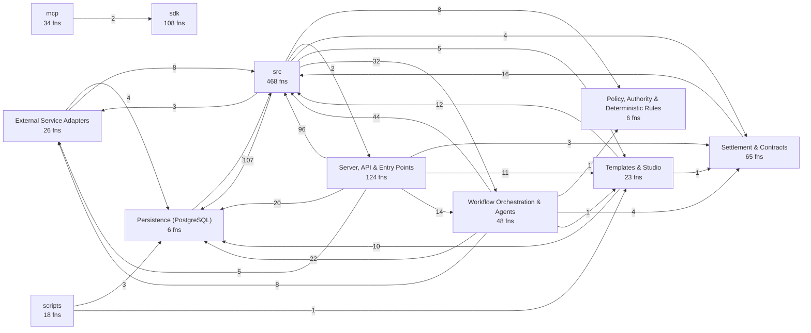
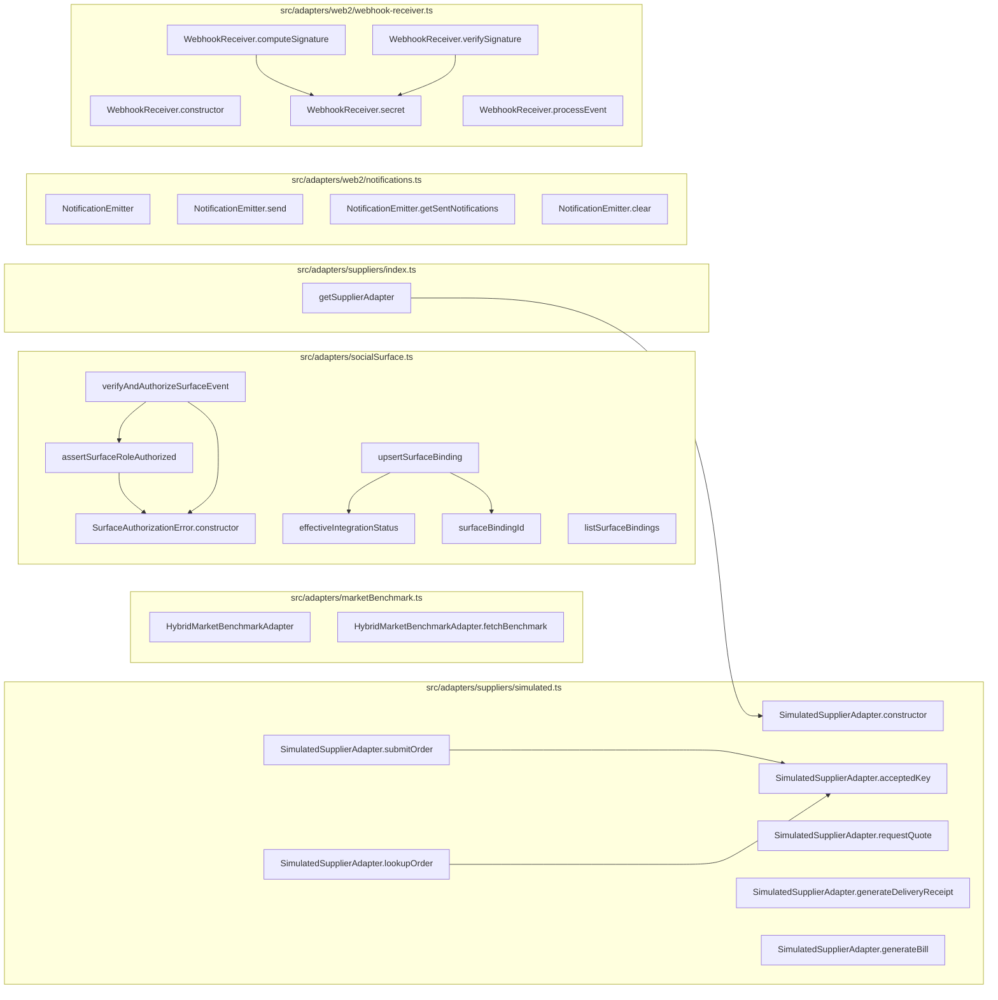
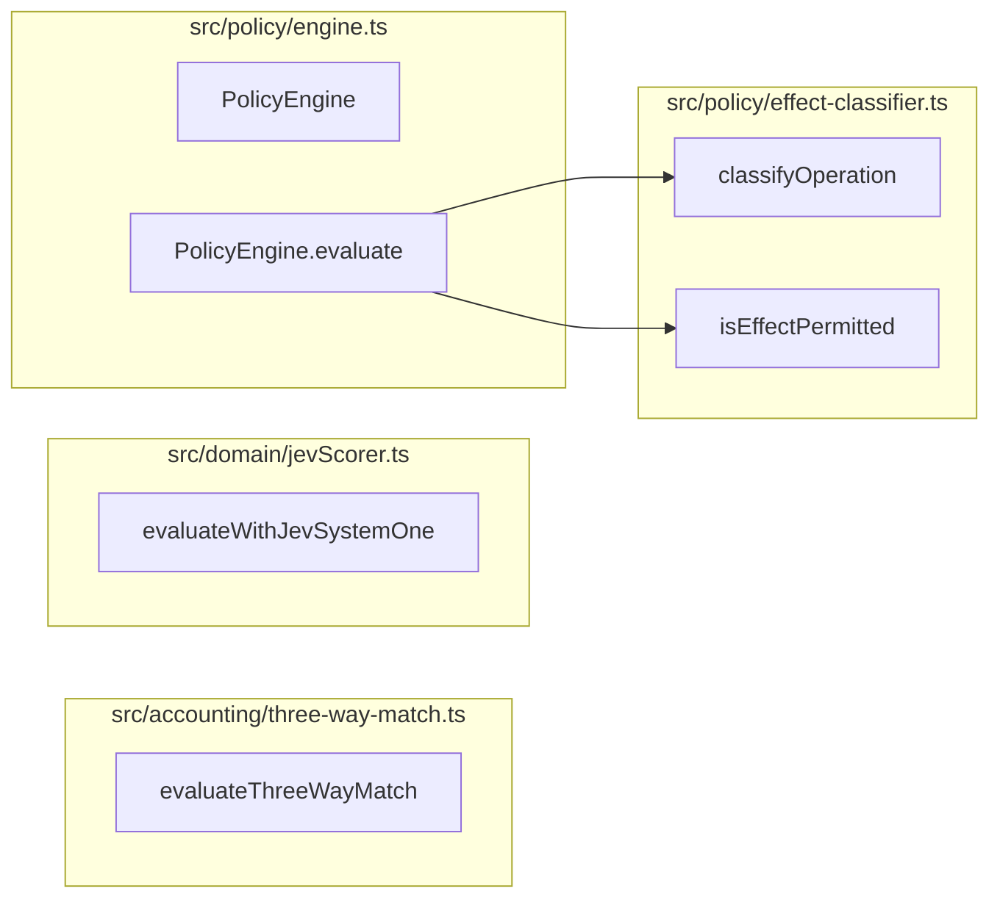
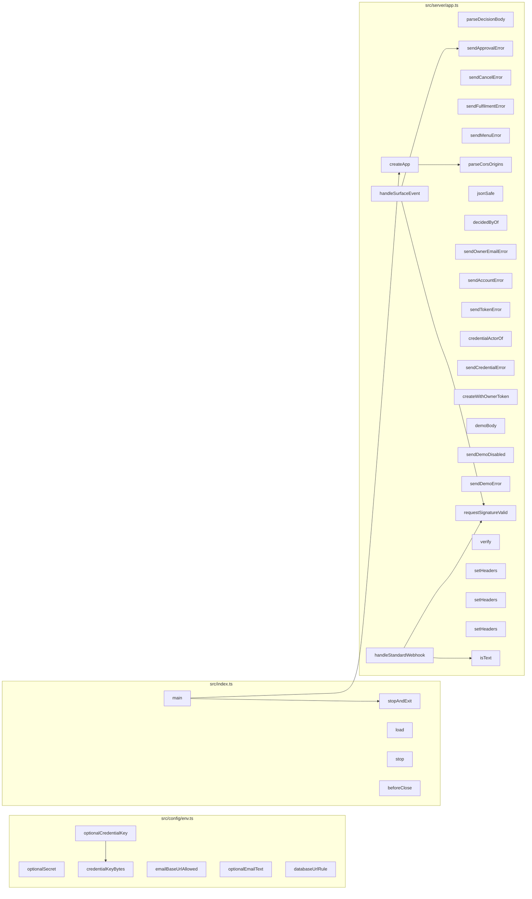
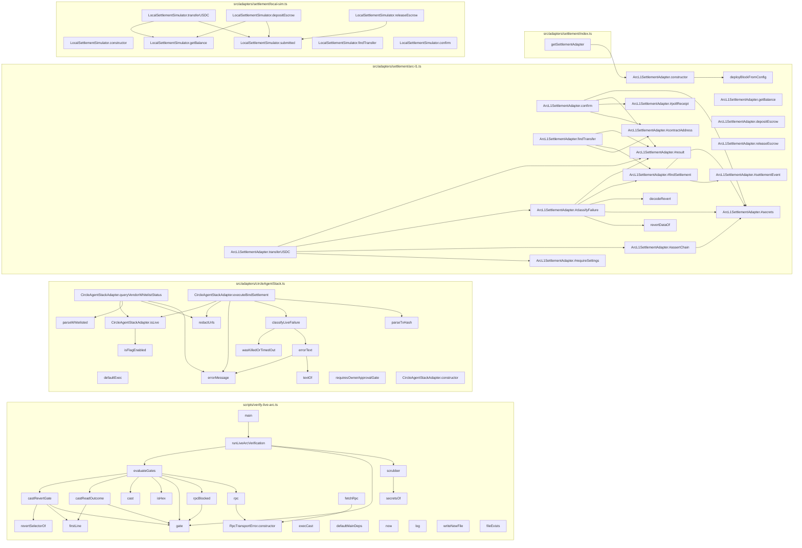
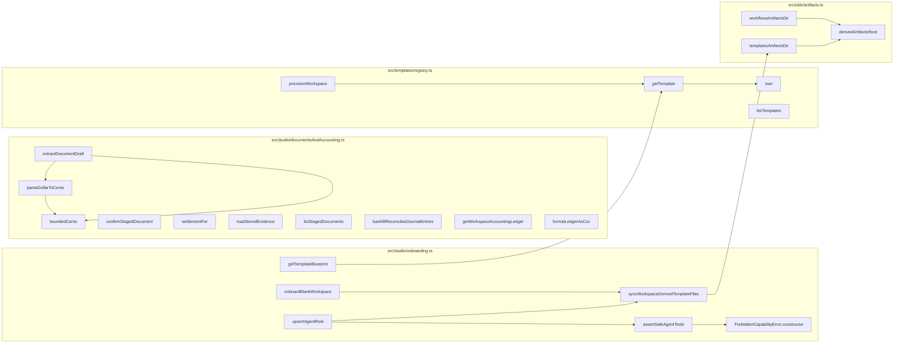
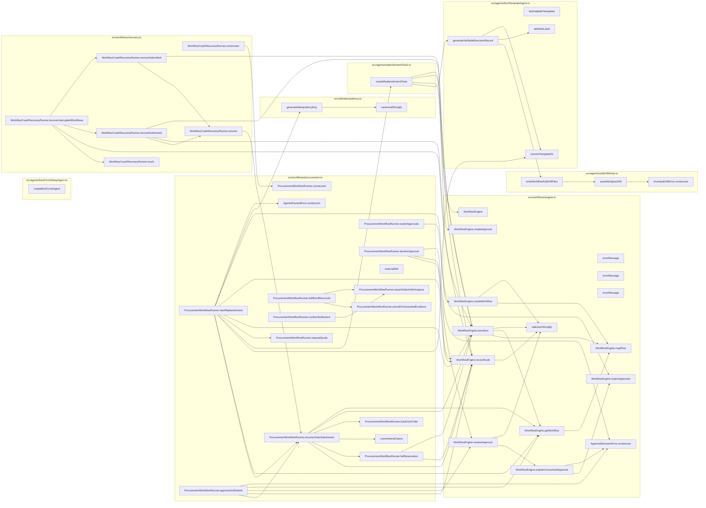
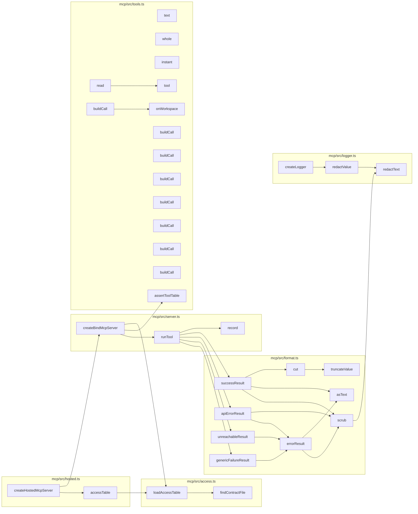
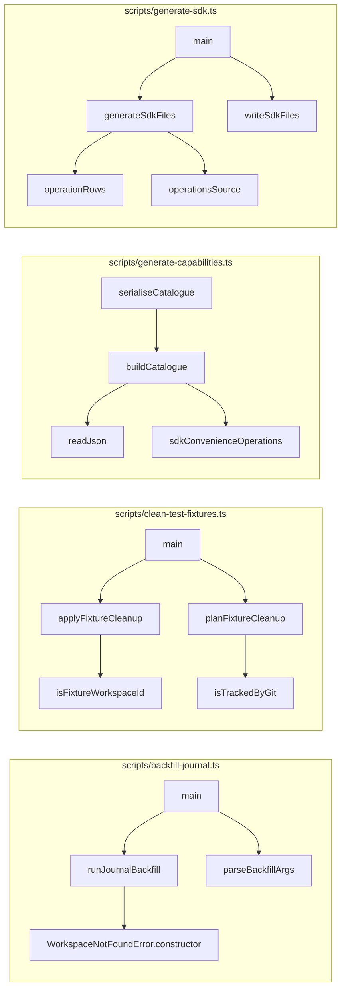

# Codebase map: functions and calls

Generated by `npx tsx scripts/map-functions.ts` from the TypeScript compiler's symbol table. Do not edit by hand.
The browser UI (`src/ui`, plain JavaScript) and the Solidity contract are not included here; see `.ua/knowledge-graph.json` for the contract.

- Functions, methods, handlers and classes: **1870** (926 in production code, 944 in tests)
- Resolved call edges: **3338**
- HTTP routes: **89**

## Layers and cross-layer calls



## HTTP surface: route to what it calls

| Route | Line | Calls directly |
| --- | --- | --- |
| `GET /x` | 161 | SQL or inline logic only |
| `GET /y` | 164 | SQL or inline logic only |
| `GET /health` | 551 | `query` |
| `GET /ready` | 562 | `checkReadiness` |
| `GET /api/public-config` | 576 | SQL or inline logic only |
| `GET /api/templates` | 590 | `jsonSafe`, `listTemplates` |
| `GET /api/templates/:id/blueprint` | 594 | `getTemplateBlueprint` |
| `GET /api/openapi.json` | 607 | `serializeOpenApiDocument`, `buildOpenApiDocument` |
| `GET /api/workspaces` | 614 | `query` |
| `GET /api/me` | 625 | `query` |
| `POST /api/workspaces/onboard` | 647 | `createWithOwnerToken`, `onboardBlankWorkspace`, `jsonSafe`, `publicErrorMessage` |
| `POST /api/workspaces` | 662 | `createWithOwnerToken`, `provisionWorkspace`, `jsonSafe`, `publicErrorMessage` |
| `POST /api/demo` | 683 | `sendDemoDisabled`, `createDemoWorkspace`, `demoBody`, `sendDemoError` |
| `POST /api/workspaces/:id/demo/reset` | 696 | `sendDemoDisabled`, `resetDemoWorkspace`, `demoBody`, `sendDemoError` |
| `GET /api/workspaces/:id` | 707 | `query`, `getSettlementAdapter`, `effectiveSettlementMode`, `ArcL1SettlementAdapter.getBalance`, `LocalSettlementSimulator.getBalance` |
| `PUT /api/workspaces/:id/policy` | 728 | `normalizePaymentAddress`, `query`, `syncWorkspaceDerivedTemplateFiles`, `publicErrorMessage` |
| `GET /api/workspaces/:id/inventory` | 773 | `query` |
| `POST /api/workspaces/:id/inventory` | 782 | `query`, `publicErrorMessage` |
| `POST /api/workspaces/:id/replenish` | 822 | `ProcurementWorkflowRunner.startReplenishment`, `publicErrorMessage` |
| `GET /api/workspaces/:id/approvals` | 842 | `ProcurementWorkflowRunner.expireApprovals`, `query` |
| `GET /api/workspaces/:id/approvals/:approvalId` | 852 | `ProcurementWorkflowRunner.expireApprovals`, `query` |
| `POST /api/approvals/:id/approve` | 860 | `ProcurementWorkflowRunner.approveAndSubmit`, `decidedByOf`, `sendApprovalError` |
| `POST /api/approvals/:id/reject` | 871 | `parseDecisionBody`, `ProcurementWorkflowRunner.declineApproval`, `decidedByOf`, `sendApprovalError` |
| `POST /api/approvals/:id/revoke` | 891 | `parseDecisionBody`, `ProcurementWorkflowRunner.declineApproval`, `decidedByOf`, `sendApprovalError` |
| `POST /api/orders/:id/reconcile` | 912 | `ProcurementWorkflowRunner.fulfillAndReconcile`, `publicErrorMessage` |
| `POST /api/orders/:id/confirm-settlement` | 928 | `ProcurementWorkflowRunner.confirmSettlement`, `publicErrorMessage` |
| `GET /api/workspaces/:id/customer-orders` | 945 | `listCustomerOrders`, `sendFulfilmentError` |
| `POST /api/workspaces/:id/customer-orders` | 953 | `sendFulfilmentError`, `acceptCustomerOrder` |
| `GET /api/workspaces/:id/customer-orders/:orderId` | 978 | `getCustomerOrder`, `sendFulfilmentError` |
| `POST /api/workspaces/:id/customer-orders/:orderId/accept` | 988 | `acceptHeldOrder`, `sendFulfilmentError` |
| `POST /api/workspaces/:id/customer-orders/:orderId/cancel` | 996 | `cancelCustomerOrder`, `sendFulfilmentError` |
| `POST /api/workspaces/:id/customer-orders/:orderId/fulfil` | 1005 | `fulfilCustomerOrder`, `sendFulfilmentError` |
| `GET /api/workspaces/:id/kitchen-capacity` | 1014 | `listKitchenCapacity`, `sendFulfilmentError` |
| `PUT /api/workspaces/:id/kitchen-capacity` | 1022 | `sendFulfilmentError`, `setKitchenCapacity` |
| `POST /api/workspaces/:id/feedback` | 1044 | `sendMenuError`, `ingestFeedback` |
| `GET /api/workspaces/:id/feedback` | 1064 | `listFeedback`, `sendMenuError` |
| `GET /api/workspaces/:id/feedback/summary` | 1072 | `sendMenuError`, `summarizeFeedback` |
| `POST /api/workspaces/:id/menu-proposals` | 1091 | `sendMenuError`, `proposeMenuChange` |
| `GET /api/workspaces/:id/menu-proposals` | 1118 | `listMenuProposals`, `sendMenuError` |
| `POST /api/workspaces/:id/menu-proposals/:proposalId/approve` | 1126 | `approveMenuProposal`, `sendMenuError` |
| `POST /api/workspaces/:id/menu-proposals/:proposalId/reject` | 1134 | `rejectMenuProposal`, `sendMenuError` |
| `POST /api/workspaces/:id/menu-proposals/:proposalId/cancel` | 1142 | `cancelMenuProposal`, `sendMenuError` |
| `POST /api/workspaces/:id/menu-proposals/:proposalId/publish` | 1150 | `publishMenuChange`, `sendMenuError` |
| `GET /api/workspaces/:id/menu` | 1158 | `listMenu`, `sendMenuError` |
| `GET /api/workspaces/:id/workflows` | 1167 | `query` |
| `GET /api/workspaces/:id/workflows/:workflowId` | 1176 | `query` |
| `POST /api/workspaces/:id/workflows/:workflowId/cancel` | 1184 | `cancelWorkflow`, `sendCancelError` |
| `GET /api/workspaces/:id/needs-attention` | 1205 | `listNeedsAttention` |
| `GET /api/workspaces/:id/orders/:orderId` | 1210 | `query` |
| `GET /api/workspaces/:id/orders` | 1225 | `query` |
| `GET /api/workspaces/:id/suppliers` | 1250 | `query` |
| `POST /api/workspaces/:id/suppliers` | 1259 | `isDemoWorkspace`, `normalizePaymentAddress`, `simulatedPaymentAddress`, `query`, `publicErrorMessage` |
| `GET /api/workspaces/:id/agents` | 1316 | `query` |
| `POST /api/workspaces/:id/agents` | 1329 | `upsertAgentRole`, `publicErrorMessage` |
| `GET /api/workspaces/:id/surfaces` | 1344 | `listSurfaceBindings` |
| `POST /api/workspaces/:id/surfaces` | 1350 | `upsertSurfaceBinding`, `decidedByOf`, `publicErrorMessage` |
| `GET /api/workspaces/:id/notifications` | 1361 | `jsonSafe`, `listNotificationChannels`, `sendOwnerEmailError` |
| `POST /api/workspaces/:id/notifications/email` | 1369 | `requestOwnerEmailVerification`, `jsonSafe`, `sendOwnerEmailError` |
| `POST /api/workspaces/:id/notifications/email/verify` | 1381 | `jsonSafe`, `verifyOwnerEmail`, `sendOwnerEmailError` |
| `DELETE /api/workspaces/:id/notifications/email/:emailId` | 1392 | `jsonSafe`, `removeOwnerEmail`, `sendOwnerEmailError` |
| `GET /api/workspaces/:id/documents` | 1401 | `listStagedDocuments` |
| `POST /api/workspaces/:id/documents/extract` | 1407 | `extractDocumentDraft`, `publicErrorMessage` |
| `POST /api/workspaces/:id/documents/:docId/confirm` | 1418 | `confirmStagedDocument`, `decidedByOf`, `publicErrorMessage`, `redactText` |
| `GET /api/workspaces/:id/accounting/ledger` | 1443 | `getWorkspaceAccountingLedger`, `formatLedgerAsCsv` |
| `GET /api/workspaces/:id/audit` | 1459 | `query` |
| `POST /api/workspaces/:id/recover` | 1473 | `WorkflowCrashRecoveryRunner.recoverInterruptedWorkflows`, `publicErrorMessage` |
| `POST /api/auth/session` | 1484 | `upsertAccount`, `createSession`, `sendAccountError` |
| `POST /api/auth/sign-out` | 1498 | `revokeSession` |
| `GET /api/account/workspaces` | 1505 | `listAccountWorkspaces` |
| `POST /api/account/workspaces` | 1509 | `createAccountWorkspace`, `publicErrorMessage` |
| `POST /api/account/invites/accept` | 1522 | `acceptInvite`, `sendAccountError` |
| `POST /api/workspaces/:id/invites` | 1532 | `createInvite`, `sendAccountError` |
| `GET /api/workspaces/:id/invites` | 1542 | `jsonSafe`, `listInvites` |
| `DELETE /api/workspaces/:id/invites/:inviteId` | 1546 | `revokeInvite` |
| `GET /api/workspaces/:id/members` | 1552 | `jsonSafe`, `listMembers` |
| `PUT /api/workspaces/:id/members/:accountId` | 1556 | `jsonSafe`, `setMemberRole`, `sendAccountError` |
| `DELETE /api/workspaces/:id/members/:accountId` | 1566 | `removeMember`, `sendAccountError` |
| `POST /api/workspaces/:id/tokens` | 1576 | `issueToken`, `sendTokenError` |
| `GET /api/workspaces/:id/tokens` | 1590 | `listTokens`, `sendTokenError` |
| `DELETE /api/workspaces/:id/tokens/:tokenId` | 1598 | `revokeToken`, `sendTokenError` |
| `PUT /api/workspaces/:id/agents-paused` | 1610 | `setAgentsPaused`, `decidedByOf` |
| `GET /api/workspaces/:id/webhook-secret` | 1627 | `viewWebhookSecret`, `decidedByOf` |
| `POST /api/workspaces/:id/webhook-secret/rotate` | 1639 | `rotateWebhookSecret`, `decidedByOf` |
| `GET /api/workspaces/:id/connectors` | 1653 | `listConnectors`, `sendCredentialError` |
| `PUT /api/workspaces/:id/connectors/:connectorId` | 1661 | `setCredential`, `credentialActorOf`, `sendCredentialError` |
| `DELETE /api/workspaces/:id/connectors/:connectorId` | 1676 | `revokeCredential`, `credentialActorOf`, `sendCredentialError` |
| `POST /api/workspaces/:id/connectors/:connectorId/verify` | 1686 | `verifyCredential`, `credentialActorOf`, `sendCredentialError` |
| `POST /api/webhooks/incoming` | 1697 | `handleSurfaceEvent`, `handleStandardWebhook` |
| `GET *` | 1902 | SQL or inline logic only |

## External Service Adapters

| Function | File:lines | Kind | Params | Exported | Called by (prod / tests) | Calls |
| --- | --- | --- | --- | --- | --- | --- |
| `HybridMarketBenchmarkAdapter` | src/adapters/marketBenchmark.ts:19-119 | class | 0 | yes | 2 / 2 | 0 |
| `HybridMarketBenchmarkAdapter.fetchBenchmark` | src/adapters/marketBenchmark.ts:24-118 | method | 3 | yes | 2 / 2 | 0 |
| `SurfaceAuthorizationError.constructor` | src/adapters/socialSurface.ts:76-79 | constructor | 1 | yes | 2 / 0 | 0 |
| `assertSurfaceRoleAuthorized` | src/adapters/socialSurface.ts:85-108 | function | 2 | yes | 1 / 1 | 1 |
| `verifyAndAuthorizeSurfaceEvent` | src/adapters/socialSurface.ts:115-137 | function | 1 | yes | 1 / 0 | 3 |
| `effectiveIntegrationStatus` | src/adapters/socialSurface.ts:149-151 | function | 1 | yes | 2 / 1 | 0 |
| `surfaceBindingId` | src/adapters/socialSurface.ts:158-160 | function | 3 | yes | 2 / 0 | 0 |
| `upsertSurfaceBinding` | src/adapters/socialSurface.ts:162-205 | function | 3 | yes | 1 / 5 | 5 |
| `listSurfaceBindings` | src/adapters/socialSurface.ts:207-213 | function | 1 | yes | 1 / 0 | 1 |
| `getSupplierAdapter` | src/adapters/suppliers/index.ts:24-34 | function | 1 | yes | 0 / 2 | 1 |
| `SimulatedSupplierAdapter.constructor` | src/adapters/suppliers/simulated.ts:20-25 | constructor | 4 | yes | 2 / 7 | 0 |
| `SimulatedSupplierAdapter.acceptedKey` | src/adapters/suppliers/simulated.ts:27-29 | method | 2 | yes | 2 / 0 | 0 |
| `SimulatedSupplierAdapter.requestQuote` | src/adapters/suppliers/simulated.ts:31-62 | method | 1 | yes | 1 / 5 | 0 |
| `SimulatedSupplierAdapter.submitOrder` | src/adapters/suppliers/simulated.ts:65-80 | method | 1 | yes | 1 / 6 | 1 |
| `SimulatedSupplierAdapter.lookupOrder` | src/adapters/suppliers/simulated.ts:83-87 | method | 1 | yes | 0 / 3 | 1 |
| `SimulatedSupplierAdapter.generateDeliveryReceipt` | src/adapters/suppliers/simulated.ts:89-99 | method | 3 | yes | 1 / 5 | 0 |
| `SimulatedSupplierAdapter.generateBill` | src/adapters/suppliers/simulated.ts:101-114 | method | 5 | yes | 1 / 6 | 0 |
| `NotificationEmitter` | src/adapters/web2/notifications.ts:6-41 | class | 0 | yes | 1 / 0 | 0 |
| `NotificationEmitter.send` | src/adapters/web2/notifications.ts:9-29 | method | 1 | yes | 1 / 0 | 2 |
| `NotificationEmitter.getSentNotifications` | src/adapters/web2/notifications.ts:31-36 | method | 1 | yes | 0 / 3 | 0 |
| `NotificationEmitter.clear` | src/adapters/web2/notifications.ts:38-40 | method | 0 | yes | 0 / 5 | 0 |
| `WebhookReceiver.constructor` | src/adapters/web2/webhook-receiver.ts:27-29 | constructor | 1 | yes | 2 / 0 | 0 |
| `WebhookReceiver.secret` | src/adapters/web2/webhook-receiver.ts:31-35 | method | 0 | yes | 2 / 0 | 1 |
| `WebhookReceiver.computeSignature` | src/adapters/web2/webhook-receiver.ts:38-40 | method | 2 | yes | 0 / 1 | 2 |
| `WebhookReceiver.verifySignature` | src/adapters/web2/webhook-receiver.ts:43-50 | method | 3 | yes | 0 / 1 | 2 |
| `WebhookReceiver.processEvent` | src/adapters/web2/webhook-receiver.ts:56-77 | method | 1 | yes | 1 / 1 | 2 |



## Persistence (PostgreSQL)

| Function | File:lines | Kind | Params | Exported | Called by (prod / tests) | Calls |
| --- | --- | --- | --- | --- | --- | --- |
| `query` | src/db/client.ts:13-18 | function | 2 | yes | 129 / 204 | 0 |
| `getClient` | src/db/client.ts:20-22 | function | 0 | yes | 0 / 1 | 0 |
| `withTransaction` | src/db/client.ts:24-39 | function | 1 | yes | 36 / 0 | 0 |
| `closePool` | src/db/client.ts:41-43 | function | 0 | yes | 2 / 65 | 0 |
| `runMigrations` | src/db/migrate.ts:24-49 | function | 1 | yes | 2 / 64 | 1 |
| `isDirectRun` | src/db/migrate.ts:55-57 | function | 2 | yes | 1 / 1 | 0 |

## Policy, Authority & Deterministic Rules

| Function | File:lines | Kind | Params | Exported | Called by (prod / tests) | Calls |
| --- | --- | --- | --- | --- | --- | --- |
| `evaluateThreeWayMatch` | src/accounting/three-way-match.ts:19-100 | function | 3 | yes | 1 / 1 | 0 |
| `evaluateWithJevSystemOne` | src/domain/jevScorer.ts:52-244 | function | 1 | yes | 1 / 1 | 0 |
| `classifyOperation` | src/policy/effect-classifier.ts:45-54 | function | 1 | yes | 2 / 2 | 0 |
| `isEffectPermitted` | src/policy/effect-classifier.ts:59-64 | function | 2 | yes | 1 / 0 | 0 |
| `PolicyEngine` | src/policy/engine.ts:14-60 | class | 0 | yes | 3 / 1 | 0 |
| `PolicyEngine.evaluate` | src/policy/engine.ts:15-59 | method | 1 | yes | 3 / 1 | 2 |



## Server, API & Entry Points

| Function | File:lines | Kind | Params | Exported | Called by (prod / tests) | Calls |
| --- | --- | --- | --- | --- | --- | --- |
| `optionalSecret` | src/config/env.ts:9-14 | function | 1 | no | 1 / 0 | 0 |
| `credentialKeyBytes` | src/config/env.ts:20-24 | function | 1 | yes | 2 / 0 | 0 |
| `optionalCredentialKey` | src/config/env.ts:27-35 | function | 1 | no | 1 / 0 | 1 |
| `emailBaseUrlAllowed` | src/config/env.ts:42-52 | function | 2 | yes | 2 / 1 | 0 |
| `optionalEmailText` | src/config/env.ts:55-57 | function | 1 | no | 1 / 0 | 0 |
| `databaseUrlRule` | src/config/env.ts:197-201 | function | 1 | yes | 1 / 1 | 0 |
| `stopAndExit` | src/index.ts:20-31 | function | 2 | no | 1 / 0 | 0 |
| `main` | src/index.ts:33-87 | function | 0 | no | 1 / 0 | 6 |
| `load` | src/index.ts:48-48 | arrow | 0 | no | 0 / 0 | 0 |
| `stop` | src/index.ts:67-67 | arrow | 0 | no | 0 / 0 | 0 |
| `beforeClose` | src/index.ts:72-74 | arrow | 0 | no | 0 / 0 | 1 |
| `parseDecisionBody` | src/server/app.ts:154-161 | function | 2 | no | 2 / 0 | 0 |
| `sendApprovalError` | src/server/app.ts:164-174 | function | 2 | no | 4 / 0 | 1 |
| `sendCancelError` | src/server/app.ts:177-188 | function | 2 | no | 1 / 0 | 0 |
| `sendFulfilmentError` | src/server/app.ts:191-200 | function | 2 | no | 8 / 0 | 0 |
| `sendMenuError` | src/server/app.ts:206-222 | function | 2 | no | 10 / 0 | 0 |
| `parseCorsOrigins` | src/server/app.ts:227-232 | function | 1 | yes | 1 / 0 | 0 |
| `jsonSafe` | src/server/app.ts:238-240 | function | 1 | no | 10 / 0 | 0 |
| `decidedByOf` | src/server/app.ts:243-245 | function | 1 | no | 8 / 0 | 0 |
| `sendOwnerEmailError` | src/server/app.ts:249-257 | function | 2 | no | 4 / 0 | 0 |
| `sendAccountError` | src/server/app.ts:259-270 | function | 2 | no | 5 / 0 | 0 |
| `sendTokenError` | src/server/app.ts:272-278 | function | 2 | no | 3 / 0 | 0 |
| `credentialActorOf` | src/server/app.ts:281-283 | function | 1 | no | 3 / 0 | 0 |
| `sendCredentialError` | src/server/app.ts:286-297 | function | 2 | no | 4 / 0 | 1 |
| `createWithOwnerToken` | src/server/app.ts:309-329 | function | 2 | no | 2 / 0 | 3 |
| `demoBody` | src/server/app.ts:382-384 | function | 1 | no | 2 / 0 | 0 |
| `sendDemoDisabled` | src/server/app.ts:386-388 | function | 1 | no | 2 / 0 | 0 |
| `sendDemoError` | src/server/app.ts:391-398 | function | 2 | no | 2 / 0 | 0 |
| `requestSignatureValid` | src/server/app.ts:410-418 | function | 2 | no | 2 / 0 | 1 |
| `createApp` | src/server/app.ts:420-1911 | function | 1 | yes | 1 / 42 | 15 |
| `verify` | src/server/app.ts:500-502 | arrow | 3 | no | 0 / 0 | 0 |
| `setHeaders` | src/server/app.ts:517-517 | arrow | 1 | no | 0 / 0 | 0 |
| `setHeaders` | src/server/app.ts:534-534 | arrow | 1 | no | 0 / 0 | 0 |
| `setHeaders` | src/server/app.ts:544-546 | arrow | 2 | no | 0 / 0 | 0 |
| `handleSurfaceEvent` | src/server/app.ts:1711-1864 | function | 3 | no | 1 / 0 | 12 |
| `handleStandardWebhook` | src/server/app.ts:1866-1893 | function | 2 | no | 1 / 0 | 3 |
| `isText` | src/server/app.ts:1878-1879 | arrow | 1 | no | 1 / 0 | 0 |



## Settlement & Contracts

| Function | File:lines | Kind | Params | Exported | Called by (prod / tests) | Calls |
| --- | --- | --- | --- | --- | --- | --- |
| `RpcTransportError.constructor` | scripts/verify-live-arc.ts:82-88 | constructor | 2 | yes | 2 / 1 | 0 |
| `secretsOf` | scripts/verify-live-arc.ts:115-127 | function | 1 | yes | 2 / 0 | 0 |
| `scrubber` | scripts/verify-live-arc.ts:130-133 | function | 1 | yes | 1 / 0 | 2 |
| `revertSelectorOf` | scripts/verify-live-arc.ts:139-144 | function | 1 | yes | 1 / 1 | 0 |
| `firstLine` | scripts/verify-live-arc.ts:146-148 | function | 1 | no | 2 / 0 | 0 |
| `isHex` | scripts/verify-live-arc.ts:150-152 | function | 1 | no | 1 / 0 | 0 |
| `gate` | scripts/verify-live-arc.ts:154-156 | function | 3 | no | 5 / 0 | 0 |
| `rpcBlocked` | scripts/verify-live-arc.ts:167-180 | function | 2 | no | 1 / 0 | 1 |
| `castReadOutcome` | scripts/verify-live-arc.ts:183-200 | function | 3 | no | 1 / 0 | 2 |
| `castRevertGate` | scripts/verify-live-arc.ts:206-227 | function | 5 | no | 1 / 0 | 3 |
| `runLiveArcVerification` | scripts/verify-live-arc.ts:230-265 | function | 1 | yes | 1 / 1 | 3 |
| `evaluateGates` | scripts/verify-live-arc.ts:267-368 | function | 1 | no | 1 / 0 | 7 |
| `rpc` | scripts/verify-live-arc.ts:269-279 | arrow | 2 | no | 1 / 0 | 1 |
| `cast` | scripts/verify-live-arc.ts:280-280 | arrow | 1 | no | 1 / 0 | 0 |
| `execCast` | scripts/verify-live-arc.ts:371-398 | arrow | 1 | yes | 0 / 0 | 0 |
| `fetchRpc` | scripts/verify-live-arc.ts:401-420 | arrow | 1 | yes | 0 / 0 | 1 |
| `defaultMainDeps` | scripts/verify-live-arc.ts:429-442 | function | 0 | yes | 0 / 0 | 0 |
| `now` | scripts/verify-live-arc.ts:434-434 | arrow | 0 | no | 0 / 0 | 0 |
| `log` | scripts/verify-live-arc.ts:435-435 | arrow | 1 | no | 0 / 0 | 0 |
| `writeNewFile` | scripts/verify-live-arc.ts:436-436 | arrow | 2 | no | 0 / 0 | 0 |
| `fileExists` | scripts/verify-live-arc.ts:437-440 | arrow | 1 | no | 0 / 0 | 0 |
| `main` | scripts/verify-live-arc.ts:448-480 | function | 2 | yes | 1 / 1 | 1 |
| `defaultExec` | src/adapters/circleAgentStack.ts:70-73 | arrow | 3 | no | 0 / 0 | 0 |
| `requiresOwnerApprovalGate` | src/adapters/circleAgentStack.ts:75-78 | function | 1 | yes | 0 / 1 | 0 |
| `isFlagEnabled` | src/adapters/circleAgentStack.ts:83-86 | function | 1 | yes | 1 / 1 | 0 |
| `redactUrls` | src/adapters/circleAgentStack.ts:88-90 | function | 1 | no | 2 / 0 | 0 |
| `errorMessage` | src/adapters/circleAgentStack.ts:92-94 | function | 1 | no | 3 / 0 | 0 |
| `textOf` | src/adapters/circleAgentStack.ts:96-100 | function | 1 | no | 1 / 0 | 0 |
| `errorText` | src/adapters/circleAgentStack.ts:103-112 | function | 1 | no | 1 / 0 | 2 |
| `wasKilledOrTimedOut` | src/adapters/circleAgentStack.ts:115-119 | function | 1 | no | 1 / 0 | 0 |
| `classifyLiveFailure` | src/adapters/circleAgentStack.ts:121-124 | function | 1 | no | 1 / 0 | 2 |
| `parseWhitelisted` | src/adapters/circleAgentStack.ts:126-134 | function | 1 | no | 1 / 0 | 0 |
| `parseTxHash` | src/adapters/circleAgentStack.ts:137-146 | function | 1 | no | 1 / 0 | 0 |
| `CircleAgentStackAdapter.constructor` | src/adapters/circleAgentStack.ts:153-157 | constructor | 2 | yes | 1 / 2 | 0 |
| `CircleAgentStackAdapter.isLive` | src/adapters/circleAgentStack.ts:160-162 | method | 0 | yes | 2 / 0 | 1 |
| `CircleAgentStackAdapter.queryVendorWhitelistStatus` | src/adapters/circleAgentStack.ts:167-209 | method | 1 | yes | 1 / 2 | 4 |
| `CircleAgentStackAdapter.executeBindSettlement` | src/adapters/circleAgentStack.ts:215-276 | method | 1 | yes | 1 / 2 | 5 |
| `revertDataOf` | src/adapters/settlement/arc-l1.ts:135-143 | function | 1 | no | 1 / 0 | 0 |
| `decodeRevert` | src/adapters/settlement/arc-l1.ts:145-152 | function | 1 | no | 1 / 0 | 0 |
| `deployBlockFromConfig` | src/adapters/settlement/arc-l1.ts:154-156 | function | 0 | no | 1 / 0 | 0 |
| `ArcL1SettlementAdapter.constructor` | src/adapters/settlement/arc-l1.ts:180-196 | constructor | 1 | yes | 1 / 6 | 1 |
| `ArcL1SettlementAdapter.getBalance` | src/adapters/settlement/arc-l1.ts:198-212 | method | 1 | yes | 1 / 2 | 0 |
| `ArcL1SettlementAdapter.transferUSDC` | src/adapters/settlement/arc-l1.ts:218-258 | method | 1 | yes | 1 / 4 | 6 |
| `ArcL1SettlementAdapter.confirm` | src/adapters/settlement/arc-l1.ts:265-288 | method | 1 | yes | 1 / 2 | 6 |
| `ArcL1SettlementAdapter.findTransfer` | src/adapters/settlement/arc-l1.ts:299-307 | method | 1 | yes | 0 / 2 | 4 |
| `ArcL1SettlementAdapter.depositEscrow` | src/adapters/settlement/arc-l1.ts:309-311 | method | 2 | yes | 0 / 2 | 1 |
| `ArcL1SettlementAdapter.releaseEscrow` | src/adapters/settlement/arc-l1.ts:313-315 | method | 2 | yes | 0 / 2 | 1 |
| `ArcL1SettlementAdapter.#result` | src/adapters/settlement/arc-l1.ts:317-328 | method | 3 | yes | 4 / 0 | 0 |
| `ArcL1SettlementAdapter.#secrets` | src/adapters/settlement/arc-l1.ts:331-333 | method | 0 | yes | 4 / 0 | 0 |
| `ArcL1SettlementAdapter.#classifyFailure` | src/adapters/settlement/arc-l1.ts:339-355 | method | 4 | yes | 1 / 0 | 7 |
| `ArcL1SettlementAdapter.#contractAddress` | src/adapters/settlement/arc-l1.ts:357-363 | method | 0 | yes | 2 / 0 | 1 |
| `ArcL1SettlementAdapter.#requireSettings` | src/adapters/settlement/arc-l1.ts:366-385 | method | 0 | yes | 1 / 0 | 1 |
| `ArcL1SettlementAdapter.#assertChain` | src/adapters/settlement/arc-l1.ts:388-398 | method | 0 | yes | 1 / 0 | 3 |
| `ArcL1SettlementAdapter.#settlementEvent` | src/adapters/settlement/arc-l1.ts:400-404 | method | 0 | yes | 1 / 0 | 0 |
| `ArcL1SettlementAdapter.#findSettlement` | src/adapters/settlement/arc-l1.ts:410-428 | method | 2 | yes | 2 / 0 | 3 |
| `ArcL1SettlementAdapter.#pollReceipt` | src/adapters/settlement/arc-l1.ts:430-443 | method | 1 | yes | 1 / 0 | 0 |
| `getSettlementAdapter` | src/adapters/settlement/index.ts:14-27 | function | 1 | yes | 3 / 0 | 1 |
| `LocalSettlementSimulator.constructor` | src/adapters/settlement/local-sim.ts:24-27 | constructor | 0 | yes | 1 / 1 | 0 |
| `LocalSettlementSimulator.getBalance` | src/adapters/settlement/local-sim.ts:29-31 | method | 1 | yes | 3 / 1 | 0 |
| `LocalSettlementSimulator.transferUSDC` | src/adapters/settlement/local-sim.ts:33-56 | method | 1 | yes | 1 / 1 | 2 |
| `LocalSettlementSimulator.findTransfer` | src/adapters/settlement/local-sim.ts:59-61 | method | 1 | yes | 0 / 1 | 0 |
| `LocalSettlementSimulator.confirm` | src/adapters/settlement/local-sim.ts:63-66 | method | 1 | yes | 1 / 1 | 1 |
| `LocalSettlementSimulator.depositEscrow` | src/adapters/settlement/local-sim.ts:68-83 | method | 2 | yes | 0 / 0 | 2 |
| `LocalSettlementSimulator.releaseEscrow` | src/adapters/settlement/local-sim.ts:85-100 | method | 2 | yes | 0 / 0 | 1 |
| `LocalSettlementSimulator.submitted` | src/adapters/settlement/local-sim.ts:102-110 | method | 0 | yes | 3 / 0 | 0 |



## Templates & Studio

| Function | File:lines | Kind | Params | Exported | Called by (prod / tests) | Calls |
| --- | --- | --- | --- | --- | --- | --- |
| `parseDollarToCents` | src/studio/documentsAndAccounting.ts:34-41 | function | 1 | no | 1 / 0 | 1 |
| `boundedCents` | src/studio/documentsAndAccounting.ts:44-46 | function | 1 | no | 2 / 0 | 0 |
| `extractDocumentDraft` | src/studio/documentsAndAccounting.ts:52-232 | function | 3 | yes | 1 / 1 | 5 |
| `confirmStagedDocument` | src/studio/documentsAndAccounting.ts:239-487 | function | 4 | yes | 1 / 2 | 4 |
| `settlementFor` | src/studio/documentsAndAccounting.ts:432-432 | arrow | 1 | no | 0 / 0 | 1 |
| `loadStoredEvidence` | src/studio/documentsAndAccounting.ts:436-460 | arrow | 1 | no | 0 / 0 | 1 |
| `listStagedDocuments` | src/studio/documentsAndAccounting.ts:489-495 | function | 1 | yes | 1 / 0 | 1 |
| `backfillReconciledJournalEntries` | src/studio/documentsAndAccounting.ts:517-563 | function | 2 | yes | 1 / 0 | 2 |
| `getWorkspaceAccountingLedger` | src/studio/documentsAndAccounting.ts:566-572 | function | 1 | yes | 1 / 0 | 1 |
| `formatLedgerAsCsv` | src/studio/documentsAndAccounting.ts:574-609 | function | 1 | yes | 1 / 0 | 0 |
| `ForbiddenCapabilityError.constructor` | src/studio/onboarding.ts:32-35 | constructor | 1 | yes | 1 / 0 | 0 |
| `assertSafeAgentTools` | src/studio/onboarding.ts:116-130 | function | 1 | yes | 1 / 0 | 1 |
| `getTemplateBlueprint` | src/studio/onboarding.ts:135-175 | function | 1 | yes | 1 / 0 | 1 |
| `onboardBlankWorkspace` | src/studio/onboarding.ts:181-328 | function | 2 | yes | 1 / 0 | 5 |
| `upsertAgentRole` | src/studio/onboarding.ts:333-406 | function | 3 | yes | 1 / 0 | 5 |
| `syncWorkspaceDerivedTemplateFiles` | src/studio/onboarding.ts:412-496 | function | 1 | yes | 3 / 0 | 2 |
| `getTemplate` | src/templates/registry.ts:12-19 | function | 1 | yes | 2 / 1 | 1 |
| `own` | src/templates/registry.ts:14-15 | arrow | 1 | no | 1 / 0 | 0 |
| `listTemplates` | src/templates/registry.ts:21-23 | function | 0 | yes | 1 / 1 | 0 |
| `provisionWorkspace` | src/templates/registry.ts:46-191 | function | 4 | yes | 4 / 55 | 3 |
| `derivedArtifactsRoot` | src/utils/artifacts.ts:12-20 | function | 0 | yes | 2 / 0 | 0 |
| `workflowsArtifactsDir` | src/utils/artifacts.ts:22-24 | function | 0 | yes | 2 / 0 | 1 |
| `templatesArtifactsDir` | src/utils/artifacts.ts:26-28 | function | 0 | yes | 2 / 0 | 1 |



## Workflow Orchestration & Agents

| Function | File:lines | Kind | Params | Exported | Called by (prod / tests) | Calls |
| --- | --- | --- | --- | --- | --- | --- |
| `InvariantDriftError.constructor` | src/agents/antiDriftWriter.ts:33-36 | constructor | 1 | yes | 1 / 0 | 0 |
| `assertNoSpecDrift` | src/agents/antiDriftWriter.ts:42-78 | function | 1 | yes | 1 / 1 | 1 |
| `writeWorkflowAntiDriftFiles` | src/agents/antiDriftWriter.ts:91-241 | function | 2 | yes | 2 / 1 | 2 |
| `createBindCircleAgent` | src/agents/bindCircleDeepAgent.ts:15-108 | function | 1 | yes | 0 / 0 | 5 |
| `listAvailableTemplates` | src/agents/bindTemplateAgent.ts:26-44 | function | 0 | yes | 0 / 1 | 0 |
| `resolveTemplateDir` | src/agents/bindTemplateAgent.ts:49-60 | function | 1 | yes | 2 / 1 | 0 |
| `whitelistLabel` | src/agents/bindTemplateAgent.ts:106-110 | function | 1 | no | 1 / 0 | 0 |
| `generateVerifiableDecisionRecord` | src/agents/bindTemplateAgent.ts:114-274 | function | 1 | yes | 1 / 2 | 5 |
| `createReplenishmentTools` | src/agents/replenishmentTools.ts:28-712 | function | 1 | yes | 1 / 9 | 18 |
| `canonicalStringify` | src/utils/idempotency.ts:7-16 | function | 1 | yes | 2 / 0 | 0 |
| `generateIdempotencyKey` | src/utils/idempotency.ts:21-32 | function | 3 | yes | 1 / 3 | 1 |
| `safeJsonStringify` | src/workflows/engine.ts:10-14 | function | 1 | no | 4 / 0 | 0 |
| `errorMessage` | src/workflows/engine.ts:22-22 | arrow | 0 | no | 0 / 0 | 0 |
| `errorMessage` | src/workflows/engine.ts:25-25 | arrow | 1 | no | 0 / 0 | 0 |
| `errorMessage` | src/workflows/engine.ts:29-29 | arrow | 1 | no | 0 / 0 | 0 |
| `ApprovalDecisionError.constructor` | src/workflows/engine.ts:40-45 | constructor | 3 | yes | 3 / 0 | 0 |
| `WorkflowEngine` | src/workflows/engine.ts:48-302 | class | 0 | yes | 8 / 17 | 0 |
| `WorkflowEngine.mapRow` | src/workflows/engine.ts:49-62 | method | 1 | yes | 3 / 0 | 0 |
| `WorkflowEngine.createWorkflow` | src/workflows/engine.ts:68-85 | method | 5 | yes | 1 / 19 | 3 |
| `WorkflowEngine.getWorkflow` | src/workflows/engine.ts:90-96 | method | 1 | yes | 5 / 8 | 2 |
| `WorkflowEngine.transition` | src/workflows/engine.ts:101-127 | method | 2 | yes | 8 / 13 | 4 |
| `WorkflowEngine.recordAudit` | src/workflows/engine.ts:132-169 | method | 10 | yes | 18 / 1 | 5 |
| `WorkflowEngine.createApproval` | src/workflows/engine.ts:174-191 | method | 8 | yes | 1 / 10 | 1 |
| `WorkflowEngine.resolveApproval` | src/workflows/engine.ts:201-239 | method | 5 | yes | 2 / 1 | 3 |
| `WorkflowEngine.expireApprovals` | src/workflows/engine.ts:249-278 | method | 1 | yes | 3 / 1 | 1 |
| `WorkflowEngine.explainUnresolvedApproval` | src/workflows/engine.ts:284-301 | method | 1 | yes | 1 / 0 | 3 |
| `AgentsPausedError.constructor` | src/workflows/procurement.ts:48-53 | constructor | 0 | yes | 1 / 0 | 0 |
| `commitmentClaims` | src/workflows/procurement.ts:71-81 | function | 3 | no | 1 / 0 | 0 |
| `ProcurementWorkflowRunner.constructor` | src/workflows/procurement.ts:91-96 | constructor | 1 | yes | 6 / 21 | 2 |
| `ProcurementWorkflowRunner.startReplenishment` | src/workflows/procurement.ts:101-387 | method | 4 | yes | 5 / 20 | 14 |
| `ProcurementWorkflowRunner.approveAndSubmit` | src/workflows/procurement.ts:392-467 | method | 3 | yes | 2 / 4 | 9 |
| `ProcurementWorkflowRunner.expireApprovals` | src/workflows/procurement.ts:472-474 | method | 1 | yes | 2 / 0 | 1 |
| `ProcurementWorkflowRunner.declineApproval` | src/workflows/procurement.ts:480-510 | method | 5 | yes | 4 / 1 | 5 |
| `ProcurementWorkflowRunner.requestQuote` | src/workflows/procurement.ts:517-575 | method | 1 | yes | 1 / 1 | 7 |
| `ProcurementWorkflowRunner.resumeOrderSubmission` | src/workflows/procurement.ts:585-775 | method | 1 | yes | 3 / 1 | 17 |
| `externalRef` | src/workflows/procurement.ts:691-691 | arrow | 1 | no | 0 / 0 | 0 |
| `ProcurementWorkflowRunner.loadOwnOrder` | src/workflows/procurement.ts:778-785 | method | 2 | yes | 1 / 0 | 1 |
| `ProcurementWorkflowRunner.failReservation` | src/workflows/procurement.ts:788-813 | method | 3 | yes | 1 / 0 | 3 |
| `ProcurementWorkflowRunner.fulfillAndReconcile` | src/workflows/procurement.ts:820-826 | method | 2 | yes | 1 / 10 | 3 |
| `ProcurementWorkflowRunner.confirmSettlement` | src/workflows/procurement.ts:832-835 | method | 2 | yes | 2 / 2 | 2 |
| `ProcurementWorkflowRunner.assertOrderInWorkspace` | src/workflows/procurement.ts:838-843 | method | 2 | yes | 2 / 0 | 2 |
| `ProcurementWorkflowRunner.storedOrGeneratedEvidence` | src/workflows/procurement.ts:845-930 | method | 1 | yes | 1 / 0 | 5 |
| `WorkflowCrashRecoveryRunner.constructor` | src/workflows/recovery.ts:34-36 | constructor | 1 | yes | 2 / 3 | 1 |
| `WorkflowCrashRecoveryRunner.recoverInterruptedWorkflows` | src/workflows/recovery.ts:48-96 | method | 1 | yes | 2 / 3 | 5 |
| `WorkflowCrashRecoveryRunner.touch` | src/workflows/recovery.ts:99-105 | method | 1 | yes | 1 / 0 | 1 |
| `WorkflowCrashRecoveryRunner.recoverSubmitted` | src/workflows/recovery.ts:107-141 | method | 2 | yes | 1 / 0 | 3 |
| `WorkflowCrashRecoveryRunner.recoverAuthorized` | src/workflows/recovery.ts:143-187 | method | 2 | yes | 1 / 0 | 6 |
| `WorkflowCrashRecoveryRunner.resume` | src/workflows/recovery.ts:189-197 | method | 3 | yes | 2 / 0 | 1 |



## mcp

| Function | File:lines | Kind | Params | Exported | Called by (prod / tests) | Calls |
| --- | --- | --- | --- | --- | --- | --- |
| `findContractFile` | mcp/src/access.ts:16-26 | function | 0 | no | 1 / 0 | 0 |
| `loadAccessTable` | mcp/src/access.ts:29-53 | function | 1 | yes | 2 / 3 | 1 |
| `truncateValue` | mcp/src/format.ts:24-44 | function | 3 | yes | 1 / 0 | 0 |
| `cut` | mcp/src/format.ts:47-51 | function | 2 | yes | 1 / 0 | 1 |
| `scrub` | mcp/src/format.ts:54-56 | function | 2 | no | 3 / 0 | 1 |
| `asText` | mcp/src/format.ts:58-60 | function | 1 | no | 2 / 0 | 0 |
| `successResult` | mcp/src/format.ts:70-86 | function | 1 | yes | 1 / 0 | 3 |
| `errorResult` | mcp/src/format.ts:88-93 | function | 2 | no | 3 / 0 | 2 |
| `apiErrorResult` | mcp/src/format.ts:96-108 | function | 2 | yes | 1 / 0 | 2 |
| `unreachableResult` | mcp/src/format.ts:111-113 | function | 1 | yes | 1 / 0 | 1 |
| `genericFailureResult` | mcp/src/format.ts:116-118 | function | 1 | yes | 1 / 0 | 1 |
| `accessTable` | mcp/src/hosted.ts:29-32 | function | 0 | no | 1 / 0 | 1 |
| `createHostedMcpServer` | mcp/src/hosted.ts:35-44 | function | 1 | yes | 0 / 0 | 3 |
| `redactText` | mcp/src/logger.ts:21-27 | function | 2 | yes | 2 / 0 | 0 |
| `redactValue` | mcp/src/logger.ts:30-40 | function | 3 | yes | 1 / 0 | 1 |
| `createLogger` | mcp/src/logger.ts:52-62 | function | 1 | yes | 0 / 2 | 1 |
| `createBindMcpServer` | mcp/src/server.ts:35-63 | function | 1 | yes | 1 / 3 | 3 |
| `runTool` | mcp/src/server.ts:65-97 | function | 6 | no | 1 / 0 | 6 |
| `record` | mcp/src/server.ts:74-76 | arrow | 2 | no | 1 / 0 | 0 |
| `text` | mcp/src/tools.ts:72-77 | function | 3 | no | 1 / 0 | 0 |
| `whole` | mcp/src/tools.ts:79-85 | function | 3 | no | 1 / 0 | 0 |
| `instant` | mcp/src/tools.ts:87-92 | function | 1 | no | 1 / 0 | 0 |
| `tool` | mcp/src/tools.ts:195-221 | function | 1 | no | 2 / 0 | 0 |
| `onWorkspace` | mcp/src/tools.ts:223-223 | arrow | 1 | no | 1 / 0 | 0 |
| `read` | mcp/src/tools.ts:225-240 | function | 1 | no | 1 / 0 | 1 |
| `buildCall` | mcp/src/tools.ts:238-238 | arrow | 2 | no | 0 / 0 | 1 |
| `buildCall` | mcp/src/tools.ts:315-319 | arrow | 2 | no | 0 / 0 | 0 |
| `buildCall` | mcp/src/tools.ts:338-344 | arrow | 2 | no | 0 / 0 | 0 |
| `buildCall` | mcp/src/tools.ts:357-361 | arrow | 2 | no | 0 / 0 | 0 |
| `buildCall` | mcp/src/tools.ts:374-383 | arrow | 2 | no | 0 / 0 | 0 |
| `buildCall` | mcp/src/tools.ts:396-399 | arrow | 2 | no | 0 / 0 | 0 |
| `buildCall` | mcp/src/tools.ts:411-414 | arrow | 2 | no | 0 / 0 | 0 |
| `buildCall` | mcp/src/tools.ts:427-434 | arrow | 2 | no | 0 / 0 | 0 |
| `assertToolTable` | mcp/src/tools.ts:443-468 | function | 2 | yes | 1 / 0 | 0 |



## scripts

| Function | File:lines | Kind | Params | Exported | Called by (prod / tests) | Calls |
| --- | --- | --- | --- | --- | --- | --- |
| `WorkspaceNotFoundError.constructor` | scripts/backfill-journal.ts:22-25 | constructor | 0 | yes | 1 / 0 | 0 |
| `parseBackfillArgs` | scripts/backfill-journal.ts:29-38 | function | 1 | yes | 1 / 1 | 0 |
| `runJournalBackfill` | scripts/backfill-journal.ts:41-56 | function | 1 | yes | 1 / 1 | 3 |
| `main` | scripts/backfill-journal.ts:58-73 | function | 0 | no | 1 / 0 | 2 |
| `isFixtureWorkspaceId` | scripts/clean-test-fixtures.ts:78-82 | function | 1 | yes | 1 / 1 | 0 |
| `isTrackedByGit` | scripts/clean-test-fixtures.ts:88-93 | function | 1 | yes | 1 / 0 | 0 |
| `planFixtureCleanup` | scripts/clean-test-fixtures.ts:102-116 | function | 0 | yes | 1 / 0 | 2 |
| `applyFixtureCleanup` | scripts/clean-test-fixtures.ts:119-128 | function | 1 | yes | 1 / 0 | 2 |
| `main` | scripts/clean-test-fixtures.ts:130-154 | function | 0 | no | 1 / 0 | 2 |
| `readJson` | scripts/generate-capabilities.ts:67-69 | function | 1 | no | 1 / 0 | 0 |
| `sdkConvenienceOperations` | scripts/generate-capabilities.ts:72-75 | function | 0 | no | 1 / 0 | 0 |
| `buildCatalogue` | scripts/generate-capabilities.ts:77-123 | function | 0 | yes | 1 / 1 | 2 |
| `serialiseCatalogue` | scripts/generate-capabilities.ts:125-127 | function | 0 | yes | 1 / 1 | 1 |
| `operationRows` | scripts/generate-sdk.ts:32-48 | function | 1 | yes | 1 / 0 | 0 |
| `operationsSource` | scripts/generate-sdk.ts:50-70 | function | 1 | no | 1 / 0 | 0 |
| `generateSdkFiles` | scripts/generate-sdk.ts:73-83 | function | 1 | yes | 1 / 1 | 2 |
| `writeSdkFiles` | scripts/generate-sdk.ts:86-91 | function | 2 | yes | 1 / 1 | 0 |
| `main` | scripts/generate-sdk.ts:93-97 | function | 0 | no | 1 / 0 | 2 |



## sdk

| Function | File:lines | Kind | Params | Exported | Called by (prod / tests) | Calls |
| --- | --- | --- | --- | --- | --- | --- |
| `parseBaseUrl` | sdk/src/client.ts:93-106 | function | 1 | no | 1 / 0 | 0 |
| `checkToken` | sdk/src/client.ts:108-113 | function | 1 | no | 1 / 0 | 0 |
| `checkInteger` | sdk/src/client.ts:115-119 | function | 4 | no | 1 / 0 | 0 |
| `abortReason` | sdk/src/client.ts:122-125 | function | 1 | no | 4 / 0 | 0 |
| `newRequestId` | sdk/src/client.ts:128-132 | function | 0 | no | 1 / 0 | 0 |
| `defaultSleep` | sdk/src/client.ts:134-144 | function | 2 | no | 0 / 0 | 0 |
| `done` | sdk/src/client.ts:137-141 | function | 0 | no | 0 / 0 | 0 |
| `abortable` | sdk/src/client.ts:147-167 | function | 2 | no | 1 / 0 | 0 |
| `onAbort` | sdk/src/client.ts:149-149 | arrow | 0 | no | 0 / 0 | 1 |
| `BindClient.constructor` | sdk/src/client.ts:191-205 | constructor | 1 | yes | 1 / 5 | 4 |
| `BindClient.toJSON` | sdk/src/client.ts:208-215 | method | 0 | yes | 0 / 0 | 1 |
| `BindClient.toString` | sdk/src/client.ts:217-219 | method | 0 | yes | 0 / 0 | 1 |
| `BindClient.[INSPECT]` | sdk/src/client.ts:221-223 | method | 0 | yes | 0 / 0 | 1 |
| `BindClient.#baseLabel` | sdk/src/client.ts:225-227 | method | 0 | yes | 3 / 0 | 0 |
| `BindClient.call` | sdk/src/client.ts:234-261 | method | 2 | yes | 48 / 3 | 6 |
| `BindClient.workspace` | sdk/src/client.ts:265-267 | method | 1 | yes | 0 / 2 | 1 |
| `BindClient.me` | sdk/src/client.ts:270-272 | method | 0 | yes | 0 / 1 | 1 |
| `BindClient.listInventory` | sdk/src/client.ts:274-276 | method | 1 | yes | 0 / 1 | 1 |
| `BindClient.upsertInventory` | sdk/src/client.ts:278-280 | method | 2 | yes | 0 / 3 | 1 |
| `BindClient.replenish` | sdk/src/client.ts:282-284 | method | 2 | yes | 0 / 2 | 1 |
| `BindClient.listApprovals` | sdk/src/client.ts:286-288 | method | 1 | yes | 0 / 1 | 1 |
| `BindClient.listOrders` | sdk/src/client.ts:290-292 | method | 1 | yes | 0 / 1 | 1 |
| `BindClient.listWorkflows` | sdk/src/client.ts:294-296 | method | 1 | yes | 0 / 1 | 1 |
| `BindClient.needsAttention` | sdk/src/client.ts:298-300 | method | 1 | yes | 0 / 1 | 1 |
| `BindClient.createCustomerOrder` | sdk/src/client.ts:302-304 | method | 2 | yes | 0 / 1 | 1 |
| `BindClient.listCustomerOrders` | sdk/src/client.ts:306-308 | method | 1 | yes | 0 / 1 | 1 |
| `BindClient.cancelCustomerOrder` | sdk/src/client.ts:310-312 | method | 2 | yes | 0 / 1 | 1 |
| `BindClient.ingestFeedback` | sdk/src/client.ts:314-316 | method | 2 | yes | 0 / 1 | 1 |
| `BindClient.feedbackSummary` | sdk/src/client.ts:318-320 | method | 2 | yes | 0 / 2 | 1 |
| `BindClient.proposeMenuChange` | sdk/src/client.ts:322-324 | method | 2 | yes | 0 / 1 | 1 |
| `BindClient.listMenu` | sdk/src/client.ts:326-328 | method | 1 | yes | 0 / 1 | 1 |
| `BindClient.listAudit` | sdk/src/client.ts:330-332 | method | 1 | yes | 0 / 2 | 1 |
| `BindClient.pollEvents` | sdk/src/client.ts:335-341 | method | 2 | yes | 0 / 3 | 1 |
| `BindClient.events` | sdk/src/client.ts:352-374 | method | 2 | yes | 0 / 2 | 2 |
| `open` | sdk/src/client.ts:356-363 | arrow | 2 | no | 0 / 0 | 1 |
| `describeError` | sdk/src/client.ts:364-364 | arrow | 1 | no | 0 / 0 | 1 |
| `sleep` | sdk/src/client.ts:365-365 | arrow | 2 | no | 0 / 0 | 0 |
| `random` | sdk/src/client.ts:366-366 | arrow | 0 | no | 0 / 0 | 0 |
| `pin` | sdk/src/client.ts:368-371 | arrow | 1 | no | 0 / 0 | 1 |
| `BindClient.#url` | sdk/src/client.ts:379-391 | method | 3 | yes | 2 / 0 | 1 |
| `BindClient.#path` | sdk/src/client.ts:393-406 | method | 2 | yes | 1 / 0 | 0 |
| `BindClient.#run` | sdk/src/client.ts:409-446 | method | 5 | yes | 1 / 0 | 4 |
| `BindClient.#exchange` | sdk/src/client.ts:452-501 | method | 6 | yes | 2 / 0 | 6 |
| `onCallerAbort` | sdk/src/client.ts:469-469 | arrow | 0 | no | 0 / 0 | 0 |
| `release` | sdk/src/client.ts:475-478 | arrow | 0 | no | 1 / 0 | 0 |
| `timedOut` | sdk/src/client.ts:500-500 | arrow | 0 | no | 0 / 0 | 0 |
| `BindClient.#backoff` | sdk/src/client.ts:503-505 | method | 1 | yes | 1 / 0 | 0 |
| `BindClient.#pause` | sdk/src/client.ts:507-511 | method | 2 | yes | 1 / 0 | 1 |
| `readBody` | sdk/src/client.ts:515-528 | function | 1 | no | 1 / 0 | 1 |
| `OwnerOperations.constructor` | sdk/src/client.ts:537-539 | constructor | 1 | yes | 1 / 0 | 0 |
| `OwnerOperations.approveApproval` | sdk/src/client.ts:541-543 | method | 1 | yes | 0 / 0 | 1 |
| `OwnerOperations.rejectApproval` | sdk/src/client.ts:545-547 | method | 2 | yes | 0 / 0 | 1 |
| `OwnerOperations.revokeApproval` | sdk/src/client.ts:549-551 | method | 2 | yes | 0 / 0 | 1 |
| `OwnerOperations.reconcileOrder` | sdk/src/client.ts:554-556 | method | 1 | yes | 0 / 0 | 1 |
| `OwnerOperations.confirmOrderSettlement` | sdk/src/client.ts:559-561 | method | 1 | yes | 0 / 0 | 1 |
| `OwnerOperations.acceptCustomerOrder` | sdk/src/client.ts:563-565 | method | 2 | yes | 0 / 0 | 1 |
| `OwnerOperations.cancelWorkflow` | sdk/src/client.ts:567-569 | method | 3 | yes | 0 / 0 | 1 |
| `OwnerOperations.recoverWorkflows` | sdk/src/client.ts:571-573 | method | 1 | yes | 0 / 0 | 1 |
| `OwnerOperations.updatePolicy` | sdk/src/client.ts:575-577 | method | 2 | yes | 0 / 2 | 1 |
| `OwnerOperations.setKitchenCapacity` | sdk/src/client.ts:579-581 | method | 2 | yes | 0 / 0 | 1 |
| `OwnerOperations.upsertSupplier` | sdk/src/client.ts:583-585 | method | 2 | yes | 0 / 0 | 1 |
| `OwnerOperations.upsertAgentRole` | sdk/src/client.ts:587-589 | method | 2 | yes | 0 / 0 | 1 |
| `OwnerOperations.upsertSurfaceBinding` | sdk/src/client.ts:591-593 | method | 2 | yes | 0 / 0 | 1 |
| `OwnerOperations.setAgentsPaused` | sdk/src/client.ts:596-598 | method | 2 | yes | 0 / 2 | 1 |
| `OwnerOperations.issueToken` | sdk/src/client.ts:600-602 | method | 2 | yes | 0 / 1 | 1 |
| `OwnerOperations.listTokens` | sdk/src/client.ts:604-606 | method | 1 | yes | 0 / 0 | 1 |
| `OwnerOperations.revokeToken` | sdk/src/client.ts:608-610 | method | 2 | yes | 0 / 0 | 1 |
| `OwnerOperations.getWebhookSecret` | sdk/src/client.ts:612-614 | method | 1 | yes | 0 / 0 | 1 |
| `OwnerOperations.rotateWebhookSecret` | sdk/src/client.ts:616-618 | method | 1 | yes | 0 / 0 | 1 |
| `OwnerOperations.listConnectors` | sdk/src/client.ts:620-622 | method | 1 | yes | 0 / 0 | 1 |
| `OwnerOperations.setConnector` | sdk/src/client.ts:624-626 | method | 3 | yes | 0 / 0 | 1 |
| `OwnerOperations.revokeConnector` | sdk/src/client.ts:628-630 | method | 2 | yes | 0 / 0 | 1 |
| `OwnerOperations.verifyConnector` | sdk/src/client.ts:632-634 | method | 2 | yes | 0 / 0 | 1 |
| `OwnerOperations.confirmDocument` | sdk/src/client.ts:636-638 | method | 3 | yes | 0 / 0 | 1 |
| `OwnerOperations.approveMenuProposal` | sdk/src/client.ts:640-642 | method | 2 | yes | 0 / 0 | 1 |
| `OwnerOperations.rejectMenuProposal` | sdk/src/client.ts:644-646 | method | 2 | yes | 0 / 0 | 1 |
| `OwnerOperations.cancelMenuProposal` | sdk/src/client.ts:648-650 | method | 2 | yes | 0 / 0 | 1 |
| `OwnerOperations.publishMenuProposal` | sdk/src/client.ts:652-654 | method | 2 | yes | 0 / 0 | 1 |
| `BindError.constructor` | sdk/src/errors.ts:9-12 | constructor | 1 | yes | 5 / 0 | 0 |
| `BindApiError.constructor` | sdk/src/errors.ts:34-43 | constructor | 1 | yes | 1 / 1 | 1 |
| `BindNetworkError.constructor` | sdk/src/errors.ts:50-54 | constructor | 1 | yes | 2 / 1 | 1 |
| `BindTimeoutError.constructor` | sdk/src/errors.ts:61-65 | constructor | 1 | yes | 2 / 1 | 1 |
| `BindStreamError.constructor` | sdk/src/errors.ts:72-76 | constructor | 1 | yes | 2 / 0 | 1 |
| `scrubText` | sdk/src/errors.ts:82-88 | function | 2 | yes | 2 / 0 | 0 |
| `scrubValue` | sdk/src/errors.ts:91-100 | function | 3 | yes | 1 / 0 | 1 |
| `parseRetryAfter` | sdk/src/errors.ts:103-110 | function | 2 | yes | 1 / 0 | 0 |
| `isRecord` | sdk/src/errors.ts:112-114 | function | 1 | no | 1 / 0 | 0 |
| `apiErrorFrom` | sdk/src/errors.ts:120-151 | function | 2 | yes | 2 / 0 | 5 |
| `Parser` | sdk/src/events.ts:38-127 | class | 0 | no | 1 / 0 | 0 |
| `Parser.lastEventId` | sdk/src/events.ts:48-50 | method | 0 | no | 0 / 0 | 0 |
| `Parser.retry` | sdk/src/events.ts:52-54 | method | 0 | no | 0 / 0 | 0 |
| `Parser.push` | sdk/src/events.ts:56-88 | method | 1 | no | 1 / 2 | 1 |
| `Parser.handleLine` | sdk/src/events.ts:90-117 | method | 2 | no | 1 / 0 | 1 |
| `Parser.dispatch` | sdk/src/events.ts:119-126 | method | 1 | no | 1 / 0 | 0 |
| `createSseParser` | sdk/src/events.ts:130-132 | function | 0 | yes | 1 / 2 | 1 |
| `settlePin` | sdk/src/events.ts:180-188 | function | 1 | no | 2 / 0 | 0 |
| `retryablePinError` | sdk/src/events.ts:191-194 | function | 1 | no | 1 / 0 | 0 |
| `parseCursor` | sdk/src/events.ts:206-210 | function | 1 | yes | 3 / 0 | 0 |
| `compareCursor` | sdk/src/events.ts:212-216 | function | 2 | no | 1 / 0 | 0 |
| `isRecord` | sdk/src/events.ts:218-220 | function | 1 | no | 1 / 0 | 0 |
| `toBindEvent` | sdk/src/events.ts:223-243 | function | 1 | no | 1 / 0 | 3 |
| `backoffMs` | sdk/src/events.ts:246-249 | function | 4 | yes | 1 / 0 | 0 |
| `positiveInteger` | sdk/src/events.ts:251-255 | function | 3 | no | 1 / 0 | 0 |
| `readEventStream` | sdk/src/events.ts:261-273 | function | 2 | yes | 1 / 0 | 4 |
| `run` | sdk/src/events.ts:275-414 | function | 3 | no | 1 / 0 | 9 |
| `onCallerAbort` | sdk/src/events.ts:284-284 | arrow | 0 | no | 0 / 0 | 0 |
| `random` | sdk/src/events.ts:292-292 | arrow | 0 | no | 0 / 0 | 0 |
| `cancelBody` | sdk/src/events.ts:356-358 | arrow | 0 | no | 0 / 0 | 0 |

```mermaid
flowchart LR
  subgraph F0["sdk/src/client.ts"]
    n187["parseBaseUrl"]
    n188["checkToken"]
    n189["checkInteger"]
    n190["abortReason"]
    n191["newRequestId"]
    n192["defaultSleep"]
    n193["done"]
    n194["abortable"]
    n195["onAbort"]
    n196["BindClient.constructor"]
    n197["BindClient.toJSON"]
    n198["BindClient.toString"]
    n199["BindClient.[INSPECT]"]
    n200["BindClient.#baseLabel"]
    n201["BindClient.call"]
    n202["BindClient.workspace"]
    n203["BindClient.me"]
    n204["BindClient.listInventory"]
    n205["BindClient.upsertInventory"]
    n206["BindClient.replenish"]
    n207["BindClient.listApprovals"]
    n208["BindClient.listOrders"]
    n209["BindClient.listWorkflows"]
    n210["BindClient.needsAttention"]
    n211["BindClient.createCustomerOrder"]
    n212["BindClient.listCustomerOrders"]
    n213["BindClient.cancelCustomerOrder"]
    n214["BindClient.ingestFeedback"]
    n215["BindClient.feedbackSummary"]
    n216["BindClient.proposeMenuChange"]
    n217["BindClient.listMenu"]
    n218["BindClient.listAudit"]
    n219["BindClient.pollEvents"]
    n220["BindClient.events"]
    n221["open"]
    n222["describeError"]
    n223["sleep"]
    n224["random"]
    n225["pin"]
    n226["BindClient.#url"]
    n227["BindClient.#path"]
    n228["BindClient.#run"]
    n229["BindClient.#exchange"]
    n230["onCallerAbort"]
    n231["release"]
    n232["timedOut"]
    n233["BindClient.#backoff"]
    n234["BindClient.#pause"]
    n235["readBody"]
    n236["OwnerOperations.constructor"]
    n237["OwnerOperations.approveApproval"]
    n238["OwnerOperations.rejectApproval"]
    n239["OwnerOperations.revokeApproval"]
    n240["OwnerOperations.reconcileOrder"]
    n241["OwnerOperations.confirmOrderSettlement"]
    n242["OwnerOperations.acceptCustomerOrder"]
    n243["OwnerOperations.cancelWorkflow"]
    n244["OwnerOperations.recoverWorkflows"]
    n245["OwnerOperations.updatePolicy"]
    n246["OwnerOperations.setKitchenCapacity"]
    n247["OwnerOperations.upsertSupplier"]
    n248["OwnerOperations.upsertAgentRole"]
    n249["OwnerOperations.upsertSurfaceBinding"]
    n250["OwnerOperations.setAgentsPaused"]
    n251["OwnerOperations.issueToken"]
    n252["OwnerOperations.listTokens"]
    n253["OwnerOperations.revokeToken"]
    n254["OwnerOperations.getWebhookSecret"]
    n255["OwnerOperations.rotateWebhookSecret"]
    n256["OwnerOperations.listConnectors"]
    n257["OwnerOperations.setConnector"]
    n258["OwnerOperations.revokeConnector"]
    n259["OwnerOperations.verifyConnector"]
    n260["OwnerOperations.confirmDocument"]
    n261["OwnerOperations.approveMenuProposal"]
    n262["OwnerOperations.rejectMenuProposal"]
    n263["OwnerOperations.cancelMenuProposal"]
    n264["OwnerOperations.publishMenuProposal"]
  end
  subgraph F1["sdk/src/errors.ts"]
    n265["BindError.constructor"]
    n266["BindApiError.constructor"]
    n267["BindNetworkError.constructor"]
    n268["BindTimeoutError.constructor"]
    n269["BindStreamError.constructor"]
    n270["scrubText"]
    n271["scrubValue"]
    n272["parseRetryAfter"]
    n273["isRecord"]
    n274["apiErrorFrom"]
  end
  subgraph F2["sdk/src/events.ts"]
    n275["Parser"]
    n276["Parser.lastEventId"]
    n277["Parser.retry"]
    n278["Parser.push"]
    n279["Parser.handleLine"]
    n280["Parser.dispatch"]
    n281["createSseParser"]
    n282["settlePin"]
    n283["retryablePinError"]
    n284["parseCursor"]
    n285["compareCursor"]
    n286["isRecord"]
    n287["toBindEvent"]
    n288["backoffMs"]
    n289["positiveInteger"]
    n290["readEventStream"]
    n291["run"]
    n292["onCallerAbort"]
    n293["random"]
    n294["cancelBody"]
  end
  n195 --> n190
  n196 --> n187
  n196 --> n188
  n196 --> n189
  n196 --> n236
  n197 --> n200
  n198 --> n200
  n199 --> n200
  n201 --> n226
  n201 --> n228
  n201 --> n235
  n201 --> n268
  n201 --> n190
  n201 --> n267
  n202 --> n201
  n203 --> n201
  n204 --> n201
  n205 --> n201
  n206 --> n201
  n207 --> n201
  n208 --> n201
  n209 --> n201
  n210 --> n201
  n211 --> n201
  n212 --> n201
  n213 --> n201
  n214 --> n201
  n215 --> n201
  n216 --> n201
  n217 --> n201
  n218 --> n201
  n219 --> n201
  n220 --> n226
  n220 --> n290
  n221 --> n229
  n222 --> n274
  n225 --> n201
  n226 --> n227
  n228 --> n229
  n228 --> n234
  n228 --> n233
  n228 --> n274
  n229 --> n190
  n229 --> n191
  n229 --> n194
  n229 --> n231
  n229 --> n268
  n229 --> n267
  n234 --> n190
  n235 --> n265
  n237 --> n201
  n238 --> n201
  n239 --> n201
  n240 --> n201
  n241 --> n201
  n242 --> n201
  n243 --> n201
  n244 --> n201
  n245 --> n201
  n246 --> n201
  n247 --> n201
  n248 --> n201
  n249 --> n201
  n250 --> n201
  n251 --> n201
  n252 --> n201
  n253 --> n201
  n254 --> n201
  n255 --> n201
  n256 --> n201
  n257 --> n201
  n258 --> n201
  n259 --> n201
  n260 --> n201
  n261 --> n201
  n262 --> n201
  n263 --> n201
  n264 --> n201
  n266 --> n265
  n267 --> n265
  n268 --> n265
  n269 --> n265
  n271 --> n270
  n274 --> n271
  n274 --> n273
  n274 --> n266
  n274 --> n270
  n274 --> n272
  n278 --> n279
  n279 --> n280
  n281 --> n275
  n287 --> n269
  n287 --> n286
  n287 --> n284
  n290 --> n289
  n290 --> n284
  n290 --> n282
  n290 --> n291
  n291 --> n284
  n291 --> n283
  n291 --> n288
  n291 --> n282
  n291 --> n269
  n291 --> n281
  n291 --> n278
  n291 --> n287
  n291 --> n285
```



## src

| Function | File:lines | Kind | Params | Exported | Called by (prod / tests) | Calls |
| --- | --- | --- | --- | --- | --- | --- |
| `JournalConflictError.constructor` | src/accounting/journal.ts:8-11 | constructor | 1 | yes | 1 / 0 | 0 |
| `recordIdempotentJournalEntry` | src/accounting/journal.ts:20-59 | function | 1 | yes | 2 / 1 | 2 |
| `b64urlToBuffer` | src/accounts/privy.ts:31-34 | function | 1 | no | 1 / 0 | 0 |
| `parseJson` | src/accounts/privy.ts:36-43 | function | 1 | no | 1 / 0 | 0 |
| `parseVerificationKeys` | src/accounts/privy.ts:52-73 | function | 1 | no | 1 / 0 | 0 |
| `createPrivyVerifier` | src/accounts/privy.ts:79-125 | function | 1 | yes | 1 / 5 | 3 |
| `AccountError.constructor` | src/accounts/service.ts:26-30 | constructor | 2 | yes | 5 / 0 | 0 |
| `hasControl` | src/accounts/service.ts:39-45 | function | 1 | no | 2 / 0 | 0 |
| `sha256` | src/accounts/service.ts:47-47 | arrow | 1 | no | 2 / 0 | 0 |
| `audit` | src/accounts/service.ts:53-59 | function | 5 | no | 6 / 0 | 2 |
| `cleanName` | src/accounts/service.ts:61-67 | function | 1 | no | 1 / 0 | 2 |
| `upsertAccount` | src/accounts/service.ts:76-86 | function | 2 | yes | 2 / 3 | 3 |
| `listAccountWorkspaces` | src/accounts/service.ts:94-101 | function | 1 | yes | 1 / 0 | 1 |
| `createAccountWorkspace` | src/accounts/service.ts:107-127 | function | 4 | yes | 1 / 0 | 5 |
| `createInvite` | src/accounts/service.ts:140-163 | function | 4 | yes | 1 / 0 | 6 |
| `listInvites` | src/accounts/service.ts:165-171 | function | 1 | yes | 1 / 0 | 1 |
| `revokeInvite` | src/accounts/service.ts:173-183 | function | 3 | yes | 1 / 0 | 2 |
| `acceptInvite` | src/accounts/service.ts:190-216 | function | 2 | yes | 1 / 0 | 4 |
| `listMembers` | src/accounts/service.ts:225-232 | function | 1 | yes | 1 / 0 | 1 |
| `activeOwnerCredentials` | src/accounts/service.ts:235-239 | function | 2 | no | 2 / 0 | 0 |
| `setMemberRole` | src/accounts/service.ts:242-260 | function | 4 | yes | 1 / 0 | 4 |
| `removeMember` | src/accounts/service.ts:263-277 | function | 3 | yes | 1 / 0 | 4 |
| `isSessionToken` | src/accounts/sessions.ts:15-17 | function | 1 | yes | 2 / 0 | 0 |
| `hash` | src/accounts/sessions.ts:19-21 | function | 1 | no | 2 / 0 | 0 |
| `createSession` | src/accounts/sessions.ts:32-47 | function | 3 | yes | 1 / 3 | 3 |
| `resolveSession` | src/accounts/sessions.ts:50-65 | function | 1 | yes | 1 / 0 | 3 |
| `revokeSession` | src/accounts/sessions.ts:67-70 | function | 1 | yes | 1 / 1 | 1 |
| `EmailTransportError.constructor` | src/adapters/email/resend.ts:25-30 | constructor | 2 | yes | 1 / 0 | 1 |
| `describe` | src/adapters/email/resend.ts:33-44 | function | 2 | no | 1 / 0 | 0 |
| `createResendTransport` | src/adapters/email/resend.ts:62-113 | function | 1 | yes | 1 / 2 | 1 |
| `SettlementNotConfiguredError.constructor` | src/adapters/settlement/errors.ts:12-16 | constructor | 1 | yes | 2 / 0 | 0 |
| `SettlementChainMismatchError.constructor` | src/adapters/settlement/errors.ts:24-29 | constructor | 2 | yes | 1 / 0 | 0 |
| `SettlementPayerMismatchError.constructor` | src/adapters/settlement/errors.ts:34-37 | constructor | 0 | yes | 1 / 0 | 0 |
| `SettlementRejectedError.constructor` | src/adapters/settlement/errors.ts:45-50 | constructor | 2 | yes | 4 / 1 | 0 |
| `SettlementNotSupportedError.constructor` | src/adapters/settlement/errors.ts:55-58 | constructor | 1 | yes | 2 / 0 | 0 |
| `SettlementTransportError.constructor` | src/adapters/settlement/errors.ts:68-72 | constructor | 2 | yes | 2 / 1 | 0 |
| `redactSecrets` | src/adapters/settlement/errors.ts:79-81 | function | 2 | yes | 1 / 1 | 2 |
| `transportErrorFrom` | src/adapters/settlement/errors.ts:84-93 | function | 3 | yes | 4 / 0 | 2 |
| `md5Hex` | src/adapters/suppliers/payment-address.ts:4-6 | function | 1 | no | 1 / 0 | 0 |
| `simulatedPaymentAddress` | src/adapters/suppliers/payment-address.ts:14-16 | function | 1 | yes | 4 / 3 | 1 |
| `normalizePaymentAddress` | src/adapters/suppliers/payment-address.ts:22-26 | function | 1 | yes | 2 / 1 | 0 |
| `SupplierResponseInvalidError.constructor` | src/adapters/suppliers/validate.ts:47-51 | constructor | 1 | yes | 2 / 1 | 0 |
| `isBoundedAmount` | src/adapters/suppliers/validate.ts:54-56 | function | 1 | no | 1 / 0 | 0 |
| `isValidDate` | src/adapters/suppliers/validate.ts:58-60 | function | 1 | no | 1 / 0 | 0 |
| `validateQuoteResponse` | src/adapters/suppliers/validate.ts:67-105 | function | 3 | yes | 1 / 2 | 2 |
| `validateOrderResponse` | src/adapters/suppliers/validate.ts:111-124 | function | 2 | yes | 1 / 1 | 0 |
| `classifyRequestEvidence` | src/agents/evidence-classification.ts:12-23 | function | 1 | yes | 1 / 1 | 0 |
| `eventNameOf` | src/api/event-catalogue.ts:77-79 | function | 1 | yes | 1 / 0 | 0 |
| `positiveInteger` | src/api/event-routes.ts:69-73 | function | 3 | no | 1 / 0 | 0 |
| `resolveEventsOptions` | src/api/event-routes.ts:76-87 | function | 1 | yes | 1 / 0 | 1 |
| `eventFrame` | src/api/event-routes.ts:90-93 | function | 1 | yes | 1 / 0 | 0 |
| `requestedCursor` | src/api/event-routes.ts:96-103 | function | 1 | no | 1 / 0 | 2 |
| `sendInvalidCursor` | src/api/event-routes.ts:105-107 | function | 1 | no | 2 / 0 | 0 |
| `tokenStillActive` | src/api/event-routes.ts:114-125 | function | 1 | no | 1 / 0 | 1 |
| `eventStreamHandler` | src/api/event-routes.ts:128-264 | function | 1 | yes | 1 / 0 | 6 |
| `close` | src/api/event-routes.ts:141-141 | arrow | 1 | no | 0 / 0 | 1 |
| `end` | src/api/event-routes.ts:162-174 | function | 1 | no | 4 / 0 | 0 |
| `waitFor` | src/api/event-routes.ts:199-212 | arrow | 1 | no | 1 / 0 | 0 |
| `done` | src/api/event-routes.ts:207-211 | function | 0 | no | 0 / 0 | 0 |
| `send` | src/api/event-routes.ts:215-220 | arrow | 1 | no | 1 / 0 | 2 |
| `run` | src/api/event-routes.ts:222-260 | arrow | 0 | no | 1 / 0 | 7 |
| `eventPollHandler` | src/api/event-routes.ts:267-297 | function | 0 | yes | 1 / 0 | 5 |
| `publishCount` | src/api/event-streams.ts:30-32 | function | 0 | no | 2 / 0 | 1 |
| `claimStream` | src/api/event-streams.ts:38-66 | function | 2 | yes | 1 / 0 | 2 |
| `release` | src/api/event-streams.ts:59-64 | arrow | 0 | no | 0 / 0 | 1 |
| `countOpenStreams` | src/api/event-streams.ts:69-71 | function | 0 | yes | 0 / 2 | 0 |
| `countOpenStreamsFor` | src/api/event-streams.ts:74-82 | function | 1 | yes | 0 / 1 | 0 |
| `closeAllEventStreams` | src/api/event-streams.ts:88-98 | function | 1 | yes | 1 / 5 | 0 |
| `writeWithBackpressure` | src/api/event-streams.ts:114-134 | function | 3 | yes | 1 / 1 | 1 |
| `finish` | src/api/event-streams.ts:122-127 | arrow | 1 | no | 3 / 0 | 0 |
| `onDrain` | src/api/event-streams.ts:128-128 | arrow | 0 | no | 0 / 0 | 1 |
| `onClose` | src/api/event-streams.ts:129-129 | arrow | 0 | no | 0 / 0 | 1 |
| `parseCursor` | src/api/events.ts:52-60 | function | 1 | yes | 3 / 1 | 0 |
| `formatCursor` | src/api/events.ts:63-65 | function | 2 | yes | 5 / 1 | 0 |
| `allowedValue` | src/api/events.ts:105-113 | function | 1 | no | 1 / 0 | 0 |
| `eventData` | src/api/events.ts:119-128 | function | 2 | yes | 1 / 1 | 2 |
| `isVisibleToRole` | src/api/events.ts:131-134 | function | 2 | yes | 2 / 1 | 0 |
| `objectIdOf` | src/api/events.ts:137-143 | function | 3 | no | 1 / 0 | 0 |
| `mapAuditRow` | src/api/events.ts:149-168 | function | 1 | yes | 0 / 1 | 5 |
| `assertLimit` | src/api/events.ts:194-198 | function | 1 | no | 2 / 0 | 0 |
| `cursorOf` | src/api/events.ts:200-202 | function | 1 | no | 3 / 0 | 1 |
| `pageOf` | src/api/events.ts:204-217 | function | 4 | no | 1 / 0 | 2 |
| `readEvents` | src/api/events.ts:223-240 | function | 4 | yes | 2 / 0 | 5 |
| `readLatestEvents` | src/api/events.ts:246-263 | function | 3 | yes | 1 / 0 | 4 |
| `latestCursor` | src/api/events.ts:269-278 | function | 1 | yes | 1 / 0 | 2 |
| `toOpenApiPath` | src/api/openapi.ts:40-42 | function | 1 | yes | 1 / 0 | 0 |
| `jsonSchema` | src/api/openapi.ts:50-60 | function | 1 | no | 3 / 0 | 0 |
| `schemaOrRef` | src/api/openapi.ts:62-65 | function | 1 | no | 2 / 0 | 1 |
| `queryParameters` | src/api/openapi.ts:67-75 | function | 1 | no | 1 / 0 | 1 |
| `responsesOf` | src/api/openapi.ts:77-97 | function | 2 | no | 1 / 0 | 1 |
| `operationOf` | src/api/openapi.ts:99-134 | function | 1 | no | 1 / 0 | 3 |
| `sortKeysDeep` | src/api/openapi.ts:137-147 | function | 1 | yes | 1 / 0 | 0 |
| `buildOpenApiDocument` | src/api/openapi.ts:153-187 | function | 2 | yes | 1 / 2 | 4 |
| `serializeOpenApiDocument` | src/api/openapi.ts:190-192 | function | 1 | yes | 1 / 2 | 0 |
| `err` | src/api/registry.ts:148-148 | arrow | 1 | no | 2 / 0 | 0 |
| `ok` | src/api/registry.ts:149-149 | arrow | 2 | no | 1 / 0 | 0 |
| `list` | src/api/registry.ts:150-150 | arrow | 1 | no | 1 / 0 | 0 |
| `withGenericErrors` | src/api/registry.ts:159-185 | function | 1 | no | 1 / 0 | 1 |
| `bearerToken` | src/auth/middleware.ts:25-30 | function | 1 | yes | 3 / 0 | 0 |
| `authenticate` | src/auth/middleware.ts:36-55 | function | 3 | yes | 0 / 0 | 2 |
| `scopeToWorkspace` | src/auth/middleware.ts:61-71 | function | 3 | yes | 0 / 0 | 0 |
| `requireRole` | src/auth/middleware.ts:74-86 | function | 1 | yes | 1 / 0 | 0 |
| `authenticateAccount` | src/auth/middleware.ts:103-126 | function | 3 | yes | 0 / 0 | 2 |
| `TokenError.constructor` | src/auth/tokens.ts:57-61 | constructor | 2 | yes | 3 / 0 | 0 |
| `generateToken` | src/auth/tokens.ts:64-66 | function | 0 | yes | 1 / 1 | 0 |
| `hashToken` | src/auth/tokens.ts:68-70 | function | 1 | yes | 3 / 1 | 0 |
| `isWellFormedToken` | src/auth/tokens.ts:72-74 | function | 1 | yes | 2 / 0 | 0 |
| `validateIssue` | src/auth/tokens.ts:76-85 | function | 2 | no | 2 / 0 | 1 |
| `writeTokenAudit` | src/auth/tokens.ts:87-99 | function | 5 | no | 2 / 0 | 2 |
| `issueToken` | src/auth/tokens.ts:105-127 | function | 4 | yes | 3 / 38 | 6 |
| `resolveToken` | src/auth/tokens.ts:134-153 | function | 1 | yes | 1 / 1 | 5 |
| `revokeToken` | src/auth/tokens.ts:160-203 | function | 3 | yes | 1 / 4 | 3 |
| `listTokens` | src/auth/tokens.ts:206-219 | function | 1 | yes | 1 / 0 | 1 |
| `ensureSecretOwnerToken` | src/auth/tokens.ts:226-239 | function | 3 | yes | 1 / 0 | 6 |
| `CredentialStoreDisabledError.constructor` | src/credentials/crypto.ts:16-19 | constructor | 0 | yes | 1 / 0 | 0 |
| `CredentialDecryptError.constructor` | src/credentials/crypto.ts:24-27 | constructor | 1 | yes | 1 / 0 | 0 |
| `keyIdOf` | src/credentials/crypto.ts:65-67 | function | 1 | yes | 1 / 0 | 0 |
| `credentialKeyFromBase64` | src/credentials/crypto.ts:70-74 | function | 1 | yes | 1 / 1 | 2 |
| `keyringFromConfig` | src/credentials/crypto.ts:80-88 | function | 0 | yes | 6 / 0 | 2 |
| `aadOf` | src/credentials/crypto.ts:90-92 | function | 1 | no | 2 / 0 | 0 |
| `fingerprintOf` | src/credentials/crypto.ts:94-97 | function | 2 | no | 1 / 0 | 0 |
| `encryptSecret` | src/credentials/crypto.ts:100-113 | function | 3 | yes | 2 / 1 | 2 |
| `decryptSecret` | src/credentials/crypto.ts:116-130 | function | 3 | yes | 3 / 1 | 2 |
| `CredentialInputError.constructor` | src/credentials/store.ts:73-76 | constructor | 1 | yes | 3 / 0 | 0 |
| `CredentialNotFoundError.constructor` | src/credentials/store.ts:81-84 | constructor | 0 | yes | 1 / 0 | 0 |
| `checkConnectorId` | src/credentials/store.ts:87-94 | function | 1 | no | 3 / 0 | 1 |
| `checkKind` | src/credentials/store.ts:96-101 | function | 1 | no | 1 / 0 | 1 |
| `checkSecret` | src/credentials/store.ts:103-108 | function | 1 | no | 1 / 0 | 1 |
| `summaryOf` | src/credentials/store.ts:110-119 | function | 1 | no | 2 / 0 | 0 |
| `writeCredentialAudit` | src/credentials/store.ts:124-137 | function | 6 | no | 4 / 0 | 2 |
| `setCredential` | src/credentials/store.ts:143-176 | function | 1 | yes | 1 / 2 | 9 |
| `listConnectors` | src/credentials/store.ts:179-186 | function | 1 | yes | 1 / 1 | 2 |
| `revokeCredential` | src/credentials/store.ts:192-216 | function | 3 | yes | 1 / 1 | 5 |
| `getCredentialForAdapter` | src/credentials/store.ts:223-243 | function | 2 | yes | 0 / 1 | 3 |
| `verifyCredential` | src/credentials/store.ts:250-337 | function | 3 | yes | 1 / 1 | 10 |
| `rotateCredentialKeys` | src/credentials/store.ts:349-404 | function | 1 | yes | 0 / 1 | 6 |
| `registerVerifier` | src/credentials/verifiers.ts:22-26 | function | 2 | yes | 0 / 2 | 0 |
| `findVerifier` | src/credentials/verifiers.ts:29-31 | function | 2 | yes | 1 / 0 | 0 |
| `clearVerifiers` | src/credentials/verifiers.ts:34-36 | function | 0 | yes | 0 / 2 | 0 |
| `sleep` | src/db/advisory-lock.ts:21-21 | arrow | 1 | no | 1 / 0 | 0 |
| `acquireAdvisoryLock` | src/db/advisory-lock.ts:24-52 | function | 2 | yes | 8 / 4 | 1 |
| `release` | src/db/advisory-lock.ts:40-44 | arrow | 0 | no | 0 / 0 | 0 |
| `demoEnabled` | src/demo/policy.ts:33-37 | function | 1 | yes | 1 / 1 | 0 |
| `isDemoWorkspaceId` | src/demo/policy.ts:39-41 | function | 1 | yes | 1 / 1 | 0 |
| `effectiveSettlementMode` | src/demo/policy.ts:44-47 | function | 1 | yes | 5 / 1 | 0 |
| `DemoSafetyError.constructor` | src/demo/policy.ts:53-56 | constructor | 1 | yes | 1 / 0 | 0 |
| `assertDemoAdapterSimulated` | src/demo/policy.ts:60-62 | function | 1 | yes | 3 / 1 | 1 |
| `childOfRoot` | src/demo/purge.ts:25-31 | function | 2 | yes | 1 / 1 | 0 |
| `removeDemoArtifacts` | src/demo/purge.ts:37-50 | function | 1 | yes | 2 / 1 | 5 |
| `deleteDemoRows` | src/demo/purge.ts:56-64 | function | 2 | yes | 2 / 0 | 1 |
| `purgeExpiredDemos` | src/demo/purge.ts:74-91 | function | 1 | yes | 2 / 2 | 3 |
| `DemoError.constructor` | src/demo/service.ts:39-43 | constructor | 2 | yes | 3 / 0 | 0 |
| `withCreateLock` | src/demo/service.ts:64-72 | function | 1 | no | 2 / 0 | 2 |
| `countActiveDemos` | src/demo/service.ts:74-77 | function | 0 | no | 2 / 0 | 1 |
| `assertCapacity` | src/demo/service.ts:80-84 | function | 2 | no | 2 / 0 | 1 |
| `provisionDemo` | src/demo/service.ts:91-117 | function | 1 | no | 2 / 0 | 5 |
| `seedDemo` | src/demo/service.ts:123-131 | function | 2 | yes | 2 / 0 | 2 |
| `purgeExpiredBeforeCreate` | src/demo/service.ts:134-145 | function | 0 | no | 1 / 0 | 2 |
| `createDemoWorkspace` | src/demo/service.ts:148-156 | function | 1 | yes | 1 / 3 | 6 |
| `resetDemoWorkspace` | src/demo/service.ts:164-184 | function | 2 | yes | 1 / 0 | 10 |
| `isDemoWorkspace` | src/demo/status.ts:4-7 | function | 1 | yes | 5 / 0 | 1 |
| `setEffectFault` | src/effects/faults.ts:24-29 | function | 1 | yes | 0 / 8 | 0 |
| `takeEffectFault` | src/effects/faults.ts:32-37 | function | 2 | yes | 1 / 0 | 0 |
| `EffectConflictError.constructor` | src/effects/ledger.ts:70-73 | constructor | 1 | yes | 1 / 0 | 0 |
| `EffectInDoubtError.constructor` | src/effects/ledger.ts:82-91 | constructor | 3 | yes | 2 / 0 | 0 |
| `newEffectId` | src/effects/ledger.ts:103-105 | function | 0 | no | 1 / 0 | 0 |
| `validateSpec` | src/effects/ledger.ts:107-126 | function | 1 | no | 1 / 0 | 1 |
| `boundedErrorMessage` | src/effects/ledger.ts:132-135 | function | 1 | yes | 5 / 0 | 2 |
| `assertSameRequest` | src/effects/ledger.ts:137-141 | function | 3 | no | 2 / 0 | 1 |
| `loadByKey` | src/effects/ledger.ts:143-159 | function | 1 | no | 2 / 0 | 1 |
| `markCompleted` | src/effects/ledger.ts:161-168 | function | 3 | no | 2 / 0 | 2 |
| `markFailed` | src/effects/ledger.ts:170-179 | function | 2 | no | 1 / 0 | 2 |
| `executeCall` | src/effects/ledger.ts:182-199 | function | 4 | no | 1 / 0 | 3 |
| `runLocked` | src/effects/ledger.ts:201-256 | function | 4 | no | 1 / 0 | 8 |
| `reportBusy` | src/effects/ledger.ts:259-267 | function | 2 | no | 1 / 0 | 4 |
| `runEffect` | src/effects/ledger.ts:273-289 | function | 3 | yes | 4 / 2 | 5 |
| `listUnresolvedEffects` | src/effects/ledger.ts:292-316 | function | 1 | yes | 0 / 3 | 1 |
| `isPlainObject` | src/effects/serialize.ts:20-23 | function | 1 | no | 1 / 0 | 0 |
| `toTagged` | src/effects/serialize.ts:26-62 | function | 2 | no | 2 / 0 | 1 |
| `fromTagged` | src/effects/serialize.ts:64-88 | function | 1 | no | 2 / 0 | 1 |
| `mapValues` | src/effects/serialize.ts:90-94 | function | 1 | no | 1 / 0 | 1 |
| `encodeResult` | src/effects/serialize.ts:100-103 | function | 1 | yes | 1 / 1 | 1 |
| `decodeResult` | src/effects/serialize.ts:106-108 | function | 1 | yes | 2 / 2 | 1 |
| `requestHash` | src/effects/serialize.ts:114-118 | function | 1 | yes | 2 / 2 | 2 |
| `sendOwnerNotification` | src/notifications/dispatch.ts:33-88 | function | 1 | yes | 2 / 2 | 3 |
| `sendApprovalNotification` | src/notifications/dispatch.ts:94-103 | function | 1 | yes | 1 / 2 | 1 |
| `isUnsafeCodePoint` | src/notifications/email.ts:29-33 | function | 1 | no | 1 / 0 | 0 |
| `sanitizeUntrustedText` | src/notifications/email.ts:40-47 | function | 2 | yes | 1 / 1 | 1 |
| `maskEmailAddress` | src/notifications/email.ts:50-58 | function | 1 | yes | 3 / 1 | 0 |
| `normaliseEmailAddress` | src/notifications/email.ts:66-71 | function | 1 | yes | 2 / 1 | 0 |
| `emailLinkBase` | src/notifications/email.ts:74-80 | function | 0 | yes | 1 / 0 | 1 |
| `emailDeliveryOn` | src/notifications/email.ts:83-85 | function | 0 | yes | 2 / 0 | 0 |
| `configuredEmailTransport` | src/notifications/email.ts:88-97 | function | 0 | yes | 2 / 0 | 1 |
| `amountText` | src/notifications/email.ts:99-102 | function | 1 | no | 1 / 0 | 0 |
| `noticeSentence` | src/notifications/email.ts:105-123 | function | 2 | no | 1 / 0 | 2 |
| `buildOwnerNoticeEmail` | src/notifications/email.ts:129-143 | function | 1 | yes | 1 / 1 | 1 |
| `buildVerificationEmail` | src/notifications/email.ts:146-157 | function | 1 | yes | 1 / 1 | 0 |
| `sendOwnerNoticeEmail` | src/notifications/email.ts:163-172 | function | 1 | yes | 1 / 0 | 4 |
| `approvalLink` | src/notifications/links.ts:7-9 | function | 1 | yes | 1 / 0 | 0 |
| `customerOrderLink` | src/notifications/links.ts:15-17 | function | 1 | yes | 1 / 0 | 0 |
| `OwnerEmailError.constructor` | src/notifications/owner-emails.ts:43-49 | constructor | 4 | yes | 4 / 0 | 0 |
| `sha256Hex` | src/notifications/owner-emails.ts:78-78 | arrow | 1 | no | 2 / 0 | 0 |
| `requireDelivery` | src/notifications/owner-emails.ts:80-84 | function | 0 | no | 2 / 0 | 2 |
| `listNotificationChannels` | src/notifications/owner-emails.ts:87-100 | function | 1 | yes | 1 / 0 | 2 |
| `summaryOf` | src/notifications/owner-emails.ts:102-113 | function | 1 | no | 0 / 0 | 0 |
| `requestOwnerEmailVerification` | src/notifications/owner-emails.ts:120-212 | function | 3 | yes | 1 / 1 | 11 |
| `verifyOwnerEmail` | src/notifications/owner-emails.ts:218-321 | function | 4 | yes | 1 / 1 | 8 |
| `masked` | src/notifications/owner-emails.ts:291-291 | arrow | 1 | no | 1 / 0 | 1 |
| `removeOwnerEmail` | src/notifications/owner-emails.ts:327-360 | function | 3 | yes | 1 / 0 | 4 |
| `resolveOwnerRecipients` | src/notifications/recipients.ts:26-57 | function | 1 | yes | 3 / 0 | 1 |
| `resolveOwnerRecipient` | src/notifications/recipients.ts:63-66 | function | 1 | yes | 0 / 1 | 1 |
| `setLogSink` | src/observability/logger.ts:27-32 | function | 1 | yes | 0 / 10 | 0 |
| `thresholdLevel` | src/observability/logger.ts:34-36 | function | 0 | no | 1 / 0 | 0 |
| `replacer` | src/observability/logger.ts:39-46 | function | 2 | no | 0 / 0 | 0 |
| `encode` | src/observability/logger.ts:48-61 | function | 3 | no | 1 / 0 | 2 |
| `fallbackLine` | src/observability/logger.ts:64-71 | function | 2 | no | 1 / 0 | 1 |
| `write` | src/observability/logger.ts:73-91 | function | 3 | no | 1 / 0 | 3 |
| `readSnapshot` | src/observability/metrics-route.ts:38-58 | function | 0 | no | 1 / 0 | 1 |
| `applySnapshot` | src/observability/metrics-route.ts:61-72 | function | 1 | no | 1 / 0 | 2 |
| `bearerMatches` | src/observability/metrics-route.ts:75-83 | function | 2 | yes | 1 / 0 | 0 |
| `createMetricsHandler` | src/observability/metrics-route.ts:92-123 | function | 1 | yes | 1 / 0 | 6 |
| `escapeLabelValue` | src/observability/metrics.ts:18-20 | function | 1 | yes | 1 / 1 | 0 |
| `escapeHelp` | src/observability/metrics.ts:23-25 | function | 1 | yes | 1 / 1 | 0 |
| `formatValue` | src/observability/metrics.ts:28-34 | function | 1 | yes | 3 / 1 | 0 |
| `renderLabels` | src/observability/metrics.ts:36-40 | function | 3 | no | 3 / 0 | 1 |
| `valuesFor` | src/observability/metrics.ts:42-47 | function | 2 | no | 6 / 0 | 0 |
| `keyOf` | src/observability/metrics.ts:49-51 | function | 1 | no | 6 / 0 | 0 |
| `BaseFamily.constructor` | src/observability/metrics.ts:61-70 | constructor | 3 | no | 1 / 0 | 0 |
| `BaseFamily.header` | src/observability/metrics.ts:72-74 | method | 1 | no | 3 / 0 | 1 |
| `Counter` | src/observability/metrics.ts:78-102 | class | 0 | yes | 1 / 0 | 0 |
| `Counter.inc` | src/observability/metrics.ts:82-89 | method | 2 | yes | 6 / 1 | 2 |
| `Counter.get` | src/observability/metrics.ts:91-93 | method | 1 | yes | 0 / 0 | 2 |
| `Counter.render` | src/observability/metrics.ts:95-101 | method | 0 | yes | 1 / 0 | 3 |
| `Gauge` | src/observability/metrics.ts:105-131 | class | 0 | yes | 1 / 0 | 0 |
| `Gauge.set` | src/observability/metrics.ts:109-113 | method | 2 | yes | 6 / 1 | 2 |
| `Gauge.replaceAll` | src/observability/metrics.ts:115-118 | method | 1 | yes | 1 / 1 | 1 |
| `Gauge.get` | src/observability/metrics.ts:120-122 | method | 1 | yes | 0 / 0 | 2 |
| `Gauge.render` | src/observability/metrics.ts:124-130 | method | 0 | yes | 1 / 0 | 3 |
| `Histogram.constructor` | src/observability/metrics.ts:146-151 | constructor | 4 | yes | 1 / 0 | 1 |
| `Histogram.observe` | src/observability/metrics.ts:153-167 | method | 2 | yes | 2 / 1 | 2 |
| `Histogram.countOf` | src/observability/metrics.ts:170-172 | method | 1 | yes | 0 / 0 | 2 |
| `Histogram.render` | src/observability/metrics.ts:174-187 | method | 0 | yes | 1 / 0 | 3 |
| `Registry` | src/observability/metrics.ts:190-217 | class | 0 | yes | 1 / 1 | 0 |
| `Registry.add` | src/observability/metrics.ts:193-197 | method | 1 | yes | 3 / 0 | 0 |
| `Registry.counter` | src/observability/metrics.ts:199-201 | method | 3 | yes | 1 / 1 | 2 |
| `Registry.gauge` | src/observability/metrics.ts:203-205 | method | 3 | yes | 1 / 1 | 2 |
| `Registry.histogram` | src/observability/metrics.ts:207-209 | method | 4 | yes | 1 / 1 | 2 |
| `Registry.render` | src/observability/metrics.ts:212-216 | method | 0 | yes | 1 / 1 | 3 |
| `recordWorkerTick` | src/observability/metrics.ts:294-299 | function | 3 | yes | 1 / 1 | 3 |
| `workerLagSeconds` | src/observability/metrics.ts:302-305 | function | 1 | yes | 1 / 1 | 0 |
| `DeadlineExceeded` | src/observability/readiness.ts:14-14 | class | 0 | no | 1 / 0 | 0 |
| `withDeadline` | src/observability/readiness.ts:17-23 | function | 2 | no | 1 / 0 | 1 |
| `checkReadiness` | src/observability/readiness.ts:25-46 | function | 0 | yes | 1 / 0 | 2 |
| `methodLabel` | src/observability/request-context.ts:32-35 | function | 1 | yes | 1 / 0 | 0 |
| `routePattern` | src/observability/request-context.ts:38-42 | function | 1 | yes | 1 / 0 | 0 |
| `statusClass` | src/observability/request-context.ts:45-47 | function | 1 | yes | 1 / 0 | 0 |
| `requestContext` | src/observability/request-context.ts:49-74 | function | 3 | yes | 0 / 0 | 5 |
| `currentRequestId` | src/observability/request-context.ts:83-85 | function | 0 | yes | 17 / 0 | 0 |
| `bindRequestId` | src/observability/request-context.ts:88-90 | function | 3 | yes | 0 / 0 | 0 |
| `orderNumberFor` | src/orders/reservation.ts:33-35 | function | 1 | yes | 1 / 2 | 0 |
| `spendLockKey` | src/orders/reservation.ts:37-39 | function | 1 | yes | 1 / 0 | 0 |
| `loadStoredQuote` | src/orders/reservation.ts:41-61 | function | 2 | yes | 1 / 0 | 1 |
| `hasApprovedEscalation` | src/orders/reservation.ts:64-70 | function | 2 | yes | 2 / 0 | 1 |
| `reserveOrder` | src/orders/reservation.ts:94-145 | function | 1 | yes | 1 / 0 | 5 |
| `spendStatusesSql` | src/orders/statuses.ts:20-22 | function | 0 | yes | 2 / 1 | 0 |
| `decideCommitment` | src/policy/commitment-gate.ts:78-171 | function | 2 | yes | 1 / 1 | 2 |
| `loadCommitmentFacts` | src/policy/commitment-gate.ts:174-240 | function | 1 | yes | 1 / 0 | 2 |
| `authorizeCommitment` | src/policy/commitment-gate.ts:242-244 | function | 1 | yes | 5 / 1 | 2 |
| `usd` | src/policy/commitment-gate.ts:260-262 | function | 1 | no | 1 / 0 | 0 |
| `describeCommitmentDecision` | src/policy/commitment-gate.ts:265-278 | function | 1 | yes | 4 / 0 | 1 |
| `ipHashOf` | src/security/rate-limit-middleware.ts:31-33 | function | 1 | yes | 1 / 0 | 0 |
| `clientIp` | src/security/rate-limit-middleware.ts:35-37 | function | 1 | no | 2 / 0 | 0 |
| `refuse` | src/security/rate-limit-middleware.ts:39-44 | function | 4 | no | 2 / 0 | 3 |
| `rateLimitGate` | src/security/rate-limit-middleware.ts:52-91 | function | 1 | yes | 1 / 0 | 2 |
| `tokenRateLimit` | src/security/rate-limit-middleware.ts:98-110 | function | 3 | yes | 0 / 0 | 1 |
| `createRateLimiter` | src/security/rate-limit.ts:53-131 | function | 1 | yes | 1 / 1 | 4 |
| `live` | src/security/rate-limit.ts:67-75 | function | 2 | no | 1 / 0 | 0 |
| `sweep` | src/security/rate-limit.ts:77-82 | function | 1 | no | 1 / 0 | 0 |
| `enforceBound` | src/security/rate-limit.ts:84-90 | function | 0 | no | 1 / 0 | 0 |
| `retryAfter` | src/security/rate-limit.ts:92-94 | function | 2 | no | 1 / 0 | 0 |
| `rateLimitsEnabled` | src/security/rate-limit.ts:147-151 | function | 1 | yes | 1 / 1 | 0 |
| `buildRateLimitScopes` | src/security/rate-limit.ts:196-203 | function | 1 | yes | 1 / 0 | 1 |
| `provisionDemoWorkspace` | src/server/demo.ts:11-16 | function | 0 | yes | 1 / 0 | 2 |
| `genericCode` | src/server/error-contract.ts:79-88 | function | 1 | no | 1 / 0 | 0 |
| `shapeFromStatus` | src/server/error-contract.ts:91-101 | function | 1 | no | 1 / 0 | 0 |
| `recoveryFor` | src/server/error-contract.ts:103-123 | function | 2 | no | 1 / 0 | 0 |
| `retryAfterFrom` | src/server/error-contract.ts:128-132 | function | 1 | no | 1 / 0 | 0 |
| `enrichErrorBody` | src/server/error-contract.ts:135-159 | function | 3 | yes | 1 / 1 | 4 |
| `errorContract` | src/server/error-contract.ts:162-167 | function | 3 | yes | 0 / 0 | 1 |
| `isInfrastructureError` | src/server/errors.ts:22-27 | function | 1 | yes | 1 / 1 | 0 |
| `publicErrorMessage` | src/server/errors.ts:33-38 | function | 1 | yes | 17 / 1 | 2 |
| `containsNul` | src/server/errors.ts:41-63 | function | 1 | yes | 1 / 1 | 0 |
| `rejectNulInput` | src/server/errors.ts:69-82 | function | 3 | yes | 0 / 0 | 1 |
| `requestErrorHandler` | src/server/errors.ts:88-115 | function | 4 | yes | 0 / 0 | 0 |
| `wrapAsyncHandler` | src/server/errors.ts:127-144 | function | 1 | yes | 1 / 0 | 0 |
| `wrapped` | src/server/errors.ts:129-141 | arrow | 4 | no | 0 / 0 | 0 |
| `wrapAsyncHandlers` | src/server/errors.ts:151-161 | function | 1 | yes | 1 / 1 | 1 |
| `withoutSecrets` | src/server/idempotency.ts:45-53 | function | 2 | no | 1 / 0 | 0 |
| `canonical` | src/server/idempotency.ts:61-71 | function | 1 | no | 1 / 0 | 0 |
| `fingerprintOf` | src/server/idempotency.ts:73-75 | function | 3 | yes | 1 / 0 | 1 |
| `isStorable` | src/server/idempotency.ts:78-81 | function | 1 | no | 1 / 0 | 0 |
| `idempotency` | src/server/idempotency.ts:83-175 | function | 3 | yes | 0 / 0 | 5 |
| `claim` | src/server/idempotency.ts:177-185 | function | 5 | no | 1 / 0 | 1 |
| `parsePublicOrigin` | src/server/mcp-route.ts:51-62 | function | 1 | yes | 1 / 0 | 0 |
| `endpointOrigin` | src/server/mcp-route.ts:65-68 | function | 2 | no | 2 / 0 | 0 |
| `unconfigured` | src/server/mcp-route.ts:71-73 | arrow | 0 | no | 0 / 0 | 0 |
| `originGate` | src/server/mcp-route.ts:76-95 | function | 1 | no | 1 / 0 | 1 |
| `noStore` | src/server/mcp-route.ts:97-100 | function | 3 | no | 0 / 0 | 0 |
| `staffKeyOnly` | src/server/mcp-route.ts:103-110 | function | 3 | no | 0 / 0 | 0 |
| `loopbackListener` | src/server/mcp-route.ts:113-149 | function | 1 | no | 1 / 0 | 0 |
| `mountHostedMcp` | src/server/mcp-route.ts:152-237 | function | 2 | yes | 1 / 0 | 5 |
| `configured` | src/server/mcp-route.ts:161-161 | arrow | 0 | no | 1 / 0 | 0 |
| `loadModule` | src/server/mcp-route.ts:165-171 | arrow | 0 | no | 1 / 0 | 0 |
| `notAllowed` | src/server/mcp-route.ts:176-184 | arrow | 2 | no | 0 / 0 | 2 |
| `toolLog` | src/server/mcp-route.ts:206-211 | arrow | 1 | no | 0 / 0 | 0 |
| `close` | src/server/mcp-route.ts:236-236 | arrow | 0 | no | 0 / 0 | 0 |
| `str` | src/server/response-meta.ts:40-40 | arrow | 1 | no | 5 / 0 | 0 |
| `eventsPath` | src/server/response-meta.ts:41-41 | arrow | 1 | no | 1 / 0 | 0 |
| `ownerOnly` | src/server/response-meta.ts:43-45 | function | 2 | no | 1 / 0 | 0 |
| `workflowStatus` | src/server/response-meta.ts:48-61 | function | 1 | no | 1 / 0 | 0 |
| `procurementLinks` | src/server/response-meta.ts:64-74 | function | 1 | no | 1 / 0 | 1 |
| `procurement` | src/server/response-meta.ts:76-95 | function | 1 | no | 1 / 0 | 5 |
| `customerOrder` | src/server/response-meta.ts:97-117 | function | 1 | no | 0 / 0 | 1 |
| `approvalDecision` | src/server/response-meta.ts:119-123 | function | 1 | no | 0 / 0 | 1 |
| `approve` | src/server/response-meta.ts:125-133 | function | 1 | no | 0 / 0 | 1 |
| `recorded` | src/server/response-meta.ts:135-140 | function | 1 | no | 1 / 0 | 1 |
| `buildMeta` | src/server/response-meta.ts:157-172 | function | 4 | yes | 1 / 1 | 0 |
| `responseMeta` | src/server/response-meta.ts:175-191 | function | 3 | yes | 0 / 0 | 1 |
| `createShutdown` | src/server/shutdown.ts:42-104 | function | 1 | yes | 1 / 2 | 1 |
| `run` | src/server/shutdown.ts:47-98 | function | 1 | no | 1 / 0 | 0 |
| `writeControlAudit` | src/studio/workspaceControls.ts:18-31 | function | 6 | no | 3 / 0 | 2 |
| `setAgentsPaused` | src/studio/workspaceControls.ts:37-56 | function | 4 | yes | 2 / 4 | 2 |
| `viewWebhookSecret` | src/studio/workspaceControls.ts:64-76 | function | 3 | yes | 1 / 0 | 3 |
| `rotateWebhookSecret` | src/studio/workspaceControls.ts:82-98 | function | 3 | yes | 1 / 0 | 3 |
| `newId` | src/utils/ids.ts:9-14 | function | 1 | yes | 32 / 5 | 0 |
| `safeString` | src/utils/redact.ts:67-74 | function | 1 | no | 2 / 0 | 0 |
| `configuredSecrets` | src/utils/redact.ts:77-94 | function | 0 | no | 1 / 0 | 0 |
| `scrubUrl` | src/utils/redact.ts:97-112 | function | 1 | no | 1 / 0 | 0 |
| `redactText` | src/utils/redact.ts:119-135 | function | 2 | yes | 16 / 1 | 3 |
| `redactUrls` | src/utils/redact.ts:141-143 | function | 1 | yes | 3 / 0 | 1 |
| `keyNamesSecret` | src/utils/redact.ts:150-160 | function | 1 | yes | 1 / 0 | 0 |
| `redactDeep` | src/utils/redact.ts:166-172 | function | 2 | yes | 3 / 1 | 1 |
| `walk` | src/utils/redact.ts:174-206 | function | 4 | no | 1 / 0 | 2 |
| `WebhookNotConfiguredError.constructor` | src/webhooks/signing.ts:13-16 | constructor | 0 | yes | 2 / 0 | 0 |
| `workspaceWebhookSecret` | src/webhooks/signing.ts:30-36 | function | 3 | yes | 3 / 9 | 1 |
| `signPayload` | src/webhooks/signing.ts:39-45 | function | 3 | yes | 2 / 12 | 0 |
| `verifySignature` | src/webhooks/signing.ts:62-82 | function | 1 | yes | 2 / 1 | 1 |
| `emptyReport` | src/workers/runner.ts:112-123 | function | 0 | no | 1 / 0 | 0 |
| `boundedMessage` | src/workers/runner.ts:126-129 | function | 1 | no | 5 / 0 | 1 |
| `resolved` | src/workers/runner.ts:131-144 | function | 1 | no | 1 / 0 | 0 |
| `runStep` | src/workers/runner.ts:151-171 | function | 3 | no | 1 / 0 | 2 |
| `expiryStep` | src/workers/runner.ts:173-175 | function | 2 | no | 1 / 0 | 2 |
| `recoveryStep` | src/workers/runner.ts:177-186 | function | 2 | no | 1 / 0 | 2 |
| `settlementPollStep` | src/workers/runner.ts:193-222 | function | 2 | no | 1 / 0 | 4 |
| `stuckSettlingStep` | src/workers/runner.ts:229-246 | function | 2 | no | 1 / 0 | 3 |
| `recoverStuckOrder` | src/workers/runner.ts:253-290 | function | 2 | no | 1 / 0 | 3 |
| `idempotencySweepStep` | src/workers/runner.ts:296-307 | function | 2 | no | 1 / 0 | 1 |
| `restockSweepStep` | src/workers/runner.ts:316-367 | function | 2 | no | 1 / 0 | 6 |
| `demoExpiryStep` | src/workers/runner.ts:373-380 | function | 2 | no | 1 / 0 | 2 |
| `runTick` | src/workers/runner.ts:386-406 | function | 1 | yes | 1 / 6 | 11 |
| `startWorker` | src/workers/runner.ts:412-465 | function | 1 | yes | 1 / 1 | 2 |
| `runOnce` | src/workers/runner.ts:420-427 | arrow | 0 | no | 2 / 0 | 1 |
| `schedule` | src/workers/runner.ts:429-442 | arrow | 0 | no | 1 / 0 | 1 |
| `WorkflowCancelError.constructor` | src/workflows/cancel.ts:39-45 | constructor | 3 | yes | 2 / 0 | 0 |
| `currentState` | src/workflows/cancel.ts:71-74 | function | 2 | no | 2 / 0 | 1 |
| `stateChanged` | src/workflows/cancel.ts:77-82 | function | 2 | no | 1 / 0 | 2 |
| `cancelWorkflow` | src/workflows/cancel.ts:88-149 | function | 4 | yes | 1 / 0 | 9 |
| `recordCancelled` | src/workflows/cancel.ts:152-169 | function | 5 | no | 1 / 0 | 1 |
| `termsOf` | src/workflows/feedback-summary.ts:48-56 | function | 1 | no | 1 / 0 | 0 |
| `compareText` | src/workflows/feedback-summary.ts:58-60 | function | 2 | no | 1 / 0 | 0 |
| `firstCharacters` | src/workflows/feedback-summary.ts:63-65 | function | 2 | no | 1 / 0 | 0 |
| `summarizeTexts` | src/workflows/feedback-summary.ts:67-87 | function | 1 | yes | 1 / 2 | 3 |
| `FeedbackError.constructor` | src/workflows/feedback.ts:19-23 | constructor | 2 | yes | 1 / 0 | 0 |
| `invalid` | src/workflows/feedback.ts:40-42 | function | 1 | no | 2 / 0 | 1 |
| `writeAudit` | src/workflows/feedback.ts:45-57 | function | 5 | no | 1 / 0 | 2 |
| `ingestFeedback` | src/workflows/feedback.ts:63-105 | function | 1 | yes | 1 / 3 | 4 |
| `summarizeFeedback` | src/workflows/feedback.ts:122-136 | function | 2 | yes | 1 / 1 | 3 |
| `listFeedback` | src/workflows/feedback.ts:139-153 | function | 1 | yes | 1 / 1 | 1 |
| `hasOwn` | src/workflows/fulfilment-promise.ts:54-54 | arrow | 2 | no | 1 / 0 | 0 |
| `invalidLineReasons` | src/workflows/fulfilment-promise.ts:57-71 | function | 1 | no | 1 / 0 | 0 |
| `decidePromise` | src/workflows/fulfilment-promise.ts:73-121 | function | 2 | yes | 1 / 1 | 2 |
| `FulfilmentError.constructor` | src/workflows/fulfilment.ts:67-71 | constructor | 2 | yes | 8 / 0 | 0 |
| `invalid` | src/workflows/fulfilment.ts:158-160 | function | 1 | no | 6 / 0 | 1 |
| `checkExternalRef` | src/workflows/fulfilment.ts:162-167 | function | 1 | no | 1 / 0 | 1 |
| `checkLines` | src/workflows/fulfilment.ts:169-180 | function | 1 | no | 1 / 0 | 1 |
| `checkDate` | src/workflows/fulfilment.ts:182-186 | function | 2 | no | 2 / 0 | 1 |
| `normaliseNote` | src/workflows/fulfilment.ts:189-194 | function | 1 | yes | 1 / 0 | 0 |
| `compareSku` | src/workflows/fulfilment.ts:196-198 | function | 2 | no | 1 / 0 | 0 |
| `identityHash` | src/workflows/fulfilment.ts:201-208 | function | 2 | no | 1 / 0 | 2 |
| `toView` | src/workflows/fulfilment.ts:210-226 | function | 2 | no | 3 / 0 | 0 |
| `loadLines` | src/workflows/fulfilment.ts:228-241 | function | 2 | no | 4 / 0 | 0 |
| `lockOrder` | src/workflows/fulfilment.ts:244-251 | function | 3 | no | 3 / 0 | 1 |
| `writeAudit` | src/workflows/fulfilment.ts:253-281 | function | 2 | no | 4 / 0 | 2 |
| `decideLocked` | src/workflows/fulfilment.ts:287-359 | function | 6 | no | 2 / 0 | 3 |
| `recordDecision` | src/workflows/fulfilment.ts:362-425 | function | 2 | no | 2 / 0 | 2 |
| `resultOf` | src/workflows/fulfilment.ts:427-435 | function | 2 | no | 1 / 0 | 0 |
| `acceptCustomerOrder` | src/workflows/fulfilment.ts:442-507 | function | 3 | yes | 1 / 3 | 13 |
| `acceptHeldOrder` | src/workflows/fulfilment.ts:513-547 | function | 4 | yes | 1 / 2 | 8 |
| `noticeMessage` | src/workflows/fulfilment.ts:579-585 | function | 3 | no | 1 / 0 | 0 |
| `recordSystemAudit` | src/workflows/fulfilment.ts:593-606 | function | 6 | no | 2 / 0 | 1 |
| `notifyOwnerOfDecision` | src/workflows/fulfilment.ts:612-671 | function | 4 | no | 1 / 0 | 6 |
| `availableLevel` | src/workflows/fulfilment.ts:674-685 | function | 2 | no | 1 / 0 | 1 |
| `restockIfLow` | src/workflows/fulfilment.ts:692-736 | function | 3 | no | 1 / 0 | 6 |
| `triggerRestockAfterAcceptance` | src/workflows/fulfilment.ts:739-745 | function | 3 | no | 1 / 0 | 1 |
| `afterNewDecision` | src/workflows/fulfilment.ts:748-757 | function | 3 | no | 2 / 0 | 2 |
| `cancelCustomerOrder` | src/workflows/fulfilment.ts:763-797 | function | 3 | yes | 1 / 1 | 5 |
| `fulfilCustomerOrder` | src/workflows/fulfilment.ts:803-858 | function | 3 | yes | 1 / 1 | 5 |
| `setKitchenCapacity` | src/workflows/fulfilment.ts:864-913 | function | 3 | yes | 1 / 3 | 7 |
| `listKitchenCapacity` | src/workflows/fulfilment.ts:915-934 | function | 2 | yes | 2 / 0 | 0 |
| `viewAfter` | src/workflows/fulfilment.ts:936-941 | function | 3 | no | 2 / 0 | 3 |
| `getCustomerOrder` | src/workflows/fulfilment.ts:944-949 | function | 2 | yes | 1 / 1 | 3 |
| `listCustomerOrders` | src/workflows/fulfilment.ts:952-960 | function | 1 | yes | 1 / 0 | 3 |
| `MenuError.constructor` | src/workflows/menu.ts:43-47 | constructor | 2 | yes | 8 / 0 | 0 |
| `invalid` | src/workflows/menu.ts:94-96 | function | 1 | no | 9 / 0 | 1 |
| `characterCount` | src/workflows/menu.ts:98-100 | function | 1 | no | 2 / 0 | 0 |
| `checkName` | src/workflows/menu.ts:102-110 | function | 1 | no | 1 / 0 | 2 |
| `checkOptionalText` | src/workflows/menu.ts:113-120 | function | 3 | no | 2 / 0 | 2 |
| `checkPrice` | src/workflows/menu.ts:122-127 | function | 1 | no | 1 / 0 | 1 |
| `checkItemId` | src/workflows/menu.ts:129-134 | function | 1 | no | 1 / 0 | 1 |
| `checkChange` | src/workflows/menu.ts:136-156 | function | 1 | no | 1 / 0 | 5 |
| `checkSourceFeedbackIds` | src/workflows/menu.ts:158-170 | function | 1 | no | 1 / 0 | 1 |
| `requireWorkspace` | src/workflows/menu.ts:172-175 | function | 1 | no | 4 / 0 | 1 |
| `requireLabel` | src/workflows/menu.ts:177-180 | function | 1 | no | 4 / 0 | 1 |
| `identityOf` | src/workflows/menu.ts:183-185 | function | 1 | no | 2 / 0 | 0 |
| `requireGrant` | src/workflows/menu.ts:188-207 | function | 4 | no | 2 / 0 | 3 |
| `requireNotPaused` | src/workflows/menu.ts:213-216 | function | 2 | no | 2 / 0 | 1 |
| `writeAudit` | src/workflows/menu.ts:218-236 | function | 2 | no | 4 / 0 | 2 |
| `lockProposal` | src/workflows/menu.ts:239-246 | function | 3 | no | 3 / 0 | 1 |
| `requireItem` | src/workflows/menu.ts:248-255 | function | 4 | no | 2 / 0 | 1 |
| `toProposalView` | src/workflows/menu.ts:257-270 | function | 1 | no | 4 / 0 | 0 |
| `withRefusalAudit` | src/workflows/menu.ts:292-314 | function | 2 | no | 2 / 0 | 3 |
| `proposeMenuChange` | src/workflows/menu.ts:321-372 | function | 2 | yes | 1 / 3 | 14 |
| `approveMenuProposal` | src/workflows/menu.ts:375-377 | function | 3 | yes | 1 / 2 | 2 |
| `rejectMenuProposal` | src/workflows/menu.ts:380-382 | function | 3 | yes | 1 / 1 | 2 |
| `decideProposal` | src/workflows/menu.ts:384-411 | function | 5 | no | 2 / 0 | 6 |
| `cancelMenuProposal` | src/workflows/menu.ts:414-436 | function | 3 | yes | 1 / 1 | 7 |
| `publishMenuChange` | src/workflows/menu.ts:443-527 | function | 3 | yes | 1 / 2 | 12 |
| `listMenuProposals` | src/workflows/menu.ts:530-536 | function | 1 | yes | 1 / 1 | 1 |
| `listMenu` | src/workflows/menu.ts:539-553 | function | 1 | yes | 1 / 2 | 1 |
| `codesOnly` | src/workflows/needs-attention.ts:45-47 | function | 1 | no | 6 / 0 | 0 |
| `iso` | src/workflows/needs-attention.ts:49-51 | function | 1 | no | 7 / 0 | 0 |
| `assembleAttention` | src/workflows/needs-attention.ts:57-65 | function | 2 | yes | 1 / 0 | 0 |
| `effectsInDoubt` | src/workflows/needs-attention.ts:68-82 | function | 1 | no | 1 / 0 | 3 |
| `paymentHolds` | src/workflows/needs-attention.ts:85-103 | function | 1 | no | 1 / 0 | 3 |
| `settlementsUnconfirmed` | src/workflows/needs-attention.ts:110-133 | function | 1 | no | 1 / 0 | 3 |
| `orderSubmissionsInDoubt` | src/workflows/needs-attention.ts:136-152 | function | 1 | no | 1 / 0 | 2 |
| `customerOrdersHeld` | src/workflows/needs-attention.ts:155-173 | function | 1 | no | 1 / 0 | 3 |
| `menuProposalsAwaiting` | src/workflows/needs-attention.ts:176-190 | function | 1 | no | 1 / 0 | 3 |
| `approvalsPending` | src/workflows/needs-attention.ts:193-207 | function | 1 | no | 1 / 0 | 3 |
| `listNeedsAttention` | src/workflows/needs-attention.ts:210-221 | function | 1 | yes | 1 / 0 | 8 |
| `SettlementOrderError.constructor` | src/workflows/settlement.ts:62-70 | constructor | 2 | yes | 3 / 0 | 0 |
| `outcomeOf` | src/workflows/settlement.ts:101-105 | function | 1 | no | 2 / 0 | 0 |
| `OrderSettlementService.constructor` | src/workflows/settlement.ts:117-119 | constructor | 1 | yes | 2 / 2 | 0 |
| `OrderSettlementService.settle` | src/workflows/settlement.ts:130-201 | method | 2 | yes | 2 / 1 | 6 |
| `OrderSettlementService.confirmSettlement` | src/workflows/settlement.ts:209-245 | method | 1 | yes | 1 / 0 | 8 |
| `OrderSettlementService.releaseClaim` | src/workflows/settlement.ts:248-253 | method | 2 | yes | 4 / 0 | 1 |
| `OrderSettlementService.inProgressResult` | src/workflows/settlement.ts:256-263 | method | 1 | yes | 2 / 0 | 1 |
| `OrderSettlementService.storedReconcileResult` | src/workflows/settlement.ts:265-273 | method | 1 | yes | 2 / 0 | 1 |
| `OrderSettlementService.awaitingResult` | src/workflows/settlement.ts:279-287 | method | 2 | yes | 3 / 0 | 1 |
| `OrderSettlementService.orderOrThrow` | src/workflows/settlement.ts:289-295 | method | 1 | yes | 1 / 0 | 2 |
| `OrderSettlementService.holdClaim` | src/workflows/settlement.ts:301-316 | method | 3 | yes | 2 / 0 | 2 |
| `OrderSettlementService.confirmOnce` | src/workflows/settlement.ts:319-327 | method | 2 | yes | 2 / 0 | 14 |
| `OrderSettlementService.confirmClaimedOrder` | src/workflows/settlement.ts:334-392 | method | 1 | yes | 1 / 0 | 8 |
| `OrderSettlementService.matchStatusOf` | src/workflows/settlement.ts:394-397 | method | 1 | yes | 1 / 0 | 1 |
| `OrderSettlementService.finaliseConfirmedPayment` | src/workflows/settlement.ts:405-480 | method | 2 | yes | 2 / 0 | 7 |
| `OrderSettlementService.reattachLostTransfer` | src/workflows/settlement.ts:488-529 | method | 4 | yes | 1 / 0 | 4 |
| `OrderSettlementService.settleClaimedOrder` | src/workflows/settlement.ts:531-796 | method | 4 | yes | 1 / 0 | 24 |
| `externalRef` | src/workflows/settlement.ts:703-703 | arrow | 1 | no | 0 / 0 | 0 |

```mermaid
flowchart LR
  subgraph F0["src/accounting/journal.ts"]
    n182["JournalConflictError.constructor"]
    n183["recordIdempotentJournalEntry"]
  end
  subgraph F1["src/accounts/privy.ts"]
    n185["b64urlToBuffer"]
    n186["parseJson"]
    n187["parseVerificationKeys"]
    n188["createPrivyVerifier"]
  end
  subgraph F2["src/accounts/service.ts"]
    n189["AccountError.constructor"]
    n190["hasControl"]
    n191["sha256"]
    n192["audit"]
    n193["cleanName"]
    n194["upsertAccount"]
    n195["listAccountWorkspaces"]
    n196["createAccountWorkspace"]
    n197["createInvite"]
    n198["listInvites"]
    n199["revokeInvite"]
    n200["acceptInvite"]
    n201["listMembers"]
    n202["activeOwnerCredentials"]
    n203["setMemberRole"]
    n204["removeMember"]
  end
  subgraph F3["src/accounts/sessions.ts"]
    n205["isSessionToken"]
    n206["hash"]
    n207["createSession"]
    n208["resolveSession"]
    n209["revokeSession"]
  end
  subgraph F4["src/adapters/email/resend.ts"]
    n225["EmailTransportError.constructor"]
    n226["describe"]
    n227["createResendTransport"]
  end
  subgraph F5["src/adapters/settlement/errors.ts"]
    n249["SettlementNotConfiguredError.constructor"]
    n250["SettlementChainMismatchError.constructor"]
    n251["SettlementPayerMismatchError.constructor"]
    n252["SettlementRejectedError.constructor"]
    n253["SettlementNotSupportedError.constructor"]
    n254["SettlementTransportError.constructor"]
    n255["redactSecrets"]
    n256["transportErrorFrom"]
  end
  subgraph F6["src/adapters/suppliers/payment-address.ts"]
    n274["md5Hex"]
    n275["simulatedPaymentAddress"]
    n276["normalizePaymentAddress"]
  end
  subgraph F7["src/adapters/suppliers/validate.ts"]
    n284["SupplierResponseInvalidError.constructor"]
    n285["isBoundedAmount"]
    n286["isValidDate"]
    n287["validateQuoteResponse"]
    n288["validateOrderResponse"]
  end
  subgraph F8["src/agents/evidence-classification.ts"]
    n306["classifyRequestEvidence"]
  end
  subgraph F9["src/api/event-catalogue.ts"]
    n308["eventNameOf"]
  end
  subgraph F10["src/api/event-routes.ts"]
    n309["positiveInteger"]
    n310["resolveEventsOptions"]
    n311["eventFrame"]
    n312["requestedCursor"]
    n313["sendInvalidCursor"]
    n314["tokenStillActive"]
    n315["eventStreamHandler"]
    n316["close"]
    n317["end"]
    n318["waitFor"]
    n319["done"]
    n320["send"]
    n321["run"]
    n322["eventPollHandler"]
  end
  subgraph F11["src/api/event-streams.ts"]
    n323["publishCount"]
    n324["claimStream"]
    n325["release"]
    n326["countOpenStreams"]
    n327["countOpenStreamsFor"]
    n328["closeAllEventStreams"]
    n329["writeWithBackpressure"]
    n330["finish"]
    n331["onDrain"]
    n332["onClose"]
  end
  subgraph F12["src/api/events.ts"]
    n333["parseCursor"]
    n334["formatCursor"]
    n335["allowedValue"]
    n336["eventData"]
    n337["isVisibleToRole"]
    n338["objectIdOf"]
    n339["mapAuditRow"]
    n340["assertLimit"]
    n341["cursorOf"]
    n342["pageOf"]
    n343["readEvents"]
    n344["readLatestEvents"]
    n345["latestCursor"]
  end
  subgraph F13["src/api/openapi.ts"]
    n346["toOpenApiPath"]
    n347["jsonSchema"]
    n348["schemaOrRef"]
    n349["queryParameters"]
    n350["responsesOf"]
    n351["operationOf"]
    n352["sortKeysDeep"]
    n353["buildOpenApiDocument"]
    n354["serializeOpenApiDocument"]
  end
  subgraph F14["src/api/registry.ts"]
    n355["err"]
    n356["ok"]
    n357["list"]
    n358["withGenericErrors"]
  end
  subgraph F15["src/auth/middleware.ts"]
    n359["bearerToken"]
    n360["authenticate"]
    n361["scopeToWorkspace"]
    n362["requireRole"]
    n363["authenticateAccount"]
  end
  subgraph F16["src/auth/tokens.ts"]
    n364["TokenError.constructor"]
    n365["generateToken"]
    n366["hashToken"]
    n367["isWellFormedToken"]
    n368["validateIssue"]
    n369["writeTokenAudit"]
    n370["issueToken"]
    n371["resolveToken"]
    n372["revokeToken"]
    n373["listTokens"]
    n374["ensureSecretOwnerToken"]
  end
  subgraph F17["src/credentials/crypto.ts"]
    n381["CredentialStoreDisabledError.constructor"]
    n382["CredentialDecryptError.constructor"]
    n383["keyIdOf"]
    n384["credentialKeyFromBase64"]
    n385["keyringFromConfig"]
    n386["aadOf"]
    n387["fingerprintOf"]
    n388["encryptSecret"]
    n389["decryptSecret"]
  end
  subgraph F18["src/credentials/store.ts"]
    n390["CredentialInputError.constructor"]
    n391["CredentialNotFoundError.constructor"]
    n392["checkConnectorId"]
    n393["checkKind"]
    n394["checkSecret"]
    n395["summaryOf"]
    n396["writeCredentialAudit"]
    n397["setCredential"]
    n398["listConnectors"]
    n399["revokeCredential"]
    n400["getCredentialForAdapter"]
    n401["verifyCredential"]
    n402["rotateCredentialKeys"]
  end
  subgraph F19["src/credentials/verifiers.ts"]
    n403["registerVerifier"]
    n404["findVerifier"]
    n405["clearVerifiers"]
  end
  subgraph F20["src/db/advisory-lock.ts"]
    n406["sleep"]
    n407["acquireAdvisoryLock"]
    n408["release"]
  end
  subgraph F21["src/demo/policy.ts"]
    n415["demoEnabled"]
    n416["isDemoWorkspaceId"]
    n417["effectiveSettlementMode"]
    n418["DemoSafetyError.constructor"]
    n419["assertDemoAdapterSimulated"]
  end
  subgraph F22["src/demo/purge.ts"]
    n420["childOfRoot"]
    n421["removeDemoArtifacts"]
    n422["deleteDemoRows"]
    n423["purgeExpiredDemos"]
  end
  subgraph F23["src/demo/service.ts"]
    n424["DemoError.constructor"]
    n425["withCreateLock"]
    n426["countActiveDemos"]
    n427["assertCapacity"]
    n428["provisionDemo"]
    n429["seedDemo"]
    n430["purgeExpiredBeforeCreate"]
    n431["createDemoWorkspace"]
    n432["resetDemoWorkspace"]
  end
  subgraph F24["src/demo/status.ts"]
    n433["isDemoWorkspace"]
  end
  subgraph F25["src/effects/faults.ts"]
    n435["setEffectFault"]
    n436["takeEffectFault"]
  end
  subgraph F26["src/effects/ledger.ts"]
    n437["EffectConflictError.constructor"]
    n438["EffectInDoubtError.constructor"]
    n439["newEffectId"]
    n440["validateSpec"]
    n441["boundedErrorMessage"]
    n442["assertSameRequest"]
    n443["loadByKey"]
    n444["markCompleted"]
    n445["markFailed"]
    n446["executeCall"]
    n447["runLocked"]
    n448["reportBusy"]
    n449["runEffect"]
    n450["listUnresolvedEffects"]
  end
  subgraph F27["src/effects/serialize.ts"]
    n451["isPlainObject"]
    n452["toTagged"]
    n453["fromTagged"]
    n454["mapValues"]
    n455["encodeResult"]
    n456["decodeResult"]
    n457["requestHash"]
  end
  subgraph F28["src/notifications/dispatch.ts"]
    n463["sendOwnerNotification"]
    n464["sendApprovalNotification"]
  end
  subgraph F29["src/notifications/email.ts"]
    n465["isUnsafeCodePoint"]
    n466["sanitizeUntrustedText"]
    n467["maskEmailAddress"]
    n468["normaliseEmailAddress"]
    n469["emailLinkBase"]
    n470["emailDeliveryOn"]
    n471["configuredEmailTransport"]
    n472["amountText"]
    n473["noticeSentence"]
    n474["buildOwnerNoticeEmail"]
    n475["buildVerificationEmail"]
    n476["sendOwnerNoticeEmail"]
  end
  subgraph F30["src/notifications/links.ts"]
    n477["approvalLink"]
    n478["customerOrderLink"]
  end
  subgraph F31["src/notifications/owner-emails.ts"]
    n479["OwnerEmailError.constructor"]
    n480["sha256Hex"]
    n481["requireDelivery"]
    n482["listNotificationChannels"]
    n483["summaryOf"]
    n484["requestOwnerEmailVerification"]
    n485["verifyOwnerEmail"]
    n486["masked"]
    n487["removeOwnerEmail"]
  end
  subgraph F32["src/notifications/recipients.ts"]
    n488["resolveOwnerRecipients"]
    n489["resolveOwnerRecipient"]
  end
  subgraph F33["src/observability/logger.ts"]
    n490["setLogSink"]
    n491["thresholdLevel"]
    n492["replacer"]
    n493["encode"]
    n494["fallbackLine"]
    n495["write"]
  end
  subgraph F34["src/observability/metrics-route.ts"]
    n496["readSnapshot"]
    n497["applySnapshot"]
    n498["bearerMatches"]
    n499["createMetricsHandler"]
  end
  subgraph F35["src/observability/metrics.ts"]
    n500["escapeLabelValue"]
    n501["escapeHelp"]
    n502["formatValue"]
    n503["renderLabels"]
    n504["valuesFor"]
    n505["keyOf"]
    n506["BaseFamily.constructor"]
    n507["BaseFamily.header"]
    n508["Counter"]
    n509["Counter.inc"]
    n510["Counter.get"]
    n511["Counter.render"]
    n512["Gauge"]
    n513["Gauge.set"]
    n514["Gauge.replaceAll"]
    n515["Gauge.get"]
    n516["Gauge.render"]
    n517["Histogram.constructor"]
    n518["Histogram.observe"]
    n519["Histogram.countOf"]
    n520["Histogram.render"]
    n521["Registry"]
    n522["Registry.add"]
    n523["Registry.counter"]
    n524["Registry.gauge"]
    n525["Registry.histogram"]
    n526["Registry.render"]
    n527["recordWorkerTick"]
    n528["workerLagSeconds"]
  end
  subgraph F36["src/observability/readiness.ts"]
    n529["DeadlineExceeded"]
    n530["withDeadline"]
    n531["checkReadiness"]
  end
  subgraph F37["src/observability/request-context.ts"]
    n532["methodLabel"]
    n533["routePattern"]
    n534["statusClass"]
    n535["requestContext"]
    n536["currentRequestId"]
    n537["bindRequestId"]
  end
  subgraph F38["src/orders/reservation.ts"]
    n538["orderNumberFor"]
    n539["spendLockKey"]
    n540["loadStoredQuote"]
    n541["hasApprovedEscalation"]
    n542["reserveOrder"]
  end
  subgraph F39["src/orders/statuses.ts"]
    n543["spendStatusesSql"]
  end
  subgraph F40["src/policy/commitment-gate.ts"]
    n544["decideCommitment"]
    n545["loadCommitmentFacts"]
    n546["authorizeCommitment"]
    n547["usd"]
    n548["describeCommitmentDecision"]
  end
  subgraph F41["src/security/rate-limit-middleware.ts"]
    n553["ipHashOf"]
    n554["clientIp"]
    n555["refuse"]
    n556["rateLimitGate"]
    n557["tokenRateLimit"]
  end
  subgraph F42["src/security/rate-limit.ts"]
    n558["createRateLimiter"]
    n559["live"]
    n560["sweep"]
    n561["enforceBound"]
    n562["retryAfter"]
    n563["rateLimitsEnabled"]
    n564["buildRateLimitScopes"]
  end
  subgraph F43["src/server/demo.ts"]
    n678["provisionDemoWorkspace"]
  end
  subgraph F44["src/server/error-contract.ts"]
    n679["genericCode"]
    n680["shapeFromStatus"]
    n681["recoveryFor"]
    n682["retryAfterFrom"]
    n683["enrichErrorBody"]
    n684["errorContract"]
  end
  subgraph F45["src/server/errors.ts"]
    n685["isInfrastructureError"]
    n686["publicErrorMessage"]
    n687["containsNul"]
    n688["rejectNulInput"]
    n689["requestErrorHandler"]
    n690["wrapAsyncHandler"]
    n691["wrapped"]
    n692["wrapAsyncHandlers"]
  end
  subgraph F46["src/server/idempotency.ts"]
    n693["withoutSecrets"]
    n694["canonical"]
    n695["fingerprintOf"]
    n696["isStorable"]
    n697["idempotency"]
    n698["claim"]
  end
  subgraph F47["src/server/mcp-route.ts"]
    n699["parsePublicOrigin"]
    n700["endpointOrigin"]
    n701["unconfigured"]
    n702["originGate"]
    n703["noStore"]
    n704["staffKeyOnly"]
    n705["loopbackListener"]
    n706["mountHostedMcp"]
    n707["configured"]
    n708["loadModule"]
    n709["notAllowed"]
    n710["toolLog"]
    n711["close"]
  end
  subgraph F48["src/server/response-meta.ts"]
    n712["str"]
    n713["eventsPath"]
    n714["ownerOnly"]
    n715["workflowStatus"]
    n716["procurementLinks"]
    n717["procurement"]
    n718["customerOrder"]
    n719["approvalDecision"]
    n720["approve"]
    n721["recorded"]
    n722["buildMeta"]
    n723["responseMeta"]
  end
  subgraph F49["src/server/shutdown.ts"]
    n724["createShutdown"]
    n725["run"]
  end
  subgraph F50["src/studio/workspaceControls.ts"]
    n742["writeControlAudit"]
    n743["setAgentsPaused"]
    n744["viewWebhookSecret"]
    n745["rotateWebhookSecret"]
  end
  subgraph F51["src/utils/ids.ts"]
    n755["newId"]
  end
  subgraph F52["src/utils/redact.ts"]
    n756["safeString"]
    n757["configuredSecrets"]
    n758["scrubUrl"]
    n759["redactText"]
    n760["redactUrls"]
    n761["keyNamesSecret"]
    n762["redactDeep"]
    n763["walk"]
  end
  subgraph F53["src/webhooks/signing.ts"]
    n764["WebhookNotConfiguredError.constructor"]
    n765["workspaceWebhookSecret"]
    n766["signPayload"]
    n767["verifySignature"]
  end
  subgraph F54["src/workers/runner.ts"]
    n768["emptyReport"]
    n769["boundedMessage"]
    n770["resolved"]
    n771["runStep"]
    n772["expiryStep"]
    n773["recoveryStep"]
    n774["settlementPollStep"]
    n775["stuckSettlingStep"]
    n776["recoverStuckOrder"]
    n777["idempotencySweepStep"]
    n778["restockSweepStep"]
    n779["demoExpiryStep"]
    n780["runTick"]
    n781["startWorker"]
    n782["runOnce"]
    n783["schedule"]
  end
  subgraph F55["src/workflows/cancel.ts"]
    n784["WorkflowCancelError.constructor"]
    n785["currentState"]
    n786["stateChanged"]
    n787["cancelWorkflow"]
    n788["recordCancelled"]
  end
  subgraph F56["src/workflows/feedback-summary.ts"]
    n804["termsOf"]
    n805["compareText"]
    n806["firstCharacters"]
    n807["summarizeTexts"]
  end
  subgraph F57["src/workflows/feedback.ts"]
    n808["FeedbackError.constructor"]
    n809["invalid"]
    n810["writeAudit"]
    n811["ingestFeedback"]
    n812["summarizeFeedback"]
    n813["listFeedback"]
  end
  subgraph F58["src/workflows/fulfilment-promise.ts"]
    n814["hasOwn"]
    n815["invalidLineReasons"]
    n816["decidePromise"]
  end
  subgraph F59["src/workflows/fulfilment.ts"]
    n817["FulfilmentError.constructor"]
    n818["invalid"]
    n819["checkExternalRef"]
    n820["checkLines"]
    n821["checkDate"]
    n822["normaliseNote"]
    n823["compareSku"]
    n824["identityHash"]
    n825["toView"]
    n826["loadLines"]
    n827["lockOrder"]
    n828["writeAudit"]
    n829["decideLocked"]
    n830["recordDecision"]
    n831["resultOf"]
    n832["acceptCustomerOrder"]
    n833["acceptHeldOrder"]
    n834["noticeMessage"]
    n835["recordSystemAudit"]
    n836["notifyOwnerOfDecision"]
    n837["availableLevel"]
    n838["restockIfLow"]
    n839["triggerRestockAfterAcceptance"]
    n840["afterNewDecision"]
    n841["cancelCustomerOrder"]
    n842["fulfilCustomerOrder"]
    n843["setKitchenCapacity"]
    n844["listKitchenCapacity"]
    n845["viewAfter"]
    n846["getCustomerOrder"]
    n847["listCustomerOrders"]
  end
  subgraph F60["src/workflows/menu.ts"]
    n848["MenuError.constructor"]
    n849["invalid"]
    n850["characterCount"]
    n851["checkName"]
    n852["checkOptionalText"]
    n853["checkPrice"]
    n854["checkItemId"]
    n855["checkChange"]
    n856["checkSourceFeedbackIds"]
    n857["requireWorkspace"]
    n858["requireLabel"]
    n859["identityOf"]
    n860["requireGrant"]
    n861["requireNotPaused"]
    n862["writeAudit"]
    n863["lockProposal"]
    n864["requireItem"]
    n865["toProposalView"]
    n866["withRefusalAudit"]
    n867["proposeMenuChange"]
    n868["approveMenuProposal"]
    n869["rejectMenuProposal"]
    n870["decideProposal"]
    n871["cancelMenuProposal"]
    n872["publishMenuChange"]
    n873["listMenuProposals"]
    n874["listMenu"]
  end
  subgraph F61["src/workflows/needs-attention.ts"]
    n875["codesOnly"]
    n876["iso"]
    n877["assembleAttention"]
    n878["effectsInDoubt"]
    n879["paymentHolds"]
    n880["settlementsUnconfirmed"]
    n881["orderSubmissionsInDoubt"]
    n882["customerOrdersHeld"]
    n883["menuProposalsAwaiting"]
    n884["approvalsPending"]
    n885["listNeedsAttention"]
  end
  subgraph F62["src/workflows/settlement.ts"]
    n908["SettlementOrderError.constructor"]
    n909["outcomeOf"]
    n910["OrderSettlementService.constructor"]
    n911["OrderSettlementService.settle"]
    n912["OrderSettlementService.confirmSettlement"]
    n913["OrderSettlementService.releaseClaim"]
    n914["OrderSettlementService.inProgressResult"]
    n915["OrderSettlementService.storedReconcileResult"]
    n916["OrderSettlementService.awaitingResult"]
    n917["OrderSettlementService.orderOrThrow"]
    n918["OrderSettlementService.holdClaim"]
    n919["OrderSettlementService.confirmOnce"]
    n920["OrderSettlementService.confirmClaimedOrder"]
    n921["OrderSettlementService.matchStatusOf"]
    n922["OrderSettlementService.finaliseConfirmedPayment"]
    n923["OrderSettlementService.reattachLostTransfer"]
    n924["OrderSettlementService.settleClaimedOrder"]
    n925["externalRef"]
  end
  n183 --> n182
  n188 --> n187
  n188 --> n185
  n188 --> n186
  n192 --> n755
  n192 --> n536
  n193 --> n190
  n193 --> n189
  n194 --> n193
  n194 --> n755
  n196 --> n407
  n196 --> n192
  n197 --> n190
  n197 --> n189
  n197 --> n755
  n197 --> n191
  n197 --> n192
  n199 --> n192
  n200 --> n189
  n200 --> n191
  n200 --> n192
  n203 --> n189
  n203 --> n202
  n203 --> n192
  n204 --> n202
  n204 --> n189
  n204 --> n192
  n207 --> n755
  n207 --> n206
  n208 --> n205
  n208 --> n206
  n225 --> n226
  n227 --> n225
  n255 --> n759
  n255 --> n760
  n256 --> n254
  n256 --> n255
  n275 --> n274
  n287 --> n285
  n287 --> n286
  n310 --> n309
  n312 --> n333
  n312 --> n334
  n315 --> n312
  n315 --> n313
  n315 --> n324
  n315 --> n317
  n315 --> n345
  n315 --> n321
  n316 --> n317
  n320 --> n329
  n320 --> n317
  n321 --> n317
  n321 --> n314
  n321 --> n343
  n321 --> n320
  n321 --> n311
  n321 --> n509
  n321 --> n318
  n322 --> n344
  n322 --> n333
  n322 --> n313
  n322 --> n343
  n322 --> n334
  n323 --> n513
  n324 --> n509
  n324 --> n323
  n325 --> n323
  n329 --> n330
  n331 --> n330
  n332 --> n330
  n336 --> n335
  n336 --> n762
  n339 --> n336
  n339 --> n334
  n339 --> n308
  n339 --> n759
  n339 --> n338
  n341 --> n334
  n342 --> n341
  n342 --> n337
  n343 --> n333
  n343 --> n340
  n343 --> n342
  n343 --> n334
  n344 --> n340
  n344 --> n341
  n344 --> n337
  n345 --> n341
  n348 --> n347
  n349 --> n347
  n350 --> n348
  n351 --> n349
  n351 --> n350
  n351 --> n348
  n353 --> n346
  n353 --> n351
  n353 --> n352
  n353 --> n347
  n358 --> n355
  n360 --> n359
  n360 --> n371
  n363 --> n359
  n363 --> n194
  n368 --> n364
  n369 --> n755
  n369 --> n536
  n370 --> n368
  n370 --> n365
  n370 --> n755
  n370 --> n366
  n370 --> n369
  n371 --> n205
  n371 --> n208
  n371 --> n367
  n371 --> n366
  n372 --> n364
  n372 --> n369
  n374 --> n367
  n374 --> n364
  n374 --> n368
  n374 --> n755
  n374 --> n366
  n384 --> n383
  n385 --> n381
  n385 --> n384
  n388 --> n386
  n388 --> n387
  n389 --> n382
  n389 --> n386
  n392 --> n390
  n393 --> n390
  n394 --> n390
  n396 --> n755
  n396 --> n536
  n397 --> n385
  n397 --> n392
  n397 --> n393
  n397 --> n394
  n397 --> n388
  n397 --> n755
  n397 --> n396
  n397 --> n395
  n398 --> n385
  n399 --> n385
  n399 --> n392
  n399 --> n396
  n399 --> n395
  n400 --> n385
  n400 --> n389
  n401 --> n385
  n401 --> n392
  n401 --> n391
  n401 --> n404
  n401 --> n389
  n401 --> n759
  n401 --> n760
  n401 --> n396
  n402 --> n385
  n402 --> n389
  n402 --> n388
  n402 --> n396
  n407 --> n406
  n419 --> n418
  n421 --> n416
  n421 --> n420
  n423 --> n421
  n423 --> n422
  n425 --> n407
  n425 --> n424
  n427 --> n424
  n428 --> n370
  n429 --> n759
  n430 --> n423
  n430 --> n759
  n431 --> n430
  n431 --> n425
  n431 --> n427
  n431 --> n426
  n431 --> n428
  n431 --> n429
  n432 --> n425
  n432 --> n424
  n432 --> n427
  n432 --> n426
  n432 --> n428
  n432 --> n421
  n432 --> n422
  n432 --> n759
  n432 --> n429
  n441 --> n759
  n441 --> n760
  n442 --> n437
  n444 --> n455
  n445 --> n441
  n446 --> n436
  n446 --> n445
  n446 --> n444
  n447 --> n439
  n447 --> n446
  n447 --> n443
  n447 --> n442
  n447 --> n456
  n447 --> n444
  n447 --> n438
  n448 --> n443
  n448 --> n442
  n448 --> n456
  n448 --> n438
  n449 --> n440
  n449 --> n457
  n449 --> n407
  n449 --> n448
  n449 --> n447
  n452 --> n451
  n453 --> n454
  n454 --> n453
  n455 --> n452
  n456 --> n453
  n457 --> n452
  n463 --> n449
  n464 --> n463
  n466 --> n465
  n471 --> n227
  n473 --> n466
  n473 --> n472
  n474 --> n473
  n476 --> n468
  n476 --> n474
  n476 --> n469
  n476 --> n471
  n481 --> n470
  n481 --> n479
  n482 --> n470
  n484 --> n481
  n484 --> n468
  n484 --> n479
  n484 --> n755
  n484 --> n480
  n484 --> n467
  n484 --> n471
  n484 --> n475
  n484 --> n441
  n485 --> n481
  n485 --> n479
  n485 --> n480
  n485 --> n486
  n486 --> n467
  n487 --> n467
  n487 --> n479
  n489 --> n488
  n493 --> n759
  n493 --> n762
  n494 --> n759
  n495 --> n491
  n495 --> n493
  n495 --> n494
  n497 --> n514
  n497 --> n513
  n499 --> n498
  n499 --> n496
  n499 --> n497
  n499 --> n513
  n499 --> n528
  n499 --> n526
  n503 --> n500
  n507 --> n501
  n509 --> n504
  n509 --> n505
  n510 --> n505
  n510 --> n504
  n511 --> n507
  n511 --> n503
  n511 --> n502
  n513 --> n504
  n513 --> n505
  n514 --> n513
  n515 --> n505
  n515 --> n504
  n516 --> n507
  n516 --> n503
  n516 --> n502
  n517 --> n506
  n518 --> n504
  n518 --> n505
  n519 --> n505
  n519 --> n504
  n520 --> n507
  n520 --> n503
  n520 --> n502
  n523 --> n522
  n523 --> n508
  n524 --> n522
  n524 --> n512
  n525 --> n522
  n525 --> n517
  n526 --> n511
  n526 --> n516
  n526 --> n520
  n527 --> n518
  n527 --> n509
  n527 --> n513
  n530 --> n529
  n531 --> n530
  n535 --> n532
  n535 --> n533
  n535 --> n509
  n535 --> n534
  n535 --> n518
  n542 --> n407
  n542 --> n539
  n542 --> n546
  n542 --> n541
  n545 --> n543
  n546 --> n544
  n546 --> n545
  n548 --> n547
  n555 --> n509
  n555 --> n553
  n555 --> n554
  n556 --> n554
  n556 --> n555
  n557 --> n555
  n558 --> n560
  n558 --> n559
  n558 --> n561
  n558 --> n562
  n564 --> n558
  n678 --> n374
  n683 --> n679
  n683 --> n680
  n683 --> n682
  n683 --> n681
  n684 --> n683
  n686 --> n685
  n686 --> n759
  n688 --> n687
  n692 --> n690
  n695 --> n694
  n697 --> n695
  n697 --> n698
  n697 --> n696
  n697 --> n693
  n702 --> n700
  n706 --> n699
  n706 --> n705
  n706 --> n702
  n706 --> n359
  n706 --> n708
  n709 --> n700
  n709 --> n707
  n716 --> n712
  n717 --> n712
  n717 --> n715
  n717 --> n716
  n717 --> n713
  n717 --> n714
  n718 --> n712
  n719 --> n712
  n720 --> n717
  n721 --> n712
  n723 --> n722
  n724 --> n725
  n742 --> n755
  n742 --> n536
  n743 --> n742
  n744 --> n742
  n744 --> n765
  n745 --> n742
  n745 --> n765
  n759 --> n756
  n759 --> n757
  n759 --> n758
  n760 --> n756
  n762 --> n763
  n763 --> n759
  n763 --> n761
  n765 --> n764
  n767 --> n766
  n769 --> n759
  n771 --> n407
  n771 --> n769
  n774 --> n769
  n775 --> n776
  n775 --> n769
  n776 --> n755
  n776 --> n536
  n778 --> n769
  n779 --> n423
  n779 --> n769
  n780 --> n770
  n780 --> n768
  n780 --> n771
  n780 --> n772
  n780 --> n773
  n780 --> n774
  n780 --> n775
  n780 --> n778
  n780 --> n777
  n780 --> n779
  n780 --> n527
  n781 --> n783
  n781 --> n782
  n782 --> n780
  n783 --> n782
  n786 --> n785
  n786 --> n784
  n787 --> n785
  n787 --> n784
  n787 --> n786
  n787 --> n788
  n807 --> n804
  n807 --> n805
  n807 --> n806
  n809 --> n808
  n810 --> n755
  n810 --> n536
  n811 --> n809
  n811 --> n755
  n811 --> n810
  n812 --> n809
  n812 --> n807
  n816 --> n815
  n816 --> n814
  n818 --> n817
  n819 --> n818
  n820 --> n818
  n821 --> n818
  n824 --> n457
  n824 --> n823
  n827 --> n817
  n828 --> n755
  n828 --> n536
  n829 --> n816
  n830 --> n755
  n830 --> n828
  n832 --> n818
  n832 --> n819
  n832 --> n820
  n832 --> n821
  n832 --> n822
  n832 --> n824
  n832 --> n755
  n832 --> n817
  n832 --> n831
  n832 --> n829
  n832 --> n830
  n832 --> n840
  n833 --> n818
  n833 --> n827
  n833 --> n817
  n833 --> n826
  n833 --> n829
  n833 --> n830
  n833 --> n840
  n836 --> n488
  n836 --> n835
  n836 --> n463
  n836 --> n834
  n836 --> n478
  n836 --> n441
  n838 --> n407
  n838 --> n835
  n838 --> n441
  n838 --> n837
  n839 --> n838
  n840 --> n836
  n840 --> n839
  n841 --> n827
  n841 --> n817
  n841 --> n845
  n841 --> n828
  n842 --> n827
  n842 --> n845
  n842 --> n817
  n842 --> n828
  n843 --> n818
  n843 --> n821
  n843 --> n755
  n843 --> n817
  n843 --> n828
  n843 --> n844
  n845 --> n817
  n845 --> n826
  n845 --> n825
  n846 --> n826
  n846 --> n825
  n847 --> n826
  n847 --> n825
  n849 --> n848
  n851 --> n849
  n851 --> n850
  n852 --> n849
  n852 --> n850
  n853 --> n849
  n854 --> n849
  n855 --> n849
  n855 --> n852
  n855 --> n851
  n855 --> n853
  n855 --> n854
  n856 --> n849
  n857 --> n849
  n858 --> n849
  n860 --> n848
  n861 --> n848
  n862 --> n755
  n862 --> n536
  n863 --> n848
  n864 --> n848
  n866 --> n755
  n866 --> n536
  n867 --> n857
  n867 --> n855
  n867 --> n852
  n867 --> n856
  n867 --> n859
  n867 --> n755
  n867 --> n866
  n867 --> n860
  n867 --> n861
  n867 --> n864
  n867 --> n849
  n867 --> n862
  n867 --> n865
  n868 --> n870
  n868 --> n858
  n869 --> n870
  n869 --> n858
  n870 --> n857
  n870 --> n863
  n870 --> n848
  n870 --> n862
  n870 --> n865
  n871 --> n857
  n871 --> n858
  n871 --> n863
  n871 --> n865
  n871 --> n848
  n871 --> n862
  n872 --> n857
  n872 --> n859
  n872 --> n858
  n872 --> n866
  n872 --> n860
  n872 --> n861
  n872 --> n863
  n872 --> n865
  n872 --> n848
  n872 --> n864
  n872 --> n862
  n878 --> n876
  n878 --> n875
  n879 --> n876
  n879 --> n875
  n880 --> n876
  n880 --> n875
  n881 --> n876
  n882 --> n875
  n882 --> n876
  n883 --> n876
  n883 --> n875
  n884 --> n876
  n884 --> n875
  n885 --> n878
  n885 --> n879
  n885 --> n880
  n885 --> n881
  n885 --> n882
  n885 --> n883
  n885 --> n884
  n885 --> n877
  n911 --> n915
  n911 --> n914
  n911 --> n916
  n911 --> n924
  n911 --> n913
  n912 --> n920
  n912 --> n913
  n912 --> n917
  n912 --> n915
  n912 --> n914
  n912 --> n916
  n912 --> n908
  n917 --> n908
  n919 --> n909
  n920 --> n417
  n920 --> n919
  n920 --> n918
  n920 --> n921
  n920 --> n913
  n920 --> n916
  n920 --> n922
  n922 --> n183
  n923 --> n755
  n923 --> n536
  n924 --> n913
  n924 --> n918
  n924 --> n417
  n924 --> n449
  n924 --> n923
  n924 --> n909
  n924 --> n919
  n924 --> n922
```

## Exported but never called from production code

These are exported symbols with no caller in `src/` or `scripts/`. Some are entry points (`main`) or called only from tests, which is the signal that matters.

| Function | File:line | Called from tests |
| --- | --- | --- |
| `createHostedMcpServer` | mcp/src/hosted.ts:35 | no |
| `createLogger` | mcp/src/logger.ts:52 | yes |
| `execCast` | scripts/verify-live-arc.ts:371 | no |
| `fetchRpc` | scripts/verify-live-arc.ts:401 | no |
| `defaultMainDeps` | scripts/verify-live-arc.ts:429 | no |
| `BindClient.toJSON` | sdk/src/client.ts:208 | no |
| `BindClient.toString` | sdk/src/client.ts:217 | no |
| `BindClient.[INSPECT]` | sdk/src/client.ts:221 | no |
| `BindClient.workspace` | sdk/src/client.ts:265 | yes |
| `BindClient.me` | sdk/src/client.ts:270 | yes |
| `BindClient.listInventory` | sdk/src/client.ts:274 | yes |
| `BindClient.upsertInventory` | sdk/src/client.ts:278 | yes |
| `BindClient.replenish` | sdk/src/client.ts:282 | yes |
| `BindClient.listApprovals` | sdk/src/client.ts:286 | yes |
| `BindClient.listOrders` | sdk/src/client.ts:290 | yes |
| `BindClient.listWorkflows` | sdk/src/client.ts:294 | yes |
| `BindClient.needsAttention` | sdk/src/client.ts:298 | yes |
| `BindClient.createCustomerOrder` | sdk/src/client.ts:302 | yes |
| `BindClient.listCustomerOrders` | sdk/src/client.ts:306 | yes |
| `BindClient.cancelCustomerOrder` | sdk/src/client.ts:310 | yes |
| `BindClient.ingestFeedback` | sdk/src/client.ts:314 | yes |
| `BindClient.feedbackSummary` | sdk/src/client.ts:318 | yes |
| `BindClient.proposeMenuChange` | sdk/src/client.ts:322 | yes |
| `BindClient.listMenu` | sdk/src/client.ts:326 | yes |
| `BindClient.listAudit` | sdk/src/client.ts:330 | yes |
| `BindClient.pollEvents` | sdk/src/client.ts:335 | yes |
| `BindClient.events` | sdk/src/client.ts:352 | yes |
| `OwnerOperations.approveApproval` | sdk/src/client.ts:541 | no |
| `OwnerOperations.rejectApproval` | sdk/src/client.ts:545 | no |
| `OwnerOperations.revokeApproval` | sdk/src/client.ts:549 | no |
| `OwnerOperations.reconcileOrder` | sdk/src/client.ts:554 | no |
| `OwnerOperations.confirmOrderSettlement` | sdk/src/client.ts:559 | no |
| `OwnerOperations.acceptCustomerOrder` | sdk/src/client.ts:563 | no |
| `OwnerOperations.cancelWorkflow` | sdk/src/client.ts:567 | no |
| `OwnerOperations.recoverWorkflows` | sdk/src/client.ts:571 | no |
| `OwnerOperations.updatePolicy` | sdk/src/client.ts:575 | yes |
| `OwnerOperations.setKitchenCapacity` | sdk/src/client.ts:579 | no |
| `OwnerOperations.upsertSupplier` | sdk/src/client.ts:583 | no |
| `OwnerOperations.upsertAgentRole` | sdk/src/client.ts:587 | no |
| `OwnerOperations.upsertSurfaceBinding` | sdk/src/client.ts:591 | no |
| `OwnerOperations.setAgentsPaused` | sdk/src/client.ts:596 | yes |
| `OwnerOperations.issueToken` | sdk/src/client.ts:600 | yes |
| `OwnerOperations.listTokens` | sdk/src/client.ts:604 | no |
| `OwnerOperations.revokeToken` | sdk/src/client.ts:608 | no |
| `OwnerOperations.getWebhookSecret` | sdk/src/client.ts:612 | no |
| `OwnerOperations.rotateWebhookSecret` | sdk/src/client.ts:616 | no |
| `OwnerOperations.listConnectors` | sdk/src/client.ts:620 | no |
| `OwnerOperations.setConnector` | sdk/src/client.ts:624 | no |
| `OwnerOperations.revokeConnector` | sdk/src/client.ts:628 | no |
| `OwnerOperations.verifyConnector` | sdk/src/client.ts:632 | no |
| `OwnerOperations.confirmDocument` | sdk/src/client.ts:636 | no |
| `OwnerOperations.approveMenuProposal` | sdk/src/client.ts:640 | no |
| `OwnerOperations.rejectMenuProposal` | sdk/src/client.ts:644 | no |
| `OwnerOperations.cancelMenuProposal` | sdk/src/client.ts:648 | no |
| `OwnerOperations.publishMenuProposal` | sdk/src/client.ts:652 | no |
| `requiresOwnerApprovalGate` | src/adapters/circleAgentStack.ts:75 | yes |
| `ArcL1SettlementAdapter.findTransfer` | src/adapters/settlement/arc-l1.ts:299 | yes |
| `ArcL1SettlementAdapter.depositEscrow` | src/adapters/settlement/arc-l1.ts:309 | yes |
| `ArcL1SettlementAdapter.releaseEscrow` | src/adapters/settlement/arc-l1.ts:313 | yes |
| `LocalSettlementSimulator.findTransfer` | src/adapters/settlement/local-sim.ts:59 | yes |
| `LocalSettlementSimulator.depositEscrow` | src/adapters/settlement/local-sim.ts:68 | no |
| `LocalSettlementSimulator.releaseEscrow` | src/adapters/settlement/local-sim.ts:85 | no |
| `getSupplierAdapter` | src/adapters/suppliers/index.ts:24 | yes |
| `SimulatedSupplierAdapter.lookupOrder` | src/adapters/suppliers/simulated.ts:83 | yes |
| `NotificationEmitter.getSentNotifications` | src/adapters/web2/notifications.ts:31 | yes |
| `NotificationEmitter.clear` | src/adapters/web2/notifications.ts:38 | yes |
| `WebhookReceiver.computeSignature` | src/adapters/web2/webhook-receiver.ts:38 | yes |
| `WebhookReceiver.verifySignature` | src/adapters/web2/webhook-receiver.ts:43 | yes |
| `createBindCircleAgent` | src/agents/bindCircleDeepAgent.ts:15 | no |
| `listAvailableTemplates` | src/agents/bindTemplateAgent.ts:26 | yes |
| `countOpenStreams` | src/api/event-streams.ts:69 | yes |
| `countOpenStreamsFor` | src/api/event-streams.ts:74 | yes |
| `mapAuditRow` | src/api/events.ts:149 | yes |
| `authenticate` | src/auth/middleware.ts:36 | no |
| `scopeToWorkspace` | src/auth/middleware.ts:61 | no |
| `authenticateAccount` | src/auth/middleware.ts:103 | no |
| `getCredentialForAdapter` | src/credentials/store.ts:223 | yes |
| `rotateCredentialKeys` | src/credentials/store.ts:349 | yes |
| `registerVerifier` | src/credentials/verifiers.ts:22 | yes |
| `clearVerifiers` | src/credentials/verifiers.ts:34 | yes |
| `getClient` | src/db/client.ts:20 | yes |
| `setEffectFault` | src/effects/faults.ts:24 | yes |
| `listUnresolvedEffects` | src/effects/ledger.ts:292 | yes |
| `resolveOwnerRecipient` | src/notifications/recipients.ts:63 | yes |
| `setLogSink` | src/observability/logger.ts:27 | yes |
| `Counter.get` | src/observability/metrics.ts:91 | no |
| `Gauge.get` | src/observability/metrics.ts:120 | no |
| `Histogram.countOf` | src/observability/metrics.ts:170 | no |
| `requestContext` | src/observability/request-context.ts:49 | no |
| `bindRequestId` | src/observability/request-context.ts:88 | no |
| `tokenRateLimit` | src/security/rate-limit-middleware.ts:98 | no |
| `errorContract` | src/server/error-contract.ts:162 | no |
| `rejectNulInput` | src/server/errors.ts:69 | no |
| `requestErrorHandler` | src/server/errors.ts:88 | no |
| `idempotency` | src/server/idempotency.ts:83 | no |
| `responseMeta` | src/server/response-meta.ts:175 | no |

## Production functions with no direct test caller

456 of 657. Indirect coverage through other functions is not counted here.

- `src/accounting/journal.ts`: `JournalConflictError.constructor`
- `src/accounts/privy.ts`: `b64urlToBuffer`, `parseJson`, `parseVerificationKeys`
- `src/accounts/service.ts`: `AccountError.constructor`, `hasControl`, `sha256`, `audit`, `cleanName`, `listAccountWorkspaces`, `createAccountWorkspace`, `createInvite`, `listInvites`, `revokeInvite`, `acceptInvite`, `listMembers`, `activeOwnerCredentials`, `setMemberRole`, `removeMember`
- `src/accounts/sessions.ts`: `isSessionToken`, `hash`, `resolveSession`
- `src/adapters/circleAgentStack.ts`: `defaultExec`, `redactUrls`, `errorMessage`, `textOf`, `errorText`, `wasKilledOrTimedOut`, `classifyLiveFailure`, `parseWhitelisted`, `parseTxHash`, `CircleAgentStackAdapter.isLive`
- `src/adapters/email/resend.ts`: `EmailTransportError.constructor`, `describe`
- `src/adapters/settlement/arc-l1.ts`: `revertDataOf`, `decodeRevert`, `deployBlockFromConfig`, `ArcL1SettlementAdapter.#result`, `ArcL1SettlementAdapter.#secrets`, `ArcL1SettlementAdapter.#classifyFailure`, `ArcL1SettlementAdapter.#contractAddress`, `ArcL1SettlementAdapter.#requireSettings`, `ArcL1SettlementAdapter.#assertChain`, `ArcL1SettlementAdapter.#settlementEvent`, `ArcL1SettlementAdapter.#findSettlement`, `ArcL1SettlementAdapter.#pollReceipt`
- `src/adapters/settlement/errors.ts`: `SettlementNotConfiguredError.constructor`, `SettlementChainMismatchError.constructor`, `SettlementPayerMismatchError.constructor`, `SettlementNotSupportedError.constructor`, `transportErrorFrom`
- `src/adapters/settlement/index.ts`: `getSettlementAdapter`
- `src/adapters/settlement/local-sim.ts`: `LocalSettlementSimulator.depositEscrow`, `LocalSettlementSimulator.releaseEscrow`, `LocalSettlementSimulator.submitted`
- `src/adapters/socialSurface.ts`: `SurfaceAuthorizationError.constructor`, `verifyAndAuthorizeSurfaceEvent`, `surfaceBindingId`, `listSurfaceBindings`
- `src/adapters/suppliers/payment-address.ts`: `md5Hex`
- `src/adapters/suppliers/simulated.ts`: `SimulatedSupplierAdapter.acceptedKey`
- `src/adapters/suppliers/validate.ts`: `isBoundedAmount`, `isValidDate`
- `src/adapters/web2/notifications.ts`: `NotificationEmitter`, `NotificationEmitter.send`
- `src/adapters/web2/webhook-receiver.ts`: `WebhookReceiver.constructor`, `WebhookReceiver.secret`
- `src/agents/antiDriftWriter.ts`: `InvariantDriftError.constructor`
- `src/agents/bindCircleDeepAgent.ts`: `createBindCircleAgent`
- `src/agents/bindTemplateAgent.ts`: `whitelistLabel`
- `src/api/event-catalogue.ts`: `eventNameOf`
- `src/api/event-routes.ts`: `positiveInteger`, `resolveEventsOptions`, `eventFrame`, `requestedCursor`, `sendInvalidCursor`, `tokenStillActive`, `eventStreamHandler`, `close`, `end`, `waitFor`, `done`, `send`, `run`, `eventPollHandler`
- `src/api/event-streams.ts`: `publishCount`, `claimStream`, `release`, `finish`, `onDrain`, `onClose`
- `src/api/events.ts`: `allowedValue`, `objectIdOf`, `assertLimit`, `cursorOf`, `pageOf`, `readEvents`, `readLatestEvents`, `latestCursor`
- `src/api/openapi.ts`: `toOpenApiPath`, `jsonSchema`, `schemaOrRef`, `queryParameters`, `responsesOf`, `operationOf`, `sortKeysDeep`
- `src/api/registry.ts`: `err`, `ok`, `list`, `withGenericErrors`
- `src/auth/middleware.ts`: `bearerToken`, `authenticate`, `scopeToWorkspace`, `requireRole`, `authenticateAccount`
- `src/auth/tokens.ts`: `TokenError.constructor`, `isWellFormedToken`, `validateIssue`, `writeTokenAudit`, `listTokens`, `ensureSecretOwnerToken`
- `src/config/env.ts`: `optionalSecret`, `credentialKeyBytes`, `optionalCredentialKey`, `optionalEmailText`
- `src/credentials/crypto.ts`: `CredentialStoreDisabledError.constructor`, `CredentialDecryptError.constructor`, `keyIdOf`, `keyringFromConfig`, `aadOf`, `fingerprintOf`
- `src/credentials/store.ts`: `CredentialInputError.constructor`, `CredentialNotFoundError.constructor`, `checkConnectorId`, `checkKind`, `checkSecret`, `summaryOf`, `writeCredentialAudit`
- `src/credentials/verifiers.ts`: `findVerifier`
- `src/db/advisory-lock.ts`: `sleep`, `release`
- `src/db/client.ts`: `withTransaction`
- `src/demo/policy.ts`: `DemoSafetyError.constructor`
- `src/demo/purge.ts`: `deleteDemoRows`
- `src/demo/service.ts`: `DemoError.constructor`, `withCreateLock`, `countActiveDemos`, `assertCapacity`, `provisionDemo`, `seedDemo`, `purgeExpiredBeforeCreate`, `resetDemoWorkspace`
- `src/demo/status.ts`: `isDemoWorkspace`
- `src/effects/faults.ts`: `takeEffectFault`
- `src/effects/ledger.ts`: `EffectConflictError.constructor`, `EffectInDoubtError.constructor`, `newEffectId`, `validateSpec`, `boundedErrorMessage`, `assertSameRequest`, `loadByKey`, `markCompleted`, `markFailed`, `executeCall`, `runLocked`, `reportBusy`
- `src/effects/serialize.ts`: `isPlainObject`, `toTagged`, `fromTagged`, `mapValues`
- `src/index.ts`: `stopAndExit`, `main`, `load`, `stop`, `beforeClose`
- `src/notifications/email.ts`: `isUnsafeCodePoint`, `emailLinkBase`, `emailDeliveryOn`, `configuredEmailTransport`, `amountText`, `noticeSentence`, `sendOwnerNoticeEmail`
- `src/notifications/links.ts`: `approvalLink`, `customerOrderLink`
- `src/notifications/owner-emails.ts`: `OwnerEmailError.constructor`, `sha256Hex`, `requireDelivery`, `listNotificationChannels`, `summaryOf`, `masked`, `removeOwnerEmail`
- `src/notifications/recipients.ts`: `resolveOwnerRecipients`
- `src/observability/logger.ts`: `thresholdLevel`, `replacer`, `encode`, `fallbackLine`, `write`
- `src/observability/metrics-route.ts`: `readSnapshot`, `applySnapshot`, `bearerMatches`, `createMetricsHandler`
- `src/observability/metrics.ts`: `renderLabels`, `valuesFor`, `keyOf`, `BaseFamily.constructor`, `BaseFamily.header`, `Counter`, `Counter.get`, `Counter.render`, `Gauge`, `Gauge.get`, `Gauge.render`, `Histogram.constructor`, `Histogram.countOf`, `Histogram.render`, `Registry.add`
- `src/observability/readiness.ts`: `DeadlineExceeded`, `withDeadline`, `checkReadiness`
- `src/observability/request-context.ts`: `methodLabel`, `routePattern`, `statusClass`, `requestContext`, `currentRequestId`, `bindRequestId`
- `src/orders/reservation.ts`: `spendLockKey`, `loadStoredQuote`, `hasApprovedEscalation`, `reserveOrder`
- `src/policy/commitment-gate.ts`: `loadCommitmentFacts`, `usd`, `describeCommitmentDecision`
- `src/policy/effect-classifier.ts`: `isEffectPermitted`
- `src/security/rate-limit-middleware.ts`: `ipHashOf`, `clientIp`, `refuse`, `rateLimitGate`, `tokenRateLimit`
- `src/security/rate-limit.ts`: `live`, `sweep`, `enforceBound`, `retryAfter`, `buildRateLimitScopes`
- `src/server/app.ts`: `parseDecisionBody`, `sendApprovalError`, `sendCancelError`, `sendFulfilmentError`, `sendMenuError`, `parseCorsOrigins`, `jsonSafe`, `decidedByOf`, `sendOwnerEmailError`, `sendAccountError`, `sendTokenError`, `credentialActorOf`, `sendCredentialError`, `createWithOwnerToken`, `demoBody`, `sendDemoDisabled`, `sendDemoError`, `requestSignatureValid`, `verify`, `setHeaders`, `setHeaders`, `setHeaders`, `handleSurfaceEvent`, `handleStandardWebhook`, `isText`
- `src/server/demo.ts`: `provisionDemoWorkspace`
- `src/server/error-contract.ts`: `genericCode`, `shapeFromStatus`, `recoveryFor`, `retryAfterFrom`, `errorContract`
- `src/server/errors.ts`: `rejectNulInput`, `requestErrorHandler`, `wrapAsyncHandler`, `wrapped`
- `src/server/idempotency.ts`: `withoutSecrets`, `canonical`, `fingerprintOf`, `isStorable`, `idempotency`, `claim`
- `src/server/mcp-route.ts`: `parsePublicOrigin`, `endpointOrigin`, `unconfigured`, `originGate`, `noStore`, `staffKeyOnly`, `loopbackListener`, `mountHostedMcp`, `configured`, `loadModule`, `notAllowed`, `toolLog`, `close`
- `src/server/response-meta.ts`: `str`, `eventsPath`, `ownerOnly`, `workflowStatus`, `procurementLinks`, `procurement`, `customerOrder`, `approvalDecision`, `approve`, `recorded`, `responseMeta`
- `src/server/shutdown.ts`: `run`
- `src/studio/documentsAndAccounting.ts`: `parseDollarToCents`, `boundedCents`, `settlementFor`, `loadStoredEvidence`, `listStagedDocuments`, `backfillReconciledJournalEntries`, `getWorkspaceAccountingLedger`, `formatLedgerAsCsv`
- `src/studio/onboarding.ts`: `ForbiddenCapabilityError.constructor`, `assertSafeAgentTools`, `getTemplateBlueprint`, `onboardBlankWorkspace`, `upsertAgentRole`, `syncWorkspaceDerivedTemplateFiles`
- `src/studio/workspaceControls.ts`: `writeControlAudit`, `viewWebhookSecret`, `rotateWebhookSecret`
- `src/templates/registry.ts`: `own`
- `src/utils/artifacts.ts`: `derivedArtifactsRoot`, `workflowsArtifactsDir`, `templatesArtifactsDir`
- `src/utils/idempotency.ts`: `canonicalStringify`
- `src/utils/redact.ts`: `safeString`, `configuredSecrets`, `scrubUrl`, `redactUrls`, `keyNamesSecret`, `walk`
- `src/webhooks/signing.ts`: `WebhookNotConfiguredError.constructor`
- `src/workers/runner.ts`: `emptyReport`, `boundedMessage`, `resolved`, `runStep`, `expiryStep`, `recoveryStep`, `settlementPollStep`, `stuckSettlingStep`, `recoverStuckOrder`, `idempotencySweepStep`, `restockSweepStep`, `demoExpiryStep`, `runOnce`, `schedule`
- `src/workflows/cancel.ts`: `WorkflowCancelError.constructor`, `currentState`, `stateChanged`, `cancelWorkflow`, `recordCancelled`
- `src/workflows/engine.ts`: `safeJsonStringify`, `errorMessage`, `errorMessage`, `errorMessage`, `ApprovalDecisionError.constructor`, `WorkflowEngine.mapRow`, `WorkflowEngine.explainUnresolvedApproval`
- `src/workflows/feedback-summary.ts`: `termsOf`, `compareText`, `firstCharacters`
- `src/workflows/feedback.ts`: `FeedbackError.constructor`, `invalid`, `writeAudit`
- `src/workflows/fulfilment-promise.ts`: `hasOwn`, `invalidLineReasons`
- `src/workflows/fulfilment.ts`: `FulfilmentError.constructor`, `invalid`, `checkExternalRef`, `checkLines`, `checkDate`, `normaliseNote`, `compareSku`, `identityHash`, `toView`, `loadLines`, `lockOrder`, `writeAudit`, `decideLocked`, `recordDecision`, `resultOf`, `noticeMessage`, `recordSystemAudit`, `notifyOwnerOfDecision`, `availableLevel`, `restockIfLow`, `triggerRestockAfterAcceptance`, `afterNewDecision`, `listKitchenCapacity`, `viewAfter`, `listCustomerOrders`
- `src/workflows/menu.ts`: `MenuError.constructor`, `invalid`, `characterCount`, `checkName`, `checkOptionalText`, `checkPrice`, `checkItemId`, `checkChange`, `checkSourceFeedbackIds`, `requireWorkspace`, `requireLabel`, `identityOf`, `requireGrant`, `requireNotPaused`, `writeAudit`, `lockProposal`, `requireItem`, `toProposalView`, `withRefusalAudit`, `decideProposal`
- `src/workflows/needs-attention.ts`: `codesOnly`, `iso`, `assembleAttention`, `effectsInDoubt`, `paymentHolds`, `settlementsUnconfirmed`, `orderSubmissionsInDoubt`, `customerOrdersHeld`, `menuProposalsAwaiting`, `approvalsPending`, `listNeedsAttention`
- `src/workflows/procurement.ts`: `AgentsPausedError.constructor`, `commitmentClaims`, `ProcurementWorkflowRunner.expireApprovals`, `externalRef`, `ProcurementWorkflowRunner.loadOwnOrder`, `ProcurementWorkflowRunner.failReservation`, `ProcurementWorkflowRunner.assertOrderInWorkspace`, `ProcurementWorkflowRunner.storedOrGeneratedEvidence`
- `src/workflows/recovery.ts`: `WorkflowCrashRecoveryRunner.touch`, `WorkflowCrashRecoveryRunner.recoverSubmitted`, `WorkflowCrashRecoveryRunner.recoverAuthorized`, `WorkflowCrashRecoveryRunner.resume`
- `src/workflows/settlement.ts`: `SettlementOrderError.constructor`, `outcomeOf`, `OrderSettlementService.confirmSettlement`, `OrderSettlementService.releaseClaim`, `OrderSettlementService.inProgressResult`, `OrderSettlementService.storedReconcileResult`, `OrderSettlementService.awaitingResult`, `OrderSettlementService.orderOrThrow`, `OrderSettlementService.holdClaim`, `OrderSettlementService.confirmOnce`, `OrderSettlementService.confirmClaimedOrder`, `OrderSettlementService.matchStatusOf`, `OrderSettlementService.finaliseConfirmedPayment`, `OrderSettlementService.reattachLostTransfer`, `OrderSettlementService.settleClaimedOrder`, `externalRef`
