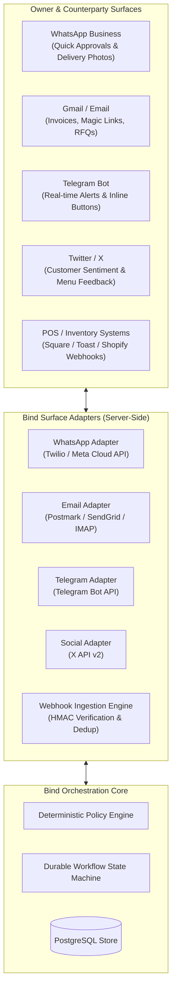
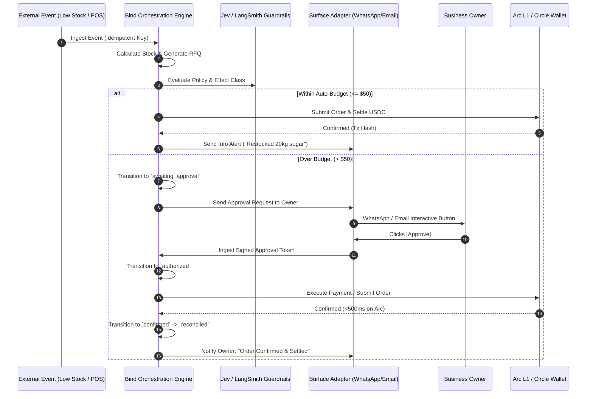

# Bind: Web2 Experience, Surface Adapters, Webhooks & Orchestration

> **Status (2026-10-20, Task 14): design, not the built system.** Implemented here: Bind's signed webhook receiver, the HTTP API,
> the SDK, the MCP server, and a simulated owner-notice emitter (`src/adapters/web2/notifications.ts`) that records each message
> with status `simulated` and delivers nothing. WhatsApp, Gmail, Telegram, X, POS systems, Gemini, LangSmith, Circle compliance
> screening and the Parallel research CLI are not implemented, and no live connection to any of them exists. The TypeSafe Jev
> scorer and the market-benchmark services run only when their keys are set, and no key is set in the repository's test setup.
> Sections 1 to 6 describe the target. Where a line below names a specific header or feature, the implemented behaviour is in
> `docs/RUNBOOK.md` and `docs/EVENTS.md`.

This document specifies how Bind meets businesses where they already operate—delivering a seamless, zero-jargon Web2 experience across Gmail, WhatsApp, Telegram, Twitter/X, POS systems, and webhooks, while orchestrating stateful agents with deterministic safety and Arc/Circle settlement under the hood.

---

## 1. The Surface Adapter Architecture

Business owners and kitchen operators do not sit inside blockchain explorers or raw terminal windows. They operate on their phones, in email inboxes, and over messaging apps. Bind bridges agents into these surfaces through **Surface Adapters**.



---

## 2. Detailed Surface Adapters

### A. WhatsApp Business Adapter (`WhatsAppAdapter`)
* **Primary Role**: The real-time notification and quick-approval channel for busy operators on the floor.
* **Inbound Capabilities**:
  * **Interactive Quick-Replies**: When an order exceeds the autonomous spending limit, the owner receives:
    > ⚠️ **Bind Alert: Ingredient Restock Needed**
    >
    > **Item**: Bread Flour (500 kg)  
    > **Supplier**: Sysco Foods  
    > **Best Quote**: $480.00 USDC (Prior: $465.00)  
    > **Reason**: Low stock detected ($<2$ days remaining)  
    >
    > *[ ✅ Approve ($480) ]* &nbsp;&nbsp;&nbsp; *[ ❌ Reject ]* &nbsp;&nbsp;&nbsp; *[ 💬 More Quotes ]*
  * **Delivery Slip & Receipt Photos**: The kitchen receiver snaps a photo of a paper delivery manifest. The adapter routes the image to Gemini Vision to extract quantities and item condition for the **3-way match**.
  * **Voice Memos**: Kitchen managers can dictate: *"We threw away two crates of avocados due to spoilage, mark as waste."* Transcribed and routed to the Menu/Feedback Agent.
* **Security & Verification**:
  * Phone number allowlist tied to the workspace owner and kitchen managers.
  * Time-limited approval tokens (one-time use, expires in 30 minutes).

---

### B. Gmail & Email Adapter (`EmailAdapter`)
* **Primary Role**: Formal supplier communications, invoice ingestion, and audit reports.
* **Inbound Processing (Document Ingestion)**:
  * Dedicated workspace inbox (`invoices@yourkitchen.bind.app` or forwarded Gmail filter).
  * Automatically parses attached PDF/image invoices, runs Gemini extraction, and triggers the three-way match workflow against the existing purchase order.
* **Outbound RFQs (Procurement Agent)**:
  * Generates professional, itemized Request for Quotations (RFQs) to supplier sales reps via standard email, including required delivery dates and payment terms (Net-15 / USDC on Arc).
* **Actionable Email Approvals**:
  * HTML email with signed, cryptographic **one-click magic approval links** (`/api/v1/approvals/:id?token=...`), allowing an owner to approve a $2,000 order directly from their phone's email app without logging into a console.

---

### C. Telegram Bot Adapter (`TelegramAdapter`)
* **Primary Role**: High-frequency operational monitoring, management alerts, and team chat integration.
* **Features**:
  * **Inline Keyboards**: Approve or reject commercial commitments with instant visual confirmation.
  * **Morning Financial Briefing**: Daily 8:00 AM summary:
    > ☕ **Good morning, Chef.**
    > • Available Treasury: **$12,450.00 USDC** (Arc L1)  
    > • Projected 7-Day Burn: **$3,200.00 USDC**  
    > • Yield Earned (USYC): **+$18.42 USDC** this week  
    > • 2 supplier orders fulfilled yesterday (3-way match verified).  
    > • Today's replenishment: 1 auto-order pending ($45 USDC).

---

### D. Twitter / X Adapter (`SocialAdapter`)
* **Primary Role**: The **Menu & Feedback Agent** listening surface.
* **Features**:
  * Monitors brand mentions, local food hashtags, and customer reviews.
  * Sentiment and complaint detection (e.g., *"Waited 40 mins for brunch, pancakes were cold"*).
  * Surfaces aggregated operational suggestions to the kitchen team: *"3 complaints about pancake wait times during 11 AM-1 PM rush; propose prep-batching batter 30 mins earlier."*

---

## 3. Webhooks & Eventhook Ingestion Engine

Real business systems emit webhooks when external events occur. Bind's Webhook Engine guarantees safe, idempotent, and non-blocking ingestion.

### Key Inbound Webhook Integrations:
1. **POS & E-Commerce Webhooks** (Square, Toast, Clover, Shopify):
   * Events: `order.created`, `order.refunded`, `inventory.count.updated`.
   * Action: Triggers Customer & Fulfilment Agent to log revenue and decrement ingredient inventory levels.
2. **Accounting & Bank Webhooks** (Odoo, ERPNext, Stripe, Circle):
   * Events: `payment.settled`, `invoice.paid`, `bank_transfer.confirmed`.
   * Action: Triggers Treasury reconciliation and updates verified ledger state.
3. **Supplier Order Webhooks** (Supplier APIs):
   * Events: `quote.provided`, `order.dispatched`, `delivery.completed`.
   * Action: Advances workflow state from `request_sent` to `quote_received` or `confirmed`.

### Ingestion Safety Rules:
* **HMAC Signature Verification** (implemented for Bind's own webhooks only): the `x-bind-signature` header (HMAC-SHA256 over `<x-bind-timestamp>.<raw body>`) is checked against the raw bytes before parsing (ADR 0022, `docs/RUNBOOK.md` section 11). The provider headers named here (`X-Square-Signature`, `X-Shopify-Hmac-Sha256`, `Circle-Signature`) are not implemented.
* **Replay Protection** (implemented as a timestamp window only): a timestamp more than 300 seconds old, or 60 seconds in the future, is refused. There is no nonce.
* **Idempotency Deduplication** (implemented for Bind's own event ids): an event id is recorded in PostgreSQL, and a repeat is answered as a duplicate (ADR 0022). The `provider_event_id` scheme above is not implemented.
* **Asynchronous Queueing** (not implemented): there is no internal queue and no latency measurement. The route processes the event before it answers.

---

## 4. The Orchestration Framework

Bind uses an **event-driven, durable state machine** built on PostgreSQL, designed to handle worker crashes, long-running human approval pauses, and retries safely.



---

## 5. Web2 Experience: "Zero Crypto Jargon"

To achieve rapid business adoption, Bind abstracts all blockchain primitives behind clean Web2 terminology:

| Raw Technical Reality | What the Business Owner Sees in Bind |
| :--- | :--- |
| Arc Testnet Chain ID `5042002` | **"Instant Settlement Network"** |
| Native USDC Gas Token | **"Direct Digital Dollar Balance"** |
| Developer-Controlled Wallet SCA | **"Business Operating Treasury"** |
| ERC-8183 Escrow Contract | **"Milestone Protected Payment"** |
| Private Key / EOA Signature | **"Authorized by Owner (via WhatsApp PIN / Magic Link)"** |
| 3-Way Accounting Reconciliation | **"Bill Verified Against PO #1042 & Delivery Receipt"** |

---

## 6. Deep Research & Due Diligence Integration

Not implemented. The only search integration in code is `src/adapters/marketBenchmark.ts` (Parallel or Tavily, used only when their keys are set; otherwise a labelled offline reference, `OFFLINE_DETERMINISTIC_FALLBACK`). The `parallel-cli` commands below are a design sketch, and the compliance check is not implemented.

When the Procurement Agent seeks new suppliers or audits current pricing, it delegates to **Parallel AI** via [`parallel-cli`](file:///home/ubuntu/.local/bin/parallel-cli):
1. **Automated RFQ Discovery**:
   ```bash
   parallel-cli task "Find wholesale organic dairy distributors in Queens NY with HACCP certification and net-15 terms" --processor base
   ```
2. **Commodity Price Benchmarking**:
   ```bash
   parallel-cli task "Current average spot price per pound for Grade A pasteurized whole butter October 2026"
   ```
3. **Compliance Verification**:
   Before a supplier address is whitelisted in Bind, Parallel runs a comprehensive due diligence check, while Circle Compliance checks the onchain address against OFAC/sanctions lists.
